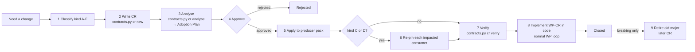

# Change Process — how to change one service

This is the runbook for changing any service after the v6 packs are baselined. Its purpose is to keep each change **as small as the dependency graph allows**. The producer changes. A consumer changes only if it reads a field, code or operation that the change breaks. Nobody else is opened.



## 1. Classify the change

| Kind | What | Examples | Packs touched | Version |
|---|---|---|---|---|
| **A** Internal | No provided artefact changes | New table or index, refactor, BR tweak with the same contract, new staff-only behaviour behind an existing operation, new WP, NFR change | The service only | none (changelog row) |
| **B** Additive | Provided artefact grows, nothing removed or tightened | New optional field (request or response or event), new operation, new eventType, new enum or `reason` value, new template, new code value | The producer only | `contractVersion` MINOR+1 |
| **C** Breaking | Something consumers may rely on changes | Rename or remove a field or operation, type change, optional→required, narrower validation, changed meaning, removed enum value, key or partitioning change | The producer + **only** the consumers listed by `impact` | New `/v2` or `eventVersion` n+1, dual-run; `contractVersion` MAJOR+1 |
| **D** Consumer need | Service X needs something new from producer Y | X needs a new field on Y's event | Y (as kind B, or C if it is breaking) + X (re-pin) | Y as B or C; X's own changelog |
| **E** Kernel | Change to `00-global/GLOBAL-CONVENTIONS.md` or the global schemas | Envelope field, problem body, headers, money object, outbox DDL | `00-global` + every pack re-checked | Kernel version bump |

**Tie-breakers:**
- If in doubt between B and C, treat it as C. `contracts.py cr analyse` will prove the impact is zero if it is.
- A semantic change with the same shape is **C**: for example, `amountPoisha` changes from "gross" to "net".
- A new **required** request field is **C**. A new **optional** request field is **B**.
- A new enum value in a **request** field (consumers send it) is **B** for the provider.
- A new enum value in a **response or event** field is **B**, because consumers are tolerant readers (kernel K1).
- Consumers that switch on a code set must handle unknown values. If a consumer cannot handle unknown values safely, it lists that set in `codesUsed` with explicit values. A new value then shows up in impact analysis as "review", not "break".

## 2. Write the CR

```bash
python3 00-global/tools/contracts.py cr new <service> "<short title>"
# → services/<NN>-<service>/changes/CR-<SVC>-<n>.md  (from 00-global/templates/CR-template.md)
#   and a row in 00-global/CR-LOG.md with state Draft
```

Fill these sections:
- **Kind**
- **Motivation** (SRS ID, incident or request)
- **Change**: the exact artefacts and fields, as before → after
- **Artefacts touched**, in impact syntax:

| Change | Artefact syntax |
|---|---|
| REST operation | `"POST /v1/payments/p2p"` |
| One field | `"POST /v1/payments/p2p#req.metadata"` |
| Event type | `txn.events/TRANSACTION_COMPLETED#amountPoisha` |
| Code set | `codes/walletStatus` |
| Data contract | `data/wallet-status-cache` |

A **kind-D** CR is written in the **producer's** `changes/` folder and names the requesting consumer.

## 3. Analyse → the Adoption Plan

```bash
python3 00-global/tools/contracts.py cr analyse CR-<SVC>-<n>
```

The tool reads "Artefacts touched" and runs `impact` for each one. It then **rewrites the CR's `Adoption Plan` section** with:
- the **producer row**, listing files and sections to edit:
  - `contracts/provided/...`
  - SPEC.md §5 (tables + examples)
  - SPEC.md §3.1 (context diagram edge labels)
  - SPEC.md §7 (BRs), §10 (new `WP-CR-<n>`) and §11 (tests)
  - the `contract.yaml` version bump
  - the changelog row
- one **consumer row per impacted consumer**. For each consumer the plan names:
  - the pin to update
  - the `fieldsUsed`/`codesUsed` entries that matched
  - the SPEC.md §6 subsection, plus any BRs, WPs and tests that mention the matched fields
- a **"not impacted"** list: every other consumer of the artefact, with the reason (e.g. "does not read `amountPoisha`").

The state changes to **Analysed**.

**Expected outcome per kind:**

| Kind | Adoption Plan |
|---|---|
| A, B | One producer row; "Impacted consumers: none". If the tool lists a consumer for a kind-B CR, reclassify the CR as C. |
| C | One producer row + N consumer rows (N = consumers that use the changed fields). |
| D | The producer row (as B or C) + the requesting consumer's row (re-pin and start using the new field). |
| E | Every pack is listed as "re-check". Usually there is no edit per pack beyond `kernel:` in `contract.yaml`. |

## 4. Approve

Approvers sign in the CR's **Approval** table. Nothing is edited before the CR is **Approved**.

| Kind | Approvers |
|---|---|
| A | Producer owner |
| B | Producer owner (architect informed via CR-LOG) |
| C | Producer owner + every impacted consumer owner + architect |
| D | Producer owner + requesting consumer owner |
| E | Architect (all owners informed) |

## 5. Apply the CR to the producer pack

Use one branch (any name) and one Claude Code session scoped to the producer folder (`scripts/agent <service>`), with this prompt:

> Read CLAUDE.md, SPEC.md, contracts/contract.yaml and changes/CR-<SVC>-<n>.md. Apply CR-<SVC>-<n> to this pack exactly as its Adoption Plan (producer row) says:
> 1. edit contracts/provided/* first;
> 2. then SPEC.md §5 tables and examples so they mirror the artefacts;
> 3. update §3 diagrams, §7 rules and §11 tests where the plan lists them;
> 4. add work package WP-CR-<n> to §10 with acceptance tests;
> 5. bump contractVersion in contract.yaml (minor for B, major for C);
> 6. for C, keep the old artefact (v1 path or .v1 schema) next to the new one and describe the dual-run in §5;
> 7. add a changelog row at the end of SPEC.md linking the CR.
> Do not touch any other service folder. Then run `python3 ../../00-global/tools/contracts.py check <service>` and fix every error.

Then tick the producer row in the CR. The state changes to **Producer-Applied**.

## 6. Re-pin each impacted consumer (kinds C and D only)

Use one branch and one session **per consumer listed in the Adoption Plan** (any branch name). Prompt:

> Read CLAUDE.md, SPEC.md, contracts/contract.yaml and ../<producer-folder>/changes/CR-<SVC>-<n>.md (read-only). Re-pin this service to <producer> contract <x.y.z> per the CR's Adoption Plan (row for this service):
> 1. update the pin(s) in contracts/contract.yaml (major / version / pinnedContractVersion) and the fieldsUsed entries;
> 2. run `python3 ../../00-global/tools/contracts.py snapshot <consumer>`;
> 3. update SPEC.md §6 (the consumed-contract subsection), the rules, WPs and tests that use the changed fields;
> 4. add WP-CR-<n> to §10;
> 5. add a changelog row.
> Edit nothing outside this folder. Run `contracts.py check <consumer>`.

Then tick the consumer's row. When every row is ticked, the state changes to **Consumers-Applied**. Services not listed in the Adoption Plan are **not opened**.

## 7. Verify

```bash
python3 00-global/tools/contracts.py check            # all packs — must be green
python3 00-global/tools/contracts.py index            # regenerates DEPENDENCY-INDEX.md
python3 00-global/tools/contracts.py cr verify CR-<SVC>-<n>
```

`cr verify` checks that:
- every pack in the Adoption Plan changed and its version or pin moved as planned;
- **no pack outside the plan changed** (diff-scope check against the baseline hash recorded at `analyse`);
- every new `fieldsUsed` path resolves.

The state changes to **Verified**.

## 8. Implement

Each touched service implements `WP-CR-<n>` through the normal WP loop (TEAM workflow): plan mode, tests first, `./gradlew check`, `make verify`, MR `[<svc>] WP-CR-<n> …`.

**Order:**
1. The producer goes first.
   - For kind B, the producer can ship at any time.
   - For kind C, the producer ships the dual-run (old + new).
2. Then the consumers.
3. The state changes to **Closed** when every touched service has merged its `WP-CR-<n>`.

## 9. Retire (kind C only)

Once `contracts.py index` shows that no consumer pins the old major, open a follow-up kind-A CR, "retire v<n>":
- remove the old artefact
- bump the PATCH version
- add a changelog row

## 10. Worked examples

**B — add `terminalId` to `TRANSACTION_COMPLETED`**
1. `cr new transaction-service "Add terminalId to TRANSACTION_COMPLETED"`, kind B. Artefact: `txn.events/TRANSACTION_COMPLETED#terminalId`.
2. `cr analyse` → the Adoption Plan has only the transaction-service row; "Impacted consumers: none". All 8 consumers are listed as not impacted (tolerant readers).
3. Owner approves → session applies: schema gets the optional `terminalId`; §5 table + example; `contractVersion 1.4.0 → 1.5.0`; WP-CR-7.
4. `cr verify` → only `02-transaction-service` changed. **Done; zero consumer edits.**
5. Later, if compliance wants to use `terminalId`: a kind-A change in compliance (add `terminalId` to `fieldsUsed`, re-pin to 1.5.0, snapshot).

**C — rename `amountPoisha` → `principalPoisha` in `TRANSACTION_COMPLETED`**
1. Kind C. Artefact: `txn.events/TRANSACTION_COMPLETED#amountPoisha`.
2. `cr analyse` → the impacted consumers are only those whose `fieldsUsed` contains `amountPoisha` (or `*`), e.g. limits-risk, pricing, finance-ops, compliance, admin. Consumers that do not read it (e.g. support, which reads only `TRANSACTION_REVERSED`) are listed as not impacted and are never opened.
3. Producer: add `TRANSACTION_COMPLETED.v2.schema.json`, dual-publish v1 + v2, `contractVersion 2.0.0`.
4. Each impacted consumer re-pins to `version: 2` in its own session and branch.
5. When no pin on v1 remains → retire CR.

## 11. Checklists

**Producer (every kind except A):**
- [ ] provided artefact edited first; examples validate
- [ ] SPEC §5 mirrors the artefact
- [ ] version bumped
- [ ] changelog row
- [ ] WP-CR added
- [ ] `check` green

**Consumer (C/D):**
- [ ] pin + `pinnedContractVersion` updated
- [ ] `snapshot` run
- [ ] §6 updated
- [ ] stubs/fixtures regenerated
- [ ] tests updated
- [ ] WP-CR added
- [ ] `check` green

**Reviewer:**
- [ ] `cr verify` green
- [ ] no folder outside the Adoption Plan in the diff
- [ ] kind is correct (a "B" that removed or tightened anything is a C)
