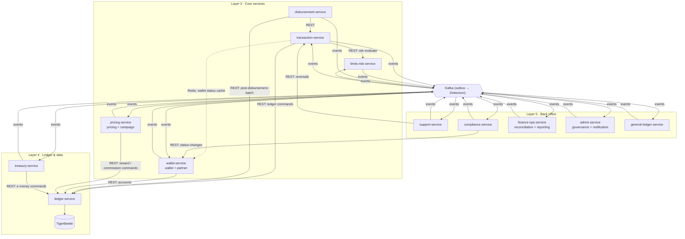

# System Context

Bits Pay core backend: 12 services. Architecture layers: 3 Core, 4 Ledger & data, 5 Back office. Money moves in **one place only**: ledger-service (TigerBeetle). Every other service either asks the ledger, prepares a request for it, or reacts after money has moved.

## 1. Services

| # | Service (`spring.application.name`) | Modules | Layer | Ports (API / mgmt) | Schema / role | Compose profiles | `mem_limit` | Client base-URL key | Owner |
|---|---|---|---|---|---|---|---|---|---|
| 01 | ledger-service | — (roles: api, cdc-bridge) | Ledger & data | 8101 / 9101 | `svc_ledger` | `dev,api,cdc-bridge` | 448 MB | `BITSPAY_CLIENTS_LEDGER_BASEURL` | Dev-1 |
| 02 | transaction-service | — | Core | 8102 / 9102 | `svc_transaction` | `dev` | 448 MB | `…_TRANSACTION_…` | Dev-2 |
| 03 | wallet-service | wallet, partner | Core | 8103 / 9103 | `svc_wallet` | `dev,api,cache-loader` | 448 MB | `…_WALLET_…` (legacy alias `PARTNER`) | Dev-3 / Dev-4 |
| 05 | limits-risk-service | — | Core | 8105 / 9105 | `svc_limits_risk` | `dev,api,worker` | 384 MB | `…_LIMITSRISK_…` | Dev-5 |
| 06 | pricing-service | pricing, campaign | Core | 8106 / 9106 | `svc_pricing` | `dev,api,worker` | 384 MB | `…_PRICING_…` | Dev-6 / Dev-4 |
| 07 | treasury-service | — | Ledger & data | 8107 / 9107 | `svc_treasury` | `dev` | 384 MB | `…_TREASURY_…` | Dev-1 |
| 08 | disbursement-service | — | Core | 8108 / 9108 | `svc_disbursement` | `dev` | 384 MB | — (not called by other services) | Dev-2 |
| 09 | support-service | — | Back office | 8109 / 9109 | `svc_support` | `dev` | 384 MB | — (not called by other services) | Dev-3 |
| 11 | compliance-service | — | Back office | 8111 / 9111 | `svc_compliance` | `dev` | 384 MB | — (not called by other services) | Dev-5 |
| 12 | finance-ops-service | reconciliation, reporting | Back office | 8112 / 9112 | `svc_finance_ops` (+ ClickHouse `rpt`) | `dev,api,ingest,jobs` | 448 MB | `…_FINANCEOPS_…` (legacy `REPORTING`) | Dev-6 / Dev-7 |
| 15 | admin-service | governance, notification | Back office | 8115 / 9115 | `svc_admin` | `dev` | 384 MB | `…_ADMIN_…` (legacy `NOTIFICATION`) | Dev-8 |
| 16 | general-ledger-service | — | Back office | 8116 / 9116 | `svc_general_ledger` | `dev,api,ingest,jobs` | 384 MB | `…_GENERALLEDGER_…` | (assign) |

Numbers 04, 10, 13 and 14 are retired: they were merged into 03, 06, 12 and 15. Edge proxy (dev/local only): `http://localhost:8000/<svc-short>/swagger-ui.html`.

**Shared infrastructure** (Docker Compose):

| Component | Version | Notes |
|---|---|---|
| PostgreSQL | 18.6 | one database `bitspay`, one schema per service |
| Redis `redis-critical` | 8.10 | idempotency, counters |
| Redis `redis-cache` | 8.10 | wallet status, display |
| Kafka | 4.3.1 | KRaft, single node |
| Debezium Connect | 3.7 | connector `outbox-all` |
| TigerBeetle | 0.17.9 | with `tb-cdc` → RabbitMQ → ledger-cdc-bridge |
| ClickHouse | 26.8 | — |
| S3-compatible object store | — | — |
| nginx edge proxy | — | — |

## 2. Layered view (hand-maintained)

This diagram is a simplified overview. The exact, generated graph is below; each pack's SPEC §3.1 shows that service's exact edges.

## 3. How to read a pack

| Need | Read |
|---|---|
| What a service does and how to build it | `services/<NN>-<svc>/SPEC.md` |
| What it serves or emits (binding) | `services/<NN>-<svc>/contracts/provided/` |
| What it needs from others (pinned) | `contracts/contract.yaml → consumes` + `contracts/consumed/` |
| Rules every service shares | `00-global/GLOBAL-CONVENTIONS.md` |
| How to change something | `00-global/CHANGE-PROCESS.md` |

<!-- GENERATED BELOW -->
## Generated dependency graph (from contract.yaml pins)

```mermaid
flowchart LR
  ledger_service["ledger-service<br/>v1.0.0"]
  transaction_service["transaction-service<br/>v1.0.0"]
  wallet_service["wallet-service<br/>v1.0.0"]
  limits_risk_service["limits-risk-service<br/>v1.0.0"]
  pricing_service["pricing-service<br/>v1.0.0"]
  treasury_service["treasury-service<br/>v1.0.0"]
  disbursement_service["disbursement-service<br/>v1.0.0"]
  support_service["support-service<br/>v1.0.0"]
  compliance_service["compliance-service<br/>v1.0.0"]
  finance_ops_service["finance-ops-service<br/>v1.0.0"]
  admin_service["admin-service<br/>v1.0.0"]
  general_ledger_service["general-ledger-service<br/>v1.0.0"]
  admin_service -- "7 topics" --> admin_service
  admin_service -- "case.events" --> compliance_service
  admin_service -- "disbursement.events" --> disbursement_service
  admin_service -- "recon.events" --> finance_ops_service
  admin_service -- "gl.events" --> general_ledger_service
  admin_service -- "campaign.events, commission.events" --> pricing_service
  admin_service -- "support.events" --> support_service
  admin_service -- "txn.events" --> transaction_service
  admin_service -- "treasury.events" --> treasury_service
  admin_service -- "REST + 3 topics" --> wallet_service
  compliance_service -- "REST + 4 topics" --> admin_service
  compliance_service -- "REST" --> ledger_service
  compliance_service -- "REST + blacklist.events, risk.alerts" --> limits_risk_service
  compliance_service -- "txn.events" --> transaction_service
  compliance_service -- "REST + 3 topics" --> wallet_service
  disbursement_service -- "4 topics" --> admin_service
  disbursement_service -- "REST" --> ledger_service
  disbursement_service -- "REST" --> limits_risk_service
  disbursement_service -- "REST" --> transaction_service
  disbursement_service -- "REST" --> wallet_service
  finance_ops_service -- "REST + 6 topics" --> admin_service
  finance_ops_service -- "case.events" --> compliance_service
  finance_ops_service -- "disbursement.events" --> disbursement_service
  finance_ops_service -- "REST + gl.events" --> general_ledger_service
  finance_ops_service -- "REST + ledger.changes" --> ledger_service
  finance_ops_service -- "risk.alerts" --> limits_risk_service
  finance_ops_service -- "3 topics" --> pricing_service
  finance_ops_service -- "support.events" --> support_service
  finance_ops_service -- "REST + txn.events" --> transaction_service
  finance_ops_service -- "treasury.events" --> treasury_service
  finance_ops_service -- "REST + 3 topics" --> wallet_service
  general_ledger_service -- "4 topics" --> admin_service
  general_ledger_service -- "recon.events" --> finance_ops_service
  general_ledger_service -- "REST + ledger.changes" --> ledger_service
  general_ledger_service -- "treasury.events" --> treasury_service
  general_ledger_service -- "wallet.events" --> wallet_service
  ledger_service -- "audit.events (writes)" --> admin_service
  limits_risk_service -- "approval.events (writes), audit.events (writes)" --> admin_service
  limits_risk_service -- "disbursement.events" --> disbursement_service
  limits_risk_service -- "txn.events" --> transaction_service
  limits_risk_service -- "3 topics" --> wallet_service
  pricing_service -- "REST + 4 topics" --> admin_service
  pricing_service -- "REST" --> ledger_service
  pricing_service -- "REST" --> limits_risk_service
  pricing_service -- "txn.events" --> transaction_service
  pricing_service -- "REST + 3 topics" --> wallet_service
  support_service -- "REST + 5 topics" --> admin_service
  support_service -- "case.events" --> compliance_service
  support_service -- "REST" --> finance_ops_service
  support_service -- "REST" --> ledger_service
  support_service -- "REST" --> limits_risk_service
  support_service -- "REST + txn.events" --> transaction_service
  support_service -- "REST + wallet.events" --> wallet_service
  transaction_service -- "3 topics" --> admin_service
  transaction_service -- "REST" --> ledger_service
  transaction_service -- "REST" --> limits_risk_service
  transaction_service -- "REST + 3 topics" --> pricing_service
  transaction_service -- "REST + data:wallet-status-cache, partner.events" --> wallet_service
  treasury_service -- "REST + 4 topics" --> admin_service
  treasury_service -- "REST + ledger.changes" --> ledger_service
  treasury_service -- "REST" --> transaction_service
  treasury_service -- "REST + partner.events" --> wallet_service
  wallet_service -- "REST + 4 topics" --> admin_service
  wallet_service -- "case.events" --> compliance_service
  wallet_service -- "REST" --> ledger_service
  wallet_service -- "REST + blacklist.events" --> limits_risk_service
  wallet_service -- "support.events" --> support_service
  wallet_service -- "txn.events" --> transaction_service
  wallet_service -- "wallet.events" --> wallet_service
```

*Arrow = consumer → producer ("depends on"). `(writes)` = writer of an admin-owned inbound topic.*
