# SVC-15 — admin-service — Service Specification (v6)

| Field | Value |
|---|---|
| Service | `admin-service` (`spring.application.name`) |
| Number / owner | SVC-15 · Dev-8 (modules: `governance` → Dev-8, lead; `notification` → Dev-8) |
| Layer / release | Back office (layer 5, asynchronous consumers) · **MVP** (governance: refdata, params, product switches, approvals, audit; notification: rules, templates, inbox, LOG channels) · R1 (staff RBAC administration, access review, activity monitoring, reminders) (+ R2: retention execution inputs, notification fallback, quiet hours, frequency caps) |
| contractVersion | 1.1.0 (see `contracts/contract.yaml`; CR-ADMIN-1) |
| Kernel | 1.0 (`../../../docs/global/GLOBAL-CONVENTIONS.md`) |
| Ports | HTTP 8115 · management 9115 |
| Schema / role | `svc_admin` (login role `svc_admin`) |
| Owns inbound topics (kernel K4.4) | `notification.requests` (notification) · `approval.events` (governance) · `audit.events` (governance) |
| Produces | `refdata.events` (governance) |
| Depends on (pins) | transaction-service@1 (`txn.events`) · wallet-service@1 (`wallet.events`, `customer.events`, `partner.events`, `GET /v1/wallets/{walletId}`) · pricing-service@1 (`commission.events`, `campaign.events`) · disbursement-service@1 (`disbursement.events`) · treasury-service@1 (`treasury.events`) · support-service@1 (`support.events`) · compliance-service@1 (`case.events`) · finance-ops-service@1 (`recon.events`) · general-ledger-service@1 (`gl.events`) — all `pinnedContractVersion 1.0.0` |
| Open decisions | OPEN D-01, D-03, D-05, D-06, D-11, D-12, D-13, D-21, D-30, D-32, D-37, D-40, D-49 (§13) |

## 1. Mission and boundaries

### 1.1 Mission

admin-service holds the **shared back-office utilities every other Bits Pay service relies on**. It has two modules in one Spring Boot application:

- **governance** is the back office's "rule book and black box". It keeps the model of **who the staff are and what they may do** (users, roles, permissions, data scopes, segregation of duties), the **one place where every pending approval in Bits Pay can be seen** (an inbox projected from `approval.events`), the **tamper-evident audit store** (every `audit.events` record and every `txn.events` payment outcome, hash-chained and verifiable), the **master reference data** (geography, MCC, purpose and reason codes, banks, holidays, system parameters, cut-offs, product switches) published on the compacted `refdata.events` topic, the **retention policy registry** with legal holds, and **back-office activity monitoring** over the audit stream.
- **notification** turns business facts into messages people read: event-driven rules, a contact projection, BN/EN templates with versioning and maker-checker, the in-app inbox (the only channel fully built), the `ChannelProvider` SPI with a `LogChannelProvider` that simulates sending and delivery receipts, delivery tracking with retry and failover, the reminder engine, quiet hours and frequency caps (R2), and the delivery-log API used by support.

Neither module moves money. admin-service **owns the schemas of the three inbound topics** that many services write into it (`notification.requests`, `approval.events`, `audit.events`), and it writes them itself too.

**Worked example.** Rahim (customer, 01900000001) sends Karim (01900000002) 500 Tk. transaction-service emits `TRANSACTION_COMPLETED` on `txn.events`.
1. The **governance** `txn` consumer canonicalises the redacted envelope and appends it to today's hash chain `t17-20261009` (partition 17 of `txn.events`), so months later an auditor can prove nobody edited the payment record.
2. The **notification** `txn` consumer matches rules `R-P2P-SENT` and `R-P2P-RECEIVED`. Rahim gets "You have sent Tk 500.00 to 01900****02. Fee Tk 5.75 (incl. VAT)…" and Karim gets "আপনি 01900****01 থেকে ৳৫০০.০০ পেয়েছেন…" in his in-app inbox and by SMS, in the language stored for his wallet. If Kafka delivers the event twice, Karim still gets **one** SMS (deterministic ids).
3. Later, Ops maker Nadia asks wallet-service to block agent Salma Store's wallet. wallet-service writes `APPROVAL_REQUESTED` and `AUDIT_RECORDED`. governance shows the request in the inbox of every `OPS_CHECKER`, ageing it until checker Tanvir approves it in wallet-service; both audit records are chained. When Bangladesh Bank approves cash-out on USSD, an admin flips `FEATURE.CASH_OUT` (two-level maker-checker) and every product owner learns it from `refdata.events`. When merchant Nirob Store receives a payment, the `R-MERCHANT-MER` rule sends Nirob an in-app message and an SMS.

### 1.2 In scope

**governance**
- Staff identity model (no authentication): staff users, roles, permissions (function × action), data scopes (geography, partner), SoD rules, maker-checker on every change, effective-permission API, access-review report, dormant-user auto-disable job, approval-route table.
- Approval inbox: projection of `approval.events` from every service, ageing buckets, overdue detection, routing to checker roles, deep links, expiry reminders. **No decision logic.**
- Audit store: consume `audit.events` and `txn.events`, redact denied keys, canonicalise, hash-chain per Kafka partition per Dhaka day, seal segments, daily anchors, verification jobs and API, offline verifier CLI, search and export for auditors (access audited), `AuditForwarder` SPI with a log implementation.
- Reference data: typed items with versions and effective dating, bulk CSV import with diff, maker-checker, publication on `refdata.events`, republish, data dictionary.
- System parameters, business calendar (weekend + holidays), cut-off times, EOD schedule, product switches (SRS C-01 / ADM-005), retention policy registry and category- and entity-level legal holds.
- Seed import of producer-declared reason codes and product codes from the generated contract index.
- Back-office activity monitoring rules → alerts → `notification.requests` to `AUDITOR`/`ADMIN` staff.

**notification**
- Consumers for `txn.events`, `wallet.events`, `customer.events`, `partner.events`, `commission.events`, `disbursement.events`, `campaign.events`, `notification.requests`, `refdata.events`; subscriptions without R1 rules on `treasury.events`, `support.events`, `case.events`, `recon.events`, `gl.events`.
- Rule engine (config with maker-checker), recipient resolution from a local contact projection, preferences and opt-out, mandatory versus optional categories.
- Templates BN/EN per channel (SMS, IN_APP, PUSH, EMAIL, IVR), Mustache-like variables with formatters, versioning, maker-checker, SMS GSM-7/UCS-2 segment calculation; seed import of every producer-declared template from the generated contract index.
- In-app inbox for wallet holders and staff (list, unread count, read, read-all, archive) incl. role inboxes.
- `ChannelProvider` SPI; `LogChannelProvider` (log + optional table, simulated DLR); provider routing, sender IDs, failover, rate limits.
- Delivery state machine, retries with backoff, DLR ingestion model, fallback chains (R2), quiet hours and frequency caps (R2).
- Reminder engine (advance, due, overdue) driven by `notification.requests` `reminder{}` or `POST /v1/reminders`.
- Notification log API (support console, SRS NOT-008), delivery summary report (RPT-005, OPEN D-37), partition retention report.

**MVP vs R1+ (SRS v1.2, CR-ADMIN-1).** The MVP release needs admin governance (reference data, params and calendar, product switches, maker-checker approvals and inbox, audit chain) and notifications for the six MVP features (P2P, merchant payment and refund, cash-in / cash-out, bill payment, mobile recharge) plus float, reversal, wallet and KYC messages. The MVP product switches are `FEATURE.P2P`, `CASH_IN`, `CASH_OUT`, `MERCHANT_PAYMENT`, `MERCHANT_REFUND`, `FLOAT_TRANSFER`, `REVERSAL`, `BILL_PAY`, `RECHARGE` enabled; every other product disabled (§5.4.2). New payer receipts `BILL_PAYMENT_SUCCESS` / `BILL_PAYMENT_FAILED` and `RECHARGE_SUCCESS` / `RECHARGE_FAILED` (BR-NOT-16). R1+: staff RBAC administration beyond seeds, access review and dormancy, activity monitoring, reminders (the `BILL_DUE` policy stays disabled), disbursement / campaign / commission-settlement rules (their products are disabled), and everything already marked R2. §10 tags each WP.

### 1.3 Out of scope / deferred

| Deferred item | Replacement now |
|---|---|
| Authentication, SSO, MFA, sessions, IdP sync | `GET /v1/staff/{id}/effective-permissions` is the future sync contract; actor context comes from `X-Actor-*` headers (kernel K3.1) |
| SIEM forwarding (AUD-005, SEC-015) | `AuditForwarder` SPI with `LogAuditForwarder` only |
| PAM/DAM capture (AUD-006) | Any future feed arrives as `audit.events` with `actorType = STAFF`, `channel = SYSTEM`; ingest-ready |
| Network/IP restriction of the back office (BOM-011) | Infrastructure, later |
| Archival / purge execution, deletion certificates (ARC-003/004/005) | The platform archiver (R2) reads this service's retention registry and legal holds and runs its own maker-checker |
| CMS content (ADM-006) | Not built |
| Back-office UI (BOM-001) | APIs only; role-based "menu" = effective-permission API |
| External reference-data feeds (DAT-005) | CSV import with delta and conflict report |
| Real SMS / push / email / IVR providers, chatbot | `ChannelProvider` SPI; `LogChannelProvider` is the sole implementation; DLR endpoint `/v1/internal/providers/{providerCode}/dlr` is the future webhook |
| Push tokens / e-mail addresses | Contact columns exist and stay null; PUSH/EMAIL deliveries become `SUPPRESSED(NO_ADDRESS)` |
| Security notifications (new device, PIN change, failed login) | Templates seeded, rules disabled until the edge/auth layer exists |
| Bill-due reminders | Policy `BILL_DUE` seeded disabled (R1+; MVP bill payment has no due-date feed) |
| Marketing campaign orchestration | Owned by pricing-service (campaign); admin-service only delivers `notification.requests` |
| Rule-driven notifications from `treasury.events`, `support.events`, `case.events`, `recon.events`, `gl.events` | Subscribed, no R1 rules; those producers send `notification.requests` themselves |
| Delivery-status event feed | Not published; `GET /v1/notifications/logs` and the delivery summary report serve it |
| Balance in receipts | Not available on `txn.events`; receipts carry no balance |

### 1.4 This service must NEVER

1. Decide, approve or reject another service's approval (the inbox only displays them).
2. Update or delete an audit record, a seal or an anchor (DB trigger and role grants enforce it; only the platform archival role may detach whole verified partitions, R2).
3. Read another service's schema, call TigerBeetle or move money.
4. Emit a Kafka tombstone on `refdata.events` (deactivate with `active = false`).
5. Use its own staff tables for runtime authorisation in this phase: authorisation uses `X-Actor-Roles` (kernel K7).
6. Send more than one message per (source event, recipient, template, channel) — deterministic ids enforce it.
7. Block or slow the payment path (it only consumes events).
8. Call any service other than wallet-service `GET /v1/wallets/{walletId}` (contact fallback).
9. Log full MSISDNs, message bodies, template variables or audit `c14n` text (except the dedicated `AUDIT_FORWARD` logger).
10. Send optional-category messages to an opted-out recipient, or let anyone opt out of a mandatory category.
11. Produce any customer communication for `statusReasonCode ∈ {AML_FREEZE, REGULATORY_INSTRUCTION, COURT_ORDER}` or from `case.events` (tipping-off).
12. Overwrite a wallet contact's MSISDN or name from `partner.events`.

### 1.5 Modules

| Module | Responsibility | Package root | Owner | Tables | Inbox table | Redis prefix |
|---|---|---|---|---|---|---|
| `governance` (lead) | Staff RBAC, approval inbox, audit chain, refdata/params/calendar/products, retention, monitoring, reason/product seed import | `com.bracits.bitspay.admin.governance` | Dev-8 | unprefixed (`staff_user`, `audit_record`, …) | `processed_event` | `gov:` |
| `notification` | Rules, contacts, templates, inbox, channels, deliveries, reminders, logs, template seed import | `com.bracits.bitspay.admin.notification` | Dev-8 | prefix `notif_` | `notif_processed_event` | `n:` |
| `common` (shared, private to the service) | `ActorContext`, problem model, outbox writer, idempotency store, **maker-checker engine** (one `approval_request` table, one `/v1/approvals` controller, handlers registered per entity type), job leader election, Redis client, `HmacHasher` | `com.bracits.bitspay.admin.common` | Dev-8 | `approval_request`, `idempotency_record`, `system_flag`, `shedlock` | — | — |

Application class `com.bracits.bitspay.admin.AdminServiceApplication`. Each module uses the traditional layered packages (`controller`, `dto`, `service`, `repository`, `entity`, `mapper`, `exception`, `client`, `messaging`, `config`; kernel K9 "Layout"). Modules talk only through their `<module>.service.<Module>Facade` interface and `<module>.dto` records (enforced by `ArchitectureTest`):
- `GovernanceFacade.contactOf(staffUserId)` → `{msisdn, email, language}` (cached 5 min, evicted on staff change) — used by notification to resolve `recipient.staffUserId`.
- `GovernanceFacade.bootstrapRefData(type)` — used by notification at start-up before its `refdata.events` consumer catches up.
- `NotificationFacade.declareTemplates(templates)` — used by governance's seed-import job to hand indexed template declarations to notification (the template import itself runs in the notification module).

Governance alerts to staff still go through `notification.requests` (written to the shared outbox), so dedupe, logs and retries follow the same path as every other sender. No cross-module DB transactions; each module keeps its own consumer groups and Redis prefix.

## 2. SRS traceability

Baseline: **SRS v1.2 (14 Oct 2026)**. "· MVP" in the last column marks rows the MVP release delivers; every other row is R1+.

| SRS ID | Requirement (short) | Covered by |
|---|---|---|
| ADM-001 | User management, roles, data scope, maker-checker | `/v1/staff/users*`, `/v1/staff/users/{id}/roles`, `/scopes`; BR-GOV-01..06; WP-5 |
| ADM-002 | Fine-grained RBAC, SoD toxic combinations | permission = function:action; `sod_rule`; BR-GOV-07..10; WP-5 |
| ADM-003 | Access review, dormant auto-disable | `GET /v1/staff/access-review`; `DormantStaffJob` BR-GOV-11; WP-6 |
| ADM-004 | Rules-engine administration without code | Permissions `LIMIT_RULE:*`, `FEE_PLAN:*`, `RISK_RULE:*` + inbox (rules owned by their services); WP-5 |
| ADM-005 | Product config, service enable/disable per licence | `product_switch` → `SYSTEM_PARAM FEATURE.<PRODUCT>`; BR-GOV-32; WP-4 · MVP |
| ADM-006 | CMS content (R2, S) | Deferred |
| ADM-007 | Geography master with versioning | refdata `GEO` + `refdata_item_version`; BR-GOV-30; WP-3 · MVP |
| AUD-001 | Tamper-evident trail of user/config/financial/admin actions | `audit.events` + `txn.events` chained (OPEN D-05); §7.3; WP-7 · MVP |
| AUD-002 | Audit record fields | `AUDIT_RECORDED` schema (§5.2.3) stored verbatim after redaction + `recordedAt` UTC and Dhaka local · MVP |
| AUD-003 | Immutable, tamper-detectable | Hash chain, seals, anchors, trigger, verification job/API, offline CLI; §7.3; WP-7, WP-8 · MVP |
| AUD-004 | Searchable/exportable by auditors; access audited | `GET /v1/audit/records`, `POST /v1/audit/exports`; BR-GOV-12; WP-8 · MVP |
| AUD-005 | Retention per ARC; SIEM forwarding | Retention registry; `AuditForwarder` SPI (partial) |
| AUD-006 | PAM/DAM capture | Ingest-ready; deferred |
| BOM-001 | Role-based menus | Effective-permission API (partial) |
| BOM-004 | Maker-checker on sensitive activities | Shared engine (kernel K5); inbox; WP-2, WP-9 · MVP |
| BOM-005 | Maker ≠ checker, multi-level, pending-queue ageing/expiry | BR-GOV-02..05, BR-GOV-23; WP-2, WP-9 · MVP |
| BOM-008 | Back-office user activity monitoring + alerts | `monitoring_rule` engine BR-GOV-40..46; WP-10 |
| BOM-009 | Bulk operations with approval (R2, S) | Bulk refdata import and role assignment with one approval; bulk notifications from `notification.requests` (partial) |
| BOM-010 | Params, calendar, holidays, cut-offs, EOD schedule with maker-checker | `/v1/params`, `/v1/calendar/*`, HOLIDAY refdata; WP-4 · MVP |
| BOM-011 | Network/VPN/MFA | Deferred (infrastructure) |
| ARC-001 | Configurable retention per category | `retention_policy` → `RETENTION.<CATEGORY>`; notification partitions; WP-4, WP-20 |
| ARC-002 | Lifecycle states + legal hold | `legal_hold`, `GET /v1/retention/legal-holds`; BR-GOV-36; WP-4 |
| ARC-005 | Deletion with approval and certificates | Inputs only (policy + holds); executed by the archiver (R2) |
| ARC-006 | Lifecycle events auditable | Archiver emits `audit.events`; governance chains them |
| DAT-002 | Bangla names | `nameBn` validation; WP-3 · MVP |
| DAT-003 | Data dictionary | `GET /v1/refdata/dictionary` (partial) |
| DAT-004 | Central reference data with versioning | Refdata (BR-GOV-30..33) · MVP |
| DAT-005 | Reference sync with delta and conflicts | CSV import → diff → approval (partial) |
| SEC-005 | RBAC least privilege + SoD | as ADM-002 |
| C-01 | Unapproved services disabled | `FEATURE.*` seeds disabled for products outside the MVP (§5.4.2); BR-GOV-32, BR-GOV-47 · MVP |
| NOT-001 | Multi-channel (SMS, in-app, push, email, IVR, chatbot) | IN_APP built; others via SPI + `LogChannelProvider`; chatbot deferred; WP-15, WP-16 · MVP |
| NOT-002 | Event-triggered notifications | Seed rules §7.12; `notification.requests`; WP-14, WP-17 · MVP |
| NOT-003 | BN/EN templates, variables, versioning, maker-checker, SMS length/Unicode | Templates, renderer, `SmsSegmentCalculator`; BR-NOT-10..15; WP-11 · MVP |
| NOT-004 | Role-based controls; mandatory vs optional | `x-actors` roles; template category; preference guard; WP-11, WP-13 · MVP |
| NOT-005 | Reminder engine | `notif_reminder_*`, `ReminderScheduler`; BR-NOT-25/26, BR-NOT-50..51 (OPEN D-11); WP-18 |
| NOT-006 | Channel fallback and priority (R2, S) | `notif_channel_policy` BR-NOT-36; WP-19 |
| NOT-007 | Delivery status, DLR, retry | Delivery state machine BR-NOT-30..35; WP-16 · MVP |
| NOT-008 | Logs retained, viewable in support console | `GET /v1/notifications/logs`, `GET /v1/notifications/{notificationId}`; WP-20 · MVP |
| NOT-009 | Quiet hours and frequency capping (R2, S) | BR-NOT-40/41; WP-19 |
| NOT-010 | Sender ID/masking, provider routing, multi-provider failover | `notif_provider`, `notif_provider_route`, `ProviderRouter`; WP-16 · MVP |
| RPT-005 | Notification-delivery report | `GET /v1/notifications/reports/delivery-summary` (OPEN D-37); WP-20 |
| PAY-012 / MER-004 | SMS to agents and merchants for every payment | `R-CASHIN-AGENT`, `R-CASHOUT-AGENT`, `R-MERCHANT-MER` on IN_APP + SMS (OPEN D-40) · MVP |
| REF-05 | No tipping-off | Wallet rule conditions; no `case.events` rules (OPEN D-06) · MVP |
| SRS §8.1 | Notification entity (template, channel, recipient, content hash, status, DLR) | `notif_notification`, `notif_delivery` · MVP |
| BIL-011 | Internal biller catalogue, simulated bill settlement (MVP) | `FEATURE.BILL_PAY` enabled (BR-GOV-47); `BILL_PAYMENT_SUCCESS` / `BILL_PAYMENT_FAILED` receipts, rules R-BILLPAY-* (BR-NOT-16); WP-CR-1 · MVP |
| BIL-012 | Mobile recharge via the operator catalogue (MVP) | `FEATURE.RECHARGE` enabled (BR-GOV-47); `RECHARGE_SUCCESS` / `RECHARGE_FAILED` receipts, rules R-RECHARGE-* (BR-NOT-16); WP-CR-1 · MVP |
| UC-16 / UC-17 | Bill payment / mobile recharge use cases | Payer receipts as BIL-011 / BIL-012 · MVP |
| PER-001/002 | Scale horizontally | Partition-parallel consumers, batch inserts, day/month partitions |
| PER-008 | Audit search ≤ 3 s | Indexes + 31-day bound; WP-8 |

## 3. Architecture

### 3.1 Context diagram

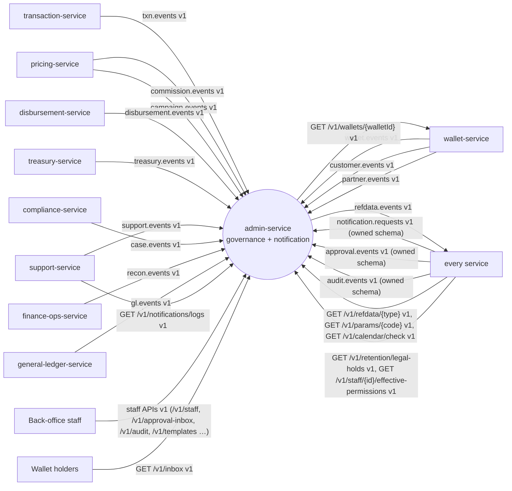

### 3.2 Component diagram

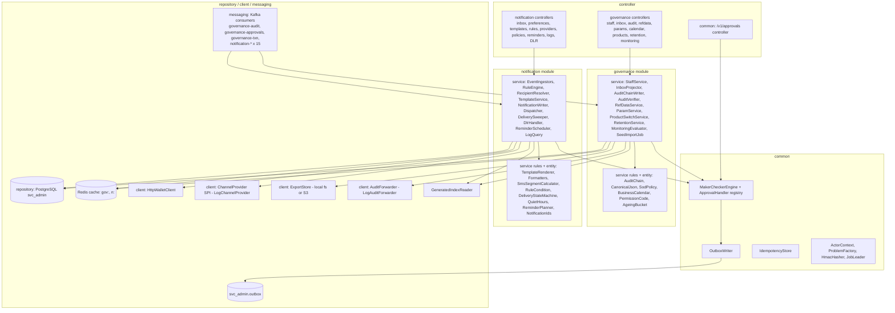

### 3.3 Runtime and deployment (Compose)

| Item | Value |
|---|---|
| Compose service | `admin-service`, ports 8115 / 9115, `mem_limit` 384 MB, profiles `dev` (all roles in one container) |
| Infra `depends_on` (healthy) | postgres, kafka-init, redis-cache. Readiness covers only own infra; never waits for another service |
| Schema | `svc_admin`; Flyway locations `db/migration/common`, `db/migration/governance`, `db/migration/notification`; history tables `flyway_history_common`, `flyway_history_governance`, `flyway_history_notification`; run order common → governance → notification |
| Outbox | one `svc_admin.outbox`, written by both modules (kernel K8.2) |
| Redis | cache cluster (`BITSPAY_REDIS_CACHE_URL`): governance monitoring counters `gov:`; notification unread counts, caps, provider rate limits `n:`. Loss is tolerated (DB is authoritative) |
| TigerBeetle / ClickHouse | not used |
| Object store | `ExportStore` for audit exports and anchor files: `bitspay.governance.export-store=local` (default) or `s3` (MinIO; `BITSPAY_S3_*`) |
| Extra env vars | `BITSPAY_CLIENTS_WALLET_BASEURL` (`http://wallet-service:8103`), `BITSPAY_S3_ENDPOINT/ACCESSKEY/SECRETKEY/REGION` (only with `s3`), `BITSPAY_GOVERNANCE_ROLES`, `BITSPAY_NOTIFICATION_ROLES` |
| Production deployables | `admin-api` (governance roles `api`, notification roles `api`; 2+ replicas) · `governance-worker` (`audit-ingest,txn-ingest,inbox-ingest,jobs`; ≤ partitions) · `notification-worker` (`ingest,dispatch,jobs`; ≤ partitions). Same image; a burst in one worker never consumes the other's capacity |

**Consumer groups** (ids per kernel K4.3):

| Group id | Module | Topic | eventTypes acted on |
|---|---|---|---|
| `admin-service.governance-audit` | governance | `audit.events` | `AUDIT_RECORDED` |
| `admin-service.governance-approvals` | governance | `approval.events` | all three |
| `admin-service.governance-txn` | governance | `txn.events` | all four (audit chain; OPEN D-05) |
| `admin-service.notification-txn` | notification | `txn.events` | `TRANSACTION_COMPLETED`, `TRANSACTION_FAILED` (REVERSED/REFUNDED subscribed, no rule) |
| `admin-service.notification-wallet` | notification | `wallet.events` | `WALLET_UPSERTED` |
| `admin-service.notification-customer` | notification | `customer.events` | `KYC_SUBMITTED`, `KYC_APPROVED`, `KYC_REJECTED`, `KYC_TIER_CHANGED`, `CUSTOMER_REGISTERED`, `CUSTOMER_PROFILE_UPDATED` (`RISK_GRADE_CHANGED` ignored) |
| `admin-service.notification-partner` | notification | `partner.events` | `PARTNER_UPSERTED` |
| `admin-service.notification-commission` | notification | `commission.events` | `COMMISSION_SETTLED` (`COMMISSION_ACCRUED` ignored) |
| `admin-service.notification-disbursement` | notification | `disbursement.events` | `BATCH_ROW_PAID` (others subscribed, no rule) |
| `admin-service.notification-campaign` | notification | `campaign.events` | `REWARD_GRANTED`, `REWARD_CLAWED_BACK` |
| `admin-service.notification-requests` | notification | `notification.requests` | both |
| `admin-service.notification-refdata` | notification | `refdata.events` | `REASON_CODE`, `SYSTEM_PARAM SUPPORT.HELPLINE` |
| `admin-service.notification-treasury`, `-support`, `-case`, `-recon`, `-gl` | notification | `treasury.events`, `support.events`, `case.events`, `recon.events`, `gl.events` | none in R1 (ignored, counted `FILTERED`) |

All group ids follow the `admin-service.<module>-<purpose>` pattern (OPEN D-30).

**Scheduled jobs** (leader per job via Postgres advisory lock; all times Asia/Dhaka):

| Job | Module | Schedule | Effect |
|---|---|---|---|
| `SeedImportJob` | governance (+ notification for templates) | start-up, then on `POST /v1/internal/seed-imports` | §7.9 |
| `ApprovalExpiryJob` | common | every 5 min | own approvals PENDING past `expires_at` → EXPIRED + `APPROVAL_EXPIRED` |
| `ChainSealJob` | governance | 00:10 daily | seal yesterday's segments, anchor, anchor file |
| `AuditVerifyJob` | governance | 01:00 daily (FULL D-1); Friday 03:00 (FULL last 35 days) | verification |
| `TailVerifyJob` | governance | every 5 min | last 1,000 records of each open chain |
| `PartitionMaintenanceJob` | both | hourly | audit daily partitions 7 days ahead; notification monthly partitions 3 months ahead; archivable report |
| `DormantStaffJob` | governance | 02:00 daily | BR-GOV-11 |
| `SodViolationScanJob` | governance | 02:30 daily | BR-GOV-08 (d) |
| `InboxReminderJob` | governance | every 15 min | BR-GOV-24 |
| `EffectiveDatedPublishJob` | governance | every minute | BR-GOV-30 |
| `ExportJobRunner` | governance | continuous (queue) | audit exports |
| `DeliverySweeper` | notification | every 1 s | claims due deliveries; TTL; lease recovery |
| `DlrTimeoutJob` | notification | hourly | `SENT` older than `dlr-timeout` → `SENT_NO_DLR` |
| `ReminderScheduler` | notification | every 60 s | fires due occurrences |
| `OutboxCleanupJob` / `InboxCleanupJob` | common | daily 03:30 | outbox > 3 days, `processed_event` / `notif_processed_event` > 14 days (kernel K8.2) |

### 3.4 Key flows

**F1 — Audit ingest and chaining (`audit.events` and `txn.events`)**

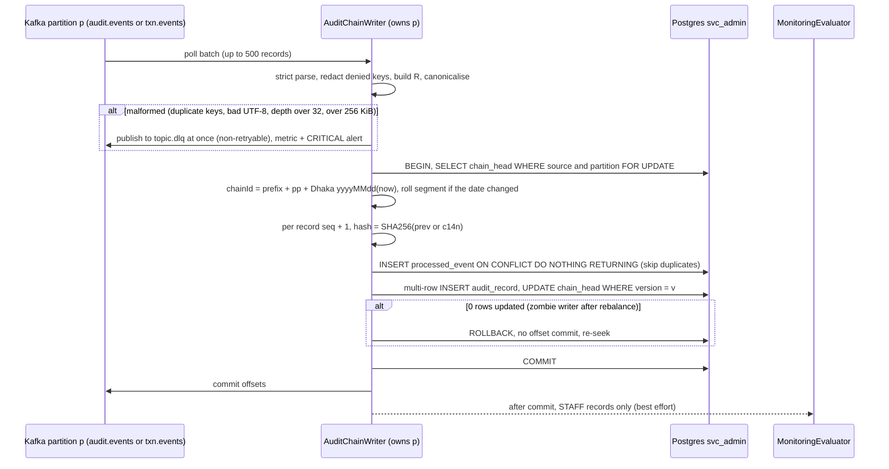

**F2 — Approval inbox**

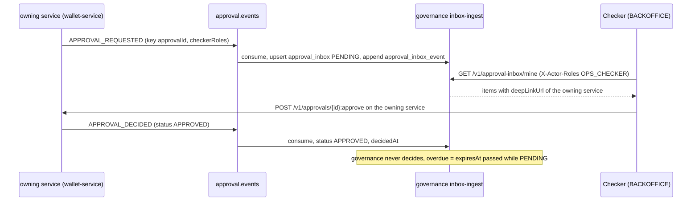

**F3 — Reference data change (maker-checker → `refdata.events`)**

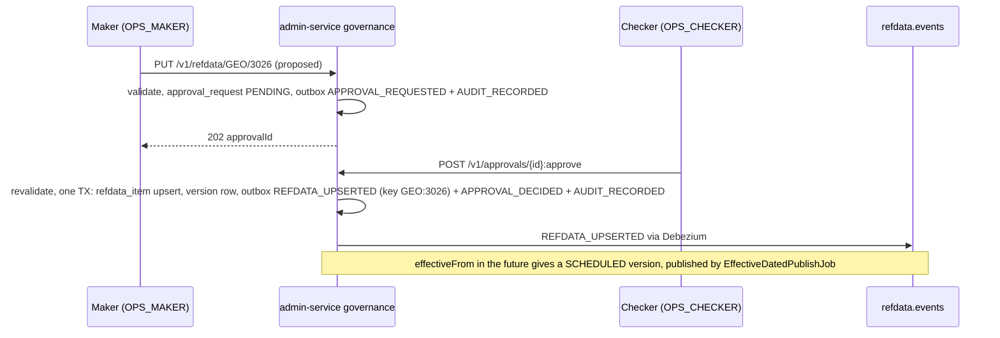

**F4 — P2P completed → two parties notified**

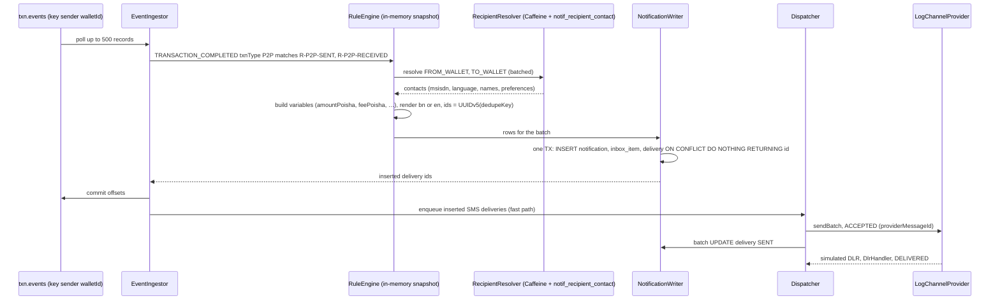

**F5 — Dispatch, retry and failover (incl. unknown outcome)**

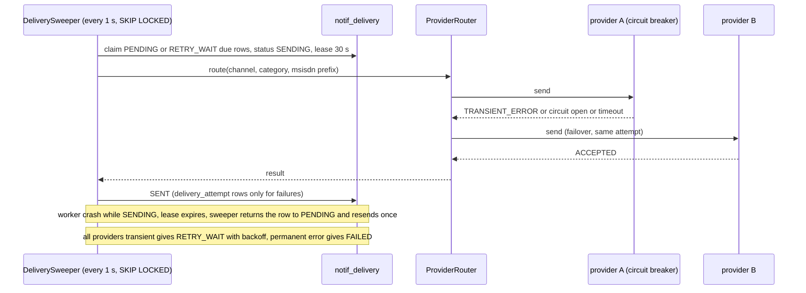

**F6 — Reminder registered via `notification.requests`**

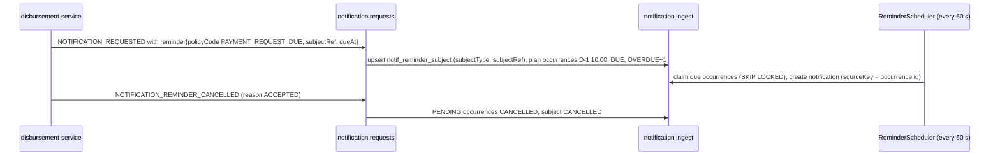

**F7 — Seed import from the generated contract index**

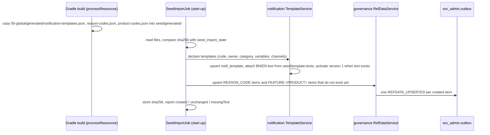

### 3.5 State machines

**Approval request (shared engine, kernel K5)**

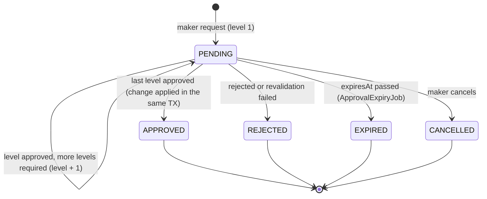

**Staff user**

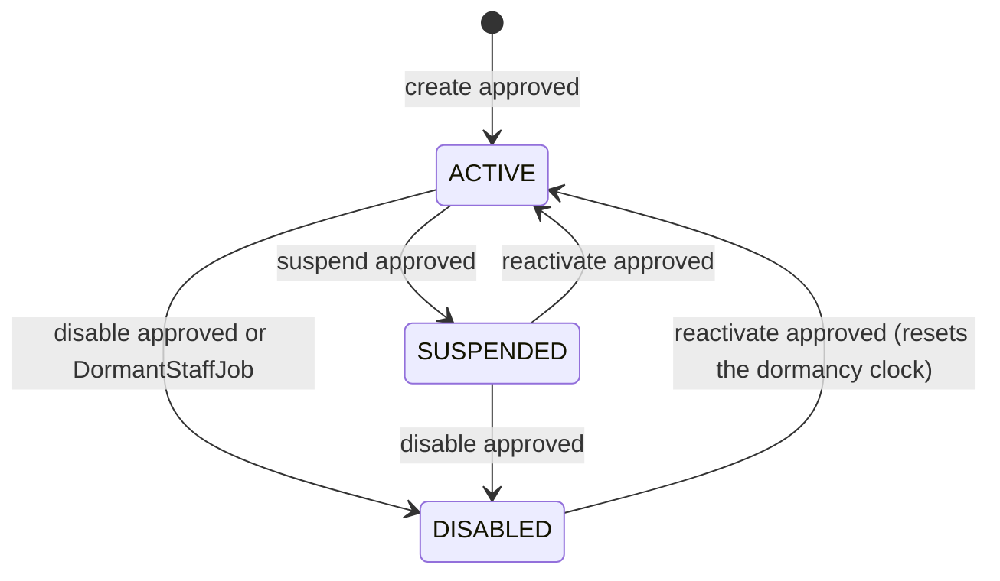

**Approval-inbox item (projection; never changed by governance itself)**

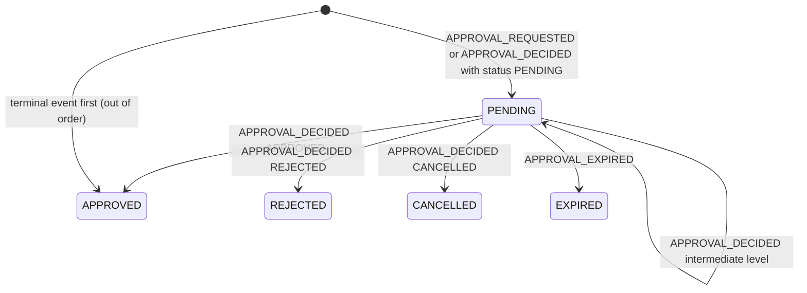

**Audit chain segment**

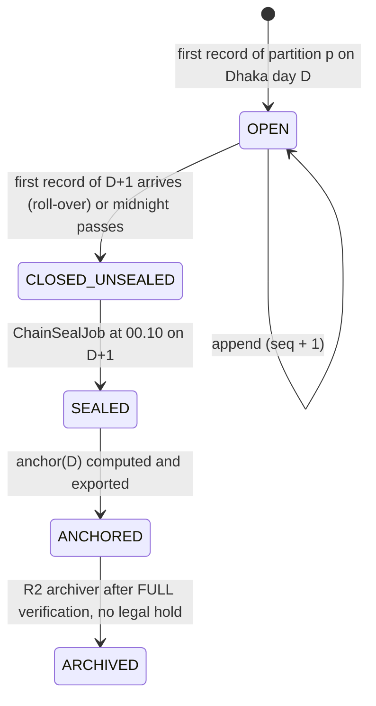

**Monitoring alert**

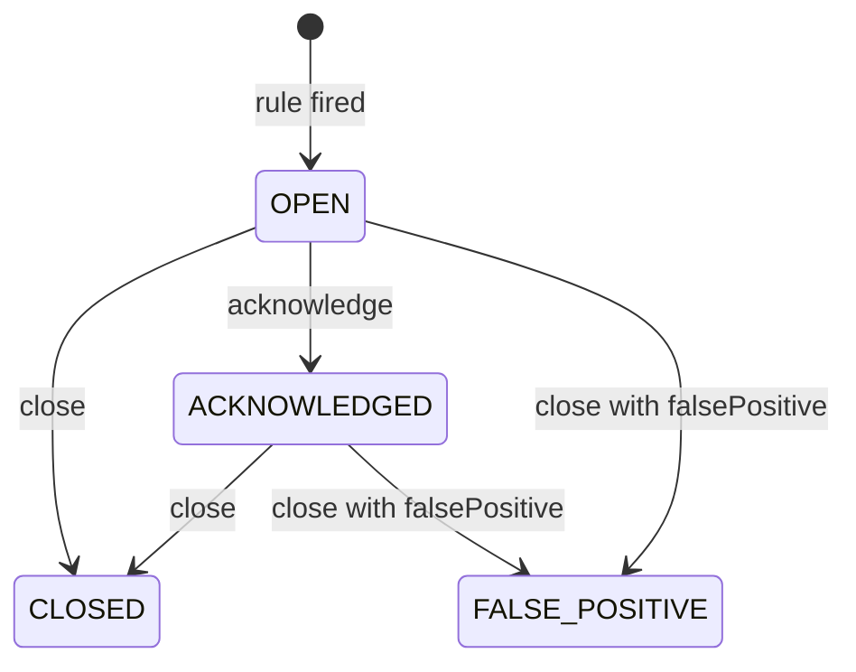

**Refdata item version**

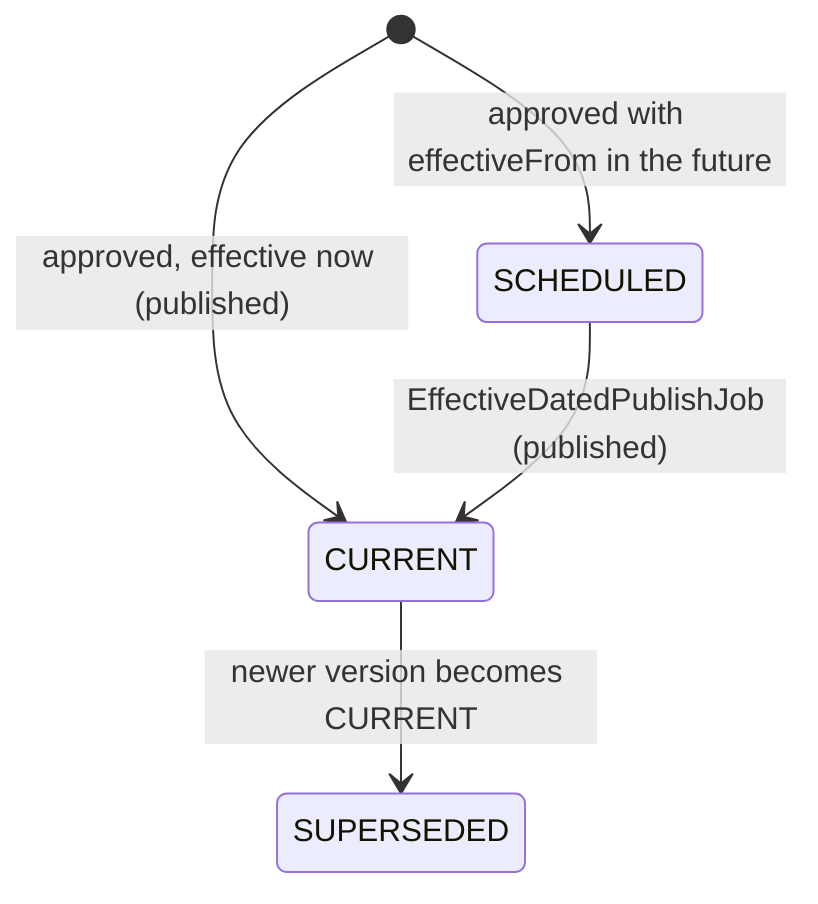

**Legal hold**

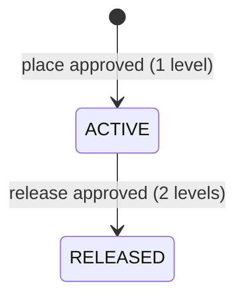

**Template version**

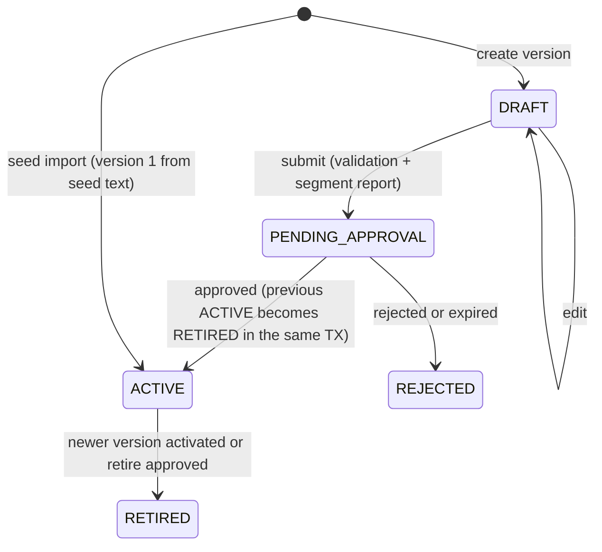

**Delivery**

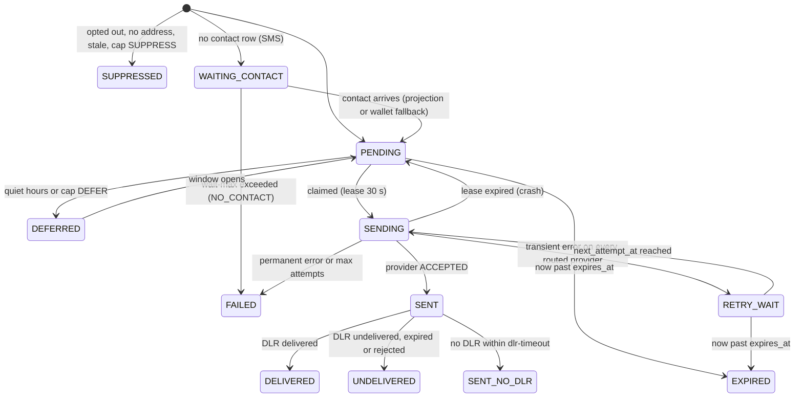

Terminal: `DELIVERED`, `UNDELIVERED`, `SENT_NO_DLR`, `FAILED`, `SUPPRESSED`, `EXPIRED`.

**Reminder subject**

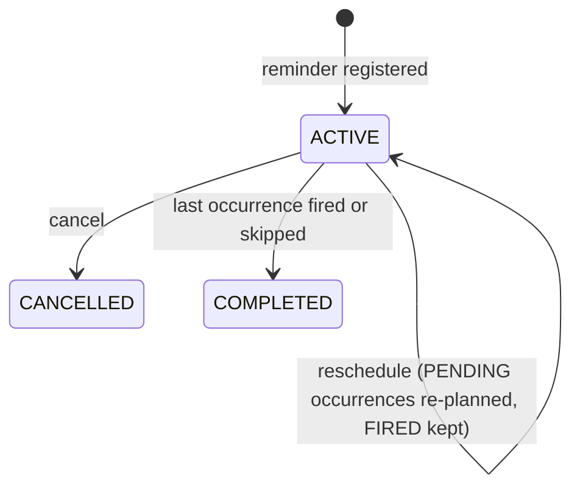

**In-app inbox item**

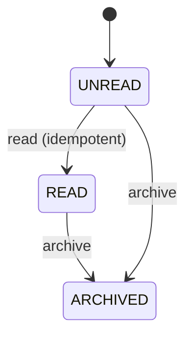

### 3.6 Architecture decisions

| ADR | Decision | Why | Consequence |
|---|---|---|---|
| ADR-01 | One service, two modules (`governance`, `notification`) + private `common`; separate worker deployables | Both are cross-cutting, low-logic, owned by one developer, and need each other (staff contacts, governance alerts) | Staff-contact lookup is in-process; capacity is isolated by deployable |
| ADR-02 | Hash chain per **Kafka partition per Dhaka ingest day**, per source topic: `chainId = p{pp}-{yyyyMMdd}` for `audit.events`, `t{pp}-{yyyyMMdd}` for `txn.events`; segments linked across days; one writer per partition guaranteed by Kafka assignment + optimistic `chain_head.version` | Parallel ingest without a global lock; deterministic order = partition offset order | ≤ 48 + 96 open chains per day in production |
| ADR-03 | Ingest day = `recordedAt` (governance clock), not `occurredAt` | Late events never reopen sealed days | `occurredAt` stays searchable |
| ADR-04 | Store the exact canonical bytes (`c14n`) as the authoritative record; searchable columns are derived and re-checked during verification | jsonb normalisation would change hashed content | No double JSON storage |
| ADR-05 | Daily anchor = hash over sorted segment heads + previous anchor; itself written as an audit record into the next day's chain and exported to an anchor file | Detects whole-day rewrites | Anchor survives DB compromise when the file is kept off-box (WORM later) |
| ADR-06 | `audit_record` range-partitioned **daily** on `ingest_date`; partitions created 7 days ahead | Cheap retention by partition | Partition job is monitored |
| ADR-07 | Governance publishes its own audit through `audit.events` (outbox) and consumes it like everyone else | One code path | Its own records are chained too |
| ADR-08 | Configuration families (product switches, cut-offs, EOD schedule, calendar, retention, GL params) are namespaced `SYSTEM_PARAM` codes | The `refdata.events` type enum stays closed | Reserved namespaces listed in `provided/data/refdata-system-params.v1.md` |
| ADR-09 | Approval inbox is a pure projection; overdue = `expiresAt < now` while PENDING; never self-expired | Owning services own state | `/mine` and summary are read models |
| ADR-10 | Monitoring counters in Redis (`INCR` + TTL), loss tolerated | Audit partition key is `entityId`, so one actor's actions span partitions | Alerts are best-effort; records are not |
| ADR-11 | Runtime authorisation stays header-based; staff model is data only (+ `bitspay.governance.authz.cross-check` logging mismatches) | No edge/auth layer in this phase | Effective-permission API is the future sync |
| ADR-12 | Idempotency of notification by deterministic ids: `notificationId = UUIDv5(NS_NOTIF, sourceKey + "|" + recipientKey + "|" + templateCode)`; `deliveryId = UUIDv5(NS_DELIV, notificationId + "|" + channel)`; `INSERT … ON CONFLICT DO NOTHING`. `sourceKey` = `requestId` (notification.requests), occurrence id (reminders), else envelope `eventId`. Replaces the inbox table for high-volume notification topics | A fan-out event touches many rows; dedupe must be intrinsic | `notif_processed_event` is used only for `notification.requests` cancellations, `refdata.events` and projection topics |
| ADR-13 | Partition key of notification tables = source `occurredAt` (deterministic across retries); monthly range partitions | Retries hit the same partition so `ON CONFLICT` works | Reading one item by id probes ≤ 7 partitions (acceptable) |
| ADR-14 | No physical sharding: one schema, plain tables, multi-row batch inserts (one TX per poll batch) | 5k TPS ≈ 10k notifications/s fits one primary with batching | Tables carry the `notif_` prefix |
| ADR-15 | Hot path writes no outbox rows; delivery outcomes are not published | No Kafka amplification per message | Logs API serves outcomes |
| ADR-16 | Content rendered at creation and stored (`body`, `content_sha256`) | Logs show exactly what was sent | Template changes never alter history |
| ADR-17 | Fast-path dispatch after commit + sweeper as safety net (`PENDING` > 30 s or expired lease) | Low latency without losing messages on crash | At most one send per delivery (conditional updates) |
| ADR-18 | `LogChannelProvider` simulates DLRs by calling the same `DlrHandler` used by the future webhook | DLR/retry logic fully testable without a provider | Error injection by MSISDN suffix |
| ADR-19 | Compacted-topic replay guard: wallet/customer/partner-driven notifications only if the event is ≤ 24 h old **and** the projection version increases | A consumer-group reset on a compacted topic must not re-notify millions | Old replays update contacts but send nothing |
| ADR-20 | Rules, templates, providers held in an in-memory snapshot refreshed when `notif_config_version` changes (poll 5 s) | No DB hit per event | Config changes visible within 5 s |
| ADR-21 | Templates, reason codes and product codes declared by other services are **seeded from the generated contract index** (`00-global/generated/*.json`), copied into the build | Producers own their codes (CONTRACT-MODEL O1/O6); admin needs no contract change to learn a new code | A new producer code is a data-only, kind-A change for admin-service (add BN/EN text, rebuild) |
| ADR-22 | `txn.events` is chained by governance (all four types, whole envelope) instead of per-payment `AUDIT_RECORDED` (OPEN D-05) | `txn.events` keeps 7 days; payment outcomes need a tamper-evident 10-year trail | Same algorithm, separate chain prefix `t` |

### 3.7 Latency / throughput budget

Not on the payment hot path (pure consumers + back-office APIs).

| Path | Budget |
|---|---|
| Event → IN_APP inbox row visible | p95 ≤ 2 s, p99 ≤ 5 s |
| Event → SMS handed to provider | p95 ≤ 3 s |
| Audit ingest end-to-end lag | p99 ≤ 5 s at design load |
| Inbox list / unread count | p95 ≤ 150 ms / ≤ 20 ms |
| Single-entity governance reads (`/v1/refdata`, `/v1/params`, `/v1/calendar/check`, legal holds, effective permissions) | p95 ≤ 300 ms (Caffeine 30 s on refdata/params) |
| Audit search (indexed filter, 31 days) | p95 ≤ 3 s (PER-008) |
| `/v1/approval-inbox/mine` with 10k pending | p95 ≤ 300 ms |
| Refdata publish after final approval | ≤ 2 s |

## 4. Data model

All tables live in schema `svc_admin` (unqualified DDL lands there via `search_path`). Mutable rows carry `created_at`, `updated_at`, `version`. `timestamptz` is UTC.

```mermaid
erDiagram
  approval_request ||--o{ staff_role_assignment : "approval_id"
  staff_user ||--o{ staff_role_assignment : has
  role ||--o{ staff_role_assignment : granted
  role ||--o{ role_permission : has
  permission ||--o{ role_permission : in
  staff_user ||--o{ staff_data_scope : has
  approval_inbox ||--o{ approval_inbox_event : timeline
  chain_head ||--o{ audit_record : "open segment"
  chain_seal ||--o{ audit_record : seals
  monitoring_rule ||--o{ monitoring_alert : fires
  refdata_type ||--o{ refdata_item : types
  refdata_item ||--o{ refdata_item_version : history
  retention_policy ||--o{ legal_hold : category
  notif_template ||--o{ notif_template_version : versions
  notif_template ||--o{ notif_rule : uses
  notif_notification ||--o{ notif_delivery : channels
  notif_notification ||--o| notif_inbox_item : "IN_APP"
  notif_delivery ||--o{ notif_delivery_attempt : attempts
  notif_reminder_policy ||--o{ notif_reminder_subject : policy
  notif_reminder_subject ||--o{ notif_reminder_occurrence : plans
  notif_recipient_contact ||--o{ notif_recipient_preference : prefs
```

### 4.1 Tables

**`db/migration/common/V1__common.sql`**

```sql
-- kernel K8.2 outbox (pre-created by the stack; payload nullable, no tombstones are ever written by this service)
CREATE TABLE IF NOT EXISTS outbox (
  id             uuid PRIMARY KEY,
  aggregate_type text        NOT NULL,
  aggregate_id   text        NOT NULL,
  event_type     text        NOT NULL,
  payload        jsonb       NULL,
  created_at     timestamptz NOT NULL DEFAULT now(),
  published_at   timestamptz);
CREATE INDEX IF NOT EXISTS outbox_unpublished ON outbox (created_at) WHERE published_at IS NULL;

-- shared maker-checker engine (kernel K5); module + subject columns are admin-specific
CREATE TABLE approval_request (
  id               uuid PRIMARY KEY,
  module           text NOT NULL CHECK (module IN ('governance','notification')),
  entity_type      text NOT NULL,   -- codes.yaml entityTypes of the module
  entity_id        text NOT NULL,
  action           text NOT NULL CHECK (action ~ '^[A-Z][A-Z_]{1,39}$'),
  payload          jsonb NOT NULL,  -- full proposed state + diff
  maker_id         text NOT NULL,
  maker_user_id    text,
  subject_staff_id uuid,            -- staff the change is about (checker ≠ subject)
  status           text NOT NULL CHECK (status IN ('PENDING','APPROVED','REJECTED','EXPIRED','CANCELLED')),
  level            int  NOT NULL DEFAULT 1,   -- 1-based level awaiting decision / last decided (= approval.events level)
  required_levels  int  NOT NULL DEFAULT 1,
  checker_roles    text[] NOT NULL,           -- roles of the current level (published as checkerRoles)
  amount_poisha    bigint,
  summary          text NOT NULL CHECK (length(summary) <= 200),
  created_at       timestamptz NOT NULL DEFAULT now(),
  updated_at       timestamptz NOT NULL DEFAULT now(),
  expires_at       timestamptz NOT NULL,
  decided_by       text[] NOT NULL DEFAULT '{}',
  decided_at       timestamptz,
  decision_comment text,
  version          bigint NOT NULL DEFAULT 0);
CREATE INDEX approval_request_pending ON approval_request (expires_at) WHERE status = 'PENDING';
CREATE UNIQUE INDEX approval_request_one_open ON approval_request (entity_type, entity_id) WHERE status = 'PENDING';

CREATE TABLE idempotency_record (
  actor_id      text NOT NULL,
  idem_key      text NOT NULL,
  operation     text NOT NULL,
  request_hash  text NOT NULL,
  response_status int NOT NULL,
  response_body jsonb NOT NULL,
  created_at    timestamptz NOT NULL DEFAULT now(),
  PRIMARY KEY (actor_id, idem_key));   -- retention ≥ 7 days (kernel K3.3, OPEN D-01)

CREATE TABLE system_flag (key text PRIMARY KEY, value text NOT NULL, updated_at timestamptz NOT NULL DEFAULT now());
-- keys: rbac.model.version, seed.publish.done, seed.import.<kind>.sha256

CREATE TABLE shedlock (name varchar(64) PRIMARY KEY, lock_until timestamptz NOT NULL,
  locked_at timestamptz NOT NULL, locked_by varchar(255) NOT NULL);
```

**`db/migration/governance/V1__governance.sql`**

```sql
CREATE TABLE IF NOT EXISTS processed_event (
  event_id     uuid PRIMARY KEY,
  topic        text NOT NULL,
  processed_at timestamptz NOT NULL DEFAULT now());

-- ===== Staff RBAC =====
CREATE TABLE staff_user (
  id               uuid PRIMARY KEY,
  username         text NOT NULL UNIQUE CHECK (username ~ '^[a-z0-9._-]{3,64}$'),
  full_name        text NOT NULL,
  email            text,
  msisdn           text CHECK (msisdn IS NULL OR msisdn ~ '^8801[3-9][0-9]{8}$'),
  language         text NOT NULL DEFAULT 'en' CHECK (language IN ('bn','en')),
  employee_no      text UNIQUE,
  department       text NOT NULL,
  status           text NOT NULL CHECK (status IN ('ACTIVE','SUSPENDED','DISABLED')),
  disabled_reason  text CHECK (disabled_reason IN ('MANUAL','DORMANT','LEAVER','SOD_REMEDIATION')),
  last_activity_at timestamptz,          -- from the audit stream (actorType STAFF)
  created_at timestamptz NOT NULL DEFAULT now(), updated_at timestamptz NOT NULL DEFAULT now(),
  version bigint NOT NULL DEFAULT 0);
CREATE INDEX staff_user_status ON staff_user (status, last_activity_at);

CREATE TABLE permission (
  code        text PRIMARY KEY CHECK (code ~ '^[A-Z_]+:(VIEW|CREATE|UPDATE|APPROVE|EXPORT|EXECUTE|DELETE)$'),
  function    text NOT NULL,
  action      text NOT NULL,
  description text NOT NULL,
  sensitive   boolean NOT NULL DEFAULT false);

CREATE TABLE role (
  code        text PRIMARY KEY CHECK (code ~ '^[A-Z][A-Z0-9_]{1,40}$'),
  name        text NOT NULL,
  description text NOT NULL,
  system_role boolean NOT NULL DEFAULT false,   -- kernel K7 roles: cannot be deleted or renamed
  active      boolean NOT NULL DEFAULT true,
  created_at timestamptz NOT NULL DEFAULT now(), updated_at timestamptz NOT NULL DEFAULT now(),
  version bigint NOT NULL DEFAULT 0);

CREATE TABLE role_permission (
  role_code       text NOT NULL REFERENCES role(code),
  permission_code text NOT NULL REFERENCES permission(code),
  PRIMARY KEY (role_code, permission_code));

CREATE TABLE staff_role_assignment (
  staff_id    uuid NOT NULL REFERENCES staff_user(id),
  role_code   text NOT NULL REFERENCES role(code),
  valid_from  timestamptz NOT NULL,
  valid_to    timestamptz,
  approval_id uuid NOT NULL,
  created_at  timestamptz NOT NULL DEFAULT now(),
  PRIMARY KEY (staff_id, role_code, valid_from));
CREATE INDEX sra_current ON staff_role_assignment (staff_id) WHERE valid_to IS NULL;

CREATE TABLE staff_data_scope (
  staff_id   uuid NOT NULL REFERENCES staff_user(id),
  scope_type text NOT NULL CHECK (scope_type IN ('ALL','GEO','PARTNER')),
  scope_code text NOT NULL,              -- '*' for ALL, GEO code, partnerId
  PRIMARY KEY (staff_id, scope_type, scope_code));

CREATE TABLE sod_rule (
  code        text PRIMARY KEY,
  kind        text NOT NULL CHECK (kind IN ('ROLE_PAIR','PERMISSION_PAIR')),
  left_code   text NOT NULL,
  right_code  text NOT NULL,
  severity    text NOT NULL CHECK (severity IN ('BLOCK','WARN')),
  description text NOT NULL,
  active      boolean NOT NULL DEFAULT true,
  created_at timestamptz NOT NULL DEFAULT now(), updated_at timestamptz NOT NULL DEFAULT now(),
  version bigint NOT NULL DEFAULT 0);

-- ===== Approval inbox (projection of approval.events) =====
CREATE TABLE approval_inbox (
  approval_id     uuid PRIMARY KEY,
  service         text NOT NULL,         -- bare service name
  module          text,                  -- required for merged services
  entity_type     text NOT NULL,
  entity_id       text NOT NULL,
  action          text NOT NULL,
  maker_id        text NOT NULL,
  checker_id      text,
  level           int  NOT NULL,         -- 1-based, as published
  required_levels int  NOT NULL,
  amount_poisha   bigint,
  status          text NOT NULL CHECK (status IN ('PENDING','APPROVED','REJECTED','EXPIRED','CANCELLED')),
  summary         text NOT NULL,
  deep_link       text NOT NULL,
  checker_roles   text[] NOT NULL,       -- event checkerRoles; route fallback only if empty (BR-GOV-21)
  routed_by       text NOT NULL CHECK (routed_by IN ('EVENT','ROUTE','DEFAULT')),
  requested_at    timestamptz NOT NULL,
  decided_at      timestamptz,
  expires_at      timestamptz,
  last_event_id   uuid NOT NULL,
  last_event_at   timestamptz NOT NULL,
  reminded_at     timestamptz,
  updated_at      timestamptz NOT NULL DEFAULT now(),
  version         bigint NOT NULL DEFAULT 0);
CREATE INDEX approval_inbox_pending ON approval_inbox (requested_at) WHERE status = 'PENDING';
CREATE INDEX approval_inbox_roles ON approval_inbox USING gin (checker_roles) WHERE status = 'PENDING';
CREATE INDEX approval_inbox_service ON approval_inbox (service, module, status, requested_at);

CREATE TABLE approval_inbox_event (
  event_id    uuid PRIMARY KEY,
  approval_id uuid NOT NULL,
  event_type  text NOT NULL,
  status      text NOT NULL,
  level       int  NOT NULL,
  checker_id  text,
  occurred_at timestamptz NOT NULL,
  payload     jsonb NOT NULL);
CREATE INDEX approval_inbox_event_by_approval ON approval_inbox_event (approval_id, occurred_at);

CREATE TABLE approval_route (
  service       text NOT NULL,           -- bare service name, 'archiver' or '*'
  module        text NOT NULL,           -- module or '*'
  entity_type   text NOT NULL,           -- entityType or '*'
  checker_roles text[] NOT NULL,
  created_at timestamptz NOT NULL DEFAULT now(), updated_at timestamptz NOT NULL DEFAULT now(),
  version bigint NOT NULL DEFAULT 0,
  PRIMARY KEY (service, module, entity_type));

CREATE TABLE service_endpoint (            -- deep-link base URLs per environment
  service  text PRIMARY KEY,
  base_url text NOT NULL);                 -- local: http://localhost:8000/<svc-short>

-- ===== Audit store =====
CREATE TABLE chain_head (
  source        char(1) NOT NULL CHECK (source IN ('p','t')),   -- p = audit.events, t = txn.events
  partition_no  int NOT NULL,
  chain_id      text NOT NULL,           -- current open segment, e.g. p07-20261009
  chain_date    date NOT NULL,
  last_seq      bigint NOT NULL,         -- 0 = empty segment
  last_hash     bytea NOT NULL CHECK (length(last_hash) = 32),
  updated_at    timestamptz NOT NULL DEFAULT now(),
  version       bigint NOT NULL DEFAULT 0,
  PRIMARY KEY (source, partition_no));

CREATE TABLE audit_record (
  ingest_date     date        NOT NULL,  -- Asia/Dhaka date of recorded_at
  chain_id        text        NOT NULL,
  seq             bigint      NOT NULL,
  event_id        uuid        NOT NULL,
  source_topic    text        NOT NULL CHECK (source_topic IN ('audit.events','txn.events')),
  event_type      text        NOT NULL,
  recorded_at     timestamptz NOT NULL,
  occurred_at     timestamptz NOT NULL,
  producer        text        NOT NULL,
  service         text        NOT NULL,
  actor_type      text        NOT NULL,
  actor_id        text        NOT NULL,
  action          text        NOT NULL,
  entity_type     text        NOT NULL,
  entity_id       text        NOT NULL,
  outcome         text        NOT NULL,
  correlation_id  text,
  channel         text,
  redacted        boolean     NOT NULL DEFAULT false,
  kafka_partition int         NOT NULL,
  kafka_offset    bigint      NOT NULL,
  c14n            text        NOT NULL,  -- exact canonical JSON that was hashed (§7.3)
  prev_hash       bytea       NOT NULL,
  hash            bytea       NOT NULL,
  PRIMARY KEY (ingest_date, chain_id, seq)
) PARTITION BY RANGE (ingest_date);
-- daily partitions by PartitionMaintenanceJob: audit_record_20261009 FOR VALUES FROM ('2026-10-09') TO ('2026-10-10')
CREATE INDEX audit_entity   ON audit_record (entity_type, entity_id, recorded_at);
CREATE INDEX audit_actor    ON audit_record (actor_id, recorded_at);
CREATE INDEX audit_corr     ON audit_record (correlation_id) WHERE correlation_id IS NOT NULL;
CREATE INDEX audit_action   ON audit_record (service, action, recorded_at);
CREATE INDEX audit_event_id ON audit_record (event_id);
CREATE INDEX audit_brin_ts  ON audit_record USING brin (recorded_at);

CREATE FUNCTION audit_immutable() RETURNS trigger LANGUAGE plpgsql AS $$
BEGIN RAISE EXCEPTION 'append-only table (%)', TG_OP; END $$;
CREATE TRIGGER audit_record_no_update BEFORE UPDATE OR DELETE ON audit_record
  FOR EACH ROW EXECUTE FUNCTION audit_immutable();

CREATE TABLE chain_seal (
  chain_id     text PRIMARY KEY,
  chain_date   date NOT NULL,
  source       char(1) NOT NULL,
  partition_no int  NOT NULL,
  first_seq    bigint NOT NULL,
  last_seq     bigint NOT NULL,
  genesis_prev bytea NOT NULL,
  last_hash    bytea NOT NULL,
  sealed_at    timestamptz NOT NULL DEFAULT now());
CREATE TRIGGER chain_seal_no_update BEFORE UPDATE OR DELETE ON chain_seal
  FOR EACH ROW EXECUTE FUNCTION audit_immutable();

CREATE TABLE audit_anchor (
  anchor_date   date PRIMARY KEY,
  chain_count   int    NOT NULL,
  record_count  bigint NOT NULL,
  prev_anchor   bytea  NOT NULL,
  anchor_hash   bytea  NOT NULL,
  manifest      text   NOT NULL,        -- exact newline-joined lines that were hashed
  exported_to   text,                   -- anchor file URI
  created_at    timestamptz NOT NULL DEFAULT now());
CREATE TRIGGER audit_anchor_no_update BEFORE UPDATE OR DELETE ON audit_anchor
  FOR EACH ROW EXECUTE FUNCTION audit_immutable();
-- afterMigrate callback: REVOKE UPDATE, DELETE, TRUNCATE ON audit_record, chain_seal, audit_anchor FROM the application role
-- (Flyway runs as the schema owner; the application datasource uses a role without those privileges)

CREATE TABLE audit_verification (
  id              uuid PRIMARY KEY,
  requested_by    text NOT NULL,        -- staff id or 'SYSTEM'
  from_date       date NOT NULL,
  to_date         date NOT NULL,
  scope           text NOT NULL CHECK (scope IN ('FULL','TAIL')),
  status          text NOT NULL CHECK (status IN ('QUEUED','RUNNING','VALID','BROKEN','FAILED')),
  records_checked bigint NOT NULL DEFAULT 0,
  chains_checked  int    NOT NULL DEFAULT 0,
  findings        jsonb  NOT NULL DEFAULT '[]',   -- [{chainId, seq, reason, expected, actual}], ≤ 1,000
  started_at timestamptz, finished_at timestamptz,
  created_at timestamptz NOT NULL DEFAULT now(), updated_at timestamptz NOT NULL DEFAULT now(),
  version bigint NOT NULL DEFAULT 0);

CREATE TABLE audit_export (
  id           uuid PRIMARY KEY,
  requested_by text NOT NULL,
  filter       jsonb NOT NULL,
  format       text NOT NULL CHECK (format IN ('CSV','JSONL','BUNDLE')),
  status       text NOT NULL CHECK (status IN ('QUEUED','RUNNING','READY','FAILED','EXPIRED')),
  row_count    bigint,
  file_uri     text,
  file_sha256  text,
  expires_at   timestamptz NOT NULL,
  created_at timestamptz NOT NULL DEFAULT now(), updated_at timestamptz NOT NULL DEFAULT now(),
  version bigint NOT NULL DEFAULT 0);

-- ===== Monitoring =====
CREATE TABLE monitoring_rule (
  code         text PRIMARY KEY,
  kind         text NOT NULL CHECK (kind IN ('THRESHOLD_COUNT','OFF_HOURS','SENSITIVE_ACTION','FAILED_OUTCOME_COUNT')),
  action_regex text NOT NULL,
  entity_type  text,                    -- null = any
  window_sec   int,
  threshold    int,
  severity     text NOT NULL CHECK (severity IN ('LOW','MEDIUM','HIGH','CRITICAL')),
  notify_roles text[] NOT NULL DEFAULT '{AUDITOR,ADMIN}',
  enabled      boolean NOT NULL DEFAULT true,
  created_at timestamptz NOT NULL DEFAULT now(), updated_at timestamptz NOT NULL DEFAULT now(),
  version bigint NOT NULL DEFAULT 0);

CREATE TABLE monitoring_alert (
  id               uuid PRIMARY KEY,
  rule_code        text NOT NULL REFERENCES monitoring_rule(code),
  staff_actor_id   text NOT NULL,
  window_start     timestamptz NOT NULL,
  observed         int NOT NULL,
  sample_event_ids uuid[] NOT NULL,
  severity         text NOT NULL,
  status           text NOT NULL CHECK (status IN ('OPEN','ACKNOWLEDGED','CLOSED','FALSE_POSITIVE')),
  assignee_id      text, resolution text,
  created_at timestamptz NOT NULL DEFAULT now(), updated_at timestamptz NOT NULL DEFAULT now(),
  version bigint NOT NULL DEFAULT 0,
  UNIQUE (rule_code, staff_actor_id, window_start));

-- ===== Reference data =====
CREATE TABLE refdata_type (
  type        text PRIMARY KEY CHECK (type IN ('GEO','MCC','PURPOSE_CODE','REASON_CODE','BANK','HOLIDAY','SYSTEM_PARAM')),
  code_regex  text NOT NULL,
  attr_schema jsonb NOT NULL,            -- $defs entry of provided/data/refdata-attributes.v1.schema.json
  has_parent  boolean NOT NULL);

CREATE TABLE refdata_item (
  type           text NOT NULL REFERENCES refdata_type(type),
  code           text NOT NULL,
  parent_code    text,
  name_en        text NOT NULL CHECK (length(name_en) <= 200),
  name_bn        text NOT NULL CHECK (length(name_bn) <= 200),
  attributes     jsonb NOT NULL DEFAULT '{}',
  active         boolean NOT NULL DEFAULT true,
  item_version   bigint NOT NULL,       -- = REFDATA_UPSERTED.data.version
  effective_from timestamptz NOT NULL,
  source         text NOT NULL DEFAULT 'ADMIN' CHECK (source IN ('ADMIN','SEED','INDEX')),
  created_at timestamptz NOT NULL DEFAULT now(), updated_at timestamptz NOT NULL DEFAULT now(),
  version bigint NOT NULL DEFAULT 0,
  PRIMARY KEY (type, code));
CREATE INDEX refdata_parent ON refdata_item (type, parent_code);

CREATE TABLE refdata_item_version (
  type text NOT NULL, code text NOT NULL, item_version bigint NOT NULL,
  parent_code text, name_en text NOT NULL, name_bn text NOT NULL,
  attributes jsonb NOT NULL, active boolean NOT NULL,
  effective_from timestamptz NOT NULL, effective_to timestamptz,
  approval_id uuid, changed_by text NOT NULL,
  status text NOT NULL CHECK (status IN ('SCHEDULED','CURRENT','SUPERSEDED')),
  created_at timestamptz NOT NULL DEFAULT now(),
  PRIMARY KEY (type, code, item_version));
CREATE INDEX refdata_scheduled ON refdata_item_version (effective_from) WHERE status = 'SCHEDULED';

CREATE TABLE refdata_import (
  id uuid PRIMARY KEY, type text NOT NULL, file_sha256 text NOT NULL,
  rows_total int NOT NULL, rows_new int NOT NULL, rows_changed int NOT NULL, rows_unchanged int NOT NULL,
  rows_deactivated int NOT NULL, conflicts jsonb NOT NULL,
  status text NOT NULL CHECK (status IN ('VALIDATED','PENDING_APPROVAL','APPLIED','REJECTED','INVALID')),
  approval_id uuid, created_by text NOT NULL,
  created_at timestamptz NOT NULL DEFAULT now(), updated_at timestamptz NOT NULL DEFAULT now(),
  version bigint NOT NULL DEFAULT 0,
  UNIQUE (type, file_sha256));

CREATE TABLE product_switch (
  product     text PRIMARY KEY CHECK (product ~ '^[A-Z][A-Z0-9_]*$'),
  enabled     boolean NOT NULL,
  channels    text[] NOT NULL DEFAULT '{}',    -- empty = all channels
  licence_ref text,
  note        text,
  owner_service text,                          -- from the product-code index
  created_at timestamptz NOT NULL DEFAULT now(), updated_at timestamptz NOT NULL DEFAULT now(),
  version bigint NOT NULL DEFAULT 0);

-- ===== Retention =====
CREATE TABLE retention_policy (
  category       text PRIMARY KEY CHECK (category IN ('FINANCIAL_TXN','CUSTOMER_KYC','PARTNER','AML_CASE','AUDIT','NOTIFICATION_LOG','API_LOG','RECON','COMPLAINT')),
  online_months  int,                   -- null = life of relationship
  total_years    int NOT NULL,
  basis          text NOT NULL CHECK (basis IN ('EVENT_DATE','RELATIONSHIP_END','CASE_CLOSURE')),
  end_action     text NOT NULL CHECK (end_action IN ('PURGE','ANONYMISE')),
  owner_services text[] NOT NULL,
  created_at timestamptz NOT NULL DEFAULT now(), updated_at timestamptz NOT NULL DEFAULT now(),
  version bigint NOT NULL DEFAULT 0);

CREATE TABLE legal_hold (
  id uuid PRIMARY KEY,
  category text NOT NULL REFERENCES retention_policy(category),
  subject_type text NOT NULL CHECK (subject_type IN ('CATEGORY','CUSTOMER','WALLET','PARTNER','CASE','TXN')),
  subject_id text NOT NULL,             -- '*' when subject_type = CATEGORY
  reason text NOT NULL CHECK (length(reason) <= 500),
  reference text CHECK (length(reference) <= 64),
  status text NOT NULL CHECK (status IN ('ACTIVE','RELEASED')),
  placed_approval_id uuid NOT NULL, released_approval_id uuid,
  placed_at timestamptz NOT NULL,
  created_at timestamptz NOT NULL DEFAULT now(), updated_at timestamptz NOT NULL DEFAULT now(),
  version bigint NOT NULL DEFAULT 0);
CREATE INDEX legal_hold_subject ON legal_hold (subject_type, subject_id) WHERE status = 'ACTIVE';

-- ===== Seed import bookkeeping =====
CREATE TABLE seed_import_run (
  id uuid PRIMARY KEY, kind text NOT NULL CHECK (kind IN ('NOTIFICATION_TEMPLATES','REASON_CODES','PRODUCT_CODES')),
  index_sha256 text NOT NULL, created int NOT NULL, updated int NOT NULL, unchanged int NOT NULL,
  missing_text text[] NOT NULL DEFAULT '{}', finished_at timestamptz NOT NULL DEFAULT now());
```

**`db/migration/notification/V1__notification.sql`**

```sql
CREATE TABLE notif_processed_event (
  event_id uuid PRIMARY KEY, topic text NOT NULL, processed_at timestamptz NOT NULL DEFAULT now());

CREATE TABLE notif_config_version (id int PRIMARY KEY CHECK (id = 1), value bigint NOT NULL);  -- bumped on any config apply

CREATE TABLE notif_template (
  code             text PRIMARY KEY CHECK (code ~ '^[A-Z][A-Z0-9_]{2,63}$'),
  category         text NOT NULL CHECK (category IN ('SECURITY','TRANSACTIONAL','SERVICE','INTERNAL','REMINDER','MARKETING')),
  mandatory        boolean NOT NULL,      -- true for SECURITY/TRANSACTIONAL/SERVICE/INTERNAL
  description      text NOT NULL,
  owner_service    text NOT NULL,         -- sender that declared it (admin-service for groups A, B, C9)
  owner_module     text,
  source           text NOT NULL CHECK (source IN ('ADMIN','INDEX','API')),
  variables        jsonb NOT NULL,        -- [{name, type: MONEY|DATETIME|DATE|TEXT|MSISDN|INT, required, maxLength, sample}]
  allowed_channels text[] NOT NULL,
  active_version   int,
  created_at timestamptz NOT NULL DEFAULT now(), updated_at timestamptz NOT NULL DEFAULT now(), version bigint NOT NULL DEFAULT 0);

CREATE TABLE notif_template_version (
  template_code  text NOT NULL REFERENCES notif_template(code),
  tversion       int  NOT NULL,
  status         text NOT NULL CHECK (status IN ('DRAFT','PENDING_APPROVAL','ACTIVE','RETIRED','REJECTED')),
  contents       jsonb NOT NULL,          -- {"SMS":{"bn":"…","en":"…"},"IN_APP":{"bn":{"title","body","deepLink"},"en":{…}},"PUSH":{…},"EMAIL":{"bn":{"subject","body"}},"IVR":{"bn":{"script"}}}
  sms_options    jsonb NOT NULL DEFAULT '{"useBanglaDigits":true,"maxSegmentsBn":3,"maxSegmentsEn":2}',
  segment_report jsonb,                   -- computed at submit (worst case) per language
  approval_id    uuid,
  created_by     text NOT NULL,
  activated_at   timestamptz,
  created_at timestamptz NOT NULL DEFAULT now(), updated_at timestamptz NOT NULL DEFAULT now(), version bigint NOT NULL DEFAULT 0,
  PRIMARY KEY (template_code, tversion));
CREATE UNIQUE INDEX notif_template_one_active ON notif_template_version (template_code) WHERE status = 'ACTIVE';

CREATE TABLE notif_rule (
  id                 text PRIMARY KEY CHECK (id ~ '^R-[A-Z0-9_-]{2,60}$'),
  source_topic       text NOT NULL,
  event_type         text NOT NULL,
  condition          jsonb NOT NULL DEFAULT '{"all":[]}',
  recipient_selector text NOT NULL CHECK (recipient_selector IN
     ('FROM_WALLET','TO_WALLET','COMMISSION_BENEFICIARY','DATA_WALLET','CUSTOMER_WALLETS','BENEFICIARY_WALLET','REQUEST_RECIPIENT')),
  template_code      text NOT NULL REFERENCES notif_template(code),
  channels           text[] NOT NULL,
  priority           text NOT NULL CHECK (priority IN ('SECURITY','TRANSACTIONAL','SERVICE','REMINDER','MARKETING')),
  variable_map       jsonb NOT NULL,
  enabled            boolean NOT NULL,
  created_at timestamptz NOT NULL DEFAULT now(), updated_at timestamptz NOT NULL DEFAULT now(), version bigint NOT NULL DEFAULT 0);
CREATE INDEX notif_rule_by_event ON notif_rule (source_topic, event_type) WHERE enabled;

CREATE TABLE notif_provider (
  code        text PRIMARY KEY,
  channel     text NOT NULL CHECK (channel IN ('SMS','PUSH','EMAIL','IVR')),
  adapter     text NOT NULL CHECK (adapter IN ('LOG')),
  enabled     boolean NOT NULL,
  sender_ids  jsonb NOT NULL,           -- {"TRANSACTIONAL":"BitsPay","MARKETING":"BitsPayOffer"}
  rate_limit_per_sec int NOT NULL,
  config      jsonb NOT NULL DEFAULT '{}',   -- non-secret; secrets via env
  created_at timestamptz NOT NULL DEFAULT now(), updated_at timestamptz NOT NULL DEFAULT now(), version bigint NOT NULL DEFAULT 0);

CREATE TABLE notif_provider_route (
  id             text PRIMARY KEY,
  channel        text NOT NULL,
  category       text,                  -- null = any
  msisdn_prefix  text,                  -- e.g. '88017', null = any
  provider_codes text[] NOT NULL,       -- ordered failover list
  rank           int NOT NULL,          -- lower = earlier
  created_at timestamptz NOT NULL DEFAULT now(), updated_at timestamptz NOT NULL DEFAULT now(), version bigint NOT NULL DEFAULT 0);

CREATE TABLE notif_channel_policy (     -- NOT-006 (R2)
  id text PRIMARY KEY, template_code text, category text,
  chain jsonb NOT NULL,                 -- [{"channel":"PUSH"},{"channel":"SMS","afterSeconds":300,"ifStatusIn":["UNDELIVERED","SENT_NO_DLR","SUPPRESSED"]}]
  enabled boolean NOT NULL,
  created_at timestamptz NOT NULL DEFAULT now(), updated_at timestamptz NOT NULL DEFAULT now(), version bigint NOT NULL DEFAULT 0);

CREATE TABLE notif_quiet_hours_policy ( -- NOT-009 (R2)
  id text PRIMARY KEY, categories text[] NOT NULL, channels text[] NOT NULL,
  start_local time NOT NULL, end_local time NOT NULL, enabled boolean NOT NULL,
  created_at timestamptz NOT NULL DEFAULT now(), updated_at timestamptz NOT NULL DEFAULT now(), version bigint NOT NULL DEFAULT 0);

CREATE TABLE notif_frequency_cap_policy ( -- NOT-009 (R2)
  category text PRIMARY KEY, max_per_day int NOT NULL, max_per_week int NOT NULL,
  over_cap_action text NOT NULL CHECK (over_cap_action IN ('SUPPRESS','DEFER')), enabled boolean NOT NULL,
  created_at timestamptz NOT NULL DEFAULT now(), updated_at timestamptz NOT NULL DEFAULT now(), version bigint NOT NULL DEFAULT 0);

CREATE TABLE notif_reminder_policy (
  code            text PRIMARY KEY CHECK (code IN ('PAYMENT_REQUEST_DUE','SCHEDULED_TRANSFER_PRE','KYC_EXPIRY','BILL_DUE')),
  subject_type    text NOT NULL CHECK (subject_type IN ('PAYMENT_REQUEST','SCHEDULED_TRANSFER','KYC_EXPIRY','BILL_DUE','SERVICE_EXPIRY','AGREEMENT_EXPIRY')),
  offsets         jsonb NOT NULL,        -- [{"key":"D-1","kind":"ADVANCE","offset":"-P1D","templateCode":"PAYREQ_REMINDER_ADVANCE"},…]
  send_time_local time NOT NULL,         -- day-offset occurrences fire at this Dhaka time; offset PT0S fires at dueAt
  channels        text[] NOT NULL,
  filters         jsonb NOT NULL DEFAULT '{}',
  enabled         boolean NOT NULL,
  created_at timestamptz NOT NULL DEFAULT now(), updated_at timestamptz NOT NULL DEFAULT now(), version bigint NOT NULL DEFAULT 0);

CREATE TABLE notif_reminder_subject (
  id uuid PRIMARY KEY, policy_code text NOT NULL REFERENCES notif_reminder_policy(code),
  subject_type text NOT NULL, subject_ref text NOT NULL CHECK (length(subject_ref) <= 64),
  recipient jsonb NOT NULL,             -- {"walletId","staffUserId","msisdn","email","role"}
  channels text[] NOT NULL,
  due_at timestamptz NOT NULL, variables jsonb NOT NULL, language text,
  registering_request_id uuid,          -- notification.requests requestId (null for POST /v1/reminders)
  routing_key text NOT NULL,            -- Kafka key of the registering request (ordering of cancels)
  status text NOT NULL CHECK (status IN ('ACTIVE','CANCELLED','COMPLETED')),
  created_by text NOT NULL,
  created_at timestamptz NOT NULL DEFAULT now(), updated_at timestamptz NOT NULL DEFAULT now(), version bigint NOT NULL DEFAULT 0,
  UNIQUE (subject_type, subject_ref));

CREATE TABLE notif_reminder_occurrence (
  id uuid PRIMARY KEY,                  -- UUIDv5(subjectId|offsetKey)
  subject_id uuid NOT NULL REFERENCES notif_reminder_subject(id),
  offset_key text NOT NULL, template_code text NOT NULL, fire_at timestamptz NOT NULL,
  status text NOT NULL CHECK (status IN ('PENDING','CLAIMED','FIRED','SKIPPED','CANCELLED')),
  claimed_until timestamptz, notification_id uuid,
  UNIQUE (subject_id, offset_key));
CREATE INDEX notif_reminder_due ON notif_reminder_occurrence (fire_at) WHERE status IN ('PENDING','CLAIMED');

CREATE TABLE notif_refdata_cache (      -- from refdata.events (REASON_CODE, SYSTEM_PARAM)
  type text NOT NULL, code text NOT NULL, name_en text NOT NULL, name_bn text NOT NULL,
  attributes jsonb NOT NULL, active boolean NOT NULL, item_version bigint NOT NULL,
  PRIMARY KEY (type, code));

CREATE TABLE notif_request_dedupe (     -- (templateCode, dedupeKey) within 24 h (BR-NOT-25)
  template_code text NOT NULL, dedupe_key text NOT NULL, request_id uuid NOT NULL,
  created_at timestamptz NOT NULL DEFAULT now(),
  PRIMARY KEY (template_code, dedupe_key));

CREATE TABLE notif_recipient_contact (
  recipient_key     text PRIMARY KEY,   -- W:{walletId} | S:{staffUserId}  (M: and R: keys have no contact row)
  wallet_id         uuid,
  owner_type        text,               -- CUSTOMER, AGENT, MERCHANT, DISTRIBUTOR, INSTITUTION, STAFF
  owner_id          text,
  wallet_type       char(1),
  wallet_status     char(1),
  msisdn            text,               -- full 13 digits (Confidential; never logged)
  language          text NOT NULL DEFAULT 'bn' CHECK (language IN ('bn','en')),
  display_name      text,               -- wallet.events displayName
  name_en           text,               -- customer.events nameEn
  name_bn           text,               -- customer.events nameBn
  push_token        text,               -- reserved (auth layer)
  email             text,               -- reserved
  wallet_version    bigint NOT NULL DEFAULT -1,
  customer_event_at timestamptz,
  partner_version   bigint NOT NULL DEFAULT -1,
  updated_at        timestamptz NOT NULL DEFAULT now());
CREATE INDEX notif_contact_msisdn ON notif_recipient_contact (msisdn);
CREATE INDEX notif_contact_owner ON notif_recipient_contact (owner_id);

CREATE TABLE notif_recipient_preference (
  recipient_key text NOT NULL, category text NOT NULL, channel text NOT NULL,
  opted_out boolean NOT NULL, updated_at timestamptz NOT NULL DEFAULT now(), version bigint NOT NULL DEFAULT 0,
  PRIMARY KEY (recipient_key, category, channel));

CREATE TABLE notif_notification (
  id                uuid NOT NULL,      -- UUIDv5 (ADR-12)
  created_at        timestamptz NOT NULL, -- source occurredAt (ADR-13)
  recorded_at       timestamptz NOT NULL DEFAULT now(),
  source_topic      text NOT NULL,
  source_key        text NOT NULL,      -- eventId | requestId | occurrenceId
  source_event_type text NOT NULL,      -- e.g. TRANSACTION_COMPLETED, NOTIFICATION_REQUESTED, REMINDER
  rule_id           text,
  template_code     text NOT NULL,
  template_version  int NOT NULL,
  category          text NOT NULL,
  priority          text NOT NULL,
  recipient_key     text NOT NULL,
  wallet_id         uuid,
  staff_user_id     uuid,
  recipient_role    text,
  msisdn_masked     text,
  language          text NOT NULL,
  txn_ref           text,
  correlation_id    text,
  variables         jsonb NOT NULL,     -- formatted strings (MSISDN values masked)
  channels          text[] NOT NULL,
  PRIMARY KEY (id, created_at)
) PARTITION BY RANGE (created_at);
CREATE INDEX notif_notification_recipient ON notif_notification (recipient_key, created_at DESC);
CREATE INDEX notif_notification_txnref ON notif_notification (txn_ref) WHERE txn_ref IS NOT NULL;

CREATE TABLE notif_inbox_item (
  id              uuid NOT NULL,        -- = UUIDv5(notificationId|IN_APP)
  created_at      timestamptz NOT NULL,
  notification_id uuid NOT NULL,
  recipient_key   text NOT NULL,
  category        text NOT NULL,
  title           text NOT NULL,
  body            text NOT NULL,
  deep_link       text,
  txn_ref         text,
  status          text NOT NULL CHECK (status IN ('UNREAD','READ','ARCHIVED')),
  read_at         timestamptz,
  archived_at     timestamptz,
  version         bigint NOT NULL DEFAULT 0,
  PRIMARY KEY (id, created_at)
) PARTITION BY RANGE (created_at);
CREATE INDEX notif_inbox_recipient ON notif_inbox_item (recipient_key, created_at DESC) WHERE status <> 'ARCHIVED';
CREATE INDEX notif_inbox_unread ON notif_inbox_item (recipient_key) WHERE status = 'UNREAD';

CREATE TABLE notif_delivery (
  id                  uuid NOT NULL,    -- UUIDv5(notificationId|channel)
  created_at          timestamptz NOT NULL,
  notification_id     uuid NOT NULL,
  recipient_key       text NOT NULL,
  channel             text NOT NULL CHECK (channel IN ('SMS','PUSH','EMAIL','IVR')),
  address             text,             -- msisdn/email/token at send time (Confidential)
  content             jsonb NOT NULL,   -- {"text":"…"} | {"title","body"} | {"subject","body"}
  content_sha256      text NOT NULL,
  encoding            text,             -- GSM7 | UCS2 (SMS)
  segments            int,
  category            text NOT NULL,
  priority            text NOT NULL,
  status              text NOT NULL CHECK (status IN ('PENDING','WAITING_CONTACT','DEFERRED','SENDING','RETRY_WAIT','SENT','DELIVERED','UNDELIVERED','SENT_NO_DLR','FAILED','SUPPRESSED','EXPIRED')),
  status_reason       text,             -- OPTED_OUT, NO_ADDRESS, NO_CONTACT, QUIET_HOURS, FREQ_CAP, STALE_EVENT, PERMANENT_ERROR, MAX_ATTEMPTS, TTL, PROVIDER_DLR_xxx
  provider_code       text,
  provider_message_id text,
  sender_id           text,
  attempt_count       int NOT NULL DEFAULT 0,
  next_attempt_at     timestamptz,
  lease_until         timestamptz,
  expires_at          timestamptz NOT NULL,
  sent_at             timestamptz,
  final_at            timestamptz,
  fallback_of         uuid,
  version             bigint NOT NULL DEFAULT 0,
  PRIMARY KEY (id, created_at)
) PARTITION BY RANGE (created_at);
CREATE INDEX notif_delivery_due ON notif_delivery (next_attempt_at) WHERE status IN ('PENDING','RETRY_WAIT','DEFERRED','WAITING_CONTACT');
CREATE INDEX notif_delivery_lease ON notif_delivery (lease_until) WHERE status = 'SENDING';
CREATE INDEX notif_delivery_awaiting_dlr ON notif_delivery (sent_at) WHERE status = 'SENT';
CREATE INDEX notif_delivery_by_notification ON notif_delivery (notification_id);
CREATE INDEX notif_delivery_by_provider_msg ON notif_delivery (provider_message_id) WHERE provider_message_id IS NOT NULL;

CREATE TABLE notif_delivery_attempt (   -- only failed / retried attempts and DLRs
  delivery_id   uuid NOT NULL,
  created_at    timestamptz NOT NULL DEFAULT now(),
  attempt_no    int NOT NULL,
  provider_code text NOT NULL,
  outcome       text NOT NULL CHECK (outcome IN ('ACCEPTED','TRANSIENT_ERROR','PERMANENT_ERROR','TIMEOUT','DLR_DELIVERED','DLR_UNDELIVERED','DLR_EXPIRED')),
  error_code    text,
  latency_ms    int,
  PRIMARY KEY (delivery_id, created_at, attempt_no)
) PARTITION BY RANGE (created_at);

CREATE TABLE notif_provider_log_message (   -- LogChannelProvider persistence (sampled)
  provider_message_id text NOT NULL,
  created_at  timestamptz NOT NULL DEFAULT now(),
  delivery_id uuid NOT NULL,
  channel text NOT NULL, address_masked text NOT NULL, sender_id text,
  content_sha256 text NOT NULL, segments int, simulated_outcome text,
  PRIMARY KEY (provider_message_id, created_at)
) PARTITION BY RANGE (created_at);

CREATE TABLE notif_delivery_daily (     -- RPT-005 summary, maintained by the delivery state machine (OPEN D-37)
  business_date date NOT NULL, template_code text NOT NULL, category text NOT NULL, channel text NOT NULL, status text NOT NULL,
  count bigint NOT NULL DEFAULT 0,
  PRIMARY KEY (business_date, template_code, channel, status));
```

Partitions: monthly `<table>_yyyymm` for `notif_notification`, `notif_inbox_item`, `notif_delivery`, `notif_delivery_attempt`, `notif_provider_log_message`; `PartitionMaintenanceJob` keeps 3 months ahead.

**Seeds.** `R__seed_governance.sql` (repeatable): roles, permissions, role_permission, sod_rule, approval_route, service_endpoint, refdata types and admin-owned items (§7.6), product switches, retention policies, monitoring rules. `R__seed_notification.sql`: rules (§7.12), providers and routes, reminder policies, quiet-hours and cap policies. Admin-owned templates (groups A, B, C9) and producer templates are created by the seed import (§7.9) from `seed/template-texts/*.json` and the generated index. Seeds bypass maker-checker (bootstrap); each seeded or index-imported refdata item gets one outbox `REFDATA_UPSERTED` exactly once (guard `system_flag seed.publish.done` and per-item `source`).

### 4.2 Redis keys (cache cluster)

| Key | Type | Purpose | TTL |
|---|---|---|---|
| `gov:mon:{ruleCode}:{actorId}:{windowStartEpochSec}` | int | monitoring counter | window × 2 |
| `gov:mon:fired:{ruleCode}:{actorId}:{windowStartEpochSec}` | string (`SET NX`) | alert dedupe before the DB unique key | window × 2 |
| `n:u:{recipientKey}` | int | unread count (INCR after insert commit, DECR on read, SET 0 on read-all; miss → `SELECT count(*) … LIMIT 1000`) | 7 d |
| `n:fc:{recipientKey}:{category}:d:{yyyyMMdd}` / `…:w:{yyyyww}` | int | frequency caps (R2) | 2 d / 8 d |
| `n:rl:{providerCode}:{epochSec}` | int | provider rate limit (fixed window) | 5 s |

Prefixes of the two modules are disjoint (a WP-1 test asserts it). Redis loss never loses records or messages.

### 4.3 Retention and archival

| Data | Online | Mechanism |
|---|---|---|
| `audit_record` partitions | 12 months (`RETENTION.AUDIT`) | Detached/archived by the R2 archiver only after a FULL verification covering the partition and only if no ACTIVE `CATEGORY` hold on `AUDIT` |
| `chain_seal`, `audit_anchor` | life of the system | never deleted |
| `approval_inbox*` | 24 months | daily purge job (R2) |
| `audit_export` files | 7 days | `ExportJobRunner` expires them |
| `notif_notification`, `notif_inbox_item`, `notif_delivery`, `notif_delivery_attempt`, `notif_provider_log_message` | 6 months online (`RETENTION.NOTIFICATION_LOG`), inbox visible 180 days | `PartitionMaintenanceJob` reports partitions older than 6 months as archivable (`GET /v1/internal/retention/partitions`); the archiver detaches/exports them (R2) |
| `notif_request_dedupe` | 24 h | hourly purge |
| `outbox` / `processed_event` / `notif_processed_event` | 3 days / 14 days | kernel K8.2 cleanup |
| `idempotency_record` | 7 days | daily purge (kernel K3.3) |

## 5. Provided contracts

Mirror of `contracts/provided/` — the artefacts win on conflict.

### 5.1 REST operations

**Common rules for every operation**
- Headers per kernel K3.1; actor context only via `ActorContext`. Staff operations require `X-Actor-Type: STAFF` and the listed `X-Actor-Roles`; wallet-holder operations require `X-Actor-Wallet-Id`; SERVICE callers send their bare service name in `X-Actor-Id`.
- Errors RFC 9457 per kernel K3.6. Provider-owned `reason` values per operation are listed under `x-problem-reasons` in the OpenAPI and in §5.3.2. The only extension member is `sodRuleCodes` (with `409 SOD_VIOLATION`).
- Pagination per kernel K3.4 (`limit` 1..200, default 50, `{items, nextCursor}`). Lists that are not paged state their bound.
- `Idempotency-Key`: optional on every staff/holder POST/PUT/PATCH (honoured 7 days, kernel K3.3, OPEN D-01); **required** on `POST /v1/reminders`. Read operations take no key.
- **Maker requests** return `202` with `ApprovalAccepted`; the change applies only on final approval (§7.1).
- **Every write and every audit or log read emits `AUDIT_RECORDED`** in the same DB transaction (outbox). Audit reads (`AUDIT_SEARCHED`, `AUDIT_VIEWED`, `AUDIT_EXPORTED`) and log reads (`NOTIFICATION_LOG_VIEWED`, `INBOX_VIEWED_BY_STAFF`) are audited **before** data is returned; if the audit write fails the call returns `503 DEPENDENCY_UNAVAILABLE`.
- Role abbreviations below follow kernel K7. "any STAFF" = any staff role. "any actor" = every actor type.

| Operation | Module | Audience | Actors & roles | Idempotency-Key | Purpose |
|---|---|---|---|---|---|
| `GET /v1/approvals` | common | staff | STAFF | — | List this service's own approvals (both modules) |
| `POST /v1/approvals/{id}:approve` | common | staff | STAFF ADMIN/OPS_CHECKER/FIN_CHECKER/CAMLCO | optional | Approve the current level of an approval |
| `POST /v1/approvals/{id}:reject` | common | staff | STAFF ADMIN/OPS_CHECKER/FIN_CHECKER/CAMLCO | optional | Reject an approval |
| `POST /v1/approvals/{id}:cancel` | common | staff | STAFF | optional | Maker withdraws a pending approval |
| `POST /v1/staff/users` | governance | staff | STAFF ADMIN | optional | Request creation of a staff user |
| `GET /v1/staff/users` | governance | staff | STAFF ADMIN/AUDITOR/READ_ONLY | — | List staff users |
| `GET /v1/staff/users/{id}` | governance | staff | STAFF ADMIN/AUDITOR/READ_ONLY | — | Staff user detail incl. current roles and scopes |
| `PATCH /v1/staff/users/{id}` | governance | staff | STAFF ADMIN | optional | Request a staff profile change |
| `POST /v1/staff/users/{id}:suspend` | governance | staff | STAFF ADMIN | optional | Request staff status change (suspend) |
| `POST /v1/staff/users/{id}:reactivate` | governance | staff | STAFF ADMIN | optional | Request staff status change (reactivate) |
| `POST /v1/staff/users/{id}:disable` | governance | staff | STAFF ADMIN | optional | Request staff status change (disable) |
| `PUT /v1/staff/users/{id}/roles` | governance | staff | STAFF ADMIN | optional | Request role assignment / revocation (SoD pre-check) |
| `PUT /v1/staff/users/{id}/scopes` | governance | staff | STAFF ADMIN | optional | Request data-scope change |
| `GET /v1/staff/{id}/effective-permissions` | governance | service | STAFF ADMIN/AUDITOR; SERVICE | — | Effective permissions (future gateway/IdP sync) |
| `GET /v1/roles` | governance | staff | STAFF | — | Roles with permissions |
| `POST /v1/roles` | governance | staff | STAFF ADMIN | optional | Request a custom role |
| `GET /v1/roles/{code}` | governance | staff | STAFF | — | One role |
| `PUT /v1/roles/{code}/permissions` | governance | staff | STAFF ADMIN | optional | Request role-permission change (checked for every holder) |
| `GET /v1/permissions` | governance | staff | STAFF | — | Permission catalogue |
| `GET /v1/sod-rules` | governance | staff | STAFF ADMIN/AUDITOR | — | Segregation-of-duties rules |
| `POST /v1/sod-rules` | governance | staff | STAFF ADMIN | optional | Request a new SoD rule |
| `PUT /v1/sod-rules/{code}` | governance | staff | STAFF ADMIN | optional | Request an SoD rule change |
| `GET /v1/sod-rules:violations` | governance | staff | STAFF ADMIN/AUDITOR | — | Current users breaching active SoD rules |
| `GET /v1/staff/access-review` | governance | staff | STAFF ADMIN/AUDITOR | — | Access review report (JSON or CSV) |
| `GET /v1/approval-routes` | governance | staff | STAFF ADMIN/AUDITOR | — | Approval-inbox routing table |
| `PUT /v1/approval-routes` | governance | staff | STAFF ADMIN | optional | Request an approval-route change |
| `GET /v1/approval-inbox` | governance | staff | STAFF ADMIN/AUDITOR/READ_ONLY/OPS_CHECKER/FIN_CHECKER/SUP_CHECKER/RISK_CHECKER/PARTNER_OPS_CHECKER/PRICING_CHECKER/CAMLCO | — | Global approval queue (projection of approval.events) |
| `GET /v1/approval-inbox/mine` | governance | staff | STAFF | — | Items this staff user may decide |
| `GET /v1/approval-inbox/summary` | governance | staff | STAFF | — | Counts by service × ageing bucket |
| `GET /v1/approval-inbox/{approvalId}` | governance | staff | STAFF | — | Inbox item with event timeline |
| `GET /v1/audit/records` | governance | staff | STAFF AUDITOR/CAMLCO | — | Search the audit store (≤ 31 days; audited) |
| `GET /v1/audit/records/{chainId}/{seq}` | governance | staff | STAFF AUDITOR/CAMLCO | — | One chained record incl. c14n and hashes (audited) |
| `GET /v1/audit/events/{eventId}` | governance | staff | STAFF AUDITOR/CAMLCO | — | Lookup a chained record by envelope eventId (audited) |
| `POST /v1/audit/exports` | governance | staff | STAFF AUDITOR | optional | Start an asynchronous audit export |
| `GET /v1/audit/exports/{id}` | governance | staff | STAFF AUDITOR | — | Export status (requester only) |
| `GET /v1/audit/exports/{id}/file` | governance | staff | STAFF AUDITOR | — | Download the export file (requester only; audited) |
| `POST /v1/audit/verifications` | governance | staff | STAFF AUDITOR/ADMIN | optional | Start a FULL chain verification |
| `GET /v1/audit/verifications` | governance | staff | STAFF AUDITOR/ADMIN | — | List verifications |
| `GET /v1/audit/verifications/{id}` | governance | staff | STAFF AUDITOR/ADMIN | — | Verification result |
| `GET /v1/audit/anchors` | governance | staff | STAFF AUDITOR/ADMIN | — | Daily anchors |
| `GET /v1/audit/chains` | governance | staff | STAFF AUDITOR/ADMIN | — | Chain segments of one Dhaka day |
| `GET /v1/monitoring/alerts` | governance | staff | STAFF AUDITOR/ADMIN | — | Back-office activity alerts |
| `POST /v1/monitoring/alerts/{id}:acknowledge` | governance | staff | STAFF AUDITOR/ADMIN | optional | Acknowledge an alert |
| `POST /v1/monitoring/alerts/{id}:close` | governance | staff | STAFF AUDITOR/ADMIN | optional | Close an alert (or mark false positive) |
| `GET /v1/monitoring/rules` | governance | staff | STAFF AUDITOR/ADMIN | — | Monitoring rules |
| `POST /v1/monitoring/rules` | governance | staff | STAFF ADMIN | optional | Request a new monitoring rule |
| `GET /v1/monitoring/rules/{code}` | governance | staff | STAFF AUDITOR/ADMIN | — | One monitoring rule |
| `PUT /v1/monitoring/rules/{code}` | governance | staff | STAFF ADMIN | optional | Request a monitoring-rule change |
| `GET /v1/refdata/types` | governance | service | CUSTOMER; AGENT; MERCHANT; DISTRIBUTOR; INSTITUTION; STAFF; SERVICE; SYSTEM | — | Refdata types with attribute schema |
| `GET /v1/refdata/{type}` | governance | service | CUSTOMER; AGENT; MERCHANT; DISTRIBUTOR; INSTITUTION; STAFF; SERVICE; SYSTEM | — | List refdata items (bootstrap before refdata.events catches up) |
| `GET /v1/refdata/{type}/{code}` | governance | service | CUSTOMER; AGENT; MERCHANT; DISTRIBUTOR; INSTITUTION; STAFF; SERVICE; SYSTEM | — | One refdata item |
| `PUT /v1/refdata/{type}/{code}` | governance | staff | STAFF OPS_MAKER/ADMIN | optional | Request a refdata upsert |
| `GET /v1/refdata/{type}/{code}/versions` | governance | service | CUSTOMER; AGENT; MERCHANT; DISTRIBUTOR; INSTITUTION; STAFF; SERVICE; SYSTEM | — | Version history of one item |
| `POST /v1/refdata/{type}/imports` | governance | staff | STAFF OPS_MAKER/ADMIN | optional | Upload a CSV, validate and diff; creates an approval when clean |
| `GET /v1/refdata/imports/{id}` | governance | staff | STAFF OPS_MAKER/OPS_CHECKER/ADMIN | — | Import diff report and conflicts |
| `POST /v1/refdata:republish` | governance | staff | STAFF ADMIN | optional | Re-emit current items with the same version (recovery) |
| `GET /v1/refdata/dictionary` | governance | service | CUSTOMER; AGENT; MERCHANT; DISTRIBUTOR; INSTITUTION; STAFF; SERVICE; SYSTEM | — | Data dictionary of all codes (DAT-003) |
| `GET /v1/params` | governance | service | CUSTOMER; AGENT; MERCHANT; DISTRIBUTOR; INSTITUTION; STAFF; SERVICE; SYSTEM | — | All SYSTEM_PARAM items with typed values |
| `GET /v1/params/{code}` | governance | service | CUSTOMER; AGENT; MERCHANT; DISTRIBUTOR; INSTITUTION; STAFF; SERVICE; SYSTEM | — | One SYSTEM_PARAM with typed value |
| `PUT /v1/params/{code}` | governance | staff | STAFF OPS_MAKER/FIN_MAKER/ADMIN | optional | Request a parameter change |
| `GET /v1/calendar/business-days` | governance | service | CUSTOMER; AGENT; MERCHANT; DISTRIBUTOR; INSTITUTION; STAFF; SERVICE; SYSTEM | — | Business-day flags for a date range (≤ 366 days) |
| `GET /v1/calendar/check` | governance | service | CUSTOMER; AGENT; MERCHANT; DISTRIBUTOR; INSTITUTION; STAFF; SERVICE; SYSTEM | — | Business-day answer for one date |
| `GET /v1/products` | governance | service | CUSTOMER; AGENT; MERCHANT; DISTRIBUTOR; INSTITUTION; STAFF; SERVICE; SYSTEM | — | Product enable switches (FEATURE.<PRODUCT>) |
| `PUT /v1/products/{product}` | governance | staff | STAFF ADMIN | optional | Request product enable/disable (enable = 2 levels) |
| `GET /v1/retention/policies` | governance | service | STAFF; SERVICE; SYSTEM | — | Retention policy registry |
| `PUT /v1/retention/policies/{category}` | governance | staff | STAFF ADMIN | optional | Request a retention policy change |
| `GET /v1/retention/legal-holds` | governance | service | SERVICE; SYSTEM; STAFF CAMLCO/ADMIN | — | Active legal holds for a subject (check before deletion/anonymisation) |
| `POST /v1/retention/legal-holds` | governance | staff | STAFF CAMLCO/ADMIN | optional | Request a legal hold |
| `POST /v1/retention/legal-holds/{id}:release` | governance | staff | STAFF CAMLCO/ADMIN | optional | Request release of a legal hold (2 levels) |
| `POST /v1/internal/seed-imports` | governance | internal | SYSTEM admin-service/seed; STAFF ADMIN | — | Re-run the seed import from the generated contract index |
| `GET /v1/inbox` | notification | customer | CUSTOMER; AGENT; MERCHANT; DISTRIBUTOR; INSTITUTION | — | Wallet holder's in-app inbox (newest first) |
| `GET /v1/inbox/unread-count` | notification | customer | CUSTOMER; AGENT; MERCHANT; DISTRIBUTOR; INSTITUTION | — | Unread count (capped 999) |
| `POST /v1/inbox/{itemId}:read` | notification | customer | CUSTOMER; AGENT; MERCHANT; DISTRIBUTOR; INSTITUTION | — | Mark one item read (idempotent) |
| `POST /v1/inbox:readAll` | notification | customer | CUSTOMER; AGENT; MERCHANT; DISTRIBUTOR; INSTITUTION | — | Mark all UNREAD items created ≤ before as read |
| `POST /v1/inbox/{itemId}:archive` | notification | customer | CUSTOMER; AGENT; MERCHANT; DISTRIBUTOR; INSTITUTION | — | Archive one item |
| `GET /v1/staff-inbox` | notification | staff | STAFF | — | Staff inbox (own S: key plus role inboxes of X-Actor-Roles) |
| `GET /v1/staff-inbox/unread-count` | notification | staff | STAFF | — | Staff unread count |
| `POST /v1/staff-inbox/{itemId}:read` | notification | staff | STAFF | — | Mark staff item read (role items: shared read state) |
| `POST /v1/staff-inbox:readAll` | notification | staff | STAFF | — | Mark all staff items ≤ before read |
| `POST /v1/staff-inbox/{itemId}:archive` | notification | staff | STAFF | — | Archive a staff item |
| `GET /v1/internal/inbox` | notification | service | SERVICE support-service; STAFF SUP_AGENT/SUP_MAKER/SUP_CHECKER | — | Support view of a wallet's inbox (masked; audited) |
| `GET /v1/notification-preferences` | notification | customer | CUSTOMER; AGENT; MERCHANT; DISTRIBUTOR; INSTITUTION; STAFF | — | Own opt-out preferences |
| `PUT /v1/notification-preferences` | notification | customer | CUSTOMER; AGENT; MERCHANT; DISTRIBUTOR; INSTITUTION; STAFF | optional | Change own opt-out preferences (optional categories only) |
| `GET /v1/templates` | notification | staff | STAFF | — | Templates (all owners) |
| `POST /v1/templates` | notification | staff | STAFF OPS_MAKER/ADMIN | optional | Request a new admin-owned template (e.g. EDU_ marketing) |
| `GET /v1/templates/{code}` | notification | staff | STAFF | — | One template |
| `GET /v1/templates/{code}/versions/{v}` | notification | staff | STAFF | — | One template version |
| `PUT /v1/templates/{code}/versions/{v}` | notification | staff | STAFF OPS_MAKER | optional | Edit a DRAFT version |
| `POST /v1/templates/{code}/versions` | notification | staff | STAFF OPS_MAKER | optional | Create a DRAFT version |
| `POST /v1/templates/{code}/versions/{v}:preview` | notification | staff | STAFF | — | Render a version with sample or given variables |
| `POST /v1/templates/{code}/versions/{v}:submit` | notification | staff | STAFF OPS_MAKER | optional | Validate + segment report → PENDING_APPROVAL |
| `POST /v1/templates/{code}/versions/{v}:retire` | notification | staff | STAFF OPS_MAKER | optional | Request retirement of a version |
| `GET /v1/rules` | notification | staff | STAFF | — | Event → notification rules |
| `POST /v1/rules` | notification | staff | STAFF OPS_MAKER/ADMIN | optional | Request a new rule |
| `GET /v1/rules/{id}` | notification | staff | STAFF | — | One rule |
| `PUT /v1/rules/{id}` | notification | staff | STAFF OPS_MAKER/ADMIN | optional | Request a rule change |
| `POST /v1/rules/{id}:enable` | notification | staff | STAFF OPS_MAKER/ADMIN | optional | Request rule enable |
| `POST /v1/rules/{id}:disable` | notification | staff | STAFF OPS_MAKER/ADMIN | optional | Request rule disable |
| `POST /v1/rules:test` | notification | staff | STAFF | — | Dry-run rules against an envelope (no writes) |
| `GET /v1/providers` | notification | staff | STAFF OPS_MAKER/OPS_CHECKER/ADMIN | — | Channel providers |
| `POST /v1/providers` | notification | staff | STAFF ADMIN | optional | Request a new provider |
| `PUT /v1/providers/{code}` | notification | staff | STAFF ADMIN | optional | Request a provider change |
| `GET /v1/provider-routes` | notification | staff | STAFF OPS_MAKER/OPS_CHECKER/ADMIN | — | Provider routes |
| `POST /v1/provider-routes` | notification | staff | STAFF ADMIN | optional | Request a new provider route |
| `PUT /v1/provider-routes/{id}` | notification | staff | STAFF ADMIN | optional | Request a provider-route change |
| `GET /v1/policies/quiet-hours/{id}` | notification | staff | STAFF | — | Get QuietHoursPolicy (R2) |
| `PUT /v1/policies/quiet-hours/{id}` | notification | staff | STAFF OPS_MAKER/ADMIN | optional | Request QuietHoursPolicy change (R2) |
| `GET /v1/policies/frequency-caps/{category}` | notification | staff | STAFF | — | Get FrequencyCapPolicy (R2) |
| `PUT /v1/policies/frequency-caps/{category}` | notification | staff | STAFF OPS_MAKER/ADMIN | optional | Request FrequencyCapPolicy change (R2) |
| `GET /v1/policies/channel-fallback/{id}` | notification | staff | STAFF | — | Get ChannelPolicy (R2) |
| `PUT /v1/policies/channel-fallback/{id}` | notification | staff | STAFF OPS_MAKER/ADMIN | optional | Request ChannelPolicy change (R2) |
| `GET /v1/reminder-policies` | notification | staff | STAFF | — | Reminder policies |
| `GET /v1/reminder-policies/{code}` | notification | staff | STAFF | — | One reminder policy |
| `PUT /v1/reminder-policies/{code}` | notification | staff | STAFF OPS_MAKER/ADMIN | optional | Request a reminder-policy change |
| `POST /v1/reminders` | notification | service | SERVICE; STAFF OPS_MAKER | required | Register a reminder subject (same semantics as notification.requests reminder{}) |
| `GET /v1/reminders` | notification | service | SERVICE; STAFF | — | List reminder subjects |
| `POST /v1/reminders/{subjectType}/{subjectRef}:cancel` | notification | service | SERVICE; STAFF OPS_MAKER | optional | Cancel all PENDING occurrences |
| `POST /v1/reminders/{subjectType}/{subjectRef}:reschedule` | notification | service | SERVICE; STAFF OPS_MAKER | optional | Re-plan PENDING occurrences for a new dueAt |
| `GET /v1/notifications/logs` | notification | service | STAFF SUP_AGENT/SUP_MAKER/SUP_CHECKER/COMPLIANCE_OFFICER/CAMLCO/AUDITOR/ADMIN; SERVICE support-service/finance-ops-service | — | Notification delivery logs (exactly one selector; ≤ 93 days; audited) |
| `GET /v1/notifications/{notificationId}` | notification | service | STAFF SUP_AGENT/SUP_MAKER/SUP_CHECKER/COMPLIANCE_OFFICER/CAMLCO/AUDITOR/ADMIN; SERVICE support-service/finance-ops-service | — | One notification with deliveries (audited) |
| `GET /v1/notifications/reports/delivery-summary` | notification | staff | STAFF ADMIN/AUDITOR/COMPLIANCE_OFFICER/CAMLCO/SUP_CHECKER | — | RPT-005 delivery report (OPEN D-37) |
| `POST /v1/internal/providers/{providerCode}/dlr` | notification | internal | SERVICE; SYSTEM | — | Provider delivery receipts (DLR model; future webhook) |
| `GET /v1/internal/retention/partitions` | notification | internal | SYSTEM; STAFF ADMIN | — | Partition retention report (archivable partitions) |

#### 5.1.1 Shared approvals — `GET /v1/approvals`, `POST /v1/approvals/{id}:approve`, `:reject`, `:cancel`

One engine and one controller for both modules (kernel K5). `GET` lists this service's own approvals (filter `status`, `entityType`, `module`; paged). Approve/reject: role ∈ the current level's `checkerRoles` (BR-GOV-03, BR-NOT-14); cancel: maker only.

Request bodies:

| Body | Field | Type | Req | Null | Constraints | Notes |
|---|---|---|---|---|---|---|
| ApproveBody | `comment` | string | N | N | ≤ 500 | |
| RejectBody | `comment` | string | Y | N | 1..500 | |
| RejectBody | `reasonCode` | string | N | N | `^[A-Z_]{3,40}$` | optional |
| CancelBody | `comment` | string | N | N | ≤ 500 | |

Response `Approval` (approve / reject / cancel return the updated approval; `GET` returns a page of them):

| Field | Type | Req | Null | Constraints / enum | Notes |
|---|---|---|---|---|---|
| `approvalId` | uuid | Y | N | | |
| `module` | enum{governance, notification} | Y | N | | |
| `entityType` | string | Y | N | §5.3.4 | |
| `entityId` | string | Y | N | ≤ 128 | |
| `action` | string | Y | N | `^[A-Z][A-Z_]{1,39}$` | |
| `makerId` | string | Y | N | staff uuid | |
| `status` | enum{PENDING, APPROVED, REJECTED, EXPIRED, CANCELLED} | Y | N | | |
| `level` | int32 | Y | N | ≥ 1 | 1-based level awaiting decision (PENDING) or last decided |
| `requiredLevels` | int32 | Y | N | ≥ 1 | |
| `checkerRoles` | array<K7 role> | Y | N | | roles of the current level |
| `amountPoisha` | int64 (poisha) | Y | Y | | always null for admin-service entity types |
| `summary` | string | Y | N | ≤ 200, no PII | |
| `payload` | object | Y | N | | proposed state + diff |
| `decidedBy` | array<string> | Y | N | | checker ids in level order |
| `createdAt` | timestamp | Y | N | | |
| `decidedAt` | timestamp | Y | Y | | |
| `expiresAt` | timestamp | Y | N | default createdAt + 72 h | |
| `decisionComment` | string | Y | Y | | truncated to 140 chars in audit |

Maker response `ApprovalAccepted` (202, every maker request in §5.1.2–§5.1.14):

| Field | Type | Req | Null | Constraints / enum | Notes |
|---|---|---|---|---|---|
| `approvalId` | uuid | Y | N | | |
| `status` | enum{PENDING} | Y | N | | |
| `entityType` | string | Y | N | §5.3.4 | |
| `entityId` | string | Y | N | | e.g. `GEO:3026`, staff uuid, `P2P_RECEIVED:4` |
| `requiredLevels` | int32 | Y | N | | 2 for product enable and legal-hold release |
| `expiresAt` | timestamp | Y | N | | |
| `sodWarnings` | array<string> | N | N | | WARN rule codes (staff role changes only) |

```json
POST /v1/approvals/0192f4a0-1b2c-7d00-8e11-2a3b4c5d6e7f:approve   { "comment": "ok" }
→ 200 { "approvalId": "0192f4a0-1b2c-7d00-8e11-2a3b4c5d6e7f", "module": "governance", "entityType": "StaffUser",
        "entityId": "0192f49f-5c3d-7a10-b2c4-9d8e7f6a5b4c", "action": "ASSIGN_ROLES", "makerId": "0192f001-0000-7000-8000-000000000001",
        "status": "APPROVED", "level": 1, "requiredLevels": 1, "checkerRoles": ["ADMIN"], "amountPoisha": null,
        "summary": "Assign OPS_CHECKER to tanvir.h", "payload": { "add": ["OPS_CHECKER"], "remove": [] },
        "decidedBy": ["0192f002-0000-7000-8000-000000000002"], "createdAt": "2026-10-09T04:00:00.000Z",
        "decidedAt": "2026-10-09T05:10:11.000Z", "expiresAt": "2026-10-12T04:00:00.000Z", "decisionComment": "ok" }
```

| HTTP | code | reason | extensions | when |
|---|---|---|---|---|
| 400 | VALIDATION_FAILED | — | | bad body |
| 403 | ACTOR_NOT_ALLOWED | `NOT_MAKER` (cancel) | | role not in the current level's `checkerRoles`; cancel by someone other than the maker |
| 404 | NOT_FOUND | | | unknown id |
| 409 | STATE_CONFLICT | `NOT_PENDING`, `APPROVAL_EXPIRED`, `REVALIDATION_FAILED` | | not PENDING; expired; the proposed change no longer validates (approval → REJECTED) |
| 409 | SOD_VIOLATION | `SOD_BLOCK` | `sodRuleCodes` | a staff role change would now breach a BLOCK rule |
| 422 | MAKER_CHECKER_VIOLATION | `CHECKER_IS_MAKER`, `CHECKER_IS_SUBJECT`, `CHECKER_ALREADY_DECIDED` | | checker = maker (incl. `X-Actor-User-Id`), checker = subject staff, or checker decided an earlier level |

#### 5.1.2 Staff RBAC

Operations: `POST /v1/staff/users` (202), `GET /v1/staff/users` (paged; filters `status`, `role`, `department`, `q`), `GET /v1/staff/users/{id}`, `PATCH /v1/staff/users/{id}` (202), `POST /v1/staff/users/{id}:suspend|:reactivate|:disable` (202), `PUT /v1/staff/users/{id}/roles` (202), `PUT /v1/staff/users/{id}/scopes` (202), `GET /v1/staff/{id}/effective-permissions`, `GET /v1/roles` (paged), `GET /v1/roles/{code}`, `POST /v1/roles` (202), `PUT /v1/roles/{code}/permissions` (202), `GET /v1/permissions` (not paged, ≈ 250), `GET /v1/sod-rules` (not paged, ≤ 200), `POST /v1/sod-rules` (202), `PUT /v1/sod-rules/{code}` (202), `GET /v1/sod-rules:violations`, `GET /v1/staff/access-review?asOf=&format=json|csv`, `GET /v1/approval-routes`, `PUT /v1/approval-routes` (202). Writes: `ADMIN`. Reads: `ADMIN`, `AUDITOR` (+ `READ_ONLY` for staff lists; any STAFF for roles and permissions). Effective permissions: `ADMIN`, `AUDITOR`, any SERVICE.

`StaffUserCreate` (request of `POST /v1/staff/users`):

| Field | Type | Req | Null | Constraints / enum | Notes |
|---|---|---|---|---|---|
| `username` | string | Y | N | `^[a-z0-9._-]{3,64}$`, unique | |
| `fullName` | string | Y | N | ≤ 200 | |
| `email` | string | N | N | ≤ 254 | |
| `msisdn` | string | N | N | `^8801[3-9][0-9]{8}$` | staff SMS alerts |
| `employeeNo` | string | N | N | ≤ 32, unique | |
| `department` | string | Y | N | | |
| `roles` | array<K7 role> | Y | N | known active roles | SoD pre-check |
| `scopes` | array<DataScope> | Y | N | `ALL` exclusive | |

`DataScope`: `scopeType` enum{ALL, GEO, PARTNER} (Y), `scopeCode` string (Y; `*` for ALL, a GEO code, a partnerId).

`StaffUser` (response of `GET /v1/staff/users/{id}`, items of the list):

| Field | Type | Req | Null | Constraints / enum |
|---|---|---|---|---|
| `staffId` | uuid | Y | N | |
| `username`, `fullName`, `department` | string | Y | N | |
| `email`, `msisdn`, `employeeNo` | string | Y | Y | |
| `status` | enum{ACTIVE, SUSPENDED, DISABLED} | Y | N | |
| `disabledReason` | enum{MANUAL, DORMANT, LEAVER, SOD_REMEDIATION} | Y | Y | |
| `roles` | array<K7 role> | Y | N | current assignments |
| `dataScopes` | array<DataScope> | Y | N | |
| `lastActivityAt` | timestamp | Y | Y | |
| `createdAt`, `updatedAt` | timestamp | Y | N | |
| `version` | int64 | Y | N | |

Other request bodies: `StaffUserPatch` {`fullName`?, `email`?, `msisdn`?, `department`?}; `StaffStatusBody` {`reason` enum{MANUAL, LEAVER, SOD_REMEDIATION} (Y), `comment` ≤ 500}; `RoleChangeBody` {`add` array (Y), `remove` array (Y), `validTo` timestamp|null}; `ScopesBody` {`scopes` array<DataScope> ≥ 1}; `RoleCreate` {`code` `^[A-Z][A-Z0-9_]{1,40}$`, `name`, `description`, `permissions` array}; `SodRule` {`code`, `kind` enum{ROLE_PAIR, PERMISSION_PAIR}, `leftCode`, `rightCode`, `severity` enum{BLOCK, WARN}, `description`, `active` bool}; `ApprovalRoute` {`service` (bare name, `archiver` or `*`), `module` (or `*`), `entityType` (or `*`), `checkerRoles` array<K7 role> ≥ 1}.

`EffectivePermissions` (`GET /v1/staff/{id}/effective-permissions`):

| Field | Type | Req | Null | Constraints / enum | Notes |
|---|---|---|---|---|---|
| `staffId` | uuid | Y | N | | |
| `username` | string | Y | N | | |
| `status` | enum{ACTIVE, SUSPENDED, DISABLED} | Y | N | | |
| `roles` | array<K7 role> | Y | N | | |
| `permissions` | array<string> | Y | N | sorted; `[]` if not ACTIVE | |
| `dataScopes` | array<object> | Y | N | `{scopeType: enum{ALL,GEO,PARTNER}, scopeCode: string}` | GEO scopes use GEO codes |
| `sodViolations` | array<string> | Y | N | SoD rule codes | |
| `asOf` | timestamp | Y | N | | |
| `modelVersion` | int64 | Y | N | | global counter, +1 per applied RBAC change |

`Role`: `code`, `name`, `description` (string, Y), `systemRole`, `active` (bool, Y), `permissions` (array, Y), `version` (int64). `Permission`: `code` `^[A-Z_]+:(VIEW|CREATE|UPDATE|APPROVE|EXPORT|EXECUTE|DELETE)$`, `function`, `action`, `description`, `sensitive` (all Y). `SodViolation`: `staffId`, `username`, `ruleCode`, `severity`, `leftCode`, `rightCode` (all Y); the list carries `asOf`.

`AccessReviewItem` (`items[]` of `GET /v1/staff/access-review`, not paged, bound = staff count ≤ 5,000): `staffId`, `username`, `department`, `status`, `roles`, `lastActivityAt` (null), `daysInactive` int32, `dormant` bool, `willAutoDisableOn` date (null), `sodViolations` array, `roleGrantedAt` object<role, timestamp>. `format=csv` returns `text/csv` with columns `staffId,username,department,status,roles,lastActivityAt,daysInactive,dormant,willAutoDisableOn,sodViolations` in this order.

```json
POST /v1/staff/users
{ "username": "tanvir.h", "fullName": "Tanvir Hasan", "email": "tanvir.h@bitspay.example", "msisdn": "8801712345678",
  "employeeNo": "E-1042", "department": "OPERATIONS", "roles": ["OPS_CHECKER"], "scopes": [{ "scopeType": "ALL", "scopeCode": "*" }] }
→ 202 { "approvalId": "0192f4a0-1b2c-7d00-8e11-2a3b4c5d6e7f", "status": "PENDING", "entityType": "StaffUser",
        "entityId": "0192f49f-5c3d-7a10-b2c4-9d8e7f6a5b4c", "requiredLevels": 1, "expiresAt": "2026-10-12T04:00:00.000Z", "sodWarnings": [] }

GET /v1/staff/0192f49f-5c3d-7a10-b2c4-9d8e7f6a5b4c/effective-permissions
→ 200 { "staffId": "0192f49f-5c3d-7a10-b2c4-9d8e7f6a5b4c", "username": "tanvir.h", "status": "ACTIVE", "roles": ["OPS_CHECKER"],
        "permissions": ["APPROVAL_INBOX:VIEW", "CAMPAIGN:APPROVE", "CAMPAIGN:VIEW", "DISBURSEMENT:APPROVE", "DISBURSEMENT:VIEW",
                        "KYC:APPROVE", "KYC:VIEW", "REFDATA:APPROVE", "REFDATA:VIEW", "SYSTEM_PARAM:APPROVE", "SYSTEM_PARAM:VIEW",
                        "TEMPLATE:APPROVE", "TEMPLATE:VIEW", "TRANSACTION:VIEW", "WALLET:APPROVE", "WALLET:VIEW"],
        "dataScopes": [{ "scopeType": "ALL", "scopeCode": "*" }], "sodViolations": [], "asOf": "2026-10-09T05:12:00.000Z", "modelVersion": 42 }
```

| HTTP | code | reason | extensions | when |
|---|---|---|---|---|
| 400 | VALIDATION_FAILED | `UNKNOWN_ROLE`, `UNKNOWN_PERMISSION`, `UNKNOWN_GEO`, `SCOPE_ALL_EXCLUSIVE` | | bad input |
| 403 | ACTOR_NOT_ALLOWED | | | role not listed |
| 404 | NOT_FOUND | | | unknown staff / role / rule |
| 409 | STATE_CONFLICT | `USERNAME_EXISTS`, `ROLE_EXISTS`, `SOD_RULE_EXISTS`, `INVALID_STATUS_TRANSITION`, `APPROVAL_ALREADY_OPEN` | | |
| 409 | SOD_VIOLATION | `SOD_BLOCK` | `sodRuleCodes` | a BLOCK rule would be breached (`detail` names the rule) |

#### 5.1.3 Approval inbox — `GET /v1/approval-inbox`, `/mine`, `/summary`, `/{approvalId}`

Global list (filters `status`, `service`, `module`, `entityType`, `ageing`, `overdue`; paged): `ADMIN`, `AUDITOR`, `READ_ONLY`, every `*_CHECKER`, `CAMLCO`. `/mine`, `/summary`, `/{approvalId}`: any STAFF.

`InboxApproval`:

| Field | Type | Req | Null | Constraints / enum | Notes |
|---|---|---|---|---|---|
| `approvalId` | uuid | Y | N | | |
| `service` | string | Y | N | bare service name | |
| `module` | string | Y | Y | | |
| `entityType`, `entityId`, `action`, `makerId` | string | Y | N | | as published |
| `checkerId` | string | Y | Y | | last decider |
| `level`, `requiredLevels` | int32 | Y | N | 1-based | |
| `amountPoisha` | int64 (poisha) | Y | Y | | |
| `status` | enum{PENDING, APPROVED, REJECTED, EXPIRED, CANCELLED} | Y | N | | |
| `summary` | string | Y | N | ≤ 200 | |
| `checkerRoles` | array<K7 role> | Y | N | | event roles, else route (BR-GOV-21) |
| `deepLink` | string | Y | N | `/v1/approvals/{approvalId}` | path on the owning service |
| `deepLinkUrl` | string | Y | Y | | `service_endpoint.base_url + deepLink`; null for an unknown service |
| `requestedAt` | timestamp | Y | N | | |
| `decidedAt`, `expiresAt` | timestamp | Y | Y | | |
| `ageMinutes` | int64 | Y | N | | now − requestedAt |
| `ageingBucket` | enum{LT_4H, H4_24, D1_3, GT_3D} | Y | N | | BR-GOV-23 |
| `overdue` | bool | Y | N | | PENDING ∧ expiresAt < now |

`InboxSummary`: `asOf`, `totalPending` int64, `overdue` int64, `byService[]` {`service`, `module` (null), `LT_4H`, `H4_24`, `D1_3`, `GT_3D`, `overdue` int64}. `InboxApprovalDetail`: `item` (InboxApproval) + `timeline[]` {`eventId` uuid, `eventType` enum{APPROVAL_REQUESTED, APPROVAL_DECIDED, APPROVAL_EXPIRED}, `status`, `level`, `checkerId` (null), `occurredAt`}.

```json
GET /v1/approval-inbox/mine   (X-Actor-Roles: OPS_CHECKER)
→ 200 { "items": [ { "approvalId": "0192f3d0-0000-7000-8000-0000000000d0", "service": "wallet-service", "module": "wallet",
    "entityType": "WalletStatusChange", "entityId": "0192f2bb-4d5f-7c62-9b3e-6f1a4dac8b12", "action": "BLOCK",
    "makerId": "0192f001-0000-7000-8000-000000000001", "checkerId": null, "level": 1, "requiredLevels": 1, "amountPoisha": null,
    "status": "PENDING", "summary": "Block wallet 01711****00 (FRAUD_FREEZE)", "checkerRoles": ["OPS_CHECKER", "SUP_CHECKER"],
    "deepLink": "/v1/approvals/0192f3d0-0000-7000-8000-0000000000d0",
    "deepLinkUrl": "http://localhost:8000/wallet/v1/approvals/0192f3d0-0000-7000-8000-0000000000d0",
    "requestedAt": "2026-10-09T08:00:00.000Z", "decidedAt": null, "expiresAt": "2026-10-12T08:00:00.000Z",
    "ageMinutes": 185, "ageingBucket": "H4_24", "overdue": false } ], "nextCursor": null }
```

Errors: 400 `VALIDATION_FAILED` (`INVALID_CURSOR`), 403, 404 (detail).

#### 5.1.4 Audit — records, exports, verifications, anchors, chains

| Operation | Roles | Notes |
|---|---|---|
| `GET /v1/audit/records?from=&to=&service=&actorId=&actorType=&entityType=&entityId=&action=&outcome=&correlationId=&cursor=&limit=` | AUDITOR, CAMLCO | `from`/`to` required, span ≤ 31 days; `entityId`, `actorId` or `correlationId` required unless span ≤ 1 day; audited `AUDIT_SEARCHED` |
| `GET /v1/audit/records/{chainId}/{seq}` | AUDITOR, CAMLCO | one record incl. `c14n`, `prevHash`; audited `AUDIT_VIEWED` |
| `GET /v1/audit/events/{eventId}` | AUDITOR, CAMLCO | lookup by envelope eventId; audited `AUDIT_VIEWED` |
| `POST /v1/audit/exports` | AUDITOR | async (202); ≤ 31 days, ≤ 5,000,000 rows |
| `GET /v1/audit/exports/{id}` · `GET /v1/audit/exports/{id}/file` | AUDITOR (requester only) | status · download (`application/octet-stream`, audited `AUDIT_EXPORTED`) |
| `POST /v1/audit/verifications` | AUDITOR, ADMIN | async FULL verification (202) |
| `GET /v1/audit/verifications/{id}` · `GET /v1/audit/verifications?status=` | AUDITOR, ADMIN | result · list |
| `GET /v1/audit/anchors?from=&to=` | AUDITOR, ADMIN | not paged, ≤ 93 days |
| `GET /v1/audit/chains?date=` | AUDITOR, ADMIN | segments of one Dhaka day, not paged (≤ 144) |

`AuditRecord` (search items; detail adds `c14n`, `prevHash`, `kafkaPartition`, `kafkaOffset`):

| Field | Type | Req | Null | Constraints / enum | Notes |
|---|---|---|---|---|---|
| `chainId` | string | Y | N | `^[pt][0-9]{2}-[0-9]{8}$` | `p` = audit.events, `t` = txn.events |
| `seq` | int64 | Y | N | ≥ 1 | |
| `eventId` | uuid | Y | N | | envelope eventId |
| `sourceTopic` | enum{audit.events, txn.events} | Y | N | | |
| `eventType`, `producer` | string | Y | N | | |
| `recordedAt` | timestamp | Y | N | | governance clock |
| `recordedAtLocal` | string | Y | N | ISO-8601 with `+06:00` | |
| `service`, `actorType`, `actorId`, `action`, `entityType`, `entityId` | string | Y | N | | derived columns (§7.3) |
| `outcome` | enum{SUCCESS, FAILURE, DENIED} | Y | N | | |
| `correlationId` | string | Y | Y | | |
| `occurredAt` | timestamp | Y | N | | |
| `data` | object | Y | N | | redacted envelope `data` as chained |
| `redacted` | bool | Y | N | | |
| `hash` | string | Y | N | 64 lower hex | |
| `c14n` (detail) | string | Y | N | | exact hashed text |
| `prevHash` (detail) | string | Y | N | 64 lower hex | |

`AuditExportCreate` {`filter` (AuditFilter: `from`, `to` required + optional `service`, `actorId`, `actorType`, `entityType`, `entityId`, `action`, `outcome`, `correlationId`), `format` enum{CSV, JSONL, BUNDLE}}. `AuditExport` {`exportId`, `status` enum{QUEUED, RUNNING, READY, FAILED, EXPIRED}, `format`, `filter`, `rowCount` (null), `fileSha256` (null), `expiresAt`, `createdAt`}. `VerificationCreate` {`fromDate`, `toDate` date}. `Verification` {`id`, `fromDate`, `toDate`, `scope` enum{FULL, TAIL}, `status` enum{QUEUED, RUNNING, VALID, BROKEN, FAILED}, `recordsChecked` int64, `chainsChecked` int32, `findings[]` {`chainId`, `seq` (null), `reason` (§5.3.1 `verificationFindingReason`), `expected` (null), `actual` (null)}, `startedAt`, `finishedAt`}. `Anchor` {`anchorDate`, `chainCount`, `recordCount`, `prevAnchorHex`, `anchorHashHex`, `manifest`, `exportedTo` (null)}. `ChainSegment` {`chainId`, `partitionNo`, `chainDate`, `firstSeq`, `lastSeq`, `lastHashHex`, `state` enum{OPEN, SEALED}, `sealedAt` (null)}.

```json
GET /v1/audit/records?from=2026-10-09T00:00:00.000Z&to=2026-10-09T23:59:59.999Z&entityId=0192f2bb-0000-7000-8000-000000000002
→ 200 { "items": [ { "chainId": "p07-20261009", "seq": 18233, "eventId": "0192f3c9-0000-7000-8000-000000000001",
    "sourceTopic": "audit.events", "eventType": "AUDIT_RECORDED", "producer": "wallet-service",
    "recordedAt": "2026-10-09T08:00:01.020Z", "recordedAtLocal": "2026-10-09T14:00:01.020+06:00",
    "service": "wallet-service", "actorType": "STAFF", "actorId": "0192f001-0000-7000-8000-000000000004",
    "action": "WALLET_STATUS_CHANGE_REQUESTED", "entityType": "Wallet", "entityId": "0192f2bb-0000-7000-8000-000000000002",
    "outcome": "SUCCESS", "correlationId": "c-0f3e", "occurredAt": "2026-10-09T08:00:00.950Z",
    "data": { "auditId": "0192f3c9-0000-7000-8000-000000000003", "service": "wallet-service", "module": "wallet", "actorType": "STAFF",
              "actorId": "0192f001-0000-7000-8000-000000000004", "actorRoles": ["SUP_MAKER"], "action": "WALLET_STATUS_CHANGE_REQUESTED",
              "entityType": "Wallet", "entityId": "0192f2bb-0000-7000-8000-000000000002", "before": { "status": "A" }, "after": { "status": "F" },
              "channel": "BACKOFFICE", "ip": "10.1.2.3", "deviceId": null, "outcome": "SUCCESS", "correlationId": "c-0f3e",
              "occurredAt": "2026-10-09T08:00:00.950Z" },
    "redacted": false, "hash": "4bd2d751e28dd6f94170311454e996726f8be0a5d53518e1b14d5242f04609fa" } ],
  "nextCursor": "eyJkIjoiMjAyNi0xMC0wOSIsImMiOiJwMDciLCJzIjoxODIzM30" }
```

| HTTP | code | reason | when |
|---|---|---|---|
| 400 | VALIDATION_FAILED | `RANGE_TOO_LARGE`, `SELECTOR_REQUIRED`, `INVALID_CURSOR` | span > 31 days (search/export), > 93 days (anchors); no selector for a span > 1 day |
| 403 | ACTOR_NOT_ALLOWED | | role not listed; export of another requester |
| 404 | NOT_FOUND | | |
| 409 | STATE_CONFLICT | `EXPORT_NOT_READY`, `EXPORT_EXPIRED` | file download |
| 503 | DEPENDENCY_UNAVAILABLE | | the access-audit outbox write failed (no data returned) |

#### 5.1.5 Activity monitoring — `/v1/monitoring/alerts`, `/v1/monitoring/rules`

`GET /v1/monitoring/alerts` (paged; `status`, `severity`), `POST /v1/monitoring/alerts/{id}:acknowledge` {`comment`?}, `POST /v1/monitoring/alerts/{id}:close` {`resolution` 1..500 (Y), `falsePositive` bool (Y)}: AUDITOR, ADMIN. `GET /v1/monitoring/rules` (not paged, ≤ 200), `GET /v1/monitoring/rules/{code}`: AUDITOR, ADMIN; `POST /v1/monitoring/rules`, `PUT /v1/monitoring/rules/{code}` (202): ADMIN.

`MonitoringAlert`: `alertId` uuid, `ruleCode`, `staffActorId`, `windowStart` timestamp, `observed` int32, `sampleEventIds` array<uuid>, `severity` enum{LOW, MEDIUM, HIGH, CRITICAL}, `status` enum{OPEN, ACKNOWLEDGED, CLOSED, FALSE_POSITIVE}, `assigneeId` (null), `resolution` (null), `createdAt`, `updatedAt` — all Req. `MonitoringRule`: `code` `^[A-Z][A-Z0-9_]{2,40}$`, `kind` enum{THRESHOLD_COUNT, OFF_HOURS, SENSITIVE_ACTION, FAILED_OUTCOME_COUNT}, `actionRegex`, `entityType` (null = any), `windowSec` (null), `threshold` (null), `severity`, `notifyRoles` array<K7 role>, `enabled` — all Req.

```json
POST /v1/monitoring/alerts/0192f6ff-0000-7000-8000-0000000000ff:close  { "resolution": "Scheduled month-end export", "falsePositive": true }
→ 200 { "alertId": "0192f6ff-0000-7000-8000-0000000000ff", "ruleCode": "BULK_EXPORT", "staffActorId": "0192f010-0000-7000-8000-000000000011",
        "windowStart": "2026-10-09T08:00:00.000Z", "observed": 6, "sampleEventIds": ["0192f3c9-0000-7000-8000-000000000001"],
        "severity": "HIGH", "status": "FALSE_POSITIVE", "assigneeId": "0192f020-0000-7000-8000-000000000020",
        "resolution": "Scheduled month-end export", "createdAt": "2026-10-09T08:41:00.000Z", "updatedAt": "2026-10-09T09:00:00.000Z" }
```

Errors: 400 (`INVALID_REGEX` on rules), 403, 404, 409 `STATE_CONFLICT` (`INVALID_ALERT_TRANSITION`, `RULE_EXISTS`, `APPROVAL_ALREADY_OPEN`), 422 `MAKER_CHECKER_VIOLATION` (`ALERT_SUBJECT`: the alert's subject staff may not acknowledge/close it).

#### 5.1.6 Reference data — `/v1/refdata/*`

| Operation | Actors | Notes |
|---|---|---|
| `GET /v1/refdata/types` | any actor | types + attribute schema (not paged, 7) |
| `GET /v1/refdata/{type}?parentCode=&active=&q=&asOf=&cursor=&limit=` | any actor | bootstrap read before `refdata.events` catches up; `asOf` = effective-dated view |
| `GET /v1/refdata/{type}/{code}` · `…/{code}/versions` | any actor | item (`asOf` optional) · history (not paged) |
| `PUT /v1/refdata/{type}/{code}` | OPS_MAKER, ADMIN | maker request (202) |
| `POST /v1/refdata/{type}/imports?deactivateMissing=` | OPS_MAKER, ADMIN | multipart CSV (`file`); validate + diff (202); conflicts → `INVALID`, no approval |
| `GET /v1/refdata/imports/{id}` | OPS_MAKER, OPS_CHECKER, ADMIN | diff report |
| `POST /v1/refdata:republish?type=` | ADMIN | re-emit current items with the same version |
| `GET /v1/refdata/dictionary` | any actor | DAT-003 (not paged) |

Path `type` ∈ `GEO`, `MCC`, `PURPOSE_CODE`, `REASON_CODE`, `BANK`, `HOLIDAY`, `SYSTEM_PARAM`.

`RefdataItem` (items of `GET /v1/refdata/{type}`, body of `GET …/{code}`):

| Field | Type | Req | Null | Constraints / enum | Notes |
|---|---|---|---|---|---|
| `type` | enum (as path) | Y | N | | |
| `code` | string | Y | N | per-type regex (§5.4) | |
| `parentCode` | string | Y | Y | GEO only | |
| `nameEn` | string | Y | N | ≤ 200 | |
| `nameBn` | string | Y | N | ≤ 200 | |
| `attributes` | object | Y | N | per-type schema (§5.4) | |
| `version` | int64 | Y | N | = `refdata.events` `version` | |
| `active` | bool | Y | N | | |
| `effectiveFrom` | timestamp | Y | N | | |

`RefdataVersion` = RefdataItem + `status` enum{SCHEDULED, CURRENT, SUPERSEDED}, `effectiveTo` (null), `approvalId` (null), `changedBy`. `RefdataUpsert` {`parentCode` (null), `nameEn`, `nameBn`, `attributes`, `active` (all Y), `effectiveFrom` timestamp|null (N)}. `RefdataImportReport` {`importId`, `type`, `status` enum{VALIDATED, PENDING_APPROVAL, APPLIED, REJECTED, INVALID}, `rowsTotal`, `rowsNew`, `rowsChanged`, `rowsUnchanged`, `rowsDeactivated` int32, `conflicts[]` {`row`, `code`, `reason` enum{PARENT_INACTIVE, PARENT_MISSING, LEVEL_MISMATCH, CODE_INVALID, BANGLA_NAME_REQUIRED, ATTRIBUTES_INVALID, DUPLICATE_ROW}}, `approvalId` (null)}. CSV header per type, e.g. GEO `code,parentCode,level,nameEn,nameBn,active`. `RepublishResult` {`type` (null = all), `published` int64}. `Dictionary` {`types[]` {`type`, `codeRegex`, `attributes` (doc), `items[]` {`code`, `nameEn`, `nameBn`, `active`}}}.

```json
PUT /v1/refdata/GEO/3026
{ "parentCode": "30", "nameEn": "Dhaka", "nameBn": "ঢাকা", "attributes": { "level": "DISTRICT", "bbsCode": "26" }, "active": true, "effectiveFrom": null }
→ 202 { "approvalId": "0192f4a0-1b2c-7d00-8e11-2a3b4c5d6e7f", "status": "PENDING", "entityType": "RefDataItem", "entityId": "GEO:3026",
        "requiredLevels": 1, "expiresAt": "2026-10-12T04:00:00.000Z" }

GET /v1/refdata/GEO?parentCode=30&limit=1
→ 200 { "items": [ { "type": "GEO", "code": "3026", "parentCode": "30", "nameEn": "Dhaka", "nameBn": "ঢাকা",
    "attributes": { "level": "DISTRICT", "bbsCode": "26" }, "version": 2, "active": true, "effectiveFrom": "2026-10-09T05:10:11.000Z" } ],
  "nextCursor": null }
```

| HTTP | code | reason | when |
|---|---|---|---|
| 400 | VALIDATION_FAILED | `UNKNOWN_REFDATA_TYPE`, `INVALID_CURSOR`, `CODE_INVALID`, `PARENT_MISSING`, `PARENT_INACTIVE`, `LEVEL_MISMATCH`, `BANGLA_NAME_REQUIRED`, `ATTRIBUTES_INVALID`, `RESERVED_NAMESPACE`, `CSV_HEADER_INVALID`, `FILE_TOO_LARGE` | BR-GOV-30..31; `FEATURE.*` / `RETENTION.*` only via §5.1.8 |
| 403 | ACTOR_NOT_ALLOWED | | write by a non-listed role |
| 404 | NOT_FOUND | | unknown code / import |
| 409 | STATE_CONFLICT | `APPROVAL_ALREADY_OPEN`, `IMPORT_DUPLICATE_FILE` | |

#### 5.1.7 Parameters and calendar — `/v1/params`, `/v1/calendar/*`

`GET /v1/params` (not paged, ≤ 500) and `GET /v1/params/{code}`: any actor. `PUT /v1/params/{code}` {`value` (Y, typed per valueType), `effectiveFrom` timestamp|null}: OPS_MAKER, FIN_MAKER, ADMIN (202). `GET /v1/calendar/business-days?from=&to=` (≤ 366 days, not paged) and `GET /v1/calendar/check?date=`: any actor.

`Param` (`GET /v1/params/{code}`):

| Field | Type | Req | Null | Constraints / enum | Notes |
|---|---|---|---|---|---|
| `code` | string | Y | N | `^[A-Z][A-Z0-9_]*(\.[A-Z0-9_]+)+$` | |
| `valueType` | enum{STRING, INT, BOOL, TIME, DURATION, CRON, JSON, FEATURE, RETENTION} | Y | N | | |
| `value` | string \| int64 \| bool \| object | Y | Y | typed per `valueType`; null for FEATURE / RETENTION | |
| `attributes` | object | Y | N | = refdata `attributes` | carries the FEATURE / RETENTION fields |
| `version` | int64 | Y | N | | |
| `active` | bool | Y | N | | |
| `effectiveFrom` | timestamp | Y | N | | |

`CalendarCheck` (`GET /v1/calendar/check`):

| Field | Type | Req | Null | Constraints / enum | Notes |
|---|---|---|---|---|---|
| `date` | date | Y | N | | as requested |
| `businessDay` | bool | Y | N | business-day rule (§5.4) | |
| `reason` | enum{WEEKEND, HOLIDAY} | Y | Y | null when `businessDay` | |
| `holidayCode` | string | Y | Y | HOLIDAY code | |
| `nextBusinessDay` | date | Y | N | scan ≤ 30 days | |

`BusinessDays.items[]` = {`date`, `businessDay`, `reason` (null), `holidayCode` (null)}.

```json
GET /v1/params/CUTOFF.EOD
→ 200 { "code": "CUTOFF.EOD", "valueType": "TIME", "value": "00:00", "attributes": { "valueType": "TIME", "value": "00:00" },
        "version": 1, "active": true, "effectiveFrom": "2026-10-01T00:00:00.000Z" }
GET /v1/calendar/check?date=2026-12-16
→ 200 { "date": "2026-12-16", "businessDay": false, "reason": "HOLIDAY", "holidayCode": "2026-12-16", "nextBusinessDay": "2026-12-17" }
```

Errors: 400 `VALIDATION_FAILED` (missing/malformed date, `RANGE_TOO_LARGE`, `VALUE_TYPE_MISMATCH`, `RESERVED_NAMESPACE`), 403 (writes), 404 `NOT_FOUND` (unknown param code), 409 `STATE_CONFLICT` (`APPROVAL_ALREADY_OPEN`).

#### 5.1.8 Products and retention — `/v1/products`, `/v1/retention/*`

| Operation | Actors | Notes |
|---|---|---|
| `GET /v1/products` | any actor | not paged; one row per product code |
| `PUT /v1/products/{product}` | ADMIN | 202; enabling = 2 levels + `licenceRef`; disabling = 1 level |
| `GET /v1/retention/policies` | any STAFF, SERVICE, SYSTEM | not paged (9 categories) |
| `PUT /v1/retention/policies/{category}` | ADMIN | 202 |
| `GET /v1/retention/legal-holds?subjectType=&subjectId=&category=` | SERVICE (archiver and every owning service before deletion/anonymisation), SYSTEM, CAMLCO, ADMIN | ACTIVE holds only; empty `items` = no hold |
| `POST /v1/retention/legal-holds` | CAMLCO, ADMIN | 202 (1 level) |
| `POST /v1/retention/legal-holds/{id}:release` {`comment` 1..500} | CAMLCO, ADMIN | 202 (2 levels) |

`ProductSwitch`: `product` `^[A-Z][A-Z0-9_]*$`, `enabled` bool, `channels` array<X-Channel> (empty = all), `licenceRef` (null), `note` (null), `version` int64. `ProductSwitchChange` {`enabled` (Y), `channels` (Y), `licenceRef` (null), `note` ≤ 500 (null)}. `RetentionPolicy` {`category`, `onlineMonths` (null), `totalYears`, `basis`, `endAction`, `ownerServices` array, `legalHold` bool, `version`}; `RetentionPolicyChange` = the same without `category`, `legalHold`, `version`.

`LegalHold` (`items[]` of `GET /v1/retention/legal-holds`):

| Field | Type | Req | Null | Constraints / enum | Notes |
|---|---|---|---|---|---|
| `holdId` | uuid | Y | N | | |
| `category` | enum{FINANCIAL_TXN, CUSTOMER_KYC, PARTNER, AML_CASE, AUDIT, NOTIFICATION_LOG, API_LOG, RECON, COMPLAINT} | Y | N | | |
| `subjectType` | enum{CATEGORY, CUSTOMER, WALLET, PARTNER, CASE, TXN} | Y | N | | |
| `subjectId` | string | Y | N | `*` for CATEGORY | |
| `reason` | string | Y | N | ≤ 500 | |
| `reference` | string | Y | Y | ≤ 64 | court order / case number |
| `status` | enum{ACTIVE} | Y | N | only ACTIVE holds are returned | |
| `placedAt` | timestamp | Y | N | | |

`LegalHoldCreate` {`category`, `subjectType`, `subjectId` ≤ 128, `reason` 1..500, `reference` ≤ 64 | null} (all Req).

```json
GET /v1/retention/legal-holds?subjectType=CASE&subjectId=CASE-2026-000123
→ 200 { "items": [ { "holdId": "0192f700-0000-7000-8000-0000000000a1", "category": "AML_CASE", "subjectType": "CASE",
    "subjectId": "CASE-2026-000123", "reason": "Court order 12/2026", "reference": "CO-12-2026", "status": "ACTIVE",
    "placedAt": "2026-10-01T05:00:00.000Z" } ], "nextCursor": null }

PUT /v1/products/CASH_OUT { "enabled": true, "channels": ["APP","USSD","PARTNER_APP","SYSTEM"], "licenceRef": "BB/PSD/2026/123", "note": "USSD approval" }
→ 202 { "approvalId": "0192f4a0-1b2c-7d00-8e11-2a3b4c5d6e7f", "status": "PENDING", "entityType": "ProductSwitch", "entityId": "CASH_OUT",
        "requiredLevels": 2, "expiresAt": "2026-10-12T04:00:00.000Z" }
```

Errors: 400 `VALIDATION_FAILED` (`LICENCE_REF_REQUIRED` when enabling without one; `SYSTEM_CHANNEL_REQUIRED` when `P2P` gets a non-empty `channels` without `SYSTEM`), 403, 404 (unknown product/category/hold), 409 `STATE_CONFLICT` (`APPROVAL_ALREADY_OPEN`, `HOLD_ALREADY_ACTIVE`, `HOLD_NOT_ACTIVE`).

#### 5.1.9 Seed import — `POST /v1/internal/seed-imports` (internal)

Actors: SYSTEM (`admin-service`, `seed`), STAFF `ADMIN`. Body {`dryRun` bool (N)}. Runs §7.9 synchronously and returns `SeedImportResult` {`indexSha256` {`notificationTemplates`, `reasonCodes`, `productCodes`}, `templates` {`created`, `updated`, `unchanged`, `missingText[]`}, `reasonCodes` {`created`, `unchanged`, `published`}, `productCodes` {`created`, `unchanged`, `published`}, `finishedAt`}. Idempotent; errors 400, 403.

```json
POST /v1/internal/seed-imports { "dryRun": false }
→ 200 { "indexSha256": { "notificationTemplates": "1f1f…", "reasonCodes": "2e2e…", "productCodes": "3d3d…" },
        "templates": { "created": 2, "updated": 0, "unchanged": 141, "missingText": [] },
        "reasonCodes": { "created": 1, "unchanged": 96, "published": 1 }, "productCodes": { "created": 0, "unchanged": 18, "published": 0 },
        "finishedAt": "2026-10-13T04:00:05.000Z" }
```

#### 5.1.10 In-app inbox — `/v1/inbox*`, `/v1/staff-inbox*`, `/v1/internal/inbox`

| Operation | Actors | Notes |
|---|---|---|
| `GET /v1/inbox?status=UNREAD\|ALL&category=&cursor=&limit=` | wallet holders (own `X-Actor-Wallet-Id`) | newest first; last `inbox.visible-days` (180) |
| `GET /v1/inbox/unread-count` | wallet holders | `{unread}` capped 999 |
| `POST /v1/inbox/{itemId}:read` | wallet holders | idempotent; 404 if not the actor's item |
| `POST /v1/inbox:readAll` {`before`} | wallet holders | marks UNREAD items created ≤ `before`; returns `{marked}` |
| `POST /v1/inbox/{itemId}:archive` | wallet holders | |
| `GET /v1/staff-inbox`, `/unread-count`, `/{itemId}:read`, `:readAll`, `/{itemId}:archive` | any STAFF | recipient `S:{X-Actor-Id}` plus role inboxes `R:{role}` for every role in `X-Actor-Roles`, merged by time; role items share read state (first reader marks READ) |
| `GET /v1/internal/inbox?walletId=` | SERVICE `support-service`; STAFF `SUP_*` | support view; bodies as stored (MSISDNs already masked), audited `INBOX_VIEWED_BY_STAFF` |

`InboxItem`:

| Field | Type | Req | Null | Constraints / enum | Notes |
|---|---|---|---|---|---|
| `itemId` | uuid | Y | N | UUIDv5(notificationId\|IN_APP) | |
| `createdAt` | timestamp | Y | N | | = source `occurredAt` |
| `category` | enum{SECURITY, TRANSACTIONAL, SERVICE, INTERNAL, REMINDER, MARKETING} | Y | N | | |
| `title`, `body` | string | Y | N | rendered | |
| `deepLink` | string | Y | Y | e.g. `bitspay://txn/{txnRef}` | |
| `txnRef` | string | Y | Y | | |
| `status` | enum{UNREAD, READ, ARCHIVED} | Y | N | | |
| `readAt` | timestamp | Y | Y | | |

Internal view items add `recipientMsisdnMasked` (null).

```json
GET /v1/inbox?status=ALL&limit=1   (X-Actor-Type: CUSTOMER, X-Actor-Wallet-Id: 0192f2bb-…)
→ 200 { "items": [ { "itemId": "5b3e2c1a-0000-5000-8000-0000000000aa", "createdAt": "2026-10-09T08:03:22.123Z", "category": "TRANSACTIONAL",
    "title": "টাকা গ্রহণ", "body": "আপনি 01711****00 থেকে ৳৫০০.০০ পেয়েছেন। TxnID: PP26100900K3M9QX2A",
    "deepLink": "bitspay://txn/PP26100900K3M9QX2A", "txnRef": "PP26100900K3M9QX2A", "status": "UNREAD", "readAt": null } ],
  "nextCursor": "eyJ0IjoiMjAyNi0xMC0wOVQwODowMzoyMi4xMjNaIiwiaWQiOiI1YjNlIn0" }
```

Errors: 400 (`readAll` without `before`), 403 (wrong actor type), 404 (item not the actor's).

#### 5.1.11 Preferences — `GET|PUT /v1/notification-preferences`

Actors: wallet holders and STAFF (own preferences only). Body / response `Preferences` {`items[]` {`category` (template category), `channel` (notification channel), `optedOut` bool}}. Opting out of SECURITY, TRANSACTIONAL, SERVICE or INTERNAL → `400 VALIDATION_FAILED` `reason MANDATORY_CATEGORY` with `errors[].field = items[i].category`.

```json
PUT /v1/notification-preferences { "items": [ { "category": "MARKETING", "channel": "SMS", "optedOut": true } ] }
→ 200 { "items": [ { "category": "MARKETING", "channel": "SMS", "optedOut": true } ] }
```

#### 5.1.12 Templates — `/v1/templates*`

| Operation | Roles |
|---|---|
| `GET /v1/templates?category=&owner=&q=` (paged) · `GET /v1/templates/{code}` · `GET /v1/templates/{code}/versions/{v}` | any STAFF |
| `POST /v1/templates` (202) | OPS_MAKER, ADMIN — admin-owned codes only (e.g. `EDU_*` marketing); producer-declared codes come from the seed import (`TEMPLATE_OWNED_BY_PRODUCER`) |
| `POST /v1/templates/{code}/versions` (201, DRAFT) · `PUT /v1/templates/{code}/versions/{v}` (DRAFT only) | OPS_MAKER |
| `POST /v1/templates/{code}/versions/{v}:preview` | any STAFF |
| `POST /v1/templates/{code}/versions/{v}:submit` (202 → PENDING_APPROVAL) | OPS_MAKER |
| `POST /v1/templates/{code}/versions/{v}:retire` (202) | OPS_MAKER (never the ACTIVE version of a mandatory template unless replaced) |

`Template`: `code` `^[A-Z][A-Z0-9_]{2,63}$`, `category`, `mandatory` bool, `description`, `owner` {`service`, `module` (null)}, `source` enum{ADMIN, INDEX, API}, `variables[]` (TemplateVariable), `allowedChannels[]`, `activeVersion` (null). `TemplateVariable` {`name` `^[a-z][A-Za-z0-9]{0,63}$` (Y), `type` enum{MONEY, DATETIME, DATE, TEXT, MSISDN, INT} (Y), `required` bool (Y), `maxLength` (null), `sample` (null)}. `TemplateVersion` {`templateCode`, `version` int32, `status` enum{DRAFT, PENDING_APPROVAL, ACTIVE, RETIRED, REJECTED}, `contents` (per channel per language, below), `smsOptions` {`useBanglaDigits`, `maxSegmentsBn`, `maxSegmentsEn`}, `segmentReport` (null), `approvalId` (null), `createdBy`, `activatedAt` (null)}. `contents`: `SMS {bn, en: text}`, `IN_APP {bn, en: {title, body, deepLink?}}`, `PUSH {bn, en: {title, body}}`, `EMAIL {bn, en: {subject, body}}`, `IVR {bn, en: {script}}`. `PreviewBody` {`language` (Y), `channel` (Y), `variables` object (N; samples used when absent)}; `PreviewResult` {`templateCode`, `version`, `language`, `channel`, `rendered`, `sms` {`encoding` enum{GSM7, UCS2}, `units`, `segments`, `perSegment`, `worstCaseSegments`, `maxSegments`} (null for non-SMS), `missingVariables[]`}.

```json
POST /v1/templates/P2P_RECEIVED/versions/3:preview
{ "language": "bn", "channel": "SMS", "variables": { "amountPoisha": 50000, "counterpartyMsisdn": "8801711000000", "txnRef": "PP26100900K3M9QX2A", "time": "2026-10-09T08:03:22.161Z" } }
→ 200 { "templateCode": "P2P_RECEIVED", "version": 3, "language": "bn", "channel": "SMS",
        "rendered": "আপনি 01711****00 থেকে ৳৫০০.০০ পেয়েছেন। TxnID: PP26100900K3M9QX2A। সময়: ০৯/১০/২০২৬ ১৪:০৩। - Bits Pay",
        "sms": { "encoding": "UCS2", "units": 101, "segments": 2, "perSegment": 67, "worstCaseSegments": 2, "maxSegments": 3 },
        "missingVariables": [] }
```

| HTTP | code | reason | when |
|---|---|---|---|
| 400 | VALIDATION_FAILED | `UNKNOWN_VARIABLE`, `SMS_TOO_LONG`, `MISSING_LANGUAGE`, `INVALID_SYNTAX`, `FORMATTER_NOT_ALLOWED` | BR-NOT-10..13; both `bn` and `en` required for every allowed channel; `REQUIRED_VARIABLE_UNUSED` is a warning in `segmentReport`, never an error |
| 403 | ACTOR_NOT_ALLOWED | | |
| 404 | NOT_FOUND | | |
| 409 | STATE_CONFLICT | `TEMPLATE_EXISTS`, `TEMPLATE_OWNED_BY_PRODUCER`, `TEMPLATE_VERSION_NOT_DRAFT`, `ACTIVE_MANDATORY_TEMPLATE`, `APPROVAL_ALREADY_OPEN` | |

#### 5.1.13 Rules, providers, routes — `/v1/rules*`, `/v1/providers*`, `/v1/provider-routes*`

| Operation | Roles (write / read) |
|---|---|
| `GET /v1/rules` (paged; `sourceTopic`, `eventType`, `enabled`) · `GET /v1/rules/{id}` | any STAFF |
| `POST /v1/rules` · `PUT /v1/rules/{id}` · `POST /v1/rules/{id}:enable` · `:disable` (202) | OPS_MAKER, ADMIN |
| `POST /v1/rules:test` {`envelope`} → {`matchedRules[]`, `notifications[]` {`recipientKey`, `templateCode`, `channels`, `rendered`}} (dry run, no writes) | any STAFF |
| `GET /v1/providers` · `GET /v1/provider-routes` (not paged, ≤ 50 / ≤ 200) | OPS_MAKER, OPS_CHECKER, ADMIN |
| `POST /v1/providers` · `PUT /v1/providers/{code}` · `POST /v1/provider-routes` · `PUT /v1/provider-routes/{id}` (202) | ADMIN |

`Rule`:

| Field | Type | Req | Null | Constraints / enum |
|---|---|---|---|---|
| `id` | string | Y | N | `^R-[A-Z0-9_-]{2,60}$` |
| `sourceTopic`, `eventType` | string | Y | N | consumed topic / eventType (§6) |
| `condition` | object | Y | N | DSL BR-NOT-01 |
| `recipientSelector` | enum{FROM_WALLET, TO_WALLET, COMMISSION_BENEFICIARY, DATA_WALLET, CUSTOMER_WALLETS, BENEFICIARY_WALLET, REQUEST_RECIPIENT} | Y | N | BR-NOT-02 |
| `templateCode` | string | Y | N | existing template |
| `channels` | array<channel> | Y | N | |
| `priority` | enum{SECURITY, TRANSACTIONAL, SERVICE, REMINDER, MARKETING} | Y | N | |
| `variableMap` | object<string, expression> | Y | N | BR-NOT-12; names = template variables |
| `enabled` | bool | Y | N | |
| `version` | int64 | N | N | response only |

`Provider` {`code`, `channel` enum{SMS, PUSH, EMAIL, IVR}, `adapter` enum{LOG}, `enabled`, `senderIds` object<category, senderId>, `rateLimitPerSec`, `config` object}. `ProviderRoute` {`id`, `channel`, `category` (null = any), `msisdnPrefix` (null = any), `providerCodes[]` ≥ 1 (ordered failover), `rank` (lower first)}.

```json
PUT /v1/rules/R-P2P-RECEIVED
{ "sourceTopic": "txn.events", "eventType": "TRANSACTION_COMPLETED",
  "condition": { "all": [ { "path": "$.data.txnType", "op": "eq", "value": "P2P" } ] },
  "recipientSelector": "TO_WALLET", "templateCode": "P2P_RECEIVED", "channels": ["IN_APP", "SMS"], "priority": "TRANSACTIONAL",
  "variableMap": { "amountPoisha": "$.data.amountPoisha", "counterpartyMsisdn": "contact($.data.fromWalletId).msisdn",
                   "counterpartyName": "contact($.data.fromWalletId).name", "txnRef": "$.data.txnRef", "time": "$.data.completedAt" },
  "enabled": true }
→ 202 { "approvalId": "0192f4a0-1b2c-7d00-8e11-2a3b4c5d6e7f", "status": "PENDING", "entityType": "NotificationRule", "entityId": "R-P2P-RECEIVED",
        "requiredLevels": 1, "expiresAt": "2026-10-12T04:00:00.000Z" }
```

Errors: 400 (`UNKNOWN_TEMPLATE`, `UNKNOWN_VARIABLE`, `INVALID_CONDITION`, `UNKNOWN_PROVIDER`), 403, 404, 409 (`RULE_EXISTS`, `PROVIDER_EXISTS`, `ROUTE_EXISTS`, `APPROVAL_ALREADY_OPEN`).

#### 5.1.14 Policies — quiet hours, frequency caps, channel fallback, reminder policies

`GET|PUT /v1/policies/quiet-hours/{id}`, `GET|PUT /v1/policies/frequency-caps/{category}`, `GET|PUT /v1/policies/channel-fallback/{id}` (R2), `GET /v1/reminder-policies` (not paged, ≤ 20), `GET|PUT /v1/reminder-policies/{code}`. Reads: any STAFF; writes (202): OPS_MAKER, ADMIN.

| Schema | Fields (all Req unless marked) |
|---|---|
| `QuietHoursPolicy` | `id`, `categories` array<enum{REMINDER, MARKETING}>, `channels` array<enum{SMS, PUSH, EMAIL, IVR}>, `startLocal` / `endLocal` `HH:mm` Asia/Dhaka (window may cross midnight), `enabled` |
| `FrequencyCapPolicy` | `category` enum{REMINDER, MARKETING}, `maxPerDay`, `maxPerWeek` int32, `overCapAction` enum{SUPPRESS, DEFER}, `enabled` |
| `ChannelPolicy` | `id`, `templateCode` (null), `category` (null), `chain[]` {`channel` (Y), `afterSeconds` (N), `ifStatusIn[]` (N)}, `enabled` |
| `ReminderPolicy` | `code` enum{PAYMENT_REQUEST_DUE, SCHEDULED_TRANSFER_PRE, KYC_EXPIRY, BILL_DUE}, `subjectType`, `offsets[]` {`key`, `kind` enum{ADVANCE, DUE, OVERDUE}, `offset` ISO-8601 (`-P1D`, `PT0S`, `P1D`), `templateCode`}, `sendTimeLocal` `HH:mm`, `channels`, `filters` object, `enabled` |

```json
GET /v1/reminder-policies/PAYMENT_REQUEST_DUE
→ 200 { "code": "PAYMENT_REQUEST_DUE", "subjectType": "PAYMENT_REQUEST",
        "offsets": [ { "key": "D-1", "kind": "ADVANCE", "offset": "-P1D", "templateCode": "PAYREQ_REMINDER_ADVANCE" },
                     { "key": "DUE", "kind": "DUE", "offset": "PT0S", "templateCode": "PAYREQ_REMINDER_DUE" },
                     { "key": "OVERDUE+1", "kind": "OVERDUE", "offset": "P1D", "templateCode": "PAYREQ_REMINDER_OVERDUE" } ],
        "sendTimeLocal": "10:00", "channels": ["IN_APP", "SMS"], "filters": {}, "enabled": true }
```

Errors: 400 (`UNKNOWN_TEMPLATE`), 403, 404, 409 (`APPROVAL_ALREADY_OPEN`).

#### 5.1.15 Reminders — `/v1/reminders*`

Same semantics as `notification.requests` with `reminder{}` (§7.11). Actors: any SERVICE and STAFF `OPS_MAKER` (writes); any SERVICE and any STAFF (list).

`ReminderCreate` (`POST /v1/reminders`, `Idempotency-Key` **required**):

| Field | Type | Req | Null | Constraints / enum | Notes |
|---|---|---|---|---|---|
| `policyCode` | enum{PAYMENT_REQUEST_DUE, SCHEDULED_TRANSFER_PRE, KYC_EXPIRY, BILL_DUE} | Y | N | enabled policy | |
| `subjectType` | enum (§5.3.1 `reminderSubjectType`) | Y | N | must match the policy | |
| `subjectRef` | string | Y | N | 1..64, format per subject type | upsert key `(subjectType, subjectRef)` |
| `recipient` | object | Y | N | {`walletId`, `msisdn`, `staffUserId`} at least one non-null | |
| `dueAt` | timestamp | Y | N | > now | |
| `language` | enum{bn, en} | N | Y | | null → contact language → `bn` |
| `channels` | array<channel> | N | N | | default = policy channels |
| `variables` | object<string, string \| int64> | Y | N | names of the policy's templates | |

`Reminder` (201, list items, cancel / reschedule responses): `reminderId` uuid, `policyCode`, `subjectType`, `subjectRef`, `dueAt`, `status` enum{ACTIVE, CANCELLED, COMPLETED}, `occurrences[]` {`key`, `fireAt`, `status` enum{PENDING, CLAIMED, FIRED, SKIPPED, CANCELLED}}. Cancel body {`reason` 1..40}; reschedule body {`dueAt`}.

```json
POST /v1/reminders   (Idempotency-Key: payreq-0192f8aa-reg)
{ "policyCode": "PAYMENT_REQUEST_DUE", "subjectType": "PAYMENT_REQUEST", "subjectRef": "0192f8aa-0000-7000-8000-0000000000aa",
  "recipient": { "walletId": "0192f2aa-1c3e-7b51-8a2d-5e0f3c9b7a01", "msisdn": null, "staffUserId": null },
  "dueAt": "2026-10-15T18:00:00.000Z", "language": null, "channels": ["IN_APP", "SMS"],
  "variables": { "requesterMsisdn": "8801811000045", "amountPoisha": 120000, "requestRef": "RQ261009K7Q2M4ZD",
                 "requestId": "0192f8aa-0000-7000-8000-0000000000aa", "expiresAt": "2026-10-15T18:00:00.000Z" } }
→ 201 { "reminderId": "0192f8ab-0000-7000-8000-0000000000ab", "policyCode": "PAYMENT_REQUEST_DUE", "subjectType": "PAYMENT_REQUEST",
        "subjectRef": "0192f8aa-0000-7000-8000-0000000000aa", "dueAt": "2026-10-15T18:00:00.000Z", "status": "ACTIVE",
        "occurrences": [ { "key": "D-1", "fireAt": "2026-10-15T04:00:00.000Z", "status": "PENDING" },
                         { "key": "DUE", "fireAt": "2026-10-15T18:00:00.000Z", "status": "PENDING" },
                         { "key": "OVERDUE+1", "fireAt": "2026-10-17T04:00:00.000Z", "status": "PENDING" } ] }
```

| HTTP | code | reason | when |
|---|---|---|---|
| 400 | VALIDATION_FAILED | `UNKNOWN_POLICY`, `DUE_AT_IN_PAST`, `RECIPIENT_REQUIRED`, `POLICY_FILTER_MISMATCH`, `UNKNOWN_VARIABLE` | |
| 403 | ACTOR_NOT_ALLOWED | | |
| 404 | NOT_FOUND | | cancel/reschedule of an unknown subject |
| 409 | STATE_CONFLICT | `REMINDER_SUBJECT_CONFLICT`, `REMINDER_NOT_ACTIVE` | subject ACTIVE with a different body (same body → 200 with the original); reschedule of a non-ACTIVE subject |
| 409 | IDEMPOTENCY_CONFLICT | | same key, different payload |

#### 5.1.16 Notification logs and delivery report

`GET /v1/notifications/logs?walletId=|msisdn=|txnRef=|staffUserId=&from=&to=&channel=&status=&cursor=&limit=` and `GET /v1/notifications/{notificationId}`. Actors: STAFF `SUP_AGENT`, `SUP_MAKER`, `SUP_CHECKER`, `COMPLIANCE_OFFICER`, `CAMLCO`, `AUDITOR`, `ADMIN`; SERVICE `support-service` (customer 360, forwarding the staff user's `X-Actor-Roles`) and `finance-ops-service` (ad-hoc RPT-005 views). Read-only, no key; paged; every call emits `AUDIT_RECORDED` action `NOTIFICATION_LOG_VIEWED` (filter with masked MSISDN).

Query parameters:

| Field | Type | Req | Null | Constraints / enum | Notes |
|---|---|---|---|---|---|
| `walletId` | uuid | N | N | exactly one selector | exactly one of `walletId` / `msisdn` / `txnRef` / `staffUserId` |
| `msisdn` | string | N | N | `^8801[3-9][0-9]{8}$` | full MSISDN |
| `txnRef` | string | N | N | opaque 1..32 `[A-Z0-9-]` | |
| `staffUserId` | uuid | N | N | | |
| `from` | timestamp | Y | N | | |
| `to` | timestamp | Y | N | `from < to`, `to − from ≤ 93 d` | |
| `channel` | enum{IN_APP, SMS, PUSH, EMAIL, IVR} | N | — | | |
| `status` | enum (delivery status) | N | — | | |
| `cursor`, `limit` | | N | — | kernel K3.4 | |

200 response — `items[]` element (`NotificationLog`; the detail endpoint returns exactly one):

| Field | Type | Req | Null | Constraints / enum | Notes |
|---|---|---|---|---|---|
| `notificationId` | uuid | Y | N | UUIDv5 (`sourceKey\|recipientKey\|templateCode`) | |
| `createdAt` | timestamp | Y | N | | = source `occurredAt` |
| `templateCode` | string | Y | N | | |
| `templateVersion` | int32 | Y | N | ≥ 1 | |
| `category` | enum{SECURITY, TRANSACTIONAL, SERVICE, REMINDER, MARKETING, INTERNAL} | Y | N | | |
| `recipient` | object | Y | N | | |
| `recipient.walletId` | uuid | Y | Y | | |
| `recipient.staffUserId` | uuid | Y | Y | | |
| `recipient.role` | enum (K7) | Y | Y | | role-inbox notifications |
| `recipient.msisdnMasked` | string | Y | Y | `8801711****00` | never the full MSISDN |
| `language` | enum{bn, en} | Y | N | | |
| `txnRef` | string | Y | Y | | |
| `sourceEventType` | string | Y | N | e.g. `TRANSACTION_COMPLETED`, `NOTIFICATION_REQUESTED`, `REMINDER` | |
| `deliveries` | array<object> | Y | N | one per channel | |
| `deliveries[].channel` | enum{IN_APP, SMS, PUSH, EMAIL, IVR} | Y | N | | |
| `deliveries[].status` | enum | Y | N | IN_APP: `UNREAD`, `READ`, `ARCHIVED`; others: `PENDING`, `WAITING_CONTACT`, `DEFERRED`, `SENDING`, `RETRY_WAIT`, `SENT`, `DELIVERED`, `UNDELIVERED`, `SENT_NO_DLR`, `FAILED`, `SUPPRESSED`, `EXPIRED` | |
| `deliveries[].at` | timestamp | N | Y | last status change | present iff `channel = IN_APP` |
| `deliveries[].statusReason` | string | N | Y | `OPTED_OUT`, `NO_ADDRESS`, `NO_CONTACT`, `QUIET_HOURS`, `FREQ_CAP`, `STALE_EVENT`, `PERMANENT_ERROR`, `MAX_ATTEMPTS`, `TTL`, `PROVIDER_DLR_*` | |
| `deliveries[].provider` | string | N | Y | | present iff `channel ≠ IN_APP` |
| `deliveries[].senderId` | string | N | Y | | present iff `channel ≠ IN_APP` |
| `deliveries[].segments` | int32 | N | Y | ≥ 1 | present iff `channel = SMS` |
| `deliveries[].attempts` | int32 | N | N | ≥ 0 | present iff `channel ≠ IN_APP` |
| `deliveries[].sentAt` | timestamp | N | Y | | present iff `channel ≠ IN_APP` |
| `deliveries[].finalAt` | timestamp | N | Y | | present iff `channel ≠ IN_APP` |
| `deliveries[].contentSha256` | string | N | N | 64 lower hex | present iff `channel ≠ IN_APP` |
| `deliveries[].content` | string | N | Y | rendered text | present iff `channel ≠ IN_APP` and the caller is `SUP_*`, `COMPLIANCE_OFFICER`, `CAMLCO`, `AUDITOR`, `ADMIN` or SERVICE; otherwise omitted |
| `nextCursor` | string | Y | Y | | list only |

```json
{ "items": [ {
  "notificationId": "8f1c2d3e-4b5a-5c6d-8e7f-0a1b2c3d4e5f", "createdAt": "2026-10-09T08:03:22.123Z", "templateCode": "P2P_RECEIVED", "templateVersion": 3,
  "category": "TRANSACTIONAL",
  "recipient": { "walletId": "0192f2bb-4d5f-7c62-9b3e-6f1a4dac8b12", "staffUserId": null, "role": null, "msisdnMasked": "8801711****00" },
  "language": "bn", "txnRef": "PP26100900K3M9QX2A", "sourceEventType": "TRANSACTION_COMPLETED",
  "deliveries": [
    { "channel": "IN_APP", "status": "READ", "at": "2026-10-09T08:05:00.000Z" },
    { "channel": "SMS", "status": "DELIVERED", "statusReason": null, "provider": "LOG_SMS_A", "senderId": "BitsPay", "segments": 2,
      "attempts": 1, "sentAt": "2026-10-09T08:03:22.900Z", "finalAt": "2026-10-09T08:03:25.100Z",
      "contentSha256": "4e1d7a1b7a1b7a1b7a1b7a1b7a1b7a1b7a1b7a1b7a1b7a1b7a1b7a1b7a1b7a1b",
      "content": "আপনি 01711****00 থেকে ৳৫০০.০০ পেয়েছেন। TxnID: PP26100900K3M9QX2A। সময়: ০৯/১০/২০২৬ ১৪:০৩। - Bits Pay" } ] } ],
  "nextCursor": null }
```

Errors: 400 `VALIDATION_FAILED` (`SELECTOR_REQUIRED`: zero or more than one selector; `RANGE_TOO_LARGE`; missing `from`/`to`; malformed value; `INVALID_CURSOR`) · 403 `ACTOR_NOT_ALLOWED` (role or actor type not listed) · 404 `NOT_FOUND` (detail only; the list returns `items: []`).

`GET /v1/notifications/reports/delivery-summary?from=&to=&templateCode=&channel=` (RPT-005, OPEN D-37; STAFF `ADMIN`, `AUDITOR`, `COMPLIANCE_OFFICER`, `CAMLCO`, `SUP_CHECKER`): `DeliverySummary` {`from`, `to` date, `rows[]` {`businessDate`, `templateCode`, `category`, `channel`, `status`, `count` int64}} from `notif_delivery_daily`; span ≤ 93 days (`RANGE_TOO_LARGE`), not paged.

#### 5.1.17 Internal — DLR and partition report

`POST /v1/internal/providers/{providerCode}/dlr` (SERVICE / SYSTEM; future provider webhook): `DlrBody` {`receipts[]` 1..500 {`deliveryRef` `{deliveryId}:{createdAtEpochMillis}`, `providerMessageId`, `status` enum{DELIVERED, UNDELIVERED, EXPIRED, REJECTED}, `errorCode` (null), `at`}} → `DlrResult` {`accepted`, `unknown`}. Errors 400, 403, 404 (unknown provider).

```json
POST /v1/internal/providers/LOG_SMS_A/dlr
{ "receipts": [ { "deliveryRef": "0d3b6f0e-5a1c-5a2e-9f3b-0c1d2e3f4a5b:1791519802123", "providerMessageId": "LOG-0d3b6f0e",
                  "status": "DELIVERED", "errorCode": null, "at": "2026-10-09T08:03:25.100Z" } ] }
→ 200 { "accepted": 1, "unknown": 0 }
```

`GET /v1/internal/retention/partitions` (SYSTEM, STAFF `ADMIN`): `PartitionReport` {`items[]` {`table`, `partition`, `from`, `to`, `archivable` bool}}, ≤ 60 rows, not paged.

### 5.2 Events produced and inbound topics owned

admin-service **produces** `refdata.events` and **owns the schemas** of the three inbound topics (kernel K4.4). It also writes the inbound topics itself (its own approvals, audit records and governance alerts) through `svc_admin.outbox`.

| Topic | Role | Key (= aggregateId) | Compacted / tombstones | Partitions dev/prod | Retention | eventTypes (aggregateType) |
|---|---|---|---|---|---|---|
| `refdata.events` | produced (governance) | `{type}:{code}` | yes / never | 1 / 3 | compacted | `REFDATA_UPSERTED` (`RefData`) |
| `notification.requests` | inbound, owned (notification) | first non-null of `recipient.walletId` → `recipient.staffUserId` → `recipient.msisdn` → `recipient.role` (never a partnerId); cancels: key of the registering request | no / no | 3 / 24 | 7 d | `NOTIFICATION_REQUESTED`, `NOTIFICATION_REMINDER_CANCELLED` (`Notification`) |
| `approval.events` | inbound, owned (governance) | `approvalId` | no / no | 3 / 6 | 7 d | `APPROVAL_REQUESTED`, `APPROVAL_DECIDED`, `APPROVAL_EXPIRED` (`Approval`) |
| `audit.events` | inbound, owned (governance) | `entityId` | no / no | 6 / 48 | 14 d | `AUDIT_RECORDED` (`Audit`) |

Schemas: `contracts/provided/events/<topic>/<EVENT_TYPE>.v1.schema.json` (JSON Schema 2020-12 of `envelope.data`, `additionalProperties: true`); one full-envelope example each.

#### 5.2.1 `refdata.events` — `REFDATA_UPSERTED`

When: final approval of an effective-now change; `EffectiveDatedPublishJob` promotes a scheduled version; seed / seed import; republish. One event per item version (republish keeps `version`). Never a tombstone: deactivation = `active: false`. Ordering is per key.

| Field | Type | Req | Null | Constraints / enum | Notes |
|---|---|---|---|---|---|
| `type` | enum{GEO, MCC, PURPOSE_CODE, REASON_CODE, BANK, HOLIDAY, SYSTEM_PARAM} | Y | N | closed for this major | configuration families are namespaced `SYSTEM_PARAM` codes |
| `code` | string | Y | N | per-type regex (§5.4) | |
| `parentCode` | string | Y | Y | GEO only (parent GEO code) | null for other types and for divisions |
| `nameEn` | string | Y | N | ≤ 200 | |
| `nameBn` | string | Y | N | ≤ 200 | |
| `attributes` | object | Y | N | per-type schema (§5.4); `SYSTEM_PARAM` always carries `valueType` | |
| `version` | int64 | Y | N | ≥ 1, +1 per approved change | readers apply only a higher version; dedupe `(type, code, version)` |
| `active` | bool | Y | N | | |

```json
{ "eventId": "0192f600-1111-7000-8000-00000000a001", "eventType": "REFDATA_UPSERTED", "eventVersion": 1,
  "occurredAt": "2026-10-09T05:10:11.123Z", "producer": "admin-service", "aggregateType": "RefData",
  "aggregateId": "SYSTEM_PARAM:FEATURE.CASH_OUT", "correlationId": "c-91aa",
  "data": { "type": "SYSTEM_PARAM", "code": "FEATURE.CASH_OUT", "parentCode": null, "nameEn": "Cash-out enabled", "nameBn": "ক্যাশ আউট চালু",
            "attributes": { "valueType": "FEATURE", "enabled": true, "channels": [], "licenceRef": null }, "version": 4, "active": true } }
```

Other `data` examples: GEO `{ "type": "GEO", "code": "3026", "parentCode": "30", "nameEn": "Dhaka", "nameBn": "ঢাকা", "attributes": { "level": "DISTRICT", "bbsCode": "26" }, "version": 2, "active": true }`; HOLIDAY `{ "type": "HOLIDAY", "code": "2026-12-16", "parentCode": null, "nameEn": "Victory Day", "nameBn": "বিজয় দিবস", "attributes": { "date": "2026-12-16", "kind": "PUBLIC", "bankHoliday": true, "provisional": false }, "version": 1, "active": true }`; param `{ "type": "SYSTEM_PARAM", "code": "CUTOFF.EOD", "parentCode": null, "nameEn": "EOD cut-off (Asia/Dhaka)", "nameBn": "দিনশেষ কাট-অফ", "attributes": { "valueType": "TIME", "value": "00:00" }, "version": 1, "active": true }`.

#### 5.2.2 `notification.requests` — inbound, schema owned by admin-service

Writers: any service (admin-service itself for group C9). Every writer pins this schema in its `consumes.inboundTopics` and declares the templates it sends, with their variables, in its own `codes.yaml → notificationTemplates`. The schema of `variables` is deliberately generic (`object<string, string | int64>`); the per-template variable list belongs to the sender's pack and is checked by admin-service at runtime against the seeded template (BR-NOT-23).

`NOTIFICATION_REQUESTED`

| Field | Type | Req | Null | Constraints / enum | Notes |
|---|---|---|---|---|---|
| `requestId` | uuid | Y | N | | idempotency: a re-sent `requestId` never produces a second message; writers derive it as UUIDv5 of the business event where possible |
| `templateCode` | string | Y | N | `^[A-Z][A-Z0-9_]{2,63}$`, a seeded template with an ACTIVE version | unknown → rejected + metric (no DLQ). With `reminder` set it only has to be one of the policy's templates; rendering uses the policy's templates |
| `recipient` | object | Y | N | at least one of `walletId` / `staffUserId` / `msisdn` / `role` non-null | resolution order BR-NOT-21 |
| `recipient.walletId` | uuid | Y | Y | | customer/partner wallet: inbox + contact projection |
| `recipient.staffUserId` | uuid | Y | Y | | staff inbox; contact resolved in-process |
| `recipient.msisdn` | string | Y | Y | `^8801[3-9][0-9]{8}$` | with `staffUserId`: optional SMS override; alone: SMS only, no inbox |
| `recipient.email` | string | N | Y | RFC 5322, ≤ 254 | EMAIL channel only |
| `recipient.role` | enum (kernel K7 role) | N | Y | | staff role inbox, IN_APP only; one request per role |
| `channels` | array<enum{IN_APP, SMS, PUSH, EMAIL, IVR}> | Y | N | `[]` → template default channels | |
| `priority` | enum{SECURITY, TRANSACTIONAL, SERVICE, REMINDER, MARKETING} | Y | Y | | writers send `null` unless the message is SECURITY; the template category is authoritative; a request never downgrades a mandatory template |
| `language` | enum{bn, en} | Y | Y | | null → contact language → `bn` |
| `variables` | object<string, string \| int64> | Y | N | names `^[a-z][A-Za-z0-9]{0,63}$`; strings ≤ 500 | value rules below |
| `dedupeKey` | string | N | Y | ≤ 128 | a second request with the same `(templateCode, dedupeKey)` within 24 h is dropped |
| `reminder` | object | N | Y | | instead of sending now, create/update a reminder subject |
| `reminder.policyCode` | enum{PAYMENT_REQUEST_DUE, SCHEDULED_TRANSFER_PRE, KYC_EXPIRY, BILL_DUE} | Y¹ | N | | ¹ when `reminder` is non-null |
| `reminder.subjectType` | enum{PAYMENT_REQUEST, SCHEDULED_TRANSFER, KYC_EXPIRY, BILL_DUE, SERVICE_EXPIRY, AGREEMENT_EXPIRY} | Y¹ | N | | |
| `reminder.subjectRef` | string | Y¹ | N | ≤ 64, format per subject type (§5.3.1) | upsert key `(subjectType, subjectRef)` |
| `reminder.dueAt` | timestamp | Y¹ | N | | policy offsets are relative to it |

**Variable value rules** (types are the template variable types of the sender's declaration):

| Template type | JSON value | Rule |
|---|---|---|
| `MONEY` | int64 (poisha) | name ends in `Poisha`; never pre-formatted, never a decimal; rendered by formatter `money` |
| `DATETIME` | string, timestamp (ISO-8601 UTC ms Z) | never a local-time string; rendered in Asia/Dhaka by `datetime` |
| `DATE` | string `YYYY-MM-DD` (Asia/Dhaka) | rendered by `date` |
| `MSISDN` | string, full 13 digits `8801…` | never pre-masked by the writer; the template masks it |
| `INT` | int64 | counts, levels, tiers |
| `TEXT` | string ≤ 500 | codes, references, names |

Variables not declared for the template are rejected (BR-NOT-23); a missing required variable renders empty and is counted (writer defect). Writers must not send `variables.role` (tolerated, legacy).

`NOTIFICATION_REMINDER_CANCELLED` — cancels all PENDING occurrences of the subject; keyed like the registering request so it is ordered after it. Unknown subject → no-op.

| Field | Type | Req | Null | Constraints / enum | Notes |
|---|---|---|---|---|---|
| `requestId` | uuid | Y | N | | id of this cancel message (idempotency) |
| `subjectType` | enum (as `reminder.subjectType`) | Y | N | | |
| `subjectRef` | string | Y | N | ≤ 64 | as registered |
| `reason` | string | Y | N | ≤ 40, informational | e.g. `ACCEPTED`, `DECLINED`, `EXPIRED`, `EXECUTED`, `SKIPPED`, `PAUSED`, `CANCELLED` |

```json
{ "eventId": "0192fb60-0000-7000-8000-0000000000e0", "eventType": "NOTIFICATION_REQUESTED", "eventVersion": 1,
  "occurredAt": "2026-10-09T05:10:11.123Z", "producer": "admin-service", "aggregateType": "Notification",
  "aggregateId": "0192f010-0000-7000-8000-000000000010", "correlationId": "c-91aa",
  "data": { "requestId": "0192fb60-0000-7000-8000-000000000060", "templateCode": "GOV_ACTIVITY_ALERT",
    "recipient": { "walletId": null, "staffUserId": "0192f010-0000-7000-8000-000000000010", "msisdn": "8801712345678", "email": null, "role": null },
    "channels": ["IN_APP", "SMS"], "priority": "SECURITY", "language": "en",
    "variables": { "ruleCode": "BULK_EXPORT", "actorUsername": "nadia.k", "observed": 7, "window": "PT1H", "severity": "HIGH",
                   "alertId": "0192f6ff-0000-7000-8000-0000000000ff" },
    "dedupeKey": "GOV_ACTIVITY_ALERT:0192f6ff-0000-7000-8000-0000000000ff:0192f010-0000-7000-8000-000000000010", "reminder": null } }
```

Reminder registration (`data` only; written by a disbursement-style sender):
```json
{ "requestId": "0192fb55-0000-7000-8000-000000000055", "templateCode": "SCHEDULED_TRANSFER_REMINDER",
  "recipient": { "walletId": "0192f2aa-1c3e-7b51-8a2d-5e0f3c9b7a01", "msisdn": null, "staffUserId": null, "email": null, "role": null },
  "channels": ["IN_APP","SMS"], "priority": null, "language": null,
  "variables": { "amountPoisha": 200000, "payeeNameMasked": "Rahima B***", "scheduleId": "0192fb01-0000-7000-8000-000000000001" },
  "dedupeKey": "SCHEDULED_TRANSFER_REMINDER:0192fb01-0000-7000-8000-000000000001:2026-11-01",
  "reminder": { "policyCode": "SCHEDULED_TRANSFER_PRE", "subjectType": "SCHEDULED_TRANSFER",
                "subjectRef": "0192fb01-0000-7000-8000-000000000001:2026-11-01", "dueAt": "2026-11-01T04:00:00.000Z" } }
```

Cancel (`data` only): `{ "requestId": "0192fb61-0000-7000-8000-000000000061", "subjectType": "PAYMENT_REQUEST", "subjectRef": "0192f8aa-0000-7000-8000-0000000000aa", "reason": "ACCEPTED" }`.

#### 5.2.3 `approval.events` — inbound, schema owned by admin-service

Writers: every service with maker-checker (admin-service included). One event per lifecycle transition; multi-level approvals publish one `APPROVAL_DECIDED` per level.

| Field | Type | Req | Null | Constraints / enum | Notes |
|---|---|---|---|---|---|
| `approvalId` | uuid | Y | N | | = key |
| `service` | string | Y | N | `^[a-z][a-z-]*-service$` or `archiver` | bare service name, never `<service>/<module>` |
| `module` | enum{wallet, partner, pricing, campaign, reconciliation, reporting, governance, notification} | C² | N | must belong to `service` | ² required for wallet-service, pricing-service, finance-ops-service, admin-service; absent for single-module services |
| `entityType` | string | Y | N | a value the writer declares in its `codes.yaml → entityTypes` | |
| `entityId` | string | Y | N | ≤ 128 | e.g. `PLN-P2P-STD:4`, a uuid, `GEO:3026` |
| `action` | string | Y | N | `^[A-Z][A-Z_]{1,39}$` | |
| `makerId` | string | Y | N | STAFF: canonical uuid; partner actor: its `X-Actor-Id`; SERVICE maker: service name | |
| `checkerId` | string | Y | Y | same format | decider of the level this event reports; null on REQUESTED and EXPIRED |
| `level` | int32 | Y | N | 1 ≤ level ≤ requiredLevels | 1-based level awaiting decision (PENDING) or just decided (final) |
| `requiredLevels` | int32 | Y | N | ≥ 1 | |
| `checkerRoles` | array<kernel K7 role> | Y | N | non-empty, staff roles only | roles allowed to decide the current level; partner checkers are identified by `X-Actor-User-Id`, never by a role |
| `amountPoisha` | int64 (poisha) | Y | Y | ≥ 0 | money-bearing approvals, else null |
| `status` | enum{PENDING, APPROVED, REJECTED, EXPIRED, CANCELLED} | Y | N | closed | REQUESTED → PENDING (level 1); DECIDED → PENDING (intermediate, level = next) / APPROVED / REJECTED / CANCELLED; EXPIRED → EXPIRED |
| `summary` | string | Y | N | ≤ 200, no PII | |
| `deepLink` | string | Y | N | `/v1/approvals/{approvalId}` | path on the writing service |
| `requestedAt` | timestamp | Y | N | | |
| `decidedAt` | timestamp | Y | Y | | null while nothing decided |
| `expiresAt` | timestamp | Y | N | default requestedAt + 72 h | |

Writer-internal states are mapped (e.g. `RETURNED` → `REJECTED`; `WAITING` is not published).

```json
{ "eventId": "0192f4a0-1b2c-7d00-8e11-000000000001", "eventType": "APPROVAL_REQUESTED", "eventVersion": 1,
  "occurredAt": "2026-10-09T04:00:00.123Z", "producer": "admin-service", "aggregateType": "Approval",
  "aggregateId": "0192f4a0-1b2c-7d00-8e11-2a3b4c5d6e7f", "correlationId": "c-77d1",
  "data": { "approvalId": "0192f4a0-1b2c-7d00-8e11-2a3b4c5d6e7f", "service": "admin-service", "module": "governance",
    "entityType": "StaffUser", "entityId": "0192f49f-5c3d-7a10-b2c4-9d8e7f6a5b4c", "action": "ASSIGN_ROLES",
    "makerId": "0192f001-0000-7000-8000-000000000001", "checkerId": null, "level": 1, "requiredLevels": 1,
    "checkerRoles": ["ADMIN"], "amountPoisha": null, "status": "PENDING", "summary": "Assign OPS_CHECKER to tanvir.h",
    "deepLink": "/v1/approvals/0192f4a0-1b2c-7d00-8e11-2a3b4c5d6e7f", "requestedAt": "2026-10-09T04:00:00.000Z",
    "decidedAt": null, "expiresAt": "2026-10-12T04:00:00.000Z" } }
```

#### 5.2.4 `audit.events` — inbound, schema owned by admin-service

Writers: every service (admin-service included). Every state-changing API writes one in the same DB transaction (kernel K6).

| Field | Type | Req | Null | Constraints / enum | Notes |
|---|---|---|---|---|---|
| `auditId` | uuid | Y | N | | |
| `service` | string | Y | N | `^[a-z][a-z-]*-service$` or `archiver` | bare service name |
| `module` | enum (as approval.events) | C² | N | | ² as approval.events |
| `actorType` | enum{CUSTOMER, AGENT, MERCHANT, DISTRIBUTOR, INSTITUTION, STAFF, SYSTEM, SERVICE} | Y | N | = `X-Actor-Type` | |
| `actorId` | string | Y | N | ≤ 64; STAFF: canonical uuid; SERVICE: service name; SYSTEM: `SYSTEM` or job name | |
| `actorUserId` | string | N | Y | ≤ 64 | partner sub-user |
| `actorRoles` | array<kernel K7 role> | Y | N | `[]` if none | |
| `action` | string | Y | N | `^[A-Z][A-Z0-9_]{1,63}$` | writer's audit action list |
| `entityType` | string | Y | N | ≤ 64 | writer's audited entity (not limited to approval entity types) |
| `entityId` | string | Y | N | ≤ 128 | = key |
| `before` | object | Y | Y | kernel K6 PII rules | null on create |
| `after` | object | Y | Y | kernel K6 PII rules | null on delete |
| `channel` | enum{APP, USSD, PARTNER_APP, PORTAL, BACKOFFICE, API, SYSTEM} | Y | Y | = `X-Channel` | |
| `ip` | string | Y | Y | | |
| `deviceId` | string | Y | Y | | |
| `outcome` | enum{SUCCESS, FAILURE, DENIED} | Y | N | | DENIED = refused for authorisation / role / SoD / maker-checker reasons |
| `correlationId` | string | Y | Y | | = `X-Correlation-Id` |
| `occurredAt` | timestamp | Y | N | | |

```json
{ "eventId": "0192f4a2-0000-7000-8000-0000000000a2", "eventType": "AUDIT_RECORDED", "eventVersion": 1,
  "occurredAt": "2026-10-09T05:10:11.123Z", "producer": "admin-service", "aggregateType": "Audit",
  "aggregateId": "0192f49f-5c3d-7a10-b2c4-9d8e7f6a5b4c", "correlationId": "c-77d1",
  "data": { "auditId": "0192f4a2-0000-7000-8000-000000000002", "service": "admin-service", "module": "governance", "actorType": "STAFF",
    "actorId": "0192f002-0000-7000-8000-000000000002", "actorUserId": null, "actorRoles": ["ADMIN"], "action": "STAFF_ROLES_ASSIGNED",
    "entityType": "StaffUser", "entityId": "0192f49f-5c3d-7a10-b2c4-9d8e7f6a5b4c", "before": { "roles": [] },
    "after": { "roles": ["OPS_CHECKER"], "approvalId": "0192f4a0-1b2c-7d00-8e11-2a3b4c5d6e7f" }, "channel": "BACKOFFICE",
    "ip": "10.1.2.9", "deviceId": null, "outcome": "SUCCESS", "correlationId": "c-77d1", "occurredAt": "2026-10-09T05:10:11.000Z" } }
```

**admin-service's own audit actions.** governance: `STAFF_CREATE_REQUESTED`, `STAFF_CREATED`, `STAFF_UPDATED`, `STAFF_SUSPENDED`, `STAFF_REACTIVATED`, `STAFF_DISABLED`, `STAFF_DORMANT_DISABLED`, `STAFF_ROLES_ASSIGNED`, `STAFF_ROLES_REVOKED`, `STAFF_SCOPES_SET`, `ROLE_CREATED`, `ROLE_PERMISSIONS_CHANGED`, `SOD_RULE_CHANGED`, `APPROVAL_ROUTE_CHANGED`, `APPROVAL_REQUESTED`, `APPROVAL_APPROVED`, `APPROVAL_REJECTED`, `APPROVAL_EXPIRED`, `APPROVAL_CANCELLED`, `REFDATA_CHANGE_REQUESTED`, `REFDATA_CHANGED`, `REFDATA_IMPORTED`, `REFDATA_REPUBLISHED`, `PARAM_CHANGED`, `PRODUCT_SWITCH_CHANGED`, `RETENTION_POLICY_CHANGED`, `LEGAL_HOLD_PLACED`, `LEGAL_HOLD_RELEASED`, `AUDIT_SEARCHED`, `AUDIT_VIEWED`, `AUDIT_EXPORTED`, `AUDIT_VERIFICATION_COMPLETED`, `AUDIT_DAY_SEALED`, `AUDIT_INTEGRITY_BROKEN`, `MONITORING_ALERT_RAISED`, `MONITORING_ALERT_CLOSED`, `MONITORING_RULE_CHANGED`, `SEED_IMPORT_COMPLETED`. notification: `TEMPLATE_CREATED`, `TEMPLATE_VERSION_DRAFTED`, `TEMPLATE_VERSION_SUBMITTED`, `TEMPLATE_VERSION_ACTIVATED`, `TEMPLATE_VERSION_RETIRED`, `TEMPLATE_SEEDED`, `RULE_CHANGED`, `PROVIDER_CHANGED`, `ROUTE_CHANGED`, `POLICY_CHANGED`, `APPROVAL_APPROVED`, `APPROVAL_REJECTED`, `APPROVAL_EXPIRED`, `PREFERENCE_CHANGED`, `REMINDER_CREATED`, `REMINDER_CANCELLED`, `NOTIFICATION_LOG_VIEWED`, `INBOX_VIEWED_BY_STAFF`. Delivery outcomes are not audited (they are in the logs).

### 5.3 Owned codes (mirror of `contracts/provided/codes.yaml`)

#### 5.3.1 Code sets

| Set | Values |
|---|---|
| `refdataType` | `GEO`, `MCC`, `PURPOSE_CODE`, `REASON_CODE`, `BANK`, `HOLIDAY`, `SYSTEM_PARAM` |
| `systemParamValueType` | `STRING`, `INT`, `BOOL`, `TIME`, `DURATION`, `CRON`, `JSON`, `FEATURE`, `RETENTION` |
| `systemParamNamespace` (reserved) | `FEATURE`, `CUTOFF`, `EOD`, `CALENDAR`, `RETENTION`, `WALLET`, `SUPPORT`, `GL` |
| `retentionCategory` | `FINANCIAL_TXN`, `CUSTOMER_KYC`, `PARTNER`, `AML_CASE`, `AUDIT`, `NOTIFICATION_LOG`, `API_LOG`, `RECON`, `COMPLAINT` |
| `legalHoldSubjectType` | `CATEGORY`, `CUSTOMER`, `WALLET`, `PARTNER`, `CASE`, `TXN` |
| `templateCategory` | below (with TTL) |
| `templateVariableType` | `MONEY`, `DATETIME`, `DATE`, `MSISDN`, `INT`, `TEXT` (value rules §5.2.2) |
| `notificationChannel` | `IN_APP`, `SMS`, `PUSH`, `EMAIL`, `IVR` |
| `notificationPriority` | `SECURITY`, `TRANSACTIONAL`, `SERVICE`, `REMINDER`, `MARKETING` |
| `reminderPolicyCode` | `PAYMENT_REQUEST_DUE` (enabled), `SCHEDULED_TRANSFER_PRE` (enabled), `KYC_EXPIRY` (disabled), `BILL_DUE` (disabled) |
| `reminderSubjectType` | `PAYMENT_REQUEST` (policy `PAYMENT_REQUEST_DUE`, `subjectRef` = `{requestId}`), `SCHEDULED_TRANSFER` (`SCHEDULED_TRANSFER_PRE`, `{scheduleId}:{yyyy-MM-dd}` occurrence date Asia/Dhaka), `KYC_EXPIRY` (`{customerId}`, reserved), `BILL_DUE`, `SERVICE_EXPIRY`, `AGREEMENT_EXPIRY` (reserved) |
| `deliveryStatus` | `UNREAD`, `READ`, `ARCHIVED`, `PENDING`, `WAITING_CONTACT`, `DEFERRED`, `SENDING`, `RETRY_WAIT`, `SENT`, `DELIVERED`, `UNDELIVERED`, `SENT_NO_DLR`, `FAILED`, `SUPPRESSED`, `EXPIRED` |
| `deliveryStatusReason` | `OPTED_OUT`, `NO_ADDRESS`, `NO_CONTACT`, `QUIET_HOURS`, `FREQ_CAP`, `STALE_EVENT`, `PERMANENT_ERROR`, `MAX_ATTEMPTS`, `TTL`, `PROVIDER_DLR_*` |
| `approvalStatus` | `PENDING`, `APPROVED`, `REJECTED`, `EXPIRED`, `CANCELLED` |
| `approvalModule` | `wallet`, `partner`, `pricing`, `campaign`, `reconciliation`, `reporting`, `governance`, `notification` |
| `auditOutcome` | `SUCCESS`, `FAILURE`, `DENIED` |
| `verificationFindingReason` | `HASH_MISMATCH`, `PREV_LINK_MISMATCH`, `SEQ_GAP`, `SEQ_DUPLICATE`, `HEAD_MISMATCH`, `SEAL_MISMATCH`, `ANCHOR_MISMATCH`, `MISSING_SEAL`, `C14N_INVALID`, `COLUMN_MISMATCH`, `GENESIS_MISMATCH` |
| `ageingBucket` | `LT_4H`, `H4_24`, `D1_3`, `GT_3D` |

**Template categories:**

| Category | Mandatory (no opt-out; bypasses quiet hours and caps) | TTL |
|---|---|---|
| `SECURITY` | yes | PT15M |
| `TRANSACTIONAL` | yes | PT24H |
| `SERVICE` | yes | PT24H |
| `INTERNAL` (staff) | yes | PT24H |
| `REMINDER` | no | PT12H |
| `MARKETING` | no | PT48H |

#### 5.3.2 Problem reasons and extensions

| code | reasons |
|---|---|
| `VALIDATION_FAILED` | `UNKNOWN_ROLE`, `UNKNOWN_PERMISSION`, `UNKNOWN_GEO`, `SCOPE_ALL_EXCLUSIVE`, `RANGE_TOO_LARGE`, `SELECTOR_REQUIRED`, `INVALID_CURSOR` (kernel), `UNKNOWN_REFDATA_TYPE`, `CODE_INVALID`, `PARENT_MISSING`, `PARENT_INACTIVE`, `LEVEL_MISMATCH`, `BANGLA_NAME_REQUIRED`, `ATTRIBUTES_INVALID`, `RESERVED_NAMESPACE`, `CSV_HEADER_INVALID`, `FILE_TOO_LARGE`, `VALUE_TYPE_MISMATCH`, `LICENCE_REF_REQUIRED`, `SYSTEM_CHANNEL_REQUIRED`, `INVALID_REGEX`, `MANDATORY_CATEGORY`, `UNKNOWN_VARIABLE`, `SMS_TOO_LONG`, `MISSING_LANGUAGE`, `INVALID_SYNTAX`, `FORMATTER_NOT_ALLOWED`, `UNKNOWN_TEMPLATE`, `INVALID_CONDITION`, `UNKNOWN_PROVIDER`, `UNKNOWN_POLICY`, `DUE_AT_IN_PAST`, `RECIPIENT_REQUIRED`, `POLICY_FILTER_MISMATCH` |
| `ACTOR_NOT_ALLOWED` | `NOT_MAKER` |
| `STATE_CONFLICT` | `NOT_PENDING`, `APPROVAL_EXPIRED`, `REVALIDATION_FAILED`, `APPROVAL_ALREADY_OPEN`, `USERNAME_EXISTS`, `ROLE_EXISTS`, `SOD_RULE_EXISTS`, `INVALID_STATUS_TRANSITION`, `EXPORT_NOT_READY`, `EXPORT_EXPIRED`, `INVALID_ALERT_TRANSITION`, `RULE_EXISTS`, `IMPORT_DUPLICATE_FILE`, `HOLD_ALREADY_ACTIVE`, `HOLD_NOT_ACTIVE`, `TEMPLATE_EXISTS`, `TEMPLATE_OWNED_BY_PRODUCER`, `TEMPLATE_VERSION_NOT_DRAFT`, `ACTIVE_MANDATORY_TEMPLATE`, `PROVIDER_EXISTS`, `ROUTE_EXISTS`, `REMINDER_SUBJECT_CONFLICT`, `REMINDER_NOT_ACTIVE` |
| `SOD_VIOLATION` | `SOD_BLOCK` (extension `sodRuleCodes`) |
| `MAKER_CHECKER_VIOLATION` | `CHECKER_IS_MAKER`, `CHECKER_IS_SUBJECT`, `CHECKER_ALREADY_DECIDED`, `ALERT_SUBJECT` |

Extension `sodRuleCodes` (array<string>): present iff `code = SOD_VIOLATION`; the BLOCK rule codes that refused the change. The per-operation lists are in `codes.yaml → problemReasons`.

#### 5.3.3 Approval routes (governance inbox routing seed)

Order: event `checkerRoles[]` → `(service, module, entityType)` → `(service, module, *)` → `(service, *, *)` → `ADMIN`. Data, changed by maker-checker (`ApprovalRoute`); a writer's new entityType needs no change here.

| service | module | entityType | checkerRoles |
|---|---|---|---|
| wallet-service | wallet | * | OPS_CHECKER, SUP_CHECKER |
| wallet-service | partner | * | PARTNER_OPS_CHECKER |
| limits-risk-service | * | * | RISK_CHECKER |
| pricing-service | pricing | * | PRICING_CHECKER |
| pricing-service | campaign | * | OPS_CHECKER |
| treasury-service | * | * | FIN_CHECKER |
| transaction-service | * | * | OPS_CHECKER |
| disbursement-service | * | * | OPS_CHECKER |
| support-service | * | * | SUP_CHECKER |
| compliance-service | * | * | CAMLCO |
| finance-ops-service | reconciliation | * | FIN_CHECKER |
| finance-ops-service | reporting | * | FIN_CHECKER, CAMLCO |
| **general-ledger-service** | * | * | **FIN_CHECKER** (its 10 entity types `GlAccount`, `PostingRuleSet`, `GlManualJournal`, `GlJournalReversal`, `GlOpeningBalance`, `GlDayForceClose`, `GlDayRestatement`, `GlPeriodClose`, `GlPeriodReopen`, `GlYearClose` route here) |
| admin-service | notification | * | OPS_CHECKER |
| admin-service | governance | * | ADMIN |
| admin-service | governance | RefDataItem, RefDataImport | OPS_CHECKER, ADMIN |
| admin-service | governance | SystemParam | OPS_CHECKER, FIN_CHECKER, ADMIN |
| admin-service | governance | LegalHold | CAMLCO, ADMIN |
| archiver | * | * | ADMIN |

#### 5.3.4 Entity types (maker-checker, kernel K5)

| Module | entityType values |
|---|---|
| governance | `StaffUser`, `Role`, `SodRule`, `RefDataItem`, `RefDataImport`, `SystemParam`, `ProductSwitch`, `RetentionPolicy`, `LegalHold`, `MonitoringRule`, `ApprovalRoute` |
| notification | `TemplateVersion`, `NotificationRule`, `Provider`, `ProviderRoute`, `QuietHoursPolicy`, `FrequencyCapPolicy`, `ChannelPolicy`, `ReminderPolicy` |

#### 5.3.5 Notification templates admin-service sends

Templates declared by other services are **not** listed here: admin-service seeds them from the generated index (§5.4.3, §7.9). The three groups below are admin-service's own. Types per §5.2.2; `Req` Y = always filled, N = optional (section hidden when absent, empty or 0). `contact(x)` = contact projection (from `wallet.events` / `customer.events`); `refdata(T, x).name` = localised refdata name; `param(C)` = `SYSTEM_PARAM` value.

**A. Rule-driven templates** (filled by the rule's `variableMap` from the source event; never sent on `notification.requests`)

| Template [cat] | Trigger · recipient · channels | Variable | Type | Req | Source |
|---|---|---|---|---|---|
| `P2P_SENT` [T] | R-P2P-SENT · `txn.events` TRANSACTION_COMPLETED `txnType = P2P` · FROM_WALLET · IN_APP, SMS | `amountPoisha` | MONEY | Y | ← `amountPoisha` |
| 〃 | 〃 | `feePoisha` | MONEY | N | ← `sum(feePoisha, vatPoisha)` only when `feeBearer = PAYER` |
| 〃 | 〃 | `counterpartyMsisdn` | MSISDN | Y | ← `contact(toWalletId).msisdn` |
| 〃 | 〃 | `counterpartyName` | TEXT | N | ← `contact(toWalletId).name` |
| 〃 | 〃 | `txnRef` | TEXT | Y | ← `txnRef` |
| 〃 | 〃 | `time` | DATETIME | Y | ← `completedAt` |
| `P2P_RECEIVED` [T] | R-P2P-RECEIVED · same event · TO_WALLET · IN_APP, SMS | `amountPoisha` | MONEY | Y | ← `amountPoisha` |
| 〃 | 〃 | `counterpartyMsisdn` | MSISDN | Y | ← `contact(fromWalletId).msisdn` |
| 〃 | 〃 | `counterpartyName` | TEXT | N | ← `contact(fromWalletId).name` |
| 〃 | 〃 | `txnRef` | TEXT | Y | |
| 〃 | 〃 | `time` | DATETIME | Y | ← `completedAt` |
| `CASH_IN_RECEIVED` [T] | R-CASHIN-CUST · COMPLETED `CASH_IN` · TO_WALLET · IN_APP, SMS | `amountPoisha` | MONEY | Y | |
| 〃 | 〃 | `feePoisha` | MONEY | N | ← `sum(feePoisha, vatPoisha)` when `feeBearer = PAYER` |
| 〃 | 〃 | `agentMsisdn` | MSISDN | Y | ← `contact(fromWalletId).msisdn` |
| 〃 | 〃 | `agentName` | TEXT | N | ← `contact(fromWalletId).name` |
| 〃 | 〃 | `txnRef` | TEXT | Y | |
| 〃 | 〃 | `time` | DATETIME | Y | ← `completedAt` |
| `CASH_IN_AGENT_CONFIRM` [T] | R-CASHIN-AGENT · COMPLETED `CASH_IN` · FROM_WALLET · IN_APP, SMS (OPEN D-40) | `amountPoisha` | MONEY | Y | |
| 〃 | 〃 | `customerMsisdn` | MSISDN | Y | ← `contact(toWalletId).msisdn` |
| 〃 | 〃 | `commissionPoisha` | MONEY | N | ← `commissionPoisha` |
| 〃 | 〃 | `txnRef` | TEXT | Y | |
| 〃 | 〃 | `time` | DATETIME | Y | ← `completedAt` |
| `CASH_OUT_SUCCESS` [T] | R-CASHOUT-CUST · COMPLETED `CASH_OUT` · FROM_WALLET · IN_APP, SMS | `amountPoisha` | MONEY | Y | |
| 〃 | 〃 | `feePoisha` | MONEY | N | ← `sum(feePoisha, vatPoisha)` when `feeBearer = PAYER` |
| 〃 | 〃 | `agentMsisdn` | MSISDN | Y | ← `contact(toWalletId).msisdn` |
| 〃 | 〃 | `txnRef` | TEXT | Y | |
| 〃 | 〃 | `time` | DATETIME | Y | ← `completedAt` |
| `CASH_OUT_AGENT_CONFIRM` [T] | R-CASHOUT-AGENT · COMPLETED `CASH_OUT` · TO_WALLET · IN_APP, SMS (OPEN D-40) | `amountPoisha` | MONEY | Y | |
| 〃 | 〃 | `customerMsisdn` | MSISDN | Y | ← `contact(fromWalletId).msisdn` |
| 〃 | 〃 | `commissionPoisha` | MONEY | N | ← `commissionPoisha` |
| 〃 | 〃 | `txnRef` | TEXT | Y | |
| 〃 | 〃 | `time` | DATETIME | Y | ← `completedAt` |
| `MERCHANT_PAYMENT_SENT` [T] | R-MERCHANT-CUST · COMPLETED `MERCHANT_PAYMENT` · FROM_WALLET · IN_APP, SMS | `amountPoisha` | MONEY | Y | |
| 〃 | 〃 | `feePoisha` | MONEY | N | ← `sum(feePoisha, vatPoisha)` when `feeBearer = PAYER` |
| 〃 | 〃 | `merchantName` | TEXT | Y | ← `contact(toWalletId).name` |
| 〃 | 〃 | `merchantReference` | TEXT | N | ← `merchantReference` (≤ 64) |
| 〃 | 〃 | `txnRef` | TEXT | Y | |
| 〃 | 〃 | `time` | DATETIME | Y | ← `completedAt` |
| `MERCHANT_PAYMENT_RECEIVED` [T] | R-MERCHANT-MER · COMPLETED `MERCHANT_PAYMENT` · TO_WALLET · IN_APP, SMS (OPEN D-40) | `amountPoisha` | MONEY | Y | |
| 〃 | 〃 | `customerMsisdn` | MSISDN | Y | ← `contact(fromWalletId).msisdn` |
| 〃 | 〃 | `merchantReference` | TEXT | N | |
| 〃 | 〃 | `txnRef` | TEXT | Y | |
| 〃 | 〃 | `time` | DATETIME | Y | ← `completedAt` |
| `MERCHANT_REFUND_RECEIVED` [T] | R-REFUND · COMPLETED `MERCHANT_REFUND` · TO_WALLET · IN_APP, SMS | `amountPoisha` | MONEY | Y | |
| 〃 | 〃 | `merchantName` | TEXT | Y | ← `contact(fromWalletId).name` |
| 〃 | 〃 | `originalTxnRef` | TEXT | Y | ← `originalTxnRef` |
| 〃 | 〃 | `txnRef` | TEXT | Y | |
| 〃 | 〃 | `time` | DATETIME | Y | ← `completedAt` |
| `MERCHANT_REFUND_SENT` [T] | R-REFUND-MER · COMPLETED `MERCHANT_REFUND` · FROM_WALLET · IN_APP (SMS OPEN D-40) | `amountPoisha` | MONEY | Y | |
| 〃 | 〃 | `originalTxnRef` | TEXT | Y | ← `originalTxnRef` |
| 〃 | 〃 | `txnRef` | TEXT | Y | |
| 〃 | 〃 | `time` | DATETIME | Y | ← `completedAt` |
| `FLOAT_TRANSFER_SENT` [T] | R-FLOAT-SENT · COMPLETED `FLOAT_TRANSFER` · FROM_WALLET · IN_APP, SMS | `amountPoisha` | MONEY | Y | |
| 〃 | 〃 | `counterpartyName` | TEXT | N | ← `contact(toWalletId).name` |
| 〃 | 〃 | `counterpartyMsisdn` | MSISDN | Y | ← `contact(toWalletId).msisdn` |
| 〃 | 〃 | `txnRef` | TEXT | Y | |
| 〃 | 〃 | `time` | DATETIME | Y | ← `completedAt` |
| `FLOAT_TRANSFER_RECEIVED` [T] | R-FLOAT-RECEIVED · COMPLETED `FLOAT_TRANSFER` · TO_WALLET · IN_APP, SMS | `amountPoisha` | MONEY | Y | |
| 〃 | 〃 | `counterpartyName` | TEXT | N | ← `contact(fromWalletId).name` |
| 〃 | 〃 | `counterpartyMsisdn` | MSISDN | Y | ← `contact(fromWalletId).msisdn` |
| 〃 | 〃 | `txnRef` | TEXT | Y | |
| 〃 | 〃 | `time` | DATETIME | Y | ← `completedAt` |
| `TXN_REVERSED` [T] | R-REVERSAL-FROM / R-REVERSAL-TO · COMPLETED `REVERSAL` · FROM_WALLET and TO_WALLET · IN_APP, SMS | `amountPoisha` | MONEY | Y | ← `amountPoisha` of the REVERSAL (partial: the reversed amount) |
| 〃 | 〃 | `originalTxnRef` | TEXT | Y | ← `originalTxnRef` |
| 〃 | 〃 | `reason` | TEXT | N | ← `refdata(REASON_CODE, reasonCode).name` |
| 〃 | 〃 | `txnRef` | TEXT | Y | txnRef of the REVERSAL |
| 〃 | 〃 | `time` | DATETIME | Y | ← `completedAt` |
| `COMMISSION_EARNED` [T] | R-COMMISSION-INLINE (seeded **disabled**) · COMPLETED `commissionPoisha ne 0` ∧ `txnType ne REVERSAL` · COMMISSION_BENEFICIARY · IN_APP | `commissionPoisha` | MONEY | Y | net = `commissionPoisha − aitPoisha` |
| 〃 | 〃 | `txnType` | TEXT | Y | txnType code |
| 〃 | 〃 | `txnRef` | TEXT | Y | |
| 〃 | 〃 | `time` | DATETIME | Y | ← `completedAt` |
| `TXN_FAILED` [T] | R-TXN-FAILED · TRANSACTION_FAILED `channel ne SYSTEM` ∧ `txnType nin [BILL_PAY, RECHARGE]` · FROM_WALLET · IN_APP | `amountPoisha` | MONEY | Y | |
| 〃 | 〃 | `txnType` | TEXT | Y | |
| 〃 | 〃 | `failureCode` | TEXT | Y | failureCode; the template maps it to a localised reason |
| 〃 | 〃 | `txnRef` | TEXT | Y | |
| 〃 | 〃 | `time` | DATETIME | Y | ← `createdAt` |
| `BILL_PAYMENT_SUCCESS` [T] | R-BILLPAY-CUST · COMPLETED `BILL_PAY` · FROM_WALLET · IN_APP, SMS (MVP) | `amountPoisha` | MONEY | Y | |
| 〃 | 〃 | `feePoisha` | MONEY | N | ← `sum(feePoisha, vatPoisha)` when `feeBearer = PAYER` |
| 〃 | 〃 | `billerName` | TEXT | Y | ← `contact(toWalletId).name` (biller settlement wallet, type B) |
| 〃 | 〃 | `billReference` | TEXT | Y | ← `billReference` |
| 〃 | 〃 | `providerReceipt` | TEXT | N | ← `providerReceipt` (`SIM-BP-<txnRef>` in the MVP) |
| 〃 | 〃 | `txnRef` | TEXT | Y | |
| 〃 | 〃 | `time` | DATETIME | Y | ← `completedAt` |
| `BILL_PAYMENT_FAILED` [T] | R-BILLPAY-FAILED · TRANSACTION_FAILED `txnType = BILL_PAY` ∧ `channel ne SYSTEM` · FROM_WALLET · IN_APP (MVP) | `amountPoisha` | MONEY | Y | |
| 〃 | 〃 | `billReference` | TEXT | N | ← `billReference` |
| 〃 | 〃 | `failureCode` | TEXT | Y | failureCode (incl. `PROVIDER_REJECTED`); the template maps it to a localised reason |
| 〃 | 〃 | `txnRef` | TEXT | Y | |
| 〃 | 〃 | `time` | DATETIME | Y | ← `createdAt` |
| `RECHARGE_SUCCESS` [T] | R-RECHARGE-CUST · COMPLETED `RECHARGE` · FROM_WALLET · IN_APP, SMS (MVP) | `amountPoisha` | MONEY | Y | |
| 〃 | 〃 | `feePoisha` | MONEY | N | ← `sum(feePoisha, vatPoisha)` when `feeBearer = PAYER` (seed plan `PLN-RECHARGE-NONE`: none) |
| 〃 | 〃 | `msisdn` | MSISDN | Y | ← `msisdn` (recharged number) |
| 〃 | 〃 | `operatorName` | TEXT | N | ← `contact(toWalletId).name` (MNO biller wallet) |
| 〃 | 〃 | `providerReceipt` | TEXT | N | ← `providerReceipt` (`SIM-RC-<txnRef>` in the MVP) |
| 〃 | 〃 | `txnRef` | TEXT | Y | |
| 〃 | 〃 | `time` | DATETIME | Y | ← `completedAt` |
| `RECHARGE_FAILED` [T] | R-RECHARGE-FAILED · TRANSACTION_FAILED `txnType = RECHARGE` ∧ `channel ne SYSTEM` · FROM_WALLET · IN_APP (MVP) | `amountPoisha` | MONEY | Y | |
| 〃 | 〃 | `msisdn` | MSISDN | N | ← `msisdn` |
| 〃 | 〃 | `failureCode` | TEXT | Y | failureCode (incl. `PROVIDER_REJECTED`); the template maps it to a localised reason |
| 〃 | 〃 | `txnRef` | TEXT | Y | |
| 〃 | 〃 | `time` | DATETIME | Y | ← `createdAt` |
| `WALLET_BLOCKED` [S] | R-WALLET-BLOCKED · `wallet.events` `status in [F,X,C]` ∧ `neqPath previousStatus` ∧ `statusReasonCode nin [PARTNER_SUSPENDED, PARTNER_TERMINATED, AML_FREEZE, REGULATORY_INSTRUCTION, COURT_ORDER]` (OPEN D-06) · DATA_WALLET · IN_APP, SMS | `msisdn` | MSISDN | Y | ← `contact(walletId).msisdn` |
| 〃 | 〃 | `reason` | TEXT | Y | ← `refdata(REASON_CODE, statusReasonCode).name` |
| 〃 | 〃 | `helpline` | TEXT | Y | ← `param(SUPPORT.HELPLINE)` |
| `WALLET_UNBLOCKED` [S] | R-WALLET-UNBLOCKED · `status eq A` ∧ `previousStatus in [F,X,C,D]` ∧ `statusReasonCode nin [PARTNER_REACTIVATED, AML_FREEZE, REGULATORY_INSTRUCTION, COURT_ORDER, KYC_APPROVED, KYC_UPGRADE]` · DATA_WALLET · IN_APP, SMS | `msisdn` | MSISDN | Y | |
| 〃 | 〃 | `helpline` | TEXT | Y | ← `param(SUPPORT.HELPLINE)` |
| `WALLET_DORMANT` [S] | R-WALLET-DORMANT · `status eq D` ∧ `neqPath previousStatus` · DATA_WALLET · SMS, IN_APP | `msisdn` | MSISDN | Y | |
| 〃 | 〃 | `helpline` | TEXT | Y | |
| `WALLET_CLOSED` [S] | R-WALLET-CLOSED · `status eq Z` ∧ `statusReasonCode ne CLOSURE` · DATA_WALLET · SMS | `msisdn` | MSISDN | Y | |
| 〃 | 〃 | `helpline` | TEXT | Y | |
| `KYC_SUBMITTED` [S] | R-KYC-SUBMITTED · `customer.events` KYC_SUBMITTED · CUSTOMER_WALLETS · IN_APP, SMS | `name` | TEXT | N | ← `nameBn` (bn) / `nameEn` |
| 〃 | 〃 | `targetTier` | INT | N | ← `targetTier` |
| `KYC_APPROVED` [S] | R-KYC-APPROVED · KYC_APPROVED · CUSTOMER_WALLETS · IN_APP, SMS | `name` | TEXT | Y | ← `nameBn` (bn) / `nameEn` |
| 〃 | 〃 | `kycTier` | INT | Y | ← `kycTier` |
| `KYC_REJECTED` [S] | R-KYC-REJECTED · KYC_REJECTED · CUSTOMER_WALLETS · IN_APP, SMS | `name` | TEXT | Y | |
| 〃 | 〃 | `reason` | TEXT | N | ← `refdata(REASON_CODE, reasonCode).name` |
| 〃 | 〃 | `helpline` | TEXT | Y | ← `param(SUPPORT.HELPLINE)` |
| `LIMITS_CHANGED` [S] | R-KYC-TIER · KYC_TIER_CHANGED · CUSTOMER_WALLETS · IN_APP | `kycTier` | INT | Y | |
| 〃 | 〃 | `name` | TEXT | N | |
| `COMMISSION_SETTLED` [T] | R-COMMISSION-SETTLED · `commission.events` COMMISSION_SETTLED · BENEFICIARY_WALLET · IN_APP, SMS | `netPoisha` | MONEY | Y | ← `netPoisha` |
| 〃 | 〃 | `grossPoisha` | MONEY | N | ← `grossPoisha` |
| 〃 | 〃 | `aitPoisha` | MONEY | N | ← `aitPoisha` |
| 〃 | 〃 | `period` | TEXT | Y | ← `period` |
| 〃 | 〃 | `txnRef` | TEXT | Y | ← `txnRef` (CMS-…) |
| `DISBURSEMENT_CREDIT` [T] | R-DISBURSEMENT-CREDIT · `disbursement.events` BATCH_ROW_PAID · DATA_WALLET (`walletId`) · IN_APP, SMS | `amountPoisha` | MONEY | Y | |
| 〃 | 〃 | `payerName` | TEXT | N | ← `contact(payerWalletId).name` |
| 〃 | 〃 | `rowRef` | TEXT | Y | ← `rowRef` `{batchRef}-{rowNo}` (OPEN D-13) |
| 〃 | 〃 | `time` | DATETIME | Y | ← `postedAt` |
| `CASHBACK_RECEIVED` [T] | R-CASHBACK · `campaign.events` REWARD_GRANTED `rewardType in [CASHBACK]` · DATA_WALLET · IN_APP | `rewardPoisha` | MONEY | Y | |
| 〃 | 〃 | `txnRef` | TEXT | N | ← `txnRef` |
| 〃 | 〃 | `triggerTxnRef` | TEXT | N | ← `triggerTxnRef` |
| `REWARD_RECEIVED` [T] | R-REWARD-BONUS · REWARD_GRANTED `rewardType nin [CASHBACK]` · DATA_WALLET · IN_APP | `rewardPoisha` | MONEY | Y | |
| 〃 | 〃 | `rewardType` | TEXT | Y | |
| 〃 | 〃 | `txnRef` | TEXT | N | |
| `CASHBACK_REVERSED` [T] | R-CASHBACK-CLAWBACK · REWARD_CLAWED_BACK · DATA_WALLET · IN_APP | `rewardPoisha` | MONEY | Y | |
| 〃 | 〃 | `reasonCode` | TEXT | Y | ∈ {TRANSACTION_REVERSED, TRANSACTION_REFUNDED, FRAUD_CONFIRMED} |

**B. Reminder-policy and reserved security templates** (OPEN D-11). An occurrence renders with the **registering request's** `variables` (names below are what the registering sender must send) plus the system variable `dueAt`; recipient, language and channels come from the registering request.

| Template [cat] | Trigger · recipient | Variable | Type | Req | Source |
|---|---|---|---|---|---|
| `PAYREQ_REMINDER_ADVANCE` [R] | policy `PAYMENT_REQUEST_DUE` offset D-1 10:00 Asia/Dhaka (enabled) · payer `walletId` · IN_APP, SMS | `amountPoisha` | MONEY | Y | registering request |
| 〃 | 〃 | `requesterMsisdn` | MSISDN | Y | |
| 〃 | 〃 | `requestRef` | TEXT | Y | `RQ…` |
| 〃 | 〃 | `requestId` | TEXT | Y | uuid text |
| 〃 | 〃 | `expiresAt` | DATETIME | Y | |
| 〃 | 〃 | `dueAt` | DATETIME | Y | system (= `reminder.dueAt` = `expiresAt`) |
| `PAYREQ_REMINDER_DUE` [R] | offset DUE (`PT0S`) · same | same six variables | | | |
| `PAYREQ_REMINDER_OVERDUE` [R] | offset OVERDUE +1 d 10:00 · same | same six variables | | | |
| `SCHEDULED_TRANSFER_REMINDER` [R] | policy `SCHEDULED_TRANSFER_PRE` offset D-1 10:00 (enabled) · payer `walletId` · IN_APP, SMS | `amountPoisha` | MONEY | Y | registering request |
| 〃 | 〃 | `payeeNameMasked` | TEXT | Y | masked by the sender; never an MSISDN |
| 〃 | 〃 | `scheduleId` | TEXT | Y | uuid text |
| 〃 | 〃 | `dueAt` | DATETIME | Y | system (occurrence execution time, UTC) |
| `KYC_EXPIRY_REMINDER` [R] | policy `KYC_EXPIRY` — reserved, seeded **disabled** | `name` | TEXT | N | |
| 〃 | 〃 | `dueDate` | DATE | Y | |
| `NEW_DEVICE_LOGIN` [SEC] | rule reserved, disabled until the edge/auth layer exists | `time` | DATETIME | Y | |
| 〃 | 〃 | `helpline` | TEXT | Y | |
| 〃 | 〃 | `deviceName` | TEXT | N | |
| `PIN_CHANGED` [SEC] | same | `time` | DATETIME | Y | |
| 〃 | 〃 | `helpline` | TEXT | Y | |
| `FAILED_LOGIN_ALERT` [SEC] | same | `time` | DATETIME | Y | |
| 〃 | 〃 | `helpline` | TEXT | Y | |
| 〃 | 〃 | `attempts` | INT | Y | |

**C9. governance → `notification.requests`** (one request per recipient staff user, cap 20; `language: "en"`)

| Template [cat] | Trigger · recipient · channels | Variable | Type | Req | Notes |
|---|---|---|---|---|---|
| `GOV_ACTIVITY_ALERT` [I] | monitoring rule fired; request `priority: SECURITY` · `staffUserId` (+ `msisdn` override) · IN_APP, SMS | `ruleCode` | TEXT | Y | |
| 〃 | 〃 | `actorUsername` | TEXT | Y | |
| 〃 | 〃 | `observed` | INT | Y | |
| 〃 | 〃 | `window` | TEXT | Y | ISO-8601 duration |
| 〃 | 〃 | `severity` | TEXT | Y | |
| 〃 | 〃 | `alertId` | TEXT | Y | also `dedupeKey` |
| `GOV_APPROVAL_EXPIRING` [I] | approval in the inbox near `expiresAt` · checker `staffUserId`s · IN_APP | `service` | TEXT | Y | |
| 〃 | 〃 | `summary` | TEXT | Y | |
| 〃 | 〃 | `expiresAt` | DATETIME | Y | |
| 〃 | 〃 | `approvalId` | TEXT | Y | also `dedupeKey` |
| `GOV_AUDIT_INTEGRITY_BROKEN` [I] | verification BROKEN; request `priority: SECURITY` · AUDITOR + ADMIN `staffUserId`s · IN_APP, SMS | `verificationId` | TEXT | Y | |
| 〃 | 〃 | `chainId` | TEXT | Y | |
| 〃 | 〃 | `seq` | INT | Y | |
| 〃 | 〃 | `reason` | TEXT | Y | |
| `GOV_STAFF_DORMANT_DISABLED` [I] | dormant staff disabled · ADMIN `staffUserId`s · IN_APP | `username` | TEXT | Y | |
| 〃 | 〃 | `daysInactive` | INT | Y | |

#### 5.3.6 Reason codes, txnRef prefixes, product codes

admin-service introduces **no** reason codes, txnRef prefixes or product codes of its own. It **seeds** `REASON_CODE` refdata items and `FEATURE.<PRODUCT>` switches from the generated index of every producer's declarations (§7.9); the initial snapshot is Appendix A.

#### 5.3.7 Metrics (part of the contract)

governance: `bitspay_governance_audit_ingested_total{partition,source_topic}`, `…_audit_ingest_lag_seconds{partition}`, `…_audit_chain_head_seq{partition}`, `…_audit_dlq_total{source_topic}`, `…_audit_integrity_broken_total`, `…_audit_verification_duration_seconds{scope}`, `…_inbox_pending{service,bucket}`, `…_inbox_overdue{service}`, `…_inbox_unrouted_total{service}`, `…_refdata_published_total{type}`, `…_monitoring_alerts_total{rule,severity}`, `…_monitoring_degraded`, `…_staff_dormant_disabled_total`, `…_seed_import_total{kind,result}`. notification: `bitspay_notification_events_consumed_total{topic,event_type}`, `…_notifications_created_total{template,category}`, `…_deliveries_total{channel,status,provider}`, `…_delivery_latency_seconds{channel,stage}`, `…_sms_segments_total{encoding}`, `…_suppressed_total{reason}`, `…_requests_rejected_total{reason}`, `…_waiting_contact`, `…_dispatch_queue_depth`, `…_provider_cb_state{provider}`, `…_reminders_fired_total{policy}`, `…_inbox_unread_cache_miss_total`, `…_selector_null_total{rule}`. Plus the kernel K8.4 generic metrics.

### 5.4 Data contracts

#### 5.4.1 `refdata-attributes` v1 (`provided/data/refdata-attributes.v1.schema.json`)

| Type | `code` regex | `parentCode` | `attributes` |
|---|---|---|---|
| `GEO` | `^[0-9]{2}([0-9]{2}([0-9]{2}([0-9]{2})?)?)?$` (BBS cumulative: division 2, district 4, upazila 6, union 8 digits) | parent GEO code (null for divisions) | `level` enum{DIVISION, DISTRICT, UPAZILA, UNION} (req, must match the code length); `bbsCode` string (req); `cityCorporation` bool (opt); `riskFlag` bool (opt, default false); `qrCity` ≤ 15 `^[A-Z ]+$` (opt; fallback upper-cased `nameEn`) |
| `MCC` | `^[0-9]{4}$` | null | `group` string `^[0-9]{2}$` ∈ {`01`..`07`, `99`}; `riskLevel` enum{LOW, MEDIUM, HIGH} |
| `PURPOSE_CODE` | `^[A-Z_]{3,32}$` | null | `appliesTo` array<txnType>; `requiresNote` bool |
| `REASON_CODE` | `^[A-Z_]{3,40}$` | null | `domain` enum{WALLET, REVERSAL, HOLD, REFUND, KYC, PARTNER, APPROVAL, OTHER} (first group; informational); `customerVisible` bool |
| `BANK` | `^[A-Z0-9-]{3,12}$` | null | `routingPrefix` (opt); `swift` (opt); `trustEligible` bool |
| `HOLIDAY` | `^\d{4}-\d{2}-\d{2}$` (= the date) | null | `date`; `kind` enum{PUBLIC, BANK, OPTIONAL}; `bankHoliday` bool; `provisional` bool |
| `SYSTEM_PARAM` | `^[A-Z][A-Z0-9_]*(\.[A-Z0-9_]+)+$` | null | always `valueType`, plus `value` or the FEATURE / RETENTION fields |

**Business-day rule:** a date is a non-business day ⇔ its weekday ∈ `CALENDAR.WEEKEND_DAYS` **or** an ACTIVE `HOLIDAY` with `bankHoliday = true` exists for it. Every geography value on every contract is a refdata GEO code (OPEN D-21).

#### 5.4.2 `refdata-system-params` v1 (`provided/data/refdata-system-params.v1.md`)

Reserved `SYSTEM_PARAM` namespaces and seeds (readers declare their own codes in their packs):

| Code / namespace | Attributes | Seed |
|---|---|---|
| `FEATURE.<PRODUCT>` | `{valueType: FEATURE, enabled, channels: array<X-Channel>, licenceRef: string\|null}`; a non-empty `FEATURE.P2P.channels` must include `SYSTEM` | `channels: []`, `licenceRef: null` for every item; MVP seed (BR-GOV-47): enabled `P2P`, `CASH_IN`, `CASH_OUT`, `MERCHANT_PAYMENT`, `MERCHANT_REFUND`, `FLOAT_TRANSFER`, `REVERSAL`, `BILL_PAY`, `RECHARGE`; disabled (R1+) `DISBURSEMENT`, `SCHEDULED_TRANSFER`, `REQUEST_MONEY`, `CAMPAIGN`, `ADD_MONEY`, `WALLET_TO_BANK`, `REMITTANCE`, `CARD`, `OFF_US_QR`; any other indexed product code disabled |
| `CUTOFF.EOD` | `{valueType: TIME, value}` — new business date starts at this Asia/Dhaka time | `"00:00"` |
| `CUTOFF.EOD_GRACE_MINUTES` | `{valueType: INT}` | `15` |
| `CUTOFF.SETTLEMENT_BANK` | `{valueType: TIME}` | `"15:00"` (no rule yet, OPEN D-49) |
| `EOD.SCHEDULE` | `{valueType: CRON}` | `"0 15 0 * * *"` |
| `CALENDAR.WEEKEND_DAYS` / `CALENDAR.TIMEZONE` | `{valueType: STRING}` | `"FRI,SAT"` / `"Asia/Dhaka"` |
| `RETENTION.<CATEGORY>` | `{valueType: RETENTION, onlineMonths, totalYears, basis, endAction, legalHold}` | `FINANCIAL_TXN` 24/10 EVENT_DATE PURGE; `CUSTOMER_KYC` null/5 RELATIONSHIP_END ANONYMISE; `PARTNER` null/5 RELATIONSHIP_END PURGE; `AML_CASE` 24/5 CASE_CLOSURE PURGE; `AUDIT` 12/10 EVENT_DATE PURGE; `NOTIFICATION_LOG` 6/5 EVENT_DATE PURGE; `API_LOG` 3/1 EVENT_DATE PURGE; `RECON` 12/10 EVENT_DATE PURGE; `COMPLAINT` 12/5 CASE_CLOSURE PURGE; `legalHold: false` |
| `WALLET.ALLOW_INBOUND_BEFORE_KYC` | `{valueType: BOOL}` | `false` |
| `SUPPORT.HELPLINE` | `{valueType: STRING}` | `"16XXX"` (placeholder) |
| `GL.FISCAL_YEAR_START_MONTH` | `{valueType: INT, value: 1..12}` | `7` (July; Finance to confirm) |

#### 5.4.3 Generated contract index (input, not owned)

The seed import reads three files written by `contracts.py index` and copied into the build at `src/main/resources/seed/generated/` by the Gradle task `copyContractIndex` (source `../../../docs/global/generated/`):

| File | Each entry (as produced from the senders' `codes.yaml`) | admin-service uses |
|---|---|---|
| `notification-templates.json` | `{service, module?, code, category, recipient, channels?, variables[{name, type, req, notes}]}` | `notif_template` declaration (owner, category, variables, allowed channels) |
| `reason-codes.json` | `{service, module?, group, values[]}` | `REASON_CODE` items (`attributes.domain` from the group, `customerVisible` from admin's name file, default false) |
| `product-codes.json` | `{service, module?, code}` | `FEATURE.<code>` items and `product_switch` rows |

Unknown extra keys are ignored. A template, reason code or product code is never deleted by the import (deactivation is a staff decision).

## 6. Consumed contracts

Mirror of `contract.yaml → consumes`. Every pin: major 1 / version 1, `pinnedContractVersion 1.0.0`. Consumers are tolerant readers (kernel K1); unknown eventTypes are ignored and counted (`UNKNOWN_TYPE`), filtered ones counted `FILTERED`.

| Producer | Artefact | Pinned | Fields used | Why |
|---|---|---|---|---|
| wallet-service | `GET /v1/wallets/{walletId}` | /v1 · 1.0.0 | `path.walletId`, `res.msisdn`, `res.displayName`, `res.language`, `res.status`, `res.walletType`, `res.version` | contact fallback (notification) |
| transaction-service | `txn.events` × 4 types (governance) | v1 · 1.0.0 | `*` | audit hash chain (OPEN D-05) |
| transaction-service | `txn.events` `TRANSACTION_COMPLETED` (notification) | v1 · 1.0.0 | 15 fields (§6.3) | group A rules |
| transaction-service | `txn.events` `TRANSACTION_FAILED` (notification) | v1 · 1.0.0 | 7 fields (§6.3) | R-TXN-FAILED |
| transaction-service | `txn.events` `TRANSACTION_REVERSED`, `TRANSACTION_REFUNDED` (notification) | v1 · 1.0.0 | none | subscribed, no rule |
| wallet-service | `wallet.events` `WALLET_UPSERTED` | v1 · 1.0.0 | 12 fields (§6.4) | contacts + wallet status rules |
| wallet-service | `customer.events` × 6 types | v1 · 1.0.0 | `customerId`, `walletIds`, `nameEn`, `nameBn` + per type | KYC rules, names |
| wallet-service | `partner.events` `PARTNER_UPSERTED` | v1 · 1.0.0 | `partnerId`, `partnerType`, `walletId`, `status`, `version` | partner metadata |
| pricing-service | `commission.events` `COMMISSION_SETTLED` | v1 · 1.0.0 | 6 fields | R-COMMISSION-SETTLED |
| pricing-service | `campaign.events` `REWARD_GRANTED`, `REWARD_CLAWED_BACK` | v1 · 1.0.0 | §6.8 | cashback / reward rules |
| disbursement-service | `disbursement.events` `BATCH_ROW_PAID` (+ 8 types subscribed, no rule) | v1 · 1.0.0 | 5 fields | R-DISBURSEMENT-CREDIT |
| treasury-, support-, compliance-, finance-ops-, general-ledger-service | `treasury.events` (9), `support.events` (6), `case.events` (8), `recon.events` (3), `gl.events` (6) | v1 · 1.0.0 | none | subscribed, no R1 rules |
| admin-service (owned inbound) | `audit.events`, `approval.events`, `notification.requests` | v1 · 1.0.0 | `*` / approval fields | governance chain + inbox; notification sends |
| admin-service (own topic) | `refdata.events` `REFDATA_UPSERTED` (notification) | v1 · 1.0.0 | 7 fields | REASON_CODE names, SUPPORT.HELPLINE |

### 6.1 wallet-service — `GET /v1/wallets/{walletId}` (notification)

- **When:** an SMS delivery is `WAITING_CONTACT` for ≥ 60 s because `wallet.events` has not yet delivered the wallet.
- **Outbound headers:** `X-Actor-Type: SERVICE`, `X-Actor-Id: admin-service`, `X-Channel: SYSTEM`, `X-Correlation-Id` of the source event. Read-only, no key.
- **Payload subset used:**

| Field | Type | Req | Null | Constraints / enum |
|---|---|---|---|---|
| `walletId` (path) | uuid | Y | N | |
| `msisdn` | string | Y | N | clear for SERVICE callers |
| `displayName` | string | Y | N | 1..100 |
| `language` | enum{bn, en} | Y | N | |
| `status` | enum{P, A, D, X, C, F, Q, Z} | Y | N | |
| `walletType` | enum{C, A, D, M, I} | Y | N | |
| `version` | int64 | Y | N | = `wallet.events` version |

- **Rule:** overwrite the contact copy only when `version` > the stored `wallet_version`.
- **Resilience:** connect 300 ms / read 1 s; circuit breaker 50 % over 20 calls, open 30 s; rate limit 200/s per pod. Failure (403, 404, 503, timeout, open circuit): delivery stays `WAITING_CONTACT`, retried each minute until `contact.wait-max` (10 min) → `FAILED(NO_CONTACT)`. IN_APP is never blocked.
- **Stubs:** `stubs/wallet-service/get-wallet-200.json`, `get-wallet-404.json`, `get-wallet-timeout.json` (generated).

### 6.2 txn.events — governance audit chain

- Group `admin-service.governance-txn`; all four eventTypes; `fieldsUsed: ["*"]` (true sink: the whole redacted envelope is canonicalised and chained, §7.3). OPEN D-05.
- Ordering: per sender wallet only; chains are per Kafka partition so offset order is the chain order.
- Idempotency: `processed_event` in the chain TX. DLQ `txn.events.dlq` only for non-canonicalisable records (never expected from a conforming producer).
- Fixtures: `fixtures/events/txn.events.TRANSACTION_COMPLETED.jsonl` (+ FAILED, REVERSED, REFUNDED).

### 6.3 txn.events — notification

Group `admin-service.notification-txn`. Ordering per sender wallet; dedupe by deterministic ids (ADR-12). `REVERSED`/`REFUNDED` are counted `FILTERED`: a reversal is notified from the REVERSAL transaction's own `TRANSACTION_COMPLETED`.

`TRANSACTION_COMPLETED` subset:

| Field | Type | Req | Null | Constraints / enum |
|---|---|---|---|---|
| `txnType` | enum | Y | N | `P2P`, `CASH_IN`, `CASH_OUT`, `MERCHANT_PAYMENT`, `MERCHANT_REFUND`, `FLOAT_TRANSFER`, `REVERSAL`, `BILL_PAY`, `RECHARGE` (the last two from transaction-service 1.1.0, MVP) |
| `txnRef` | string | Y | N | 18 chars, opaque to admin-service |
| `fromWalletId` / `toWalletId` | uuid | Y | N | |
| `amountPoisha` | int64 (poisha) | Y | N | > 0; REVERSAL row: principal reversed |
| `feePoisha`, `vatPoisha` | int64 (poisha) | Y | N | ≥ 0 |
| `feeBearer` | enum | Y | N | `PAYER`, `PAYEE`, `OPERATOR` (`SHARED` reserved, must be accepted — OPEN D-03) |
| `commissionPoisha`, `aitPoisha` | int64 (poisha) | Y | N | ≥ 0 |
| `commissionBeneficiaryWalletId` | uuid | Y | Y | null when commission 0 |
| `merchantReference` | string | Y | Y | MERCHANT_PAYMENT only |
| `reasonCode` | string | Y | Y | REVERSAL / MERCHANT_REFUND reason |
| `originalTxnRef` | string | Y | Y | set on REVERSAL and MERCHANT_REFUND rows |
| `billReference` | string | N | Y | BILL_PAY only (additive optional, transaction-service 1.1.0) |
| `msisdn` | string | N | Y | RECHARGE only (recharged number; additive optional) |
| `providerReceipt` | string | N | Y | BILL_PAY / RECHARGE only (additive optional) |
| `completedAt` | timestamp | Y | N | |

`TRANSACTION_FAILED` subset: `txnType`, `txnRef`, `channel` (enum X-Channel values, Y, N), `fromWalletId`, `amountPoisha`, `failureCode` (enum, Y, Y — non-null on FAILED: `WALLET_NOT_TRANSACTABLE`, `LIMIT_EXCEEDED`, `RISK_BLOCKED`, `RISK_HELD_FOR_REVIEW`, `RISK_STEP_UP_REQUIRED`, `SERVICE_DISABLED`, `INSUFFICIENT_FUNDS`, `MAX_BALANCE_EXCEEDED`, `LEDGER_ORIGINAL_NOT_FOUND`, `LEDGER_ALREADY_REVERSED`, `LEDGER_HOLD_NOT_FOUND`, `LEDGER_INVALID_AMOUNT`, `LEDGER_OTHER`, `LEDGER_NOT_POSTED`), `createdAt` (timestamp, Y, N); for BILL_PAY / RECHARGE also the additive optional `billReference`, `msisdn` (string, N, Y) and `failureCode` `PROVIDER_REJECTED` (transaction-service 1.1.0). Unknown `failureCode` values render the generic reason text.

Fixtures: `fixtures/events/txn.events.TRANSACTION_COMPLETED.jsonl` (P2P, CASH_IN, CASH_OUT, MERCHANT_PAYMENT, MERCHANT_REFUND, FLOAT_TRANSFER, REVERSAL), `txn.events.TRANSACTION_FAILED.jsonl` (APP and SYSTEM channel).

### 6.4 wallet.events — `WALLET_UPSERTED`

Group `admin-service.notification-wallet`; compacted; the **only** contact source for wallets. Apply only if `version` > stored `wallet_version`; notify only under the replay guard (ADR-19).

| Field | Type | Req | Null | Constraints / enum |
|---|---|---|---|---|
| `walletId` | uuid | Y | N | = key |
| `version` | int64 | Y | N | strictly +1 per change |
| `ownerType` | enum | Y | N | `CUSTOMER`, `AGENT`, `MERCHANT`, `DISTRIBUTOR`, `INSTITUTION` |
| `ownerId` | uuid | Y | N | |
| `walletType` | enum | Y | N | `C`, `A`, `D`, `M`, `I` |
| `msisdn` | string | Y | N | 13 digits `8801…` |
| `status` | enum | Y | N | `P`, `A`, `D`, `X`, `C`, `F`, `Q`, `Z` |
| `previousStatus` | enum | Y | Y | null only on the first event |
| `statusReasonCode` | string | Y | N | wallet status reasons (e.g. `FRAUD_FREEZE`, `AML_FREEZE`, `PARTNER_SUSPENDED`, `CLOSURE`, `KYC_APPROVED`) |
| `displayName` | string | Y | N | 1..100 |
| `language` | enum | Y | N | `bn`, `en` |
| `updatedAt` | timestamp | Y | N | replay guard |

Semantics relied on: every restriction add/lift emits a new version with `statusReasonCode` = that change's reason even when `status` is unchanged; on a lift, `statusReasonCode` = the reason of the restriction lifted. Fixtures: `wallet.events.WALLET_UPSERTED.jsonl` (new, blocked FRAUD_FREEZE, blocked AML_FREEZE, unblocked, dormant, closed, old replay).

### 6.5 customer.events

Group `admin-service.notification-customer`. Not compacted; ordered per customer. Subset for all six consumed types: `customerId` (uuid), `walletIds` (array<uuid>, may be `[]`), `nameEn` (string, null), `nameBn` (string, null). Per type: `KYC_SUBMITTED` + `targetTier` (int32, N, null); `KYC_APPROVED` and `KYC_TIER_CHANGED` + `kycTier` (int32 0..2, Y, N); `KYC_REJECTED` + `reasonCode` (string, null; KYC rejection reasons). `CUSTOMER_REGISTERED` and `CUSTOMER_PROFILE_UPDATED` only refresh `name_en`/`name_bn` of the customer's wallet contacts (guard `customer_event_at`). `RISK_GRADE_CHANGED` is ignored (`FILTERED`). Fixtures: `customer.events.KYC_SUBMITTED.jsonl`, `KYC_APPROVED`, `KYC_REJECTED`, `KYC_TIER_CHANGED`, `CUSTOMER_PROFILE_UPDATED`.

### 6.6 partner.events — `PARTNER_UPSERTED`

Group `admin-service.notification-partner`; compacted. Subset: `partnerId` (uuid), `partnerType` (enum{AGENT, MERCHANT, DISTRIBUTOR, INSTITUTION}), `walletId` (uuid, null until ACTIVE), `status` (enum), `version` (int64). Effect: set `owner_type` of the partner wallet's contact if `version` > `partner_version`; **never** overwrites the MSISDN or name (the wallet contact comes from `wallet.events`); events with `walletId = null` only record the version. Fixtures: `partner.events.PARTNER_UPSERTED.jsonl`.

### 6.7 commission.events — `COMMISSION_SETTLED`

Group `admin-service.notification-commission` (`COMMISSION_ACCRUED` ignored). Subset: `beneficiaryWalletId` (uuid), `period` (string `YYYY-MM-DD/YYYY-MM-DD`), `grossPoisha` (int64 poisha > 0), `aitPoisha` (int64 poisha ≥ 0), `netPoisha` (int64 poisha > 0), `txnRef` (string, opaque `CMS-…`). Fixture: `commission.events.COMMISSION_SETTLED.jsonl`.

### 6.8 disbursement.events and campaign.events

`disbursement.events` (group `admin-service.notification-disbursement`) `BATCH_ROW_PAID` subset: `walletId` (uuid, recipient), `amountPoisha` (int64 poisha > 0), `payerWalletId` (uuid), `rowRef` (string ≤ 24, `{batchRef}-{rowNo}`, OPEN D-13), `postedAt` (timestamp). The other eight types are subscribed with no rule (payment-request and scheduled-transfer reminders arrive via `notification.requests`).

`campaign.events` (group `admin-service.notification-campaign`): `REWARD_GRANTED` subset `walletId` (uuid), `rewardPoisha` (int64 poisha), `rewardType` (enum{CASHBACK, BONUS, REFERRAL, DRAW_PRIZE}; unknown values → `REWARD_RECEIVED`), `txnRef` (string), `triggerTxnRef` (string, null); `REWARD_CLAWED_BACK` subset `walletId`, `rewardPoisha`, `reasonCode` (enum{TRANSACTION_REVERSED, TRANSACTION_REFUNDED, FRAUD_CONFIRMED}). Fixtures: `disbursement.events.BATCH_ROW_PAID.jsonl`, `campaign.events.REWARD_GRANTED.jsonl`, `campaign.events.REWARD_CLAWED_BACK.jsonl`.

### 6.9 Topics subscribed without R1 rules

| Topic | Group | eventTypes | Note |
|---|---|---|---|
| `treasury.events` | `admin-service.notification-treasury` | `EMONEY_ISSUED`, `EMONEY_REDEEMED`, `EMONEY_REDEMPTION_PAID_OUT`, `TRUST_BALANCE_CONFIRMED`, `FLOAT_REQUEST_UPDATED`, `LIQUIDITY_THRESHOLD_BREACHED`, `MANUAL_JOURNAL_POSTED`, `TRUST_REBALANCED`, `TRUST_INTEREST_RECORDED` | sender uses `notification.requests` |
| `support.events` | `admin-service.notification-support` | `TICKET_CREATED`, `TICKET_STATUS_CHANGED`, `DISPUTE_OPENED`, `DISPUTE_RESOLVED`, `REVERSAL_REQUESTED`, `REVERSAL_COMPLETED` | support sends `TICKET_UPDATE` itself (OPEN D-12) |
| `case.events` | `admin-service.notification-case` | `SCREENING_COMPLETED`, `SCREENING_DECIDED`, `CASE_OPENED`, `CASE_CLOSED`, `FREEZE_APPLIED`, `FREEZE_LIFTED`, `RISK_REGRADE_RECOMMENDED`, `REVERSAL_RECOMMENDED` | never customer-facing (tipping-off, OPEN D-06) |
| `recon.events` | `admin-service.notification-recon` | `RECON_RUN_COMPLETED`, `EMONEY_VARIANCE_DETECTED`, `RECON_EXCEPTION_RAISED` | |
| `gl.events` | `admin-service.notification-gl` | `GL_DAY_CLOSED`, `GL_DAY_CERTIFIED`, `GL_PERIOD_STATUS_CHANGED`, `GL_JOURNAL_POSTED`, `GL_ACCOUNT_UPSERTED`, `GL_EXCEPTION_RAISED` | general-ledger-service sends its own templates |

`fieldsUsed: []` for every row: a rule added later on one of these topics is a contract change of this pack (re-pin with the fields it reads).

### 6.10 Owned inbound topics — consumption

| Topic / eventType | Group | Module | Effect | Idempotency |
|---|---|---|---|---|
| `audit.events` `AUDIT_RECORDED` | `admin-service.governance-audit` | governance | redact → c14n → chain (§7.3); `staff_user.last_activity_at` for `actorType STAFF` (batched, ≤ once/min/staff); monitoring after commit | `processed_event` in the chain TX |
| `approval.events` × 3 | `admin-service.governance-approvals` | governance | approval inbox (BR-GOV-20..25); fields: every `approval.events` field | `approval_inbox_event.event_id` PK + `processed_event` |
| `notification.requests` × 2 | `admin-service.notification-requests` | notification | direct send / reminder registration / cancel (BR-NOT-20..26) | deterministic ids from `requestId`; cancels via `notif_processed_event` |

Malformed or non-canonicalisable audit records are non-retryable → `audit.events.dlq` immediately with `x-error`, plus metric and CRITICAL alert `AuditRecordRejected` (an audit record that cannot be stored is an incident).

### 6.11 Inbound topics written by admin-service

| Topic | Module | What |
|---|---|---|
| `notification.requests` `NOTIFICATION_REQUESTED` | governance | templates `GOV_ACTIVITY_ALERT`, `GOV_APPROVAL_EXPIRING`, `GOV_AUDIT_INTEGRITY_BROKEN`, `GOV_STAFF_DORMANT_DISABLED` (§5.3.5 C9) |
| `approval.events` (all three) | governance, notification | own approvals; `service: "admin-service"`, `module`, entity types §5.3.4, `checkerRoles` of the current level, `deepLink: "/v1/approvals/{approvalId}"` |
| `audit.events` `AUDIT_RECORDED` | governance, notification | `service: "admin-service"`, `module`; action lists §5.2.4 |

These are written to `svc_admin.outbox` and consumed back like any writer's (ADR-07).

### 6.12 Reference data read

| Type / code | Module | Use | Fallback until received |
|---|---|---|---|
| `REASON_CODE` (all) | notification | localised `reason` variables (`refdata(REASON_CODE, x).name`) | the code itself |
| `SYSTEM_PARAM SUPPORT.HELPLINE` | notification | `helpline` variable | `bitspay.notification.helpline-default` (`16XXX`) |

Consumed from `refdata.events` (group `admin-service.notification-refdata`), version-guarded, into `notif_refdata_cache`; bootstrap at start-up through `GovernanceFacade.bootstrapRefData`. governance reads its own store (no consumer group). `CUTOFF.EOD` is read in-process by both modules for business dates of reports (`notif_delivery_daily`).

## 7. Business rules and calculations

### 7.1 Maker-checker and staff model (governance + shared engine)

- **BR-GOV-01** Every create/update/disable of staff users, role assignments, scopes, roles, role-permissions, SoD rules, approval routes, refdata items/imports, params, product switches, retention policies, legal holds and monitoring rules — and every notification template version, rule, provider, route, policy and reminder policy (BR-NOT-14) — is a maker request (`approval_request` PENDING, `APPROVAL_REQUESTED` + `AUDIT_RECORDED` outbox rows) and applies only after final approval, in one DB transaction that also writes `APPROVAL_DECIDED` and `AUDIT_RECORDED`.
- **BR-GOV-02** Checker ≠ maker (compare `X-Actor-Id`; also `X-Actor-User-Id` when both carry it). For entity types about a staff member, checker ≠ subject staff (`subject_staff_id`). Violation → `422 MAKER_CHECKER_VIOLATION`. For `requiredLevels > 1`, each level's checker differs from the maker and from every earlier checker (`CHECKER_ALREADY_DECIDED`).
- **BR-GOV-03** Checker role per entity type (config `bitspay.admin.approval.checker-roles`; published as `checkerRoles`): `StaffUser`, `Role`, `SodRule`, `ApprovalRoute`, `MonitoringRule`, `RetentionPolicy`, `ProductSwitch` → `ADMIN`; `RefDataItem`, `RefDataImport` → `OPS_CHECKER` or `ADMIN`; `SystemParam` → `OPS_CHECKER`, `FIN_CHECKER` or `ADMIN`; `LegalHold` → `CAMLCO` or `ADMIN`; notification entity types → `OPS_CHECKER` (+ `ADMIN` for `Provider`, `ProviderRoute` and MARKETING templates). Missing role → `403 ACTOR_NOT_ALLOWED`.
- **BR-GOV-04** Required levels: `ProductSwitch` **enable** = 2, `LegalHold` **release** = 2, everything else = 1. Expiry default 72 h; `ApprovalExpiryJob` (every 5 min) sets EXPIRED and emits `APPROVAL_EXPIRED`.
- **BR-GOV-05** At most one PENDING approval per entity (unique index) → `409 STATE_CONFLICT APPROVAL_ALREADY_OPEN`. The proposed payload is re-validated at approval (e.g. parent GEO still active); failure → approval REJECTED with `decision_comment = "REVALIDATION_FAILED: …"` and `409 REVALIDATION_FAILED` to the checker.
- **BR-GOV-06** Staff status machine §3.5. Disabling keeps role assignments (access-review history); effective permissions of non-ACTIVE users are empty.
- **BR-GOV-07** Effective permissions = union of permissions of roles with an assignment where `valid_from ≤ now < coalesce(valid_to, ∞)`, role active, user ACTIVE; sorted ascending. `modelVersion` = `system_flag rbac.model.version`, +1 per applied RBAC change.
- **BR-GOV-08** SoD `ROLE_PAIR`: a user may not hold both roles. `PERMISSION_PAIR`: a user's effective permissions may not contain both. Evaluated (a) at the role-assignment request (BLOCK → `409 SOD_VIOLATION` with `sodRuleCodes`; WARN → `sodWarnings` in the 202), (b) again at approval, (c) at a role-permission change for every current holder (BLOCK if any holder would violate), (d) nightly by `SodViolationScanJob` (rules added later → `MONITORING_ALERT_RAISED`, rule `SOD_VIOLATION_EXISTING`).
- **BR-GOV-09** System roles (kernel K7) cannot be deleted or renamed; their permissions may change via maker-checker. Custom roles `^[A-Z][A-Z0-9_]{1,40}$` are allowed but are meaningful to other services only once they know them (header roles are free text; kernel K7 lists the only values allowed in `checkerRoles`, `actorRoles`, `recipient.role`).
- **BR-GOV-10** Data scope: `ALL` is exclusive of other scopes; GEO scope codes must be active GEO items; a division scope implies all descendants (consumers expand via refdata).
- **BR-GOV-11** `DormantStaffJob` (02:00 Dhaka) disables ACTIVE users whose `coalesce(last_activity_at, created_at)` is older than `staff.dormant-after-days` (90) with reason `DORMANT`, as actor `SYSTEM` without maker-checker (SRS ADM-003 "automatic"); emits `STAFF_DORMANT_DISABLED` audit + `GOV_STAFF_DORMANT_DISABLED` to every ACTIVE `ADMIN`. The access review flags users 7 days before (`willAutoDisableOn`).

### 7.2 Approval inbox

- **BR-GOV-20** Upsert by `approvalId`. An event applies only if not older than the stored one: ordering key = (`statusRank`, `level`, `occurredAt`), `statusRank` PENDING = 0 < terminal (APPROVED/REJECTED/EXPIRED/CANCELLED) = 1. A terminal row is never overwritten by a PENDING event. Every event is appended to `approval_inbox_event` (dedupe by `eventId`).
- **BR-GOV-21** Routing: use the event's `checkerRoles[]` (mandatory on the topic; `routed_by = EVENT`). Only if it is empty (non-conforming writer): `approval_route` `(service, module, entityType)` → `(service, module, *)` → `(service, *, *)` → `['ADMIN']` (`routed_by = ROUTE | DEFAULT`), counted in `bitspay_governance_inbox_unrouted_total` when DEFAULT. Re-evaluated on every event.
- **BR-GOV-22** `deepLinkUrl = service_endpoint.base_url + deepLink`; unknown service → null.
- **BR-GOV-23** Ageing bucket from `now − requestedAt`: < 4 h `LT_4H`, < 24 h `H4_24`, < 72 h `D1_3`, else `GT_3D` (3 h 59 m → LT_4H; 4 h → H4_24). `overdue = status PENDING ∧ expiresAt < now`. Governance never changes status itself.
- **BR-GOV-24** `InboxReminderJob` (every 15 min): PENDING items with `expiresAt − now ≤ 12 h` and `reminded_at IS NULL` → `GOV_APPROVAL_EXPIRING` to every ACTIVE staff holding one of the item's `checkerRoles` (cap 20, ordered by last activity desc), `dedupeKey = approvalId:staffId`, then set `reminded_at`.
- **BR-GOV-25** `/mine` = PENDING items where `checkerRoles ∩ X-Actor-Roles ≠ ∅`, excluding items where `makerId = X-Actor-Id` and items where `X-Actor-Id` already decided an earlier level (from the timeline).

### 7.3 Audit hash chain (AUD-003) — exact algorithm

**Inputs.** One Kafka record from `audit.events` (source prefix `p`) or `txn.events` (prefix `t`, OPEN D-05), partition `pp` (0-based), offset `o`, value = kernel K4.1 envelope.

**Step 1 — Parse strictly.** UTF-8 only; reject duplicate object keys, NaN/Infinity, nesting depth > 32, total size > 256 KiB → non-retryable → `<topic>.dlq`.

**Step 2 — Redact.** Walk `data` recursively; for any object key whose lower-cased name is in `audit.redact-keys` (`pin`, `newpin`, `oldpin`, `otp`, `password`, `secret`, `token`, `nid`, `nidnumber`, `cvv`) replace the value with `"***REDACTED***"` and set `redacted = true`. MSISDNs are not altered (writers mask them, kernel K6).

**Step 3 — Build the chain record** `R`:
```
R = { "chainId", "seq", "recordedAt", "eventId", "eventType", "eventVersion", "occurredAt",
      "producer", "aggregateType", "aggregateId", "correlationId", "data" }
```
`recordedAt` = governance clock (UTC, ms, `Z`); `chainId = prefix + twoDigits(partition) + "-" + yyyyMMdd(recordedAt in Asia/Dhaka)`; `seq` = previous seq in this chain + 1 (first = 1). Envelope fields absent in the input are written as `null`; unknown extra envelope fields are dropped; unknown fields inside `data` are kept.

**Step 4 — Canonical JSON** `C = c14n(R)`:
1. UTF-8, no BOM, no whitespace outside strings.
2. Object members sorted by key comparing UTF-16 code units (RFC 8785 ordering).
3. Strings: `"` → `\"`, `\` → `\\`, U+0008 `\b`, U+000C `\f`, U+000A `\n`, U+000D `\r`, U+0009 `\t`, other U+0000–U+001F → `\u00xx` (lower-case hex). Every other character (Bangla, `/`, non-BMP) literal. No Unicode normalisation.
4. Numbers: integral within int64 → plain decimal (`-0` → `0`, no `+`, no leading zeros, no exponent); otherwise `new BigDecimal(text).stripTrailingZeros().toPlainString()` (`1.50` → `1.5`, `1E+2` → `100`).
5. `true`, `false`, `null` literal; arrays keep order; `{}`, `[]`.

**Step 5 — Hash.**
```
partitionGenesis(prefix, p) = SHA-256( UTF-8("BITSPAY-AUDIT-GENESIS|" + prefix + twoDigits(p)) )
genesisPrev(segment)        = last_hash of the previous segment of the same (prefix, partition), else partitionGenesis
hash_1 = SHA-256( genesisPrev || UTF-8(C_1) )
hash_n = SHA-256( hash_{n-1} || UTF-8(C_n) )        -- || = byte concatenation; hashes are raw 32 bytes
```
Persist `c14n = C_n`, `prev_hash`, `hash`, and derived columns parsed from `R`:

| Column | `audit.events` | `txn.events` |
|---|---|---|
| `service` | `data.service` | `producer` (`transaction-service`) |
| `actor_type` / `actor_id` | `data.actorType` / `data.actorId` | `data.initiatorActorType` / `data.initiatorActorId` |
| `action` | `data.action` | `eventType` |
| `entity_type` / `entity_id` | `data.entityType` / `data.entityId` | `Transaction` / `data.txnId` |
| `outcome` | `data.outcome` | `FAILURE` for `TRANSACTION_FAILED`, else `SUCCESS` |
| `correlation_id` / `channel` | `data.correlationId` / `data.channel` | envelope `correlationId` / `data.channel` |

**Step 6 — Head update.** Same TX: `UPDATE chain_head SET chain_id, chain_date, last_seq, last_hash, version = version + 1 WHERE source = :s AND partition_no = :p AND version = :v`; 0 rows → another writer owns the partition → rollback, no offset commit, re-seek. On the first record whose Dhaka date > `chain_head.chain_date`, roll over: new `chain_id`, `seq` restarts at 1, `genesisPrev = chain_head.last_hash`.

**Step 7 — Seal and anchor.** `ChainSealJob` at 00:10 Dhaka for day D (yesterday): for each (source, partition) with a chain for D, insert `chain_seal(chainId, firstSeq = 1, lastSeq, genesisPrev, lastHash)` reading `max(seq)` under `chain_head … FOR UPDATE` (a writer that later sees a seal for its open chain date fails loudly). Then:
```
manifest(D) = join("\n", sort_by_chainId_asc( chainId + "|" + firstSeq + "|" + lastSeq + "|" + hex(lastHash) ))   -- no trailing newline; "" if none
anchor(D)   = SHA-256( anchor(D-1) || UTF-8(manifest(D)) )      -- first day: anchor(D-1) = 32 zero bytes
```
Insert `audit_anchor`, write `anchors/{yyyy}/{yyyyMMdd}.anchor.json` `{anchorDate, anchorHashHex, prevAnchorHex, manifest, recordCount}` to `ExportStore`, and emit `AUDIT_RECORDED` action `AUDIT_DAY_SEALED` (entityType `AuditAnchor`, entityId `D`, after `{anchorHash, recordCount}`) — chained into day D+1. Lower-case hex everywhere.

**Golden vectors** (`src/test/resources/golden/audit-chain-vectors.json`; Java and offline CLI must both pass):
- `partitionGenesis(p, 7)` = `8fface239f5c20ecc93892bfa4a2a352cd656cc8012b74259051e3a3ba345ad6`
- V1: R = chainId `p07-20261009`, seq 1, recordedAt `2026-10-09T08:00:01.020Z`, eventId `0192f3c9-0000-7000-8000-000000000001`, eventType `AUDIT_RECORDED`, eventVersion 1, occurredAt `2026-10-09T08:00:00.950Z`, producer `wallet-service`, aggregateType `Wallet`, aggregateId `0192f2bb-0000-7000-8000-000000000002`, correlationId `c-0f3e`, data as below. Canonical form:
```
{"aggregateId":"0192f2bb-0000-7000-8000-000000000002","aggregateType":"Wallet","chainId":"p07-20261009","correlationId":"c-0f3e","data":{"action":"WALLET_STATUS_CHANGE_REQUESTED","actorId":"0192f001-0000-7000-8000-000000000004","actorRoles":["SUP_MAKER"],"actorType":"STAFF","after":{"note":"গ্রাহকের অনুরোধ","status":"F"},"auditId":"0192f3c9-0000-7000-8000-000000000003","before":{"status":"A"},"channel":"BACKOFFICE","correlationId":"c-0f3e","deviceId":null,"entityId":"0192f2bb-0000-7000-8000-000000000002","entityType":"Wallet","ip":"10.1.2.3","occurredAt":"2026-10-09T08:00:00.950Z","outcome":"SUCCESS","service":"wallet-service"},"eventId":"0192f3c9-0000-7000-8000-000000000001","eventType":"AUDIT_RECORDED","eventVersion":1,"occurredAt":"2026-10-09T08:00:00.950Z","producer":"wallet-service","recordedAt":"2026-10-09T08:00:01.020Z","seq":1}
```
  hash_1 (prev = partitionGenesis(p, 7)) = `4bd2d751e28dd6f94170311454e996726f8be0a5d53518e1b14d5242f04609fa`
- V2: same R with seq 2, eventId `0192f3c9-0000-7000-8000-000000000005` → hash_2 = `8788d48043e201afbc63cdf17a3bff337c029a06a9d9bbaea47390fa8ff76f1d`
- V3: anchor for a day with only that chain (manifest `p07-20261009|1|2|8788d48043e201afbc63cdf17a3bff337c029a06a9d9bbaea47390fa8ff76f1d`), prev anchor = 32 zero bytes → `9695ef101c6a8d00152c4ae5471a67195c20b78910f041b287c434edf6c14548`
- V4 (added in WP-7, computed once by the reference implementation and frozen): `partitionGenesis(t, 17)` and one `TRANSACTION_COMPLETED` record chained as `t17-20261009` seq 1.

(The V1 vector predates the `module` field and keeps its original data; the algorithm hashes whatever `data` arrives.)

**Verification** (`AuditVerifier`, shared by `AuditVerifyJob`, API and offline CLI):
1. For each date D: load seals and the anchor; recompute `manifest(D)` and `anchor(D)` from stored `anchor(D-1)` → `ANCHOR_MISMATCH`. A chain with records but no seal (D < today) → `MISSING_SEAL`.
2. For each chain of D, stream records by `seq` (server-side cursor, fetch 5,000): expect 1, 2, 3 … (`SEQ_GAP` / `SEQ_DUPLICATE`); `prev_hash` of seq 1 = seal `genesisPrev` = previous segment's `last_hash` (`GENESIS_MISMATCH`); `prev_hash_n = hash_{n-1}` (`PREV_LINK_MISMATCH`); `SHA-256(prev_hash || UTF-8(c14n)) = hash` (`HASH_MISMATCH`); `c14n(parse(c14n)) == c14n` (`C14N_INVALID`); derived columns = values parsed from c14n (`COLUMN_MISMATCH`).
3. Last record = seal (`SEAL_MISMATCH`); open chain last record = `chain_head` (`HEAD_MISMATCH`).
4. VALID iff no findings (capped at 1,000). BROKEN → `AUDIT_INTEGRITY_BROKEN` audit + `GOV_AUDIT_INTEGRITY_BROKEN` to every ACTIVE `AUDITOR` and `ADMIN` + `bitspay_governance_audit_integrity_broken_total`.
5. Schedules: daily 01:00 FULL D-1; Friday 03:00 FULL last 35 days; `TailVerifyJob` every 5 min (last 1,000 records of each open chain, scope TAIL).
6. **Offline:** export `BUNDLE` = zip with `records-{chainId}.jsonl` (`{seq, prevHash, hash, c14n}`), `seals.json`, `anchors.json`, `manifest.json` (file SHA-256s). `java -jar admin-service.jar --verify-bundle=path.zip` runs `AuditVerifier` without DB or Spring context and prints VALID/BROKEN + findings JSON; exit 0 / 2.

- **BR-GOV-12** Audit search/view/export are audited before the response (outbox row in a TX; failure → 503, no data). Exports ≤ 5,000,000 rows and 31 days; files expire after 7 days; only the requester downloads; download audited `AUDIT_EXPORTED`.
- **BR-GOV-13** `AuditForwarder` SPI is called after commit for each stored record (`LogAuditForwarder` writes `{chainId, seq, hash, c14n}` to logger `AUDIT_FORWARD`, routed to a separate appender). Failures never block ingest (metric only).

### 7.4 Activity monitoring (BOM-008)

- **BR-GOV-40** Evaluated only for chained records with `actorType = STAFF`, after the chain TX commits (best effort).
- **BR-GOV-41** `THRESHOLD_COUNT`: `INCR gov:mon:{rule}:{actor}:{floor(recordedAt / window)}`; if the value = threshold + 1 (first crossing) and `SET NX` of the fired key succeeds → alert.
- **BR-GOV-42** `OFF_HOURS`: action matches and the Dhaka time is outside `monitoring.business-hours` (08:00–20:00) or the date is not a business day → alert (dedupe one per actor per rule per hour).
- **BR-GOV-43** `SENSITIVE_ACTION`: action matches → alert every time.
- **BR-GOV-44** `FAILED_OUTCOME_COUNT`: like THRESHOLD_COUNT, only `outcome ∈ {DENIED, FAILURE}`.
- **BR-GOV-45** On alert: insert `monitoring_alert` (unique key dedupes across replicas), audit `MONITORING_ALERT_RAISED`, and one `GOV_ACTIVITY_ALERT` per ACTIVE staff holding any `notify_roles` (cap 20), recipient `{staffUserId, msisdn}`, `priority: SECURITY`, `dedupeKey = alertId:staffId`.
- **BR-GOV-46** Alert machine §3.5; the alert's subject staff cannot acknowledge/close it (`422 ALERT_SUBJECT`).
- Redis down → monitoring degraded (`bitspay_governance_monitoring_degraded = 1`), ingest continues.

Seed rules: `BULK_EXPORT` (THRESHOLD_COUNT, `.*_EXPORT(ED)?$`, 3600 s, 5, HIGH); `MASS_PII_VIEW` (THRESHOLD_COUNT, `^(CUSTOMER|WALLET|AUDIT)_VIEWED$`, 600 s, 200, MEDIUM); `OFF_HOURS_SENSITIVE` (OFF_HOURS, `.*(APPROVED|EXPORTED|ROLES_ASSIGNED|STATUS_CHANGE.*|ADJUSTMENT.*)$`, HIGH); `AUDIT_EXPORT_BY_ADMIN` (SENSITIVE_ACTION, `^AUDIT_EXPORTED$`, MEDIUM); `REPEATED_DENIALS` (FAILED_OUTCOME_COUNT, `.*`, 600 s, 10, HIGH); `SOD_VIOLATION_EXISTING` (SENSITIVE_ACTION, internal, HIGH).

### 7.5 Reference data, params, calendar, products, retention

- **BR-GOV-30** Each approved change sets `item_version + 1` and writes `refdata_item_version` (CURRENT; previous CURRENT → SUPERSEDED with `effective_to`). `effectiveFrom > now` → SCHEDULED, promoted and published by `EffectiveDatedPublishJob` (every minute); else published immediately. `REFDATA_UPSERTED.data.version = item_version`. Validation: code matches the type regex; `parentCode` exists and is active, and for GEO its level is exactly one above; `nameBn` contains ≥ 1 Bengali-block character (U+0980–U+09FF) or equals `nameEn` for codes flagged `latinOnly` (DAT-002); attributes validate against the type's schema.
- **BR-GOV-31** Deactivation = `active: false` published; codes are never reused for another meaning and never deleted; never a tombstone.
- **BR-GOV-47** MVP product-switch seed (CR-ADMIN-1, SRS v1.2 C-01 / ADM-005): enabled `P2P`, `CASH_IN`, `CASH_OUT`, `MERCHANT_PAYMENT`, `MERCHANT_REFUND`, `FLOAT_TRANSFER`, `REVERSAL`, `BILL_PAY`, `RECHARGE`; disabled `DISBURSEMENT`, `SCHEDULED_TRANSFER`, `REQUEST_MONEY`, `CAMPAIGN`, `ADD_MONEY`, `WALLET_TO_BANK`, `REMITTANCE`, `CARD`, `OFF_US_QR` and any other indexed code. The seed is applied only when the `product_switch` row does not exist (BR-SEED-06); an environment already seeded with `BILL_PAY` / `RECHARGE` disabled is switched by a normal 2-level product-switch approval (licence reference `MVP-PILOT`, B-24).
- **BR-GOV-32** Product switch → `SYSTEM_PARAM FEATURE.<PRODUCT>` `{valueType FEATURE, enabled, channels, licenceRef}`. Enabling = 2 levels + `licenceRef`; disabling = 1 level and always allowed (fast kill). A non-empty `channels` for `P2P` must include `SYSTEM` (service-initiated scheduled transfers). Owners apply kernel K3.7.
- **BR-GOV-33** Republish emits the current state of every item of the type with the **same** version (readers dedupe by `(type, code, version)`).
- **BR-GOV-34** Business day: weekday ∉ `CALENDAR.WEEKEND_DAYS` (`FRI,SAT`) and no ACTIVE HOLIDAY with `bankHoliday = true`; `nextBusinessDay` scans ≤ 30 days.
- **BR-GOV-35** Param typing: TIME `HH:mm[:ss]`, DURATION ISO-8601, CRON 6-field Spring, INT int64, BOOL, JSON object, STRING ≤ 500. `FEATURE.*` and `RETENTION.*` refused on `/v1/params` (`RESERVED_NAMESPACE`).
- **BR-GOV-36** Retention policy changes and placing/releasing a `CATEGORY` hold publish `RETENTION.<CATEGORY>` with `legalHold` = any ACTIVE CATEGORY hold. The archiver (R2) skips categories with `legalHold = true`, runs its own deletion maker-checker and certificates and emits `audit.events` for every lifecycle action, which governance chains. Every service that deletes or anonymises calls `GET /v1/retention/legal-holds` for the entity before acting and skips it while a hold exists (category holds included).

### 7.6 Governance seed data (provisional unless stated)

**Roles** (kernel K7, `system_role = true`): `OPS_MAKER`, `OPS_CHECKER`, `FIN_MAKER`, `FIN_CHECKER`, `SUP_AGENT`, `SUP_MAKER`, `SUP_CHECKER`, `RISK_ANALYST`, `RISK_CHECKER`, `COMPLIANCE_OFFICER`, `CAMLCO`, `PARTNER_OPS_MAKER`, `PARTNER_OPS_CHECKER`, `PRICING_MAKER`, `PRICING_CHECKER`, `ADMIN`, `AUDITOR`, `READ_ONLY`.

**Permission functions** (each × `VIEW`, `CREATE`, `UPDATE`, `APPROVE`, `EXPORT`; plus `EXECUTE`/`DELETE` where marked): `WALLET`, `CUSTOMER`, `KYC`, `PARTNER`, `TRANSACTION`, `REVERSAL`, `TICKET`, `DISPUTE`, `LIMIT_RULE`, `RISK_RULE`, `BLACKLIST`, `FEE_PLAN`, `COMMISSION`, `EMONEY`, `TRUST_ACCOUNT`, `FLOAT`, `MANUAL_JOURNAL`, `AML_CASE`, `SCREENING`, `STR_CTR`, `RECON` (+EXECUTE), `REPORT` (+EXECUTE), `STATEMENT`, `TEMPLATE`, `NOTIFICATION_LOG`, `CAMPAIGN`, `DISBURSEMENT`, `GL` (+EXECUTE), `STAFF_USER`, `ROLE`, `SOD_RULE`, `REFDATA`, `SYSTEM_PARAM`, `PRODUCT_SWITCH`, `AUDIT_LOG`, `MONITORING`, `RETENTION` (+DELETE), `APPROVAL_INBOX`. `sensitive = true` for `*:EXPORT`, `AUDIT_LOG:*`, `CUSTOMER:VIEW`, `MANUAL_JOURNAL:*`, `EMONEY:*`, `GL:*`.

**Role → permissions** (V=VIEW C=CREATE U=UPDATE A=APPROVE E=EXPORT X=EXECUTE D=DELETE; every role also gets `APPROVAL_INBOX:V`):

| Role | Permissions |
|---|---|
| OPS_MAKER | WALLET:VCU, CUSTOMER:V, KYC:VCU, TRANSACTION:V, REFDATA:VCU, SYSTEM_PARAM:VU, TEMPLATE:VCU, CAMPAIGN:VCU, DISBURSEMENT:VC, NOTIFICATION_LOG:V |
| OPS_CHECKER | WALLET:VA, KYC:VA, TRANSACTION:V, REFDATA:VA, SYSTEM_PARAM:VA, TEMPLATE:VA, CAMPAIGN:VA, DISBURSEMENT:VA |
| FIN_MAKER | EMONEY:VC, TRUST_ACCOUNT:VCU, FLOAT:VC, MANUAL_JOURNAL:VC, COMMISSION:VCU, RECON:VCUX, REPORT:VEX, SYSTEM_PARAM:VU, TRANSACTION:V, GL:VCUX |
| FIN_CHECKER | EMONEY:VA, TRUST_ACCOUNT:VA, FLOAT:VA, MANUAL_JOURNAL:VA, COMMISSION:VA, RECON:VA, SYSTEM_PARAM:VA, REPORT:VE, GL:VA |
| SUP_AGENT | CUSTOMER:V, WALLET:V, TRANSACTION:V, TICKET:VCU, DISPUTE:VC, STATEMENT:V, NOTIFICATION_LOG:V |
| SUP_MAKER | SUP_AGENT set + WALLET:U, DISPUTE:U, REVERSAL:VC |
| SUP_CHECKER | WALLET:VA, DISPUTE:VA, REVERSAL:VA, TICKET:V, TRANSACTION:V, NOTIFICATION_LOG:V |
| RISK_ANALYST | RISK_RULE:VCU, LIMIT_RULE:VCU, BLACKLIST:VCU, AML_CASE:VU, TRANSACTION:V, REPORT:VX |
| RISK_CHECKER | RISK_RULE:VA, LIMIT_RULE:VA, BLACKLIST:VA, TRANSACTION:V |
| COMPLIANCE_OFFICER | SCREENING:VCU, AML_CASE:VCU, STR_CTR:VC, CUSTOMER:V, WALLET:V, TRANSACTION:V, REPORT:VEX, RETENTION:V, NOTIFICATION_LOG:V |
| CAMLCO | SCREENING:VA, AML_CASE:VA, STR_CTR:VAE, RETENTION:VCA, AUDIT_LOG:V, REPORT:VE, NOTIFICATION_LOG:V |
| PARTNER_OPS_MAKER | PARTNER:VCU, FLOAT:V |
| PARTNER_OPS_CHECKER | PARTNER:VA |
| PRICING_MAKER | FEE_PLAN:VCU, COMMISSION:V |
| PRICING_CHECKER | FEE_PLAN:VA, COMMISSION:V |
| ADMIN | STAFF_USER:VCUA, ROLE:VCUA, SOD_RULE:VCUA, PRODUCT_SWITCH:VCUA, RETENTION:VCUAD, MONITORING:VCUA, REFDATA:VCUA, SYSTEM_PARAM:VCUA, NOTIFICATION_LOG:V |
| AUDITOR | AUDIT_LOG:VE, MONITORING:VU, STAFF_USER:V, ROLE:V, SOD_RULE:V, REFDATA:V, SYSTEM_PARAM:V, PRODUCT_SWITCH:V, RETENTION:V, REPORT:V, GL:V, NOTIFICATION_LOG:V |
| READ_ONLY | WALLET:V, TRANSACTION:V, PARTNER:V, REFDATA:V, SYSTEM_PARAM:V, REPORT:V |

**SoD rules:** ROLE_PAIR BLOCK `OPS_MAKER/OPS_CHECKER`, `FIN_MAKER/FIN_CHECKER`, `SUP_MAKER/SUP_CHECKER`, `RISK_ANALYST/RISK_CHECKER`, `PARTNER_OPS_MAKER/PARTNER_OPS_CHECKER`, `PRICING_MAKER/PRICING_CHECKER`, `ADMIN/AUDITOR`; ROLE_PAIR WARN `COMPLIANCE_OFFICER/CAMLCO`, `ADMIN/FIN_CHECKER`; PERMISSION_PAIR BLOCK `EMONEY:CREATE/EMONEY:APPROVE`, `MANUAL_JOURNAL:CREATE/MANUAL_JOURNAL:APPROVE`, `REVERSAL:CREATE/REVERSAL:APPROVE`, `FEE_PLAN:CREATE/FEE_PLAN:APPROVE`, `LIMIT_RULE:CREATE/LIMIT_RULE:APPROVE`, `GL:CREATE/GL:APPROVE`, `AUDIT_LOG:EXPORT/STAFF_USER:APPROVE`. Rule code = `<LEFT>_<RIGHT>`.

**Approval routes:** §5.3.3. **Service endpoints** (local): `http://localhost:8000/<svc-short>` per service.

**Refdata seeds (admin-owned items):**
- GEO divisions (BBS codes, Bangla names): `10` Barishal/বরিশাল, `20` Chattogram/চট্টগ্রাম, `30` Dhaka/ঢাকা, `40` Khulna/খুলনা, `45` Mymensingh/ময়মনসিংহ, `50` Rajshahi/রাজশাহী, `55` Rangpur/রংপুর, `60` Sylhet/সিলেট. Districts/upazilas/unions (64 / ~495 / ~4,500) are loaded from the Operator's BBS CSV via the import API; the repo ships `seed/geo-sample.csv` (Dhaka division → district `3026` → 2 upazilas → 2 unions each, illustrative).
- PURPOSE_CODE: `FAMILY_SUPPORT`, `GIFT`, `LOAN_REPAYMENT`, `EDUCATION`, `MEDICAL`, `BUSINESS`, `SALARY`, `RENT`, `OTHER` (`appliesTo [P2P]`, `requiresNote` true only for `OTHER`).
- MCC: `5411` grocery (group `01`), `5812` restaurants (`02`), `5912` pharmacy (`03`), `5999` misc retail (`01`), `4900` utilities (`05`), `5541` fuel (`04`); `riskLevel LOW`.
- BANK: 5 illustrative entries, `trustEligible: false` until Finance confirms.
- HOLIDAY 2026–2027 fixed dates: `02-21` Shaheed Day, `03-26` Independence Day, `04-14` Pohela Boishakh, `05-01` May Day, `12-16` Victory Day, `12-25` Christmas (`kind PUBLIC`, `bankHoliday true`); moon-dependent holidays entered yearly with `provisional: true`.
- SYSTEM_PARAM: §5.4.2.
- REASON_CODE and FEATURE.* items: from the generated index (§7.9); names from `seed/reason-code-names.json` (e.g. `FRAUD_FREEZE` "Suspected fraud" / "সন্দেহজনক প্রতারণা", `CUSTOMER_REQUEST` "At customer's request" / "গ্রাহকের অনুরোধে"); a code without a name entry gets `nameEn = nameBn = code` and a WARN in the import report.
- Retention policies: §5.4.2 with `ownerServices` (`FINANCIAL_TXN` transaction-service, `CUSTOMER_KYC` wallet-service, `PARTNER` wallet-service, `AML_CASE` compliance-service, `AUDIT` admin-service, `NOTIFICATION_LOG` admin-service, `API_LOG` all, `RECON` finance-ops-service, `COMPLAINT` support-service).

### 7.7 Notification pipeline

- **BR-NOT-01** For each consumed event, every enabled rule with matching `(sourceTopic, eventType)` whose `condition` is true produces one notification per resolved recipient. Condition DSL: `{"all": […]}` / `{"any": […]}` of `{path, op, value}`, `op ∈ eq, ne, in, nin, exists, notExists, neqPath` (JSONPath subset `$.a.b[0]`).
- **BR-NOT-02** Recipient selectors: `FROM_WALLET` = `data.fromWalletId`; `TO_WALLET` = `data.toWalletId`; `COMMISSION_BENEFICIARY` = `data.commissionBeneficiaryWalletId`; `DATA_WALLET` = `data.walletId`; `CUSTOMER_WALLETS` = each of `data.walletIds[]`; `BENEFICIARY_WALLET` = `data.beneficiaryWalletId`; `REQUEST_RECIPIENT` = `data.recipient`. Null → skipped (`bitspay_notification_selector_null_total`).
- **BR-NOT-03** Channels = rule channels ∩ template `allowed_channels` ∩ channels with an active provider (IN_APP always). Per channel: opted-out optional category → `SUPPRESSED(OPTED_OUT)`; no address → `SUPPRESSED(NO_ADDRESS)` (PUSH/EMAIL) or `WAITING_CONTACT` (SMS without a contact row); wallet status `Z` → only mandatory SERVICE category.
- **BR-NOT-04** Language = request `language` → contact `language` → `bn` (staff: `staff_user.language`, default `en`).
- **BR-NOT-05** Ids per ADR-12; re-processing yields identical ids; only rows actually inserted are dispatched.
- **BR-NOT-06** Stale guard: `txn.events` events older than `ingest.max-age-external` (24 h) at processing → external channels `SUPPRESSED(STALE_EVENT)`, IN_APP still created. Compacted topics: ADR-19 for all channels.
- **BR-NOT-07** `TRANSACTION_FAILED` notifies only the initiator (`FROM_WALLET`), IN_APP only, and only when `data.channel ≠ SYSTEM`.
- **BR-NOT-08** Event `occurredAt` = partition key and `created_at`; inbox ordering by `created_at`.
- **BR-NOT-09** One DB TX per poll batch (multi-row `INSERT … ON CONFLICT DO NOTHING`, ≤ 500 events); offsets committed only after it commits; failure → retry the whole batch (idempotent), then per-record isolation; poison record → `<topic>.dlq`.
- **BR-NOT-09a** Tipping-off (OPEN D-06): wallet rules never fire for `statusReasonCode ∈ {AML_FREEZE, REGULATORY_INSTRUCTION, COURT_ORDER}` (nor their lifts); `FRAUD_FREEZE` is notified. No rule may be created on `case.events` with a customer recipient selector (rule validation refuses it).
- **BR-NOT-09b** Contacts: `wallet.events` is the only source of `msisdn`, `language`, `display_name`, `wallet_type`, `wallet_status` (version-guarded); `customer.events` sets `name_en`/`name_bn` on each listed wallet's contact; `partner.events` sets only `owner_type` and never touches MSISDN or name; `walletId = null` partner events record the version only. `contact(x).name` = `name_bn` for bn when present, else `name_en`, else `display_name`, else the masked MSISDN.

### 7.8 Templates, rendering and SMS segments

- **BR-NOT-10** Syntax: `{{var}}`, `{{var|formatter}}`, section `{{#var}}…{{/var}}` rendered when var is non-null, non-empty and not `0`, inverted `{{^var}}…{{/var}}`; nesting ≤ 2; no partials, loops or expressions. Unknown variable at render → empty + metric (submit-time validation prevents it). SMS/PUSH/IN_APP: no escaping; EMAIL: HTML-escape values.
- **BR-NOT-11** Formatters (language-aware):
  - `money`: poisha → taka with 2 decimals and South-Asian grouping (`12345678` → `1,23,456.78`); for `bn` with `useBanglaDigits`, digits `0-9 → ০-৯` (`১,২৩,৪৫৬.৭৮`). The template supplies `Tk`/`৳`.
  - `datetime`: ISO UTC → Asia/Dhaka `dd/MM/yyyy HH:mm` (Bangla digits in bn).
  - `date`: `YYYY-MM-DD` → `dd/MM/yyyy` (Bangla digits in bn).
  - `msisdnMask`: `8801711000000` → `01711****00`; `msisdnLocal` is reserved and refused at submit (`FORMATTER_NOT_ALLOWED`).
  - `digits` (Bangla digits in bn), `upper`, `int`.
- **BR-NOT-12** Variable-map expressions: JSONPath; `sum(p1, p2)`; `when(cond, expr)` (e.g. `when($.data.feeBearer eq PAYER, sum($.data.feePoisha, $.data.vatPoisha))`, else absent); `contact(pathToWalletId).msisdn|name|language`; `refdata(TYPE, path).name` (localised from `notif_refdata_cache`; fallback the code); `param(CODE)`; `const('…')`. Variable names are exactly the template's (`…Poisha` for MONEY).
- **BR-NOT-13** `SmsSegmentCalculator` (service):
  1. Encoding `GSM7` if every char is in the GSM 03.38 default alphabet or extension table, else `UCS2`; any Bangla char (incl. `৳`) forces UCS2.
  2. Units: GSM7 1 per basic char, 2 per extension char (`^ { } \ [ ~ ] | €`, form feed); UCS2 = UTF-16 code units (non-BMP counts 2).
  3. Segments: GSM7 `units ≤ 160 → 1` else `ceil(units / 153)`; UCS2 `units ≤ 70 → 1` else `ceil(units / 67)`; never split a surrogate pair or an escape pair.
  4. Worst case at submit: render each variable at its `maxLength` sample (money `9,99,99,999.99`, msisdnMask 11 chars, names 30 chars Bangla in both languages) → must be ≤ `maxSegmentsBn` / `maxSegmentsEn` (3 / 2) else `SMS_TOO_LONG`.
- **BR-NOT-14** Template version machine §3.5; checker ≠ maker; checker role `OPS_CHECKER` (`ADMIN` also for MARKETING). Rendering uses the version ACTIVE at processing time; the notification stores `template_version`. Both `bn` and `en` required for every allowed channel (`MISSING_LANGUAGE`).
- **BR-NOT-15** Category → mandatory and TTL: §5.3.1.
- **BR-NOT-16** Bill payment and recharge receipts (MVP, CR-ADMIN-1; SRS BIL-011, BIL-012, UC-16, UC-17). `TRANSACTION_COMPLETED` `txnType = BILL_PAY` → `BILL_PAYMENT_SUCCESS` to the payer (FROM_WALLET; IN_APP, SMS); `txnType = RECHARGE` → `RECHARGE_SUCCESS` to the payer (IN_APP, SMS). The biller / MNO wallet (TO_WALLET, type B) gets **no** message (no rule; billers have no inbox use in the MVP). `TRANSACTION_FAILED` for these types → `BILL_PAYMENT_FAILED` / `RECHARGE_FAILED` (IN_APP only, BR-NOT-07), and R-TXN-FAILED excludes them so the payer gets one failure message. `PROVIDER_REJECTED` (simulated provider refused after the ledger posted and was auto-reversed) maps to "The biller could not accept this payment; your money has not been deducted" / "বিলার পেমেন্টটি গ্রহণ করতে পারেনি; আপনার টাকা কাটা হয়নি". `billerName` / `operatorName` come from the contact projection of the biller wallet (`wallet.events`, `partner.events`); a missing contact renders `billerName` as the masked biller wallet code and hides `operatorName`. A later back-office REVERSAL of a bill payment is notified by R-REVERSAL-* (`TXN_REVERSED`) as for any reversal. Worked example: Rahim pays DESCO 1,200 Tk, reference `0123456789`, fee 5.00 + VAT 0.75 → EN "Bill payment Tk 1,200.00 to DESCO successful. Ref: 0123456789. Fee Tk 5.75 (incl. VAT). Receipt: SIM-BP-BP26101400K3M9QX2A. TxnID: BP26101400K3M9QX2A. Time: 14/10/2026 11:05. - Bits Pay".

**Golden template samples** (`src/test/resources/golden/template-samples.json`; Rahim 8801711000000 → Karim 8801811000045, `amountPoisha 50000`, `feePoisha 500`, `vatPoisha 75`, `feeBearer PAYER`, `txnRef PP26100900K3M9QX2A`, `completedAt 2026-10-09T08:03:22.161Z`):

| Template | Language | Text (seed v1) | Rendered | Encoding / units / segments |
|---|---|---|---|---|
| `P2P_SENT` | en | `You have sent Tk {{amountPoisha\|money}} to {{counterpartyMsisdn\|msisdnMask}}.{{#feePoisha}} Fee Tk {{feePoisha\|money}} (incl. VAT).{{/feePoisha}} TxnID: {{txnRef}}. Time: {{time\|datetime}}. - Bits Pay` | "You have sent Tk 500.00 to 01811****45. Fee Tk 5.75 (incl. VAT). TxnID: PP26100900K3M9QX2A. Time: 09/10/2026 14:03. - Bits Pay" | GSM7 / 126 / **1** |
| `P2P_SENT` | bn | `আপনি {{counterpartyMsisdn\|msisdnMask}} নম্বরে ৳{{amountPoisha\|money}} পাঠিয়েছেন।{{#feePoisha}} ফি ৳{{feePoisha\|money}} (ভ্যাটসহ)।{{/feePoisha}} TxnID: {{txnRef}}। সময়: {{time\|datetime}}। - Bits Pay` | "আপনি 01811****45 নম্বরে ৳৫০০.০০ পাঠিয়েছেন। ফি ৳৫.৭৫ (ভ্যাটসহ)। TxnID: PP26100900K3M9QX2A। সময়: ০৯/১০/২০২৬ ১৪:০৩। - Bits Pay" | UCS2 / 125 / **2** |
| `P2P_RECEIVED` | en | `You have received Tk {{amountPoisha\|money}} from {{counterpartyMsisdn\|msisdnMask}}. TxnID: {{txnRef}}. Time: {{time\|datetime}}. - Bits Pay` | — | GSM7 / 107 / **1** |
| `P2P_RECEIVED` | bn | `আপনি {{counterpartyMsisdn\|msisdnMask}} থেকে ৳{{amountPoisha\|money}} পেয়েছেন। TxnID: {{txnRef}}। সময়: {{time\|datetime}}। - Bits Pay` | "আপনি 01711****00 থেকে ৳৫০০.০০ পেয়েছেন। TxnID: PP26100900K3M9QX2A। সময়: ০৯/১০/২০২৬ ১৪:০৩। - Bits Pay" | UCS2 / 101 / **2** |
| `CASH_OUT_SUCCESS` (Karim, 1,000 Tk at agent Salma 8801911000022; fee 1500 + VAT 225 poisha) | en | `Cash Out Tk {{amountPoisha\|money}} at agent {{agentMsisdn\|msisdnMask}} successful.{{#feePoisha}} Fee Tk {{feePoisha\|money}} (incl. VAT).{{/feePoisha}} TxnID: {{txnRef}}. Time: {{time\|datetime}}. - Bits Pay` | — | GSM7 / 141 / **1** |
| `CASH_OUT_SUCCESS` | bn | `এজেন্ট {{agentMsisdn\|msisdnMask}} থেকে ৳{{amountPoisha\|money}} ক্যাশ আউট সফল হয়েছে।{{#feePoisha}} ফি ৳{{feePoisha\|money}} (ভ্যাটসহ)।{{/feePoisha}} TxnID: {{txnRef}}। সময়: {{time\|datetime}}। - Bits Pay` | "এজেন্ট 01911****22 থেকে ৳১,০০০.০০ ক্যাশ আউট সফল হয়েছে। ফি ৳১৭.২৫ (ভ্যাটসহ)। TxnID: CO26100900AB12CD34। সময়: ০৯/১০/২০২৬ ১৬:২০। - Bits Pay" | UCS2 / 138 / **3** (within 3; dropping the suffix gives 2 — product decision) |
| `WALLET_BLOCKED` | en | `Your Bits Pay account {{msisdn\|msisdnMask}} has been blocked. Reason: {{reason}}. For help call {{helpline}}. - Bits Pay` | "…Reason: Suspected fraud. For help call 16XXX. - Bits Pay" | GSM7 / 108 / **1** |
| `WALLET_BLOCKED` | bn | `আপনার বিটস পে অ্যাকাউন্ট {{msisdn\|msisdnMask}} বন্ধ করা হয়েছে। কারণ: {{reason}}। সহায়তার জন্য {{helpline}} নম্বরে কল করুন। - Bits Pay` | — | UCS2 / 126 / **2** |
| `KYC_APPROVED` | en | `Congratulations {{name}}! Your Bits Pay KYC is approved and your account is now active (Tier {{kycTier}}). - Bits Pay` | — | GSM7 / 110 / **1** |
| `KYC_APPROVED` | bn | `অভিনন্দন {{name}}! আপনার বিটস পে কেওয়াইসি অনুমোদিত হয়েছে এবং অ্যাকাউন্ট এখন সক্রিয় (টিয়ার {{kycTier\|digits}})। - Bits Pay` | "অভিনন্দন করিম আহমেদ! … (টিয়ার ২)। - Bits Pay" | UCS2 / 110 / **2** |

MVP seed texts (v1, CR-ADMIN-1; segment counts fixed by the WP-CR-1 golden test): `BILL_PAYMENT_SUCCESS` en `Bill payment Tk {{amountPoisha|money}} to {{billerName}} successful. Ref: {{billReference}}.{{#feePoisha}} Fee Tk {{feePoisha|money}} (incl. VAT).{{/feePoisha}}{{#providerReceipt}} Receipt: {{providerReceipt}}.{{/providerReceipt}} TxnID: {{txnRef}}. Time: {{time|datetime}}. - Bits Pay`, bn `{{billerName}}-এ ৳{{amountPoisha|money}} বিল পরিশোধ সফল হয়েছে। রেফ: {{billReference}}।{{#feePoisha}} ফি ৳{{feePoisha|money}} (ভ্যাটসহ)।{{/feePoisha}}{{#providerReceipt}} রসিদ: {{providerReceipt}}।{{/providerReceipt}} TxnID: {{txnRef}}। সময়: {{time|datetime}}। - Bits Pay`; `RECHARGE_SUCCESS` en `Recharge Tk {{amountPoisha|money}} to {{msisdn|msisdnMask}}{{#operatorName}} ({{operatorName}}){{/operatorName}} successful.{{#feePoisha}} Fee Tk {{feePoisha|money}} (incl. VAT).{{/feePoisha}} TxnID: {{txnRef}}. Time: {{time|datetime}}. - Bits Pay`, bn `{{msisdn|msisdnMask}}{{#operatorName}} ({{operatorName}}){{/operatorName}} নম্বরে ৳{{amountPoisha|money}} রিচার্জ সফল হয়েছে।{{#feePoisha}} ফি ৳{{feePoisha|money}} (ভ্যাটসহ)।{{/feePoisha}} TxnID: {{txnRef}}। সময়: {{time|datetime}}। - Bits Pay`; `BILL_PAYMENT_FAILED` / `RECHARGE_FAILED` (IN_APP) en `Bill payment / Recharge of Tk {{amountPoisha|money}} failed: {{failureCode|reason}}. TxnID: {{txnRef}}.` with the matching bn text.

IN_APP titles: `P2P_SENT` "Money sent" / "টাকা পাঠানো হয়েছে"; `BILL_PAYMENT_SUCCESS` "Bill paid" / "বিল পরিশোধ হয়েছে"; `BILL_PAYMENT_FAILED` "Bill payment failed" / "বিল পরিশোধ ব্যর্থ"; `RECHARGE_SUCCESS` "Recharge successful" / "রিচার্জ সফল"; `RECHARGE_FAILED` "Recharge failed" / "রিচার্জ ব্যর্থ"; `P2P_RECEIVED` "Money received" / "টাকা গ্রহণ"; `CASH_OUT_SUCCESS` "Cash out successful" / "ক্যাশ আউট সফল"; `WALLET_BLOCKED` "Account blocked" / "অ্যাকাউন্ট বন্ধ"; `KYC_APPROVED` "KYC approved" / "কেওয়াইসি অনুমোদিত"; body = SMS text without " - Bits Pay"; `deepLink` `bitspay://txn/{{txnRef}}` for transactional templates.

### 7.9 Seed import from the generated contract index

- **BR-SEED-01** Source files (§5.4.3) are copied into the build by `copyContractIndex` (part of `processResources`); the running service never reads outside its own resources. A missing file at build time fails the build; an empty list is valid.
- **BR-SEED-02** `SeedImportJob` runs at start-up (leader only) and on `POST /v1/internal/seed-imports`. It compares each file's SHA-256 with `system_flag seed.import.<kind>.sha256` and skips an unchanged file. Outcome per kind in `seed_import_run`; audit `SEED_IMPORT_COMPLETED`; metric `bitspay_governance_seed_import_total{kind,result}`.
- **BR-SEED-03** **Templates** (notification module): for each indexed entry, upsert `notif_template` (`source = INDEX`, `owner_service/module`, `category`, `variables` exactly as declared, `allowed_channels` = declared channels or all). If no version exists and `seed/template-texts/<code>.json` has BN + EN text, create version 1 ACTIVE (`created_by = SYSTEM`, audit `TEMPLATE_SEEDED`, no maker-checker — bootstrap). Without text the code is listed in `missingText`, stays without an ACTIVE version, and requests for it are rejected (`UNKNOWN_TEMPLATE`, BR-NOT-20). A changed declaration (new optional variable, new channel) updates the definition; a changed declaration that removes or retypes a variable used by the ACTIVE version marks the version for review (WARN, metric) but keeps rendering.
- **BR-SEED-04** Admin-owned templates (§5.3.5 groups A, B, C9) are seeded the same way from `seed/admin-templates.json` (this pack's codes.yaml) with `source = ADMIN`.
- **BR-SEED-05** **Reason codes** (governance): each `(group, value)` → a `REASON_CODE` item if absent (`attributes.domain` = mapped group: Wallet status → WALLET, Reversal → REVERSAL, Hold → HOLD, Merchant refund → REFUND, KYC → KYC, Partner status → PARTNER, others → OTHER; `customerVisible` from the name file, default false), `source = INDEX`, version 1, one `REFDATA_UPSERTED`. Existing items are not modified (names are admin data).
- **BR-SEED-06** **Product codes** (governance): each code → `product_switch` + `FEATURE.<CODE>` if absent, with the default of §5.4.2 (unknown new code → `enabled: false`, `channels: []`, `licenceRef: null`), one `REFDATA_UPSERTED`. Enabling it later is a normal 2-level product-switch approval.
- **BR-SEED-07** A **new producer code** (template, reason code, product code) therefore needs no change to admin-service's contract: it is a data-only, kind-A change — re-index, add BN/EN text (and names), rebuild, seed import runs. The pack's §8.4-style master list survives only as the initial seed snapshot (Appendix A).
- **BR-SEED-08** `dryRun: true` computes the result without writing.

### 7.10 Delivery, retry, DLR, routing

- **BR-NOT-30** Delivery state machine §3.5. Every transition is a conditional update `WHERE id = ? AND created_at = ? AND status = :expected` (no lost update, no double send).
- **BR-NOT-31** Retry: transient (`TRANSIENT_ERROR`, `TIMEOUT`, circuit open, rate-limited) on every routed provider → `RETRY_WAIT` with backoff 30 s, 2 min, 10 min, 30 min; max 5 attempts; within one attempt the router tries each provider of the route in order. Permanent (`INVALID_ADDRESS`, `BLOCKED_BY_OPERATOR`) → `FAILED` at once.
- **BR-NOT-32** TTL `expires_at = created_at + ttl(category)` (§5.3.1); past TTL → `EXPIRED(TTL)`.
- **BR-NOT-33** Routing: first `notif_provider_route` (lowest `rank`) matching channel, then category (or null), then longest `msisdn_prefix` (or null). Sender ID = `provider.sender_ids[category]` → `[TRANSACTIONAL]`. Disabled or open-circuit providers are skipped. Provider rate limit via Redis fixed window; exceeding → transient for that provider.
- **BR-NOT-34** DLR: matched by `deliveryRef` (`{deliveryId}:{createdAtEpochMillis}`; fallback `provider_message_id` within 7 days); a DLR for a terminal delivery is only recorded in `notif_delivery_attempt`. `SENT` without DLR after `dlr-timeout` (48 h) → `SENT_NO_DLR`.
- **BR-NOT-35** `LogChannelProvider`: logs `{providerMessageId, channel, addressMasked, senderId, segments, contentSha256}` (never the body), optionally inserts `notif_provider_log_message` (`persist-sample-rate`), returns ACCEPTED (or a configured error ratio), then schedules a simulated DLR after `dlr-delay` (`delivered 0.97, undelivered 0.02, none 0.01`). Error injection by MSISDN suffix: `…99` permanent, `…98` transient once.
- **BR-NOT-36** Fallback (R2): when a delivery for a template/category with an enabled `notif_channel_policy` ends in a status listed in the next step's `ifStatusIn` (or is not DELIVERED after `afterSeconds`), create the next channel's delivery with `fallback_of` and id `UUIDv5(notificationId|channel|fallback)`.
- **BR-NOT-37** Every terminal transition increments `notif_delivery_daily` for `(businessDate(created_at), template, channel, status)` (RPT-005, OPEN D-37).

### 7.11 notification.requests, reminders, quiet hours, caps, inbox

- **BR-NOT-20** `NOTIFICATION_REQUESTED`: the template must exist with an ACTIVE version, else rejected without DLQ (`bitspay_notification_requests_rejected_total{reason=UNKNOWN_TEMPLATE}` + WARN log with `requestId`).
- **BR-NOT-21** Recipient resolution: `walletId` → `W:` key (inbox + contact); else `staffUserId` → `S:` key (staff inbox; contact via `GovernanceFacade.contactOf`, `recipient.msisdn` overrides the SMS address); else `msisdn` only → `M:` key, SMS only; else `role` → `R:{role}` key, IN_APP only (role inbox); else (tolerant reader) legacy `variables.role`; nothing usable → rejected (`reason=NO_RECIPIENT`).
- **BR-NOT-22** `priority` null/unknown → template category; a request never downgrades a mandatory template to optional; `SECURITY` raises TTL priority only.
- **BR-NOT-23** `variables` are strings or int64; every name must be a declared variable of the template (else rejected, `reason=UNKNOWN_VARIABLE`); MONEY values must be integers; MSISDN values are masked by the template, never by the sender.
- **BR-NOT-24** `channels` empty → template default channels.
- **BR-NOT-25** `dedupeKey`: a second request with the same `(templateCode, dedupeKey)` within 24 h is dropped (`notif_request_dedupe`, metric `reason=DUPLICATE`).
- **BR-NOT-26** `reminder` non-null: upsert the reminder subject `(subjectType, subjectRef)` with the request's recipient, language, channels, variables, `dueAt` and routing key (same semantics as `POST /v1/reminders`, BR-NOT-50); `templateCode` must be one of the policy's templates; nothing is sent now. `NOTIFICATION_REMINDER_CANCELLED` → all PENDING occurrences CANCELLED, subject CANCELLED; unknown subject → no-op. The reminder engine is the only reminder mechanism for payment requests and scheduled transfers (OPEN D-11).
- **BR-NOT-40** Quiet hours (R2): optional categories on external channels inside a policy window (Asia/Dhaka, may cross midnight; seed 22:00–08:00) → `DEFERRED` until window end + random 0–15 min; TTL still applies.
- **BR-NOT-41** Frequency caps (R2): before dispatch, `INCR` day/week counters for optional categories; over cap → `SUPPRESSED(FREQ_CAP)` or `DEFERRED` per policy (MARKETING 2/day 5/week SUPPRESS; REMINDER 3/day 10/week DEFER). Redis down → caps fail open (metric).
- **BR-NOT-50** Reminder planning: day offsets (`-P1D`, `P1D`, …) → date of `dueAt` (Dhaka) + offset at `send_time_local`; `PT0S` (DUE) → `dueAt`. Occurrences with `fireAt < now` at creation are `SKIPPED` (DUE/OVERDUE fire at once if within 1 h). Policy filters must match (`POLICY_FILTER_MISMATCH`). Same subject, same body → original returned; different body while ACTIVE → `REMINDER_SUBJECT_CONFLICT` (REST) or update of PENDING occurrences (topic; later request wins by offset order). Example: `PAYMENT_REQUEST_DUE`, `dueAt 2026-10-15T18:00:00.000Z` → D-1 at `2026-10-15T04:00:00.000Z` (10:00 Dhaka on 15/10, the Dhaka date of `dueAt` being 16/10), DUE at `2026-10-15T18:00:00.000Z`, OVERDUE+1 at `2026-10-17T04:00:00.000Z`.
- **BR-NOT-51** `ReminderScheduler` (every 60 s) claims PENDING with `fire_at ≤ now` (`FOR UPDATE SKIP LOCKED`, `claimed_until = now + 5 min`), creates the notification (`sourceKey` = occurrence id, variables + `dueAt`), sets FIRED; after the last occurrence the subject is COMPLETED.
- **BR-NOT-52** Inbox item `UNREAD → READ → ARCHIVED`, `UNREAD → ARCHIVED`; read idempotent; only the recipient may change it; role items share read state.

### 7.12 Seed rules (provisional; enabled unless noted)

| Rule id | Source / eventType / condition | Recipient | Template | Channels |
|---|---|---|---|---|
| R-P2P-SENT | txn COMPLETED `txnType eq P2P` | FROM_WALLET | P2P_SENT | IN_APP, SMS |
| R-P2P-RECEIVED | same | TO_WALLET | P2P_RECEIVED | IN_APP, SMS |
| R-CASHIN-CUST | `CASH_IN` | TO_WALLET | CASH_IN_RECEIVED | IN_APP, SMS |
| R-CASHIN-AGENT | `CASH_IN` | FROM_WALLET | CASH_IN_AGENT_CONFIRM | IN_APP, SMS (OPEN D-40) |
| R-CASHOUT-CUST | `CASH_OUT` | FROM_WALLET | CASH_OUT_SUCCESS | IN_APP, SMS |
| R-CASHOUT-AGENT | `CASH_OUT` | TO_WALLET | CASH_OUT_AGENT_CONFIRM | IN_APP, SMS (OPEN D-40) |
| R-MERCHANT-CUST | `MERCHANT_PAYMENT` | FROM_WALLET | MERCHANT_PAYMENT_SENT | IN_APP, SMS |
| R-MERCHANT-MER | `MERCHANT_PAYMENT` | TO_WALLET | MERCHANT_PAYMENT_RECEIVED | IN_APP, SMS (OPEN D-40) |
| R-REFUND | `MERCHANT_REFUND` | TO_WALLET | MERCHANT_REFUND_RECEIVED | IN_APP, SMS |
| R-REFUND-MER | `MERCHANT_REFUND` | FROM_WALLET | MERCHANT_REFUND_SENT | IN_APP |
| R-FLOAT-SENT / R-FLOAT-RECEIVED | `FLOAT_TRANSFER` | FROM / TO | FLOAT_TRANSFER_SENT / _RECEIVED | IN_APP, SMS |
| R-REVERSAL-FROM / R-REVERSAL-TO | `REVERSAL` | FROM / TO | TXN_REVERSED | IN_APP, SMS |
| R-COMMISSION-INLINE (**disabled**) | COMPLETED `commissionPoisha ne 0` ∧ `txnType ne REVERSAL` | COMMISSION_BENEFICIARY | COMMISSION_EARNED | IN_APP |
| R-BILLPAY-CUST | `BILL_PAY` (MVP) | FROM_WALLET | BILL_PAYMENT_SUCCESS | IN_APP, SMS |
| R-RECHARGE-CUST | `RECHARGE` (MVP) | FROM_WALLET | RECHARGE_SUCCESS | IN_APP, SMS |
| R-TXN-FAILED | txn FAILED `channel ne SYSTEM` ∧ `txnType nin [BILL_PAY, RECHARGE]` | FROM_WALLET | TXN_FAILED | IN_APP |
| R-BILLPAY-FAILED | txn FAILED `txnType eq BILL_PAY` ∧ `channel ne SYSTEM` (MVP) | FROM_WALLET | BILL_PAYMENT_FAILED | IN_APP |
| R-RECHARGE-FAILED | txn FAILED `txnType eq RECHARGE` ∧ `channel ne SYSTEM` (MVP) | FROM_WALLET | RECHARGE_FAILED | IN_APP |
| R-WALLET-BLOCKED | wallet `status in [F,X,C]` ∧ `neqPath previousStatus` ∧ `statusReasonCode nin [PARTNER_SUSPENDED, PARTNER_TERMINATED, AML_FREEZE, REGULATORY_INSTRUCTION, COURT_ORDER]` | DATA_WALLET | WALLET_BLOCKED | IN_APP, SMS |
| R-WALLET-UNBLOCKED | `status eq A` ∧ `previousStatus in [F,X,C,D]` ∧ `statusReasonCode nin [PARTNER_REACTIVATED, AML_FREEZE, REGULATORY_INSTRUCTION, COURT_ORDER, KYC_APPROVED, KYC_UPGRADE]` | DATA_WALLET | WALLET_UNBLOCKED | IN_APP, SMS |
| R-WALLET-DORMANT | `status eq D` ∧ `neqPath previousStatus` | DATA_WALLET | WALLET_DORMANT | SMS, IN_APP |
| R-WALLET-CLOSED | `status eq Z` ∧ `statusReasonCode ne CLOSURE` | DATA_WALLET | WALLET_CLOSED | SMS |
| R-KYC-SUBMITTED | customer KYC_SUBMITTED | CUSTOMER_WALLETS | KYC_SUBMITTED | IN_APP, SMS |
| R-KYC-APPROVED | customer KYC_APPROVED | CUSTOMER_WALLETS | KYC_APPROVED | IN_APP, SMS |
| R-KYC-REJECTED | customer KYC_REJECTED | CUSTOMER_WALLETS | KYC_REJECTED | IN_APP, SMS |
| R-KYC-TIER | customer KYC_TIER_CHANGED | CUSTOMER_WALLETS | LIMITS_CHANGED | IN_APP |
| R-COMMISSION-SETTLED | commission COMMISSION_SETTLED | BENEFICIARY_WALLET | COMMISSION_SETTLED | IN_APP, SMS |
| R-DISBURSEMENT-CREDIT | disbursement BATCH_ROW_PAID | DATA_WALLET | DISBURSEMENT_CREDIT | IN_APP, SMS |
| R-CASHBACK | campaign REWARD_GRANTED `rewardType in [CASHBACK]` | DATA_WALLET | CASHBACK_RECEIVED | IN_APP |
| R-REWARD-BONUS | campaign REWARD_GRANTED `rewardType nin [CASHBACK]` | DATA_WALLET | REWARD_RECEIVED | IN_APP |
| R-CASHBACK-CLAWBACK | campaign REWARD_CLAWED_BACK | DATA_WALLET | CASHBACK_REVERSED | IN_APP |
| R-REQUESTS | notification.requests NOTIFICATION_REQUESTED | REQUEST_RECIPIENT | `data.templateCode` | `data.channels` |

Seed providers: `LOG_SMS_A` (SMS, LOG, sender IDs `{"TRANSACTIONAL":"BitsPay","SERVICE":"BitsPay","INTERNAL":"BitsPay","MARKETING":"BitsPayOffer"}`, 5,000/s), `LOG_SMS_B` (failover, 2,000/s), `LOG_PUSH`, `LOG_EMAIL`, `LOG_IVR`. Routes: SMS any → [`LOG_SMS_A`, `LOG_SMS_B`] rank 100; SMS MARKETING → [`LOG_SMS_B`] rank 50; prefix routes empty (Operator decides per-MNO routing: 88013/88017 GP, 88018/88016 Robi-Airtel, 88014/88019 Banglalink, 88015 Teletalk). Reminder policies: `PAYMENT_REQUEST_DUE` (D-1, DUE, OVERDUE+1; 10:00; enabled), `SCHEDULED_TRANSFER_PRE` (D-1 10:00; enabled), `KYC_EXPIRY` (D-30, D-7, D-1, DUE; disabled), `BILL_DUE` (D-3, D-1, DUE, OVERDUE+1; disabled). Quiet hours: MARKETING + REMINDER on SMS/PUSH/IVR 22:00–08:00 (R2). Caps: BR-NOT-41.

## 8. Configuration

| Property | Default | Meaning | Provisional / OPEN |
|---|---|---|---|
| `bitspay.governance.roles` | `api,audit-ingest,txn-ingest,inbox-ingest,jobs` | governance runtime roles | |
| `bitspay.notification.roles` | `api,ingest,dispatch,jobs` | notification runtime roles | |
| `bitspay.admin.approval.expiry` | `PT72H` | approval expiry | |
| `bitspay.admin.approval.levels` | `ProductSwitch.ENABLE: 2, LegalHold.RELEASE: 2, default: 1` | required levels | |
| `bitspay.admin.approval.checker-roles` | BR-GOV-03 map | checker roles per entity type | provisional |
| `bitspay.governance.staff.dormant-after-days` / `dormant-warning-days` | `90` / `7` | dormancy | provisional |
| `bitspay.governance.audit.redact-keys` | `pin,newpin,oldpin,otp,password,secret,token,nid,nidnumber,cvv` | redaction | |
| `bitspay.governance.audit.max-record-bytes` / `batch-size` | `262144` / `500` | ingest limits | |
| `bitspay.governance.audit.partitions-ahead-days` | `7` | daily partitions | |
| `bitspay.governance.audit.seal-cron` / `verify-cron` / `tail-verify-interval` | `0 10 0 * * *` / `0 0 1 * * *` / `PT5M` | Asia/Dhaka | |
| `bitspay.governance.audit.chain-txn-events` | `true` | chain `txn.events` | OPEN D-05 |
| `bitspay.governance.audit.export.max-rows` / `max-days` / `ttl` | `5000000` / `31` / `P7D` | exports | |
| `bitspay.governance.audit.forwarder` | `log` | `log` \| `none` | |
| `bitspay.governance.inbox.reminder-before` / `reminder-max-recipients` | `PT12H` / `20` | BR-GOV-24 | |
| `bitspay.governance.monitoring.enabled` / `business-hours` | `true` / `08:00-20:00` | BR-GOV-42 | provisional |
| `bitspay.governance.export-store` | `local` | `local` \| `s3` | |
| `bitspay.governance.authz.cross-check` | `false` | log header/model mismatches | |
| `bitspay.governance.seed.import-on-startup` | `true` | §7.9 | |
| `bitspay.notification.ingest.max-poll-records` / `concurrency` | `500` / `4` | consumers | |
| `bitspay.notification.ingest.max-age-external` / `compacted-replay-window` | `PT24H` / `PT24H` | BR-NOT-06, ADR-19 | |
| `bitspay.notification.contact.wait-max` / `wallet-fallback-after` | `PT10M` / `PT60S` | §6.1 | |
| `bitspay.notification.contact.cache-size` / `cache-ttl` | `500000` / `PT10M` | Caffeine | |
| `bitspay.notification.dispatch.queue-capacity` / `lease` / `sweeper-interval` / `batch-size` | `20000` / `PT30S` / `PT1S` / `500` | dispatch | |
| `bitspay.notification.retry.backoff` / `max-attempts` | `[PT30S, PT2M, PT10M, PT30M]` / `5` | BR-NOT-31 | |
| `bitspay.notification.ttl.*` | SECURITY `PT15M`, TRANSACTIONAL `PT24H`, SERVICE `PT24H`, INTERNAL `PT24H`, REMINDER `PT12H`, MARKETING `PT48H` | BR-NOT-32 | |
| `bitspay.notification.dlr-timeout` | `PT48H` | BR-NOT-34 | |
| `bitspay.notification.providers.log.*` | `persist-sample-rate 1.0`, `dlr-delay PT2S`, ratios `0.97/0.02/0.01`, `error-injection true` | BR-NOT-35 | |
| `bitspay.notification.sms.mask-counterparty` / `max-segments-bn` / `max-segments-en` | `true` / `3` / `2` | SMS | provisional |
| `bitspay.notification.inbox.visible-days` / `unread-cap` | `180` / `999` | inbox | |
| `bitspay.notification.retention.online-months` / `partitions-ahead-months` | `6` / `3` | partitions | |
| `bitspay.notification.config-refresh` | `PT5S` | ADR-20 | |
| `bitspay.notification.helpline-default` | `16XXX` | fallback for `SUPPORT.HELPLINE` | placeholder |
| `bitspay.clients.wallet.base-url` / `connect-timeout` / `read-timeout` | `http://wallet-service:8103` (local `http://localhost:8099`) / `300ms` / `1s` | §6.1 | |
| `bitspay.security.mode` / `bitspay.outbox.relay` | `trusted-headers` / `debezium` (`polling` locally) | kernel K8.3 | |
| `spring.kafka.consumer` | `max-poll-records 500`, `enable-auto-commit false`, `isolation-level read_committed` | | |

## 9. Non-functional requirements

| Area | Target |
|---|---|
| Throughput (design 5k TPS sustained system-wide, 10k burst for 10 min) | notification: ≈ 10k notifications/s sustained (2 parties per payment), 20k burst; audit chain: ≈ 5k `txn.events` + ≈ 1k `audit.events` records/s sustained, 2× burst; lag p99 ≤ 5 s |
| Latency | §3.7 |
| Audit storage | ≈ 2 KB/record incl. indexes; daily partitions; storage growth metric |
| Availability | API stateless (2+ replicas in prod); workers survive rebalance without chain fork (optimistic head version) |
| Resilience | Kafka down: ingest pauses, no loss. Postgres down: readiness DOWN, consumers stop without offset commit. Redis down: monitoring degraded, unread counts from DB (`LIMIT 1000`), caps fail open, provider rate limit falls back to an in-process limiter. Provider down: circuit breaker + failover + retry. wallet-service down: `WAITING_CONTACT` → `FAILED(NO_CONTACT)`. Dispatch queue full: rows stay PENDING (sweeper); a consumer never blocks on a provider |
| `mem_limit` | 384 MB (Compose, all roles) |
| Security / PII | No PII in logs (MSISDN masked `8801711****00`; bodies, variables and `c14n` never logged except the `AUDIT_FORWARD` appender); redaction BR; audit and log reads audited; DB role without UPDATE/DELETE/TRUNCATE on `audit_record`, `chain_seal`, `audit_anchor`; `notif_delivery.address` and `notif_recipient_contact.msisdn` Confidential |
| Metrics | §5.3.7 + kernel K8.4 |
| Alerts (defined, dashboards deferred) | integrity broken (critical); audit DLQ > 0 (critical); audit ingest lag > 60 s (high); seal job missed by 01:00 (high); inbox overdue > 0 for 1 h (warning); audit partitions ahead < 3 days (high); txn.events notification lag > 30 s (high); FAILED ratio > 5 % over 10 min (high); provider circuit open > 5 min (high); WAITING_CONTACT > 10k (warning); notification partitions ahead < 1 month (high); seed import `missingText` non-empty (warning) |

## 10. Work packages (build order for Claude Code)

Each WP: goal · scope · acceptance tests · depends on.

Scope tags (CR-ADMIN-1, SRS v1.2): `[MVP]` WPs are delivered in the MVP release; `[R1+]` WPs follow. In the MVP, staff roles come only from `X-Actor-Roles` (kernel K7) and the seeded role / permission tables (WP-5 administration APIs are R1+); WP-17 runs the wallet, KYC and `notification.requests` rules (commission-settlement, disbursement and campaign rules stay seeded but their products are disabled).

**[MVP] WP-1 Skeleton & contracts (common)** — standalone Gradle project, package root `com.bracits.bitspay.admin` with `governance`, `notification`, `common`; three Flyway locations (V1 DDL §4.1, outbox/inbox per kernel K8.2); `ActorContext` filter, `@RequiresActor`, problem model incl. `sodRuleCodes`; `provided/openapi.yaml` served (controllers return 501 until their WP); WireMock stubs for wallet-service and event fixtures wired; provider contract tests for every operation and the 7 event schemas red→green as WPs land; `ArchitectureTest` (ArchUnit); Redis prefix-disjointness test; schema-isolation test. AC: `./gradlew check` green; Swagger lists all 123 operations; Flyway migrates an empty `svc_admin` twice. Depends: —.

**[MVP] WP-2 Maker-checker engine (common)** — `MakerCheckerEngine` (create, approve, reject, cancel, expire, levels, subject check, revalidation), `ApprovalHandler<T>` registry, `/v1/approvals` controller, outbox writers for `approval.events` and `audit.events` (own schemas), `ApprovalExpiryJob`, idempotency store. AC: `approve_byMaker_422_CHECKER_IS_MAKER`; `approve_bySubjectStaff_422`; two-level approval needs two distinct checkers; expiry emits `APPROVAL_EXPIRED`; every transition writes exactly one approval + one audit outbox row, both validating against `provided/events/*`. Depends: WP-1.

**[MVP] WP-3 Reference data core (governance)** — types + schema validation, item CRUD by approval, versions, effective dating job, publication + republish, admin-owned seeds with one-time publish, CSV import with diff/conflicts, dictionary, `GovernanceFacade.bootstrapRefData`. AC: approving a GEO change emits `REFDATA_UPSERTED` key `GEO:3026` with version + 1; scheduled change publishes only after `effectiveFrom`; orphan parent → INVALID import; Latin-only `nameBn` rejected; `asOf` returns the historical name; republish keeps versions. Depends: WP-2.

**[MVP] WP-4 Params, calendar, product switches, retention (governance)** — typed params; calendar endpoints; product switches (2-level enable) publishing `FEATURE.*`; retention policies; legal holds (category + entity); `GL.FISCAL_YEAR_START_MONTH` seed. AC: `calendar_victoryDay_notBusinessDay_nextIs17th`; Friday not a business day; enabling `CASH_OUT` needs 2 approvals and publishes `FEATURE.CASH_OUT` enabled; disabling needs 1; P2P channels without SYSTEM → 400; holds lookup returns the ACTIVE hold; a CATEGORY hold on AUDIT republishes `RETENTION.AUDIT` with `legalHold true`; release needs 2 approvals. Depends: WP-3.

**[R1+] WP-5 Staff RBAC (governance)** — users, roles, permissions, assignments, scopes, approval routes (all via approvals); SoD engine; effective permissions + `modelVersion`; seeds; `GovernanceFacade.contactOf`. AC: assigning OPS_MAKER to an OPS_CHECKER → 409 `SOD_VIOLATION` `sodRuleCodes ["OPS_MAKER_OPS_CHECKER"]`; WARN rule → `sodWarnings`; a role-permission change creating a violation for a holder → 409; disabled user → empty permissions; effective permissions match the seed matrix for every role (parameterised). Depends: WP-2.

**[R1+] WP-6 Access review & dormancy (governance)** — `last_activity_at` updater (audit consumer), access review JSON/CSV, `DormantStaffJob` + `GOV_STAFF_DORMANT_DISABLED`, nightly SoD scan. AC: inactive 91 days → DISABLED/DORMANT + audit + request validating against the `notification.requests` schema; inactive 84 days flagged `willAutoDisableOn`; CSV columns stable (snapshot). Depends: WP-5.

**[MVP] WP-7 Audit ingest & hash chain (governance)** — strict parser, redaction, `CanonicalJson` and `AuditChain` (service), golden vectors V1–V3 (+ V4 frozen), chain writer for `audit.events` and `txn.events` (prefixes `p`/`t`), head optimistic lock, roll-over, partitions job, immutability trigger and grants, DLQ, forwarder SPI. AC: golden vectors pass; duplicate eventId chained once; PIN field redacted with `redacted true`; UPDATE on `audit_record` raises; zombie writer → second TX rolls back, no fork; 1,000 records across Dhaka midnight → two linked segments; a `TRANSACTION_COMPLETED` fixture lands in `t…` with derived columns per §7.3. Depends: WP-1.

**[MVP] WP-8 Seal, anchor, verification, search, export (governance)** — `ChainSealJob`, anchors + files, `AuditVerifier` (job, API, CLI), tail verify, search with cursor, view, exports (CSV/JSONL/BUNDLE), access auditing, offline `--verify-bundle`. AC: tamper tests give the right reason (`HASH_MISMATCH`, `SEQ_GAP`, `ANCHOR_MISMATCH`, `SEAL_MISMATCH`); search writes `AUDIT_SEARCHED` before returning; a bundle verifies VALID offline and BROKEN after a byte flip; search over 31 days with entityId < 3 s on 10 M seeded rows (Testcontainers, laptop-indicative only). Depends: WP-7.

**[MVP] WP-9 Approval inbox (governance)** — consumer, projection, timeline, routing (event roles first), deep links, list/mine/summary/detail, reminder job. AC: DECIDED before REQUESTED ends APPROVED; late duplicate PENDING doesn't reopen; `/mine` excludes own maker items; bucket boundaries (3 h 59 m LT_4H, 4 h H4_24); overdue flagged without status change; reminder sent once; general-ledger-service item without roles routes to FIN_CHECKER. Depends: WP-2, WP-5.

**[R1+] WP-10 Activity monitoring (governance)** — rule CRUD via approvals, evaluator (Redis counters, calendar-aware off-hours), alerts API and lifecycle, staff fan-out. AC: 6 exports in 60 min by one staff → exactly one BULK_EXPORT alert across 3 instances; 22:30 Thursday action → OFF_HOURS alert; Friday 11:00 → alert (weekend); subject cannot close own alert; Redis down → ingest unaffected. Depends: WP-7, WP-4.

**[MVP] WP-11 Notification store, templates, renderer (notification)** — `notif_*` tables, partitions job, template + version CRUD, preview, renderer (sections, formatters incl. `date`, Bangla digits, lakh grouping), `SmsSegmentCalculator`, worst-case validation, approvals. AC: §7.8 golden samples render byte-exact with segment counts 1/2, 1/2, 1/3, 1/2, 1/2; `money(12345678, bn)` = `১,২৩,৪৫৬.৭৮`; maker approving own version → 422; activation retires the previous version in one TX and emits audit. Depends: WP-2.

**[MVP] WP-12 Seed import from the generated index (governance + notification)** — Gradle `copyContractIndex`; `SeedImportJob`; template declarations (`NotificationFacade.declareTemplates`), admin-owned templates, BN/EN seed texts, reason codes, product codes; internal endpoint; report. AC: an index with a new producer template + text file → template ACTIVE after restart with no contract change; without text → listed in `missingText` and requests rejected `UNKNOWN_TEMPLATE`; a new reason code → one `REFDATA_UPSERTED`; a new product code → `FEATURE.<code>` disabled; re-running with the same index changes nothing; a test fails if any template declared in the index lacks BN/EN text (DoD gate). Depends: WP-3, WP-4, WP-11.

**[MVP] WP-13 Projections: contacts, preferences, refdata (notification)** — wallet/customer/partner consumers with version guards and replay guard; refdata consumer; preferences API; Caffeine contact cache. AC: older wallet version ignored; customer KYC event updates names on every listed wallet; partner event never overwrites MSISDN; opt-out of TRANSACTIONAL → 400 `MANDATORY_CATEGORY`; reason name localised from a refdata fixture. Depends: WP-11.

**[MVP] WP-14 Rule engine & txn ingest (notification)** — rule snapshot, condition DSL, variable-map expressions (`when`, `sum`, `contact`, `refdata`, `param`), batch writer, seed rules, `POST /v1/rules:test`. AC: P2P fixture → exactly 2 notifications, 2 inbox items, 2 SMS deliveries with `amountPoisha`/`feePoisha` variables; fixture delivered twice → no new rows; FAILED from SYSTEM channel → nothing; 25 h-old event → SMS `SUPPRESSED(STALE_EVENT)`, inbox created; REVERSED fixture → nothing (FILTERED). Depends: WP-13.

**[MVP] WP-15 In-app inbox (notification)** — holder and staff inbox APIs (role inboxes), unread counter (Redis + DB fallback), internal support view (audited). AC: list pruned to partitions in window (EXPLAIN); read twice idempotent; another wallet's item → 404; unread count correct after Redis flush; role item read by one OPS_CHECKER shows READ for another. Depends: WP-14.

**[MVP] WP-16 Channel SPI, dispatch, DLR, retry (notification)** — `ChannelProvider` SPI, `LogChannelProvider` with DLR simulation and error injection, `ProviderRouter` (routes, sender IDs, circuit breaker, rate limit, failover), `Dispatcher` + `DeliverySweeper`, DLR endpoint, `DlrTimeoutJob`, wallet contact fallback. AC: `…98` → RETRY_WAIT then SENT; `…99` → FAILED(PERMANENT_ERROR); provider A circuit open → B used; killed worker mid-SENDING → resent exactly once; simulated DLR → DELIVERED; no DLR → SENT_NO_DLR (clock-controlled); WAITING_CONTACT → wallet stub fills MSISDN. Depends: WP-14.

**[MVP] WP-17 Other sources & notification.requests (notification)** — wallet status, KYC, commission, disbursement, campaign rules; `notification.requests` (wallet / staff / msisdn-only / role; dedupeKey; unknown template/variable rejection); subscribed-no-rule topics with metrics. AC: FRAUD_FREEZE fixture → WALLET_BLOCKED bn SMS with localised reason; AML_FREEZE fixture → nothing; replayed 3-day-old WALLET_UPSERTED → no notification; msisdn-only request → SMS, no inbox; `GOV_ACTIVITY_ALERT` request → staff inbox item + SMS; role request → role inbox; same dedupeKey twice → one message. Depends: WP-16, WP-12.

**[R1+] WP-18 Reminders (notification)** — policies, subjects, occurrence planning, scheduler (SKIP LOCKED), REST + `reminder{}` + `NOTIFICATION_REMINDER_CANCELLED`. AC: BR-NOT-50 example timestamps; cancel before D-1 → nothing fires; two scheduler instances fire each occurrence once; idempotent POST with the same key returns the same reminderId; cancel message for an unknown subject → no-op. Depends: WP-17.

**[R1+] WP-19 Quiet hours, caps, fallback (notification, R2)** — policy CRUD via approvals, DEFERRED handling with jitter, Redis caps, fallback chains. AC: MARKETING at 23:00 Dhaka → DEFERRED until 08:00–08:15; TRANSACTIONAL at 23:00 → sent; 3rd MARKETING of the day → SUPPRESSED(FREQ_CAP); PUSH SUPPRESSED(NO_ADDRESS) → one SMS fallback. Depends: WP-16.

**[R1+] WP-20 Logs API, delivery report, retention (notification)** — logs search (exactly one selector, ≤ 93 days), detail, content visibility by role, access audit, `notif_delivery_daily` + delivery summary (OPEN D-37), partition report. AC: msisdn query returns time-ordered cursor pages; two selectors → 400 `SELECTOR_REQUIRED`; READ_ONLY → 403; SUP_AGENT sees content, support-service SERVICE call sees content; every call writes `NOTIFICATION_LOG_VIEWED`; partitions older than 6 months listed archivable. Depends: WP-16.

**[MVP] WP-CR-1 MVP product switches and bill payment / recharge receipts (governance + notification; CR-ADMIN-1)** — `FEATURE.*` seed of BR-GOV-47 (Flyway seed + `seed/product-switch-defaults.json`); templates `BILL_PAYMENT_SUCCESS`, `BILL_PAYMENT_FAILED`, `RECHARGE_SUCCESS`, `RECHARGE_FAILED` with BN/EN seed texts (§7.8) and IN_APP titles; rules R-BILLPAY-CUST, R-RECHARGE-CUST, R-BILLPAY-FAILED, R-RECHARGE-FAILED and the narrowed R-TXN-FAILED (§7.12, BR-NOT-16); `failureCode` text for `PROVIDER_REJECTED`; golden samples for the two SMS templates; fixtures `txn.events.TRANSACTION_COMPLETED` (BILL_PAY, RECHARGE) and `TRANSACTION_FAILED` (BILL_PAY `PROVIDER_REJECTED`) built in-test until the re-pinned transaction-service 1.1.0 fixtures arrive. AC: `seed_emptyDb_billPayAndRechargeEnabled_othersDisabled`; `seed_existingDisabledBillPay_notOverwritten`; `ingest_billPayCompleted_payerSmsAndInbox_noBillerMessage`; `ingest_rechargeCompleted_msisdnMaskedInSms`; `ingest_billPayFailed_providerRejected_oneInAppOnly_noTxnFailed`; `ingest_rechargeFailed_systemChannel_nothing`; `golden_billPaymentSuccess_enBn_segments`; `seedImport_newTemplates_haveBnEnText`. Depends: WP-4, WP-12, WP-14.

**[MVP] WP-21 Compose integration & hardening (both)** — run in the Compose stack against real topics; manual scenarios (§11); PII log scan; traceability doc; load smoke (local only, indicative). AC: chain verification VALID after the five-feature scenario; inbox shows approvals from ≥ 3 services with working deep links; Karim's inbox shows the P2P message once; no DLQ records; log scan finds no MSISDN/NID pattern. Depends: all.

## 11. Test plan

- **Provider contract tests:** every operation in `provided/openapi.yaml` (request/response examples validate; problem bodies validate); every produced/owned event (`refdata.events`, and admin-service's own `approval.events`, `audit.events`, `notification.requests` rows) validates against `provided/events/*` and the kernel envelope; `refdataEvent_keyIsTypeColonCode`.
- **Consumer contract tests:** wallet GET stub from `contracts/consumed/wallet-service`; every consumed event fixture (`fixtures/events/*.jsonl`) parsed with only the `fieldsUsed` subset; unknown fields and unknown enum values tolerated.
- **Service unit (`service` package ≥ 90 %):** `canonicalJson_sortsKeysByUtf16Units`, `canonicalJson_banglaEmittedLiterally`, `canonicalJson_controlCharsEscapedLowerHex`, `canonicalJson_numberNormalisation_1E2_is100`, `canonicalJson_duplicateKeys_rejected`, `auditChain_goldenVectors_V1_V2_V3_V4`, `auditChain_rollOver_genesisLinksPreviousSegment`, `auditChain_txnDerivedColumns`, `verifier_detects{HashMismatch,SeqGap,PrevLinkMismatch,AnchorMismatch,ColumnMismatch}`, `sodPolicy_rolePairBlock`, `sodPolicy_permissionPairAcrossRoles`, `businessCalendar_weekendAndHoliday`, `ageingBucket_boundaries`, `redactor_redactsNestedPinCaseInsensitive`, `renderer_sectionHiddenWhenFeeZero`, `renderer_banglaDigitsInMoneyAndDate`, `money_lakhGrouping_12345678`, `msisdnMask_8801711000000_is01711****00`, `smsCalc_gsm7_160is1_161is2`, `smsCalc_extensionCharsCountTwo`, `smsCalc_ucs2_70is1_71is2_134is2_135is3`, `smsCalc_surrogatePairCountsTwo`, `smsCalc_banglaForcesUcs2`, `templates_goldenSamples_matchSegments`, `condition_neqPath_statusChanged`, `selector_customerWallets_fanOut`, `deliveryStateMachine_illegalTransitionRejected`, `reminderPlanner_dayOffsetsAtSendTimeDhaka`, `quietHours_windowCrossingMidnight`, `notificationIds_deterministicUuidV5`; jqwik properties for `money` formatting and segment counting.
- **Service (Mockito / WireMock):** maker-checker cases; `staff_dormantJob_disablesAfter90Days`; `inbox_outOfOrderEvents_terminalWins`; `monitoring_thresholdCrossedOnce_singleAlert`; `refdata_scheduledVersion_publishedOnEffectiveDate`; `ingest_p2p_createsTwoRecipients`; `ingest_duplicateEvent_noNewRows`; `ingest_failedFromSystemChannel_ignored`; `ingest_staleEvent_smsSuppressedInboxCreated`; `wallet_amlFreeze_noNotification`; `preferences_mandatoryOptOut_rejected`; `request_msisdnOnly_smsNoInbox`; `request_unknownVariable_rejected`; `walletReplay_oldEvent_noNotification`; `seedImport_newProducerTemplate_activeWithoutContractChange`.
- **Integration (Testcontainers Postgres/Kafka/Redis + WireMock):** `auditIngest_endToEnd_chainedAndOffsetsCommitted`, `auditIngest_duplicateDelivery_storedOnce`, `auditIngest_zombieWriter_rollsBackWithoutFork`, `auditRecord_updateBlockedByTrigger`, `auditIngest_malformedJson_toDlqAndAlert`, `txnChain_endToEnd`, `sealJob_createsSealsAndAnchorFile`, `auditSearch_auditsItself`, `auditExport_bundle_verifiesOffline`, `refdata_approve_publishesOutboxEnvelope`, `productSwitch_enableRequiresTwoApprovals`, `inbox_consumesApprovalEventsFixtures`, `monitoring_multiInstance_dedupedAlert`, `pipeline_p2p_inboxAndSmsDelivered`, `pipeline_batchFailure_retriedNoDuplicates`, `dispatch_transientThenSuccess`, `dispatch_permanentFailure`, `dispatch_failoverWhenCircuitOpen`, `sweeper_leaseExpiry_resendOnce`, `dlr_simulated_delivered`, `dlr_timeout_sentNoDlr`, `contact_waitingThenWalletFallback`, `contact_walletFallbackDown_failsNoContact`, `reminder_firesOnceAcrossTwoSchedulers`, `reminder_registeredViaTopic_cancelledViaTopic`, `inbox_unreadCount_afterRedisFlush`, `logs_msisdnQuery_audited`, `partitionMaintenance_createsAhead`, `schemaIsolation_cannotReadOtherSchema`.
- **Event idempotency:** every consumed fixture delivered twice → single effect.
- **Concurrency:** `auditChain_100ParallelBatchesSamePartition_noForkNoGap`, `approve_concurrentCheckers_onlyOneWins`, `ingest_100ParallelDuplicateDeliveries_oneNotification`, `inbox_concurrentReadAndReadAll_consistentCount`, `dispatch_twoWorkersSameRow_singleSend`.
- **Golden:** audit chain vectors; template samples (incl. `BILL_PAYMENT_SUCCESS`, `RECHARGE_SUCCESS`).
- **MVP (CR-ADMIN-1, WP-CR-1):** `seed_emptyDb_billPayAndRechargeEnabled_othersDisabled`, `seed_existingDisabledBillPay_notOverwritten`, `ingest_billPayCompleted_payerSmsAndInbox_noBillerMessage`, `ingest_rechargeCompleted_msisdnMaskedInSms`, `ingest_billPayFailed_providerRejected_oneInAppOnly_noTxnFailed`, `ingest_rechargeFailed_systemChannel_nothing`, `golden_billPaymentSuccess_enBn_segments`, `seedImport_newTemplates_haveBnEnText`.
- **Manual Compose scenarios:** (1) wallet block approval appears in the inbox with a working deep link, then disappears after approve; (2) P2P Rahim → Karim: two inbox items, two SMS log lines (masked), one chained `t…` record each; (3) `FEATURE.CASH_OUT` disable → transaction-service refuses cash-out; (4) governance alert to staff inbox after 6 exports; (5) verification VALID for the day.

## 12. Definition of done (additions to kernel K10)

- [ ] Golden vectors V1–V4 pass in Java and in the offline CLI; tamper suite (edit, delete, insert, reorder, truncate tail, rewrite seal) detects each case with the right reason.
- [ ] The application DB role lacks UPDATE/DELETE/TRUNCATE on `audit_record`, `chain_seal`, `audit_anchor`.
- [ ] All admin seeds load from an empty DB and are published once to `refdata.events`; the seed import of the current generated index reports `missingText: []`.
- [ ] Every governance write and every audit/log read emits `AUDIT_RECORDED` (test enumerates controllers via reflection).
- [ ] §7.8 samples render byte-exact in BN and EN with the stated segment counts.
- [ ] Duplicate/replay tests prove "Karim never gets two SMS" (txn duplicate, wallet compacted replay, batch retry, worker crash).
- [ ] No message body, variable, `c14n` or full MSISDN in any log line (log scan over the full test run).
- [ ] `ArchitectureTest` (ArchUnit) green; Redis prefix-disjointness test green; `docs/MODULES.md` lists per module the `<Module>Facade` methods, tables, topics and consumer groups.
- [ ] Inbox shows approvals from ≥ 3 real services in the Compose stack.

## 13. Open decisions, deferred items, assumptions

| Tag | Topic | Provisional value used | Where used |
|---|---|---|---|
| OPEN D-01 | Idempotency-Key retention | ≥ 7 days (decided value; kernel K3.3) | §4.1 `idempotency_record`, §5.1 |
| OPEN D-03 | `SHARED` fee bearer | reserved; consumer accepts it, `feePoisha` variable only when `PAYER` | §6.3, §5.3.5 |
| OPEN D-05 | Tamper-evident trail of payment outcomes | governance chains all four `txn.events` types (`fieldsUsed *`, prefix `t`) | §1.1, §3.3, §6.2, §7.3, ADR-22, §8 |
| OPEN D-06 | Customer notification of freezes (tipping-off) | `FRAUD_FREEZE` notified; `AML_FREEZE`, `REGULATORY_INSTRUCTION`, `COURT_ORDER` and lifts never; no `case.events` rules | §5.3.5, §7.7 BR-NOT-09a, §7.12 |
| OPEN D-11 | Owner of reminders | notification reminder engine; `PAYMENT_REQUEST_DUE` and `SCHEDULED_TRANSFER_PRE` enabled, `KYC_EXPIRY` disabled | §5.2.2, §5.3.5 B, BR-NOT-26 |
| OPEN D-12 | Ticket/dispute notifications | support-service sends `TICKET_UPDATE` itself; no `support.events` rules | §6.9 |
| OPEN D-13 | Human-readable ID of disbursement credits | `rowRef` `{batchRef}-{rowNo}` | `DISBURSEMENT_CREDIT` |
| OPEN D-21 | Geography vocabulary | every geography value is a refdata GEO code | §5.4.1 |
| OPEN D-30 | Consumer group ids | `admin-service.governance-*`, `admin-service.notification-*` | §3.3, contract.yaml |
| OPEN D-32 | Reason-code seeds needing governance sign-off | seeded from the producers' declarations (Appendix A) | §7.9, Appendix A |
| OPEN D-37 | Owner of the notification-delivery report (RPT-005) | admin-service/notification owns it (`GET /v1/notifications/reports/delivery-summary`) | §5.1.16, BR-NOT-37 |
| OPEN D-40 | SMS to agents/merchants for every payment | IN_APP + SMS on R-CASHIN-AGENT, R-CASHOUT-AGENT, R-MERCHANT-MER; R-REFUND-MER IN_APP only | §7.12 |
| OPEN D-49 | Use of `CUTOFF.SETTLEMENT_BANK` | seeded `15:00`, no rule | §5.4.2 |
| OPEN B-24 | MVP pilot audience and exit criteria | MVP switches enabled with `channels: []` (all channels); a pilot restriction is a later product-switch change | BR-GOV-47 |
| OPEN B-25 | Biller / MNO catalogue sign-off | receipts name the biller from the contact projection; wording provisional | BR-NOT-16 |
| MVP deferral (CR-ADMIN-1) | Admin features outside the MVP | staff RBAC administration (WP-5), access review (WP-6), activity monitoring (WP-10), reminders incl. `BILL_DUE` (WP-18, policy stays disabled), quiet hours / caps / fallback (WP-19), logs API and delivery report (WP-20) → R1+; no message to the biller wallet; electricity `token` not carried on `txn.events`, so not in the receipt | §1.2, §10, BR-NOT-16 |

**Deferred (with interim behaviour):** real channel providers (LOG provider only); push tokens and e-mails (`SUPPRESSED(NO_ADDRESS)`); security notifications (rules disabled); delivery-status event feed (logs API instead); balance in receipts (not available); SIEM forwarding (log forwarder); archival execution (R2 archiver reads registry and holds); rule-driven notifications from treasury/support/case/recon/gl events (senders use `notification.requests`).

**Assumptions:**
1. Role codes, permission matrix, SoD pairs and approval routes are provisional pending Operator HR/Compliance sign-off.
2. The full BBS geocode dataset is supplied by the Operator; sample codes below division level are illustrative.
3. Moon-dependent holidays are entered yearly with `provisional: true`; weekend Fri/Sat.
4. Retention values are defaults subject to Operator confirmation; `GL.FISCAL_YEAR_START_MONTH = 7` subject to Finance.
5. Dormancy 90 days, alert thresholds and business hours 08:00–20:00 are provisional.
6. Writers mask PII in `before`/`after` (kernel K6); governance only redacts denylisted keys.
7. Anchor files go to local storage / MinIO now; WORM or off-site anchoring is decided later.
8. All template wording, sender IDs, helpline `16XXX` and the " - Bits Pay" suffix are provisional (marketing/legal approval); the BN cash-out SMS is 3 segments with the suffix.
9. Counterparty MSISDN is masked in SMS by default.
10. The `approval-routes` API and `approval_route.module` column are this pack's realisation of the `ApprovalRoute` entity type (no API was catalogued before).
11. The format of `00-global/generated/*.json` is whatever `contracts.py index` writes from the senders' `codes.yaml`; the import reads only the keys listed in §5.4.3.

**Provenance:** SVC-15 admin-service v1.2 (consolidated governance + notification spec, with the v5.0 overlay); Contract Catalogue v1.4 §7.2, §7.3 (`notification.requests`, `approval.events`, `audit.events`, `refdata.events`, consumed topic payloads), §8.1–§8.6 incl. §8.6.1 groups A, B and C9, §11.2, §11.4, §12.1; contract audit §4.11 edits C-001, C-008, C-009, C-014, C-015, C-019, C-026, C-031, C-038, C-040, C-045, C-058, C-059, C-063, C-065, C-066, C-069, C-071, C-076, C-080, C-081, C-094, C-098, C-120, C-123, C-143; GL addendum CCR-GL-01 (routing, entity types), CCR-GL-06 (`GL.FISCAL_YEAR_START_MONTH`), CCR-GL-07 (GL templates owned and sent by general-ledger-service, seeded from the index) and the GL impact note §3 for admin-service; local stack (port, profiles, `mem_limit`, topics, retention).

## 14. Changelog

| contractVersion | Date | CR | Change |
|---|---|---|---|
| 1.0.0 | 2026-10-13 | — | v6 baseline consolidated from SVC-15 v1.2 + v5.0 overlay + catalogue v1.4 + contract audit + GL CCRs |
| 1.1.0 | 2026-10-14 | CR-ADMIN-1 | MVP scope (SRS v1.2): `FEATURE.*` seed switched to the MVP sets (`BILL_PAY`, `RECHARGE` now enabled; BR-GOV-47; data contract `refdata-system-params`); new group-A templates `BILL_PAYMENT_SUCCESS`, `BILL_PAYMENT_FAILED`, `RECHARGE_SUCCESS`, `RECHARGE_FAILED` with rules R-BILLPAY-*, R-RECHARGE-*, R-TXN-FAILED narrowed (BR-NOT-16); `BILL_DUE` stays disabled; §2 MVP markers; §10 WPs tagged [MVP]/[R1+], WP-CR-1; removed the GL journal export entity type `GlExport` from the general-ledger approval-route note (general-ledger-service 2.0.0 drops the export). Kind B |

## Appendix A — Initial reason-code seed snapshot

Snapshot of the producer-declared reason codes at baseline (OPEN D-32). It is **not** the source of truth: the seed import (§7.9) reads `reason-codes.json` from the generated index, so producers add codes in their own packs. A code listed in several groups is one refdata item.

| Group (declaring field) | Codes |
|---|---|
| Wallet status (`statusReasonCode`) | `KYC_APPROVED`, `KYC_EXPIRED`, `DORMANCY`, `CUSTOMER_REQUEST`, `FRAUD_FREEZE`, `AML_FREEZE`, `COURT_ORDER`, `REGULATORY_INSTRUCTION`, `CLOSURE`, `WALLET_CREATED`, `PRE_REGISTRATION`, `REACTIVATION`, `KYC_UPGRADE`, `RISK_REGRADE`, `SCREENING_REJECT`, `PARTNER_SUSPENDED`, `PARTNER_REACTIVATED`, `PARTNER_TERMINATED` (display-only `RESTRICTED` is never stored or emitted) |
| Partner status | `AML_FREEZE`, `FRAUD_FREEZE`, `SCREENING_REJECTED`, `RISK_PERFORMANCE`, `DISTRIBUTOR_SUSPENSION`, `BLACKLIST_MATCH`, `ONBOARDING_APPROVED`, `SUSPENSION_EXPIRED`, `NAME_CHANGED`, `PARTNER_REJECTED`, `BLACKLISTED` |
| Reversal | `WRONG_TRANSFER`, `DISPUTE_UPHELD`, `SYSTEM_ERROR`, `FRAUD_CONFIRMED` |
| Hold | `DISPUTE_HOLD`, `AML_LIEN`, `WRONG_TRANSFER_HOLD` |
| Merchant refund | `CUSTOMER_RETURN`, `DUPLICATE_PAYMENT`, `ORDER_CANCELLED`, `PRICE_ADJUSTMENT`, `OTHER` |
| KYC (`customer.events` reasonCode) | `KYC_SUBMITTED`, `KYC_APPROVED`, `KYC_UPGRADE`, `RISK_REGRADE`, `NID_MISMATCH`, `IMAGE_UNCLEAR`, `SELFIE_MISMATCH`, `INCOMPLETE`, `DUPLICATE`, `SCREENING_REJECT`, `BLACKLISTED`, `FRAUD_SUSPECTED`, `UNDERAGE`, `OTHER` |
| Customer profile | `REGISTERED`, `PROFILE_UPDATED`, `PREFERENCES_UPDATED`, `NOMINEES_UPDATED`, `KYC_REVIEW_DUE`, `KYC_REVIEW_OVERDUE` |
| Wallet flag (set/clear) | the Hold codes + `AML_WATCH`, `AML_LIEN`, `PIN_RESET`, `NEW_DEVICE` |
| Risk regrade | `AML_CASE_SUSPICIOUS`, `FRAUD_CONFIRMED`, `PERIODIC_REVIEW` |
| Blacklist entry | `FRAUD_CONFIRMED`, `MULE_ACCOUNT`, `IDENTITY_FRAUD`, `AML_SUSPICION`, `REGULATORY_INSTRUCTION`, `SANCTIONS`, `OTHER` |
| E-money redemption | `FLOAT_RETURN_TO_BANK`, `MERCHANT_SETTLEMENT`, `REVENUE_SWEEP`, `VAT_REMITTANCE`, `AIT_REMITTANCE`, `CAMPAIGN_FUNDING_RETURN`, `CLOSURE_PAYOUT`, `OTHER` |
| Manual journal | `FEE_CORRECTION`, `VAT_RECLASS`, `SUSPENSE_CLEARING`, `COMMISSION_FUNDING`, `CAMPAIGN_FUNDING_TRANSFER`, `OTHER` |

**Product switches (`FEATURE.<PRODUCT>`) at the MVP baseline (BR-GOV-47, CR-ADMIN-1):** enabled `P2P`, `CASH_IN`, `CASH_OUT`, `MERCHANT_PAYMENT`, `MERCHANT_REFUND`, `FLOAT_TRANSFER`, `REVERSAL`, `BILL_PAY`, `RECHARGE`; disabled `DISBURSEMENT`, `SCHEDULED_TRANSFER`, `REQUEST_MONEY`, `CAMPAIGN`, `ADD_MONEY`, `WALLET_TO_BANK`, `REMITTANCE`, `CARD`, `OFF_US_QR`. As for reason codes, the product codes themselves come from the generated index; this list fixes only the seed value.

Producer-local code lists that are not `REASON_CODE` items (commission-adjustment and clawback codes, disbursement release/pause reasons, limits-risk evaluate reasons, transaction `failureCode`) are not seeded.
