# SVC-11 — compliance-service — Service Specification (v6)

| Field | Value |
|---|---|
| Service | `compliance-service` (`spring.application.name`) |
| Number / owner | SVC-11 · Dev-5 (Track B) · single module |
| Layer / release | Back office (async consumer) · MVP (basic KYC case and screening clearance for customers and partners, incl. BILLER partners) · R1 (AML monitoring, alerts and fraud cases, freezes / liens / instructions, CTR, STR and regulatory reporting, MIS) · R2 (AML-008, AML-010, FRD-012) |
| contractVersion | 1.0.0 (see `contracts/contract.yaml`) |
| Kernel | 1.0 (`../../../docs/global/GLOBAL-CONVENTIONS.md`) |
| Ports | HTTP 8111 · management 9111 |
| Schema / role | `svc_compliance` (login role `svc_compliance`) |
| Depends on (pins) | ledger-service@1 (1.0.0) · wallet-service@1 (1.0.0; wallet + partner modules) · limits-risk-service@1 (1.0.0) · transaction-service@1 (1.0.0) · admin-service@1 (1.0.0; refdata, legal holds, inbound topics) |
| Open decisions | OPEN D-06, D-10, D-16, D-19, D-20, D-21, D-25, D-30, D-32, D-48 (§13) |

## 1. Mission and boundaries

### 1.1 Mission

compliance-service is Bits Pay's in-house AML/CFT and fraud-investigation back office. It screens people and businesses against sanctions, PEP and internal lists, watches completed transactions for suspicious patterns, runs one shared case workflow for fraud and AML alerts, executes freezes and liens, and produces the regulatory files (STR/SAR and CTR in goAML XML, downloaded and uploaded by hand to BFIU) and the AML/fraud MIS.

**Worked example.**
1. Karim submits KYC in the app. wallet-service publishes `customer.events KYC_SUBMITTED` with his submitted names (`Karim Ahmed`, `করিম আহমেদ`), DOB and `nidHash`.
2. compliance-service screens both names (the Bangla one after transliteration) against every ACTIVE list version and the limits-risk blacklist. The PEP list scores `Karim Ahmed` at 0.9620 with matching DOB, so it publishes `case.events SCREENING_COMPLETED` with `result = POTENTIAL_MATCH`, `eddRequired = true` and `sourceEventId` = the `KYC_SUBMITTED` eventId, and opens an EDD case. wallet-service holds Karim's activation.
3. A compliance officer completes the EDD checklist and proposes `EDD_APPROVED`; a second officer (level 1) and the CAMLCO (level 2) approve. compliance-service publishes `SCREENING_DECIDED decision = CLEAR`; wallet-service activates Karim and sets his PEP flag.
4. Weeks later 31 different senders (Rahim among them) send Karim P2P transfers within 24 h, and 92 % of the money leaves by cash-out at Salma Telecom (an agent) within three hours. Scenario AML-SC-05 (many-to-one) raises an alert; it joins Karim's open AML case.
5. The officer proposes `SUSPICIOUS` with actions FREEZE, LIEN (Tk 148,200 = 14,820,000 poisha) and STR_DRAFT; the CAMLCO approves. compliance-service calls `POST /v1/wallets/{walletId}/status-changes` (`BLOCKED`, `AML_FREEZE`, reference `CASE-2026-000123`) and `POST /v1/ledger/commands/create-hold` (`AML_LIEN`). On `200 APPLIED` and `OK` it publishes `FREEZE_APPLIED` twice (one per freeze).
6. The officer edits the STR draft, validates it, the CAMLCO approves, and the officer downloads `STR_<rentityId>_STR-2026-000045_20261009.xml` for manual upload to goAML; the goAML reference is recorded with `:mark-submitted`. Karim is never told (tipping-off).
7. Nirob Store (a merchant) is onboarded: `partner.events PARTNER_UPSERTED` in `PENDING_SCREENING` with its legal name, display name and key persons. All are screened together and answered with one partner-level `SCREENING_COMPLETED` (`sourceVersion` = the partner version).

### 1.2 In scope

- Screening lists (UN, BFIU domestic, OFAC, EU, UK HMT, PEP, INTERNAL) by **file upload**: parsing, versioning, maker-checker activation, DELTA re-screen on activation, FULL re-screen on demand.
- Limits-risk blacklist hits from `blacklist.events` (NID, MSISDN) as CONFIRMED matches.
- Fuzzy matching: Jaro-Winkler + token-set + Bangla→Latin transliteration + phonetic key, thresholds, false-positive suppression.
- Onboarding screening of customers (`KYC_SUBMITTED`) and partners (`PARTNER_UPSERTED` in `PENDING_SCREENING`, incl. legal name, display name and key persons), profile-change and ad-hoc screening.
- PEP / high-risk EDD workflow with two-level approval (CO then CAMLCO).
- Transaction monitoring: 11 configurable scenarios over `txn.events` (detail + daily rollups).
- Shared fraud/AML alerts and cases (assignment, SLA, notes, evidence, four-eyes decisions) fed by scenarios, screening, `risk.alerts`, manual alerts, regulatory instructions and (R2) customer reports and external imports.
- Case actions: wallet freeze / debit block (wallet status change), lien (ledger hold), AML watch flag, blacklist proposal (limits-risk), STR draft, risk re-grade recommendation, reversal recommendation, partner suspension.
- Regulatory instructions → freeze / lien / lift with reference.
- CTR daily extraction and monthly goAML XML/CSV report; STR/SAR goAML XML export.
- AML MIS and fraud dashboard data; staff notifications; approvals; audit.
- R2: customer fraud reports, periodic review scheduling, external AML export/import files, retention purge.

**Release split (CR-COMPLIANCE-1, SRS v1.2).** **MVP:** basic KYC case and screening clearance — lists by file upload and re-screening, the matching engine, onboarding / profile-change / ad-hoc screening of customers (`KYC_SUBMITTED`) and partners (`PARTNER_UPSERTED`, every partner type including `BILLER` with sub-types `UTILITY`, `EDUCATION`, `GOVT_FEE`, `INTERNET_TV`, `MNO`; BR-11-75), PEP / high-risk EDD, and the SCREENING / EDD case handling and four-eyes decisions that release or reject onboarding. **R1+:** AML transaction monitoring (`txn.events` ingestion, scenarios), `risk.alerts` and fraud / AML alert cases, freezes, liens, regulatory instructions and the sanctions auto-freeze executor, CTR, STR and regulatory reporting, AML / fraud MIS; R2 items as listed above. R1+ operations stay in the contract and answer 501 in the MVP build.

### 1.3 Out of scope / deferred

| Deferred item | Replacement now |
|---|---|
| List subscriptions / automatic downloads (INT-17) | Manual file upload API (§5.1) |
| goAML upload (INT-18) | Downloadable XML; submission reference recorded by `:mark-submitted` |
| Remittance counterparty screening, high-risk geography scenario | Scenario AML-SC-10 reserved and disabled |
| Monitoring of non-orchestrator credits (`disbursement.events BATCH_ROW_PAID`, `campaign.events REWARD_GRANTED`) | Not consumed in R1 — OPEN D-25 |
| SIEM forwarding | JSON logs with `siem=true` marker on security-relevant lines |
| Reversal execution | `REVERSAL_RECOMMENDED` event; support-service executes with its own maker-checker |
| Clear NID for STR (`?reveal=nid`) | Officer types the ID number into the encrypted STR draft (OPEN D-20) |
| Adverse-media list source | Treated as part of the INTERNAL watchlist (OPEN D-48) |
| Retention purge (R2) | Data kept; purge job built in WP-10 with the legal-hold check |
| Helm, CI, E2E suites, k6, observability stack | Manual scenario walk-through on the Compose stack; metrics exposed |
| AML monitoring, alert / fraud cases, freezes and liens, regulatory instructions, CTR, STR and regulatory reporting, MIS — R1+ (CR-COMPLIANCE-1) | MVP build answers 501 for these operations and does not consume `txn.events` or `risk.alerts`; a CONFIRMED sanctions match at onboarding holds activation through the SCREENING case (no auto-freeze executor until WP-8) |

### 1.4 This service must NEVER

1. Move money, except through ledger `create-hold` / `release-hold` with attempt-derived `commandId`s.
2. Change a wallet status except through `POST /v1/wallets/{walletId}/status-changes`, or a partner status except through `POST /v1/partners/{partnerId}/status-changes` (SUSPENDED only).
3. Lift a freeze without sending the **same** `reasonCode` and `reference` that were sent when it was applied, or lift by restoring a stored "status before".
4. Treat a freeze as applied before the provider confirmed it (HTTP 200 `APPLIED`/`NOOP` from wallet-service, `OK`/`EXISTS` from the ledger). `wallet.events` is never the confirmation source.
5. Notify a customer about an AML case, a screening result or an STR (tipping-off). The only customer message is `WALLET_RESTRICTED_NOTICE` for a regulatory-instruction freeze, and only when `freeze.notify-customer-on-regulatory = true`.
6. Send a case narrative, rationale or note outside the service: wallet `comment` is exactly `FREEZE <reference>` / `LIFT <reference>`; events, notifications and audit `before`/`after` carry no narrative.
7. Store or log a clear NID or a full MSISDN in projections, logs or events: HMAC hash (kernel K2) + mask. Names and DOB are stored (screening needs them). The only clear NID ever held is an officer-typed ID number inside an STR draft, encrypted with `FieldCipher`.
8. Publish `SCREENING_COMPLETED` with `result = CLEAR` unless the subject was screened against **all** ACTIVE list versions and the blacklist projection.
9. Read another service's database or call an operation not pinned in `contracts/contract.yaml`.
10. Decide anything sensitive without four-eyes (list activation, settings, screening/EDD/case decisions, freezes, lifts, instructions, STR/CTR submission, scenario changes).

### 1.5 Modules

Single module. Internal packages under `com.bracits.bitspay.compliance`: `lists`, `screening` (normaliser, transliterator, phonetic, matcher, index), `subjects` (projections), `monitoring` (ingestion, rollups, scenarios), `cases` (alerts, cases, SLA), `actions` (freeze/lien executor), `reporting` (CTR, STR/goAML, MIS), `approvals`, `evidence` (`client.ObjectStorage`), `refdata`. Each feature package sits inside the layer packages (`controller.cases`, `service.screening`, `entity.cases`, …); layers follow GLOBAL-CONVENTIONS §K9 (controller → service → repository / client / messaging).

## 2. SRS traceability

Baseline: SRS v1.2 (14 Oct 2026). "· MVP" marks rows the MVP release delivers; unmarked rows are R1+ (CR-COMPLIANCE-1).

| SRS ID | Requirement (short) | Covered by |
|---|---|---|
| AML-001 | Screening vs UN, BFIU, OFAC, EU, UK HMT, internal; at onboarding and on list update | BR-11-01..02, BR-11-10..12; list APIs §5.1.4–§5.1.11; WP-4, WP-5 (remittance deferred) · MVP |
| AML-002 | Fuzzy matching with Bangla/English transliteration, thresholds, review | BR-11-03..09; `POST /v1/screening/test-match`, settings, transliteration APIs; WP-3 · MVP |
| AML-003 | PEP/IP identification, EDD with senior approval | BR-11-20..22; `EddDecision` 2 levels; WP-5 · MVP |
| AML-004 | Configurable monitoring scenarios | BR-11-25..27; scenario APIs; WP-6 (geography reserved; non-orchestrator credits OPEN D-25) |
| AML-005 | CTR extraction per BFIU thresholds | BR-11-50..51; CTR APIs; WP-9 |
| AML-006 | AML alert & case management, four-eyes, audit | BR-11-30..36; case APIs; `audit.events`; WP-7 |
| AML-007 | STR/SAR in goAML XML | BR-11-52..54; STR APIs; WP-9 (manual upload) |
| AML-008 | Risk re-grading; periodic review by grade | BR-11-60..61; `RISK_REGRADE_RECOMMENDED`; WP-10 (R2) |
| AML-009 | Freeze/lien on regulatory instruction with reference | BR-11-40..47; instruction and freeze APIs; WP-8 |
| AML-010 | External AML system export/import | `POST /v1/exports/aml`, `POST /v1/imports/external-alerts`; WP-10 (R2) |
| AML-011 | AML MIS for CAMLCO/BFIU | `/v1/mis/aml/*`; WP-9 |
| FRD-008 | Fraud case management with actions & SLA | shared case model (domain FRAUD); actions incl. `RECOMMEND_REVERSAL` → `REVERSAL_RECOMMENDED`; WP-7, WP-8 |
| FRD-010 | Fraud dashboards (FP rate, confirmed value, loss ratio, recovery) | `/v1/mis/fraud/summary`; BR-11-56; WP-9 |
| FRD-011 | Fraud events, decisions, actions logged & auditable | `audit.events`, `case_event` history; WP-7 (SIEM deferred) |
| FRD-012 | Customer "report fraud" | `POST /v1/fraud-reports`; WP-10 (R2) |
| ONB-008 | Screen every applicant before activation; hold potential matches | BR-11-10, BR-11-13; `SCREENING_COMPLETED` / `SCREENING_DECIDED`; WP-5 · MVP |
| ONB-011 | EDD for High-risk customers | BR-11-21 (OPEN D-19); WP-5 · MVP |
| PON-004 | Partner + key persons screened at onboarding and on list updates | BR-11-11, BR-11-12 (legal name, display name, key persons from `partner.events`); BR-11-75 BILLER partners (BIL-011, BIL-012); WP-5, WP-CR-1 · MVP |
| PON-005 | Risk-based due diligence for partners | EDD case for partner PEP hits (partner risk-grade EDD stays with the partner module); WP-5 · MVP |
| PON-009 | Suspend partner on AML/fraud action | `SUSPEND_PARTNER` action; BR-11-14, BR-11-48; WP-8 |
| CIC-010 | CICO anti-fraud (post-transaction) | AML-SC-08; WP-6 |
| BOM-004 / BOM-005 | Maker-checker, checker ≠ maker, multi-level | `approval_request`, §7.10 matrix; WP-1 · MVP |
| RR-06 / RR-07 | STR/SAR and CTR to BFIU via goAML | XML exports; WP-9 |
| REF-05 | No tipping-off | §1.4 rule 5; BR-11-46; DoD test · MVP |
| ARC-002 | Legal holds before deletion | BR-11-58 (R2) |

## 3. Architecture

### 3.1 Context diagram

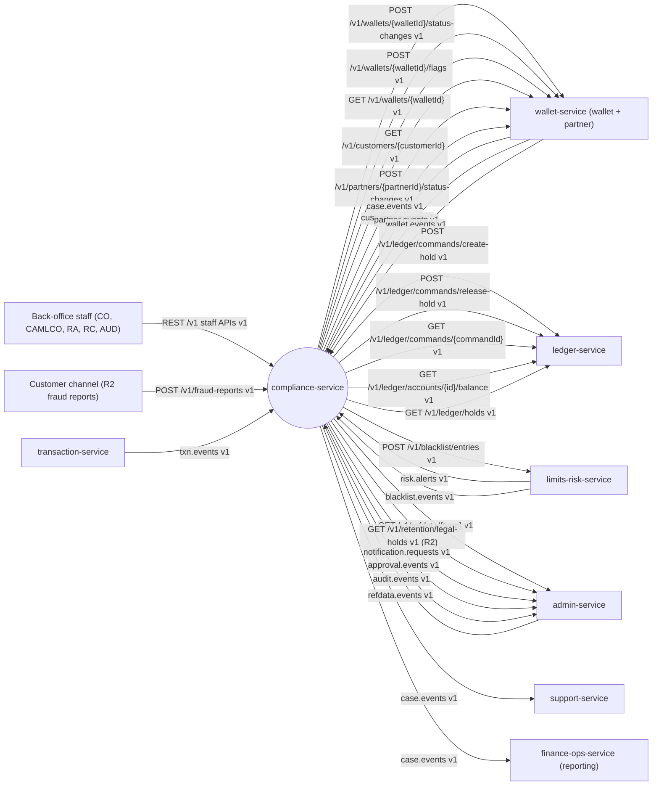

### 3.2 Component diagram

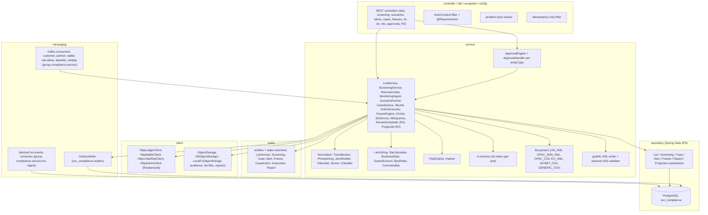

### 3.3 Runtime and deployment (Compose)

| Item | Value |
|---|---|
| Compose service | `compliance-service`, ports 8111 / 9111, `mem_limit` 384 MB, depends on `postgres`, `kafka-init`, `object-store` |
| Spring profiles | `dev` (Compose; all roles in one container), `local`, `hybrid`; role profiles `api` (REST + list index) and `worker` (consumers, jobs) — `dev` enables both |
| Schema | `svc_compliance`, Flyway location `db/migration`, one history table |
| Redis / TigerBeetle / ClickHouse | none |
| Object storage | S3 via `BITSPAY_S3_ENDPOINT`, `_ACCESSKEY`, `_SECRETKEY`, `_REGION`; bucket `bitspay-docs` (list files, evidence, instruction documents; prefix `compliance/`), bucket `bitspay-reports` (STR/CTR/MIS/export files; prefix `compliance/`). `client.ObjectStorage` interface with two config-selected implementations, `s3` and `local-fs` (tests) |
| Service clients (kernel K8.3) | `BITSPAY_CLIENTS_LEDGER_BASEURL`, `BITSPAY_CLIENTS_WALLET_BASEURL` (wallet + partner APIs), `BITSPAY_CLIENTS_LIMITSRISK_BASEURL`, `BITSPAY_CLIENTS_ADMIN_BASEURL`; tests and profile `local` point them at WireMock |
| Secrets | `BITSPAY_PLATFORM_HMAC_KEY` (kernel K2 hashes), `BITSPAY_FIELD_CIPHER_KEY` (STR typed ID numbers, encrypted evidence) |
| Consumer groups | `compliance-service`: `customer.events`, `partner.events`, `wallet.events`, `risk.alerts`, `blacklist.events`, `refdata.events` · `compliance-service.txn-ingest`: `txn.events` (OPEN D-30) |
| Produced topics | `case.events` (3 / 6 partitions, 7 d), plus inbound topics `notification.requests`, `approval.events`, `audit.events` via the same outbox |
| Leader-only jobs | `pg_try_advisory_lock(<job hash>)`: scenario runner, CTR job, SLA job, freeze executor sweep, partition maintenance, rescreen coordinator, review scheduler (R2), purge (R2), outbox/inbox cleanup |
| Scheduled jobs | SLA/escalation every 5 min; freeze executor sweep every 30 s; scenario runner every 5 min (runs due windows); CTR extraction daily 02:00 Asia/Dhaka for business date D-1; partition maintenance daily 01:00; list-index reload check every 10 s (`config_version`); review scheduler daily 00:30 (R2); purge weekly (R2); outbox cleanup (> 3 days) and `processed_event` cleanup (> 14 days) daily |
| Readiness | own Postgres + Kafka + object storage only; never waits for another service |

### 3.4 Key flows

**Customer onboarding screening (ONB-008)**

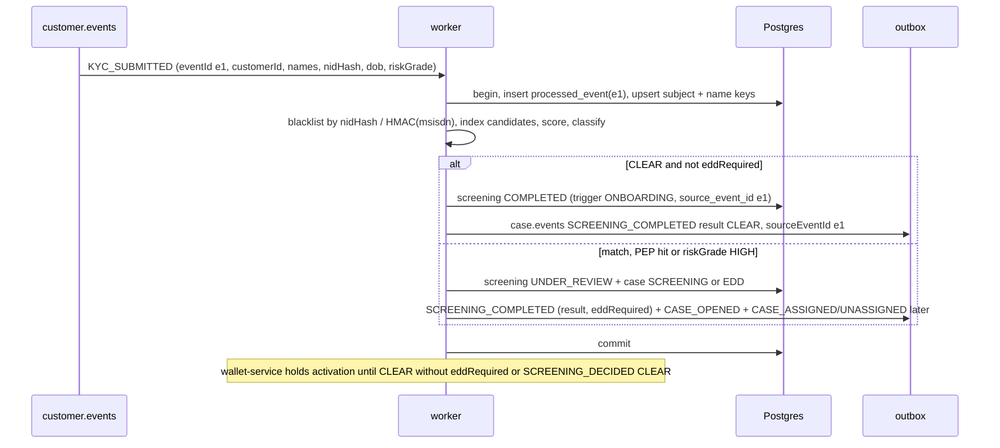

**Partner screening (PON-004)**

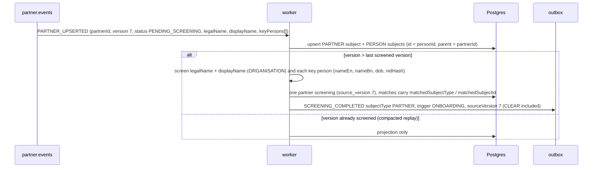

**List update and DELTA re-screen (AML-001)**

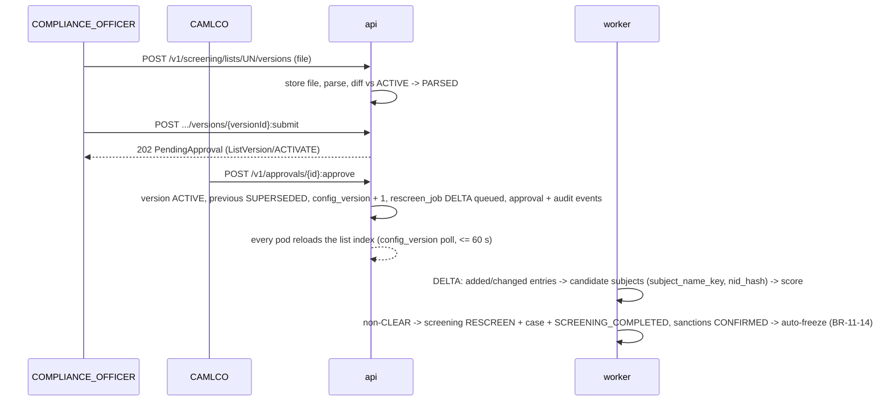

**Monitoring → case → freeze + lien → STR**

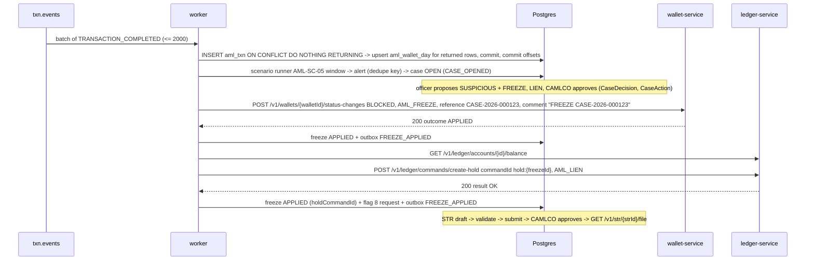

**Lien with an unknown outcome and a rejection**

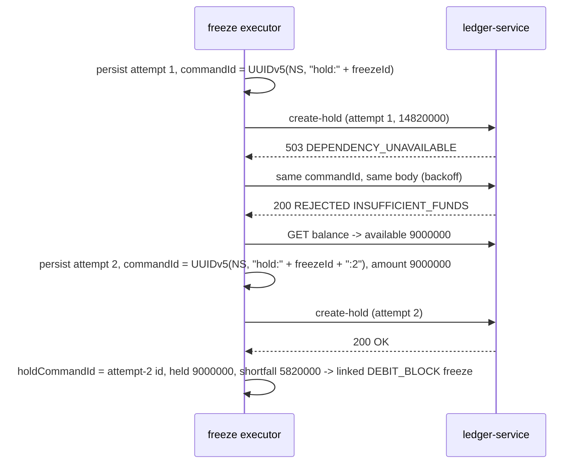

**Freeze lift (C-007 resolution)**

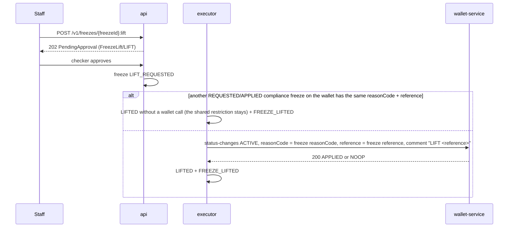

**Fraud alert ingestion**

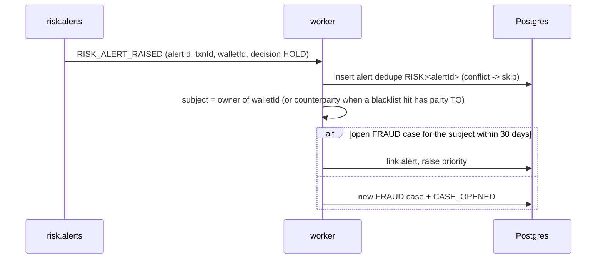

### 3.5 State machines

**List version**
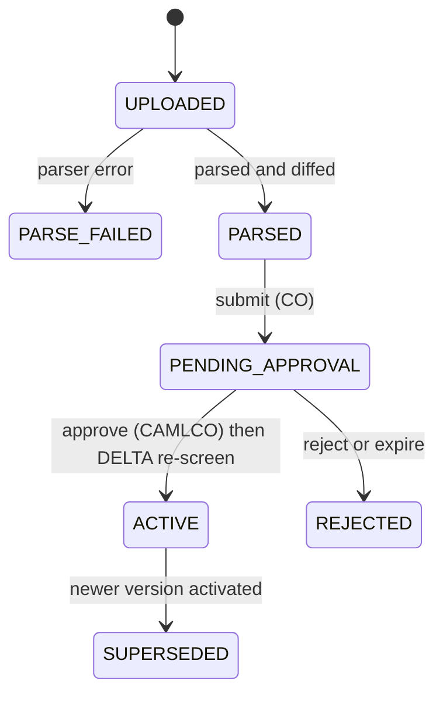

**Screening**
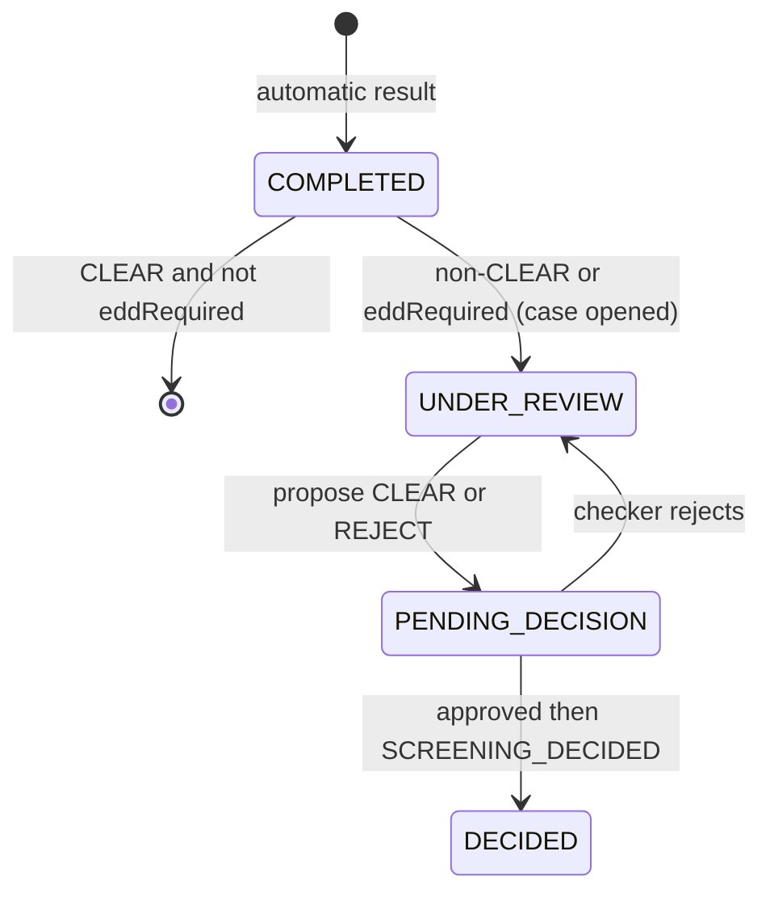

**Case**
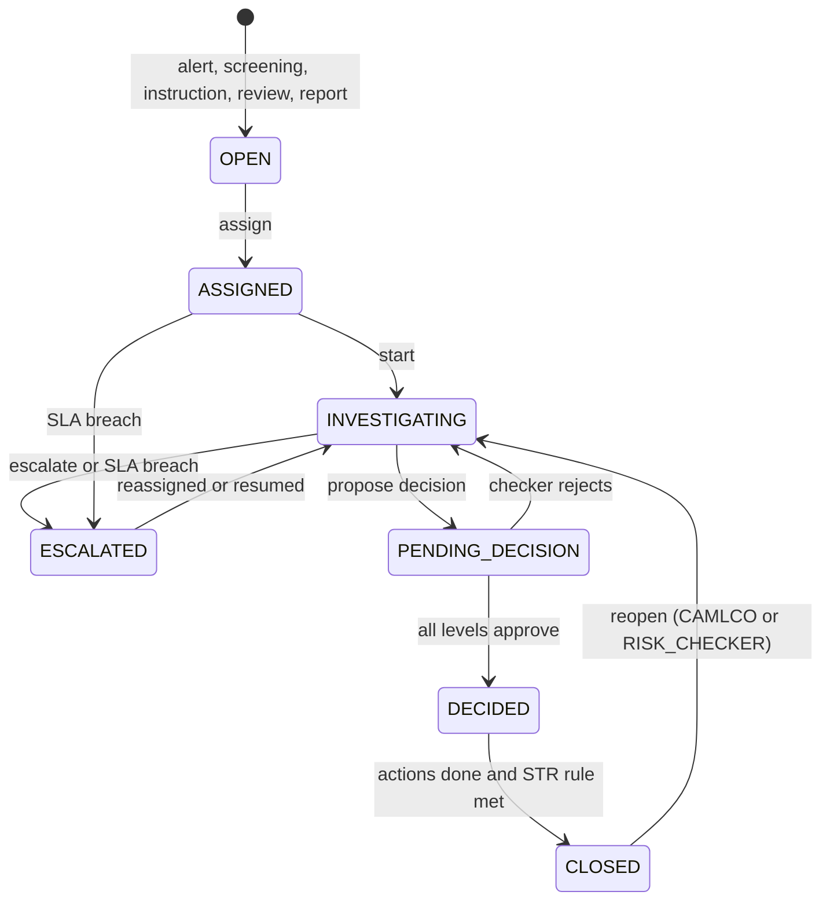

**Alert**
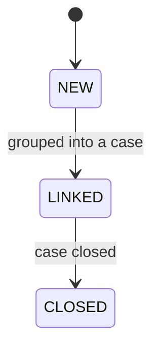

**Freeze**
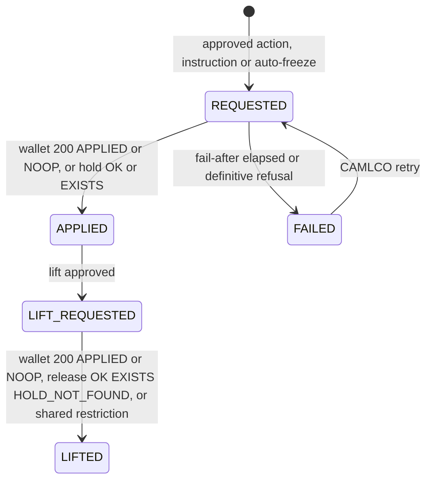

**Case action**
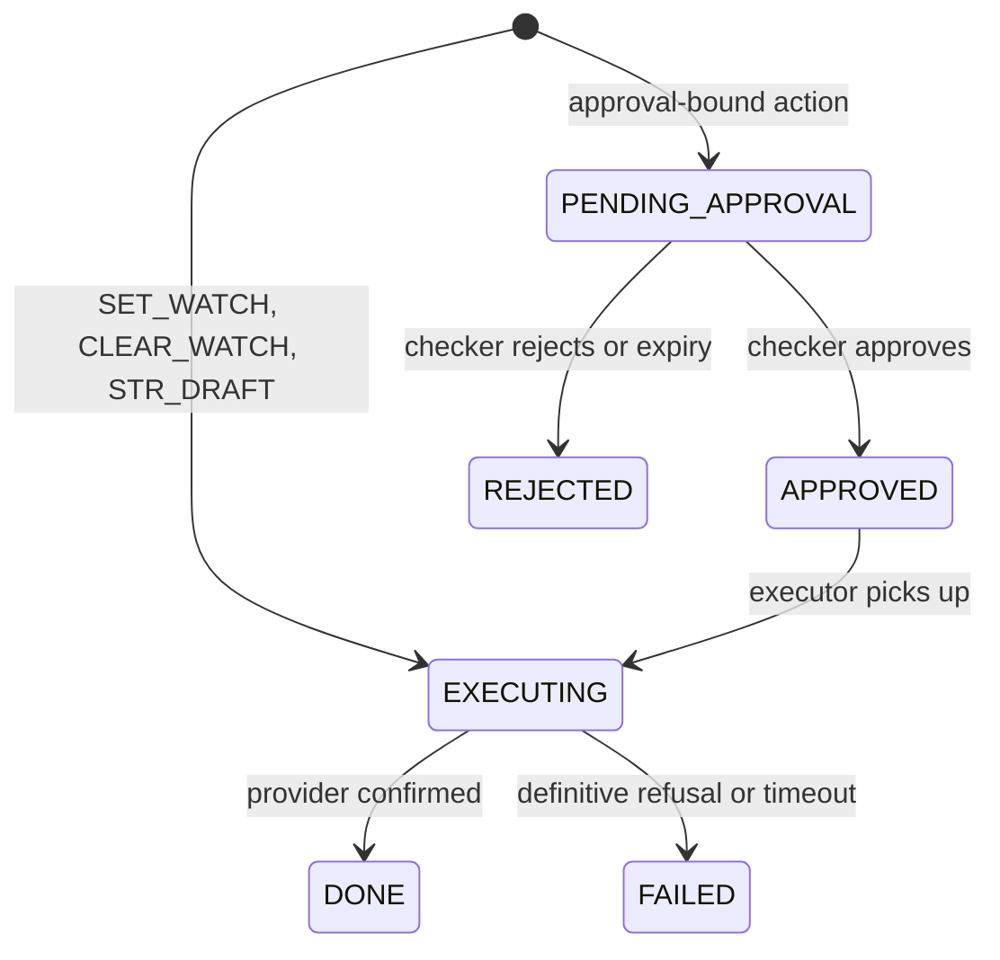

**Regulatory instruction**
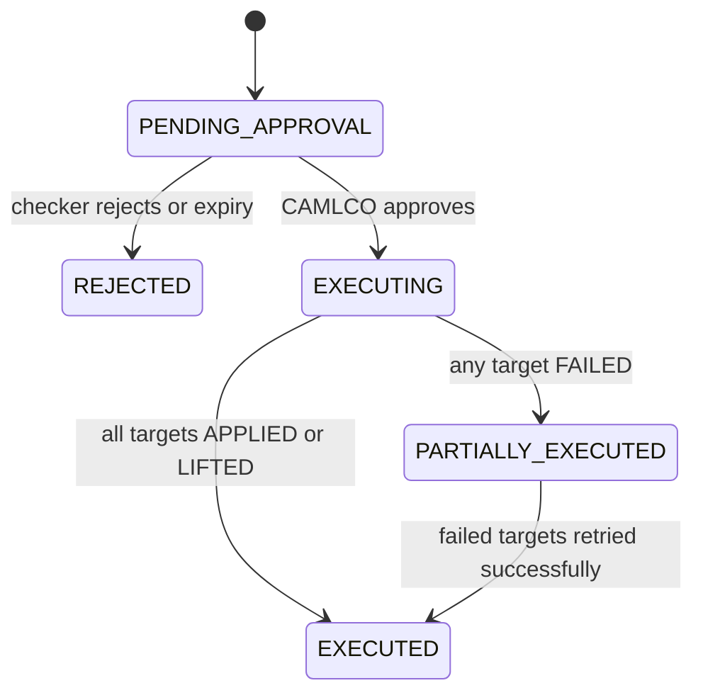

**STR / CTR report**
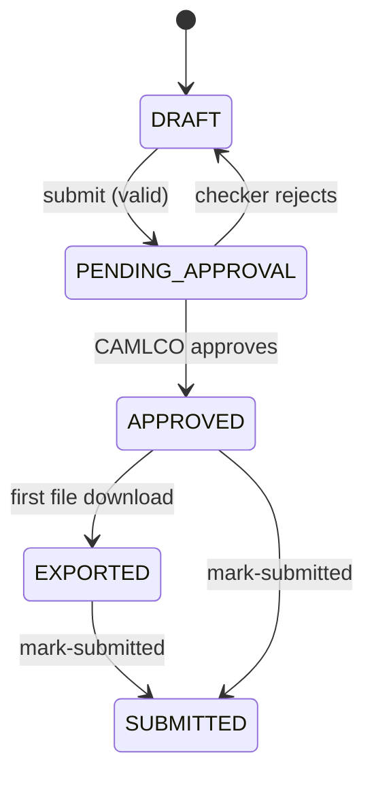

A rejected STR/CTR approval returns the report to DRAFT (the status `REJECTED` is reserved for a report withdrawn by CAMLCO; it frees the period/case for a new report).

### 3.6 Architecture decisions

| ADR | Decision | Why | Consequence |
|---|---|---|---|
| ADR-01 Screening index | Active list entries (tens of thousands with aliases) live in memory per pod as phonetic-token → entry index, rebuilt on `config_version` change. Subjects (up to 80 M) are indexed in Postgres `subject_name_key` for DELTA re-screens; FULL re-screens stream subjects in chunks against the in-memory index | Sub-second onboarding screening without an external search engine | Pods reload within 60 s of activation; screening consumers pause while the index is not loaded |
| ADR-02 Batched `txn.events` ingestion | Poll batches (≤ 2,000) in one DB transaction: `INSERT INTO aml_txn … ON CONFLICT DO NOTHING RETURNING`, then rollup upserts only for returned rows; commit offsets after the DB commit. No `processed_event` for this topic (kernel K4.3 intrinsic idempotent effect) | 5k TPS sustained; replays are no-ops | Consumer group `compliance-service.txn-ingest`; DLQ rules unchanged |
| ADR-03 Scenarios = code types + data parameters | 11 scenario types as parameterised SQL over rollups (stage 1) and detail (stage 2); parameters, enablement, schedule and severity are data with maker-checker | AML-004 "configurable" without code changes | New scenario *types* need a release; thresholds do not |
| ADR-04 Confirmation from the provider's response | A freeze/lift is confirmed by wallet-service HTTP 200 `outcome ∈ {APPLIED, NOOP}`; a lien by ledger `OK`/`EXISTS`. A 202 for `AML_FREEZE`/`FRAUD_FREEZE` is an integration error. `wallet.events` only refreshes the projection | The wallet emits no event for an add/lift that changes nothing visible on some paths and `NOOP` emits nothing | Retries reuse the same Idempotency-Key / commandId; `NOOP` makes them safe |
| ADR-05 goAML as template + optional XSD | Streaming XML writer from a code template; validated against the operator-provided BFIU XSD when `goaml.xsd-path` is set, else structural checks; code lists are table data | BFIU XSD and code lists not yet available | Swapping in the XSD needs no code change |
| ADR-06 Tipping-off protection | No customer-facing message for AML cases, screenings or STRs; freeze reason sent to wallet-service is the reason code only, comment `FREEZE <reference>` or `LIFT <reference>`; customer message only `WALLET_RESTRICTED_NOTICE` (opt-in, regulatory instructions) | MLPA 2012, SRS REF-05 | Notification test asserts staff-only recipients |
| ADR-07 One case model | Fraud and AML share `case_file` with `domain` and `case_type`; role routing per domain (RISK_* for FRAUD, COMPLIANCE_OFFICER/CAMLCO for AML) | One workflow, one SLA engine, one MIS | Domain decides checker roles and freeze reason |
| ADR-08 Attempt-derived lien commandIds | `hold:{freezeId}` for attempt 1, `hold:{freezeId}:{n}` for n ≥ 2; the attempt increments only after a definitive `REJECTED`; the posted id is stored and released | Ledger: a REJECTED result is final for its commandId (OPEN D-16) | `FREEZE_APPLIED.holdCommandId` = the attempt that posted |
| ADR-09 Lift by (reasonCode, reference) | Lift = `targetStatus ACTIVE` + the freeze's own `reasonCode` + the exact `reference` sent on apply; stored status-before is informational only | Prevents lifting other services' or other cases' restrictions (C-007) | Freezes sharing a restriction are lifted at the wallet only when the last one goes |

### 3.7 Latency / throughput budget

compliance-service is not on the payment hot path. Budgets: `txn.events` ingestion keeps up with the 5k TPS sustained / 10k burst (10 min) system target with consumer lag p95 ≤ 60 s; onboarding screening p95 ≤ 2 s from `KYC_SUBMITTED` to `SCREENING_COMPLETED`; ad-hoc screening p95 ≤ 500 ms; case/alert API p95 ≤ 300 ms. Outbound calls: 300 ms connect, 1 s read (reads) / 2 s read (status changes and ledger commands).

## 4. Data model

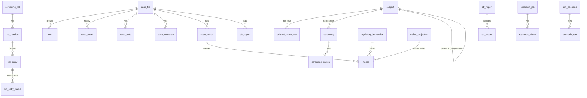

### 4.1 Tables — Flyway `V1__init.sql`

```sql
CREATE EXTENSION IF NOT EXISTS pg_trgm;

-- ===== kernel K8.2 outbox / inbox =====
CREATE TABLE IF NOT EXISTS outbox (
  id             uuid PRIMARY KEY,                    -- = envelope eventId
  aggregate_type text        NOT NULL,                -- = Kafka topic
  aggregate_id   text        NOT NULL,                -- = Kafka key = envelope aggregateId
  event_type     text        NOT NULL,
  payload        jsonb       NULL,                    -- full envelope (never NULL here: no tombstones)
  created_at     timestamptz NOT NULL DEFAULT now(),
  published_at   timestamptz
);
CREATE INDEX IF NOT EXISTS outbox_unpublished ON outbox (created_at) WHERE published_at IS NULL;
CREATE TABLE IF NOT EXISTS processed_event (
  event_id     uuid PRIMARY KEY,
  topic        text NOT NULL,
  processed_at timestamptz NOT NULL DEFAULT now()
);

-- ===== Idempotency-Key replay (kernel K3.3, retention >= 7 days) =====
CREATE TABLE idempotency_record (
  actor_id text NOT NULL, idem_key text NOT NULL, request_hash text NOT NULL,
  response_status int NOT NULL, response_body jsonb, created_at timestamptz NOT NULL DEFAULT now(),
  PRIMARY KEY (actor_id, idem_key));

-- ===== maker-checker (kernel K5) =====
CREATE TABLE approval_request (
  id uuid PRIMARY KEY, entity_type text NOT NULL, entity_id text NOT NULL, action text NOT NULL, payload jsonb NOT NULL,
  maker_id text NOT NULL, maker_user_id text,
  status text NOT NULL CHECK (status IN ('PENDING','APPROVED','REJECTED','EXPIRED','CANCELLED')),
  level int NOT NULL DEFAULT 1, required_levels int NOT NULL DEFAULT 1,
  level_roles jsonb NOT NULL,                         -- [["COMPLIANCE_OFFICER","CAMLCO"],["CAMLCO"]] : checkerRoles per level
  excluded_checkers text[] NOT NULL DEFAULT '{}',     -- assignee / proposer, who may not decide
  amount_poisha bigint, summary text NOT NULL,
  created_at timestamptz NOT NULL DEFAULT now(), updated_at timestamptz NOT NULL DEFAULT now(), expires_at timestamptz NOT NULL,
  decided_by text[] NOT NULL DEFAULT '{}', decided_at timestamptz, decision_comment text, version bigint NOT NULL DEFAULT 0);
CREATE INDEX approval_pending ON approval_request (status, created_at) WHERE status = 'PENDING';
CREATE UNIQUE INDEX approval_one_pending ON approval_request (entity_type, entity_id, action) WHERE status = 'PENDING';

CREATE TABLE config_version (id int PRIMARY KEY CHECK (id = 1), version bigint NOT NULL);
INSERT INTO config_version VALUES (1, 1);

CREATE TABLE doc_sequence (kind text NOT NULL, year int NOT NULL, next_value bigint NOT NULL, PRIMARY KEY (kind, year));
-- kinds: CASE (CASE-YYYY-NNNNNN), ALERT (ALT-YYYY-NNNNNNNN), STR (STR-YYYY-NNNNNN), FRAUD_REPORT (FR-YYYY-NNNNNN)

-- ===== reference data (refdata.events) =====
CREATE TABLE refdata_item (
  type text NOT NULL, code text NOT NULL, parent_code text, name_en text NOT NULL, name_bn text NOT NULL,
  attributes jsonb NOT NULL, version bigint NOT NULL, active boolean NOT NULL, updated_at timestamptz NOT NULL DEFAULT now(),
  PRIMARY KEY (type, code));                          -- only GEO and SYSTEM_PARAM CUTOFF.EOD / RETENTION.AML_CASE kept

-- ===== subjects & projections =====
CREATE TABLE subject (
  id            uuid PRIMARY KEY,                    -- customerId | partnerId | key-person personId | generated (ad-hoc PERSON)
  subject_type  text NOT NULL CHECK (subject_type IN ('CUSTOMER','PARTNER','PERSON')),
  parent_subject_id uuid REFERENCES subject(id),     -- PERSON key person -> PARTNER
  person_role   text,                                -- PROPRIETOR | DIRECTOR | PARTNER | AUTHORISED_SIGNATORY | BENEFICIAL_OWNER
  entity_kind   text NOT NULL CHECK (entity_kind IN ('INDIVIDUAL','ORGANISATION')),
  name_en       text, name_bn text,                  -- partners: name_en = legalName
  name_alt      text,                                -- partners: displayName (second screened variant)
  name_norm     text NOT NULL,                       -- normalised Latin of the primary name (display, trigram)
  dob           date, dob_year int,
  nid_hash      text, msisdn_hash text, msisdn_masked text,
  risk_grade    text CHECK (risk_grade IN ('LOW','MEDIUM','HIGH')),
  kyc_tier      smallint, kyc_status text,           -- customers
  partner_type  text, district text, upazila text,   -- GEO codes
  occupation    text, income_band text, gender text,
  source_status text,                                -- partner status / KYC status as last seen
  source_version bigint,                             -- partners: last PARTNER_UPSERTED version applied
  last_screened_version bigint,                      -- partners: last version answered with SCREENING_COMPLETED
  pep           boolean NOT NULL DEFAULT false,
  last_screened_at timestamptz, ad_hoc boolean NOT NULL DEFAULT false,
  created_at timestamptz NOT NULL DEFAULT now(), updated_at timestamptz NOT NULL DEFAULT now(), version bigint NOT NULL DEFAULT 0);
CREATE INDEX subject_nid ON subject (nid_hash) WHERE nid_hash IS NOT NULL;
CREATE INDEX subject_msisdn ON subject (msisdn_hash) WHERE msisdn_hash IS NOT NULL;
CREATE INDEX subject_parent ON subject (parent_subject_id) WHERE parent_subject_id IS NOT NULL;
CREATE INDEX subject_trgm ON subject USING gin (name_norm gin_trgm_ops);

CREATE TABLE subject_name_key (key text NOT NULL, subject_id uuid NOT NULL REFERENCES subject(id) ON DELETE CASCADE,
  PRIMARY KEY (key, subject_id));

CREATE TABLE wallet_projection (                     -- wallet.events (compacted); never a freeze confirmation
  wallet_id uuid PRIMARY KEY, owner_type text NOT NULL, owner_id uuid NOT NULL, wallet_type char(1) NOT NULL,
  status char(1) NOT NULL, previous_status char(1), status_reason text NOT NULL, kyc_tier smallint, category_code int,
  flags int NOT NULL DEFAULT 0, msisdn_hash text NOT NULL, msisdn_masked text NOT NULL, display_name text,
  reactivated_at timestamptz,                         -- set only on a reactivation (BR-11-71)
  source_version bigint NOT NULL, wallet_created_at timestamptz NOT NULL, updated_at timestamptz NOT NULL DEFAULT now());
CREATE INDEX wallet_owner ON wallet_projection (owner_id);
CREATE INDEX wallet_msisdn ON wallet_projection (msisdn_hash);

CREATE TABLE internal_blacklist (                    -- blacklist.events (compacted), types NID and MSISDN only
  entry_id uuid PRIMARY KEY, type text NOT NULL CHECK (type IN ('NID','MSISDN')), value_hash text NOT NULL,
  active boolean NOT NULL, expires_at timestamptz, reason_code text NOT NULL, updated_at timestamptz NOT NULL DEFAULT now());
CREATE INDEX internal_blacklist_hash ON internal_blacklist (type, value_hash) WHERE active;

-- ===== screening lists =====
CREATE TABLE screening_list (
  list_code   text PRIMARY KEY CHECK (list_code IN ('UN','BFIU','OFAC','EU','UKHMT','PEP','INTERNAL')),
  name        text NOT NULL, list_kind text NOT NULL CHECK (list_kind IN ('SANCTIONS','PEP','INTERNAL')),
  parser      text NOT NULL CHECK (parser IN ('UN_XML','OFAC_SDN_XML','OFAC_CSV','EU_XML','UKHMT_CSV','GENERIC_CSV')),
  threshold   numeric(5,4),                          -- per-list override of screening.threshold.review
  auto_freeze_on_confirmed boolean NOT NULL DEFAULT false,
  active_version_id uuid,
  created_at timestamptz NOT NULL DEFAULT now(), updated_at timestamptz NOT NULL DEFAULT now(), version bigint NOT NULL DEFAULT 0);

CREATE TABLE list_version (
  id uuid PRIMARY KEY, list_code text NOT NULL REFERENCES screening_list(list_code), version_no int NOT NULL,
  file_name text NOT NULL, file_sha256 text NOT NULL, storage_key text NOT NULL, publication_date date,
  status text NOT NULL CHECK (status IN ('UPLOADED','PARSE_FAILED','PARSED','PENDING_APPROVAL','ACTIVE','SUPERSEDED','REJECTED')),
  record_count int, added_count int, changed_count int, removed_count int, parse_report jsonb, diff jsonb,
  uploaded_by text NOT NULL, approval_id uuid, approved_by text, activated_at timestamptz,
  created_at timestamptz NOT NULL DEFAULT now(), updated_at timestamptz NOT NULL DEFAULT now(), version bigint NOT NULL DEFAULT 0,
  UNIQUE (list_code, version_no), UNIQUE (list_code, file_sha256));

CREATE TABLE list_entry (
  id uuid PRIMARY KEY, list_version_id uuid NOT NULL REFERENCES list_version(id), list_code text NOT NULL,
  external_ref text NOT NULL,                        -- e.g. UN "QDi.123", OFAC uid
  entry_type text NOT NULL CHECK (entry_type IN ('INDIVIDUAL','ENTITY','VESSEL','OTHER')),
  primary_name text NOT NULL, dob_text text, dob_year int, nationality text[], programs text[],
  id_number_hashes text[],                           -- kernel K2 HMAC of normalised national IDs / passports
  id_numbers_masked text[], addresses jsonb, remarks text, raw jsonb NOT NULL,
  entry_hash text NOT NULL,                          -- SHA-256 of canonical content, change detection
  UNIQUE (list_version_id, external_ref));
CREATE INDEX list_entry_ref ON list_entry (list_code, external_ref);
CREATE INDEX list_entry_idhash ON list_entry USING gin (id_number_hashes);

CREATE TABLE list_entry_name (
  entry_id uuid NOT NULL REFERENCES list_entry(id) ON DELETE CASCADE, name_raw text NOT NULL,
  name_norm text NOT NULL, script text NOT NULL CHECK (script IN ('LATIN','BENGALI','OTHER')), is_primary boolean NOT NULL,
  PRIMARY KEY (entry_id, name_norm));
CREATE INDEX list_entry_name_trgm ON list_entry_name USING gin (name_norm gin_trgm_ops);

CREATE TABLE translit_rule (bn_seq text PRIMARY KEY, latin text NOT NULL, priority int NOT NULL DEFAULT 0, version bigint NOT NULL DEFAULT 0);
CREATE TABLE name_dictionary (variant text PRIMARY KEY, canonical text NOT NULL,
  kind text NOT NULL CHECK (kind IN ('HONORIFIC','NAME','COMMON_TOKEN')), version bigint NOT NULL DEFAULT 0);
CREATE TABLE screening_settings (settings_version int PRIMARY KEY, status text NOT NULL CHECK (status IN ('ACTIVE','SUPERSEDED','PENDING_APPROVAL','REJECTED')),
  body jsonb NOT NULL, created_by text NOT NULL, approved_by text, created_at timestamptz NOT NULL DEFAULT now());

-- ===== screening =====
CREATE TABLE screening (
  id uuid PRIMARY KEY, subject_id uuid NOT NULL REFERENCES subject(id),
  trigger text NOT NULL CHECK (trigger IN ('ONBOARDING','RESCREEN','MANUAL','PROFILE_CHANGE','PERIODIC')),
  list_versions jsonb NOT NULL,                      -- {"UN": 14, "OFAC": 9, ...} active at screening time
  result text NOT NULL CHECK (result IN ('CLEAR','POTENTIAL_MATCH','CONFIRMED_MATCH')),
  status text NOT NULL CHECK (status IN ('COMPLETED','UNDER_REVIEW','PENDING_DECISION','DECIDED')),
  max_score numeric(5,4), edd_required boolean NOT NULL DEFAULT false,
  decision text CHECK (decision IN ('CLEAR','REJECT')), decided_by text, decided_at timestamptz,
  case_id uuid, source_event_id uuid, source_version bigint, published boolean NOT NULL DEFAULT false,
  created_at timestamptz NOT NULL DEFAULT now(), updated_at timestamptz NOT NULL DEFAULT now(), version bigint NOT NULL DEFAULT 0);
CREATE INDEX screening_subject ON screening (subject_id, created_at DESC);
CREATE INDEX screening_open ON screening (status) WHERE status <> 'DECIDED' AND (result <> 'CLEAR' OR edd_required);
CREATE UNIQUE INDEX screening_source_once ON screening (source_event_id) WHERE source_event_id IS NOT NULL;
CREATE UNIQUE INDEX screening_partner_version_once ON screening (subject_id, source_version) WHERE source_version IS NOT NULL;

CREATE TABLE screening_match (
  id uuid PRIMARY KEY, screening_id uuid NOT NULL REFERENCES screening(id),
  list_code text NOT NULL CHECK (list_code IN ('UN','BFIU','OFAC','EU','UKHMT','PEP','INTERNAL','BLACKLIST')),
  list_kind text NOT NULL CHECK (list_kind IN ('SANCTIONS','PEP','INTERNAL','BLACKLIST')),
  list_version_no int NOT NULL,                      -- 0 for BLACKLIST
  entry_id uuid, external_ref text NOT NULL, entry_hash text,
  entry_type text NOT NULL CHECK (entry_type IN ('INDIVIDUAL','ENTITY','VESSEL','OTHER')),
  match_type text NOT NULL CHECK (match_type IN ('NAME','NAME_DOB','ID','INTERNAL_BLACKLIST')),
  matched_name text, subject_name text, score numeric(5,4) NOT NULL, score_breakdown jsonb,
  matched_subject_type text CHECK (matched_subject_type IN ('PARTNER','PERSON')), matched_subject_id uuid,
  disposition text NOT NULL DEFAULT 'PENDING' CHECK (disposition IN ('PENDING','TRUE_MATCH','FALSE_POSITIVE')),
  disposition_by text, disposition_at timestamptz);
CREATE INDEX screening_match_screening ON screening_match (screening_id);

CREATE TABLE screening_fp_suppression (             -- decided false positives are not re-raised for unchanged content
  subject_id uuid NOT NULL, list_code text NOT NULL, entry_external_ref text NOT NULL, entry_hash text NOT NULL,
  subject_fingerprint text NOT NULL,                 -- SHA-256 of normalised names + DOB at decision time
  decided_by text NOT NULL, decided_at timestamptz NOT NULL,
  PRIMARY KEY (subject_id, list_code, entry_external_ref, entry_hash));

CREATE TABLE rescreen_job (
  id uuid PRIMARY KEY, mode text NOT NULL CHECK (mode IN ('DELTA','FULL')), list_version_id uuid, list_codes text[],
  requested_by text NOT NULL,
  status text NOT NULL CHECK (status IN ('QUEUED','RUNNING','COMPLETED','FAILED','CANCELLED')),
  total bigint NOT NULL DEFAULT 0, processed bigint NOT NULL DEFAULT 0, hits int NOT NULL DEFAULT 0,
  started_at timestamptz, finished_at timestamptz, created_at timestamptz NOT NULL DEFAULT now(), version bigint NOT NULL DEFAULT 0);
CREATE TABLE rescreen_chunk (job_id uuid NOT NULL REFERENCES rescreen_job(id), chunk_no int NOT NULL,
  from_subject_id uuid NOT NULL, to_subject_id uuid NOT NULL,
  status text NOT NULL CHECK (status IN ('PENDING','RUNNING','DONE','FAILED')),
  claimed_by text, claimed_at timestamptz, PRIMARY KEY (job_id, chunk_no));

-- ===== monitoring =====
CREATE TABLE aml_txn (
  business_date date NOT NULL,                       -- BR-11-70 (CUTOFF.EOD)
  txn_id uuid NOT NULL, txn_ref text NOT NULL, txn_type text NOT NULL, channel text,
  occurred_at timestamptz NOT NULL,                  -- completedAt
  from_wallet_id uuid NOT NULL, from_wallet_type char(1) NOT NULL,
  to_wallet_id uuid NOT NULL, to_wallet_type char(1) NOT NULL,
  amount_poisha bigint NOT NULL, fee_poisha bigint NOT NULL DEFAULT 0,
  device_id text, risk_decision text, original_txn_ref text,
  reversed boolean NOT NULL DEFAULT false, reversal_txn_ref text, reversed_amount_poisha bigint,
  PRIMARY KEY (business_date, txn_id)) PARTITION BY RANGE (business_date);
CREATE INDEX aml_txn_from ON aml_txn (from_wallet_id, occurred_at);
CREATE INDEX aml_txn_to ON aml_txn (to_wallet_id, occurred_at);
CREATE INDEX aml_txn_ref ON aml_txn (txn_ref);
CREATE INDEX aml_txn_id ON aml_txn (txn_id);

CREATE TABLE aml_wallet_day (
  wallet_id uuid NOT NULL, business_date date NOT NULL, txn_type text NOT NULL,
  direction char(1) NOT NULL CHECK (direction IN ('S','R')),
  cnt int NOT NULL, amount_poisha bigint NOT NULL, max_amount_poisha bigint NOT NULL,
  PRIMARY KEY (business_date, wallet_id, txn_type, direction)) PARTITION BY RANGE (business_date);
CREATE INDEX aml_wallet_day_w ON aml_wallet_day (wallet_id, business_date);

CREATE TABLE aml_scenario (
  code text PRIMARY KEY, name text NOT NULL, scenario_type text NOT NULL, enabled boolean NOT NULL,
  params jsonb NOT NULL, schedule text NOT NULL CHECK (schedule IN ('HOURLY','DAILY')),
  severity text NOT NULL CHECK (severity IN ('LOW','MEDIUM','HIGH','CRITICAL')),
  params_version int NOT NULL DEFAULT 1, last_run_at timestamptz, last_run_window_end timestamptz,
  provisional boolean NOT NULL DEFAULT true, updated_at timestamptz NOT NULL DEFAULT now(), version bigint NOT NULL DEFAULT 0);

CREATE TABLE scenario_run (id uuid PRIMARY KEY, scenario_code text NOT NULL, window_start timestamptz NOT NULL, window_end timestamptz NOT NULL,
  candidates int, alerts int, status text NOT NULL CHECK (status IN ('RUNNING','COMPLETED','FAILED')),
  started_at timestamptz NOT NULL, finished_at timestamptz, error text,
  UNIQUE (scenario_code, window_end));

-- ===== alerts & cases =====
CREATE TABLE alert (
  id uuid PRIMARY KEY, alert_no text NOT NULL UNIQUE,                     -- ALT-2026-00001234
  domain text NOT NULL CHECK (domain IN ('FRAUD','AML')),
  source text NOT NULL CHECK (source IN ('FRAUD_RULE','AML_SCENARIO','SCREENING','CUSTOMER_REPORT','MANUAL','EXTERNAL','REGULATORY')),
  source_ref text,                                    -- risk alertId, scenario runId, screeningId, fraud reportId
  dedupe_key text NOT NULL UNIQUE,                    -- RISK:<alertId> | <scenarioCode>|<walletId>|<windowEnd date> | SCR:<screeningId> | ...
  scenario_code text, rule_ids text[] NOT NULL DEFAULT '{}', risk_score int, decision text,
  subject_id uuid, wallet_id uuid, txn_ids uuid[] NOT NULL DEFAULT '{}', txn_refs text[] NOT NULL DEFAULT '{}', amount_poisha bigint,
  severity text NOT NULL CHECK (severity IN ('LOW','MEDIUM','HIGH','CRITICAL')),
  status text NOT NULL CHECK (status IN ('NEW','LINKED','CLOSED')),
  disposition text CHECK (disposition IN ('TRUE_POSITIVE','FALSE_POSITIVE','INCONCLUSIVE')),
  details jsonb NOT NULL, case_id uuid,
  created_at timestamptz NOT NULL DEFAULT now(), updated_at timestamptz NOT NULL DEFAULT now(), version bigint NOT NULL DEFAULT 0);
CREATE INDEX alert_wallet ON alert (wallet_id, created_at DESC);
CREATE INDEX alert_open ON alert (status) WHERE status <> 'CLOSED';
CREATE INDEX alert_suppress ON alert (scenario_code, wallet_id, created_at DESC) WHERE status <> 'CLOSED';

CREATE TABLE case_file (
  id uuid PRIMARY KEY, case_no text NOT NULL UNIQUE,                      -- CASE-2026-000123
  domain text NOT NULL CHECK (domain IN ('FRAUD','AML')),
  case_type text NOT NULL CHECK (case_type IN ('FRAUD','AML_MONITORING','SCREENING','EDD','REGULATORY_INSTRUCTION','PERIODIC_REVIEW','CUSTOMER_REPORT')),
  subject_id uuid REFERENCES subject(id), primary_wallet_id uuid,
  priority text NOT NULL CHECK (priority IN ('LOW','MEDIUM','HIGH','CRITICAL')),
  status text NOT NULL CHECK (status IN ('OPEN','ASSIGNED','INVESTIGATING','ESCALATED','PENDING_DECISION','DECIDED','CLOSED')),
  assignee_id text, escalation_level int NOT NULL DEFAULT 0,
  sla_due_at timestamptz NOT NULL, sla_warned boolean NOT NULL DEFAULT false, sla_breached boolean NOT NULL DEFAULT false,
  unassigned_notified boolean NOT NULL DEFAULT false,
  proposed_decision text, proposed_by text, proposal jsonb, approval_id uuid,
  decision text CHECK (decision IN ('CONFIRMED_FRAUD','FALSE_POSITIVE','SUSPICIOUS','NOT_SUSPICIOUS','EDD_APPROVED','EDD_REJECTED',
                                     'SCREENING_CLEAR','SCREENING_REJECT','INSTRUCTION_EXECUTED','REVIEW_COMPLETED')),
  decided_by text[] NOT NULL DEFAULT '{}', decided_at timestamptz, resolution text, no_str_justification text,
  confirmed_fraud_poisha bigint NOT NULL DEFAULT 0, recovered_poisha bigint NOT NULL DEFAULT 0,
  edd_checklist jsonb, recommended_grade text, recommended_actions text[] NOT NULL DEFAULT '{}',
  screening_id uuid, instruction_id uuid,
  opened_at timestamptz NOT NULL DEFAULT now(), closed_at timestamptz,
  created_at timestamptz NOT NULL DEFAULT now(), updated_at timestamptz NOT NULL DEFAULT now(), version bigint NOT NULL DEFAULT 0);
CREATE INDEX case_open ON case_file (status, priority, sla_due_at) WHERE status <> 'CLOSED';
CREATE INDEX case_subject ON case_file (subject_id, domain) WHERE status <> 'CLOSED';

CREATE TABLE case_event (                            -- immutable case history (FRD-011)
  id bigserial PRIMARY KEY, case_id uuid NOT NULL REFERENCES case_file(id), event_type text NOT NULL,
  actor_id text NOT NULL, actor_roles text[], body jsonb NOT NULL, created_at timestamptz NOT NULL DEFAULT now());
CREATE TABLE case_note (id uuid PRIMARY KEY, case_id uuid NOT NULL REFERENCES case_file(id), author_id text NOT NULL,
  body text NOT NULL, created_at timestamptz NOT NULL DEFAULT now());
CREATE TABLE case_evidence (id uuid PRIMARY KEY, case_id uuid REFERENCES case_file(id), instruction_id uuid,
  file_name text NOT NULL, content_type text NOT NULL, size_bytes bigint NOT NULL, sha256 text NOT NULL, storage_key text NOT NULL,
  uploaded_by text NOT NULL, created_at timestamptz NOT NULL DEFAULT now());
CREATE TABLE case_action (
  id uuid PRIMARY KEY, case_id uuid REFERENCES case_file(id), instruction_id uuid,
  action_type text NOT NULL CHECK (action_type IN ('FREEZE','DEBIT_BLOCK','LIEN','LIFT','SET_WATCH','CLEAR_WATCH',
                                                    'PROPOSE_BLACKLIST','STR_DRAFT','REGRADE','RECOMMEND_REVERSAL','SUSPEND_PARTNER')),
  wallet_id uuid, partner_id uuid, amount_poisha bigint, params jsonb NOT NULL DEFAULT '{}',
  status text NOT NULL CHECK (status IN ('PENDING_APPROVAL','APPROVED','EXECUTING','DONE','FAILED','REJECTED')),
  requested_by text NOT NULL, approval_id uuid, result jsonb, attempts int NOT NULL DEFAULT 0, next_attempt_at timestamptz,
  created_at timestamptz NOT NULL DEFAULT now(), updated_at timestamptz NOT NULL DEFAULT now(), version bigint NOT NULL DEFAULT 0);
CREATE INDEX case_action_due ON case_action (next_attempt_at) WHERE status IN ('APPROVED','EXECUTING');

-- ===== freezes & regulatory instructions =====
CREATE TABLE regulatory_instruction (
  id uuid PRIMARY KEY, reference_no text NOT NULL UNIQUE,
  authority text NOT NULL CHECK (authority IN ('BFIU','COURT','BB','ACC','POLICE')),
  received_date date NOT NULL, instruction_type text NOT NULL CHECK (instruction_type IN ('FULL_BLOCK','DEBIT_BLOCK','LIEN','LIFT')),
  targets jsonb NOT NULL,                             -- [{walletId, amountPoisha?, freezeId?}]
  document_evidence_id uuid NOT NULL, case_id uuid, approval_id uuid,
  status text NOT NULL CHECK (status IN ('PENDING_APPROVAL','EXECUTING','EXECUTED','PARTIALLY_EXECUTED','REJECTED')),
  created_by text NOT NULL, approved_by text,
  created_at timestamptz NOT NULL DEFAULT now(), updated_at timestamptz NOT NULL DEFAULT now(), version bigint NOT NULL DEFAULT 0);

CREATE TABLE freeze (
  id uuid PRIMARY KEY, wallet_id uuid NOT NULL, case_id uuid, instruction_id uuid, action_id uuid,
  freeze_type text NOT NULL CHECK (freeze_type IN ('FULL_BLOCK','DEBIT_BLOCK','LIEN')),
  reason_code text NOT NULL CHECK (reason_code IN ('AML_FREEZE','FRAUD_FREEZE','AML_LIEN')),
  reference text NOT NULL,                            -- caseNo or instruction referenceNo; identical on apply and lift
  requested_amount_poisha bigint, held_amount_poisha bigint, shortfall_poisha bigint,
  hold_attempt int,                                   -- LIEN: current attempt n (persisted before the call)
  current_hold_command_id uuid,                       -- LIEN: commandId of attempt n
  hold_command_id uuid,                               -- LIEN: the commandId that posted (OK / EXISTS)
  release_command_id uuid, linked_freeze_id uuid,    -- shortfall DEBIT_BLOCK of a LIEN
  status_before char(1),                              -- informational only
  status text NOT NULL CHECK (status IN ('REQUESTED','APPLIED','FAILED','LIFT_REQUESTED','LIFTED')),
  step_started_at timestamptz,                        -- first try of the current step (apply or lift)
  attempts int NOT NULL DEFAULT 0, next_attempt_at timestamptz, last_error text,
  lift_approval_id uuid, applied_at timestamptz, lifted_at timestamptz,
  applied_event_emitted boolean NOT NULL DEFAULT false, lifted_event_emitted boolean NOT NULL DEFAULT false,
  created_at timestamptz NOT NULL DEFAULT now(), updated_at timestamptz NOT NULL DEFAULT now(), version bigint NOT NULL DEFAULT 0);
CREATE INDEX freeze_wallet ON freeze (wallet_id) WHERE status IN ('REQUESTED','APPLIED','LIFT_REQUESTED');
CREATE INDEX freeze_due ON freeze (next_attempt_at) WHERE status IN ('REQUESTED','LIFT_REQUESTED');
CREATE UNIQUE INDEX freeze_one_active ON freeze (wallet_id, freeze_type, reason_code, reference)
  WHERE status IN ('REQUESTED','APPLIED','LIFT_REQUESTED');

-- ===== CTR / STR =====
CREATE TABLE ctr_record (
  business_date date NOT NULL, wallet_id uuid NOT NULL, subject_id uuid,
  cash_in_poisha bigint NOT NULL, cash_out_poisha bigint NOT NULL, txn_count int NOT NULL,
  status text NOT NULL CHECK (status IN ('EXTRACTED','INCLUDED','EXPORTED')), report_id uuid,
  created_at timestamptz NOT NULL DEFAULT now(), PRIMARY KEY (business_date, wallet_id));
CREATE TABLE ctr_report (
  id uuid PRIMARY KEY, period text NOT NULL,          -- 2026-10
  status text NOT NULL CHECK (status IN ('DRAFT','PENDING_APPROVAL','APPROVED','EXPORTED','SUBMITTED','REJECTED')),
  record_count int NOT NULL, total_poisha bigint NOT NULL, storage_key text, file_sha256 text, goaml_reference text, submitted_at timestamptz,
  approval_id uuid, created_by text NOT NULL, approved_by text,
  created_at timestamptz NOT NULL DEFAULT now(), updated_at timestamptz NOT NULL DEFAULT now(), version bigint NOT NULL DEFAULT 0);
CREATE UNIQUE INDEX ctr_report_period ON ctr_report (period) WHERE status <> 'REJECTED';
CREATE TABLE str_report (
  id uuid PRIMARY KEY, str_no text NOT NULL UNIQUE,  -- STR-2026-000045 (= goAML entity_reference)
  case_id uuid NOT NULL REFERENCES case_file(id), report_code text NOT NULL CHECK (report_code IN ('STR','SAR')),
  status text NOT NULL CHECK (status IN ('DRAFT','PENDING_APPROVAL','APPROVED','EXPORTED','SUBMITTED','REJECTED')),
  fields jsonb NOT NULL,                             -- editable draft without clear ID numbers
  fields_secret bytea,                               -- FieldCipher(AES-GCM) of {partyIndex -> idNumber}
  xml_storage_key text, xml_sha256 text, validation_report jsonb, validated_version bigint,
  goaml_reference text, submitted_at timestamptz, approval_id uuid,
  created_by text NOT NULL, approved_by text,
  created_at timestamptz NOT NULL DEFAULT now(), updated_at timestamptz NOT NULL DEFAULT now(), version bigint NOT NULL DEFAULT 1);
CREATE UNIQUE INDEX str_one_per_case ON str_report (case_id) WHERE status <> 'REJECTED';
CREATE TABLE goaml_code_map (code_type text NOT NULL, internal_value text NOT NULL, goaml_code text NOT NULL,
  provisional boolean NOT NULL DEFAULT true, PRIMARY KEY (code_type, internal_value));

-- ===== notifications sent (dedupe) =====
CREATE TABLE notification_sent (dedupe_key text PRIMARY KEY, request_id uuid NOT NULL, created_at timestamptz NOT NULL DEFAULT now());

-- ===== R2 =====
CREATE TABLE fraud_report (
  id uuid PRIMARY KEY, report_no text NOT NULL UNIQUE, reporter_wallet_id uuid NOT NULL, reporter_customer_id uuid NOT NULL, txn_ref text,
  reported_msisdn_hash text, reported_msisdn_masked text,
  category text NOT NULL CHECK (category IN ('SCAM','UNAUTHORISED','SIM_SWAP','PHISHING','OTHER')),
  description text, status text NOT NULL CHECK (status IN ('RECEIVED','UNDER_REVIEW','CLOSED')), alert_id uuid,
  created_at timestamptz NOT NULL DEFAULT now(), updated_at timestamptz NOT NULL DEFAULT now(), version bigint NOT NULL DEFAULT 0);
CREATE TABLE review_schedule (subject_id uuid PRIMARY KEY REFERENCES subject(id), risk_grade text NOT NULL,
  next_review_at date NOT NULL, last_review_case_id uuid, updated_at timestamptz NOT NULL DEFAULT now());
CREATE TABLE export_job (id uuid PRIMARY KEY, dataset text NOT NULL CHECK (dataset IN ('TRANSACTIONS','CUSTOMERS','ALERTS')),
  from_ts timestamptz NOT NULL, to_ts timestamptz NOT NULL, format text NOT NULL CHECK (format IN ('CSV','JSONL')),
  status text NOT NULL CHECK (status IN ('QUEUED','RUNNING','COMPLETED','FAILED')), storage_key text,
  requested_by text NOT NULL, created_at timestamptz NOT NULL DEFAULT now(), finished_at timestamptz);
```

Partitions: `aml_txn` daily and `aml_wallet_day` monthly, created 7 days / 3 months ahead by the partition job; `aml_txn` partitions older than `monitoring.detail-retention` (180 days) are dropped. Case history (`case_event`) snapshots the transaction list an investigation needs, and STR drafts snapshot their transactions when created.

`V2__seed_provisional.sql` seeds (all `provisional = true` where the column exists, listed in `docs/PROVISIONAL-SEEDS.md`): the seven `screening_list` rows (UN `UN_XML` auto-freeze; BFIU `GENERIC_CSV` auto-freeze; OFAC `OFAC_SDN_XML`; EU `EU_XML`; UKHMT `UKHMT_CSV`; PEP `GENERIC_CSV` threshold 0.88; INTERNAL `GENERIC_CSV`), the transliteration table and dictionary (BR-11-04), screening settings v1 (§8), the 11 scenarios (BR-11-28), the goAML code map and `doc_sequence` rows.

### 4.2 Redis keys / caches

None. The list index is an in-process structure (ADR-01); Caffeine caches only `refdata_item` and settings.

### 4.3 Retention and archival

| Data | Online | Total | Rule |
|---|---|---|---|
| Cases, alerts, screenings, actions, freezes, instructions, STR/CTR, evidence | `RETENTION.AML_CASE.onlineMonths` (seed 24) | `totalYears` (seed 5) after case closure / report submission | basis `CASE_CLOSURE`, end action `PURGE` (R2, BR-11-58, legal-hold check first) |
| `aml_txn` detail | 180 days (`monitoring.detail-retention`) | — | partition drop |
| `aml_wallet_day` | 24 months | — | partition drop |
| List versions and entries | forever | — | audit of what was screened against |
| `idempotency_record` | 7 days | — | cleanup job |
| outbox / processed_event | 3 / 14 days | — | kernel K8.2 cleanup |

## 5. Provided contracts

Mirror of `contracts/provided/` — on any conflict the artefact wins (kernel precedence 3).

### 5.1 REST operations

Common rules for every operation:
- Headers per kernel K3.1, read only through `ActorContext`. Staff operations require `X-Actor-Type: STAFF`, `X-Actor-Roles` and `X-Channel: BACKOFFICE` (any channel is accepted; it is recorded). The R2 customer operations require `X-Actor-Type: CUSTOMER` and `X-Actor-Wallet-Id`.
- Errors per kernel K3.6; provider-owned `reason` values and extension members per operation are listed below and in `codes.yaml`.
- `Idempotency-Key` is **optional** on staff POST/PUT operations (honoured per kernel K3.3 when sent, replayed from `idempotency_record`) and **required** on `POST /v1/fraud-reports`. No operation moves money; state changes that reach other services go through approvals and deterministic ids.
- Paged lists follow kernel K3.4 (default `limit` 50). Not-paged lists state their bound.
- Every state-changing operation writes `audit.events` (and `case_event` for case-related changes) in the same DB transaction; downloads of evidence, STR/CTR files, MIS CSVs and exports are audited too (`x-audit: true`).
- "Assignee" rules (case operations): `RISK_ANALYST` / `COMPLIANCE_OFFICER` act only on cases assigned to them (`403 NOT_CASE_ASSIGNEE`), `RISK_CHECKER` (FRAUD) and `CAMLCO` (AML) act on any case of their domain; a role of the other domain gets `403`.

Role abbreviations in prose: CO = `COMPLIANCE_OFFICER`, CAM = `CAMLCO`, RA = `RISK_ANALYST`, RC = `RISK_CHECKER`, AUD = `AUDITOR`.

| # | Operation | Audience | Actors & roles | Idempotency | Purpose |
|---|---|---|---|---|---|
| 5.1.1 | `GET /v1/approvals` | staff | STAFF CO/CAM/RC/AUD | none (read) | List maker-checker requests |
| 5.1.2 | `POST /v1/approvals/{id}:approve` | staff | STAFF CO/CAM/RC | optional | Approve the current level |
| 5.1.3 | `POST /v1/approvals/{id}:reject` | staff | STAFF CO/CAM/RC | optional | Reject the request |
| 5.1.4 | `GET /v1/screening/lists` | staff | STAFF CO/CAM/RA/AUD | none (read) | Screening lists with their active version |
| 5.1.5 | `POST /v1/screening/lists/{listCode}/versions` | staff | STAFF CO | optional | Upload a new list file |
| 5.1.6 | `GET /v1/screening/lists/{listCode}/versions` | staff | STAFF CO/CAM/AUD | none (read) | Versions of one list |
| 5.1.7 | `GET /v1/screening/lists/{listCode}/versions/{versionId}` | staff | STAFF CO/CAM/AUD | none (read) | One version with parse report and diff |
| 5.1.8 | `POST /v1/screening/lists/{listCode}/versions/{versionId}:submit` | staff | STAFF CO | optional | Submit a parsed version for activation |
| 5.1.9 | `GET /v1/screening/list-entries` | staff | STAFF CO/CAM/RA | none (read) | Search entries of active versions |
| 5.1.10 | `POST /v1/screening/rescreens` | staff | STAFF CAM | optional | Start a FULL re-screen job |
| 5.1.11 | `GET /v1/screening/rescreens/{jobId}` | staff | STAFF CO/CAM | none (read) | Re-screen job progress |
| 5.1.12 | `POST /v1/screenings` | staff | STAFF CO/CAM/RA | optional | Ad-hoc screening (synchronous) |
| 5.1.13 | `GET /v1/screenings` | staff | STAFF CO/CAM/AUD | none (read) | Screening review queue |
| 5.1.14 | `GET /v1/screenings/{screeningId}` | staff | STAFF CO/CAM/AUD | none (read) | Screening with matches and score breakdown |
| 5.1.15 | `POST /v1/screenings/{screeningId}/matches/{matchId}:disposition` | staff | STAFF CO | optional | Disposition one match |
| 5.1.16 | `POST /v1/screenings/{screeningId}:propose-decision` | staff | STAFF CO | optional | Propose CLEAR or REJECT |
| 5.1.17 | `POST /v1/screening/test-match` | staff | STAFF CO/CAM | optional | Score two names (tuning tool) |
| 5.1.18 | `GET /v1/screening/settings` | staff | STAFF CO/CAM/AUD | none (read) | Active matcher settings |
| 5.1.19 | `POST /v1/screening/settings` | staff | STAFF CO | optional | Propose new matcher settings |
| 5.1.20 | `GET /v1/screening/transliteration` | staff | STAFF CO/CAM/AUD | none (read) | Transliteration rules and name dictionary |
| 5.1.21 | `POST /v1/screening/transliteration` | staff | STAFF CO | optional | Propose a transliteration change set |
| 5.1.22 | `GET /v1/aml/scenarios` | staff | STAFF CO/CAM/AUD | none (read) | Monitoring scenarios |
| 5.1.23 | `POST /v1/aml/scenarios/{code}:update` | staff | STAFF CO | optional | Propose a scenario change |
| 5.1.24 | `POST /v1/aml/scenarios/{code}:run` | staff | STAFF CAM | optional | Run one window manually (idempotent per window) |
| 5.1.25 | `GET /v1/aml/scenario-runs` | staff | STAFF CO/CAM | none (read) | Scenario run history |
| 5.1.26 | `GET /v1/alerts` | staff | STAFF RA/RC/CO/CAM/AUD | none (read) | List alerts |
| 5.1.27 | `GET /v1/alerts/{alertId}` | staff | STAFF RA/RC/CO/CAM/AUD | none (read) | One alert |
| 5.1.28 | `POST /v1/alerts` | staff | STAFF RA/CO | optional | Raise a manual alert (grouped into a case) |
| 5.1.29 | `GET /v1/cases` | staff | STAFF RA/RC/CO/CAM/AUD | none (read) | List cases |
| 5.1.30 | `GET /v1/cases/{caseId}` | staff | STAFF RA/RC/CO/CAM/AUD | none (read) | Case with alerts, notes, evidence, actions, freezes and linked transactions |
| 5.1.31 | `POST /v1/cases/{caseId}:assign` | staff | STAFF RC/CAM/RA/CO | optional | Assign (or self-assign) a case |
| 5.1.32 | `POST /v1/cases/{caseId}:start` | staff | STAFF RA/CO | optional | Start the investigation |
| 5.1.33 | `POST /v1/cases/{caseId}:escalate` | staff | STAFF RA/CO | optional | Escalate |
| 5.1.34 | `POST /v1/cases/{caseId}/notes` | staff | STAFF RA/CO/RC/CAM | optional | Add a note |
| 5.1.35 | `POST /v1/cases/{caseId}/evidence` | staff | STAFF RA/CO/RC/CAM | optional | Upload an evidence file |
| 5.1.36 | `GET /v1/cases/{caseId}/evidence/{evidenceId}` | staff | STAFF RA/CO/RC/CAM | none (read) | Download an evidence file (audited) |
| 5.1.37 | `POST /v1/cases/{caseId}/alerts/{alertId}:disposition` | staff | STAFF RA/CO | optional | Disposition one alert of the case |
| 5.1.38 | `POST /v1/cases/{caseId}:propose-decision` | staff | STAFF RA/CO | optional | Propose the case decision |
| 5.1.39 | `POST /v1/cases/{caseId}/actions` | staff | STAFF RA/CO/RC/CAM | optional | Request an action (freeze, lien, lift, watch, blacklist, STR, regrade, reversal, partner suspension) |
| 5.1.40 | `POST /v1/cases/{caseId}/recoveries` | staff | STAFF RA/CO | optional | Record a recovered amount (FRD-010) |
| 5.1.41 | `POST /v1/cases/{caseId}:close` | staff | STAFF RA/CO/CAM | optional | Close a decided case |
| 5.1.42 | `POST /v1/cases/{caseId}:reopen` | staff | STAFF RC/CAM | optional | Reopen a closed case |
| 5.1.43 | `POST /v1/regulatory-instructions` | staff | STAFF CO | optional | Register a regulatory freeze / lien / lift instruction |
| 5.1.44 | `GET /v1/regulatory-instructions` | staff | STAFF CO/CAM/AUD | none (read) | List instructions |
| 5.1.45 | `GET /v1/regulatory-instructions/{instructionId}` | staff | STAFF CO/CAM/AUD | none (read) | One instruction with per-target status |
| 5.1.46 | `GET /v1/freezes` | staff | STAFF CO/CAM/RA/RC/SUP_AGENT/AUD | none (read) | List freezes |
| 5.1.47 | `GET /v1/freezes/{freezeId}` | staff | STAFF CO/CAM/RA/RC/SUP_AGENT/AUD | none (read) | One freeze |
| 5.1.48 | `POST /v1/freezes/{freezeId}:lift` | staff | STAFF CO/RA | optional | Request the lift of an applied freeze |
| 5.1.49 | `POST /v1/freezes/{freezeId}:retry` | staff | STAFF CAM | optional | Retry a FAILED freeze |
| 5.1.50 | `GET /v1/ctr/records` | staff | STAFF CO/CAM/AUD | none (read) | CTR records of one business date |
| 5.1.51 | `POST /v1/ctr/reports` | staff | STAFF CO | optional | Build the monthly CTR report (DRAFT) |
| 5.1.52 | `GET /v1/ctr/reports/{reportId}` | staff | STAFF CO/CAM/AUD | none (read) | One CTR report |
| 5.1.53 | `POST /v1/ctr/reports/{reportId}:submit` | staff | STAFF CO | optional | Submit for approval |
| 5.1.54 | `GET /v1/ctr/reports/{reportId}/file` | staff | STAFF CO/CAM | none (read) | Download the CTR file (audited) |
| 5.1.55 | `POST /v1/ctr/reports/{reportId}:mark-submitted` | staff | STAFF CO/CAM | optional | Record the goAML submission |
| 5.1.56 | `POST /v1/str` | staff | STAFF CO | optional | Create an STR/SAR draft pre-filled from a case |
| 5.1.57 | `GET /v1/str` | staff | STAFF CO/CAM/AUD | none (read) | List STR/SAR reports |
| 5.1.58 | `GET /v1/str/{strId}` | staff | STAFF CO/CAM | none (read) | One STR/SAR (ETag = version) |
| 5.1.59 | `PUT /v1/str/{strId}` | staff | STAFF CO/CAM | optional | Replace the draft fields (If-Match required) |
| 5.1.60 | `POST /v1/str/{strId}:validate` | staff | STAFF CO | optional | Validate (XSD or structural) |
| 5.1.61 | `POST /v1/str/{strId}:submit` | staff | STAFF CO | optional | Submit for approval |
| 5.1.62 | `GET /v1/str/{strId}/file` | staff | STAFF CO/CAM | none (read) | Download the goAML XML (audited) |
| 5.1.63 | `POST /v1/str/{strId}:mark-submitted` | staff | STAFF CO/CAM | optional | Record the goAML submission |
| 5.1.64 | `GET /v1/mis/aml/summary` | staff | STAFF CAM/CO/AUD | none (read) | AML MIS summary (AML-011) |
| 5.1.65 | `GET /v1/mis/aml/case-ageing` | staff | STAFF CAM/CO | none (read) | Open cases by age bucket and priority |
| 5.1.66 | `GET /v1/mis/fraud/summary` | staff | STAFF RC/RA/CAM/AUD | none (read) | Fraud dashboard data (FRD-010) |
| 5.1.67 | `GET /v1/mis/{report}.csv` | staff | STAFF CAM/CO/RC/RA/AUD | none (read) | CSV export of a MIS report (audited) |
| 5.1.68 | `POST /v1/fraud-reports` | customer | CUSTOMER (own) | required | Customer reports fraud (R2, FRD-012) |
| 5.1.69 | `GET /v1/fraud-reports/{reportId}` | customer | CUSTOMER (own); STAFF RA/RC/CO/CAM | none (read) | Status of a fraud report (R2) |
| 5.1.70 | `POST /v1/aml/review-schedules:run` | staff | STAFF CAM | optional | Open due periodic-review cases now (R2) |
| 5.1.71 | `GET /v1/aml/review-schedules` | staff | STAFF CAM/CO | none (read) | Periodic review schedule (R2) |
| 5.1.72 | `POST /v1/exports/aml` | staff | STAFF CAM | optional | Export data for an external AML system (R2) |
| 5.1.73 | `GET /v1/exports/aml/{jobId}/file` | staff | STAFF CAM | none (read) | Download an export file (audited, R2) |
| 5.1.74 | `POST /v1/imports/external-alerts` | staff | STAFF CAM | optional | Import alerts from an external AML system (R2) |

#### 5.1.1 `GET /v1/approvals`

List maker-checker requests.

- Audience `staff` · actors: STAFF `COMPLIANCE_OFFICER`, `CAMLCO`, `RISK_CHECKER`, `AUDITOR`
- Idempotency-Key: none (read) · paged (kernel K3.4) · audit: no
- Parameters: `status` (query, enum{PENDING, APPROVED, REJECTED, EXPIRED, CANCELLED}) default PENDING; `entityType` (query, enum{ListVersion, ScreeningSettings, TransliterationChangeSet, ScreeningDecision, EddDecision, CaseDecision, CaseAction, FreezeLift, AutoFreezeReview, RegulatoryInstruction, StrReport, CtrReport, AmlScenario}); `limit` (query, int32) 1..200, default 50 (kernel K3.4); `cursor` (query, string) opaque, 24 h (kernel K3.4)
- Response 200: page of `Approval` — Approvals, newest first

```json
{"items": [{"approvalId": "0193a3f0-0000-7000-8000-000000000501", "service": "compliance-service", "entityType": "CaseAction", "entityId": "0193a3e0-0000-7000-8000-000000000601", "action": "EXECUTE", "makerId": "0192f010-0000-7000-8000-0000000000c1", "checkerId": null, "level": 1, "requiredLevels": 1, "checkerRoles": ["CAMLCO"], "amountPoisha": 14820000, "status": "PENDING", "summary": "LIEN CASE-2026-000123", "deepLink": "/v1/approvals/0193a3f0-0000-7000-8000-000000000501", "requestedAt": "2026-10-09T10:00:00.000Z", "decidedAt": null, "expiresAt": "2026-10-12T10:00:00.000Z"}], "nextCursor": null}
```

| HTTP | code | reason | extensions | when |
|---|---|---|---|---|
| 400 | `VALIDATION_FAILED` | — | — | schema, header, range or format error |
| 403 | `ACTOR_NOT_ALLOWED` | — | — | actor type or role not permitted |
| 400 | `VALIDATION_FAILED` | `INVALID_CURSOR` | — | expired, tampered or foreign cursor |

#### 5.1.2 `POST /v1/approvals/{id}:approve`

Approve the current level. Role must be in the current level's `checkerRoles` (else 403). Executes the approved effect in the same DB transaction (state change + outbox).

- Audience `staff` · actors: STAFF `COMPLIANCE_OFFICER`, `CAMLCO`, `RISK_CHECKER`
- Idempotency-Key: optional · not paged · audit: yes
- Parameters: `id` (path, uuid, required)
- Request: `ApproveRequest` (schema reference §5.1.Z)

```json
{"comment": "Lien sized correctly"}
```
- Response 200: `Approval` — Approval after the decision (PENDING with the next level, or APPROVED)

```json
{"approvalId": "0193a3f0-0000-7000-8000-000000000501", "service": "compliance-service", "entityType": "CaseAction", "entityId": "0193a3e0-0000-7000-8000-000000000601", "action": "EXECUTE", "makerId": "0192f010-0000-7000-8000-0000000000c1", "checkerId": null, "level": 1, "requiredLevels": 1, "checkerRoles": ["CAMLCO"], "amountPoisha": 14820000, "status": "PENDING", "summary": "LIEN CASE-2026-000123", "deepLink": "/v1/approvals/0193a3f0-0000-7000-8000-000000000501", "requestedAt": "2026-10-09T10:00:00.000Z", "decidedAt": null, "expiresAt": "2026-10-12T10:00:00.000Z"}
```

| HTTP | code | reason | extensions | when |
|---|---|---|---|---|
| 400 | `VALIDATION_FAILED` | — | — | schema, header, range or format error |
| 403 | `ACTOR_NOT_ALLOWED` | — | — | actor type or role not permitted |
| 404 | `NOT_FOUND` | — | — | entity missing |
| 409 | `STATE_CONFLICT` | `NOT_PENDING` | — | not PENDING |
| 409 | `STATE_CONFLICT` | `APPROVAL_EXPIRED` | — | expired |
| 409 | `STATE_CONFLICT` | `REVALIDATION_FAILED` | — | the entity changed since the request (e.g. freeze no longer APPLIED) |
| 422 | `MAKER_CHECKER_VIOLATION` | — | — | checker = maker, = case assignee/proposer, or decided an earlier level |

#### 5.1.3 `POST /v1/approvals/{id}:reject`

Reject the request.

- Audience `staff` · actors: STAFF `COMPLIANCE_OFFICER`, `CAMLCO`, `RISK_CHECKER`
- Idempotency-Key: optional · not paged · audit: yes
- Parameters: `id` (path, uuid, required)
- Request: `RejectRequest` (schema reference §5.1.Z)

```json
{"comment": "Amount exceeds the instruction", "reasonCode": null}
```
- Response 200: `Approval` — Approval with status REJECTED

```json
{"approvalId": "0193a3f0-0000-7000-8000-000000000501", "service": "compliance-service", "entityType": "CaseAction", "entityId": "0193a3e0-0000-7000-8000-000000000601", "action": "EXECUTE", "makerId": "0192f010-0000-7000-8000-0000000000c1", "checkerId": null, "level": 1, "requiredLevels": 1, "checkerRoles": ["CAMLCO"], "amountPoisha": 14820000, "status": "PENDING", "summary": "LIEN CASE-2026-000123", "deepLink": "/v1/approvals/0193a3f0-0000-7000-8000-000000000501", "requestedAt": "2026-10-09T10:00:00.000Z", "decidedAt": null, "expiresAt": "2026-10-12T10:00:00.000Z"}
```

| HTTP | code | reason | extensions | when |
|---|---|---|---|---|
| 400 | `VALIDATION_FAILED` | — | — | schema, header, range or format error |
| 403 | `ACTOR_NOT_ALLOWED` | — | — | actor type or role not permitted |
| 404 | `NOT_FOUND` | — | — | entity missing |
| 409 | `STATE_CONFLICT` | `NOT_PENDING` | — | not PENDING |
| 409 | `STATE_CONFLICT` | `APPROVAL_EXPIRED` | — | expired |
| 422 | `MAKER_CHECKER_VIOLATION` | — | — | checker = maker |

#### 5.1.4 `GET /v1/screening/lists`

Screening lists with their active version.

- Audience `staff` · actors: STAFF `COMPLIANCE_OFFICER`, `CAMLCO`, `RISK_ANALYST`, `AUDITOR`
- Idempotency-Key: none (read) · not paged · audit: no
- Response 200: `ScreeningListCollection` — Not paged (one item per list)

```json
{"items": [{"listCode": "UN", "name": "UN Security Council Consolidated List", "listKind": "SANCTIONS", "parser": "UN_XML", "threshold": null, "autoFreezeOnConfirmed": true, "activeVersionId": "0193a1c0-0000-7000-8000-000000000101", "activeVersionNo": 14, "activatedAt": "2026-10-01T06:00:00.000Z", "recordCount": 1010}]}
```

| HTTP | code | reason | extensions | when |
|---|---|---|---|---|
| 400 | `VALIDATION_FAILED` | — | — | schema, header, range or format error |
| 403 | `ACTOR_NOT_ALLOWED` | — | — | actor type or role not permitted |

#### 5.1.5 `POST /v1/screening/lists/{listCode}/versions`

Upload a new list file.

- Audience `staff` · actors: STAFF `COMPLIANCE_OFFICER`
- Idempotency-Key: optional · not paged · audit: yes
- Parameters: `listCode` (path, enum{UN, BFIU, OFAC, EU, UKHMT, PEP, INTERNAL}, required)
- Request: `multipart/form-data`

| Field | Type | Req | Null | Constraints / enum | Notes |
|---|---|---|---|---|---|
| `file` | binary | Y | N | <= 200 MB | list file in the list's parser format |
| `publicationDate` | date | N | Y |  | publication date printed on the list |

```json
{"file": "(binary)", "publicationDate": "2026-10-08"}
```
- Response 201: `ListVersion` — Parsed synchronously (<= 60 s): status PARSED or PARSE_FAILED

```json
{"versionId": "0193a1c0-0000-7000-8000-000000000101", "listCode": "UN", "versionNo": 15, "status": "PARSED", "fileName": "consolidated.xml", "fileSha256": "3b7d4c1e9a0f2b5c6d7e8f9012a3b4c5d6e7f8091a2b3c4d5e6f708192a3b4c5", "publicationDate": "2026-10-08", "recordCount": 1012, "added": 3, "changed": 2, "removed": 1, "parseReport": {"warnings": [{"externalRef": "QDi.431", "line": null, "message": "DOB 'circa 1965' parsed as year 1965"}], "errors": []}, "uploadedBy": "0192f010-0000-7000-8000-0000000000c1", "approvalId": null, "approvedBy": null, "activatedAt": null, "createdAt": "2026-10-09T04:00:00.000Z"}
```
- Response 202: `ListVersion` — Parsing continues asynchronously: status UPLOADED

```json
{"versionId": "0193a1c0-0000-7000-8000-000000000101", "listCode": "UN", "versionNo": 15, "status": "PARSED", "fileName": "consolidated.xml", "fileSha256": "3b7d4c1e9a0f2b5c6d7e8f9012a3b4c5d6e7f8091a2b3c4d5e6f708192a3b4c5", "publicationDate": "2026-10-08", "recordCount": 1012, "added": 3, "changed": 2, "removed": 1, "parseReport": {"warnings": [{"externalRef": "QDi.431", "line": null, "message": "DOB 'circa 1965' parsed as year 1965"}], "errors": []}, "uploadedBy": "0192f010-0000-7000-8000-0000000000c1", "approvalId": null, "approvedBy": null, "activatedAt": null, "createdAt": "2026-10-09T04:00:00.000Z"}
```

| HTTP | code | reason | extensions | when |
|---|---|---|---|---|
| 400 | `VALIDATION_FAILED` | — | — | schema, header, range or format error |
| 403 | `ACTOR_NOT_ALLOWED` | — | — | actor type or role not permitted |
| 404 | `NOT_FOUND` | — | — | entity missing |
| 400 | `VALIDATION_FAILED` | `FILE_TOO_LARGE` | — | file > 200 MB |
| 400 | `VALIDATION_FAILED` | `UNSUPPORTED_FILE_FORMAT` | — | not parseable by the list's parser at all |
| 409 | `STATE_CONFLICT` | `DUPLICATE_LIST_FILE` | `existingVersionId` | same SHA-256 already uploaded for this list |

#### 5.1.6 `GET /v1/screening/lists/{listCode}/versions`

Versions of one list.

- Audience `staff` · actors: STAFF `COMPLIANCE_OFFICER`, `CAMLCO`, `AUDITOR`
- Idempotency-Key: none (read) · paged (kernel K3.4) · audit: no
- Parameters: `listCode` (path, enum{UN, BFIU, OFAC, EU, UKHMT, PEP, INTERNAL}, required); `limit` (query, int32) 1..200, default 50 (kernel K3.4); `cursor` (query, string) opaque, 24 h (kernel K3.4)
- Response 200: page of `ListVersion` — Newest version first

```json
{"items": [{"versionId": "0193a1c0-0000-7000-8000-000000000101", "listCode": "UN", "versionNo": 15, "status": "PARSED", "fileName": "consolidated.xml", "fileSha256": "3b7d4c1e9a0f2b5c6d7e8f9012a3b4c5d6e7f8091a2b3c4d5e6f708192a3b4c5", "publicationDate": "2026-10-08", "recordCount": 1012, "added": 3, "changed": 2, "removed": 1, "parseReport": {"warnings": [{"externalRef": "QDi.431", "line": null, "message": "DOB 'circa 1965' parsed as year 1965"}], "errors": []}, "uploadedBy": "0192f010-0000-7000-8000-0000000000c1", "approvalId": null, "approvedBy": null, "activatedAt": null, "createdAt": "2026-10-09T04:00:00.000Z"}], "nextCursor": null}
```

| HTTP | code | reason | extensions | when |
|---|---|---|---|---|
| 400 | `VALIDATION_FAILED` | — | — | schema, header, range or format error |
| 403 | `ACTOR_NOT_ALLOWED` | — | — | actor type or role not permitted |
| 404 | `NOT_FOUND` | — | — | entity missing |
| 400 | `VALIDATION_FAILED` | `INVALID_CURSOR` | — | expired, tampered or foreign cursor |

#### 5.1.7 `GET /v1/screening/lists/{listCode}/versions/{versionId}`

One version with parse report and diff.

- Audience `staff` · actors: STAFF `COMPLIANCE_OFFICER`, `CAMLCO`, `AUDITOR`
- Idempotency-Key: none (read) · not paged · audit: no
- Parameters: `listCode` (path, enum{UN, BFIU, OFAC, EU, UKHMT, PEP, INTERNAL}, required); `versionId` (path, uuid, required)
- Response 200: `ListVersionDetail`

```json
{"versionId": "0193a1c0-0000-7000-8000-000000000101", "listCode": "UN", "versionNo": 15, "status": "PARSED", "fileName": "consolidated.xml", "fileSha256": "3b7d4c1e9a0f2b5c6d7e8f9012a3b4c5d6e7f8091a2b3c4d5e6f708192a3b4c5", "publicationDate": "2026-10-08", "recordCount": 1012, "added": 3, "changed": 2, "removed": 1, "parseReport": {"warnings": [{"externalRef": "QDi.431", "line": null, "message": "DOB 'circa 1965' parsed as year 1965"}], "errors": []}, "uploadedBy": "0192f010-0000-7000-8000-0000000000c1", "approvalId": null, "approvedBy": null, "activatedAt": null, "createdAt": "2026-10-09T04:00:00.000Z", "diff": {"added": [{"externalRef": "QDi.433", "entryType": "INDIVIDUAL", "primaryName": "Example Person"}], "changed": [], "removed": [], "truncated": false}}
```

| HTTP | code | reason | extensions | when |
|---|---|---|---|---|
| 400 | `VALIDATION_FAILED` | — | — | schema, header, range or format error |
| 403 | `ACTOR_NOT_ALLOWED` | — | — | actor type or role not permitted |
| 404 | `NOT_FOUND` | — | — | entity missing |

#### 5.1.8 `POST /v1/screening/lists/{listCode}/versions/{versionId}:submit`

Submit a parsed version for activation.

- Audience `staff` · actors: STAFF `COMPLIANCE_OFFICER`
- Idempotency-Key: optional · not paged · audit: yes
- Parameters: `listCode` (path, enum{UN, BFIU, OFAC, EU, UKHMT, PEP, INTERNAL}, required); `versionId` (path, uuid, required)
- Request: `EmptyRequest` (schema reference §5.1.Z)

```json
{}
```
- Response 202: `PendingApproval` — Approval `ListVersion/ACTIVATE` created (checker CAMLCO)

```json
{"entityType": "ScreeningDecision", "entityId": "0193a1c1-0000-7000-8000-000000000301", "status": "PENDING_APPROVAL", "approvalId": "0193a3f0-0000-7000-8000-000000000501"}
```

| HTTP | code | reason | extensions | when |
|---|---|---|---|---|
| 400 | `VALIDATION_FAILED` | — | — | schema, header, range or format error |
| 403 | `ACTOR_NOT_ALLOWED` | — | — | actor type or role not permitted |
| 404 | `NOT_FOUND` | — | — | entity missing |
| 409 | `STATE_CONFLICT` | `INVALID_TRANSITION` | — | entity not in a state that allows the action |
| 409 | `STATE_CONFLICT` | `LIST_VERSION_HAS_ERRORS` | — | parse report has errors |

#### 5.1.9 `GET /v1/screening/list-entries`

Search entries of active versions.

- Audience `staff` · actors: STAFF `COMPLIANCE_OFFICER`, `CAMLCO`, `RISK_ANALYST`
- Idempotency-Key: none (read) · paged (kernel K3.4) · audit: no
- Parameters: `listCode` (query, enum{UN, BFIU, OFAC, EU, UKHMT, PEP, INTERNAL}); `q` (query, string, required) 3..100 chars; trigram search on normalised names; `limit` (query, int32) 1..200, default 50 (kernel K3.4); `cursor` (query, string) opaque, 24 h (kernel K3.4)
- Response 200: page of `ListEntry` — Best match first

```json
{"items": [{"entryId": "0193a0ff-0000-7000-8000-000000000999", "listCode": "OFAC", "versionNo": 9, "externalRef": "36512", "entryType": "INDIVIDUAL", "primaryName": "Mohammed Abdul Kareem", "aliases": ["Muhammad Abdul Karim"], "dobText": "1979", "nationality": ["BD"], "programs": ["SDGT"], "idNumbersMasked": ["A123****"], "remarks": null}], "nextCursor": null}
```

| HTTP | code | reason | extensions | when |
|---|---|---|---|---|
| 400 | `VALIDATION_FAILED` | — | — | schema, header, range or format error |
| 403 | `ACTOR_NOT_ALLOWED` | — | — | actor type or role not permitted |
| 400 | `VALIDATION_FAILED` | `INVALID_CURSOR` | — | expired, tampered or foreign cursor |

#### 5.1.10 `POST /v1/screening/rescreens`

Start a FULL re-screen job.

- Audience `staff` · actors: STAFF `CAMLCO`
- Idempotency-Key: optional · not paged · audit: yes
- Request: `RescreenRequest` (schema reference §5.1.Z)

```json
{"mode": "FULL", "listCodes": null, "comment": "Transliteration table v7 activated"}
```
- Response 202: `RescreenJob` — Job queued

```json
{"jobId": "0193a1c5-0000-7000-8000-000000000111", "mode": "FULL", "listVersionId": null, "status": "QUEUED", "total": 0, "processed": 0, "hits": 0, "requestedBy": "0192f010-0000-7000-8000-0000000000c2", "startedAt": null, "finishedAt": null, "createdAt": "2026-10-09T05:00:00.000Z"}
```

| HTTP | code | reason | extensions | when |
|---|---|---|---|---|
| 400 | `VALIDATION_FAILED` | — | — | schema, header, range or format error |
| 403 | `ACTOR_NOT_ALLOWED` | — | — | actor type or role not permitted |
| 409 | `STATE_CONFLICT` | `RESCREEN_ALREADY_RUNNING` | `jobId` | a FULL job is QUEUED or RUNNING |

#### 5.1.11 `GET /v1/screening/rescreens/{jobId}`

Re-screen job progress.

- Audience `staff` · actors: STAFF `COMPLIANCE_OFFICER`, `CAMLCO`
- Idempotency-Key: none (read) · not paged · audit: no
- Parameters: `jobId` (path, uuid, required)
- Response 200: `RescreenJob`

```json
{"jobId": "0193a1c5-0000-7000-8000-000000000111", "mode": "FULL", "listVersionId": null, "status": "QUEUED", "total": 0, "processed": 0, "hits": 0, "requestedBy": "0192f010-0000-7000-8000-0000000000c2", "startedAt": null, "finishedAt": null, "createdAt": "2026-10-09T05:00:00.000Z"}
```

| HTTP | code | reason | extensions | when |
|---|---|---|---|---|
| 400 | `VALIDATION_FAILED` | — | — | schema, header, range or format error |
| 403 | `ACTOR_NOT_ALLOWED` | — | — | actor type or role not permitted |
| 404 | `NOT_FOUND` | — | — | entity missing |

#### 5.1.12 `POST /v1/screenings`

Ad-hoc screening (synchronous). A non-CLEAR result opens a SCREENING case. With `subjectId` (CUSTOMER/PARTNER) a `SCREENING_COMPLETED` (trigger MANUAL) is published; ad-hoc names publish nothing.

- Audience `staff` · actors: STAFF `COMPLIANCE_OFFICER`, `CAMLCO`, `RISK_ANALYST`
- Idempotency-Key: optional · not paged · audit: yes
- Request: `AdHocScreeningRequest` (schema reference §5.1.Z)

```json
{"subjectId": null, "entityKind": "INDIVIDUAL", "nameEn": "Md. Abdul Karim", "nameBn": "মোঃ আব্দুল করিম", "dob": "1979-03-02", "nid": null}
```
- Response 200: `ScreeningResult` — Result; p95 <= 500 ms

```json
{"screeningId": "0193a1c1-0000-7000-8000-000000000301", "subjectType": "PERSON", "subjectId": "0193a1c1-0000-7000-8000-0000000002f0", "trigger": "MANUAL", "result": "POTENTIAL_MATCH", "eddRequired": false, "maxScore": 0.9312, "status": "UNDER_REVIEW", "matches": [{"matchId": "0193a1c1-0000-7000-8000-000000000302", "listCode": "OFAC", "listKind": "SANCTIONS", "listVersion": 9, "entryId": "0193a0ff-0000-7000-8000-000000000999", "externalRef": "36512", "entryType": "INDIVIDUAL", "matchedName": "Mohammed Abdul Kareem", "subjectName": "mohammad abdul karim", "score": 0.9312, "matchType": "NAME_DOB", "matchedSubjectType": null, "matchedSubjectId": null, "breakdown": {"jaroWinkler": 0.9104, "jaroWinklerJoined": 0.9187, "tokenSet": 0.9333, "phoneticEqual": false, "subsetRule": false, "dobAdjust": 0.03, "typeAdjust": 0.0}, "disposition": "PENDING", "dispositionBy": null, "dispositionAt": null}]}
```

| HTTP | code | reason | extensions | when |
|---|---|---|---|---|
| 400 | `VALIDATION_FAILED` | — | — | schema, header, range or format error |
| 403 | `ACTOR_NOT_ALLOWED` | — | — | actor type or role not permitted |
| 404 | `NOT_FOUND` | — | — | subjectId unknown |
| 503 | `DEPENDENCY_UNAVAILABLE` | `SCREENING_INDEX_NOT_READY` | — | the in-memory list index is not loaded |

#### 5.1.13 `GET /v1/screenings`

Screening review queue.

- Audience `staff` · actors: STAFF `COMPLIANCE_OFFICER`, `CAMLCO`, `AUDITOR`
- Idempotency-Key: none (read) · paged (kernel K3.4) · audit: no
- Parameters: `status` (query, enum{COMPLETED, UNDER_REVIEW, PENDING_DECISION, DECIDED}); `result` (query, enum{CLEAR, POTENTIAL_MATCH, CONFIRMED_MATCH}); `trigger` (query, enum{ONBOARDING, RESCREEN, MANUAL, PROFILE_CHANGE, PERIODIC}); `subjectId` (query, uuid); `subjectType` (query, enum{CUSTOMER, PARTNER, PERSON}); `limit` (query, int32) 1..200, default 50 (kernel K3.4); `cursor` (query, string) opaque, 24 h (kernel K3.4)
- Response 200: page of `ScreeningSummary` — Newest first

```json
{"items": [{"screeningId": "0193a1c1-0000-7000-8000-000000000301", "subjectType": "CUSTOMER", "subjectId": "0192f2c0-0000-7000-8000-00000000c002", "subjectName": "Karim Ahmed", "trigger": "ONBOARDING", "result": "POTENTIAL_MATCH", "eddRequired": true, "status": "UNDER_REVIEW", "maxScore": 0.962, "caseId": "0193a2d0-0000-7000-8000-000000000401", "createdAt": "2026-10-09T05:30:01.400Z", "decidedAt": null}], "nextCursor": null}
```

| HTTP | code | reason | extensions | when |
|---|---|---|---|---|
| 400 | `VALIDATION_FAILED` | — | — | schema, header, range or format error |
| 403 | `ACTOR_NOT_ALLOWED` | — | — | actor type or role not permitted |
| 400 | `VALIDATION_FAILED` | `INVALID_CURSOR` | — | expired, tampered or foreign cursor |

#### 5.1.14 `GET /v1/screenings/{screeningId}`

Screening with matches and score breakdown.

- Audience `staff` · actors: STAFF `COMPLIANCE_OFFICER`, `CAMLCO`, `AUDITOR`
- Idempotency-Key: none (read) · not paged · audit: no
- Parameters: `screeningId` (path, uuid, required)
- Response 200: `ScreeningDetail`

```json
{"screeningId": "0193a1c1-0000-7000-8000-000000000301", "subjectType": "CUSTOMER", "subjectId": "0192f2c0-0000-7000-8000-00000000c002", "subjectName": "Karim Ahmed", "trigger": "ONBOARDING", "result": "POTENTIAL_MATCH", "eddRequired": true, "status": "UNDER_REVIEW", "maxScore": 0.962, "caseId": "0193a2d0-0000-7000-8000-000000000401", "createdAt": "2026-10-09T05:30:01.400Z", "decidedAt": null, "listVersions": {"UN": 14, "BFIU": 3, "OFAC": 9, "EU": 22, "UKHMT": 18, "PEP": 4, "INTERNAL": 2}, "matches": [{"matchId": "0193a1c1-0000-7000-8000-000000000302", "listCode": "PEP", "listKind": "PEP", "listVersion": 4, "entryId": "0193a0ff-0000-7000-8000-000000000999", "externalRef": "PEP-00871", "entryType": "INDIVIDUAL", "matchedName": "Karim Ahmed", "subjectName": "karim ahmed", "score": 0.962, "matchType": "NAME_DOB", "matchedSubjectType": null, "matchedSubjectId": null, "breakdown": {"jaroWinkler": 0.9104, "jaroWinklerJoined": 0.9187, "tokenSet": 0.9333, "phoneticEqual": false, "subsetRule": false, "dobAdjust": 0.03, "typeAdjust": 0.0}, "disposition": "PENDING", "dispositionBy": null, "dispositionAt": null}], "decision": null, "decidedBy": null, "sourceEventId": "0192f2c1-0000-7000-8000-0000000000f1", "sourceVersion": null}
```

| HTTP | code | reason | extensions | when |
|---|---|---|---|---|
| 400 | `VALIDATION_FAILED` | — | — | schema, header, range or format error |
| 403 | `ACTOR_NOT_ALLOWED` | — | — | actor type or role not permitted |
| 404 | `NOT_FOUND` | — | — | entity missing |

#### 5.1.15 `POST /v1/screenings/{screeningId}/matches/{matchId}:disposition`

Disposition one match.

- Audience `staff` · actors: STAFF `COMPLIANCE_OFFICER`
- Idempotency-Key: optional · not paged · audit: yes
- Parameters: `screeningId` (path, uuid, required); `matchId` (path, uuid, required)
- Request: `MatchDispositionRequest` (schema reference §5.1.Z)

```json
{"disposition": "FALSE_POSITIVE", "comment": "DOB and nationality differ"}
```
- Response 200: `ScreeningMatch` — Match after the disposition

```json
{"matchId": "0193a1c1-0000-7000-8000-000000000302", "listCode": "OFAC", "listKind": "SANCTIONS", "listVersion": 9, "entryId": "0193a0ff-0000-7000-8000-000000000999", "externalRef": "36512", "entryType": "INDIVIDUAL", "matchedName": "Mohammed Abdul Kareem", "subjectName": "mohammad abdul karim", "score": 0.9312, "matchType": "NAME_DOB", "matchedSubjectType": null, "matchedSubjectId": null, "breakdown": {"jaroWinkler": 0.9104, "jaroWinklerJoined": 0.9187, "tokenSet": 0.9333, "phoneticEqual": false, "subsetRule": false, "dobAdjust": 0.03, "typeAdjust": 0.0}, "disposition": "PENDING", "dispositionBy": null, "dispositionAt": null}
```

| HTTP | code | reason | extensions | when |
|---|---|---|---|---|
| 400 | `VALIDATION_FAILED` | — | — | schema, header, range or format error |
| 403 | `ACTOR_NOT_ALLOWED` | — | — | actor type or role not permitted |
| 404 | `NOT_FOUND` | — | — | entity missing |
| 409 | `STATE_CONFLICT` | `INVALID_TRANSITION` | — | entity not in a state that allows the action |

#### 5.1.16 `POST /v1/screenings/{screeningId}:propose-decision`

Propose CLEAR or REJECT.

- Audience `staff` · actors: STAFF `COMPLIANCE_OFFICER`
- Idempotency-Key: optional · not paged · audit: yes
- Parameters: `screeningId` (path, uuid, required)
- Request: `ScreeningDecisionRequest` (schema reference §5.1.Z)

```json
{"decision": "CLEAR", "comment": "All matches false positives"}
```
- Response 202: `PendingApproval` — Approval `ScreeningDecision/DECIDE` created

```json
{"entityType": "ScreeningDecision", "entityId": "0193a1c1-0000-7000-8000-000000000301", "status": "PENDING_APPROVAL", "approvalId": "0193a3f0-0000-7000-8000-000000000501"}
```

| HTTP | code | reason | extensions | when |
|---|---|---|---|---|
| 400 | `VALIDATION_FAILED` | — | — | schema, header, range or format error |
| 403 | `ACTOR_NOT_ALLOWED` | — | — | actor type or role not permitted |
| 404 | `NOT_FOUND` | — | — | entity missing |
| 409 | `STATE_CONFLICT` | `INVALID_TRANSITION` | — | entity not in a state that allows the action |
| 409 | `STATE_CONFLICT` | `MATCHES_NOT_DISPOSITIONED` | `pendingMatchIds` | a match is still PENDING |
| 409 | `STATE_CONFLICT` | `DECIDED_VIA_EDD_CASE` | `caseId` | eddRequired screening: decide through the EDD case |

#### 5.1.17 `POST /v1/screening/test-match`

Score two names (tuning tool).

- Audience `staff` · actors: STAFF `COMPLIANCE_OFFICER`, `CAMLCO`
- Idempotency-Key: optional · not paged · audit: no
- Request: `TestMatchRequest` (schema reference §5.1.Z)

```json
{"a": {"name": "Mohammad Rahim", "dob": null, "dobYear": 1990, "entityKind": "INDIVIDUAL"}, "b": {"name": "Muhammad Raheem", "dob": null, "dobYear": 1961, "entityKind": "INDIVIDUAL"}}
```
- Response 200: `TestMatchResult` — No state change

```json
{"score": 0.8634, "breakdown": {"jaroWinkler": 0.9456, "jaroWinklerJoined": 0.9533, "tokenSet": 0.9333, "phoneticEqual": true, "subsetRule": true, "dobAdjust": -0.1, "typeAdjust": 0.0}, "threshold": 0.85, "classification": "POTENTIAL_MATCH", "normalizedA": ["mohammad rahim", "mohammadrahim"], "normalizedB": ["mohammad raheem", "mohammadraheem"]}
```

| HTTP | code | reason | extensions | when |
|---|---|---|---|---|
| 400 | `VALIDATION_FAILED` | — | — | schema, header, range or format error |
| 403 | `ACTOR_NOT_ALLOWED` | — | — | actor type or role not permitted |

#### 5.1.18 `GET /v1/screening/settings`

Active matcher settings.

- Audience `staff` · actors: STAFF `COMPLIANCE_OFFICER`, `CAMLCO`, `AUDITOR`
- Idempotency-Key: none (read) · not paged · audit: no
- Response 200: `ScreeningSettings`

```json
{"settingsVersion": 1, "thresholdReview": 0.85, "listThresholds": {"PEP": 0.88}, "candidateCap": 500, "singleTokenMinScore": 0.95, "partnerScreenStatuses": ["PENDING_SCREENING"], "eddHoldViaScreening": true, "status": "ACTIVE", "pendingApprovalId": null, "createdBy": "0192f010-0000-7000-8000-0000000000c1", "approvedBy": null, "createdAt": "2026-10-01T00:00:00.000Z"}
```

| HTTP | code | reason | extensions | when |
|---|---|---|---|---|
| 400 | `VALIDATION_FAILED` | — | — | schema, header, range or format error |
| 403 | `ACTOR_NOT_ALLOWED` | — | — | actor type or role not permitted |

#### 5.1.19 `POST /v1/screening/settings`

Propose new matcher settings.

- Audience `staff` · actors: STAFF `COMPLIANCE_OFFICER`
- Idempotency-Key: optional · not paged · audit: yes
- Request: `ScreeningSettingsChange` (schema reference §5.1.Z)

```json
{"thresholdReview": 0.86, "listThresholds": {"PEP": 0.88}, "candidateCap": 500, "singleTokenMinScore": 0.95, "partnerScreenStatuses": ["PENDING_SCREENING"], "eddHoldViaScreening": true, "comment": "Raise review threshold after FP analysis"}
```
- Response 202: `PendingApproval` — Approval `ScreeningSettings/UPDATE` (checker CAMLCO)

```json
{"entityType": "ScreeningDecision", "entityId": "0193a1c1-0000-7000-8000-000000000301", "status": "PENDING_APPROVAL", "approvalId": "0193a3f0-0000-7000-8000-000000000501"}
```

| HTTP | code | reason | extensions | when |
|---|---|---|---|---|
| 400 | `VALIDATION_FAILED` | — | — | schema, header, range or format error |
| 403 | `ACTOR_NOT_ALLOWED` | — | — | actor type or role not permitted |
| 409 | `STATE_CONFLICT` | `CHANGE_ALREADY_PENDING` | `approvalId` | another settings change is pending |

#### 5.1.20 `GET /v1/screening/transliteration`

Transliteration rules and name dictionary.

- Audience `staff` · actors: STAFF `COMPLIANCE_OFFICER`, `CAMLCO`, `AUDITOR`
- Idempotency-Key: none (read) · not paged · audit: no
- Response 200: `Transliteration` — Not paged

```json
{"rulesVersion": 7, "rules": [{"bnSeq": "ক", "latin": "k", "priority": 0}, {"bnSeq": "ক্ষ", "latin": "kkh", "priority": 0}], "dictionary": [{"variant": "মোঃ", "canonical": "mohammad", "kind": "NAME"}, {"variant": "md", "canonical": "mohammad", "kind": "NAME"}], "pendingApprovalId": null}
```

| HTTP | code | reason | extensions | when |
|---|---|---|---|---|
| 400 | `VALIDATION_FAILED` | — | — | schema, header, range or format error |
| 403 | `ACTOR_NOT_ALLOWED` | — | — | actor type or role not permitted |

#### 5.1.21 `POST /v1/screening/transliteration`

Propose a transliteration change set.

- Audience `staff` · actors: STAFF `COMPLIANCE_OFFICER`
- Idempotency-Key: optional · not paged · audit: yes
- Request: `TransliterationChangeSet` (schema reference §5.1.Z)

```json
{"upsertRules": [], "deleteRules": [], "upsertDictionary": [{"variant": "হোসাইন", "canonical": "hossain", "kind": "NAME"}], "deleteDictionary": [], "comment": "Add hossain spelling"}
```
- Response 202: `PendingApproval` — Approval `TransliterationChangeSet/UPDATE` (checker CAMLCO)

```json
{"entityType": "ScreeningDecision", "entityId": "0193a1c1-0000-7000-8000-000000000301", "status": "PENDING_APPROVAL", "approvalId": "0193a3f0-0000-7000-8000-000000000501"}
```

| HTTP | code | reason | extensions | when |
|---|---|---|---|---|
| 400 | `VALIDATION_FAILED` | — | — | schema, header, range or format error |
| 403 | `ACTOR_NOT_ALLOWED` | — | — | actor type or role not permitted |
| 409 | `STATE_CONFLICT` | `CHANGE_ALREADY_PENDING` | `approvalId` | another change set is pending |

#### 5.1.22 `GET /v1/aml/scenarios`

Monitoring scenarios.

- Audience `staff` · actors: STAFF `COMPLIANCE_OFFICER`, `CAMLCO`, `AUDITOR`
- Idempotency-Key: none (read) · not paged · audit: no
- Response 200: `AmlScenarioCollection` — Not paged

```json
{"items": [{"code": "AML-SC-05", "name": "Many-to-one", "scenarioType": "MANY_TO_ONE", "enabled": true, "params": {"windowHours": 24, "minDistinctSenders": 25, "minTotalPoisha": 10000000, "txnTypes": ["P2P"]}, "schedule": "HOURLY", "severity": "HIGH", "paramsVersion": 1, "provisional": true, "lastRunAt": "2026-10-09T10:00:05.000Z", "lastRunWindowEnd": "2026-10-09T10:00:00.000Z", "pendingApprovalId": null}]}
```

| HTTP | code | reason | extensions | when |
|---|---|---|---|---|
| 400 | `VALIDATION_FAILED` | — | — | schema, header, range or format error |
| 403 | `ACTOR_NOT_ALLOWED` | — | — | actor type or role not permitted |

#### 5.1.23 `POST /v1/aml/scenarios/{code}:update`

Propose a scenario change.

- Audience `staff` · actors: STAFF `COMPLIANCE_OFFICER`
- Idempotency-Key: optional · not paged · audit: yes
- Parameters: `code` (path, string, required) `AML-SC-nn`
- Request: `ScenarioUpdateRequest` (schema reference §5.1.Z)

```json
{"params": {"windowHours": 24, "minDistinctSenders": 30, "minTotalPoisha": 10000000, "txnTypes": ["P2P"]}, "comment": "Reduce FP"}
```
- Response 202: `PendingApproval` — Approval `AmlScenario/UPDATE` (checker CAMLCO)

```json
{"entityType": "ScreeningDecision", "entityId": "0193a1c1-0000-7000-8000-000000000301", "status": "PENDING_APPROVAL", "approvalId": "0193a3f0-0000-7000-8000-000000000501"}
```

| HTTP | code | reason | extensions | when |
|---|---|---|---|---|
| 400 | `VALIDATION_FAILED` | — | — | schema, header, range or format error |
| 403 | `ACTOR_NOT_ALLOWED` | — | — | actor type or role not permitted |
| 404 | `NOT_FOUND` | — | — | entity missing |
| 400 | `VALIDATION_FAILED` | `INVALID_SCENARIO_PARAMS` | — | params fail the scenario-type schema |
| 409 | `STATE_CONFLICT` | `CHANGE_ALREADY_PENDING` | `approvalId` | another change is pending |
| 409 | `STATE_CONFLICT` | `SCENARIO_RESERVED` | — | AML-SC-10 cannot be enabled |

#### 5.1.24 `POST /v1/aml/scenarios/{code}:run`

Run one window manually (idempotent per window).

- Audience `staff` · actors: STAFF `CAMLCO`
- Idempotency-Key: optional · not paged · audit: yes
- Parameters: `code` (path, string, required) `AML-SC-nn`
- Request: `ScenarioRunRequest` (schema reference §5.1.Z)

```json
{"windowEnd": "2026-10-09T10:00:00.000Z"}
```
- Response 200: `ScenarioRun` — A run for this window already exists (returned unchanged)

```json
{"runId": "0193a1d0-0000-7000-8000-000000000121", "scenarioCode": "AML-SC-05", "windowStart": "2026-10-08T10:00:00.000Z", "windowEnd": "2026-10-09T10:00:00.000Z", "status": "COMPLETED", "candidates": 14, "alerts": 1, "startedAt": "2026-10-09T10:00:01.000Z", "finishedAt": "2026-10-09T10:00:05.000Z", "error": null}
```
- Response 202: `ScenarioRun` — Run started

```json
{"runId": "0193a1d0-0000-7000-8000-000000000121", "scenarioCode": "AML-SC-05", "windowStart": "2026-10-08T10:00:00.000Z", "windowEnd": "2026-10-09T10:00:00.000Z", "status": "COMPLETED", "candidates": 14, "alerts": 1, "startedAt": "2026-10-09T10:00:01.000Z", "finishedAt": "2026-10-09T10:00:05.000Z", "error": null}
```

| HTTP | code | reason | extensions | when |
|---|---|---|---|---|
| 400 | `VALIDATION_FAILED` | — | — | schema, header, range or format error |
| 403 | `ACTOR_NOT_ALLOWED` | — | — | actor type or role not permitted |
| 404 | `NOT_FOUND` | — | — | entity missing |
| 409 | `STATE_CONFLICT` | `SCENARIO_DISABLED` | — | scenario disabled |

#### 5.1.25 `GET /v1/aml/scenario-runs`

Scenario run history.

- Audience `staff` · actors: STAFF `COMPLIANCE_OFFICER`, `CAMLCO`
- Idempotency-Key: none (read) · paged (kernel K3.4) · audit: no
- Parameters: `code` (query, string); `limit` (query, int32) 1..200, default 50 (kernel K3.4); `cursor` (query, string) opaque, 24 h (kernel K3.4)
- Response 200: page of `ScenarioRun` — Newest window first

```json
{"items": [{"runId": "0193a1d0-0000-7000-8000-000000000121", "scenarioCode": "AML-SC-05", "windowStart": "2026-10-08T10:00:00.000Z", "windowEnd": "2026-10-09T10:00:00.000Z", "status": "COMPLETED", "candidates": 14, "alerts": 1, "startedAt": "2026-10-09T10:00:01.000Z", "finishedAt": "2026-10-09T10:00:05.000Z", "error": null}], "nextCursor": null}
```

| HTTP | code | reason | extensions | when |
|---|---|---|---|---|
| 400 | `VALIDATION_FAILED` | — | — | schema, header, range or format error |
| 403 | `ACTOR_NOT_ALLOWED` | — | — | actor type or role not permitted |
| 400 | `VALIDATION_FAILED` | `INVALID_CURSOR` | — | expired, tampered or foreign cursor |

#### 5.1.26 `GET /v1/alerts`

List alerts.

- Audience `staff` · actors: STAFF `RISK_ANALYST`, `RISK_CHECKER`, `COMPLIANCE_OFFICER`, `CAMLCO`, `AUDITOR`
- Idempotency-Key: none (read) · paged (kernel K3.4) · audit: no
- Parameters: `domain` (query, enum{FRAUD, AML}); `status` (query, enum{NEW, LINKED, CLOSED}); `source` (query, enum{FRAUD_RULE, AML_SCENARIO, SCREENING, CUSTOMER_REPORT, MANUAL, EXTERNAL, REGULATORY}); `walletId` (query, uuid); `limit` (query, int32) 1..200, default 50 (kernel K3.4); `cursor` (query, string) opaque, 24 h (kernel K3.4)
- Response 200: page of `Alert` — Newest first

```json
{"items": [{"alertId": "0193a2c0-0000-7000-8000-000000000391", "alertNo": "ALT-2026-00001234", "domain": "AML", "source": "AML_SCENARIO", "sourceRef": "0193a1d0-0000-7000-8000-000000000121", "scenarioCode": "AML-SC-05", "ruleIds": [], "riskScore": null, "decision": null, "subjectType": "CUSTOMER", "subjectId": "0192f2c0-0000-7000-8000-00000000c002", "walletId": "0192f2bb-4d5f-7c62-9b3e-6f1a4dac8b12", "txnIds": ["0192f3c1-7a2b-7c00-9a51-3f2c8e1d0a11"], "txnRefs": ["PP26100900K3M9QX2A"], "amountPoisha": 14820000, "severity": "HIGH", "status": "LINKED", "disposition": null, "caseId": "0193a2d0-0000-7000-8000-000000000401", "details": {"senders": 31, "windowEnd": "2026-10-09T10:00:00.000Z", "repeats": []}, "createdAt": "2026-10-09T10:00:05.000Z"}], "nextCursor": null}
```

| HTTP | code | reason | extensions | when |
|---|---|---|---|---|
| 400 | `VALIDATION_FAILED` | — | — | schema, header, range or format error |
| 403 | `ACTOR_NOT_ALLOWED` | — | — | actor type or role not permitted |
| 400 | `VALIDATION_FAILED` | `INVALID_CURSOR` | — | expired, tampered or foreign cursor |

#### 5.1.27 `GET /v1/alerts/{alertId}`

One alert.

- Audience `staff` · actors: STAFF `RISK_ANALYST`, `RISK_CHECKER`, `COMPLIANCE_OFFICER`, `CAMLCO`, `AUDITOR`
- Idempotency-Key: none (read) · not paged · audit: no
- Parameters: `alertId` (path, uuid, required)
- Response 200: `Alert`

```json
{"alertId": "0193a2c0-0000-7000-8000-000000000391", "alertNo": "ALT-2026-00001234", "domain": "AML", "source": "AML_SCENARIO", "sourceRef": "0193a1d0-0000-7000-8000-000000000121", "scenarioCode": "AML-SC-05", "ruleIds": [], "riskScore": null, "decision": null, "subjectType": "CUSTOMER", "subjectId": "0192f2c0-0000-7000-8000-00000000c002", "walletId": "0192f2bb-4d5f-7c62-9b3e-6f1a4dac8b12", "txnIds": ["0192f3c1-7a2b-7c00-9a51-3f2c8e1d0a11"], "txnRefs": ["PP26100900K3M9QX2A"], "amountPoisha": 14820000, "severity": "HIGH", "status": "LINKED", "disposition": null, "caseId": "0193a2d0-0000-7000-8000-000000000401", "details": {"senders": 31, "windowEnd": "2026-10-09T10:00:00.000Z", "repeats": []}, "createdAt": "2026-10-09T10:00:05.000Z"}
```

| HTTP | code | reason | extensions | when |
|---|---|---|---|---|
| 400 | `VALIDATION_FAILED` | — | — | schema, header, range or format error |
| 403 | `ACTOR_NOT_ALLOWED` | — | — | actor type or role not permitted |
| 404 | `NOT_FOUND` | — | — | entity missing |

#### 5.1.28 `POST /v1/alerts`

Raise a manual alert (grouped into a case). Domain FRAUD needs RISK_ANALYST, domain AML needs COMPLIANCE_OFFICER (else 403).

- Audience `staff` · actors: STAFF `RISK_ANALYST`, `COMPLIANCE_OFFICER`
- Idempotency-Key: optional · not paged · audit: yes
- Request: `ManualAlertRequest` (schema reference §5.1.Z)

```json
{"domain": "FRAUD", "walletId": "0192f2bb-4d5f-7c62-9b3e-6f1a4dac8b12", "severity": "HIGH", "summary": "Branch report of SIM-swap pattern", "txnRefs": ["PP26100900K3M9QX2A"]}
```
- Response 201: `Alert` — Alert created and linked to a case

```json
{"alertId": "0193a2c0-0000-7000-8000-000000000391", "alertNo": "ALT-2026-00001234", "domain": "AML", "source": "AML_SCENARIO", "sourceRef": "0193a1d0-0000-7000-8000-000000000121", "scenarioCode": "AML-SC-05", "ruleIds": [], "riskScore": null, "decision": null, "subjectType": "CUSTOMER", "subjectId": "0192f2c0-0000-7000-8000-00000000c002", "walletId": "0192f2bb-4d5f-7c62-9b3e-6f1a4dac8b12", "txnIds": ["0192f3c1-7a2b-7c00-9a51-3f2c8e1d0a11"], "txnRefs": ["PP26100900K3M9QX2A"], "amountPoisha": 14820000, "severity": "HIGH", "status": "LINKED", "disposition": null, "caseId": "0193a2d0-0000-7000-8000-000000000401", "details": {"senders": 31, "windowEnd": "2026-10-09T10:00:00.000Z", "repeats": []}, "createdAt": "2026-10-09T10:00:05.000Z"}
```

| HTTP | code | reason | extensions | when |
|---|---|---|---|---|
| 400 | `VALIDATION_FAILED` | — | — | schema, header, range or format error |
| 403 | `ACTOR_NOT_ALLOWED` | — | — | actor type or role not permitted |
| 404 | `NOT_FOUND` | — | — | walletId unknown to the wallet projection |

#### 5.1.29 `GET /v1/cases`

List cases.

- Audience `staff` · actors: STAFF `RISK_ANALYST`, `RISK_CHECKER`, `COMPLIANCE_OFFICER`, `CAMLCO`, `AUDITOR`
- Idempotency-Key: none (read) · paged (kernel K3.4) · audit: no
- Parameters: `domain` (query, enum{FRAUD, AML}); `status` (query, enum{OPEN, ASSIGNED, INVESTIGATING, ESCALATED, PENDING_DECISION, DECIDED, CLOSED}); `caseType` (query, enum{FRAUD, AML_MONITORING, SCREENING, EDD, REGULATORY_INSTRUCTION, PERIODIC_REVIEW, CUSTOMER_REPORT}); `assigneeId` (query, uuid); `priority` (query, enum{LOW, MEDIUM, HIGH, CRITICAL}); `slaBreached` (query, bool); `limit` (query, int32) 1..200, default 50 (kernel K3.4); `cursor` (query, string) opaque, 24 h (kernel K3.4)
- Response 200: page of `CaseSummary` — Ordered by slaDueAt ascending

```json
{"items": [{"caseId": "0193a2d0-0000-7000-8000-000000000401", "caseNo": "CASE-2026-000123", "domain": "AML", "caseType": "AML_MONITORING", "subjectType": "CUSTOMER", "subjectId": "0192f2c0-0000-7000-8000-00000000c002", "walletId": "0192f2bb-4d5f-7c62-9b3e-6f1a4dac8b12", "priority": "HIGH", "status": "ASSIGNED", "assigneeId": "0192f010-0000-7000-8000-0000000000c1", "escalationLevel": 0, "slaDueAt": "2026-10-10T10:00:05.000Z", "slaBreached": false, "openedAt": "2026-10-09T10:00:05.000Z", "closedAt": null, "decision": null}], "nextCursor": null}
```

| HTTP | code | reason | extensions | when |
|---|---|---|---|---|
| 400 | `VALIDATION_FAILED` | — | — | schema, header, range or format error |
| 403 | `ACTOR_NOT_ALLOWED` | — | — | actor type or role not permitted |
| 400 | `VALIDATION_FAILED` | `INVALID_CURSOR` | — | expired, tampered or foreign cursor |

#### 5.1.30 `GET /v1/cases/{caseId}`

Case with alerts, notes, evidence, actions, freezes and linked transactions.

- Audience `staff` · actors: STAFF `RISK_ANALYST`, `RISK_CHECKER`, `COMPLIANCE_OFFICER`, `CAMLCO`, `AUDITOR`
- Idempotency-Key: none (read) · not paged · audit: no
- Parameters: `caseId` (path, uuid, required)
- Response 200: `CaseDetail`

```json
{"caseId": "0193a2d0-0000-7000-8000-000000000401", "caseNo": "CASE-2026-000123", "domain": "AML", "caseType": "AML_MONITORING", "subjectType": "CUSTOMER", "subjectId": "0192f2c0-0000-7000-8000-00000000c002", "walletId": "0192f2bb-4d5f-7c62-9b3e-6f1a4dac8b12", "priority": "HIGH", "status": "ASSIGNED", "assigneeId": "0192f010-0000-7000-8000-0000000000c1", "escalationLevel": 0, "slaDueAt": "2026-10-10T10:00:05.000Z", "slaBreached": false, "openedAt": "2026-10-09T10:00:05.000Z", "closedAt": null, "decision": null, "proposedDecision": null, "proposal": null, "decidedBy": [], "decidedAt": null, "resolution": null, "confirmedFraudPoisha": 0, "recoveredPoisha": 0, "eddChecklist": null, "recommendedGrade": null, "recommendedActions": [], "alerts": [{"alertId": "0193a2c0-0000-7000-8000-000000000391", "alertNo": "ALT-2026-00001234", "domain": "AML", "source": "AML_SCENARIO", "sourceRef": "0193a1d0-0000-7000-8000-000000000121", "scenarioCode": "AML-SC-05", "ruleIds": [], "riskScore": null, "decision": null, "subjectType": "CUSTOMER", "subjectId": "0192f2c0-0000-7000-8000-00000000c002", "walletId": "0192f2bb-4d5f-7c62-9b3e-6f1a4dac8b12", "txnIds": ["0192f3c1-7a2b-7c00-9a51-3f2c8e1d0a11"], "txnRefs": ["PP26100900K3M9QX2A"], "amountPoisha": 14820000, "severity": "HIGH", "status": "LINKED", "disposition": null, "caseId": "0193a2d0-0000-7000-8000-000000000401", "details": {"senders": 31, "windowEnd": "2026-10-09T10:00:00.000Z", "repeats": []}, "createdAt": "2026-10-09T10:00:05.000Z"}], "notes": [{"noteId": "0193a2e1-0000-7000-8000-000000000461", "authorId": "0192f010-0000-7000-8000-0000000000c1", "body": "31 distinct senders.", "createdAt": "2026-10-09T11:00:00.000Z"}], "evidence": [], "actions": [], "freezes": [], "linkedTxns": [{"txnId": "0192f3c1-7a2b-7c00-9a51-3f2c8e1d0a11", "txnRef": "PP26100900K3M9QX2A", "txnType": "P2P", "occurredAt": "2026-10-09T08:03:22.161Z", "fromWalletId": "0192f2aa-1c3e-7b51-8a2d-5e0f3c9b7a01", "toWalletId": "0192f2bb-4d5f-7c62-9b3e-6f1a4dac8b12", "amountPoisha": 50000, "reversed": false}], "holds": [], "history": [{"eventType": "ASSIGNED", "actorId": "0192f010-0000-7000-8000-0000000000c2", "at": "2026-10-09T10:10:00.000Z", "body": {"assigneeId": "0192f010-0000-7000-8000-0000000000c1"}}]}
```

| HTTP | code | reason | extensions | when |
|---|---|---|---|---|
| 400 | `VALIDATION_FAILED` | — | — | schema, header, range or format error |
| 403 | `ACTOR_NOT_ALLOWED` | — | — | actor type or role not permitted |
| 404 | `NOT_FOUND` | — | — | entity missing |

#### 5.1.31 `POST /v1/cases/{caseId}:assign`

Assign (or self-assign) a case. RISK_CHECKER (FRAUD) / CAMLCO (AML) assign anyone of the domain; RISK_ANALYST / COMPLIANCE_OFFICER may only self-assign.

- Audience `staff` · actors: STAFF `RISK_CHECKER`, `CAMLCO`, `RISK_ANALYST`, `COMPLIANCE_OFFICER`
- Idempotency-Key: optional · not paged · audit: yes
- Parameters: `caseId` (path, uuid, required)
- Request: `AssignRequest` (schema reference §5.1.Z)

```json
{"assigneeId": "0192f010-0000-7000-8000-0000000000c1"}
```
- Response 200: `CaseSummary`

```json
{"caseId": "0193a2d0-0000-7000-8000-000000000401", "caseNo": "CASE-2026-000123", "domain": "AML", "caseType": "AML_MONITORING", "subjectType": "CUSTOMER", "subjectId": "0192f2c0-0000-7000-8000-00000000c002", "walletId": "0192f2bb-4d5f-7c62-9b3e-6f1a4dac8b12", "priority": "HIGH", "status": "ASSIGNED", "assigneeId": "0192f010-0000-7000-8000-0000000000c1", "escalationLevel": 0, "slaDueAt": "2026-10-10T10:00:05.000Z", "slaBreached": false, "openedAt": "2026-10-09T10:00:05.000Z", "closedAt": null, "decision": null}
```

| HTTP | code | reason | extensions | when |
|---|---|---|---|---|
| 400 | `VALIDATION_FAILED` | — | — | schema, header, range or format error |
| 403 | `ACTOR_NOT_ALLOWED` | — | — | actor type or role not permitted |
| 404 | `NOT_FOUND` | — | — | entity missing |
| 409 | `STATE_CONFLICT` | `INVALID_TRANSITION` | — | entity not in a state that allows the action |

#### 5.1.32 `POST /v1/cases/{caseId}:start`

Start the investigation.

- Audience `staff` · actors: STAFF `RISK_ANALYST`, `COMPLIANCE_OFFICER`
- Idempotency-Key: optional · not paged · audit: yes
- Parameters: `caseId` (path, uuid, required)
- Request: `EmptyRequest` (schema reference §5.1.Z)

```json
{}
```
- Response 200: `CaseSummary`

```json
{"caseId": "0193a2d0-0000-7000-8000-000000000401", "caseNo": "CASE-2026-000123", "domain": "AML", "caseType": "AML_MONITORING", "subjectType": "CUSTOMER", "subjectId": "0192f2c0-0000-7000-8000-00000000c002", "walletId": "0192f2bb-4d5f-7c62-9b3e-6f1a4dac8b12", "priority": "HIGH", "status": "ASSIGNED", "assigneeId": "0192f010-0000-7000-8000-0000000000c1", "escalationLevel": 0, "slaDueAt": "2026-10-10T10:00:05.000Z", "slaBreached": false, "openedAt": "2026-10-09T10:00:05.000Z", "closedAt": null, "decision": null}
```

| HTTP | code | reason | extensions | when |
|---|---|---|---|---|
| 400 | `VALIDATION_FAILED` | — | — | schema, header, range or format error |
| 403 | `ACTOR_NOT_ALLOWED` | — | — | actor type or role not permitted |
| 404 | `NOT_FOUND` | — | — | entity missing |
| 409 | `STATE_CONFLICT` | `INVALID_TRANSITION` | — | entity not in a state that allows the action |
| 403 | `ACTOR_NOT_ALLOWED` | `NOT_CASE_ASSIGNEE` | — | caller is not the assignee |

#### 5.1.33 `POST /v1/cases/{caseId}:escalate`

Escalate.

- Audience `staff` · actors: STAFF `RISK_ANALYST`, `COMPLIANCE_OFFICER`
- Idempotency-Key: optional · not paged · audit: yes
- Parameters: `caseId` (path, uuid, required)
- Request: `EscalateRequest` (schema reference §5.1.Z)

```json
{"reason": "Needs CAMLCO view on PEP link"}
```
- Response 200: `CaseSummary`

```json
{"caseId": "0193a2d0-0000-7000-8000-000000000401", "caseNo": "CASE-2026-000123", "domain": "AML", "caseType": "AML_MONITORING", "subjectType": "CUSTOMER", "subjectId": "0192f2c0-0000-7000-8000-00000000c002", "walletId": "0192f2bb-4d5f-7c62-9b3e-6f1a4dac8b12", "priority": "HIGH", "status": "ASSIGNED", "assigneeId": "0192f010-0000-7000-8000-0000000000c1", "escalationLevel": 0, "slaDueAt": "2026-10-10T10:00:05.000Z", "slaBreached": false, "openedAt": "2026-10-09T10:00:05.000Z", "closedAt": null, "decision": null}
```

| HTTP | code | reason | extensions | when |
|---|---|---|---|---|
| 400 | `VALIDATION_FAILED` | — | — | schema, header, range or format error |
| 403 | `ACTOR_NOT_ALLOWED` | — | — | actor type or role not permitted |
| 404 | `NOT_FOUND` | — | — | entity missing |
| 409 | `STATE_CONFLICT` | `INVALID_TRANSITION` | — | entity not in a state that allows the action |
| 403 | `ACTOR_NOT_ALLOWED` | `NOT_CASE_ASSIGNEE` | — | caller is not the assignee |

#### 5.1.34 `POST /v1/cases/{caseId}/notes`

Add a note.

- Audience `staff` · actors: STAFF `RISK_ANALYST`, `COMPLIANCE_OFFICER`, `RISK_CHECKER`, `CAMLCO`
- Idempotency-Key: optional · not paged · audit: yes
- Parameters: `caseId` (path, uuid, required)
- Request: `NoteRequest` (schema reference §5.1.Z)

```json
{"body": "31 distinct senders; 92 % moved out by cash-out within 3 h."}
```
- Response 201: `CaseNote`

```json
{"noteId": "0193a2e1-0000-7000-8000-000000000461", "authorId": "0192f010-0000-7000-8000-0000000000c1", "body": "31 distinct senders; 92 % moved out by cash-out within 3 h.", "createdAt": "2026-10-09T11:00:00.000Z"}
```

| HTTP | code | reason | extensions | when |
|---|---|---|---|---|
| 400 | `VALIDATION_FAILED` | — | — | schema, header, range or format error |
| 403 | `ACTOR_NOT_ALLOWED` | — | — | actor type or role not permitted |
| 404 | `NOT_FOUND` | — | — | entity missing |
| 403 | `ACTOR_NOT_ALLOWED` | `NOT_CASE_ASSIGNEE` | — | RA/CO who is not the assignee |
| 409 | `STATE_CONFLICT` | `CASE_CLOSED` | — | case CLOSED |

#### 5.1.35 `POST /v1/cases/{caseId}/evidence`

Upload an evidence file.

- Audience `staff` · actors: STAFF `RISK_ANALYST`, `COMPLIANCE_OFFICER`, `RISK_CHECKER`, `CAMLCO`
- Idempotency-Key: optional · not paged · audit: yes
- Parameters: `caseId` (path, uuid, required)
- Request: `multipart/form-data`

| Field | Type | Req | Null | Constraints / enum | Notes |
|---|---|---|---|---|---|
| `file` | binary | Y | N | <= evidence.max-bytes (20 MB) | encrypted at rest; SHA-256 stored |

```json
{"file": "(binary)"}
```
- Response 201: `EvidenceMeta`

```json
{"evidenceId": "0193a2e0-0000-7000-8000-000000000451", "fileName": "agent-statement.pdf", "contentType": "application/pdf", "sizeBytes": 182044, "sha256": "9b1d0f2e3c4a5b6c7d8e9f00112233445566778899aabbccddeeff0011223344", "uploadedBy": "0192f010-0000-7000-8000-0000000000c1", "createdAt": "2026-10-09T11:05:00.000Z"}
```

| HTTP | code | reason | extensions | when |
|---|---|---|---|---|
| 400 | `VALIDATION_FAILED` | — | — | schema, header, range or format error |
| 403 | `ACTOR_NOT_ALLOWED` | — | — | actor type or role not permitted |
| 404 | `NOT_FOUND` | — | — | entity missing |
| 400 | `VALIDATION_FAILED` | `FILE_TOO_LARGE` | — | file too large |
| 403 | `ACTOR_NOT_ALLOWED` | `NOT_CASE_ASSIGNEE` | — | RA/CO who is not the assignee |
| 409 | `STATE_CONFLICT` | `CASE_CLOSED` | — | case CLOSED |

#### 5.1.36 `GET /v1/cases/{caseId}/evidence/{evidenceId}`

Download an evidence file (audited). Writes `audit.events` action `EVIDENCE_DOWNLOADED`.

- Audience `staff` · actors: STAFF `RISK_ANALYST`, `COMPLIANCE_OFFICER`, `RISK_CHECKER`, `CAMLCO`
- Idempotency-Key: none (read) · not paged · audit: yes
- Parameters: `caseId` (path, uuid, required); `evidenceId` (path, uuid, required)
- Response 200: file `application/octet-stream` — File bytes; `X-Content-SHA256` header carries the stored digest

| HTTP | code | reason | extensions | when |
|---|---|---|---|---|
| 400 | `VALIDATION_FAILED` | — | — | schema, header, range or format error |
| 403 | `ACTOR_NOT_ALLOWED` | — | — | actor type or role not permitted |
| 404 | `NOT_FOUND` | — | — | entity missing |
| 409 | `STATE_CONFLICT` | `EVIDENCE_INTEGRITY_FAILED` | — | stored digest does not match |

#### 5.1.37 `POST /v1/cases/{caseId}/alerts/{alertId}:disposition`

Disposition one alert of the case.

- Audience `staff` · actors: STAFF `RISK_ANALYST`, `COMPLIANCE_OFFICER`
- Idempotency-Key: optional · not paged · audit: yes
- Parameters: `caseId` (path, uuid, required); `alertId` (path, uuid, required)
- Request: `AlertDispositionRequest` (schema reference §5.1.Z)

```json
{"disposition": "TRUE_POSITIVE", "comment": null}
```
- Response 200: `Alert`

```json
{"alertId": "0193a2c0-0000-7000-8000-000000000391", "alertNo": "ALT-2026-00001234", "domain": "AML", "source": "AML_SCENARIO", "sourceRef": "0193a1d0-0000-7000-8000-000000000121", "scenarioCode": "AML-SC-05", "ruleIds": [], "riskScore": null, "decision": null, "subjectType": "CUSTOMER", "subjectId": "0192f2c0-0000-7000-8000-00000000c002", "walletId": "0192f2bb-4d5f-7c62-9b3e-6f1a4dac8b12", "txnIds": ["0192f3c1-7a2b-7c00-9a51-3f2c8e1d0a11"], "txnRefs": ["PP26100900K3M9QX2A"], "amountPoisha": 14820000, "severity": "HIGH", "status": "LINKED", "disposition": null, "caseId": "0193a2d0-0000-7000-8000-000000000401", "details": {"senders": 31, "windowEnd": "2026-10-09T10:00:00.000Z", "repeats": []}, "createdAt": "2026-10-09T10:00:05.000Z"}
```

| HTTP | code | reason | extensions | when |
|---|---|---|---|---|
| 400 | `VALIDATION_FAILED` | — | — | schema, header, range or format error |
| 403 | `ACTOR_NOT_ALLOWED` | — | — | actor type or role not permitted |
| 404 | `NOT_FOUND` | — | — | entity missing |
| 409 | `STATE_CONFLICT` | `INVALID_TRANSITION` | — | entity not in a state that allows the action |
| 403 | `ACTOR_NOT_ALLOWED` | `NOT_CASE_ASSIGNEE` | — | caller is not the assignee |

#### 5.1.38 `POST /v1/cases/{caseId}:propose-decision`

Propose the case decision.

- Audience `staff` · actors: STAFF `RISK_ANALYST`, `COMPLIANCE_OFFICER`
- Idempotency-Key: optional · not paged · audit: yes
- Parameters: `caseId` (path, uuid, required)
- Request: `CaseDecisionProposal` (schema reference §5.1.Z)

```json
{"decision": "SUSPICIOUS", "rationale": "Structuring: 6 cash-ins of 24,000-24,900 Tk via 4 agents in 48 h", "recommendedActions": ["FREEZE", "LIEN", "STR_DRAFT", "SET_WATCH"], "recommendedGrade": "HIGH", "confirmedFraudPoisha": 0, "lienAmountPoisha": 14820000, "eddChecklist": null}
```
- Response 202: `PendingApproval` — Approval `CaseDecision/DECIDE` or `EddDecision/DECIDE` created

```json
{"entityType": "ScreeningDecision", "entityId": "0193a1c1-0000-7000-8000-000000000301", "status": "PENDING_APPROVAL", "approvalId": "0193a3f0-0000-7000-8000-000000000501"}
```

| HTTP | code | reason | extensions | when |
|---|---|---|---|---|
| 400 | `VALIDATION_FAILED` | — | — | schema, header, range or format error |
| 403 | `ACTOR_NOT_ALLOWED` | — | — | actor type or role not permitted |
| 404 | `NOT_FOUND` | — | — | entity missing |
| 409 | `STATE_CONFLICT` | `INVALID_TRANSITION` | — | entity not in a state that allows the action |
| 403 | `ACTOR_NOT_ALLOWED` | `NOT_CASE_ASSIGNEE` | — | caller is not the assignee |
| 409 | `STATE_CONFLICT` | `ALERTS_NOT_DISPOSITIONED` | `pendingAlertIds` | an alert has no disposition |
| 409 | `STATE_CONFLICT` | `EDD_CHECKLIST_INCOMPLETE` | `missingFields` | EDD case without a complete checklist |
| 409 | `STATE_CONFLICT` | `DECISION_NOT_ALLOWED` | — | decision not valid for the caseType |

#### 5.1.39 `POST /v1/cases/{caseId}/actions`

Request an action (freeze, lien, lift, watch, blacklist, STR, regrade, reversal, partner suspension).

- Audience `staff` · actors: STAFF `RISK_ANALYST`, `COMPLIANCE_OFFICER`, `RISK_CHECKER`, `CAMLCO`
- Idempotency-Key: optional · not paged · audit: yes
- Parameters: `caseId` (path, uuid, required)
- Request: `CaseActionRequest` (schema reference §5.1.Z)

```json
{"actionType": "LIEN", "walletId": "0192f2bb-4d5f-7c62-9b3e-6f1a4dac8b12", "partnerId": null, "amountPoisha": 14820000, "freezeId": null, "txnRefs": null, "blacklistType": null, "deviceId": null, "blacklistReasonCode": null, "blacklistExpiresAt": null, "recommendedGrade": null, "partnerReasonCode": null, "comment": "Lien = inflow of the window"}
```
- Response 202: `CaseAction` — PENDING_APPROVAL (approval `CaseAction/EXECUTE`, or `FreezeLift/LIFT` for LIFT); SET_WATCH, CLEAR_WATCH and STR_DRAFT start EXECUTING without approval

```json
{"actionId": "0193a3e0-0000-7000-8000-000000000601", "caseId": "0193a2d0-0000-7000-8000-000000000401", "actionType": "LIEN", "walletId": "0192f2bb-4d5f-7c62-9b3e-6f1a4dac8b12", "partnerId": null, "amountPoisha": 14820000, "params": {}, "status": "PENDING_APPROVAL", "approvalId": "0193a3f0-0000-7000-8000-000000000501", "requestedBy": "0192f010-0000-7000-8000-0000000000c1", "result": null, "createdAt": "2026-10-09T12:00:00.000Z", "updatedAt": "2026-10-09T12:00:00.000Z"}
```

| HTTP | code | reason | extensions | when |
|---|---|---|---|---|
| 400 | `VALIDATION_FAILED` | — | — | schema, header, range or format error |
| 403 | `ACTOR_NOT_ALLOWED` | — | — | actor type or role not permitted |
| 404 | `NOT_FOUND` | — | — | entity missing |
| 409 | `STATE_CONFLICT` | `CASE_CLOSED` | — | case CLOSED |
| 409 | `STATE_CONFLICT` | `ACTION_NOT_ALLOWED` | — | action not valid for this subject (e.g. REGRADE on a partner, SUSPEND_PARTNER on a customer) |
| 409 | `STATE_CONFLICT` | `FREEZE_ALREADY_ACTIVE` | `freezeId` | the same freeze (wallet, type, reason, reference) is already REQUESTED/APPLIED |

#### 5.1.40 `POST /v1/cases/{caseId}/recoveries`

Record a recovered amount (FRD-010).

- Audience `staff` · actors: STAFF `RISK_ANALYST`, `COMPLIANCE_OFFICER`
- Idempotency-Key: optional · not paged · audit: yes
- Parameters: `caseId` (path, uuid, required)
- Request: `RecoveryRequest` (schema reference §5.1.Z)

```json
{"amountPoisha": 4010000, "note": "Recovered from mule wallet via support reversal RV26101000Q2D5M8XT"}
```
- Response 200: `CaseRecovery`

```json
{"caseId": "0193a2d0-0000-7000-8000-000000000401", "confirmedFraudPoisha": 18250000, "recoveredPoisha": 4010000}
```

| HTTP | code | reason | extensions | when |
|---|---|---|---|---|
| 400 | `VALIDATION_FAILED` | — | — | schema, header, range or format error |
| 403 | `ACTOR_NOT_ALLOWED` | — | — | actor type or role not permitted |
| 404 | `NOT_FOUND` | — | — | entity missing |

#### 5.1.41 `POST /v1/cases/{caseId}:close`

Close a decided case.

- Audience `staff` · actors: STAFF `RISK_ANALYST`, `COMPLIANCE_OFFICER`, `CAMLCO`
- Idempotency-Key: optional · not paged · audit: yes
- Parameters: `caseId` (path, uuid, required)
- Request: `CloseRequest` (schema reference §5.1.Z)

```json
{"resolution": "STR approved and exported; freeze and lien applied", "noStrJustification": null}
```
- Response 200: `CaseSummary`

```json
{"caseId": "0193a2d0-0000-7000-8000-000000000401", "caseNo": "CASE-2026-000123", "domain": "AML", "caseType": "AML_MONITORING", "subjectType": "CUSTOMER", "subjectId": "0192f2c0-0000-7000-8000-00000000c002", "walletId": "0192f2bb-4d5f-7c62-9b3e-6f1a4dac8b12", "priority": "HIGH", "status": "ASSIGNED", "assigneeId": "0192f010-0000-7000-8000-0000000000c1", "escalationLevel": 0, "slaDueAt": "2026-10-10T10:00:05.000Z", "slaBreached": false, "openedAt": "2026-10-09T10:00:05.000Z", "closedAt": null, "decision": null}
```

| HTTP | code | reason | extensions | when |
|---|---|---|---|---|
| 400 | `VALIDATION_FAILED` | — | — | schema, header, range or format error |
| 403 | `ACTOR_NOT_ALLOWED` | — | — | actor type or role not permitted |
| 404 | `NOT_FOUND` | — | — | entity missing |
| 409 | `STATE_CONFLICT` | `INVALID_TRANSITION` | — | entity not in a state that allows the action |
| 403 | `ACTOR_NOT_ALLOWED` | `NOT_CASE_ASSIGNEE` | — | caller is not the assignee (CAMLCO may close with noStrJustification) |
| 409 | `STATE_CONFLICT` | `ACTIONS_PENDING` | — | an approved action is not DONE/FAILED |
| 409 | `STATE_CONFLICT` | `STR_REQUIRED` | — | SUSPICIOUS without an approved STR or a CAMLCO justification |

#### 5.1.42 `POST /v1/cases/{caseId}:reopen`

Reopen a closed case.

- Audience `staff` · actors: STAFF `RISK_CHECKER`, `CAMLCO`
- Idempotency-Key: optional · not paged · audit: yes
- Parameters: `caseId` (path, uuid, required)
- Request: `ReopenRequest` (schema reference §5.1.Z)

```json
{"reason": "New linked alerts"}
```
- Response 200: `CaseSummary`

```json
{"caseId": "0193a2d0-0000-7000-8000-000000000401", "caseNo": "CASE-2026-000123", "domain": "AML", "caseType": "AML_MONITORING", "subjectType": "CUSTOMER", "subjectId": "0192f2c0-0000-7000-8000-00000000c002", "walletId": "0192f2bb-4d5f-7c62-9b3e-6f1a4dac8b12", "priority": "HIGH", "status": "ASSIGNED", "assigneeId": "0192f010-0000-7000-8000-0000000000c1", "escalationLevel": 0, "slaDueAt": "2026-10-10T10:00:05.000Z", "slaBreached": false, "openedAt": "2026-10-09T10:00:05.000Z", "closedAt": null, "decision": null}
```

| HTTP | code | reason | extensions | when |
|---|---|---|---|---|
| 400 | `VALIDATION_FAILED` | — | — | schema, header, range or format error |
| 403 | `ACTOR_NOT_ALLOWED` | — | — | actor type or role not permitted |
| 404 | `NOT_FOUND` | — | — | entity missing |
| 409 | `STATE_CONFLICT` | `INVALID_TRANSITION` | — | entity not in a state that allows the action |

#### 5.1.43 `POST /v1/regulatory-instructions`

Register a regulatory freeze / lien / lift instruction.

- Audience `staff` · actors: STAFF `COMPLIANCE_OFFICER`
- Idempotency-Key: optional · not paged · audit: yes
- Request: `multipart/form-data`

| Field | Type | Req | Null | Constraints / enum | Notes |
|---|---|---|---|---|---|
| `instruction` | object (RegulatoryInstructionRequest) | Y | N | application/json part |  |
| `document` | binary | Y | N | <= evidence.max-bytes | scanned instruction letter |

```json
{"instruction": {"referenceNo": "BFIU-2026-0412", "authority": "BFIU", "receivedDate": "2026-10-09", "instructionType": "FULL_BLOCK", "targets": [{"walletId": "0192f2bb-4d5f-7c62-9b3e-6f1a4dac8b12", "amountPoisha": null, "freezeId": null}], "comment": "Letter received by hand"}, "document": "(binary)"}
```
- Response 202: `RegulatoryInstruction` — PENDING_APPROVAL (approval `RegulatoryInstruction/EXECUTE`, checker CAMLCO)

```json
{"instructionId": "0193a3e2-0000-7000-8000-000000000801", "referenceNo": "BFIU-2026-0412", "authority": "BFIU", "receivedDate": "2026-10-09", "instructionType": "FULL_BLOCK", "status": "PENDING_APPROVAL", "caseId": null, "documentEvidenceId": "0193a2e0-0000-7000-8000-000000000451", "approvalId": "0193a3f0-0000-7000-8000-000000000501", "targets": [{"walletId": "0192f2bb-4d5f-7c62-9b3e-6f1a4dac8b12", "amountPoisha": null, "freezeId": null, "freezeStatus": null}], "createdBy": "0192f010-0000-7000-8000-0000000000c1", "approvedBy": null, "createdAt": "2026-10-09T09:00:00.000Z", "updatedAt": "2026-10-09T09:00:00.000Z"}
```

| HTTP | code | reason | extensions | when |
|---|---|---|---|---|
| 400 | `VALIDATION_FAILED` | — | — | schema, header, range or format error |
| 403 | `ACTOR_NOT_ALLOWED` | — | — | actor type or role not permitted |
| 409 | `STATE_CONFLICT` | `DUPLICATE_REFERENCE` | `instructionId` | referenceNo already registered |
| 400 | `VALIDATION_FAILED` | `FILE_TOO_LARGE` | — | document too large |

#### 5.1.44 `GET /v1/regulatory-instructions`

List instructions.

- Audience `staff` · actors: STAFF `COMPLIANCE_OFFICER`, `CAMLCO`, `AUDITOR`
- Idempotency-Key: none (read) · paged (kernel K3.4) · audit: no
- Parameters: `status` (query, enum{PENDING_APPROVAL, EXECUTING, EXECUTED, PARTIALLY_EXECUTED, REJECTED}); `limit` (query, int32) 1..200, default 50 (kernel K3.4); `cursor` (query, string) opaque, 24 h (kernel K3.4)
- Response 200: page of `RegulatoryInstruction` — Newest first

```json
{"items": [{"instructionId": "0193a3e2-0000-7000-8000-000000000801", "referenceNo": "BFIU-2026-0412", "authority": "BFIU", "receivedDate": "2026-10-09", "instructionType": "FULL_BLOCK", "status": "PENDING_APPROVAL", "caseId": null, "documentEvidenceId": "0193a2e0-0000-7000-8000-000000000451", "approvalId": "0193a3f0-0000-7000-8000-000000000501", "targets": [{"walletId": "0192f2bb-4d5f-7c62-9b3e-6f1a4dac8b12", "amountPoisha": null, "freezeId": null, "freezeStatus": null}], "createdBy": "0192f010-0000-7000-8000-0000000000c1", "approvedBy": null, "createdAt": "2026-10-09T09:00:00.000Z", "updatedAt": "2026-10-09T09:00:00.000Z"}], "nextCursor": null}
```

| HTTP | code | reason | extensions | when |
|---|---|---|---|---|
| 400 | `VALIDATION_FAILED` | — | — | schema, header, range or format error |
| 403 | `ACTOR_NOT_ALLOWED` | — | — | actor type or role not permitted |
| 400 | `VALIDATION_FAILED` | `INVALID_CURSOR` | — | expired, tampered or foreign cursor |

#### 5.1.45 `GET /v1/regulatory-instructions/{instructionId}`

One instruction with per-target status.

- Audience `staff` · actors: STAFF `COMPLIANCE_OFFICER`, `CAMLCO`, `AUDITOR`
- Idempotency-Key: none (read) · not paged · audit: no
- Parameters: `instructionId` (path, uuid, required)
- Response 200: `RegulatoryInstruction`

```json
{"instructionId": "0193a3e2-0000-7000-8000-000000000801", "referenceNo": "BFIU-2026-0412", "authority": "BFIU", "receivedDate": "2026-10-09", "instructionType": "FULL_BLOCK", "status": "PENDING_APPROVAL", "caseId": null, "documentEvidenceId": "0193a2e0-0000-7000-8000-000000000451", "approvalId": "0193a3f0-0000-7000-8000-000000000501", "targets": [{"walletId": "0192f2bb-4d5f-7c62-9b3e-6f1a4dac8b12", "amountPoisha": null, "freezeId": null, "freezeStatus": null}], "createdBy": "0192f010-0000-7000-8000-0000000000c1", "approvedBy": null, "createdAt": "2026-10-09T09:00:00.000Z", "updatedAt": "2026-10-09T09:00:00.000Z"}
```

| HTTP | code | reason | extensions | when |
|---|---|---|---|---|
| 400 | `VALIDATION_FAILED` | — | — | schema, header, range or format error |
| 403 | `ACTOR_NOT_ALLOWED` | — | — | actor type or role not permitted |
| 404 | `NOT_FOUND` | — | — | entity missing |

#### 5.1.46 `GET /v1/freezes`

List freezes.

- Audience `staff` · actors: STAFF `COMPLIANCE_OFFICER`, `CAMLCO`, `RISK_ANALYST`, `RISK_CHECKER`, `SUP_AGENT`, `AUDITOR`
- Idempotency-Key: none (read) · paged (kernel K3.4) · audit: no
- Parameters: `walletId` (query, uuid); `status` (query, enum{REQUESTED, APPLIED, FAILED, LIFT_REQUESTED, LIFTED}); `limit` (query, int32) 1..200, default 50 (kernel K3.4); `cursor` (query, string) opaque, 24 h (kernel K3.4)
- Response 200: page of `Freeze` — Newest first

```json
{"items": [{"freezeId": "0193a3e1-0000-7000-8000-000000000701", "walletId": "0192f2bb-4d5f-7c62-9b3e-6f1a4dac8b12", "caseId": "0193a2d0-0000-7000-8000-000000000401", "instructionId": null, "freezeType": "LIEN", "reasonCode": "AML_LIEN", "reference": "CASE-2026-000123", "requestedAmountPoisha": 14820000, "heldAmountPoisha": 14820000, "shortfallPoisha": 0, "holdCommandId": "5d0f2c6e-8f6a-5b2e-9a77-0c3e1d2f4a10", "holdAttempt": 1, "linkedFreezeId": null, "status": "APPLIED", "attempts": 1, "lastError": null, "appliedAt": "2026-10-09T10:05:00.200Z", "liftedAt": null, "createdAt": "2026-10-09T10:04:59.000Z", "updatedAt": "2026-10-09T10:05:00.200Z"}], "nextCursor": null}
```

| HTTP | code | reason | extensions | when |
|---|---|---|---|---|
| 400 | `VALIDATION_FAILED` | — | — | schema, header, range or format error |
| 403 | `ACTOR_NOT_ALLOWED` | — | — | actor type or role not permitted |
| 400 | `VALIDATION_FAILED` | `INVALID_CURSOR` | — | expired, tampered or foreign cursor |

#### 5.1.47 `GET /v1/freezes/{freezeId}`

One freeze.

- Audience `staff` · actors: STAFF `COMPLIANCE_OFFICER`, `CAMLCO`, `RISK_ANALYST`, `RISK_CHECKER`, `SUP_AGENT`, `AUDITOR`
- Idempotency-Key: none (read) · not paged · audit: no
- Parameters: `freezeId` (path, uuid, required)
- Response 200: `Freeze`

```json
{"freezeId": "0193a3e1-0000-7000-8000-000000000701", "walletId": "0192f2bb-4d5f-7c62-9b3e-6f1a4dac8b12", "caseId": "0193a2d0-0000-7000-8000-000000000401", "instructionId": null, "freezeType": "LIEN", "reasonCode": "AML_LIEN", "reference": "CASE-2026-000123", "requestedAmountPoisha": 14820000, "heldAmountPoisha": 14820000, "shortfallPoisha": 0, "holdCommandId": "5d0f2c6e-8f6a-5b2e-9a77-0c3e1d2f4a10", "holdAttempt": 1, "linkedFreezeId": null, "status": "APPLIED", "attempts": 1, "lastError": null, "appliedAt": "2026-10-09T10:05:00.200Z", "liftedAt": null, "createdAt": "2026-10-09T10:04:59.000Z", "updatedAt": "2026-10-09T10:05:00.200Z"}
```

| HTTP | code | reason | extensions | when |
|---|---|---|---|---|
| 400 | `VALIDATION_FAILED` | — | — | schema, header, range or format error |
| 403 | `ACTOR_NOT_ALLOWED` | — | — | actor type or role not permitted |
| 404 | `NOT_FOUND` | — | — | entity missing |

#### 5.1.48 `POST /v1/freezes/{freezeId}:lift`

Request the lift of an applied freeze.

- Audience `staff` · actors: STAFF `COMPLIANCE_OFFICER`, `RISK_ANALYST`
- Idempotency-Key: optional · not paged · audit: yes
- Parameters: `freezeId` (path, uuid, required)
- Request: `FreezeLiftRequest` (schema reference §5.1.Z)

```json
{"liftReference": null, "comment": "Case closed NOT_SUSPICIOUS"}
```
- Response 202: `PendingApproval` — Approval `FreezeLift/LIFT` (checker CAMLCO for AML/instruction freezes, RISK_CHECKER for FRAUD)

```json
{"entityType": "ScreeningDecision", "entityId": "0193a1c1-0000-7000-8000-000000000301", "status": "PENDING_APPROVAL", "approvalId": "0193a3f0-0000-7000-8000-000000000501"}
```

| HTTP | code | reason | extensions | when |
|---|---|---|---|---|
| 400 | `VALIDATION_FAILED` | — | — | schema, header, range or format error |
| 403 | `ACTOR_NOT_ALLOWED` | — | — | actor type or role not permitted |
| 404 | `NOT_FOUND` | — | — | entity missing |
| 409 | `STATE_CONFLICT` | `FREEZE_NOT_ACTIVE` | — | freeze not APPLIED |
| 409 | `STATE_CONFLICT` | `CHANGE_ALREADY_PENDING` | `approvalId` | a lift is already pending |

#### 5.1.49 `POST /v1/freezes/{freezeId}:retry`

Retry a FAILED freeze.

- Audience `staff` · actors: STAFF `CAMLCO`
- Idempotency-Key: optional · not paged · audit: yes
- Parameters: `freezeId` (path, uuid, required)
- Request: `FreezeRetryRequest` (schema reference §5.1.Z)

```json
{"comment": "Wallet service restored"}
```
- Response 202: `Freeze` — Freeze back to REQUESTED

```json
{"freezeId": "0193a3e1-0000-7000-8000-000000000701", "walletId": "0192f2bb-4d5f-7c62-9b3e-6f1a4dac8b12", "caseId": "0193a2d0-0000-7000-8000-000000000401", "instructionId": null, "freezeType": "LIEN", "reasonCode": "AML_LIEN", "reference": "CASE-2026-000123", "requestedAmountPoisha": 14820000, "heldAmountPoisha": 14820000, "shortfallPoisha": 0, "holdCommandId": "5d0f2c6e-8f6a-5b2e-9a77-0c3e1d2f4a10", "holdAttempt": 1, "linkedFreezeId": null, "status": "APPLIED", "attempts": 1, "lastError": null, "appliedAt": "2026-10-09T10:05:00.200Z", "liftedAt": null, "createdAt": "2026-10-09T10:04:59.000Z", "updatedAt": "2026-10-09T10:05:00.200Z"}
```

| HTTP | code | reason | extensions | when |
|---|---|---|---|---|
| 400 | `VALIDATION_FAILED` | — | — | schema, header, range or format error |
| 403 | `ACTOR_NOT_ALLOWED` | — | — | actor type or role not permitted |
| 404 | `NOT_FOUND` | — | — | entity missing |
| 409 | `STATE_CONFLICT` | `INVALID_TRANSITION` | — | entity not in a state that allows the action |

#### 5.1.50 `GET /v1/ctr/records`

CTR records of one business date.

- Audience `staff` · actors: STAFF `COMPLIANCE_OFFICER`, `CAMLCO`, `AUDITOR`
- Idempotency-Key: none (read) · paged (kernel K3.4) · audit: no
- Parameters: `businessDate` (query, date, required); `limit` (query, int32) 1..200, default 50 (kernel K3.4); `cursor` (query, string) opaque, 24 h (kernel K3.4)
- Response 200: page of `CtrRecord` — Ordered by walletId

```json
{"items": [{"businessDate": "2026-10-08", "walletId": "0192f2bb-4d5f-7c62-9b3e-6f1a4dac8b12", "subjectId": "0192f2c0-0000-7000-8000-00000000c002", "cashInPoisha": 60000000, "cashOutPoisha": 45000000, "txnCount": 9, "status": "EXTRACTED", "reportId": null}], "nextCursor": null}
```

| HTTP | code | reason | extensions | when |
|---|---|---|---|---|
| 400 | `VALIDATION_FAILED` | — | — | schema, header, range or format error |
| 403 | `ACTOR_NOT_ALLOWED` | — | — | actor type or role not permitted |
| 400 | `VALIDATION_FAILED` | `INVALID_CURSOR` | — | expired, tampered or foreign cursor |

#### 5.1.51 `POST /v1/ctr/reports`

Build the monthly CTR report (DRAFT).

- Audience `staff` · actors: STAFF `COMPLIANCE_OFFICER`
- Idempotency-Key: optional · not paged · audit: yes
- Request: `CtrReportRequest` (schema reference §5.1.Z)

```json
{"period": "2026-10"}
```
- Response 201: `CtrReport`

```json
{"reportId": "0193a4b0-0000-7000-8000-000000000951", "period": "2026-10", "status": "DRAFT", "recordCount": 412, "totalPoisha": 61200000000, "approvalId": null, "fileSha256": null, "goamlReference": null, "submittedAt": null, "createdBy": "0192f010-0000-7000-8000-0000000000c1", "approvedBy": null, "createdAt": "2026-11-02T04:00:00.000Z", "updatedAt": "2026-11-02T04:00:00.000Z"}
```

| HTTP | code | reason | extensions | when |
|---|---|---|---|---|
| 400 | `VALIDATION_FAILED` | — | — | schema, header, range or format error |
| 403 | `ACTOR_NOT_ALLOWED` | — | — | actor type or role not permitted |
| 409 | `STATE_CONFLICT` | `CTR_PERIOD_EXISTS` | `reportId` | a non-REJECTED report exists for the period |

#### 5.1.52 `GET /v1/ctr/reports/{reportId}`

One CTR report.

- Audience `staff` · actors: STAFF `COMPLIANCE_OFFICER`, `CAMLCO`, `AUDITOR`
- Idempotency-Key: none (read) · not paged · audit: no
- Parameters: `reportId` (path, uuid, required)
- Response 200: `CtrReport`

```json
{"reportId": "0193a4b0-0000-7000-8000-000000000951", "period": "2026-10", "status": "DRAFT", "recordCount": 412, "totalPoisha": 61200000000, "approvalId": null, "fileSha256": null, "goamlReference": null, "submittedAt": null, "createdBy": "0192f010-0000-7000-8000-0000000000c1", "approvedBy": null, "createdAt": "2026-11-02T04:00:00.000Z", "updatedAt": "2026-11-02T04:00:00.000Z"}
```

| HTTP | code | reason | extensions | when |
|---|---|---|---|---|
| 400 | `VALIDATION_FAILED` | — | — | schema, header, range or format error |
| 403 | `ACTOR_NOT_ALLOWED` | — | — | actor type or role not permitted |
| 404 | `NOT_FOUND` | — | — | entity missing |

#### 5.1.53 `POST /v1/ctr/reports/{reportId}:submit`

Submit for approval.

- Audience `staff` · actors: STAFF `COMPLIANCE_OFFICER`
- Idempotency-Key: optional · not paged · audit: yes
- Parameters: `reportId` (path, uuid, required)
- Request: `EmptyRequest` (schema reference §5.1.Z)

```json
{}
```
- Response 202: `PendingApproval` — Approval `CtrReport/SUBMIT` (checker CAMLCO)

```json
{"entityType": "ScreeningDecision", "entityId": "0193a1c1-0000-7000-8000-000000000301", "status": "PENDING_APPROVAL", "approvalId": "0193a3f0-0000-7000-8000-000000000501"}
```

| HTTP | code | reason | extensions | when |
|---|---|---|---|---|
| 400 | `VALIDATION_FAILED` | — | — | schema, header, range or format error |
| 403 | `ACTOR_NOT_ALLOWED` | — | — | actor type or role not permitted |
| 404 | `NOT_FOUND` | — | — | entity missing |
| 409 | `STATE_CONFLICT` | `INVALID_TRANSITION` | — | entity not in a state that allows the action |

#### 5.1.54 `GET /v1/ctr/reports/{reportId}/file`

Download the CTR file (audited).

- Audience `staff` · actors: STAFF `COMPLIANCE_OFFICER`, `CAMLCO`
- Idempotency-Key: none (read) · not paged · audit: yes
- Parameters: `reportId` (path, uuid, required); `format` (query, enum{xml, csv}) default xml
- Response 200: file `application/xml|text/csv` — goAML CTR XML or CSV; first download moves APPROVED -> EXPORTED

| HTTP | code | reason | extensions | when |
|---|---|---|---|---|
| 400 | `VALIDATION_FAILED` | — | — | schema, header, range or format error |
| 403 | `ACTOR_NOT_ALLOWED` | — | — | actor type or role not permitted |
| 404 | `NOT_FOUND` | — | — | entity missing |
| 409 | `STATE_CONFLICT` | `FILE_NOT_AVAILABLE` | — | report not APPROVED or later |

#### 5.1.55 `POST /v1/ctr/reports/{reportId}:mark-submitted`

Record the goAML submission.

- Audience `staff` · actors: STAFF `COMPLIANCE_OFFICER`, `CAMLCO`
- Idempotency-Key: optional · not paged · audit: yes
- Parameters: `reportId` (path, uuid, required)
- Request: `MarkSubmittedRequest` (schema reference §5.1.Z)

```json
{"goamlReference": "GOAML-2026-117734", "submittedAt": "2026-10-10T09:30:00.000Z"}
```
- Response 200: `CtrReport`

```json
{"reportId": "0193a4b0-0000-7000-8000-000000000951", "period": "2026-10", "status": "DRAFT", "recordCount": 412, "totalPoisha": 61200000000, "approvalId": null, "fileSha256": null, "goamlReference": null, "submittedAt": null, "createdBy": "0192f010-0000-7000-8000-0000000000c1", "approvedBy": null, "createdAt": "2026-11-02T04:00:00.000Z", "updatedAt": "2026-11-02T04:00:00.000Z"}
```

| HTTP | code | reason | extensions | when |
|---|---|---|---|---|
| 400 | `VALIDATION_FAILED` | — | — | schema, header, range or format error |
| 403 | `ACTOR_NOT_ALLOWED` | — | — | actor type or role not permitted |
| 404 | `NOT_FOUND` | — | — | entity missing |
| 409 | `STATE_CONFLICT` | `INVALID_TRANSITION` | — | entity not in a state that allows the action |

#### 5.1.56 `POST /v1/str`

Create an STR/SAR draft pre-filled from a case.

- Audience `staff` · actors: STAFF `COMPLIANCE_OFFICER`
- Idempotency-Key: optional · not paged · audit: yes
- Request: `StrCreateRequest` (schema reference §5.1.Z)

```json
{"caseId": "0193a2d0-0000-7000-8000-000000000401", "reportCode": "STR"}
```
- Response 201: `StrReport` — DRAFT with a validation report

```json
{"strId": "0193a4a0-0000-7000-8000-000000000901", "strNo": "STR-2026-000045", "caseId": "0193a2d0-0000-7000-8000-000000000401", "reportCode": "STR", "status": "DRAFT", "fields": {"reason": "Customer received 31 P2P transfers from distinct senders within 24h (AML-SC-05) and moved 92% out via cash-out.", "action": "Wallet frozen (AML_FREEZE) on 2026-10-09; lien of 148,200.00 BDT placed.", "indicators": ["AML-SC-05"], "txnRefs": ["PP26100900K3M9QX2A"], "parties": [{"role": "SUBJECT", "customerId": "0192f2c0-0000-7000-8000-00000000c002", "walletId": "0192f2bb-4d5f-7c62-9b3e-6f1a4dac8b12", "firstName": "Karim", "lastName": "Ahmed", "gender": "MALE", "birthdate": "1985-01-20", "idNumberMasked": "******6789", "msisdn": "8801711000000", "occupation": "BUSINESS", "address": {"line1": "House 12, Road 3", "city": "Dhaka", "district": "3026", "countryCode": "BD"}}]}, "validationReport": null, "xmlSha256": null, "approvalId": null, "goamlReference": null, "submittedAt": null, "createdBy": "0192f010-0000-7000-8000-0000000000c1", "approvedBy": null, "createdAt": "2026-10-09T14:00:00.000Z", "updatedAt": "2026-10-09T14:00:00.000Z", "version": 1}
```

| HTTP | code | reason | extensions | when |
|---|---|---|---|---|
| 400 | `VALIDATION_FAILED` | — | — | schema, header, range or format error |
| 403 | `ACTOR_NOT_ALLOWED` | — | — | actor type or role not permitted |
| 404 | `NOT_FOUND` | — | — | case unknown |
| 409 | `STATE_CONFLICT` | `STR_EXISTS` | `strId` | a non-REJECTED STR exists for the case |

#### 5.1.57 `GET /v1/str`

List STR/SAR reports.

- Audience `staff` · actors: STAFF `COMPLIANCE_OFFICER`, `CAMLCO`, `AUDITOR`
- Idempotency-Key: none (read) · paged (kernel K3.4) · audit: no
- Parameters: `status` (query, enum{DRAFT, PENDING_APPROVAL, APPROVED, EXPORTED, SUBMITTED, REJECTED}); `caseId` (query, uuid); `limit` (query, int32) 1..200, default 50 (kernel K3.4); `cursor` (query, string) opaque, 24 h (kernel K3.4)
- Response 200: page of `StrSummary` — Newest first

```json
{"items": [{"strId": "0193a4a0-0000-7000-8000-000000000901", "strNo": "STR-2026-000045", "caseId": "0193a2d0-0000-7000-8000-000000000401", "reportCode": "STR", "status": "DRAFT", "createdAt": "2026-10-09T14:00:00.000Z", "updatedAt": "2026-10-09T14:00:00.000Z"}], "nextCursor": null}
```

| HTTP | code | reason | extensions | when |
|---|---|---|---|---|
| 400 | `VALIDATION_FAILED` | — | — | schema, header, range or format error |
| 403 | `ACTOR_NOT_ALLOWED` | — | — | actor type or role not permitted |
| 400 | `VALIDATION_FAILED` | `INVALID_CURSOR` | — | expired, tampered or foreign cursor |

#### 5.1.58 `GET /v1/str/{strId}`

One STR/SAR (ETag = version).

- Audience `staff` · actors: STAFF `COMPLIANCE_OFFICER`, `CAMLCO`
- Idempotency-Key: none (read) · not paged · audit: no
- Parameters: `strId` (path, uuid, required)
- Response 200: `StrReport` — `ETag` header = version

```json
{"strId": "0193a4a0-0000-7000-8000-000000000901", "strNo": "STR-2026-000045", "caseId": "0193a2d0-0000-7000-8000-000000000401", "reportCode": "STR", "status": "DRAFT", "fields": {"reason": "Customer received 31 P2P transfers from distinct senders within 24h (AML-SC-05) and moved 92% out via cash-out.", "action": "Wallet frozen (AML_FREEZE) on 2026-10-09; lien of 148,200.00 BDT placed.", "indicators": ["AML-SC-05"], "txnRefs": ["PP26100900K3M9QX2A"], "parties": [{"role": "SUBJECT", "customerId": "0192f2c0-0000-7000-8000-00000000c002", "walletId": "0192f2bb-4d5f-7c62-9b3e-6f1a4dac8b12", "firstName": "Karim", "lastName": "Ahmed", "gender": "MALE", "birthdate": "1985-01-20", "idNumberMasked": "******6789", "msisdn": "8801711000000", "occupation": "BUSINESS", "address": {"line1": "House 12, Road 3", "city": "Dhaka", "district": "3026", "countryCode": "BD"}}]}, "validationReport": null, "xmlSha256": null, "approvalId": null, "goamlReference": null, "submittedAt": null, "createdBy": "0192f010-0000-7000-8000-0000000000c1", "approvedBy": null, "createdAt": "2026-10-09T14:00:00.000Z", "updatedAt": "2026-10-09T14:00:00.000Z", "version": 1}
```

| HTTP | code | reason | extensions | when |
|---|---|---|---|---|
| 400 | `VALIDATION_FAILED` | — | — | schema, header, range or format error |
| 403 | `ACTOR_NOT_ALLOWED` | — | — | actor type or role not permitted |
| 404 | `NOT_FOUND` | — | — | entity missing |

#### 5.1.59 `PUT /v1/str/{strId}`

Replace the draft fields (If-Match required).

- Audience `staff` · actors: STAFF `COMPLIANCE_OFFICER`, `CAMLCO`
- Idempotency-Key: optional · not paged · audit: yes
- Parameters: `strId` (path, uuid, required); `If-Match` (header, string, required) the version from GET
- Request: `StrUpdateRequest` (schema reference §5.1.Z)

```json
{"fields": {"reason": "Customer received 31 P2P transfers from distinct senders within 24h (AML-SC-05) and moved 92% out via cash-out.", "action": "Wallet frozen (AML_FREEZE) on 2026-10-09; lien of 148,200.00 BDT placed.", "indicators": ["AML-SC-05"], "txnRefs": ["PP26100900K3M9QX2A"], "parties": [{"role": "SUBJECT", "customerId": "0192f2c0-0000-7000-8000-00000000c002", "walletId": "0192f2bb-4d5f-7c62-9b3e-6f1a4dac8b12", "firstName": "Karim", "lastName": "Ahmed", "gender": "MALE", "birthdate": "1985-01-20", "idNumberMasked": "******6789", "msisdn": "8801711000000", "occupation": "BUSINESS", "address": {"line1": "House 12, Road 3", "city": "Dhaka", "district": "3026", "countryCode": "BD"}, "idNumber": "1234567896789"}]}}
```
- Response 200: `StrReport`

```json
{"strId": "0193a4a0-0000-7000-8000-000000000901", "strNo": "STR-2026-000045", "caseId": "0193a2d0-0000-7000-8000-000000000401", "reportCode": "STR", "status": "DRAFT", "fields": {"reason": "Customer received 31 P2P transfers from distinct senders within 24h (AML-SC-05) and moved 92% out via cash-out.", "action": "Wallet frozen (AML_FREEZE) on 2026-10-09; lien of 148,200.00 BDT placed.", "indicators": ["AML-SC-05"], "txnRefs": ["PP26100900K3M9QX2A"], "parties": [{"role": "SUBJECT", "customerId": "0192f2c0-0000-7000-8000-00000000c002", "walletId": "0192f2bb-4d5f-7c62-9b3e-6f1a4dac8b12", "firstName": "Karim", "lastName": "Ahmed", "gender": "MALE", "birthdate": "1985-01-20", "idNumberMasked": "******6789", "msisdn": "8801711000000", "occupation": "BUSINESS", "address": {"line1": "House 12, Road 3", "city": "Dhaka", "district": "3026", "countryCode": "BD"}}]}, "validationReport": null, "xmlSha256": null, "approvalId": null, "goamlReference": null, "submittedAt": null, "createdBy": "0192f010-0000-7000-8000-0000000000c1", "approvedBy": null, "createdAt": "2026-10-09T14:00:00.000Z", "updatedAt": "2026-10-09T14:00:00.000Z", "version": 1}
```

| HTTP | code | reason | extensions | when |
|---|---|---|---|---|
| 400 | `VALIDATION_FAILED` | — | — | schema, header, range or format error |
| 403 | `ACTOR_NOT_ALLOWED` | — | — | actor type or role not permitted |
| 404 | `NOT_FOUND` | — | — | entity missing |
| 409 | `STATE_CONFLICT` | `INVALID_TRANSITION` | — | entity not in a state that allows the action |
| 409 | `STATE_CONFLICT` | `VERSION_MISMATCH` | — | If-Match differs from the current version |

#### 5.1.60 `POST /v1/str/{strId}:validate`

Validate (XSD or structural).

- Audience `staff` · actors: STAFF `COMPLIANCE_OFFICER`
- Idempotency-Key: optional · not paged · audit: yes
- Parameters: `strId` (path, uuid, required)
- Request: `EmptyRequest` (schema reference §5.1.Z)

```json
{}
```
- Response 200: `ValidationReport`

```json
{"valid": false, "mode": "STRUCTURAL", "errors": [{"path": "$.parties[0].idNumber", "message": "id_number is mandatory"}], "warnings": [], "validatedAt": "2026-10-09T15:00:00.000Z"}
```

| HTTP | code | reason | extensions | when |
|---|---|---|---|---|
| 400 | `VALIDATION_FAILED` | — | — | schema, header, range or format error |
| 403 | `ACTOR_NOT_ALLOWED` | — | — | actor type or role not permitted |
| 404 | `NOT_FOUND` | — | — | entity missing |

#### 5.1.61 `POST /v1/str/{strId}:submit`

Submit for approval.

- Audience `staff` · actors: STAFF `COMPLIANCE_OFFICER`
- Idempotency-Key: optional · not paged · audit: yes
- Parameters: `strId` (path, uuid, required)
- Request: `EmptyRequest` (schema reference §5.1.Z)

```json
{}
```
- Response 202: `PendingApproval` — Approval `StrReport/SUBMIT` (checker CAMLCO)

```json
{"entityType": "ScreeningDecision", "entityId": "0193a1c1-0000-7000-8000-000000000301", "status": "PENDING_APPROVAL", "approvalId": "0193a3f0-0000-7000-8000-000000000501"}
```

| HTTP | code | reason | extensions | when |
|---|---|---|---|---|
| 400 | `VALIDATION_FAILED` | — | — | schema, header, range or format error |
| 403 | `ACTOR_NOT_ALLOWED` | — | — | actor type or role not permitted |
| 404 | `NOT_FOUND` | — | — | entity missing |
| 409 | `STATE_CONFLICT` | `INVALID_TRANSITION` | — | entity not in a state that allows the action |
| 409 | `STATE_CONFLICT` | `STR_NOT_VALID` | — | last validation has errors or is older than the last edit |

#### 5.1.62 `GET /v1/str/{strId}/file`

Download the goAML XML (audited).

- Audience `staff` · actors: STAFF `COMPLIANCE_OFFICER`, `CAMLCO`
- Idempotency-Key: none (read) · not paged · audit: yes
- Parameters: `strId` (path, uuid, required)
- Response 200: file `application/xml` — goAML report; first download moves APPROVED -> EXPORTED

| HTTP | code | reason | extensions | when |
|---|---|---|---|---|
| 400 | `VALIDATION_FAILED` | — | — | schema, header, range or format error |
| 403 | `ACTOR_NOT_ALLOWED` | — | — | actor type or role not permitted |
| 404 | `NOT_FOUND` | — | — | entity missing |
| 409 | `STATE_CONFLICT` | `FILE_NOT_AVAILABLE` | — | STR not APPROVED or later |

#### 5.1.63 `POST /v1/str/{strId}:mark-submitted`

Record the goAML submission.

- Audience `staff` · actors: STAFF `COMPLIANCE_OFFICER`, `CAMLCO`
- Idempotency-Key: optional · not paged · audit: yes
- Parameters: `strId` (path, uuid, required)
- Request: `MarkSubmittedRequest` (schema reference §5.1.Z)

```json
{"goamlReference": "GOAML-2026-117734", "submittedAt": "2026-10-10T09:30:00.000Z"}
```
- Response 200: `StrReport`

```json
{"strId": "0193a4a0-0000-7000-8000-000000000901", "strNo": "STR-2026-000045", "caseId": "0193a2d0-0000-7000-8000-000000000401", "reportCode": "STR", "status": "DRAFT", "fields": {"reason": "Customer received 31 P2P transfers from distinct senders within 24h (AML-SC-05) and moved 92% out via cash-out.", "action": "Wallet frozen (AML_FREEZE) on 2026-10-09; lien of 148,200.00 BDT placed.", "indicators": ["AML-SC-05"], "txnRefs": ["PP26100900K3M9QX2A"], "parties": [{"role": "SUBJECT", "customerId": "0192f2c0-0000-7000-8000-00000000c002", "walletId": "0192f2bb-4d5f-7c62-9b3e-6f1a4dac8b12", "firstName": "Karim", "lastName": "Ahmed", "gender": "MALE", "birthdate": "1985-01-20", "idNumberMasked": "******6789", "msisdn": "8801711000000", "occupation": "BUSINESS", "address": {"line1": "House 12, Road 3", "city": "Dhaka", "district": "3026", "countryCode": "BD"}}]}, "validationReport": null, "xmlSha256": null, "approvalId": null, "goamlReference": null, "submittedAt": null, "createdBy": "0192f010-0000-7000-8000-0000000000c1", "approvedBy": null, "createdAt": "2026-10-09T14:00:00.000Z", "updatedAt": "2026-10-09T14:00:00.000Z", "version": 1}
```

| HTTP | code | reason | extensions | when |
|---|---|---|---|---|
| 400 | `VALIDATION_FAILED` | — | — | schema, header, range or format error |
| 403 | `ACTOR_NOT_ALLOWED` | — | — | actor type or role not permitted |
| 404 | `NOT_FOUND` | — | — | entity missing |
| 409 | `STATE_CONFLICT` | `INVALID_TRANSITION` | — | entity not in a state that allows the action |

#### 5.1.64 `GET /v1/mis/aml/summary`

AML MIS summary (AML-011).

- Audience `staff` · actors: STAFF `CAMLCO`, `COMPLIANCE_OFFICER`, `AUDITOR`
- Idempotency-Key: none (read) · not paged · audit: no
- Parameters: `from` (query, date, required); `to` (query, date, required) inclusive, <= from + 366 days
- Response 200: `AmlSummary`

```json
{"from": "2026-10-01", "to": "2026-10-31", "alertsByScenario": [{"key": "AML-SC-05", "count": 12}], "alertsByStatus": [{"key": "LINKED", "count": 40}], "casesByType": [{"key": "AML_MONITORING", "count": 18}], "casesByStatus": [{"key": "INVESTIGATING", "count": 7}], "strByStatus": [{"key": "SUBMITTED", "count": 3}], "ctrRecords": 412, "screeningHitsByList": [{"key": "PEP", "count": 9}], "eddCasesOpen": 4, "slaBreaches": 1}
```

| HTTP | code | reason | extensions | when |
|---|---|---|---|---|
| 400 | `VALIDATION_FAILED` | — | — | schema, header, range or format error |
| 403 | `ACTOR_NOT_ALLOWED` | — | — | actor type or role not permitted |

#### 5.1.65 `GET /v1/mis/aml/case-ageing`

Open cases by age bucket and priority.

- Audience `staff` · actors: STAFF `CAMLCO`, `COMPLIANCE_OFFICER`
- Idempotency-Key: none (read) · not paged · audit: no
- Parameters: `domain` (query, enum{FRAUD, AML})
- Response 200: `CaseAgeing`

```json
{"asOf": "2026-10-13T06:00:00.000Z", "rows": [{"priority": "HIGH", "bucket": "D1_3", "count": 3}]}
```

| HTTP | code | reason | extensions | when |
|---|---|---|---|---|
| 400 | `VALIDATION_FAILED` | — | — | schema, header, range or format error |
| 403 | `ACTOR_NOT_ALLOWED` | — | — | actor type or role not permitted |

#### 5.1.66 `GET /v1/mis/fraud/summary`

Fraud dashboard data (FRD-010).

- Audience `staff` · actors: STAFF `RISK_CHECKER`, `RISK_ANALYST`, `CAMLCO`, `AUDITOR`
- Idempotency-Key: none (read) · not paged · audit: no
- Parameters: `from` (query, date, required); `to` (query, date, required); `groupBy` (query, enum{rule, channel, district, partner, day}) default rule
- Response 200: `FraudSummary`

```json
{"from": "2026-10-01", "to": "2026-10-31", "groupBy": "rule", "rows": [{"key": "FR-NEWDEV-001", "alerts": 412, "decidedAlerts": 380, "falsePositives": 301, "falsePositiveRateBps": 7921, "confirmedFraudCount": 61, "confirmedFraudPoisha": 182500000, "recoveredPoisha": 40100000}], "totals": {"txnValuePoisha": 91200000000, "confirmedFraudPoisha": 412000000, "lossRatioBps": 40, "recoveryRateBps": 973}}
```

| HTTP | code | reason | extensions | when |
|---|---|---|---|---|
| 400 | `VALIDATION_FAILED` | — | — | schema, header, range or format error |
| 403 | `ACTOR_NOT_ALLOWED` | — | — | actor type or role not permitted |

#### 5.1.67 `GET /v1/mis/{report}.csv`

CSV export of a MIS report (audited).

- Audience `staff` · actors: STAFF `CAMLCO`, `COMPLIANCE_OFFICER`, `RISK_CHECKER`, `RISK_ANALYST`, `AUDITOR`
- Idempotency-Key: none (read) · not paged · audit: yes
- Parameters: `report` (path, enum{aml-summary, case-ageing, fraud-summary}, required); `from` (query, date); `to` (query, date); `groupBy` (query, enum{rule, channel, district, partner, day})
- Response 200: file `text/csv` — UTF-8 CSV, header row

| HTTP | code | reason | extensions | when |
|---|---|---|---|---|
| 400 | `VALIDATION_FAILED` | — | — | schema, header, range or format error |
| 403 | `ACTOR_NOT_ALLOWED` | — | — | actor type or role not permitted |
| 404 | `NOT_FOUND` | — | — | entity missing |

#### 5.1.68 `POST /v1/fraud-reports`

Customer reports fraud (R2, FRD-012). Creates a CUSTOMER_REPORT alert (UNAUTHORISED/SIM_SWAP -> HIGH, else MEDIUM). Never reveals investigation details.

- Audience `customer` · actors: CUSTOMER (own wallet (X-Actor-Wallet-Id = reporter wallet))
- Idempotency-Key: required · not paged · audit: yes
- Request: `FraudReportRequest` (schema reference §5.1.Z)

```json
{"txnRef": "PP26100900K3M9QX2A", "reportedMsisdn": "01711000000", "category": "SCAM", "description": "Caller claimed to be from Bits Pay"}
```
- Response 201: `FraudReportCreated`

```json
{"reportId": "0193a5a0-0000-7000-8000-000000000a01", "reportNo": "FR-2026-000017", "status": "RECEIVED"}
```

| HTTP | code | reason | extensions | when |
|---|---|---|---|---|
| 400 | `VALIDATION_FAILED` | — | — | schema, header, range or format error |
| 403 | `ACTOR_NOT_ALLOWED` | — | — | actor type or role not permitted |
| 404 | `NOT_FOUND` | — | — | txnRef not found in monitoring detail |

#### 5.1.69 `GET /v1/fraud-reports/{reportId}`

Status of a fraud report (R2).

- Audience `customer` · actors: CUSTOMER (own wallet (X-Actor-Wallet-Id = reporter wallet)); STAFF `RISK_ANALYST`, `RISK_CHECKER`, `COMPLIANCE_OFFICER`, `CAMLCO`
- Idempotency-Key: none (read) · not paged · audit: no
- Parameters: `reportId` (path, uuid, required)
- Response 200: `FraudReportStatus` — Status only

```json
{"reportId": "0193a5a0-0000-7000-8000-000000000a01", "reportNo": "FR-2026-000017", "status": "UNDER_REVIEW", "createdAt": "2026-10-09T12:00:00.000Z", "updatedAt": "2026-10-09T13:00:00.000Z"}
```

| HTTP | code | reason | extensions | when |
|---|---|---|---|---|
| 400 | `VALIDATION_FAILED` | — | — | schema, header, range or format error |
| 403 | `ACTOR_NOT_ALLOWED` | — | — | actor type or role not permitted |
| 404 | `NOT_FOUND` | — | — | entity missing |

#### 5.1.70 `POST /v1/aml/review-schedules:run`

Open due periodic-review cases now (R2).

- Audience `staff` · actors: STAFF `CAMLCO`
- Idempotency-Key: optional · not paged · audit: yes
- Request: `EmptyRequest` (schema reference §5.1.Z)

```json
{}
```
- Response 200: `ReviewRunResult`

```json
{"runAt": "2026-10-13T00:30:00.000Z", "dueSubjects": 37, "casesOpened": 37}
```

| HTTP | code | reason | extensions | when |
|---|---|---|---|---|
| 400 | `VALIDATION_FAILED` | — | — | schema, header, range or format error |
| 403 | `ACTOR_NOT_ALLOWED` | — | — | actor type or role not permitted |

#### 5.1.71 `GET /v1/aml/review-schedules`

Periodic review schedule (R2).

- Audience `staff` · actors: STAFF `CAMLCO`, `COMPLIANCE_OFFICER`
- Idempotency-Key: none (read) · paged (kernel K3.4) · audit: no
- Parameters: `dueBefore` (query, date); `limit` (query, int32) 1..200, default 50 (kernel K3.4); `cursor` (query, string) opaque, 24 h (kernel K3.4)
- Response 200: page of `ReviewSchedule` — Ordered by nextReviewAt

```json
{"items": [{"subjectId": "0192f2c0-0000-7000-8000-00000000c002", "riskGrade": "HIGH", "nextReviewAt": "2027-10-09", "lastReviewCaseId": null}], "nextCursor": null}
```

| HTTP | code | reason | extensions | when |
|---|---|---|---|---|
| 400 | `VALIDATION_FAILED` | — | — | schema, header, range or format error |
| 403 | `ACTOR_NOT_ALLOWED` | — | — | actor type or role not permitted |
| 400 | `VALIDATION_FAILED` | `INVALID_CURSOR` | — | expired, tampered or foreign cursor |

#### 5.1.72 `POST /v1/exports/aml`

Export data for an external AML system (R2).

- Audience `staff` · actors: STAFF `CAMLCO`
- Idempotency-Key: optional · not paged · audit: yes
- Request: `ExportRequest` (schema reference §5.1.Z)

```json
{"dataset": "ALERTS", "fromTs": "2026-10-01T00:00:00.000Z", "toTs": "2026-10-08T00:00:00.000Z", "format": "CSV"}
```
- Response 202: `ExportJob`

```json
{"jobId": "0193a5b0-0000-7000-8000-000000000b01", "dataset": "ALERTS", "fromTs": "2026-10-01T00:00:00.000Z", "toTs": "2026-10-08T00:00:00.000Z", "format": "CSV", "status": "QUEUED", "createdAt": "2026-10-09T05:00:00.000Z"}
```

| HTTP | code | reason | extensions | when |
|---|---|---|---|---|
| 400 | `VALIDATION_FAILED` | — | — | schema, header, range or format error |
| 403 | `ACTOR_NOT_ALLOWED` | — | — | actor type or role not permitted |

#### 5.1.73 `GET /v1/exports/aml/{jobId}/file`

Download an export file (audited, R2).

- Audience `staff` · actors: STAFF `CAMLCO`
- Idempotency-Key: none (read) · not paged · audit: yes
- Parameters: `jobId` (path, uuid, required)
- Response 200: file `text/csv|application/x-ndjson` — 

| HTTP | code | reason | extensions | when |
|---|---|---|---|---|
| 400 | `VALIDATION_FAILED` | — | — | schema, header, range or format error |
| 403 | `ACTOR_NOT_ALLOWED` | — | — | actor type or role not permitted |
| 404 | `NOT_FOUND` | — | — | entity missing |
| 409 | `STATE_CONFLICT` | `EXPORT_NOT_READY` | — | job not COMPLETED |

#### 5.1.74 `POST /v1/imports/external-alerts`

Import alerts from an external AML system (R2).

- Audience `staff` · actors: STAFF `CAMLCO`
- Idempotency-Key: optional · not paged · audit: yes
- Request: `multipart/form-data`

| Field | Type | Req | Null | Constraints / enum | Notes |
|---|---|---|---|---|---|
| `file` | binary | Y | N | CSV `walletId\|msisdn,severity,summary,externalRef`, <= 10 MB |  |

```json
{"file": "(binary)"}
```
- Response 200: `ImportResult`

```json
{"imported": 18, "rejected": 1, "errors": [{"line": 7, "message": "unknown walletId"}]}
```

| HTTP | code | reason | extensions | when |
|---|---|---|---|---|
| 400 | `VALIDATION_FAILED` | — | — | schema, header, range or format error |
| 403 | `ACTOR_NOT_ALLOWED` | — | — | actor type or role not permitted |

#### 5.1.Z Schema reference

Component schemas of `contracts/provided/openapi.yaml` (request and response bodies). `Problem` is the kernel K3.6 body; `<X>Page` = `{items: array<X>, nextCursor: string|null}`.

**`Approval`** — One maker-checker request (same shape as the approval.events data).

| Field | Type | Req | Null | Constraints / enum | Notes |
|---|---|---|---|---|---|
| `approvalId` | uuid | Y | N |  |  |
| `service` | enum{compliance-service} | Y | N |  | no `module` (single-module service) |
| `entityType` | enum{ListVersion, ScreeningSettings, TransliterationChangeSet, ScreeningDecision, EddDecision, CaseDecision, CaseAction, FreezeLift, AutoFreezeReview, RegulatoryInstruction, StrReport, CtrReport, AmlScenario} | Y | N | codes.yaml entityTypes |  |
| `entityId` | string | Y | N | <= 128 | e.g. caseId, actionId, `UN:15` |
| `action` | string | Y | N | ^[A-Z][A-Z_]{1,39}$ | ACTIVATE, UPDATE, DECIDE, EXECUTE, LIFT, REVIEW, SUBMIT |
| `makerId` | string | Y | N | STAFF uuid, or `compliance-service` (auto-freeze review) |  |
| `checkerId` | string | Y | Y |  | decider of the reported level |
| `level` | int32 | Y | N | 1 <= level <= requiredLevels | 1-based |
| `requiredLevels` | int32 | Y | N | 1..2 |  |
| `checkerRoles` | array<enum{OPS_MAKER, OPS_CHECKER, FIN_MAKER, FIN_CHECKER, SUP_AGENT, SUP_MAKER, SUP_CHECKER, RISK_ANALYST, RISK_CHECKER, COMPLIANCE_OFFICER, CAMLCO, PARTNER_OPS_MAKER, PARTNER_OPS_CHECKER, PRICING_MAKER, PRICING_CHECKER, ADMIN, AUDITOR, READ_ONLY}> | Y | N | non-empty | roles allowed to decide the current level |
| `amountPoisha` | int64 (poisha) | Y | Y | >= 0 | lien / confirmed-fraud amount, else null |
| `status` | enum{PENDING, APPROVED, REJECTED, EXPIRED, CANCELLED} | Y | N |  |  |
| `summary` | string | Y | N | <= 200, no customer PII |  |
| `deepLink` | string | Y | N | `/v1/approvals/{approvalId}` |  |
| `requestedAt` | timestamp | Y | N |  |  |
| `decidedAt` | timestamp | Y | Y |  |  |
| `expiresAt` | timestamp | Y | N | requestedAt + 72 h |  |

**`ApproveRequest`**

| Field | Type | Req | Null | Constraints / enum | Notes |
|---|---|---|---|---|---|
| `comment` | string | N | N | 1..500 |  |

**`RejectRequest`**

| Field | Type | Req | Null | Constraints / enum | Notes |
|---|---|---|---|---|---|
| `comment` | string | Y | N | 1..500 |  |
| `reasonCode` | string | N | Y | ^[A-Z_]{3,40}$ |  |

**`PendingApproval`** — Returned by every operation that only creates a maker-checker request.

| Field | Type | Req | Null | Constraints / enum | Notes |
|---|---|---|---|---|---|
| `entityType` | enum{ListVersion, ScreeningSettings, TransliterationChangeSet, ScreeningDecision, EddDecision, CaseDecision, CaseAction, FreezeLift, AutoFreezeReview, RegulatoryInstruction, StrReport, CtrReport, AmlScenario} | Y | N |  |  |
| `entityId` | string | Y | N | <= 128 |  |
| `status` | enum{PENDING_APPROVAL} | Y | N |  |  |
| `approvalId` | uuid | Y | N |  | decide with `POST /v1/approvals/{id}:approve` |

**`ScreeningList`**

| Field | Type | Req | Null | Constraints / enum | Notes |
|---|---|---|---|---|---|
| `listCode` | enum{UN, BFIU, OFAC, EU, UKHMT, PEP, INTERNAL} | Y | N |  |  |
| `name` | string | Y | N |  |  |
| `listKind` | enum{SANCTIONS, PEP, INTERNAL} | Y | N |  |  |
| `parser` | enum{UN_XML, OFAC_SDN_XML, OFAC_CSV, EU_XML, UKHMT_CSV, GENERIC_CSV} | Y | N |  |  |
| `threshold` | number | Y | Y | 0..1 | per-list override of the review threshold; null = global |
| `autoFreezeOnConfirmed` | bool | Y | N |  | BR-11-14 |
| `activeVersionId` | uuid | Y | Y |  | null until a first activation |
| `activeVersionNo` | int32 | Y | Y | >= 1 |  |
| `activatedAt` | timestamp | Y | Y |  |  |
| `recordCount` | int32 | Y | Y |  | entries in the active version |

**`ScreeningListCollection`**

| Field | Type | Req | Null | Constraints / enum | Notes |
|---|---|---|---|---|---|
| `items` | array<object (ScreeningList)> | Y | N | not paged; one item per list code (<= 16) |  |

**`ParseIssue`**

| Field | Type | Req | Null | Constraints / enum | Notes |
|---|---|---|---|---|---|
| `externalRef` | string | Y | Y |  |  |
| `line` | int32 | Y | Y |  | CSV line / XML record index |
| `message` | string | Y | N | <= 500 |  |

**`ParseReport`**

| Field | Type | Req | Null | Constraints / enum | Notes |
|---|---|---|---|---|---|
| `warnings` | array<object (ParseIssue)> | Y | N |  |  |
| `errors` | array<object (ParseIssue)> | Y | N |  | non-empty blocks `:submit` |

**`ListVersion`**

| Field | Type | Req | Null | Constraints / enum | Notes |
|---|---|---|---|---|---|
| `versionId` | uuid | Y | N |  |  |
| `listCode` | enum{UN, BFIU, OFAC, EU, UKHMT, PEP, INTERNAL} | Y | N |  |  |
| `versionNo` | int32 | Y | N | >= 1 |  |
| `status` | enum{UPLOADED, PARSE_FAILED, PARSED, PENDING_APPROVAL, ACTIVE, SUPERSEDED, REJECTED} | Y | N |  |  |
| `fileName` | string | Y | N |  |  |
| `fileSha256` | string | Y | N | 64 lower-case hex |  |
| `publicationDate` | date | Y | Y |  |  |
| `recordCount` | int32 | Y | Y |  | null until parsed |
| `added` | int32 | Y | Y |  | diff vs the active version |
| `changed` | int32 | Y | Y |  |  |
| `removed` | int32 | Y | Y |  |  |
| `parseReport` | object (ParseReport) | Y | Y |  | null until parsed |
| `uploadedBy` | uuid | Y | N |  | staffUserId |
| `approvalId` | uuid | Y | Y |  |  |
| `approvedBy` | uuid | Y | Y |  |  |
| `activatedAt` | timestamp | Y | Y |  |  |
| `createdAt` | timestamp | Y | N |  |  |

**`DiffEntry`**

| Field | Type | Req | Null | Constraints / enum | Notes |
|---|---|---|---|---|---|
| `externalRef` | string | Y | N |  |  |
| `entryType` | enum{INDIVIDUAL, ENTITY, VESSEL, OTHER} | Y | N |  |  |
| `primaryName` | string | Y | N |  |  |

**`ListDiff`**

| Field | Type | Req | Null | Constraints / enum | Notes |
|---|---|---|---|---|---|
| `added` | array<object (DiffEntry)> | Y | N | <= 1000 items |  |
| `changed` | array<object (DiffEntry)> | Y | N | <= 1000 items |  |
| `removed` | array<object (DiffEntry)> | Y | N | <= 1000 items |  |
| `truncated` | bool | Y | N |  | true when any list was capped |

**`ListVersionDetail`**

| Field | Type | Req | Null | Constraints / enum | Notes |
|---|---|---|---|---|---|
| `versionId` | uuid | Y | N |  |  |
| `listCode` | enum{UN, BFIU, OFAC, EU, UKHMT, PEP, INTERNAL} | Y | N |  |  |
| `versionNo` | int32 | Y | N | >= 1 |  |
| `status` | enum{UPLOADED, PARSE_FAILED, PARSED, PENDING_APPROVAL, ACTIVE, SUPERSEDED, REJECTED} | Y | N |  |  |
| `fileName` | string | Y | N |  |  |
| `fileSha256` | string | Y | N | 64 lower-case hex |  |
| `publicationDate` | date | Y | Y |  |  |
| `recordCount` | int32 | Y | Y |  | null until parsed |
| `added` | int32 | Y | Y |  | diff vs the active version |
| `changed` | int32 | Y | Y |  |  |
| `removed` | int32 | Y | Y |  |  |
| `parseReport` | object (ParseReport) | Y | Y |  | null until parsed |
| `uploadedBy` | uuid | Y | N |  | staffUserId |
| `approvalId` | uuid | Y | Y |  |  |
| `approvedBy` | uuid | Y | Y |  |  |
| `activatedAt` | timestamp | Y | Y |  |  |
| `createdAt` | timestamp | Y | N |  |  |
| `diff` | object (ListDiff) | Y | Y |  | null until parsed |

**`ListEntry`**

| Field | Type | Req | Null | Constraints / enum | Notes |
|---|---|---|---|---|---|
| `entryId` | uuid | Y | N |  |  |
| `listCode` | enum{UN, BFIU, OFAC, EU, UKHMT, PEP, INTERNAL} | Y | N |  |  |
| `versionNo` | int32 | Y | N |  |  |
| `externalRef` | string | Y | N |  |  |
| `entryType` | enum{INDIVIDUAL, ENTITY, VESSEL, OTHER} | Y | N |  |  |
| `primaryName` | string | Y | N |  |  |
| `aliases` | array<string> | Y | N |  |  |
| `dobText` | string | Y | Y |  | as published |
| `nationality` | array<string> | Y | N | ISO 3166 alpha-2 |  |
| `programs` | array<string> | Y | N |  |  |
| `idNumbersMasked` | array<string> | Y | N | first 4 + `****` | clear ID numbers never returned |
| `remarks` | string | Y | Y |  |  |

**`RescreenRequest`**

| Field | Type | Req | Null | Constraints / enum | Notes |
|---|---|---|---|---|---|
| `mode` | enum{FULL} | Y | N |  | DELTA jobs are created by list activation only |
| `listCodes` | array<enum{UN, BFIU, OFAC, EU, UKHMT, PEP, INTERNAL}> | N | Y |  | null/absent = all lists |
| `comment` | string | Y | N | 1..500 |  |

**`RescreenJob`**

| Field | Type | Req | Null | Constraints / enum | Notes |
|---|---|---|---|---|---|
| `jobId` | uuid | Y | N |  |  |
| `mode` | enum{DELTA, FULL} | Y | N |  |  |
| `listVersionId` | uuid | Y | Y |  | DELTA only |
| `status` | enum{QUEUED, RUNNING, COMPLETED, FAILED, CANCELLED} | Y | N |  |  |
| `total` | int64 | Y | N |  | subjects to process |
| `processed` | int64 | Y | N |  |  |
| `hits` | int32 | Y | N |  | non-CLEAR screenings created |
| `requestedBy` | string | Y | N |  | staffUserId or `compliance-service` |
| `startedAt` | timestamp | Y | Y |  |  |
| `finishedAt` | timestamp | Y | Y |  |  |
| `createdAt` | timestamp | Y | N |  |  |

**`ScoreBreakdown`**

| Field | Type | Req | Null | Constraints / enum | Notes |
|---|---|---|---|---|---|
| `jaroWinkler` | number | Y | N | 0..1 |  |
| `jaroWinklerJoined` | number | Y | N | 0..1 |  |
| `tokenSet` | number | Y | N | 0..1 |  |
| `phoneticEqual` | bool | Y | N |  |  |
| `subsetRule` | bool | Y | N |  |  |
| `dobAdjust` | number | Y | N |  |  |
| `typeAdjust` | number | Y | N |  |  |

**`ScreeningMatch`**

| Field | Type | Req | Null | Constraints / enum | Notes |
|---|---|---|---|---|---|
| `matchId` | uuid | Y | N |  |  |
| `listCode` | enum{UN, BFIU, OFAC, EU, UKHMT, PEP, INTERNAL, BLACKLIST} | Y | N |  | `BLACKLIST` = limits-risk blacklist hit |
| `listKind` | enum{SANCTIONS, PEP, INTERNAL, BLACKLIST} | Y | N |  |  |
| `listVersion` | int32 | Y | N | >= 1; 0 for BLACKLIST |  |
| `entryId` | uuid | Y | Y |  | null for BLACKLIST |
| `externalRef` | string | Y | N |  | blacklist entryId for BLACKLIST |
| `entryType` | enum{INDIVIDUAL, ENTITY, VESSEL, OTHER} | Y | N |  |  |
| `matchedName` | string | Y | Y |  | null for ID / INTERNAL_BLACKLIST |
| `subjectName` | string | Y | Y |  | normalised subject variant that matched |
| `score` | number | Y | N | 0.0000..1.0000 | not money |
| `matchType` | enum{NAME, NAME_DOB, ID, INTERNAL_BLACKLIST} | Y | N |  |  |
| `matchedSubjectType` | enum{PARTNER, PERSON} | Y | Y |  | partner screenings only |
| `matchedSubjectId` | uuid | Y | Y |  | partnerId or key-person personId |
| `breakdown` | object (ScoreBreakdown) | Y | Y |  | null for ID / INTERNAL_BLACKLIST |
| `disposition` | enum{PENDING, TRUE_MATCH, FALSE_POSITIVE} | Y | N |  |  |
| `dispositionBy` | uuid | Y | Y |  |  |
| `dispositionAt` | timestamp | Y | Y |  |  |

**`AdHocScreeningRequest`** — Ad-hoc screening. A request with subjectId re-screens that subject (trigger MANUAL); a request with nameEn screens an unsaved PERSON/ORGANISATION and publishes no event.

| Field | Type | Req | Null | Constraints / enum | Notes |
|---|---|---|---|---|---|
| `subjectId` | uuid | N | Y | exactly one of subjectId / nameEn | an existing CUSTOMER or PARTNER subject |
| `entityKind` | enum{INDIVIDUAL, ORGANISATION} | N | Y | required with nameEn |  |
| `nameEn` | string | N | Y | 1..200 | ad-hoc name |
| `nameBn` | string | N | Y | 1..200 |  |
| `dob` | date | N | Y |  |  |
| `nid` | string | N | Y | 10/13/17 digits | hashed on receipt (kernel K2), never stored or logged in clear |

**`ScreeningResult`**

| Field | Type | Req | Null | Constraints / enum | Notes |
|---|---|---|---|---|---|
| `screeningId` | uuid | Y | N |  |  |
| `subjectType` | enum{CUSTOMER, PARTNER, PERSON} | Y | N |  | PERSON for ad-hoc names |
| `subjectId` | uuid | Y | N |  |  |
| `trigger` | enum{ONBOARDING, RESCREEN, MANUAL, PROFILE_CHANGE, PERIODIC} | Y | N |  | always MANUAL here |
| `result` | enum{CLEAR, POTENTIAL_MATCH, CONFIRMED_MATCH} | Y | N |  |  |
| `eddRequired` | bool | Y | N |  |  |
| `maxScore` | number | Y | Y |  | null when no match |
| `status` | enum{COMPLETED, UNDER_REVIEW, PENDING_DECISION, DECIDED} | Y | N |  |  |
| `matches` | array<object (ScreeningMatch)> | Y | N |  |  |

**`ScreeningSummary`**

| Field | Type | Req | Null | Constraints / enum | Notes |
|---|---|---|---|---|---|
| `screeningId` | uuid | Y | N |  |  |
| `subjectType` | enum{CUSTOMER, PARTNER, PERSON} | Y | N |  |  |
| `subjectId` | uuid | Y | N |  |  |
| `subjectName` | string | Y | Y |  | display name of the subject (staff only) |
| `trigger` | enum{ONBOARDING, RESCREEN, MANUAL, PROFILE_CHANGE, PERIODIC} | Y | N |  |  |
| `result` | enum{CLEAR, POTENTIAL_MATCH, CONFIRMED_MATCH} | Y | N |  |  |
| `eddRequired` | bool | Y | N |  |  |
| `status` | enum{COMPLETED, UNDER_REVIEW, PENDING_DECISION, DECIDED} | Y | N |  |  |
| `maxScore` | number | Y | Y |  |  |
| `caseId` | uuid | Y | Y |  |  |
| `createdAt` | timestamp | Y | N |  |  |
| `decidedAt` | timestamp | Y | Y |  |  |

**`ScreeningDetail`**

| Field | Type | Req | Null | Constraints / enum | Notes |
|---|---|---|---|---|---|
| `screeningId` | uuid | Y | N |  |  |
| `subjectType` | enum{CUSTOMER, PARTNER, PERSON} | Y | N |  |  |
| `subjectId` | uuid | Y | N |  |  |
| `subjectName` | string | Y | Y |  | display name of the subject (staff only) |
| `trigger` | enum{ONBOARDING, RESCREEN, MANUAL, PROFILE_CHANGE, PERIODIC} | Y | N |  |  |
| `result` | enum{CLEAR, POTENTIAL_MATCH, CONFIRMED_MATCH} | Y | N |  |  |
| `eddRequired` | bool | Y | N |  |  |
| `status` | enum{COMPLETED, UNDER_REVIEW, PENDING_DECISION, DECIDED} | Y | N |  |  |
| `maxScore` | number | Y | Y |  |  |
| `caseId` | uuid | Y | Y |  |  |
| `createdAt` | timestamp | Y | N |  |  |
| `decidedAt` | timestamp | Y | Y |  |  |
| `listVersions` | map<string, int32> | Y | N |  | listCode -> versionNo active at screening time |
| `matches` | array<object (ScreeningMatch)> | Y | N |  |  |
| `decision` | enum{CLEAR, REJECT} | Y | Y |  |  |
| `decidedBy` | uuid | Y | Y |  |  |
| `sourceEventId` | uuid | Y | Y |  | triggering event id (ONBOARDING) |
| `sourceVersion` | int64 | Y | Y |  | partner version screened |

**`MatchDispositionRequest`**

| Field | Type | Req | Null | Constraints / enum | Notes |
|---|---|---|---|---|---|
| `disposition` | enum{TRUE_MATCH, FALSE_POSITIVE} | Y | N |  |  |
| `comment` | string | Y | N | 1..500 |  |

**`ScreeningDecisionRequest`**

| Field | Type | Req | Null | Constraints / enum | Notes |
|---|---|---|---|---|---|
| `decision` | enum{CLEAR, REJECT} | Y | N |  |  |
| `comment` | string | Y | N | 1..500 |  |

**`NameSample`**

| Field | Type | Req | Null | Constraints / enum | Notes |
|---|---|---|---|---|---|
| `name` | string | Y | N | 1..200 | Latin or Bangla |
| `dob` | date | N | Y |  |  |
| `dobYear` | int32 | N | Y |  | used when dob is unknown |
| `entityKind` | enum{INDIVIDUAL, ORGANISATION} | N | N | default INDIVIDUAL |  |

**`TestMatchRequest`**

| Field | Type | Req | Null | Constraints / enum | Notes |
|---|---|---|---|---|---|
| `a` | object (NameSample) | Y | N |  | subject side |
| `b` | object (NameSample) | Y | N |  | list side |

**`TestMatchResult`**

| Field | Type | Req | Null | Constraints / enum | Notes |
|---|---|---|---|---|---|
| `score` | number | Y | N | 0..1 |  |
| `breakdown` | object (ScoreBreakdown) | Y | N |  |  |
| `threshold` | number | Y | N |  | review threshold of the active settings |
| `classification` | enum{CLEAR, POTENTIAL_MATCH} | Y | N |  |  |
| `normalizedA` | array<string> | Y | N |  | name variants after normalisation |
| `normalizedB` | array<string> | Y | N |  |  |

**`ScreeningSettings`**

| Field | Type | Req | Null | Constraints / enum | Notes |
|---|---|---|---|---|---|
| `settingsVersion` | int32 | Y | N |  |  |
| `thresholdReview` | number | Y | N | 0.5..1 | seed 0.85 |
| `listThresholds` | map<string, number> | Y | N | listCode -> threshold | seed {PEP: 0.88} |
| `candidateCap` | int32 | Y | N | 50..5000 | seed 500 |
| `singleTokenMinScore` | number | Y | N |  | seed 0.95 |
| `partnerScreenStatuses` | array<string> | Y | N |  | seed [PENDING_SCREENING] |
| `eddHoldViaScreening` | bool | Y | N |  | seed true |
| `status` | enum{ACTIVE} | Y | N |  |  |
| `pendingApprovalId` | uuid | Y | Y |  | a pending change, if any |
| `createdBy` | uuid | Y | N |  |  |
| `approvedBy` | uuid | Y | Y |  | null for the seed |
| `createdAt` | timestamp | Y | N |  |  |

**`ScreeningSettingsChange`**

| Field | Type | Req | Null | Constraints / enum | Notes |
|---|---|---|---|---|---|
| `thresholdReview` | number | Y | N | 0.5..1 | seed 0.85 |
| `listThresholds` | map<string, number> | Y | N | listCode -> threshold | seed {PEP: 0.88} |
| `candidateCap` | int32 | Y | N | 50..5000 | seed 500 |
| `singleTokenMinScore` | number | Y | N |  | seed 0.95 |
| `partnerScreenStatuses` | array<string> | Y | N |  | seed [PENDING_SCREENING] |
| `eddHoldViaScreening` | bool | Y | N |  | seed true |
| `comment` | string | Y | N | 1..500 |  |

**`TranslitRule`**

| Field | Type | Req | Null | Constraints / enum | Notes |
|---|---|---|---|---|---|
| `bnSeq` | string | Y | N | Bengali sequence |  |
| `latin` | string | Y | N |  | empty string = drop |
| `priority` | int32 | Y | N |  | longest match first, then priority |

**`DictionaryEntry`**

| Field | Type | Req | Null | Constraints / enum | Notes |
|---|---|---|---|---|---|
| `variant` | string | Y | N |  |  |
| `canonical` | string | Y | N |  |  |
| `kind` | enum{HONORIFIC, NAME, COMMON_TOKEN} | Y | N |  |  |

**`Transliteration`**

| Field | Type | Req | Null | Constraints / enum | Notes |
|---|---|---|---|---|---|
| `rulesVersion` | int64 | Y | N |  | bumps on every activated change set |
| `rules` | array<object (TranslitRule)> | Y | N | not paged (<= 2000) |  |
| `dictionary` | array<object (DictionaryEntry)> | Y | N | not paged (<= 20000) |  |
| `pendingApprovalId` | uuid | Y | Y |  |  |

**`TransliterationChangeSet`**

| Field | Type | Req | Null | Constraints / enum | Notes |
|---|---|---|---|---|---|
| `upsertRules` | array<object (TranslitRule)> | Y | N | may be [] |  |
| `deleteRules` | array<string> | Y | N | bnSeq values; may be [] |  |
| `upsertDictionary` | array<object (DictionaryEntry)> | Y | N | may be [] |  |
| `deleteDictionary` | array<string> | Y | N | variant values; may be [] |  |
| `comment` | string | Y | N | 1..500 |  |

**`AmlScenario`**

| Field | Type | Req | Null | Constraints / enum | Notes |
|---|---|---|---|---|---|
| `code` | string | Y | N | `AML-SC-nn` |  |
| `name` | string | Y | N |  |  |
| `scenarioType` | enum{STRUCTURING_CASH, HIGH_CASH_ACTIVITY, RAPID_MOVEMENT, UNUSUAL_VS_PROFILE, MANY_TO_ONE, ONE_TO_MANY, DORMANT_REACTIVATION, AGENT_ANOMALY, MERCHANT_ANOMALY, HIGH_RISK_GEOGRAPHY, FRAUD_ALERT_ESCALATION} | Y | N |  |  |
| `enabled` | bool | Y | N |  |  |
| `params` | object | Y | N | validated against the scenario type | money parameters end in `Poisha` |
| `schedule` | enum{HOURLY, DAILY} | Y | N |  |  |
| `severity` | enum{LOW, MEDIUM, HIGH, CRITICAL} | Y | N |  |  |
| `paramsVersion` | int32 | Y | N | >= 1 |  |
| `provisional` | bool | Y | N |  | seed not yet confirmed by CAMLCO |
| `lastRunAt` | timestamp | Y | Y |  |  |
| `lastRunWindowEnd` | timestamp | Y | Y |  |  |
| `pendingApprovalId` | uuid | Y | Y |  |  |

**`AmlScenarioCollection`**

| Field | Type | Req | Null | Constraints / enum | Notes |
|---|---|---|---|---|---|
| `items` | array<object (AmlScenario)> | Y | N | not paged (<= 32) |  |

**`ScenarioUpdateRequest`** — At least one of enabled, params, severity, schedule.

| Field | Type | Req | Null | Constraints / enum | Notes |
|---|---|---|---|---|---|
| `enabled` | bool | N | N |  |  |
| `params` | object | N | N | full parameter object |  |
| `severity` | enum{LOW, MEDIUM, HIGH, CRITICAL} | N | N |  |  |
| `schedule` | enum{HOURLY, DAILY} | N | N |  |  |
| `comment` | string | Y | N | 1..500 |  |

**`ScenarioRunRequest`**

| Field | Type | Req | Null | Constraints / enum | Notes |
|---|---|---|---|---|---|
| `windowEnd` | timestamp | Y | N | a full hour (HOURLY) or Asia/Dhaka day boundary (DAILY), not in the future |  |

**`ScenarioRun`**

| Field | Type | Req | Null | Constraints / enum | Notes |
|---|---|---|---|---|---|
| `runId` | uuid | Y | N |  |  |
| `scenarioCode` | string | Y | N |  |  |
| `windowStart` | timestamp | Y | N |  |  |
| `windowEnd` | timestamp | Y | N |  |  |
| `status` | enum{RUNNING, COMPLETED, FAILED} | Y | N |  |  |
| `candidates` | int32 | Y | Y |  |  |
| `alerts` | int32 | Y | Y |  |  |
| `startedAt` | timestamp | Y | N |  |  |
| `finishedAt` | timestamp | Y | Y |  |  |
| `error` | string | Y | Y | <= 500 |  |

**`Alert`**

| Field | Type | Req | Null | Constraints / enum | Notes |
|---|---|---|---|---|---|
| `alertId` | uuid | Y | N |  |  |
| `alertNo` | string | Y | N | `ALT-YYYY-NNNNNNNN` |  |
| `domain` | enum{FRAUD, AML} | Y | N |  |  |
| `source` | enum{FRAUD_RULE, AML_SCENARIO, SCREENING, CUSTOMER_REPORT, MANUAL, EXTERNAL, REGULATORY} | Y | N |  |  |
| `sourceRef` | string | Y | Y |  | risk alertId, scenario runId, screeningId, fraud reportId |
| `scenarioCode` | string | Y | Y |  |  |
| `ruleIds` | array<string> | Y | N |  | fraud rules; [] otherwise |
| `riskScore` | int32 | Y | Y | 0..100 |  |
| `decision` | string | Y | Y |  | fraud engine decision |
| `subjectType` | enum{CUSTOMER, PARTNER} | Y | Y |  | null when unresolved |
| `subjectId` | uuid | Y | Y |  |  |
| `walletId` | uuid | Y | Y |  |  |
| `txnIds` | array<uuid> | Y | N |  |  |
| `txnRefs` | array<string> | Y | N | opaque |  |
| `amountPoisha` | int64 (poisha) | Y | Y |  |  |
| `severity` | enum{LOW, MEDIUM, HIGH, CRITICAL} | Y | N |  |  |
| `status` | enum{NEW, LINKED, CLOSED} | Y | N |  |  |
| `disposition` | enum{TRUE_POSITIVE, FALSE_POSITIVE, INCONCLUSIVE} | Y | Y |  |  |
| `caseId` | uuid | Y | Y |  |  |
| `details` | object | Y | N |  | source-specific detail (repeats[], scenario figures, rule list) |
| `createdAt` | timestamp | Y | N |  |  |

**`ManualAlertRequest`**

| Field | Type | Req | Null | Constraints / enum | Notes |
|---|---|---|---|---|---|
| `domain` | enum{FRAUD, AML} | Y | N |  |  |
| `walletId` | uuid | Y | N |  |  |
| `severity` | enum{LOW, MEDIUM, HIGH, CRITICAL} | Y | N |  |  |
| `summary` | string | Y | N | 1..500 | internal; never sent outside the service |
| `txnRefs` | array<string> | Y | N | 0..500 opaque references |  |

**`CaseSummary`**

| Field | Type | Req | Null | Constraints / enum | Notes |
|---|---|---|---|---|---|
| `caseId` | uuid | Y | N |  |  |
| `caseNo` | string | Y | N | `CASE-YYYY-NNNNNN` |  |
| `domain` | enum{FRAUD, AML} | Y | N |  |  |
| `caseType` | enum{FRAUD, AML_MONITORING, SCREENING, EDD, REGULATORY_INSTRUCTION, PERIODIC_REVIEW, CUSTOMER_REPORT} | Y | N |  |  |
| `subjectType` | enum{CUSTOMER, PARTNER} | Y | Y |  |  |
| `subjectId` | uuid | Y | Y |  |  |
| `walletId` | uuid | Y | Y |  | primary wallet |
| `priority` | enum{LOW, MEDIUM, HIGH, CRITICAL} | Y | N |  |  |
| `status` | enum{OPEN, ASSIGNED, INVESTIGATING, ESCALATED, PENDING_DECISION, DECIDED, CLOSED} | Y | N |  |  |
| `assigneeId` | uuid | Y | Y |  |  |
| `escalationLevel` | int32 | Y | N | >= 0 |  |
| `slaDueAt` | timestamp | Y | N |  |  |
| `slaBreached` | bool | Y | N |  |  |
| `openedAt` | timestamp | Y | N |  |  |
| `closedAt` | timestamp | Y | Y |  |  |
| `decision` | enum{CONFIRMED_FRAUD, FALSE_POSITIVE, SUSPICIOUS, NOT_SUSPICIOUS, EDD_APPROVED, EDD_REJECTED, SCREENING_CLEAR, SCREENING_REJECT, INSTRUCTION_EXECUTED, REVIEW_COMPLETED} | Y | Y |  |  |

**`CaseNote`**

| Field | Type | Req | Null | Constraints / enum | Notes |
|---|---|---|---|---|---|
| `noteId` | uuid | Y | N |  |  |
| `authorId` | uuid | Y | N |  |  |
| `body` | string | Y | N | 1..4000 |  |
| `createdAt` | timestamp | Y | N |  |  |

**`EvidenceMeta`**

| Field | Type | Req | Null | Constraints / enum | Notes |
|---|---|---|---|---|---|
| `evidenceId` | uuid | Y | N |  |  |
| `fileName` | string | Y | N |  |  |
| `contentType` | string | Y | N |  |  |
| `sizeBytes` | int64 | Y | N | <= evidence.max-bytes |  |
| `sha256` | string | Y | N | 64 lower-case hex |  |
| `uploadedBy` | uuid | Y | N |  |  |
| `createdAt` | timestamp | Y | N |  |  |

**`CaseAction`**

| Field | Type | Req | Null | Constraints / enum | Notes |
|---|---|---|---|---|---|
| `actionId` | uuid | Y | N |  |  |
| `caseId` | uuid | Y | Y |  |  |
| `actionType` | enum{FREEZE, DEBIT_BLOCK, LIEN, LIFT, SET_WATCH, CLEAR_WATCH, PROPOSE_BLACKLIST, STR_DRAFT, REGRADE, RECOMMEND_REVERSAL, SUSPEND_PARTNER} | Y | N |  |  |
| `walletId` | uuid | Y | Y |  |  |
| `partnerId` | uuid | Y | Y |  | SUSPEND_PARTNER only |
| `amountPoisha` | int64 (poisha) | Y | Y |  | LIEN only |
| `params` | object | Y | N |  | action-specific (txnRefs, blacklist type, grade) |
| `status` | enum{PENDING_APPROVAL, APPROVED, EXECUTING, DONE, FAILED, REJECTED} | Y | N |  |  |
| `approvalId` | uuid | Y | Y |  | null for SET_WATCH / CLEAR_WATCH / STR_DRAFT |
| `requestedBy` | string | Y | N |  |  |
| `result` | object | Y | Y |  | freezeIds, entryId, strId … |
| `createdAt` | timestamp | Y | N |  |  |
| `updatedAt` | timestamp | Y | N |  |  |

**`Freeze`**

| Field | Type | Req | Null | Constraints / enum | Notes |
|---|---|---|---|---|---|
| `freezeId` | uuid | Y | N |  |  |
| `walletId` | uuid | Y | N |  |  |
| `caseId` | uuid | Y | Y |  |  |
| `instructionId` | uuid | Y | Y |  |  |
| `freezeType` | enum{FULL_BLOCK, DEBIT_BLOCK, LIEN} | Y | N |  |  |
| `reasonCode` | enum{AML_FREEZE, FRAUD_FREEZE, AML_LIEN} | Y | N |  |  |
| `reference` | string | Y | N | <= 64 | caseNo or instruction referenceNo; sent unchanged on apply and lift |
| `requestedAmountPoisha` | int64 (poisha) | Y | Y |  | LIEN only |
| `heldAmountPoisha` | int64 (poisha) | Y | Y |  | LIEN only |
| `shortfallPoisha` | int64 (poisha) | Y | Y |  | LIEN only |
| `holdCommandId` | uuid | Y | Y |  | LIEN: the create-hold commandId that posted |
| `holdAttempt` | int32 | Y | Y | >= 1 | LIEN: current attempt number |
| `linkedFreezeId` | uuid | Y | Y |  | shortfall DEBIT_BLOCK of a LIEN |
| `status` | enum{REQUESTED, APPLIED, FAILED, LIFT_REQUESTED, LIFTED} | Y | N |  |  |
| `attempts` | int32 | Y | N |  | delivery attempts of the current step |
| `lastError` | string | Y | Y | <= 500, no PII |  |
| `appliedAt` | timestamp | Y | Y |  |  |
| `liftedAt` | timestamp | Y | Y |  |  |
| `createdAt` | timestamp | Y | N |  |  |
| `updatedAt` | timestamp | Y | N |  |  |

**`LinkedTxn`**

| Field | Type | Req | Null | Constraints / enum | Notes |
|---|---|---|---|---|---|
| `txnId` | uuid | Y | N |  |  |
| `txnRef` | string | Y | N | opaque |  |
| `txnType` | string | Y | N |  | transaction-service txnType |
| `occurredAt` | timestamp | Y | N |  | completedAt |
| `fromWalletId` | uuid | Y | N |  |  |
| `toWalletId` | uuid | Y | N |  |  |
| `amountPoisha` | int64 (poisha) | Y | N |  |  |
| `reversed` | bool | Y | N |  |  |

**`HoldView`**

| Field | Type | Req | Null | Constraints / enum | Notes |
|---|---|---|---|---|---|
| `holdCommandId` | uuid | Y | N |  |  |
| `amountPoisha` | int64 (poisha) | Y | N |  |  |
| `reasonCode` | string | Y | N |  |  |
| `createdBy` | string | Y | N |  |  |
| `createdAt` | timestamp | Y | N |  |  |

**`CaseHistoryItem`**

| Field | Type | Req | Null | Constraints / enum | Notes |
|---|---|---|---|---|---|
| `eventType` | string | Y | N |  | e.g. ASSIGNED, NOTE_ADDED, DECISION_PROPOSED |
| `actorId` | string | Y | N |  |  |
| `at` | timestamp | Y | N |  |  |
| `body` | object | Y | N |  |  |

**`EddChecklist`**

| Field | Type | Req | Null | Constraints / enum | Notes |
|---|---|---|---|---|---|
| `sourceOfFunds` | string | Y | N | 1..500 |  |
| `sourceOfWealth` | string | Y | N | 1..500 |  |
| `purposeOfRelationship` | string | Y | N | 1..500 |  |
| `expectedMonthlyVolumePoisha` | int64 (poisha) | Y | N | >= 0 |  |
| `adverseMediaChecked` | bool | Y | N | must be true |  |
| `pepRelationship` | string | Y | Y |  | required for PEP matches |
| `supportingEvidenceIds` | array<uuid> | Y | N | >= 1 | case evidence ids |

**`CaseDetail`**

| Field | Type | Req | Null | Constraints / enum | Notes |
|---|---|---|---|---|---|
| `caseId` | uuid | Y | N |  |  |
| `caseNo` | string | Y | N | `CASE-YYYY-NNNNNN` |  |
| `domain` | enum{FRAUD, AML} | Y | N |  |  |
| `caseType` | enum{FRAUD, AML_MONITORING, SCREENING, EDD, REGULATORY_INSTRUCTION, PERIODIC_REVIEW, CUSTOMER_REPORT} | Y | N |  |  |
| `subjectType` | enum{CUSTOMER, PARTNER} | Y | Y |  |  |
| `subjectId` | uuid | Y | Y |  |  |
| `walletId` | uuid | Y | Y |  | primary wallet |
| `priority` | enum{LOW, MEDIUM, HIGH, CRITICAL} | Y | N |  |  |
| `status` | enum{OPEN, ASSIGNED, INVESTIGATING, ESCALATED, PENDING_DECISION, DECIDED, CLOSED} | Y | N |  |  |
| `assigneeId` | uuid | Y | Y |  |  |
| `escalationLevel` | int32 | Y | N | >= 0 |  |
| `slaDueAt` | timestamp | Y | N |  |  |
| `slaBreached` | bool | Y | N |  |  |
| `openedAt` | timestamp | Y | N |  |  |
| `closedAt` | timestamp | Y | Y |  |  |
| `decision` | enum{CONFIRMED_FRAUD, FALSE_POSITIVE, SUSPICIOUS, NOT_SUSPICIOUS, EDD_APPROVED, EDD_REJECTED, SCREENING_CLEAR, SCREENING_REJECT, INSTRUCTION_EXECUTED, REVIEW_COMPLETED} | Y | Y |  |  |
| `proposedDecision` | enum{CONFIRMED_FRAUD, FALSE_POSITIVE, SUSPICIOUS, NOT_SUSPICIOUS, EDD_APPROVED, EDD_REJECTED, SCREENING_CLEAR, SCREENING_REJECT, INSTRUCTION_EXECUTED, REVIEW_COMPLETED} | Y | Y |  |  |
| `proposal` | object | Y | Y |  | last proposal body |
| `decidedBy` | array<string> | Y | N |  | checkers in level order |
| `decidedAt` | timestamp | Y | Y |  |  |
| `resolution` | string | Y | Y |  |  |
| `confirmedFraudPoisha` | int64 (poisha) | Y | N | >= 0 |  |
| `recoveredPoisha` | int64 (poisha) | Y | N | >= 0 |  |
| `eddChecklist` | object (EddChecklist) | Y | Y |  | EDD cases |
| `recommendedGrade` | enum{LOW, MEDIUM, HIGH} | Y | Y |  |  |
| `recommendedActions` | array<enum{FREEZE, DEBIT_BLOCK, LIEN, LIFT, SET_WATCH, CLEAR_WATCH, PROPOSE_BLACKLIST, STR_DRAFT, REGRADE, RECOMMEND_REVERSAL, SUSPEND_PARTNER}> | Y | N |  |  |
| `alerts` | array<object (Alert)> | Y | N |  |  |
| `notes` | array<object (CaseNote)> | Y | N |  |  |
| `evidence` | array<object (EvidenceMeta)> | Y | N |  |  |
| `actions` | array<object (CaseAction)> | Y | N |  |  |
| `freezes` | array<object (Freeze)> | Y | N |  |  |
| `linkedTxns` | array<object (LinkedTxn)> | Y | N | <= 500 | from monitoring detail (180 days) |
| `holds` | array<object (HoldView)> | Y | Y |  | open ledger holds of the primary wallet; null when the ledger is unavailable |
| `history` | array<object (CaseHistoryItem)> | Y | N |  |  |

**`AssignRequest`**

| Field | Type | Req | Null | Constraints / enum | Notes |
|---|---|---|---|---|---|
| `assigneeId` | uuid | Y | N |  | staff user holding a role of the case domain |

**`EmptyRequest`** — Empty JSON object.

(empty object `{}`)

**`EscalateRequest`**

| Field | Type | Req | Null | Constraints / enum | Notes |
|---|---|---|---|---|---|
| `reason` | string | Y | N | 1..500 |  |

**`NoteRequest`**

| Field | Type | Req | Null | Constraints / enum | Notes |
|---|---|---|---|---|---|
| `body` | string | Y | N | 1..4000 |  |

**`AlertDispositionRequest`**

| Field | Type | Req | Null | Constraints / enum | Notes |
|---|---|---|---|---|---|
| `disposition` | enum{TRUE_POSITIVE, FALSE_POSITIVE, INCONCLUSIVE} | Y | N |  |  |
| `comment` | string | N | Y | 1..500 |  |

**`CaseDecisionProposal`**

| Field | Type | Req | Null | Constraints / enum | Notes |
|---|---|---|---|---|---|
| `decision` | enum{CONFIRMED_FRAUD, FALSE_POSITIVE, SUSPICIOUS, NOT_SUSPICIOUS, EDD_APPROVED, EDD_REJECTED, SCREENING_CLEAR, SCREENING_REJECT, INSTRUCTION_EXECUTED, REVIEW_COMPLETED} | Y | N | allowed values depend on caseType (BR-11-33) |  |
| `rationale` | string | Y | N | 1..2000 | internal; never leaves the service |
| `recommendedActions` | array<enum{FREEZE, DEBIT_BLOCK, LIEN, LIFT, SET_WATCH, CLEAR_WATCH, PROPOSE_BLACKLIST, STR_DRAFT, REGRADE, RECOMMEND_REVERSAL, SUSPEND_PARTNER}> | Y | N | may be [] |  |
| `recommendedGrade` | enum{LOW, MEDIUM, HIGH} | N | Y |  | customers only |
| `confirmedFraudPoisha` | int64 (poisha) | N | N | >= 0, default 0 | FRAUD |
| `lienAmountPoisha` | int64 (poisha) | N | Y | > 0 | informational for the checker |
| `eddChecklist` | object (EddChecklist) | N | Y |  | required for EDD cases |

**`CaseActionRequest`**

| Field | Type | Req | Null | Constraints / enum | Notes |
|---|---|---|---|---|---|
| `actionType` | enum{FREEZE, DEBIT_BLOCK, LIEN, LIFT, SET_WATCH, CLEAR_WATCH, PROPOSE_BLACKLIST, STR_DRAFT, REGRADE, RECOMMEND_REVERSAL, SUSPEND_PARTNER} | Y | N |  |  |
| `walletId` | uuid | N | Y |  | FREEZE, DEBIT_BLOCK, LIEN, SET_WATCH, CLEAR_WATCH; default = case primary wallet |
| `partnerId` | uuid | N | Y |  | SUSPEND_PARTNER |
| `amountPoisha` | int64 (poisha) | N | Y | > 0 | LIEN (requested amount) |
| `freezeId` | uuid | N | Y |  | LIFT |
| `txnRefs` | array<string> | N | Y | 1..50 | RECOMMEND_REVERSAL |
| `blacklistType` | enum{NID, MSISDN, WALLET, DEVICE} | N | Y |  | PROPOSE_BLACKLIST |
| `deviceId` | string | N | Y | <= 128 | PROPOSE_BLACKLIST with DEVICE |
| `blacklistReasonCode` | enum{FRAUD_CONFIRMED, AML_SUSPICION, SANCTIONS} | N | Y |  | PROPOSE_BLACKLIST |
| `blacklistExpiresAt` | timestamp | N | Y | future | PROPOSE_BLACKLIST; null = no expiry |
| `recommendedGrade` | enum{LOW, MEDIUM, HIGH} | N | Y |  | REGRADE |
| `partnerReasonCode` | enum{AML_FREEZE, FRAUD_FREEZE, RISK_PERFORMANCE} | N | Y |  | SUSPEND_PARTNER |
| `comment` | string | Y | N | 1..500 | internal |

**`RecoveryRequest`**

| Field | Type | Req | Null | Constraints / enum | Notes |
|---|---|---|---|---|---|
| `amountPoisha` | int64 (poisha) | Y | N | > 0 |  |
| `note` | string | Y | N | 1..500 |  |

**`CaseRecovery`**

| Field | Type | Req | Null | Constraints / enum | Notes |
|---|---|---|---|---|---|
| `caseId` | uuid | Y | N |  |  |
| `confirmedFraudPoisha` | int64 (poisha) | Y | N |  |  |
| `recoveredPoisha` | int64 (poisha) | Y | N |  | cumulative |

**`CloseRequest`**

| Field | Type | Req | Null | Constraints / enum | Notes |
|---|---|---|---|---|---|
| `resolution` | string | Y | N | 1..2000 | internal |
| `noStrJustification` | string | N | Y | 1..1000 | SUSPICIOUS cases without STR; CAMLCO only |

**`ReopenRequest`**

| Field | Type | Req | Null | Constraints / enum | Notes |
|---|---|---|---|---|---|
| `reason` | string | Y | N | 1..500 |  |

**`InstructionTarget`**

| Field | Type | Req | Null | Constraints / enum | Notes |
|---|---|---|---|---|---|
| `walletId` | uuid | Y | N |  |  |
| `amountPoisha` | int64 (poisha) | N | Y | > 0 | required for LIEN |
| `freezeId` | uuid | N | Y |  | required for LIFT: the freeze to lift |

**`RegulatoryInstructionRequest`** — JSON part `instruction` of the multipart request.

| Field | Type | Req | Null | Constraints / enum | Notes |
|---|---|---|---|---|---|
| `referenceNo` | string | Y | N | 1..64, unique | authority reference; becomes the freeze `reference` |
| `authority` | enum{BFIU, COURT, BB, ACC, POLICE} | Y | N |  |  |
| `receivedDate` | date | Y | N |  |  |
| `instructionType` | enum{FULL_BLOCK, DEBIT_BLOCK, LIEN, LIFT} | Y | N |  |  |
| `targets` | array<object (InstructionTarget)> | Y | N | 1..100 |  |
| `comment` | string | Y | N | 1..500 | internal |

**`InstructionTargetStatus`**

| Field | Type | Req | Null | Constraints / enum | Notes |
|---|---|---|---|---|---|
| `walletId` | uuid | Y | N |  |  |
| `amountPoisha` | int64 (poisha) | Y | Y |  |  |
| `freezeId` | uuid | Y | Y |  | freeze created (or lifted) for this target |
| `freezeStatus` | enum{REQUESTED, APPLIED, FAILED, LIFT_REQUESTED, LIFTED} | Y | Y |  |  |

**`RegulatoryInstruction`**

| Field | Type | Req | Null | Constraints / enum | Notes |
|---|---|---|---|---|---|
| `instructionId` | uuid | Y | N |  |  |
| `referenceNo` | string | Y | N | <= 64 |  |
| `authority` | enum{BFIU, COURT, BB, ACC, POLICE} | Y | N |  |  |
| `receivedDate` | date | Y | N |  |  |
| `instructionType` | enum{FULL_BLOCK, DEBIT_BLOCK, LIEN, LIFT} | Y | N |  |  |
| `status` | enum{PENDING_APPROVAL, EXECUTING, EXECUTED, PARTIALLY_EXECUTED, REJECTED} | Y | N |  |  |
| `caseId` | uuid | Y | Y |  | REGULATORY_INSTRUCTION case, created on approval |
| `documentEvidenceId` | uuid | Y | N |  | the uploaded instruction document |
| `approvalId` | uuid | Y | Y |  |  |
| `targets` | array<object (InstructionTargetStatus)> | Y | N |  |  |
| `createdBy` | uuid | Y | N |  |  |
| `approvedBy` | uuid | Y | Y |  |  |
| `createdAt` | timestamp | Y | N |  |  |
| `updatedAt` | timestamp | Y | N |  |  |

**`FreezeLiftRequest`**

| Field | Type | Req | Null | Constraints / enum | Notes |
|---|---|---|---|---|---|
| `liftReference` | string | N | Y | <= 64 | authority reference of the lift order, if any (audit only) |
| `comment` | string | Y | N | 1..500 | internal |

**`FreezeRetryRequest`**

| Field | Type | Req | Null | Constraints / enum | Notes |
|---|---|---|---|---|---|
| `comment` | string | Y | N | 1..500 |  |

**`CtrRecord`**

| Field | Type | Req | Null | Constraints / enum | Notes |
|---|---|---|---|---|---|
| `businessDate` | date | Y | N |  | per CUTOFF.EOD |
| `walletId` | uuid | Y | N |  |  |
| `subjectId` | uuid | Y | Y |  |  |
| `cashInPoisha` | int64 (poisha) | Y | N | >= 0 |  |
| `cashOutPoisha` | int64 (poisha) | Y | N | >= 0 |  |
| `txnCount` | int32 | Y | N |  |  |
| `status` | enum{EXTRACTED, INCLUDED, EXPORTED} | Y | N |  |  |
| `reportId` | uuid | Y | Y |  |  |

**`CtrReportRequest`**

| Field | Type | Req | Null | Constraints / enum | Notes |
|---|---|---|---|---|---|
| `period` | string | Y | N | `YYYY-MM`, a past month |  |

**`CtrReport`**

| Field | Type | Req | Null | Constraints / enum | Notes |
|---|---|---|---|---|---|
| `reportId` | uuid | Y | N |  |  |
| `period` | string | Y | N | `YYYY-MM` |  |
| `status` | enum{DRAFT, PENDING_APPROVAL, APPROVED, EXPORTED, SUBMITTED, REJECTED} | Y | N |  |  |
| `recordCount` | int32 | Y | N |  |  |
| `totalPoisha` | int64 (poisha) | Y | N |  | sum of cash-in + cash-out of the records |
| `approvalId` | uuid | Y | Y |  |  |
| `fileSha256` | string | Y | Y |  | set on first export |
| `goamlReference` | string | Y | Y | <= 64 |  |
| `submittedAt` | timestamp | Y | Y |  |  |
| `createdBy` | uuid | Y | N |  |  |
| `approvedBy` | uuid | Y | Y |  |  |
| `createdAt` | timestamp | Y | N |  |  |
| `updatedAt` | timestamp | Y | N |  |  |

**`MarkSubmittedRequest`**

| Field | Type | Req | Null | Constraints / enum | Notes |
|---|---|---|---|---|---|
| `goamlReference` | string | Y | N | 1..64 | reference returned by the goAML portal |
| `submittedAt` | timestamp | Y | N | not in the future |  |

**`StrCreateRequest`**

| Field | Type | Req | Null | Constraints / enum | Notes |
|---|---|---|---|---|---|
| `caseId` | uuid | Y | N |  | AML or FRAUD case |
| `reportCode` | enum{STR, SAR} | Y | N |  |  |

**`StrParty`**

| Field | Type | Req | Null | Constraints / enum | Notes |
|---|---|---|---|---|---|
| `role` | enum{SUBJECT, COUNTERPARTY} | Y | N |  |  |
| `customerId` | uuid | Y | Y |  |  |
| `walletId` | uuid | Y | Y |  |  |
| `firstName` | string | Y | Y |  |  |
| `lastName` | string | Y | Y |  |  |
| `gender` | enum{MALE, FEMALE, THIRD_GENDER} | Y | Y |  |  |
| `birthdate` | date | Y | Y |  |  |
| `idNumber` | string | N | Y | write-only | typed by the officer; stored encrypted; never returned |
| `idNumberMasked` | string | Y | Y | `******` + last 4 | read-only |
| `msisdn` | string | Y | Y | 13 digits | goAML account / phone number |
| `occupation` | string | Y | Y |  |  |
| `address` | object | Y | Y |  | {line1, city, district, countryCode} |

**`StrFields`**

| Field | Type | Req | Null | Constraints / enum | Notes |
|---|---|---|---|---|---|
| `reason` | string | Y | N | <= 4000 | goAML `<reason>` |
| `action` | string | Y | N | <= 4000 | goAML `<action>` |
| `indicators` | array<string> | Y | N |  | scenario codes / rule ids mapped via goaml_code_map |
| `txnRefs` | array<string> | Y | N | <= 500 | STR transactions |
| `parties` | array<object (StrParty)> | Y | N | >= 1 |  |

**`ValidationIssue`**

| Field | Type | Req | Null | Constraints / enum | Notes |
|---|---|---|---|---|---|
| `path` | string | Y | N |  | JSON path in fields or XML element path |
| `message` | string | Y | N |  |  |

**`ValidationReport`**

| Field | Type | Req | Null | Constraints / enum | Notes |
|---|---|---|---|---|---|
| `valid` | bool | Y | N |  |  |
| `mode` | enum{XSD, STRUCTURAL} | Y | N |  |  |
| `errors` | array<object (ValidationIssue)> | Y | N |  | block submit |
| `warnings` | array<object (ValidationIssue)> | Y | N |  |  |
| `validatedAt` | timestamp | Y | N |  |  |

**`StrReport`**

| Field | Type | Req | Null | Constraints / enum | Notes |
|---|---|---|---|---|---|
| `strId` | uuid | Y | N |  |  |
| `strNo` | string | Y | N | `STR-YYYY-NNNNNN` | = goAML entity_reference |
| `caseId` | uuid | Y | N |  |  |
| `reportCode` | enum{STR, SAR} | Y | N |  |  |
| `status` | enum{DRAFT, PENDING_APPROVAL, APPROVED, EXPORTED, SUBMITTED, REJECTED} | Y | N |  |  |
| `fields` | object (StrFields) | Y | N |  | editable while DRAFT |
| `validationReport` | object (ValidationReport) | Y | Y |  | last validation |
| `xmlSha256` | string | Y | Y |  |  |
| `approvalId` | uuid | Y | Y |  |  |
| `goamlReference` | string | Y | Y |  |  |
| `submittedAt` | timestamp | Y | Y |  |  |
| `createdBy` | uuid | Y | N |  |  |
| `approvedBy` | uuid | Y | Y |  |  |
| `createdAt` | timestamp | Y | N |  |  |
| `updatedAt` | timestamp | Y | N |  |  |
| `version` | int64 | Y | N |  | = ETag; send as If-Match on PUT |

**`StrSummary`**

| Field | Type | Req | Null | Constraints / enum | Notes |
|---|---|---|---|---|---|
| `strId` | uuid | Y | N |  |  |
| `strNo` | string | Y | N |  |  |
| `caseId` | uuid | Y | N |  |  |
| `reportCode` | enum{STR, SAR} | Y | N |  |  |
| `status` | enum{DRAFT, PENDING_APPROVAL, APPROVED, EXPORTED, SUBMITTED, REJECTED} | Y | N |  |  |
| `createdAt` | timestamp | Y | N |  |  |
| `updatedAt` | timestamp | Y | N |  |  |

**`StrUpdateRequest`**

| Field | Type | Req | Null | Constraints / enum | Notes |
|---|---|---|---|---|---|
| `fields` | object (StrFields) | Y | N |  | full replacement; `idNumber` accepted here |

**`CountRow`**

| Field | Type | Req | Null | Constraints / enum | Notes |
|---|---|---|---|---|---|
| `key` | string | Y | N |  |  |
| `count` | int64 | Y | N |  |  |

**`AmlSummary`**

| Field | Type | Req | Null | Constraints / enum | Notes |
|---|---|---|---|---|---|
| `from` | date | Y | N |  |  |
| `to` | date | Y | N |  | inclusive |
| `alertsByScenario` | array<object (CountRow)> | Y | N |  |  |
| `alertsByStatus` | array<object (CountRow)> | Y | N |  |  |
| `casesByType` | array<object (CountRow)> | Y | N |  |  |
| `casesByStatus` | array<object (CountRow)> | Y | N |  |  |
| `strByStatus` | array<object (CountRow)> | Y | N |  |  |
| `ctrRecords` | int64 | Y | N |  |  |
| `screeningHitsByList` | array<object (CountRow)> | Y | N |  |  |
| `eddCasesOpen` | int64 | Y | N |  |  |
| `slaBreaches` | int64 | Y | N |  |  |

**`AgeingRow`**

| Field | Type | Req | Null | Constraints / enum | Notes |
|---|---|---|---|---|---|
| `priority` | enum{LOW, MEDIUM, HIGH, CRITICAL} | Y | N |  |  |
| `bucket` | enum{D0_1, D1_3, D3_7, D7_30, D30_PLUS} | Y | N |  | age in days since openedAt |
| `count` | int64 | Y | N |  |  |

**`CaseAgeing`**

| Field | Type | Req | Null | Constraints / enum | Notes |
|---|---|---|---|---|---|
| `asOf` | timestamp | Y | N |  |  |
| `rows` | array<object (AgeingRow)> | Y | N |  | open cases only |

**`FraudRow`**

| Field | Type | Req | Null | Constraints / enum | Notes |
|---|---|---|---|---|---|
| `key` | string | Y | N |  | rule id / channel / GEO district code / partnerId / date |
| `alerts` | int64 | Y | N |  |  |
| `decidedAlerts` | int64 | Y | N |  |  |
| `falsePositives` | int64 | Y | N |  |  |
| `falsePositiveRateBps` | int32 | Y | N | floor(fp x 10000 / decided) | 0 when decided = 0 |
| `confirmedFraudCount` | int64 | Y | N |  |  |
| `confirmedFraudPoisha` | int64 (poisha) | Y | N |  |  |
| `recoveredPoisha` | int64 (poisha) | Y | N |  |  |

**`FraudTotals`**

| Field | Type | Req | Null | Constraints / enum | Notes |
|---|---|---|---|---|---|
| `txnValuePoisha` | int64 (poisha) | Y | N |  | sum of monitored COMPLETED amounts in the period |
| `confirmedFraudPoisha` | int64 (poisha) | Y | N |  |  |
| `lossRatioBps` | int32 | Y | N | floor((confirmed - recovered) x 10000 / txnValue) |  |
| `recoveryRateBps` | int32 | Y | N | floor(recovered x 10000 / confirmed) |  |

**`FraudSummary`**

| Field | Type | Req | Null | Constraints / enum | Notes |
|---|---|---|---|---|---|
| `from` | date | Y | N |  |  |
| `to` | date | Y | N |  |  |
| `groupBy` | enum{rule, channel, district, partner, day} | Y | N |  |  |
| `rows` | array<object (FraudRow)> | Y | N |  |  |
| `totals` | object (FraudTotals) | Y | N |  |  |

**`FraudReportRequest`**

| Field | Type | Req | Null | Constraints / enum | Notes |
|---|---|---|---|---|---|
| `txnRef` | string | N | Y | 1..32 `[A-Z0-9-]` | opaque |
| `reportedMsisdn` | string | N | Y | `01…`, `880…`, `+880…` | hashed + masked on receipt |
| `category` | enum{SCAM, UNAUTHORISED, SIM_SWAP, PHISHING, OTHER} | Y | N |  |  |
| `description` | string | N | Y | <= 1000 |  |

**`FraudReportCreated`**

| Field | Type | Req | Null | Constraints / enum | Notes |
|---|---|---|---|---|---|
| `reportId` | uuid | Y | N |  |  |
| `reportNo` | string | Y | N | `FR-YYYY-NNNNNN` |  |
| `status` | enum{RECEIVED} | Y | N |  |  |

**`FraudReportStatus`**

| Field | Type | Req | Null | Constraints / enum | Notes |
|---|---|---|---|---|---|
| `reportId` | uuid | Y | N |  |  |
| `reportNo` | string | Y | N |  |  |
| `status` | enum{RECEIVED, UNDER_REVIEW, CLOSED} | Y | N |  | no investigation detail (tipping-off) |
| `createdAt` | timestamp | Y | N |  |  |
| `updatedAt` | timestamp | Y | N |  |  |

**`ReviewRunResult`**

| Field | Type | Req | Null | Constraints / enum | Notes |
|---|---|---|---|---|---|
| `runAt` | timestamp | Y | N |  |  |
| `dueSubjects` | int32 | Y | N |  |  |
| `casesOpened` | int32 | Y | N | <= review.daily-cap |  |

**`ReviewSchedule`**

| Field | Type | Req | Null | Constraints / enum | Notes |
|---|---|---|---|---|---|
| `subjectId` | uuid | Y | N |  | customerId |
| `riskGrade` | enum{LOW, MEDIUM, HIGH} | Y | N |  |  |
| `nextReviewAt` | date | Y | N |  |  |
| `lastReviewCaseId` | uuid | Y | Y |  |  |

**`ExportRequest`**

| Field | Type | Req | Null | Constraints / enum | Notes |
|---|---|---|---|---|---|
| `dataset` | enum{TRANSACTIONS, CUSTOMERS, ALERTS} | Y | N |  |  |
| `fromTs` | timestamp | Y | N |  |  |
| `toTs` | timestamp | Y | N | > fromTs, <= 31 days later |  |
| `format` | enum{CSV, JSONL} | Y | N |  |  |

**`ExportJob`**

| Field | Type | Req | Null | Constraints / enum | Notes |
|---|---|---|---|---|---|
| `jobId` | uuid | Y | N |  |  |
| `dataset` | enum{TRANSACTIONS, CUSTOMERS, ALERTS} | Y | N |  |  |
| `fromTs` | timestamp | Y | N |  |  |
| `toTs` | timestamp | Y | N |  |  |
| `format` | enum{CSV, JSONL} | Y | N |  |  |
| `status` | enum{QUEUED, RUNNING, COMPLETED, FAILED} | Y | N |  |  |
| `createdAt` | timestamp | Y | N |  |  |

**`ImportLineError`**

| Field | Type | Req | Null | Constraints / enum | Notes |
|---|---|---|---|---|---|
| `line` | int32 | Y | N |  |  |
| `message` | string | Y | N |  |  |

**`ImportResult`**

| Field | Type | Req | Null | Constraints / enum | Notes |
|---|---|---|---|---|---|
| `imported` | int32 | Y | N |  | alerts created (source EXTERNAL) |
| `rejected` | int32 | Y | N |  |  |
| `errors` | array<object (ImportLineError)> | Y | N | <= 1000 |  |

### 5.2 Events produced

| Topic | Key (= aggregateId) | Compacted / tombstones | Partitions dev/prod | Retention | eventTypes |
|---|---|---|---|---|---|
| `case.events` | `subjectId` (`SCREENING_COMPLETED`, `SCREENING_DECIDED`, `RISK_REGRADE_RECOMMENDED`) · `caseId` (`CASE_OPENED`, `CASE_CLOSED`, `REVERSAL_RECOMMENDED`) · `walletId` (`FREEZE_APPLIED`, `FREEZE_LIFTED`) | no / no | 3 / 6 | 7 d | 8 types below |

Envelope per kernel K4.1: `eventVersion 1`, `producer "compliance-service"`, `eventId` = outbox row id (UUIDv7), `aggregateId` = Kafka key, `correlationId` = the triggering request / event correlation id (jobs generate one). Published only through `svc_compliance.outbox` in the same DB transaction as the state change (kernel K4.2). Schemas: `contracts/provided/events/case.events/<EVENT_TYPE>.v1.schema.json`; examples `….v1.example.json`.

**Ordering.** Screening events are keyed by subject, so `SCREENING_DECIDED` always follows its `SCREENING_COMPLETED` for the same subject. Case events are keyed by case; freeze events by wallet. There is no ordering across keys.

**Emission rules.**
- `SCREENING_COMPLETED`: `trigger = ONBOARDING` → always, CLEAR included (customers: one per `KYC_SUBMITTED`; partners: one per `PARTNER_UPSERTED` in `PENDING_SCREENING` whose `version` > the last version screened). `RESCREEN`, `PROFILE_CHANGE`, `PERIODIC` → only when `result ≠ CLEAR` or `eddRequired`. `MANUAL` → only for CUSTOMER/PARTNER subjects. Key persons and both partner names are screened inside the partner-level event (`matches[].matchedSubjectType/Id`); no PERSON-level event is ever published.
- `result` is the true screening result; `eddRequired = true` with `result = CLEAR` is possible (HIGH risk grade). The retired `EDD` pseudo-match is never emitted.
- `SCREENING_DECIDED`: after the four-eyes decision of a non-CLEAR or `eddRequired` screening; carries the same correlation fields as its COMPLETED (`trigger`, `sourceEventId`, `sourceVersion`).
- `CASE_OPENED` / `CASE_CLOSED`: no narrative, no rationale.
- `FREEZE_APPLIED` / `FREEZE_LIFTED`: exactly one of each per `freezeId` (flags `applied_event_emitted`, `lifted_event_emitted`).
- `RISK_REGRADE_RECOMMENDED` (R2): customers only.
- `REVERSAL_RECOMMENDED`: once per recommended `txnRef` when a `RECOMMEND_REVERSAL` action is approved; never auto-executed by this service.

**Tipping-off.** No `case.events` type is meant for customer-facing processing; staff alerts are sent by this service on `notification.requests` (§6.20), never derived from `case.events`.

#### `SCREENING_COMPLETED` (aggregateType `Screening`, key `subjectId`)

When: every ONBOARDING screening (incl. CLEAR); RESCREEN / PROFILE_CHANGE / PERIODIC only if result != CLEAR or eddRequired; MANUAL for CUSTOMER/PARTNER subjects.

| Field | Type | Req | Null | Constraints / enum | Notes |
|---|---|---|---|---|---|
| `screeningId` | uuid | Y | N | UUIDv7 |  |
| `subjectType` | enum{CUSTOMER, PARTNER} | Y | N |  | `PERSON` is never emitted (reserved) |
| `subjectId` | uuid | Y | N | customerId / partnerId |  |
| `trigger` | enum{ONBOARDING, RESCREEN, MANUAL, PROFILE_CHANGE, PERIODIC} | Y | N | always set |  |
| `result` | enum{CLEAR, POTENTIAL_MATCH, CONFIRMED_MATCH} | Y | N | most severe match | the true result; CLEAR possible with eddRequired |
| `eddRequired` | bool | Y | N | customers: PEP hit or riskGrade HIGH (with `edd.hold-via-screening`); partners: PEP hit only | consumers hold exactly like POTENTIAL_MATCH |
| `sourceEventId` | uuid | Y | Y | `eventId` of the triggering KYC_SUBMITTED / PARTNER_UPSERTED | null for RESCREEN / PERIODIC / MANUAL / PROFILE_CHANGE |
| `sourceVersion` | int64 | Y | Y | partner `version` screened | null for customers |
| `matches` | array<object (Match)> | Y | N | `[]` when no match |  |

```json
{"eventId": "0193a1c1-0000-7000-8000-0000000003e0", "eventType": "SCREENING_COMPLETED", "eventVersion": 1, "occurredAt": "2026-10-09T05:30:01.420Z", "producer": "compliance-service", "aggregateType": "Screening", "aggregateId": "0192f2c0-0000-7000-8000-00000000c002", "correlationId": "c-7d21aa", "data": {"screeningId": "0193a1c1-0000-7000-8000-000000000301", "subjectType": "CUSTOMER", "subjectId": "0192f2c0-0000-7000-8000-00000000c002", "trigger": "ONBOARDING", "result": "POTENTIAL_MATCH", "eddRequired": true, "sourceEventId": "0192f2c1-0000-7000-8000-0000000000f1", "sourceVersion": null, "matches": [{"listCode": "PEP", "listKind": "PEP", "listVersion": 4, "externalRef": "PEP-00871", "entryType": "INDIVIDUAL", "matchedName": "Karim Ahmed", "score": 0.962, "matchType": "NAME_DOB", "matchedSubjectType": null, "matchedSubjectId": null}]}}
```

#### `SCREENING_DECIDED` (aggregateType `Screening`, key `subjectId`)

When: four-eyes decision of a POTENTIAL_MATCH / CONFIRMED_MATCH / eddRequired screening (after its COMPLETED).

| Field | Type | Req | Null | Constraints / enum | Notes |
|---|---|---|---|---|---|
| `screeningId` | uuid | Y | N | UUIDv7 |  |
| `subjectType` | enum{CUSTOMER, PARTNER} | Y | N |  | `PERSON` is never emitted (reserved) |
| `subjectId` | uuid | Y | N | customerId / partnerId |  |
| `trigger` | enum{ONBOARDING, RESCREEN, MANUAL, PROFILE_CHANGE, PERIODIC} | Y | N | always set |  |
| `result` | enum{CLEAR, POTENTIAL_MATCH, CONFIRMED_MATCH} | Y | N | most severe match | the true result; CLEAR possible with eddRequired |
| `eddRequired` | bool | Y | N | customers: PEP hit or riskGrade HIGH (with `edd.hold-via-screening`); partners: PEP hit only | consumers hold exactly like POTENTIAL_MATCH |
| `sourceEventId` | uuid | Y | Y | `eventId` of the triggering KYC_SUBMITTED / PARTNER_UPSERTED | null for RESCREEN / PERIODIC / MANUAL / PROFILE_CHANGE |
| `sourceVersion` | int64 | Y | Y | partner `version` screened | null for customers |
| `matches` | array<object (Match)> | Y | N | `[]` when no match |  |
| `decision` | enum{CLEAR, REJECT} | Y | N |  | consumers act on REJECT only when trigger = ONBOARDING |
| `decidedAt` | timestamp | Y | N |  |  |

```json
{"eventId": "0193a1c1-0000-7000-8000-0000000003e1", "eventType": "SCREENING_DECIDED", "eventVersion": 1, "occurredAt": "2026-10-10T09:00:00.000Z", "producer": "compliance-service", "aggregateType": "Screening", "aggregateId": "0192f2c0-0000-7000-8000-00000000c002", "correlationId": "c-7d21aa", "data": {"screeningId": "0193a1c1-0000-7000-8000-000000000301", "subjectType": "CUSTOMER", "subjectId": "0192f2c0-0000-7000-8000-00000000c002", "trigger": "ONBOARDING", "result": "POTENTIAL_MATCH", "eddRequired": true, "sourceEventId": "0192f2c1-0000-7000-8000-0000000000f1", "sourceVersion": null, "matches": [{"listCode": "PEP", "listKind": "PEP", "listVersion": 4, "externalRef": "PEP-00871", "entryType": "INDIVIDUAL", "matchedName": "Karim Ahmed", "score": 0.962, "matchType": "NAME_DOB", "matchedSubjectType": null, "matchedSubjectId": null}], "decision": "CLEAR", "decidedAt": "2026-10-10T08:59:59.120Z"}}
```

#### `CASE_OPENED` (aggregateType `Case`, key `caseId`)

When: case created (alert grouping, screening/EDD, regulatory instruction, periodic review, customer report).

| Field | Type | Req | Null | Constraints / enum | Notes |
|---|---|---|---|---|---|
| `caseId` | uuid | Y | N |  |  |
| `caseNo` | string | Y | N | `CASE-YYYY-NNNNNN` |  |
| `domain` | enum{FRAUD, AML} | Y | N |  |  |
| `caseType` | enum{FRAUD, AML_MONITORING, SCREENING, EDD, REGULATORY_INSTRUCTION, PERIODIC_REVIEW, CUSTOMER_REPORT} | Y | N |  |  |
| `subjectType` | enum{CUSTOMER, PARTNER} | Y | Y | null only if the subject is unresolved (manual/external alert) |  |
| `subjectId` | uuid | Y | Y |  |  |
| `walletId` | uuid | Y | Y | primary wallet | null for a pending partner / walletless subject |
| `priority` | enum{LOW, MEDIUM, HIGH, CRITICAL} | Y | N |  |  |
| `alertIds` | array<uuid> | Y | N | may be `[]` (screening, instruction) |  |
| `openedAt` | timestamp | Y | N |  |  |
| `slaDueAt` | timestamp | Y | N |  |  |

```json
{"eventId": "0193a2d0-0000-7000-8000-0000000004e0", "eventType": "CASE_OPENED", "eventVersion": 1, "occurredAt": "2026-10-09T10:00:00.010Z", "producer": "compliance-service", "aggregateType": "Case", "aggregateId": "0193a2d0-0000-7000-8000-000000000401", "correlationId": "c-7d21aa", "data": {"caseId": "0193a2d0-0000-7000-8000-000000000401", "caseNo": "CASE-2026-000123", "domain": "AML", "caseType": "AML_MONITORING", "subjectType": "CUSTOMER", "subjectId": "0192f2c0-0000-7000-8000-00000000c002", "walletId": "0192f2bb-4d5f-7c62-9b3e-6f1a4dac8b12", "priority": "HIGH", "alertIds": ["0193a2c0-0000-7000-8000-000000000391"], "openedAt": "2026-10-09T10:00:00.000Z", "slaDueAt": "2026-10-10T10:00:00.000Z"}}
```

#### `CASE_CLOSED` (aggregateType `Case`, key `caseId`)

When: case closed (no narrative, tipping-off).

| Field | Type | Req | Null | Constraints / enum | Notes |
|---|---|---|---|---|---|
| `caseId` | uuid | Y | N |  |  |
| `caseNo` | string | Y | N | `CASE-YYYY-NNNNNN` |  |
| `domain` | enum{FRAUD, AML} | Y | N |  |  |
| `caseType` | enum{FRAUD, AML_MONITORING, SCREENING, EDD, REGULATORY_INSTRUCTION, PERIODIC_REVIEW, CUSTOMER_REPORT} | Y | N |  |  |
| `subjectType` | enum{CUSTOMER, PARTNER} | Y | Y | null only if the subject is unresolved (manual/external alert) |  |
| `subjectId` | uuid | Y | Y |  |  |
| `walletId` | uuid | Y | Y | primary wallet | null for a pending partner / walletless subject |
| `decision` | enum{CONFIRMED_FRAUD, FALSE_POSITIVE, SUSPICIOUS, NOT_SUSPICIOUS, EDD_APPROVED, EDD_REJECTED, SCREENING_CLEAR, SCREENING_REJECT, INSTRUCTION_EXECUTED, REVIEW_COMPLETED} | Y | N |  |  |
| `recommendedActions` | array<enum{FREEZE, DEBIT_BLOCK, LIEN, LIFT, SET_WATCH, CLEAR_WATCH, PROPOSE_BLACKLIST, STR_DRAFT, REGRADE, RECOMMEND_REVERSAL, SUSPEND_PARTNER}> | Y | N | may be `[]` |  |
| `closedAt` | timestamp | Y | N |  |  |

```json
{"eventId": "0193a2d0-0000-7000-8000-0000000004e1", "eventType": "CASE_CLOSED", "eventVersion": 1, "occurredAt": "2026-10-12T07:00:00.020Z", "producer": "compliance-service", "aggregateType": "Case", "aggregateId": "0193a2d0-0000-7000-8000-000000000401", "correlationId": "c-7d21aa", "data": {"caseId": "0193a2d0-0000-7000-8000-000000000401", "caseNo": "CASE-2026-000123", "domain": "AML", "caseType": "AML_MONITORING", "subjectType": "CUSTOMER", "subjectId": "0192f2c0-0000-7000-8000-00000000c002", "walletId": "0192f2bb-4d5f-7c62-9b3e-6f1a4dac8b12", "decision": "SUSPICIOUS", "recommendedActions": ["FREEZE", "LIEN", "STR_DRAFT"], "closedAt": "2026-10-12T07:00:00.000Z"}}
```

#### `FREEZE_APPLIED` (aggregateType `Freeze`, key `walletId`)

When: wallet status-change 200 APPLIED/NOOP, or ledger create-hold OK/EXISTS.

| Field | Type | Req | Null | Constraints / enum | Notes |
|---|---|---|---|---|---|
| `freezeId` | uuid | Y | N |  | exactly one APPLIED and one LIFTED per freezeId |
| `walletId` | uuid | Y | N |  | = key |
| `freezeType` | enum{FULL_BLOCK, DEBIT_BLOCK, LIEN} | Y | N |  |  |
| `reasonCode` | enum{AML_FREEZE, FRAUD_FREEZE, AML_LIEN} | Y | N |  | regulatory instructions use `AML_FREEZE` + `reference` |
| `reference` | string | Y | N | <= 64 | caseNo or instruction referenceNo; exactly the `reference` sent on the wallet restriction |
| `caseId` | uuid | Y | Y |  |  |
| `instructionId` | uuid | Y | Y |  |  |
| `heldAmountPoisha` | int64 (poisha) | Y | Y | LIEN only |  |
| `holdCommandId` | uuid | Y | Y | LIEN only | the create-hold commandId that actually posted (attempt-derived) |
| `appliedAt` | timestamp | Y | N |  |  |

```json
{"eventId": "0193a3e1-0000-7000-8000-0000000007e0", "eventType": "FREEZE_APPLIED", "eventVersion": 1, "occurredAt": "2026-10-09T10:05:00.210Z", "producer": "compliance-service", "aggregateType": "Freeze", "aggregateId": "0192f2bb-4d5f-7c62-9b3e-6f1a4dac8b12", "correlationId": "c-7d21aa", "data": {"freezeId": "0193a3e1-0000-7000-8000-000000000701", "walletId": "0192f2bb-4d5f-7c62-9b3e-6f1a4dac8b12", "freezeType": "LIEN", "reasonCode": "AML_LIEN", "reference": "CASE-2026-000123", "caseId": "0193a2d0-0000-7000-8000-000000000401", "instructionId": null, "heldAmountPoisha": 14820000, "holdCommandId": "5d0f2c6e-8f6a-5b2e-9a77-0c3e1d2f4a10", "appliedAt": "2026-10-09T10:05:00.200Z"}}
```

#### `FREEZE_LIFTED` (aggregateType `Freeze`, key `walletId`)

When: lift 200 APPLIED/NOOP, ledger release-hold OK/EXISTS/HOLD_NOT_FOUND, or lift without a wallet call (restriction still held by another freeze).

| Field | Type | Req | Null | Constraints / enum | Notes |
|---|---|---|---|---|---|
| `freezeId` | uuid | Y | N |  | exactly one APPLIED and one LIFTED per freezeId |
| `walletId` | uuid | Y | N |  | = key |
| `freezeType` | enum{FULL_BLOCK, DEBIT_BLOCK, LIEN} | Y | N |  |  |
| `reasonCode` | enum{AML_FREEZE, FRAUD_FREEZE, AML_LIEN} | Y | N |  | regulatory instructions use `AML_FREEZE` + `reference` |
| `reference` | string | Y | N | <= 64 | caseNo or instruction referenceNo; exactly the `reference` sent on the wallet restriction |
| `caseId` | uuid | Y | Y |  |  |
| `instructionId` | uuid | Y | Y |  |  |
| `heldAmountPoisha` | int64 (poisha) | Y | Y | LIEN only |  |
| `holdCommandId` | uuid | Y | Y | LIEN only | the create-hold commandId that actually posted (attempt-derived) |
| `liftedAt` | timestamp | Y | N |  |  |

```json
{"eventId": "0193a3e1-0000-7000-8000-0000000007e1", "eventType": "FREEZE_LIFTED", "eventVersion": 1, "occurredAt": "2026-10-20T06:00:00.160Z", "producer": "compliance-service", "aggregateType": "Freeze", "aggregateId": "0192f2bb-4d5f-7c62-9b3e-6f1a4dac8b12", "correlationId": "c-7d21aa", "data": {"freezeId": "0193a3e1-0000-7000-8000-000000000702", "walletId": "0192f2bb-4d5f-7c62-9b3e-6f1a4dac8b12", "freezeType": "FULL_BLOCK", "reasonCode": "AML_FREEZE", "reference": "CASE-2026-000123", "caseId": "0193a2d0-0000-7000-8000-000000000401", "instructionId": null, "heldAmountPoisha": null, "holdCommandId": null, "liftedAt": "2026-10-20T06:00:00.150Z"}}
```

#### `RISK_REGRADE_RECOMMENDED` (aggregateType `RiskRegrade`, key `subjectId`)

When: (R2) case decision SUSPICIOUS / CONFIRMED_FRAUD with recommendedGrade != current, or periodic review; customers only.

| Field | Type | Req | Null | Constraints / enum | Notes |
|---|---|---|---|---|---|
| `subjectType` | enum{CUSTOMER} | Y | N |  |  |
| `subjectId` | uuid | Y | N | customerId |  |
| `currentGrade` | enum{LOW, MEDIUM, HIGH} | Y | Y |  | null if unknown |
| `recommendedGrade` | enum{LOW, MEDIUM, HIGH} | Y | N |  |  |
| `caseId` | uuid | Y | N |  |  |
| `reasonCode` | enum{AML_CASE_SUSPICIOUS, FRAUD_CONFIRMED, PERIODIC_REVIEW} | Y | N | codes.yaml reasonCodes `Risk regrade` (OPEN D-32) |  |

```json
{"eventId": "0193a2d0-0000-7000-8000-0000000004e2", "eventType": "RISK_REGRADE_RECOMMENDED", "eventVersion": 1, "occurredAt": "2026-10-11T07:00:00.000Z", "producer": "compliance-service", "aggregateType": "RiskRegrade", "aggregateId": "0192f2c0-0000-7000-8000-00000000c002", "correlationId": "c-7d21aa", "data": {"subjectType": "CUSTOMER", "subjectId": "0192f2c0-0000-7000-8000-00000000c002", "currentGrade": "MEDIUM", "recommendedGrade": "HIGH", "caseId": "0193a2d0-0000-7000-8000-000000000401", "reasonCode": "AML_CASE_SUSPICIOUS"}}
```

#### `REVERSAL_RECOMMENDED` (aggregateType `ReversalRecommendation`, key `caseId`)

When: once per recommended txnRef when a RECOMMEND_REVERSAL action is approved; never auto-executed.

| Field | Type | Req | Null | Constraints / enum | Notes |
|---|---|---|---|---|---|
| `caseId` | uuid | Y | N |  | = key |
| `caseNo` | string | Y | N | `CASE-YYYY-NNNNNN` |  |
| `domain` | enum{FRAUD, AML} | Y | N |  |  |
| `txnRef` | string | Y | N | opaque, 1..32 `[A-Z0-9-]` | transaction recommended for reversal |
| `walletIds` | array<uuid> | Y | N | from/to wallets of the transaction |  |
| `amountPoisha` | int64 (poisha) | Y | N | > 0 | original principal (informational) |
| `reasonCode` | enum{FRAUD_CONFIRMED} | Y | N | closed enum |  |
| `recommendedAt` | timestamp | Y | N |  |  |

```json
{"eventId": "0193a2d0-0000-7000-8000-0000000004e3", "eventType": "REVERSAL_RECOMMENDED", "eventVersion": 1, "occurredAt": "2026-10-11T07:00:00.010Z", "producer": "compliance-service", "aggregateType": "ReversalRecommendation", "aggregateId": "0193a2d0-0000-7000-8000-000000000402", "correlationId": "c-7d21aa", "data": {"caseId": "0193a2d0-0000-7000-8000-000000000402", "caseNo": "CASE-2026-000124", "domain": "FRAUD", "txnRef": "PP26100900K3M9QX2A", "walletIds": ["0192f2aa-1c3e-7b51-8a2d-5e0f3c9b7a01", "0192f2bb-4d5f-7c62-9b3e-6f1a4dac8b12"], "amountPoisha": 50000, "reasonCode": "FRAUD_CONFIRMED", "recommendedAt": "2026-10-11T07:00:00.000Z"}}
```

`Match` item (used by `SCREENING_COMPLETED` / `SCREENING_DECIDED`):

| Field | Type | Req | Null | Constraints / enum | Notes |
|---|---|---|---|---|---|
| `listCode` | enum{UN, BFIU, OFAC, EU, UKHMT, PEP, INTERNAL, BLACKLIST} | Y | N |  | `BLACKLIST` = limits-risk blacklist hit; `INTERNAL` = uploaded internal watchlist |
| `listKind` | enum{SANCTIONS, PEP, INTERNAL, BLACKLIST} | Y | N |  | consumers key PEP on `listKind = PEP` |
| `listVersion` | int32 | Y | N | >= 1; `0` for BLACKLIST |  |
| `externalRef` | string | Y | N | list reference; blacklist `entryId` for BLACKLIST |  |
| `entryType` | enum{INDIVIDUAL, ENTITY, VESSEL, OTHER} | Y | N |  |  |
| `matchedName` | string | Y | Y | null for matchType ID / INTERNAL_BLACKLIST |  |
| `score` | number | Y | N | 0.0000 … 1.0000, 4 decimals | not money |
| `matchType` | enum{NAME, NAME_DOB, ID, INTERNAL_BLACKLIST} | Y | N |  |  |
| `matchedSubjectType` | enum{PARTNER, PERSON} | N | Y | partner events only |  |
| `matchedSubjectId` | uuid | N | Y | partnerId or key person `personId` |  |
### 5.3 Owned codes (mirror of `contracts/provided/codes.yaml`)

**Code sets** (consumers may branch on these; a new value is additive):

| Set | Values |
|---|---|
| `screeningResult` | `CLEAR`, `POTENTIAL_MATCH`, `CONFIRMED_MATCH` |
| `screeningTrigger` | `ONBOARDING`, `RESCREEN`, `MANUAL`, `PROFILE_CHANGE`, `PERIODIC` |
| `screeningDecision` | `CLEAR`, `REJECT` |
| `screeningSubjectType` | `CUSTOMER`, `PARTNER` (`PERSON` reserved, never emitted) |
| `screeningStatus` | `COMPLETED`, `UNDER_REVIEW`, `PENDING_DECISION`, `DECIDED` |
| `matchListCode` | `UN`, `BFIU`, `OFAC`, `EU`, `UKHMT`, `PEP`, `INTERNAL`, `BLACKLIST` |
| `matchListKind` | `SANCTIONS`, `PEP`, `INTERNAL`, `BLACKLIST` |
| `matchEntryType` | `INDIVIDUAL`, `ENTITY`, `VESSEL`, `OTHER` |
| `matchType` | `NAME`, `NAME_DOB`, `ID`, `INTERNAL_BLACKLIST` |
| `matchedSubjectType` | `PARTNER`, `PERSON` |
| `caseDomain` | `FRAUD`, `AML` |
| `caseType` | `FRAUD`, `AML_MONITORING`, `SCREENING`, `EDD`, `REGULATORY_INSTRUCTION`, `PERIODIC_REVIEW`, `CUSTOMER_REPORT` |
| `casePriority` | `LOW`, `MEDIUM`, `HIGH`, `CRITICAL` |
| `caseStatus` | `OPEN`, `ASSIGNED`, `INVESTIGATING`, `ESCALATED`, `PENDING_DECISION`, `DECIDED`, `CLOSED` |
| `caseDecision` | `CONFIRMED_FRAUD`, `FALSE_POSITIVE`, `SUSPICIOUS`, `NOT_SUSPICIOUS`, `EDD_APPROVED`, `EDD_REJECTED`, `SCREENING_CLEAR`, `SCREENING_REJECT`, `INSTRUCTION_EXECUTED`, `REVIEW_COMPLETED` |
| `caseAction` | `FREEZE`, `DEBIT_BLOCK`, `LIEN`, `LIFT`, `SET_WATCH`, `CLEAR_WATCH`, `PROPOSE_BLACKLIST`, `STR_DRAFT`, `REGRADE`, `RECOMMEND_REVERSAL`, `SUSPEND_PARTNER` |
| `freezeType` | `FULL_BLOCK`, `DEBIT_BLOCK`, `LIEN` |
| `freezeReasonCode` | `AML_FREEZE`, `FRAUD_FREEZE`, `AML_LIEN` |
| `freezeStatus` | `REQUESTED`, `APPLIED`, `FAILED`, `LIFT_REQUESTED`, `LIFTED` |
| `riskGrade` | `LOW`, `MEDIUM`, `HIGH` |
| `reversalReasonCode` | `FRAUD_CONFIRMED` (closed) |
| `alertSource` | `FRAUD_RULE`, `AML_SCENARIO`, `SCREENING`, `CUSTOMER_REPORT`, `MANUAL`, `EXTERNAL`, `REGULATORY` |

**Problem reasons and extensions** — per operation in §5.1 (34 provider reasons; `INVALID_CURSOR` is kernel-reserved). Extension members:

| Extension | Type | When |
|---|---|---|
| `existingVersionId` | uuid | `DUPLICATE_LIST_FILE` |
| `jobId` | uuid | `RESCREEN_ALREADY_RUNNING` |
| `pendingMatchIds` | array<uuid> | `MATCHES_NOT_DISPOSITIONED` |
| `caseId` | uuid | `DECIDED_VIA_EDD_CASE` |
| `approvalId` | uuid | `CHANGE_ALREADY_PENDING` |
| `pendingAlertIds` | array<uuid> | `ALERTS_NOT_DISPOSITIONED` |
| `missingFields` | array<string> | `EDD_CHECKLIST_INCOMPLETE` |
| `freezeId` | uuid | `FREEZE_ALREADY_ACTIVE` |
| `instructionId` | uuid | `DUPLICATE_REFERENCE` |
| `reportId` | uuid | `CTR_PERIOD_EXISTS` |
| `strId` | uuid | `STR_EXISTS` |

**Maker-checker `entityTypes`** (single module; `approval.events.service = "compliance-service"`, no `module`):

| entityType | action | Maker | Checker roles per level | Levels |
|---|---|---|---|---|
| `ListVersion` | `ACTIVATE` | CO | L1 `CAMLCO` | 1 |
| `ScreeningSettings` | `UPDATE` | CO | L1 `CAMLCO` | 1 |
| `TransliterationChangeSet` | `UPDATE` | CO | L1 `CAMLCO` | 1 |
| `ScreeningDecision` | `DECIDE` | CO | CLEAR with max score < 0.95 and no CONFIRMED match: L1 `COMPLIANCE_OFFICER`, `CAMLCO`; REJECT or any CONFIRMED: L1 `CAMLCO` | 1 |
| `EddDecision` | `DECIDE` | CO (assignee) | L1 `COMPLIANCE_OFFICER` (≠ maker); L2 `CAMLCO` | 2 |
| `CaseDecision` | `DECIDE` | FRAUD: RA (assignee); AML: CO (assignee) | FRAUD: L1 `RISK_CHECKER`, plus L2 `CAMLCO` when `confirmedFraudPoisha ≥ 100,000,000`; AML: L1 `CAMLCO` | 1–2 |
| `CaseAction` | `EXECUTE` | requester | FRAUD: L1 `RISK_CHECKER`; AML / instruction: L1 `CAMLCO` | 1 |
| `FreezeLift` | `LIFT` | CO / RA | FRAUD freeze: L1 `RISK_CHECKER`; AML / instruction freeze: L1 `CAMLCO` | 1 |
| `AutoFreezeReview` | `REVIEW` | `compliance-service` | L1 `CAMLCO`; reject ⇒ lift | 1 |
| `RegulatoryInstruction` | `EXECUTE` | CO | L1 `CAMLCO` | 1 |
| `StrReport` | `SUBMIT` | CO | L1 `CAMLCO` | 1 |
| `CtrReport` | `SUBMIT` | CO | L1 `CAMLCO` | 1 |
| `AmlScenario` | `UPDATE` | CO | L1 `CAMLCO` | 1 |

Checker ≠ maker, ≠ case assignee and proposer, ≠ any earlier-level checker (compared on `X-Actor-Id` and, when both present, `X-Actor-User-Id`); expiry 72 h (`APPROVAL_EXPIRED`); a level-1 approval of a 2-level request publishes `APPROVAL_DECIDED` with `status PENDING`, `level 2` and the level-2 `checkerRoles`.

**Notification templates** (sent on `notification.requests`; variables exactly as below; DATETIME = ISO-8601 UTC ms `Z`; INT = JSON integer; no customer name, MSISDN or narrative in any variable):

| Template | Category | Trigger · recipient | Variable | Type | Req | Notes |
|---|---|---|---|---|---|---|
| `CASE_ASSIGNED` | INTERNAL | case assigned · assignee `recipient.staffUserId` | `caseNo` | TEXT | Y | |
| | | | `domain` | TEXT | Y | enum{`AML`,`FRAUD`} |
| | | | `caseType` | TEXT | Y | |
| | | | `priority` | TEXT | Y | |
| | | | `slaDueAt` | DATETIME | Y | |
| | | | `deepLink` | TEXT | Y | |
| `CASE_SLA_WARNING` | INTERNAL | case SLA warning · assignee `recipient.staffUserId` | `caseNo` | TEXT | Y | |
| | | | `priority` | TEXT | Y | |
| | | | `slaDueAt` | DATETIME | Y | |
| | | | `percentElapsed` | INT | Y | e.g. `80` |
| | | | `deepLink` | TEXT | Y | |
| `CASE_SLA_BREACHED` | INTERNAL | case SLA breached · `recipient.role` `RISK_CHECKER` (FRAUD) / `CAMLCO` (AML) + assignee `recipient.staffUserId` | `caseNo` | TEXT | Y | |
| | | | `domain` | TEXT | Y | |
| | | | `priority` | TEXT | Y | |
| | | | `slaDueAt` | DATETIME | Y | |
| | | | `escalationLevel` | INT | Y | |
| | | | `deepLink` | TEXT | Y | |
| `CASE_UNASSIGNED` | INTERNAL | case open without assignee · `recipient.role` `RISK_CHECKER` / `CAMLCO` | `caseNo` | TEXT | Y | |
| | | | `domain` | TEXT | Y | |
| | | | `priority` | TEXT | Y | |
| | | | `openedAt` | DATETIME | Y | |
| | | | `deepLink` | TEXT | Y | |
| `SANCTIONS_AUTO_FREEZE` | INTERNAL | sanctions auto-freeze executed · `recipient.role = CAMLCO` | `caseNo` | TEXT | Y | |
| | | | `listCode` | TEXT | Y | |
| | | | `walletCount` | INT | Y | |
| | | | `frozenAt` | DATETIME | Y | |
| | | | `deepLink` | TEXT | Y | |
| `FREEZE_FAILED` | INTERNAL | freeze could not be applied · `recipient.role` `CAMLCO` (AML) / `RISK_CHECKER` (FRAUD) | `freezeType` | TEXT | Y | |
| | | | `reference` | TEXT | Y | ≤ 64 |
| | | | `walletIdMasked` | TEXT | Y | first 8 chars + `…` |
| | | | `lastError` | TEXT | Y | |
| | | | `deepLink` | TEXT | Y | |
| `WALLET_RESTRICTED_NOTICE` | SERVICE | customer message for a regulatory-instruction freeze, **only** when `freeze.notify-customer-on-regulatory = true` (OPEN D-06) · `recipient.walletId` · IN_APP, SMS | `reason` | TEXT | Y | neutral text ("regulatory instruction"); never the AML reason code |
| | | | `helpline` | TEXT | Y | ← `param(SUPPORT.HELPLINE)` — filled by notification, not sent by compliance |

**Reason codes introduced** (governance seeds them as `REASON_CODE` items): group **Risk regrade** (`RISK_REGRADE_RECOMMENDED.reasonCode`) = `AML_CASE_SUSPICIOUS`, `FRAUD_CONFIRMED`, `PERIODIC_REVIEW` (OPEN D-32).

**Reference formats** (opaque to every consumer): `caseNo` `CASE-YYYY-NNNNNN`; `alertNo` `ALT-YYYY-NNNNNNNN`; `strNo` `STR-YYYY-NNNNNN`; fraud `reportNo` `FR-YYYY-NNNNNN`; CTR `period` `YYYY-MM`. No txnRef prefixes (compliance posts no transfers; holds carry no txnRef). No product codes (no `FEATURE.*` switch).

**Metrics** (`codes.yaml → metrics`): see §9.

### 5.4 Data contracts

None. compliance-service owns no cache format or shared algorithm. (The screening golden vectors in BR-11-07 are an internal test asset, not a contract.)

## 6. Consumed contracts

Mirror of `contracts/contract.yaml → consumes`. Payload subsets below are copied from the producers' contracts at the pinned version.

| Producer | Artefact | Pinned | Fields used | Why |
|---|---|---|---|---|
| ledger-service | `POST /v1/ledger/commands/create-hold` | v1 / 1.1.0 | commandId, accountId, amountPoisha, reasonCode → commandId, result, rejectionCode, detail, transferIds, postedAt | LIEN |
| ledger-service | `POST /v1/ledger/commands/release-hold` | v1 / 1.1.0 | commandId, holdCommandId → commandId, result, rejectionCode, postedAt | lift of a LIEN |
| ledger-service | `GET /v1/ledger/commands/{commandId}` | v1 / 1.1.0 | found, result, rejectionCode | resolve unknown outcome after 24 h |
| ledger-service | `GET /v1/ledger/accounts/{id}/balance` | v1 / 1.1.0 | availableBalancePoisha, closed | lien sizing |
| ledger-service | `GET /v1/ledger/holds` | v1 / 1.1.0 | items[] (holdCommandId, amountPoisha, reasonCode, createdBy, createdAt), totalHeldPoisha | case view |
| wallet-service | `POST /v1/wallets/{walletId}/status-changes` | v1 / 1.1.0 | targetStatus, reasonCode, reference, comment → changeRequestId, walletId, outcome, approvalId, walletStatus, walletVersion | apply / lift freezes |
| wallet-service | `POST /v1/wallets/{walletId}/flags` | v1 / 1.1.0 | set, clear, reasonCode → flags | AML_WATCH, HAS_OPEN_LIEN |
| wallet-service | `GET /v1/wallets/{walletId}` | v1 / 1.1.0 | 12 fields | enrichment, projection miss |
| wallet-service | `GET /v1/customers/{customerId}` | v1 / 1.1.0 | 23 fields | STR party, EDD (OPEN D-20) |
| wallet-service (partner) | `POST /v1/partners/{partnerId}/status-changes` | v1 / 1.1.0 | targetStatus, reasonCode, comment → partnerId, status, version | SUSPEND_PARTNER |
| limits-risk-service | `POST /v1/blacklist/entries` | v1 / 1.1.0 | type, valueHash, valueMasked, reasonCode, expiresAt, comment, source, reference → entryId, status, approvalId, valueMasked; problem `entryId` | PROPOSE_BLACKLIST |
| admin-service | `GET /v1/refdata/{type}` | v1 / 1.1.0 | items[] (type, code, parentCode, nameEn, nameBn, attributes, version, active), nextCursor | bootstrap |
| admin-service | `GET /v1/retention/legal-holds` | v1 / 1.1.0 | items[] (holdId, category, subjectType, subjectId, status, placedAt) | R2 purge |
| wallet-service | `customer.events` (7 types) | v1 / 1.1.0 | §6.13 | subjects, onboarding screening |
| wallet-service | `partner.events PARTNER_UPSERTED` | v1 / 1.1.0 | §6.14 | partner + key-person screening |
| wallet-service | `wallet.events WALLET_UPSERTED` | v1 / 1.1.0 | §6.15 | wallet projection |
| transaction-service | `txn.events TRANSACTION_COMPLETED`, `TRANSACTION_REVERSED` | v1 / 1.1.0 | §6.16 | monitoring, CTR |
| limits-risk-service | `risk.alerts RISK_ALERT_RAISED` | v1 / 1.1.0 | §6.17 | FRAUD alerts |
| limits-risk-service | `blacklist.events BLACKLIST_ENTRY_UPSERTED` | v1 / 1.1.0 | §6.18 | blacklist matches |
| admin-service | `refdata.events REFDATA_UPSERTED` | v1 / 1.1.0 | §6.19 | GEO, CUTOFF.EOD, RETENTION.AML_CASE |
| admin-service | inbound `notification.requests`, `approval.events`, `audit.events` | v1 / 1.1.0 | `*` | §6.20 |

**Outbound headers (all calls, kernel K3.2):** `X-Actor-Type: SERVICE` (`SYSTEM` for scheduled jobs), `X-Actor-Id: compliance-service`, `X-Channel` = the inbound request's channel (`BACKOFFICE` for staff-triggered effects), `SYSTEM` for jobs, sweepers and consumers, `X-Correlation-Id` propagated. The only forwarded actor context is the acting officer's `X-Actor-Roles` and `X-Actor-User-Id` on `GET /v1/customers/{customerId}` (§6.9). Each dependency is called through one concrete `client.Http<Svc>Client` (base URL `bitspay.clients.<svc>.base-url`; WireMock in tests and profile `local`); circuit breaker per dependency (Resilience4j, 50 % failure rate over 20 calls, 30 s open).

### 6.1 ledger-service — `POST /v1/ledger/commands/create-hold` (command type 14)

- Purpose: place an `AML_LIEN` hold for a LIEN freeze (BR-11-42). compliance-service is an allowed caller for types 14 and 15. `X-Actor-Type: SERVICE` is mandatory for ledger commands.
- `Idempotency-Key` = `commandId` (optional and only logged by the ledger; ledger idempotency is keyed on `commandId`).
- **commandId derivation** (ADR-08, OPEN D-16): `NS_COMPLIANCE = 6f1b6a2e-5c1d-5b55-9c1e-11c0a0c0b011`. Attempt 1: `UUIDv5(NS_COMPLIANCE, "hold:" + freezeId)`; attempt n ≥ 2: `UUIDv5(NS_COMPLIANCE, "hold:" + freezeId + ":" + n)`. The attempt and its commandId are persisted **before** the call; the attempt increments only after a definitive `REJECTED`, never after a timeout/503/5xx.

Request (fields used):

| Field | Type | Req | Null | Constraints / enum | Notes |
|---|---|---|---|---|---|
| `commandId` | uuid | Y | N | = holdCommandId of this attempt | derivation above |
| `accountId` | uuid | Y | N | account type ∈ {100, 110, 120, 130, 140} | = walletId |
| `amountPoisha` | int64 (poisha) | Y | N | 1..10^13; ≤ available | `min(requested, available)` |
| `reasonCode` | string | Y | N | 1..40 | always `AML_LIEN` (both domains) |

Response 200 (fields used):

| Field | Type | Req | Null | Constraints / enum |
|---|---|---|---|---|
| `commandId` | uuid | Y | N | echo |
| `result` | enum{OK, EXISTS, REJECTED} | Y | N | |
| `rejectionCode` | enum{INSUFFICIENT_FUNDS, ACCOUNT_NOT_FOUND, ACCOUNT_CLOSED, MAX_BALANCE_EXCEEDED, ORIGINAL_NOT_FOUND, ALREADY_REVERSED, HOLD_NOT_FOUND, INVALID_AMOUNT, OTHER} | Y | Y | non-null iff REJECTED |
| `detail` | string | Y | Y | logged only (e.g. `ACCOUNT_TYPE_MISMATCH`) |
| `transferIds` | array<uuid> | Y | N | logged |
| `postedAt` | timestamp | Y | Y | |

```json
{ "commandId": "5d0f2c6e-8f6a-5b2e-9a77-0c3e1d2f4a10", "accountId": "0192f2bb-4d5f-7c62-9b3e-6f1a4dac8b12", "amountPoisha": 14820000, "reasonCode": "AML_LIEN" }
{ "commandId": "5d0f2c6e-8f6a-5b2e-9a77-0c3e1d2f4a10", "result": "OK", "rejectionCode": null, "detail": null,
  "transferIds": ["1f0c2b3a-4d5e-8f60-9a1b-2c3d4e5f6a7b"], "postedAt": "2026-10-09T10:05:00.123Z" }
```

Handling: `OK` / `EXISTS` → freeze APPLIED, `hold_command_id` = this attempt's commandId, `held_amount_poisha` = amount sent. `REJECTED INSUFFICIENT_FUNDS` → re-read balance, next attempt with the new amount (≤ 3 attempts in total). `REJECTED ACCOUNT_NOT_FOUND | ACCOUNT_CLOSED | OTHER` → freeze FAILED. `503` / timeout / connection error → retry the **same** commandId and body (backoff 30 s doubling to 15 min, ≤ 20 tries, bounded by `freeze.fail-after`), then FAILED + `FREEZE_FAILED`. `400` / `403` / `409 IDEMPOTENCY_CONFLICT` → FAILED + alert (caller bug; never retried unchanged). Timeout 300 ms connect / 2 s read. Stubs: `stubs/ledger-service/create-hold-ok.json`, `create-hold-insufficient.json`, `create-hold-503.json`.

### 6.2 ledger-service — `POST /v1/ledger/commands/release-hold` (command type 15)

| Field | Type | Req | Null | Constraints | Notes |
|---|---|---|---|---|---|
| `commandId` | uuid | Y | N | `UUIDv5(NS_COMPLIANCE, "release:" + freezeId)` | one posted hold per freeze, so a release never needs a second attempt |
| `holdCommandId` | uuid | Y | N | the hold commandId that **actually posted** | `freeze.hold_command_id` |

Response fields used: `commandId`, `result` enum{OK, EXISTS, REJECTED}, `rejectionCode` (only `HOLD_NOT_FOUND` is branched on), `postedAt`. `OK` / `EXISTS` / `REJECTED HOLD_NOT_FOUND` ("already released") → freeze LIFTED, `FREEZE_LIFTED`, then clear flag 8 if no other APPLIED compliance lien remains on the wallet. Other `REJECTED` → freeze stays LIFT_REQUESTED, `lastError` set, CAMLCO alerted. `503`/timeout → retry same commandId and body. Stubs: `release-hold-ok.json`, `release-hold-not-found.json`.

### 6.3 ledger-service — `GET /v1/ledger/commands/{commandId}`

Used only before retrying a create-hold or release-hold step whose first try is **older than 24 h** (kernel K3.3 rule 4; e.g. a CAMLCO `:retry` of a FAILED lien). Fields used: `found` bool, `result` enum{OK, REJECTED} (null = unknown; `EXISTS` accepted as posted), `rejectionCode`. Interpretation: `result = REJECTED` → treat as that rejection (next attempt if INSUFFICIENT_FUNDS); `found = true` ∧ `result ∈ {OK, EXISTS}` → posted (APPLIED / LIFTED); otherwise not posted → re-post the same commandId and body. Timeout 300 ms / 1 s. Stub: `ledger-command-lookup-notfound.json`.

### 6.4 ledger-service — `GET /v1/ledger/accounts/{id}/balance`

Fields used: `availableBalancePoisha` int64 (poisha) (Y, N; = ledger − held), `closed` bool (Y, N; `true` → freeze FAILED `ACCOUNT_CLOSED`). Called once per lien attempt. Failure (503/timeout/CB open) → action stays APPROVED / freeze REQUESTED and is retried. Timeout 300 ms / 1 s. Stub: `ledger-balance.json`.

### 6.5 ledger-service — `GET /v1/ledger/holds?accountId=`

Not paged. Fields used: `items[].holdCommandId` uuid, `items[].amountPoisha` int64 (poisha), `items[].reasonCode` string, `items[].createdBy` string, `items[].createdAt` timestamp, `totalHeldPoisha` int64 (poisha) (all Y, N). Case view only (`CaseDetail.holds`); failure → `holds = null`. Stub: `ledger-holds.json`.

### 6.6 wallet-service — `POST /v1/wallets/{walletId}/status-changes`

Purpose: apply and lift FULL_BLOCK / DEBIT_BLOCK freezes. compliance-service with `AML_FREEZE` / `FRAUD_FREEZE` is **applied immediately** by wallet-service (compliance already ran its four-eyes).

- `Idempotency-Key` = `fz-<freezeId>-APPLY` or `fz-<freezeId>-LIFT` (scoped per `X-Actor-Id` on the provider).

| Field | Type | Req | Null | Constraints / enum | What compliance sends |
|---|---|---|---|---|---|
| `targetStatus` | enum{BLOCKED, DEBIT_BLOCKED, CREDIT_BLOCKED, ACTIVE, DORMANT} | Y | N | | `BLOCKED` (FULL_BLOCK), `DEBIT_BLOCKED` (DEBIT_BLOCK), `ACTIVE` (lift). Never `DORMANT` or a stored status-before |
| `reasonCode` | string | Y | N | `^[A-Z_]{3,40}$` | `AML_FREEZE` (AML domain, regulatory instruction, sanctions auto-freeze) · `FRAUD_FREEZE` (FRAUD domain); a lift sends the freeze's own reason |
| `reference` | string | Y for these reasons | N | ≤ 64; mandatory on add **and** lift | caseNo / instruction `referenceNo` / screening case caseNo — **the same value on lift** |
| `comment` | string | Y | N | 1..500 | exactly `FREEZE <reference>` or `LIFT <reference>` |

Response 200/202 (fields used):

| Field | Type | Req | Null | Constraints / enum |
|---|---|---|---|---|
| `changeRequestId` | uuid | Y | N | logged |
| `walletId` | uuid | Y | N | |
| `outcome` | enum{APPLIED, PENDING_APPROVAL, NOOP} | Y | N | 200 ⇒ APPLIED / NOOP; 202 ⇒ PENDING_APPROVAL |
| `approvalId` | uuid | Y | Y | non-null iff PENDING_APPROVAL |
| `walletStatus` | enum{P, A, D, X, C, F, Q, Z} | Y | N | stored as `status_after` in the freeze result |
| `walletVersion` | int64 | Y | N | logged |

```json
{ "targetStatus": "BLOCKED", "reasonCode": "AML_FREEZE", "reference": "CASE-2026-000123", "comment": "FREEZE CASE-2026-000123" }
{ "changeRequestId": "0192f400-2222-7000-8000-00000000a002", "walletId": "0192f2bb-4d5f-7c62-9b3e-6f1a4dac8b12",
  "outcome": "APPLIED", "approvalId": null, "walletStatus": "F", "walletVersion": 8813 }
```

Handling (ADR-04): `200 APPLIED | NOOP` → freeze APPLIED (apply) or LIFTED (lift) + event. `202 PENDING_APPROVAL` → integration error: freeze FAILED, `FREEZE_FAILED` notification, metric `bitspay_compliance_freeze_integration_errors_total{dependency="wallet",kind="PENDING_APPROVAL"}`. `400` (unknown reason, missing reference) / `403` → FAILED (configuration bug). `404` → FAILED. `409 STATE_CONFLICT` (any reason, e.g. `WALLET_CLOSED`, `TARGET_NOT_ALLOWED`) → FAILED. `409 IDEMPOTENCY_CONFLICT` → FAILED + alert. `503` / timeout → retry same key and body until `freeze.fail-after` (2 h). Timeout 300 ms / 2 s. Stubs: `wallet-status-change-applied.json`, `-noop.json`, `-202.json`, `-409-closed.json`.

### 6.7 wallet-service — `POST /v1/wallets/{walletId}/flags`

| Field | Type | Req | Null | Constraints | Compliance use |
|---|---|---|---|---|---|
| `set` | int32 | Y | N | 0..31 | bits ⊂ {1, 8} |
| `clear` | int32 | Y | N | 0..31; disjoint from `set` | bits ⊂ {1, 8}; clears only compliance's own holder bits |
| `reasonCode` | string | Y | N | wallet flag reason | `AML_WATCH` (bit 1) · `AML_LIEN` (bit 8) |

Response field used: `flags` int32 (logged). Holder = `compliance-service`; a bit stays set while any holder holds it. Errors `400`/`403`/`404`/`409 WALLET_CLOSED` → action FAILED; `503` → retried (idempotent). Timeout 300 ms / 1 s. Stub: `wallet-flags-ok.json`.

### 6.8 wallet-service — `GET /v1/wallets/{walletId}`

Fields used (all Req, non-null): `walletId` uuid, `ownerType` enum{CUSTOMER, AGENT, MERCHANT, DISTRIBUTOR, INSTITUTION}, `ownerId` uuid, `walletType` enum{C, A, D, M, I}, `status` enum{P, A, D, X, C, F, Q, Z}, `statusReasonCode` string (SERVICE callers receive the stored code), `msisdn` string (clear for SERVICE without roles — hashed + masked on receipt, never stored clear), `displayName` string, `kycTier` int32, `flags` int32, `version` int64, `createdAt` timestamp. Used for case/STR enrichment and on a projection miss (only applied when `version` > projection). Failure → use `wallet_projection`. Timeout 300 ms / 1 s. Stub: `wallet-get.json`.

### 6.9 wallet-service — `GET /v1/customers/{customerId}` (OPEN D-20)

Forwarded context: the acting officer's `X-Actor-Roles` (`COMPLIANCE_OFFICER` / `CAMLCO`) and `X-Actor-User-Id` (staffUserId); masking follows those roles. A clear NID is never returned (`nidMasked` only); the officer types the ID number into the STR draft.

| Field | Type | Req | Null | Constraints / enum |
|---|---|---|---|---|
| `customerId` | uuid | Y | N | |
| `status` | enum{PRE_REGISTERED, REGISTERED, ACTIVE, CLOSED} | Y | N | |
| `msisdn` | string | Y | N | clear `8801…` or masked `8801711****00` per forwarded roles |
| `email` | string | Y | Y | |
| `nameEn` | string | Y | Y | |
| `nameBn` | string | Y | Y | |
| `nidMasked` | string | Y | Y | `******` + last 4 |
| `dob` | date | Y | Y | |
| `gender` | enum{MALE, FEMALE, THIRD_GENDER} | Y | Y | |
| `occupation` | string | Y | Y | |
| `incomeBand` | string | Y | Y | |
| `sourceOfFunds` | string | Y | Y | |
| `purposeOfAccount` | string | Y | Y | |
| `presentAddress` | object | Y | Y | `{line1, line2, division, district, upazila, union, postCode}` (GEO codes) |
| `language` | enum{bn, en} | Y | N | |
| `kycTier` | int32 | Y | N | 0..2 |
| `kycStatus` | enum{NOT_STARTED, IN_PROGRESS, PENDING_REVIEW, APPROVED, REJECTED} | Y | N | |
| `riskGrade` | enum{LOW, MEDIUM, HIGH} | Y | Y | |
| `eddRequired` | bool | Y | Y | non-null for SERVICE |
| `screeningStatus` | enum{NOT_SCREENED, PENDING, CLEAR, POTENTIAL_MATCH, CONFIRMED_MATCH, REJECTED} | Y | Y | non-null for SERVICE |
| `wallets[].walletId` / `walletType` / `status` | uuid / enum{C, A, D, M, I} / enum §wallet codes | Y | N | |
| `registrationChannel` | enum (X-Channel values) | Y | N | |
| `createdAt` | timestamp | Y | N | goAML `<opened>` |

Errors `403` / `404` → STR draft built from projections; missing fields listed in `validation_report`. Timeout 300 ms / 1 s. Stub: `customer-get.json`.

### 6.10 wallet-service (partner module) — `POST /v1/partners/{partnerId}/status-changes`

| Field | Type | Req | Null | Constraints | Compliance sends |
|---|---|---|---|---|---|
| `targetStatus` | enum{SUSPENDED, ACTIVE, PENDING_TERMINATION} | Y | N | | `SUSPENDED` only |
| `reasonCode` | string | Y | N | | `AML_FREEZE` · `FRAUD_FREEZE` · `RISK_PERFORMANCE` |
| `comment` | string | Y | N | 1..500 | `SUSPEND <caseNo>` |

`until` is never sent. `Idempotency-Key` = `sp-<actionId>`. Response 200 (partner detail) — fields used: `partnerId` uuid, `status` enum (= `SUSPENDED`), `version` int64 (all Y, N) → action DONE. `403` / `404` / `409 STATE_CONFLICT` (`INVALID_TRANSITION`) → action FAILED + staff alert; `503` → retry. Reactivation is never called by compliance (partner STAFF maker-checker). `SCREENING_REJECTED` is applied by the partner module itself from `case.events`. Stub: `partner-suspend-ok.json`.

### 6.11 limits-risk-service — `POST /v1/blacklist/entries`

| Field | Type | Req | Null | Constraints | Compliance sends |
|---|---|---|---|---|---|
| `type` | enum{NID, MSISDN, DEVICE, WALLET, BANK_ACCOUNT, IP, PARTNER} | Y | N | | `NID`, `MSISDN`, `WALLET`, `DEVICE` |
| `valueHash` | string | one of value/valueHash | N | 64 lower-case hex (kernel K2) | always (`value` never sent) |
| `valueMasked` | string | N | Y | masked display form only | MSISDN `8801711****00`, NID `******` + last 4, others first 4 + `****` |
| `reasonCode` | enum{FRAUD_CONFIRMED, MULE_ACCOUNT, IDENTITY_FRAUD, AML_SUSPICION, REGULATORY_INSTRUCTION, SANCTIONS, OTHER} | Y | N | | `FRAUD_CONFIRMED` · `AML_SUSPICION` · `SANCTIONS` |
| `expiresAt` | timestamp | N | Y | future | from the action, else null |
| `comment` | string | Y | N | 1..500 | `PROPOSE <caseNo>` |
| `source` | enum{MANUAL, COMPLIANCE_CASE} | N | N | | `COMPLIANCE_CASE` |
| `reference` | string | N | Y | ≤ 64 | caseNo |

`Idempotency-Key` = `bl-<actionId>`. Response 202 fields used: `entryId` uuid, `status` enum{PENDING_APPROVAL}, `approvalId` uuid, `valueMasked` string|null → action DONE (result `{entryId}`; the entry is maker-checked in limits-risk by RISK_CHECKER / CAMLCO). `409 STATE_CONFLICT` with extension `entryId` (an ACTIVE or PENDING_APPROVAL entry exists) → action DONE with that entryId. `400`/`403` → FAILED. `503` → retry. Hash sources: NID → `subject.nid_hash`; MSISDN → `subject.msisdn_hash` (or wallet projection); WALLET → `HMAC(lower-case walletId)`; DEVICE → `HMAC(trimmed deviceId)` from the action. Stub: `blacklist-propose-202.json`, `blacklist-propose-409.json`.

### 6.12 admin-service — `GET /v1/refdata/{type}` and `GET /v1/retention/legal-holds` (R2)

- `GET /v1/refdata/{type}` with `type ∈ {GEO, SYSTEM_PARAM}`, paged (`cursor`, `limit` 200): called at start-up when `refdata_item` is empty for that type, until the `refdata.events` consumer has caught up. Fields used: `items[].type`, `code`, `parentCode`, `nameEn`, `nameBn`, `attributes`, `version`, `active`; `nextCursor`. Failure → defaults (`CUTOFF.EOD` = `00:00`; GEO names shown as codes). Stub: `refdata-geo.json`, `refdata-system-param.json`.
- `GET /v1/retention/legal-holds?subjectType=&subjectId=&category=AML_CASE` (R2): called **before** purging a case (subjectType `CASE`, subjectId caseNo), a customer's AML data (`CUSTOMER`) or a wallet's (`WALLET`); a category-level hold (`subjectType CATEGORY`, subjectId `*`) blocks every purge. Fields used: `items[].holdId`, `category` enum (AML_CASE branched on), `subjectType`, `subjectId`, `status` (ACTIVE), `placedAt`. Any item → skip the entity. Failure → skip the purge run. Stub: `legal-holds-empty.json`, `legal-holds-active.json`.

### 6.13 wallet-service — `customer.events` (group `compliance-service`)

One `data` shape for all seven types (full current values, except on `KYC_SUBMITTED` = submitted values). Not compacted; no `version` field — ordered per customer by partition offset. Fields used:

| Field | Type | Req | Null | Constraints / enum | Used on |
|---|---|---|---|---|---|
| `customerId` | uuid | Y | N | = key | all |
| `walletIds` | array<uuid> | Y | N | READY wallets | REGISTERED, KYC_SUBMITTED, PROFILE_UPDATED |
| `msisdn` | string | Y | N | canonical 13 digits | hashed + masked on receipt; never stored clear |
| `nameEn` | string | Y | Y | KYC_SUBMITTED: submitted value | screening |
| `nameBn` | string | Y | Y | KYC_SUBMITTED: submitted value | screening |
| `nidHash` | string | Y | Y | 64 lower-case hex | ID match, blacklist |
| `dob` | date | Y | Y | KYC_SUBMITTED: submitted value | scoring |
| `kycTier` | int32 | Y | N | 0..2, current approved tier | subject |
| `riskGrade` | enum{LOW, MEDIUM, HIGH} | Y | Y | never null on KYC_SUBMITTED (grade of the submission) | EDD |
| `occupation` | string | Y | Y | | STR, MIS |
| `incomeBand` | enum{UP_TO_BDT_10K, BDT_10K_25K, BDT_25K_50K, BDT_50K_100K, ABOVE_BDT_100K} | Y | Y | | AML-SC-04 |
| `district` | string | Y | Y | GEO code (4 digits) (OPEN D-21) | MIS |
| `upazila` | string | Y | Y | GEO code (6 digits) | MIS |
| `gender` | enum{MALE, FEMALE, THIRD_GENDER} | Y | Y | | STR |
| `kycExpiryDate` | date | Y | Y | | KYC_APPROVED / REJECTED / TIER_CHANGED (review baseline, R2) |
| `reasonCode` | string | Y | Y | | RISK_GRADE_CHANGED |
| `submissionId` | uuid | N | Y | | KYC_* (stored with the screening) |
| `targetTier` | int32 | N | Y | 1..2 | KYC_SUBMITTED |

Effects: `KYC_SUBMITTED` → upsert subject + name keys, onboarding screening (BR-11-10), unique `screening.source_event_id` = envelope `eventId`. `CUSTOMER_REGISTERED` / `CUSTOMER_PROFILE_UPDATED` → upsert; a name or DOB change of a customer with an approved tier → `PROFILE_CHANGE` screening. `KYC_APPROVED` / `KYC_REJECTED` / `KYC_TIER_CHANGED` → subject status/tier (and review schedule baseline, R2). `RISK_GRADE_CHANGED` → subject grade; `HIGH` → EDD case if none open (BR-11-21). Idempotency: inbox `processed_event` (+ unique index for screenings). Fixtures: `fixtures/events/customer.events.KYC_SUBMITTED.jsonl` (Rahim CLEAR, Karim PEP, Bangla-name hit, HIGH risk), `…CUSTOMER_REGISTERED.jsonl`, `…CUSTOMER_PROFILE_UPDATED.jsonl`, `…KYC_APPROVED.jsonl`, `…RISK_GRADE_CHANGED.jsonl`.

### 6.14 wallet-service (partner module) — `partner.events PARTNER_UPSERTED` (group `compliance-service`, compacted)

| Field | Type | Req | Null | Constraints / enum |
|---|---|---|---|---|
| `partnerId` | uuid | Y | N | = key |
| `partnerType` | enum{AGENT, MERCHANT, DISTRIBUTOR, INSTITUTION, BILLER} | Y | N | BILLER since wallet 1.1.0 (BR-11-75) |
| `status` | enum{PENDING_SCREENING, PENDING_APPROVAL, ACTIVE, SUSPENDED, PENDING_TERMINATION, TERMINATED, REJECTED} | Y | N | screening trigger = `PENDING_SCREENING` |
| `displayName` | string | Y | N | 1..25 upper-case |
| `legalName` | string | Y | N | |
| `msisdn` | string | Y | N | hashed + masked on receipt |
| `walletId` | uuid | Y | Y | null until ACTIVE |
| `territory.district` | string | Y | N | GEO code |
| `riskGrade` | enum{LOW, MEDIUM, HIGH} | Y | N | |
| `keyPersons[].personId` | uuid | Y | N | PERSON subject id |
| `keyPersons[].role` | enum{PROPRIETOR, DIRECTOR, PARTNER, AUTHORISED_SIGNATORY, BENEFICIAL_OWNER} | Y | N | |
| `keyPersons[].nameEn` | string | Y | N | |
| `keyPersons[].nameBn` | string | Y | Y | |
| `keyPersons[].nidHash` | string | Y | Y | 64 hex |
| `keyPersons[].dob` | date | Y | Y | |
| `version` | int64 | Y | N | strictly increasing per partner |

Effects: apply only if `version` > `subject.source_version` (compacted replays ignored); upsert PARTNER subject (`name_en` = legalName, `name_alt` = displayName, ORGANISATION) and PERSON subjects (id = `personId`, `parent_subject_id` = partnerId); key persons no longer listed are detached (kept for history). Screening per BR-11-11 when `status ∈ screening.partner-screen-statuses` (`PENDING_SCREENING`) and `version` > `last_screened_version`. Fixture: `fixtures/events/partner.events.PARTNER_UPSERTED.jsonl` (pending screening with two key persons; rescreen with same names, version+1). `partnerType` is read as a tolerant reader: `BILLER` (and any later value) is stored as-is and screened like any other partner (BR-11-75); the optional `biller` object is not read.

### 6.15 wallet-service — `wallet.events WALLET_UPSERTED` (group `compliance-service`, compacted)

| Field | Type | Req | Null | Constraints / enum |
|---|---|---|---|---|
| `walletId` | uuid | Y | N | = key |
| `version` | int64 | Y | N | apply only if > stored |
| `ownerType` | enum{CUSTOMER, AGENT, MERCHANT, DISTRIBUTOR, INSTITUTION, BILLER} | Y | N | BILLER since wallet 1.1.0 |
| `ownerId` | uuid | Y | N | customerId / partnerId |
| `walletType` | enum{C, A, D, M, I, B} | Y | N | B since wallet 1.1.0 |
| `msisdn` | string | Y | N | hashed + masked on receipt |
| `status` | enum{P, A, D, X, C, F, Q, Z} | Y | N | |
| `previousStatus` | enum (same codes) | Y | Y | |
| `statusReasonCode` | string | Y | N | wallet status reasons |
| `kycTier` | int32 | Y | N | |
| `categoryCode` | int32 | Y | N | |
| `flags` | int32 | Y | N | |
| `displayName` | string | Y | N | |
| `createdAt` | timestamp | Y | N | |

Effects: upsert `wallet_projection` when `version` is newer; `reactivated_at` per BR-11-71. `ownerType BILLER` / `walletType B` (biller settlement wallets) are stored as-is (BR-11-75). **Never** used to confirm a freeze or lift (ADR-04). Fixtures: `wallet.events.WALLET_UPSERTED.jsonl` (active, AML_FREEZE add on an F wallet, reactivation D→A REACTIVATION, first activation D→A KYC_APPROVED).

### 6.16 transaction-service — `txn.events` (group `compliance-service.txn-ingest`)

Subscribed types: `TRANSACTION_COMPLETED`, `TRANSACTION_REVERSED`. `TRANSACTION_FAILED` and `TRANSACTION_REFUNDED` are ignored and counted (`reason = FILTERED`); a merchant refund appears as its own COMPLETED `MERCHANT_REFUND` row. Idempotency per ADR-02 (no inbox).

`TRANSACTION_COMPLETED` fields used:

| Field | Type | Req | Null | Constraints / enum |
|---|---|---|---|---|
| `txnId` | uuid | Y | N | |
| `txnRef` | string | Y | N | opaque (OPEN D-10) |
| `txnType` | enum{P2P, CASH_IN, CASH_OUT, MERCHANT_PAYMENT, MERCHANT_REFUND, FLOAT_TRANSFER, REVERSAL} | Y | N | unknown value → stored as-is, excluded from scenarios |
| `channel` | enum (X-Channel values) | Y | N | |
| `completedAt` | timestamp | Y | N | business date source |
| `fromWalletId` / `toWalletId` | uuid | Y | N | |
| `fromWalletType` / `toWalletType` | enum{C, A, D, M, I} | Y | N | |
| `amountPoisha` | int64 (poisha) | Y | N | REVERSAL row: principal reversed |
| `feePoisha` | int64 (poisha) | Y | N | |
| `deviceId` | string | Y | Y | |
| `riskDecision` | enum{ALLOW, ALLOW_AND_ALERT, STEP_UP, HOLD, BLOCK, LIMIT_EXCEEDED, SERVICE_DISABLED} | Y | Y | |
| `originalTxnRef` | string | Y | Y | set on REVERSAL / MERCHANT_REFUND rows |

`TRANSACTION_REVERSED` fields used (data describes the **original**): `txnId` uuid, `txnRef` string (original's), `completedAt` timestamp (original's; locates the partition), `reversalTxnRef` string|null, `reversedAmountPoisha` int64|null. Correlate by `txnId`/`txnRef`, never by `originalTxnRef`. If the original row is not (yet) present, the update is retried via the normal retry path (5 attempts) and then ignored and counted (the REVERSAL row's own COMPLETED is ingested independently). Fixtures: `txn.events.TRANSACTION_COMPLETED.jsonl` (cash-in band, P2P many-to-one set, reversal row), `txn.events.TRANSACTION_REVERSED.jsonl`.

### 6.17 limits-risk-service — `risk.alerts RISK_ALERT_RAISED` (group `compliance-service`)

| Field | Type | Req | Null | Constraints / enum |
|---|---|---|---|---|
| `alertId` | uuid | Y | N | dedupe `RISK:<alertId>` |
| `txnId` | uuid | Y | N | correlate with `aml_txn.txn_id` |
| `walletId` | uuid | Y | N | sender wallet (= key) |
| `decision` | enum{ALLOW_AND_ALERT, STEP_UP, HOLD, BLOCK, LIMIT_EXCEEDED} | Y | N | severity BR-11-31 |
| `ruleIds` | array<string> | Y | N | |
| `riskScore` | int32 | Y | N | 0..100 |
| `details.txnType` | enum | Y | N | |
| `details.channel` | enum | Y | N | |
| `details.amountPoisha` | int64 (poisha) | Y | N | |
| `details.deviceId` | string | Y | Y | |
| `details.counterpartyWalletId` | uuid | Y | N | |
| `details.blacklistHits[].type` | enum{NID, MSISDN, DEVICE, WALLET, BANK_ACCOUNT, IP, PARTNER} | Y | N | |
| `details.blacklistHits[].party` | enum{FROM, TO} | Y | N | `TO` selects the counterparty as case subject |
| `details.blacklistHits[].entryId` | uuid | Y | N | |
| `details.evaluatedAt` | timestamp | Y | N | |

`txnRef` is always null on this event and is not used. Fixtures: `risk.alerts.RISK_ALERT_RAISED.jsonl` (HOLD, BLOCK with TO blacklist hit, LIMIT_EXCEEDED).

### 6.18 limits-risk-service — `blacklist.events BLACKLIST_ENTRY_UPSERTED` (group `compliance-service`, compacted)

Fields used: `entryId` uuid (key), `type` enum (only `NID`, `MSISDN` used; others ignored and counted `FILTERED`), `valueHash` string (64 hex), `active` bool, `expiresAt` timestamp|null, `reasonCode` enum{FRAUD_CONFIRMED, MULE_ACCOUNT, IDENTITY_FRAUD, AML_SUSPICION, REGULATORY_INSTRUCTION, SANCTIONS, OTHER}. Idempotent upsert by `entryId`. A newly active entry (or `false → true`) matches subjects by `nid_hash` / `msisdn_hash` → RESCREEN screening with a `BLACKLIST` match (BR-11-08). Fixture: `blacklist.events.BLACKLIST_ENTRY_UPSERTED.jsonl`.

### 6.19 admin-service — `refdata.events REFDATA_UPSERTED` (group `compliance-service`, compacted)

Fields used: `type` enum (GEO, SYSTEM_PARAM used), `code`, `parentCode`, `nameEn`, `nameBn`, `attributes`, `version` int64, `active` bool. Apply only a higher `version`; dedupe `(type, code, version)`. Kept items: all `GEO`; `SYSTEM_PARAM` `CUTOFF.EOD` (`{valueType: TIME, value: "00:00"}`) and `RETENTION.AML_CASE` (`{valueType: RETENTION, onlineMonths, totalYears, basis, endAction, legalHold}`). Every other type/code is ignored and counted (`FILTERED`). Fixture: `refdata.events.REFDATA_UPSERTED.jsonl`.

### 6.20 Inbound topics written (pinned to admin-service 1.0.0)

| Topic | eventTypes | Key | What compliance writes |
|---|---|---|---|
| `notification.requests` | `NOTIFICATION_REQUESTED` | first non-null of `recipient.walletId` → `staffUserId` → `msisdn` → `role` | the 7 templates of §5.3; `requestId = UUIDv5(NS_COMPLIANCE, "notif:" + dedupeKey)`; `dedupeKey = <templateCode>:<caseId or freezeId or instructionId>:<n>`; `channels` `["IN_APP"]` for staff (+ `"EMAIL"` when `notify.staff-email = true`), `["IN_APP","SMS"]` for `WALLET_RESTRICTED_NOTICE`; `priority` null; `language` null; `reminder` null; `recipient.msisdn` never sent; never `variables.role` |
| `approval.events` | `APPROVAL_REQUESTED`, `APPROVAL_DECIDED`, `APPROVAL_EXPIRED` | approvalId | `service = "compliance-service"`, no `module`, `entityType` per §5.3, `checkerRoles[]` of the current level, 1-based `level`, `deepLink = /v1/approvals/{approvalId}`, `summary` ≤ 200 without customer PII |
| `audit.events` | `AUDIT_RECORDED` | entityId | every state change and every evidence / STR / CTR / MIS / export download; `before`/`after` without clear NID, full MSISDN, ID numbers or narrative; `comment` truncated to 140 chars |

Audit actions (closed list, `action` field): `LIST_VERSION_UPLOADED`, `LIST_VERSION_SUBMITTED`, `LIST_VERSION_ACTIVATED`, `RESCREEN_STARTED`, `SCREENING_CREATED`, `MATCH_DISPOSITIONED`, `SCREENING_DECISION_PROPOSED`, `SCREENING_DECIDED`, `SETTINGS_CHANGE_PROPOSED`, `SETTINGS_ACTIVATED`, `TRANSLITERATION_CHANGE_PROPOSED`, `TRANSLITERATION_ACTIVATED`, `SCENARIO_CHANGE_PROPOSED`, `SCENARIO_UPDATED`, `SCENARIO_RUN_REQUESTED`, `ALERT_CREATED`, `ALERT_DISPOSITIONED`, `CASE_OPENED`, `CASE_ASSIGNED`, `CASE_STARTED`, `CASE_ESCALATED`, `CASE_NOTE_ADDED`, `EVIDENCE_UPLOADED`, `EVIDENCE_DOWNLOADED`, `CASE_DECISION_PROPOSED`, `CASE_DECIDED`, `CASE_CLOSED`, `CASE_REOPENED`, `RECOVERY_RECORDED`, `ACTION_REQUESTED`, `ACTION_EXECUTED`, `ACTION_FAILED`, `FREEZE_REQUESTED`, `FREEZE_APPLIED`, `FREEZE_FAILED`, `FREEZE_LIFT_REQUESTED`, `FREEZE_LIFTED`, `FREEZE_RETRIED`, `INSTRUCTION_REGISTERED`, `INSTRUCTION_EXECUTED`, `CTR_REPORT_CREATED`, `CTR_REPORT_SUBMITTED`, `CTR_FILE_DOWNLOADED`, `CTR_MARKED_SUBMITTED`, `STR_CREATED`, `STR_UPDATED`, `STR_VALIDATED`, `STR_SUBMITTED`, `STR_FILE_DOWNLOADED`, `STR_MARKED_SUBMITTED`, `MIS_EXPORTED`, `APPROVAL_DECIDED`, `FRAUD_REPORT_RECEIVED`, `EXPORT_REQUESTED`, `EXPORT_DOWNLOADED`, `ALERTS_IMPORTED`, `CASE_PURGED`.

### 6.21 Reference data read

| Type / code | Use | Fallback until received |
|---|---|---|
| `GEO` (all codes) | district / upazila names in MIS and STR address city | show the code |
| `SYSTEM_PARAM CUTOFF.EOD` | business date of `aml_txn`, rollups, CTR (BR-11-70) | `00:00` |
| `SYSTEM_PARAM RETENTION.AML_CASE` | purge horizon (R2) | 24 months online / 5 years total, basis CASE_CLOSURE, PURGE |

### 6.22 Not consumed in R1

`disbursement.events BATCH_ROW_PAID` and `campaign.events REWARD_GRANTED` (credits that bypass `txn.events`) are **not** consumed — OPEN D-25. Pass-through and many-to-one scenarios therefore do not see salary/G2P or cashback credits in R1.

## 7. Business rules and calculations

### 7.1 Lists

- **BR-11-01 Parsers.** `UN_XML` (UN consolidated `INDIVIDUAL`/`ENTITY` with `INDIVIDUAL_ALIAS`, `INDIVIDUAL_DATE_OF_BIRTH`, `INDIVIDUAL_DOCUMENT`), `OFAC_SDN_XML` (`sdnEntry`, `akaList`, `dateOfBirthList`, `idList`), `OFAC_CSV` (sdn.csv + alt.csv), `EU_XML` (`sanctionEntity`, `nameAlias`, `birthdate`, `identification`), `UKHMT_CSV` (ConList), `GENERIC_CSV` for BFIU / PEP / INTERNAL (`externalRef,entryType,primaryName,aliases(|-separated),nameBn,dob,nationality,idNumbers(|),programs,remarks`, UTF-8). Each parser maps to `list_entry` + `list_entry_name`. ID numbers are normalised and hashed per kernel K2 (`NID` digits only; passports and other documents letters + digits upper-case) into `id_number_hashes`; a masked copy (first 4 + `****`) is kept; clear ID numbers are kept only in `raw` of the list entry (public list data, not customer PII). Files ≤ 200 MB; parsing ≤ 60 s is synchronous (201), longer continues asynchronously (202, status UPLOADED).
- **BR-11-01a Hashing.** Customer/partner identifiers are compared only as kernel K2 hashes: `customer.events.nidHash`, `keyPersons[].nidHash`, `blacklist.events.valueHash` and HMAC(MSISDN normalised to `8801XXXXXXXXX`) compare by equality. Masks: MSISDN `8801711****00`, NID `******` + last 4.
- **BR-11-02 Versioning.** Upload → PARSED with a diff against the ACTIVE version by `external_ref` and `entry_hash` (added / changed / removed). A version whose parse report has errors cannot be submitted (`LIST_VERSION_HAS_ERRORS`). Same SHA-256 twice for a list → `409 DUPLICATE_LIST_FILE`. Activation (approval `ListVersion/ACTIVATE`): version ACTIVE, previous SUPERSEDED, `screening_list.active_version_id` updated, `config_version` + 1, a DELTA `rescreen_job` for added + changed entries queued — all in the approval transaction. Removed entries close nothing automatically (open cases stay; the analyst decides).

### 7.2 Normalisation, transliteration and matching (AML-002)

- **BR-11-03 Normalisation** (subjects and list names; side-effect-free functions in `service.screening`):
  1. Unicode NFKC; strip zero-width characters (U+200C, U+200D); lower-case.
  2. If the string contains Bengali script (U+0980–U+09FF) → transliterate (BR-11-04); keep any Latin original too (both are variants).
  3. Replace punctuation `. , - ' ’ ( ) /` with space; collapse spaces; drop digits.
  4. Tokenise; map tokens through `name_dictionary`: `HONORIFIC` tokens (seed `mr, mrs, dr, engr, alhaj, haji`) removed; `NAME` variants canonicalised (`md, mohd, muhammad, mohammed, muhammed, mohamed → mohammad`; `mst, mosammat, mosammot → mosammat`).
  5. Variants per name: tokens joined with a space, and joined without spaces.
- **BR-11-04 Bangla → Latin transliteration** (rules in `translit_rule`, longest match first; changeable by `TransliterationChangeSet` with maker-checker). Seed:

| Bangla | Latin | Bangla | Latin | Bangla | Latin | Bangla | Latin |
|---|---|---|---|---|---|---|---|
| অ | o | ক | k | ত | t | ব | b |
| আ / া | a | খ | kh | থ | th | ভ | bh |
| ই ঈ / ি ী | i | গ | g | দ | d | ম | m |
| উ ঊ / ু ূ | u | ঘ | gh | ধ | dh | য | j |
| ঋ / ৃ | ri | ঙ / ং | ng | ন ণ | n | য় | y |
| এ / ে | e | চ | ch | প | p | র | r |
| ঐ / ৈ | oi | ছ | chh | ফ | f | ল | l |
| ও / ো | o | জ | j | শ ষ | sh | স | s |
| ঔ / ৌ | ou | ঝ | jh | হ | h | ড় | r |
| ঃ | h | ট | t | ঠ | th | ঢ় | rh |
| ঁ | (drop) | ড | d | ঢ | dh | ৎ | t |
| ্ (hasanta) | suppress inherent vowel | ঞ | n | ক্ষ | kkh | জ্ঞ | gg |

  Inherent vowel: a consonant not followed by a vowel sign or hasanta gets `o`, except at word end (dropped). Dictionary overrides apply before the rules (seed ≥ 30 entries, e.g. `মোহাম্মদ → mohammad`, `মোঃ → mohammad`, `আব্দুল → abdul`, `উদ্দিন → uddin`, `হোসেন → hossain`, `রহমান → rahman`, `বেগম → begum`, `খাতুন → khatun`, `আক্তার → akter`, `শেখ → sheikh`, `ইসলাম → islam`, `চৌধুরী → chowdhury`). Example: `রহিম` → `ro` + `hi` + `m` = `rohim`; its phonetic key equals that of `rahim`.
- **BR-11-05 Phonetic key** (per token and for the no-space variant): replace `chh→c, ch→c, sh→s, kh→k, gh→g, jh→j, th→t, dh→d, ph→f, bh→b, ck→k, q→k, z→j, x→ks, v→b, w→o, y→i, ee→i, oo→u`; keep the first letter; remove vowels `aeiou` and `h` from the rest; collapse repeated letters. `mohammad/muhammed → md`, `rahim/rohim/raheem → rm`, `karim/kareem → krm`, `hossain/hussain → hsn`, `sheikh/shaikh → sk`.
- **BR-11-06 Candidate generation.** In-memory index `phoneticKey(token) → entryIds` over all name variants of ACTIVE versions. Tokens of kind `COMMON_TOKEN` (seed: mohammad, md, abdul, begum, khatun, akter, uddin, hossain, islam, rahman, ahmed, ali, mia, sheikh, mosammat, chowdhury) and tokens < 3 characters are not keys. Candidates = entries sharing ≥ 1 key token, plus no-space-variant key equality; capped at `screening.candidate-cap` (500; highest key overlap first; `bitspay_compliance_candidates_capped_total` when capped).
- **BR-11-07 Score** (doubles allowed — not money; stored rounded to 4 decimals HALF_EVEN). For each subject variant × entry variant (token lists S, E):
  ```
  jw        = JaroWinkler(join(S," "), join(E," "))            (prefix scale 0.1, max prefix 4)
  jwJoined  = JaroWinkler(join(S,""), join(E,""))
  tokenSet  = 2·Σ jw(pair) / (|S|+|E|) over greedy best token pairs with jw(pair) ≥ 0.85
  phonEq    = phoneticKey(join(S,"")) == phoneticKey(join(E,"")) and key length ≥ 3
  name      = max(0.5·jw + 0.5·tokenSet, 0.98·jwJoined, phonEq ? 0.92 : 0)
  if min(|S|,|E|) ≥ 2 and every token of the shorter side pairs with jw ≥ 0.92: name = max(name, 0.90)   (subsetRule)
  dobAdj    = +0.05 same full date | +0.03 same year | −0.10 years differ ≥ 2 | 0 unknown
  typeAdj   = −0.15 if subject INDIVIDUAL vs entry ENTITY/VESSEL (or ORGANISATION vs INDIVIDUAL)
  score     = clamp(max over variant pairs(name) + dobAdj + typeAdj, 0, 1)
  single-token subject names: hit only if score ≥ max(threshold, singleTokenMinScore 0.95) and dobAdj ≥ 0
  ```
  Golden matcher vectors (`src/test/resources/screening-golden.json`; weights may be tuned in settings but every vector keeps its class):

| # | Subject | List name | Expected |
|---|---|---|---|
| M1 | `Mohammad Rahim` | `Muhammad Raheem` | POTENTIAL (≥ 0.90) |
| M2 | nameBn `মোহাম্মদ রহিম` | `Mohammad Rahim` | POTENTIAL (≥ 0.90) |
| M3 | `Md. Abdul Karim` (DOB 1979-03-02) | `Mohammed Abdul Kareem` (DOB 1979) | POTENTIAL |
| M4 | `Rahim Uddin` | `Rahimuddin` | POTENTIAL (jwJoined = 1.0) |
| M5 | `শেখ হাসান` | `Sheikh Hasan` | POTENTIAL |
| M6 | `Karim Ahmed` | `Kamal Hossain` | CLEAR |
| M7 | `Salma Begum` | `Selim Reza` | CLEAR |
| M8 | `Abdul Karim Mia` | `Abdul Karim` | POTENTIAL (subset rule) |
| M9 | `Mohammad Rahim` (DOB 1990) | `Muhammad Raheem` (DOB 1961) | score = score(M1) − 0.10 exactly |
| M10 | customer `Nirob Ahmed` | ENTITY `Nirob Trading Ltd` | CLEAR (type −0.15) |
| M11 | `Rahim` (single token) | `Rahim` | POTENTIAL only if no DOB conflict |
| M12 | nidHash equal to an entry ID hash | any name | CONFIRMED_MATCH |

- **BR-11-08 Classification.** `score ≥ threshold(list)` (settings `thresholdReview` 0.85; `listThresholds` PEP 0.88; per-list column override) → `POTENTIAL_MATCH` (`matchType NAME`, or `NAME_DOB` when `dobAdj > 0`). Exact `nid_hash ∈ entry.id_number_hashes` → `CONFIRMED_MATCH` (`matchType ID`, score 1.0, `matchedName` null). Active `internal_blacklist` entry for the subject's `nid_hash` or `msisdn_hash` (and not expired) → `CONFIRMED_MATCH` with `listCode BLACKLIST`, `listKind BLACKLIST`, `listVersion 0`, `externalRef = entryId`, `entryType INDIVIDUAL`, `matchType INTERNAL_BLACKLIST`, `matchedName` null, score 1.0. Screening `result` = most severe match; none → `CLEAR`. `listKind` of uploaded lists: UN/BFIU/OFAC/EU/UKHMT → SANCTIONS, PEP → PEP, INTERNAL → INTERNAL.
- **BR-11-09 False-positive suppression.** A match dispositioned `FALSE_POSITIVE` in a screening decided `CLEAR` inserts `screening_fp_suppression(subject, list, externalRef, entryHash, subjectFingerprint)`; later screenings skip that entry while its `entry_hash` and the subject fingerprint (normalised names + DOB) are unchanged.

### 7.3 Screening lifecycle (ONB-008, PON-004, AML-001)

- **BR-11-10 Customer onboarding.** `KYC_SUBMITTED` → screen the submitted names (`nameEn`, `nameBn`), DOB and `nidHash`, plus `msisdn` hash, against all ACTIVE list versions and the blacklist projection. Always emit `SCREENING_COMPLETED` (`trigger ONBOARDING`, `sourceEventId` = the envelope `eventId`, `sourceVersion` null), p95 ≤ 2 s. Non-CLEAR or `eddRequired` → screening UNDER_REVIEW and a case: `SCREENING` (priority HIGH; CRITICAL if CONFIRMED on a sanctions list) or `EDD` (BR-11-20/21). The unique index on `source_event_id` makes a redelivered `KYC_SUBMITTED` a no-op (the inbox already does).
- **BR-11-11 Partners.** `PARTNER_UPSERTED` with `status ∈ screening.partner-screen-statuses` (`PENDING_SCREENING`) and `version` > `subject.last_screened_version` → one partner screening: `legalName` and `displayName` as ORGANISATION variants of the PARTNER subject, and every key person (`nameEn`, `nameBn`, `dob`, ID match on `nidHash`) as INDIVIDUAL. Matches on a key person carry `matchedSubjectType PERSON`, `matchedSubjectId = personId`; matches on the partner names carry `PARTNER` / partnerId. Always emit a partner-level `SCREENING_COMPLETED` (`trigger ONBOARDING`, CLEAR included, `sourceVersion = version`, `sourceEventId` = envelope eventId); `eddRequired = true` only for a PEP hit on a key person or the partner. Replays with an already screened version only refresh the projection. No PERSON-level event is published; key persons are never screened through a compliance API.
- **BR-11-12 Re-screening.** DELTA (on list activation): candidate subjects from `subject_name_key` (keys of added/changed entry names) and `subject.nid_hash` against `id_number_hashes`, scored against the added/changed entries only. FULL (CAMLCO, or automatically after a settings / transliteration activation): chunks of 10,000 subjects claimed with `FOR UPDATE SKIP LOCKED`, resumable after a worker crash; target ≥ 1 M subjects/h per worker. Only non-CLEAR or `eddRequired` results create screenings, cases and events (`trigger RESCREEN`); a key-person hit re-screens at partner level and is published under the partner. Blacklist-triggered re-screens follow BR-11-08. A `PROFILE_CHANGE` screening (name or DOB change of a customer with an approved tier) follows the same publication rule.
- **BR-11-13 Decision (four-eyes).** All matches dispositioned → `:propose-decision` CLEAR|REJECT → approval `ScreeningDecision/DECIDE` (§5.3) → screening DECIDED, `SCREENING_DECIDED` (same `trigger`, `sourceEventId`, `sourceVersion`; `decidedAt`). CLEAR inserts FP suppressions; TRUE_MATCH on a PEP entry sets `subject.pep = true`. The SCREENING case moves to DECIDED with `SCREENING_CLEAR` / `SCREENING_REJECT`. Consumers act on REJECT only for `trigger = ONBOARDING`; for other triggers the case continues with actions (freeze, suspension) decided here. `eddRequired` screenings are decided through their EDD case (`409 DECIDED_VIA_EDD_CASE`).
- **BR-11-14 Sanctions auto-freeze.** A `CONFIRMED_MATCH` on a list with `auto_freeze_on_confirmed` (seed UN, BFIU) — excluding `ID`-only matches on non-sanctions lists and `BLACKLIST` matches — for a subject with non-CLOSED wallets → immediately (no prior approval; "without delay" obligation) one FULL_BLOCK freeze per wallet of the subject (`AML_FREEZE`, reference = the screening case's caseNo); for a PARTNER subject (or a key person's partner) additionally `POST /v1/partners/{partnerId}/status-changes` SUSPENDED `AML_FREEZE`. Case priority CRITICAL; `SANCTIONS_AUTO_FREEZE` to CAMLCO; approval `AutoFreezeReview/REVIEW` (maker `compliance-service`, checker CAMLCO). Reject ⇒ the freezes are lifted (BR-11-43) and the partner stays suspended until partner staff reactivate it.

### 7.4 PEP / EDD (AML-003, ONB-011)

- **BR-11-20** A POTENTIAL_MATCH / CONFIRMED_MATCH with `listKind = PEP` → `eddRequired = true`, case type `EDD` (instead of SCREENING); TRUE_MATCH disposition sets `subject.pep = true`.
- **BR-11-21** `KYC_SUBMITTED` with `riskGrade = HIGH` and `edd.hold-via-screening = true` (seed) → `eddRequired = true` on the onboarding screening even when `result = CLEAR`, and an EDD case if none is open. `RISK_GRADE_CHANGED` to `HIGH` → EDD case if none open (no screening event). Customer EDD is owned by the compliance EDD case; wallet-service's own level-2 approval stays the KYC decision only (OPEN D-19). Partners: `eddRequired` only for PEP hits; partner risk-grade EDD stays with the partner module.
- **BR-11-22** EDD checklist (`case_file.edd_checklist`, all fields required before proposal, else `409 EDD_CHECKLIST_INCOMPLETE` with `missingFields`): `sourceOfFunds`, `sourceOfWealth`, `purposeOfRelationship`, `expectedMonthlyVolumePoisha`, `adverseMediaChecked = true`, `pepRelationship` (PEP only), `supportingEvidenceIds[]` (≥ 1). Decision `EDD_APPROVED` / `EDD_REJECTED` needs **2 levels**: level 1 COMPLIANCE_OFFICER (≠ maker), level 2 CAMLCO (senior management approval). When the EDD case originated from a screening, the final approval also decides the screening: `EDD_APPROVED` → `SCREENING_DECIDED decision CLEAR`, `EDD_REJECTED` → `REJECT`.

### 7.5 Transaction monitoring (AML-004)

- **BR-11-25 Ingestion.** Only `TRANSACTION_COMPLETED` rows enter `aml_txn` (incl. `REVERSAL` and `MERCHANT_REFUND` rows); `business_date` per BR-11-70 from `completedAt`. Rollups per wallet / business date / txnType / direction (`S` from-wallet, `R` to-wallet) are upserted only for rows actually inserted. `TRANSACTION_REVERSED` sets `reversed = true`, `reversal_txn_ref`, `reversed_amount_poisha` on the original row (located by `business_date` of the original `completedAt` and `txn_id`); rollups are not decremented (activity is what is monitored). Unknown `txnType` values are stored and excluded from scenarios.
- **BR-11-26 Runs.** The scenario runner (leader) executes each enabled scenario per its schedule for the window ending at the last full hour (HOURLY) or the last Asia/Dhaka business-day boundary (DAILY). `scenario_run (scenario_code, window_end)` is unique ⇒ a window never runs twice; missed windows are caught up in order. Stage 1 (rollups) → candidate wallets; stage 2 (detail SQL on `aml_txn`) confirms and collects txnIds. `POST /v1/aml/scenarios/{code}:run` runs one window on demand (existing run → returned unchanged).
- **BR-11-27 Alert dedupe & suppression.** `dedupe_key = <code>|<walletId>|<windowEnd date>`; if an alert of the same code and wallet is NEW/LINKED and was created within `monitoring.suppress-days` (7), append the new figures to its `details.repeats[]` instead of creating an alert.
- **BR-11-28 Scenarios** (seed parameters provisional; money in poisha):

| Code | Type / schedule | Detects | Parameters (seed) | Severity |
|---|---|---|---|---|
| AML-SC-01 | STRUCTURING_CASH / HOURLY | Repeated cash txns just under a level, across agents | `{"windowHours":72,"txnTypes":["CASH_IN","CASH_OUT"],"bandLowPoisha":2000000,"bandHighPoisha":2500000,"minTxns":4,"minTotalPoisha":8000000,"minDistinctAgents":2,"subjectWalletTypes":["C"]}` | HIGH |
| AML-SC-02 | HIGH_CASH_ACTIVITY / DAILY | Customer 30-day cash volume; agent daily spike vs baseline | `{"windowDays":30,"customerCashTotalPoisha":40000000,"agentSpikeMultiplierBps":30000,"agentMinDailyPoisha":50000000,"agentBaselineDays":30}` | MEDIUM |
| AML-SC-03 | RAPID_MOVEMENT / HOURLY | Funds in and ≥ 80 % out within hours | `{"windowHours":24,"minInflowPoisha":5000000,"outflowToInflowBps":8000,"maxHoldMinutes":180,"subjectWalletTypes":["C"]}` | HIGH |
| AML-SC-04 | UNUSUAL_VS_PROFILE / DAILY | 30-day volume vs income-band cap or own 90-day baseline | `{"windowDays":30,"incomeBandMonthlyCapPoisha":{"UP_TO_BDT_10K":1000000,"BDT_10K_25K":2500000,"BDT_25K_50K":5000000,"BDT_50K_100K":10000000,"ABOVE_BDT_100K":30000000},"profileMultiplierBps":30000,"selfBaselineDays":90,"selfMultiplierBps":50000,"minVolumePoisha":10000000}` (unknown band → self-baseline branch only) | MEDIUM |
| AML-SC-05 | MANY_TO_ONE / HOURLY | Many distinct senders into one wallet | `{"windowHours":24,"minDistinctSenders":25,"minTotalPoisha":10000000,"txnTypes":["P2P"]}` | HIGH |
| AML-SC-06 | ONE_TO_MANY / HOURLY | One wallet paying many distinct receivers | `{"windowHours":24,"minDistinctReceivers":25,"minTotalPoisha":10000000,"txnTypes":["P2P"]}` | HIGH |
| AML-SC-07 | DORMANT_REACTIVATION / DAILY | Large outflow soon after a reactivation | `{"reactivatedWithinDays":30,"windowDaysAfterReactivation":7,"minOutflowPoisha":5000000}` | MEDIUM |
| AML-SC-08 | AGENT_ANOMALY / DAILY | Agent–customer pair frequency, volume spike, cash-out/cash-in imbalance (CIC-010) | `{"pairMaxTxnsPerDay":6,"spikeMultiplierBps":30000,"spikeMinDailyPoisha":50000000,"baselineDays":30,"cashOutToCashInBps":30000}` | MEDIUM |
| AML-SC-09 | MERCHANT_ANOMALY / DAILY | Refund ratio; inflow concentrated on few customers | `{"windowDays":7,"refundToPaymentBps":2000,"minPaymentsPoisha":10000000,"concentrationTopN":3,"concentrationBps":5000,"minInflowPoisha":20000000}` | MEDIUM |
| AML-SC-10 | HIGH_RISK_GEOGRAPHY | Remittance corridors | disabled — reserved (`SCENARIO_RESERVED`) | — |
| AML-SC-11 | FRAUD_ALERT_ESCALATION / HOURLY | Repeated fraud alerts on one wallet → AML review | `{"windowDays":7,"minRiskAlerts":3}` | HIGH |

  Stage-2 SQL for AML-SC-05 (window `[:ws, :we)`):
  ```sql
  SELECT to_wallet_id, count(DISTINCT from_wallet_id) AS senders, sum(amount_poisha) AS total, array_agg(txn_id) AS txns
  FROM aml_txn
  WHERE business_date BETWEEN :wsBusinessDate AND :weBusinessDate
    AND occurred_at >= :ws AND occurred_at < :we AND txn_type = ANY(:txnTypes) AND to_wallet_id = ANY(:candidates)
  GROUP BY to_wallet_id
  HAVING count(DISTINCT from_wallet_id) >= :minDistinctSenders AND sum(amount_poisha) >= :minTotalPoisha;
  ```
  Stage 1 for SC-05: `aml_wallet_day` rows with `txn_type = ANY(:txnTypes)` and `direction = 'R'` summed over the window's business dates with `sum(cnt) ≥ :minDistinctSenders`. Ratios in parameters are integer basis points (`Bps`); comparisons use integer arithmetic (`a × 10000 ≥ b × bps`).

### 7.6 Alerts and cases (FRD-008, AML-006)

- **BR-11-30 Grouping.** New alert → subject via `wallet_projection.owner_id` (FRAUD: the counterparty's owner when a blacklist hit has `party = TO`) → if an open case (status ≠ CLOSED) of the same `domain` and subject opened within `cases.group-window-days` (30) exists → link (alert LINKED, case priority = max); else create a case (`CASE_OPENED`). Unresolvable subject (manual/external alert on an unknown wallet) → case with `subjectType/subjectId = null`.
- **BR-11-31 Severity and SLA.** FRAUD: decision BLOCK/HOLD → HIGH, STEP_UP → MEDIUM, ALLOW_AND_ALERT / LIMIT_EXCEEDED → LOW. Customer report UNAUTHORISED/SIM_SWAP → HIGH, else MEDIUM. Scenarios per BR-11-28. Sanctions CONFIRMED → CRITICAL. SLA (`cases.sla-hours`, calendar hours, provisional): CRITICAL 4, HIGH 24, MEDIUM 72, LOW 240; SCREENING 24; PERIODIC_REVIEW 720. `sla_due_at = opened_at + hours(priority or type)`; raising the priority recomputes it from `opened_at` (never later than before).
- **BR-11-32 SLA & escalation job (every 5 min).** At 80 % of the SLA → `CASE_SLA_WARNING` to the assignee (once, `sla_warned`). At 100 % → `sla_breached = true`, `escalation_level + 1`, status ESCALATED, `CASE_SLA_BREACHED` to the assignee and to role RISK_CHECKER (FRAUD) / CAMLCO (AML). Unassigned for > 2 h → `CASE_UNASSIGNED` to the same role (once, `unassigned_notified`). Assignment → `CASE_ASSIGNED` to the assignee.
- **BR-11-33 Four-eyes decisions.** Only the assignee proposes; every alert of the case needs a disposition first (`ALERTS_NOT_DISPOSITIONED`). Allowed decisions per case type (`DECISION_NOT_ALLOWED` otherwise): FRAUD → CONFIRMED_FRAUD / FALSE_POSITIVE; AML_MONITORING, CUSTOMER_REPORT → SUSPICIOUS / NOT_SUSPICIOUS (FRAUD-domain customer reports: CONFIRMED_FRAUD / FALSE_POSITIVE); SCREENING → SCREENING_CLEAR / SCREENING_REJECT (normally decided via the screening, BR-11-13); EDD → EDD_APPROVED / EDD_REJECTED; REGULATORY_INSTRUCTION → INSTRUCTION_EXECUTED; PERIODIC_REVIEW → REVIEW_COMPLETED. Checkers per §5.3; checker ≠ proposer, ≠ assignee. A rejected proposal returns the case to INVESTIGATING. Approval of the last level → DECIDED; `recommendedActions` are recorded but each action is still requested and approved through `/actions` (an action already approved with the decision payload is created APPROVED).
- **BR-11-34 Closure.** Only from DECIDED, and only when every approved action is DONE or FAILED (`ACTIONS_PENDING`). `SUSPICIOUS` additionally needs an STR in status ≥ APPROVED or a `noStrJustification` recorded by CAMLCO (`STR_REQUIRED`). Emits `CASE_CLOSED`; alerts → CLOSED. Reopen (CAMLCO / RISK_CHECKER) → INVESTIGATING (a later close emits a new `CASE_CLOSED`).
- **BR-11-35 Confirmed fraud and recovery.** `confirmedFraudPoisha` is set from the approved CONFIRMED_FRAUD proposal; `POST …/recoveries` adds to `recovered_poisha` (never above `confirmed_fraud_poisha`, else `400 VALIDATION_FAILED`).
- **BR-11-36 Reversal recommendation.** A `RECOMMEND_REVERSAL` action (FRAUD domain; `txnRefs` 1..50 from the case's linked transactions) needs approval `CaseAction/EXECUTE`. On approval, one `REVERSAL_RECOMMENDED` per txnRef is written in the approval transaction (`walletIds` = from/to wallets and `amountPoisha` = principal from `aml_txn`; `reasonCode FRAUD_CONFIRMED`; `domain` = case domain) and the action becomes DONE. compliance never reverses anything itself.

### 7.7 Actions, freezes and regulatory instructions (AML-009)

- **BR-11-40 Action execution.** Approved action → executor:
  - FREEZE → freeze FULL_BLOCK; DEBIT_BLOCK → freeze DEBIT_BLOCK; reason `AML_FREEZE` (domain AML, instruction, auto-freeze) or `FRAUD_FREEZE` (domain FRAUD); `reference` = caseNo (instruction: `referenceNo`). `status_before` copied from the projection (informational).
  - LIEN → freeze LIEN, reason `AML_LIEN` (both domains), BR-11-42.
  - LIFT → lift of the referenced freeze (BR-11-43); the approval entity is `FreezeLift`.
  - SET_WATCH / CLEAR_WATCH → flags `set: 1` / `clear: 1`, reason `AML_WATCH`, no approval.
  - PROPOSE_BLACKLIST → `POST /v1/blacklist/entries` (§6.11).
  - STR_DRAFT → creates the STR draft (BR-11-52), no approval.
  - REGRADE → `RISK_REGRADE_RECOMMENDED` (customers only, R2 event; BR-11-60).
  - RECOMMEND_REVERSAL → BR-11-36.
  - SUSPEND_PARTNER → BR-11-48.
  A second REQUESTED/APPLIED freeze with the same `(wallet, type, reason, reference)` is refused (`409 FREEZE_ALREADY_ACTIVE`).
- **BR-11-41 Confirmation (ADR-04).** FULL/DEBIT block is APPLIED when wallet-service answers `200` with `outcome ∈ {APPLIED, NOOP}` → `FREEZE_APPLIED` in the same transaction. `202 PENDING_APPROVAL`, `400`, `403`, `404`, `409` → FAILED + `FREEZE_FAILED`. `503`/timeout → re-send the same request (same Idempotency-Key) with backoff (30 s doubling to 15 min); still unconfirmed after `freeze.fail-after` (2 h) from `step_started_at` → FAILED + `FREEZE_FAILED`. `wallet.events` is never consulted. FAILED → REQUESTED only by CAMLCO `:retry` (new step; kernel K3.3 rule 4 lookup first for liens older than 24 h).
- **BR-11-42 Lien sizing and attempts (ADR-08).** `available` from `GET …/balance` (`closed = true` → FAILED); `held = min(requested, available)`.
  - `held > 0` → persist `hold_attempt = n`, `current_hold_command_id = commandId(n)` (attempt 1 `UUIDv5(NS_COMPLIANCE, "hold:" + freezeId)`, n ≥ 2 `… "hold:" + freezeId + ":" + n`), then `create-hold`.
  - `OK` / `EXISTS` → APPLIED, `hold_command_id = commandId(n)`, `held_amount_poisha = held`, `shortfall_poisha = requested − held`, `FREEZE_APPLIED`, then flags `set: 8` reason `AML_LIEN`.
  - `REJECTED INSUFFICIENT_FUNDS` (race) → re-read the balance, n + 1 with the new amount; at most 3 attempts in total, then FAILED.
  - `503` / timeout → same commandId and same body (never a new attempt).
  - `held = 0` → no hold; freeze FAILED (`lastError NO_AVAILABLE_BALANCE`), `FREEZE_FAILED`.
  - `shortfall > 0` (including `held = 0`) and `lien.shortfall-action = DEBIT_BLOCK` (seed) → create a linked DEBIT_BLOCK freeze (same reason `AML_FREEZE`/`FRAUD_FREEZE` by domain, same reference, `linked_freeze_id`), executed immediately under the same approval.
  - No later top-up of a lien (a new instruction or action is needed).
  Worked example: requested 14,820,000; available 9,000,000 → held 9,000,000, shortfall 5,820,000, linked DEBIT_BLOCK. Property: `held + shortfall = requested`.
- **BR-11-43 Lift (ADR-09).** Approved lift (`FreezeLift`, or an approved LIFT instruction, or a rejected `AutoFreezeReview`) → LIFT_REQUESTED.
  - LIEN → `release-hold` (`commandId = UUIDv5(NS_COMPLIANCE, "release:" + freezeId)`, `holdCommandId = hold_command_id`); `OK` / `EXISTS` / `REJECTED HOLD_NOT_FOUND` → LIFTED + `FREEZE_LIFTED`; clear flag 8 if no other APPLIED compliance lien on the wallet. Its linked DEBIT_BLOCK (if APPLIED) is lifted under the same approval.
  - FULL_BLOCK / DEBIT_BLOCK → if another compliance freeze on the same wallet in REQUESTED/APPLIED has the **same** `(reasonCode, reference)`, mark this one LIFTED without a wallet call (the wallet restriction is still needed). Otherwise `status-changes` `{targetStatus: ACTIVE, reasonCode: <freeze reasonCode>, reference: <freeze reference, exactly as sent on apply>, comment: "LIFT <reference>"}`; `200 APPLIED | NOOP` → LIFTED + `FREEZE_LIFTED`. A lift never sends `DORMANT` or a stored previous status; wallet-service recomputes the effective status from the remaining restrictions.
  - Failure handling as BR-11-41 (the freeze stays LIFT_REQUESTED; `FREEZE_FAILED` with `lastError` after `freeze.fail-after`).
- **BR-11-44 Regulatory instructions.** Mandatory `referenceNo` (unique), `authority`, `receivedDate`, document (stored as evidence). Approval `RegulatoryInstruction/EXECUTE` (CAMLCO) → a `REGULATORY_INSTRUCTION` case (domain AML, priority HIGH, `CASE_OPENED`) and per target: one freeze of the instruction type (`AML_FREEZE` / `AML_LIEN`, reference = `referenceNo`) or, for LIFT, the lift of the target's `freezeId` (BR-11-43, sent with that freeze's own reason and reference). Status EXECUTED when all targets APPLIED (or LIFTED), PARTIALLY_EXECUTED if any FAILED (back to EXECUTED after a successful retry). The case is decided `INSTRUCTION_EXECUTED` by the assignee once executed.
- **BR-11-45 Freeze reason codes sent downstream.** Only `AML_FREEZE`, `FRAUD_FREEZE` (wallet) and `AML_LIEN` (hold, flag 8), `AML_WATCH` (flag 1). Regulatory instructions use `AML_FREEZE` + `reference`; `REGULATORY_INSTRUCTION` and `COURT_ORDER` are never sent (they would fall into wallet-side maker-checker).
- **BR-11-46 Notifications and tipping-off.** Staff notifications only (§5.3 templates), each with a `dedupeKey`. `WALLET_RESTRICTED_NOTICE` is sent once per (instruction, wallet) when a freeze created from a regulatory instruction becomes APPLIED **and** `freeze.notify-customer-on-regulatory = true` (default false); variables `{reason: "regulatory instruction"}` (helpline is filled by notification). Customer notification of `FRAUD_FREEZE` changes is done by the notification service from `wallet.events` (customer protection), not by compliance (OPEN D-06).
- **BR-11-47 Watch flag.** SET_WATCH on SUSPICIOUS / CONFIRMED_FRAUD decisions is recommended, not automatic; CLEAR_WATCH clears only compliance's holder bit.
- **BR-11-48 Partner suspension.** `SUSPEND_PARTNER` (approval `CaseAction/EXECUTE`; partner subjects only) → `POST /v1/partners/{partnerId}/status-changes` `{SUSPENDED, AML_FREEZE | FRAUD_FREEZE | RISK_PERFORMANCE, "SUSPEND <caseNo>"}`; `200` with `status = SUSPENDED` → DONE. The partner module blocks the partner wallet itself (`PARTNER_SUSPENDED`); compliance does not additionally freeze unless a FREEZE action is approved. Reactivation is partner staff maker-checker.

### 7.8 CTR and STR (AML-005, AML-007)

- **BR-11-50 CTR extraction.** Daily at 02:00 Asia/Dhaka for business date D-1, for wallets of `ctr.subject-wallet-types` (seed `[C]`): `cashIn = Σ aml_wallet_day(CASH_IN, R)`, `cashOut = Σ aml_wallet_day(CASH_OUT, S)`; a record when `ctr.aggregation = SUM` (seed) and `cashIn + cashOut ≥ ctr.threshold-poisha`, or `EITHER` and `max(cashIn, cashOut) ≥ threshold`. Seed threshold **100,000,000 poisha (Tk 10 lakh) — provisional (BFIU threshold for MFS to be confirmed)**. Idempotent per `(business_date, wallet_id)`. Example: cash-in 60,000,000 + cash-out 45,000,000 = 105,000,000 ≥ 100,000,000 → record (SUM); with EITHER → no record.
- **BR-11-51 CTR report.** `POST /v1/ctr/reports {period}` (by default prepared by the 7th of the next month): all EXTRACTED records of the period → INCLUDED, `record_count`, `total_poisha`; goAML `report_code CTR` XML (one `<transaction>` per underlying cash transaction from `aml_txn`) + CSV generated on approval and stored; first download → EXPORTED (records EXPORTED); `:mark-submitted` records the goAML reference.
- **BR-11-52 STR draft.** Pre-filled from the case: subject party (projection + `GET /v1/customers/{customerId}` with forwarded officer roles), wallets/accounts, transactions = alert txnIds + analyst-selected (≤ 500, snapshotted), `reason` = decision rationale, `action` = executed actions summary, indicators via `goaml_code_map(INDICATOR, scenarioCode | ruleId)`. Missing mandatory fields (e.g. the ID number — clear NID is never available) are listed in `validation_report` and typed by the officer into `fields.parties[].idNumber`; typed ID numbers are stored only in `fields_secret` (FieldCipher AES-GCM), returned only as `idNumberMasked`, never logged or audited.
- **BR-11-53 Formatting.** `amount_local` = poisha → `"{p / 100}.{p % 100, 2 digits}"` with integer arithmetic (14,820,000 → `148200.00`). Dates `yyyy-MM-dd'T'HH:mm:ss` in Asia/Dhaka. Codes via `goaml_code_map` (types `TRANSMODE`, `FUNDS`, `ACCOUNT_TYPE`, `ACCOUNT_STATUS`, `ID_TYPE`, `INDICATOR`, `GENDER`). File name `STR_<rentityId>_<strNo>_<yyyyMMdd>.xml`; SHA-256 stored; every download audited.
- **BR-11-54 Validation.** `goaml.xsd-path` set → XSD validation (errors block submit); else structural checks: mandatory elements present, ≥ 1 transaction for STR (SAR may have none but needs `<activity>`), amounts > 0, totals consistent, every party has an ID number. `:submit` requires the last validation to be clean and newer than the last edit (`STR_NOT_VALID`).

goAML STR skeleton (element order per the goAML schema; provisional until the BFIU XSD and code lists are provided):
```xml
<?xml version="1.0" encoding="UTF-8"?>
<report>
  <rentity_id>${goaml.rentity-id}</rentity_id>
  <rentity_branch>Head Office</rentity_branch>
  <submission_code>E</submission_code>
  <report_code>STR</report_code>
  <entity_reference>STR-2026-000045</entity_reference>
  <submission_date>2026-10-09T16:00:00</submission_date>
  <currency_code_local>BDT</currency_code_local>
  <reporting_person>
    <gender>M</gender><first_name>…</first_name><last_name>…</last_name>
    <occupation>CAMLCO</occupation><email>…</email>
  </reporting_person>
  <location>
    <address_type>BUS</address_type><address>…</address><city>Dhaka</city><country_code>BD</country_code>
  </location>
  <reason>Customer received 31 P2P transfers from distinct senders within 24h (AML-SC-05) and moved 92% out via cash-out …</reason>
  <action>Wallet frozen (AML_FREEZE) on 2026-10-09; lien of 148,200.00 BDT placed.</action>
  <transaction>
    <transactionnumber>PP26100900K3M9QX2A</transactionnumber>
    <internal_ref_number>0192f3c1-7a2b-7c00-9a51-3f2c8e1d0a11</internal_ref_number>
    <transaction_location>APP</transaction_location>
    <transaction_description>P2P transfer</transaction_description>
    <date_transaction>2026-10-09T14:03:22</date_transaction>
    <transmode_code>${map TRANSMODE P2P}</transmode_code>
    <amount_local>500.00</amount_local>
    <t_from_my_client>
      <from_funds_code>${map FUNDS WALLET}</from_funds_code>
      <from_account>
        <institution_name>Bits Pay</institution_name>
        <non_bank_institution>true</non_bank_institution>
        <account>8801711000000</account>
        <currency_code>BDT</currency_code>
        <personal_account_type>${map ACCOUNT_TYPE C}</personal_account_type>
        <signatory>
          <is_primary>true</is_primary>
          <t_person>
            <gender>M</gender><first_name>Rahim</first_name><last_name>Uddin</last_name>
            <birthdate>1990-04-12T00:00:00</birthdate>
            <id_number>${fields.parties[0].idNumber}</id_number>
            <nationality1>BD</nationality1>
            <phones><phone><tph_contact_type>PRIV</tph_contact_type><tph_communication_type>M</tph_communication_type><tph_number>8801711000000</tph_number></phone></phones>
            <addresses><address><address_type>PRIV</address_type><address>…</address><city>…</city><country_code>BD</country_code></address></addresses>
            <occupation>…</occupation>
          </t_person>
        </signatory>
        <opened>2026-01-15T00:00:00</opened>
        <status_code>${map ACCOUNT_STATUS F}</status_code>
      </from_account>
      <from_country>BD</from_country>
    </t_from_my_client>
    <t_to_my_client>
      <to_funds_code>${map FUNDS WALLET}</to_funds_code>
      <to_account>… same structure for Karim …</to_account>
      <to_country>BD</to_country>
    </t_to_my_client>
  </transaction>
  <report_indicators><indicator>${map INDICATOR AML-SC-05}</indicator></report_indicators>
</report>
```
SAR: `<report_code>SAR</report_code>` and, instead of `<transaction>`, `<activity><report_parties><report_party><person>…</person><reason>…</reason></report_party></report_parties></activity>`. Counterparties outside Bits Pay would use `t_from` / `t_to` (not applicable in this phase). The XML is the only place a full MSISDN and the typed ID number leave the service, as a file downloaded by an authorised officer.

- **BR-11-55 MIS rates.** All rates are integer basis points: `falsePositiveRateBps = floor(falsePositives × 10000 / decidedAlerts)` (0 when 0), `lossRatioBps = floor((confirmedFraud − recovered) × 10000 / txnValue)`, `recoveryRateBps = floor(recovered × 10000 / confirmedFraud)`. Example: 301 FP of 380 decided → 7921 bps.
- **BR-11-56 Fraud MIS grouping.** `groupBy = rule` (alert `rule_ids`), `channel` (alert/txn channel), `district` (subject GEO district code; names from refdata), `partner` (agent/merchant counterparty partnerId), `day` (business date). `txnValuePoisha` = Σ COMPLETED amounts in `aml_wallet_day` (direction S) for the period.

### 7.9 Re-grading, periodic review and retention (AML-008, R2)

- **BR-11-60** Case decision SUSPICIOUS / CONFIRMED_FRAUD with `recommendedGrade` (or settings `regrade.auto-recommend-on-suspicious = HIGH`) different from the subject's grade → `RISK_REGRADE_RECOMMENDED` (customers only; `reasonCode AML_CASE_SUSPICIOUS` / `FRAUD_CONFIRMED`; periodic review → `PERIODIC_REVIEW`). wallet-service applies it with its own maker-checker.
- **BR-11-61** `review_schedule` per customer subject: next review = last review (or KYC approval) + `review.interval-months` by grade (seed HIGH 12, MEDIUM 24, LOW 60 — provisional). Daily job (and `POST /v1/aml/review-schedules:run`) opens `PERIODIC_REVIEW` cases (priority LOW, SLA 720 h) for due subjects, at most `review.daily-cap` (2,000) per day, and runs a `PERIODIC` screening.
- **BR-11-58 Purge (R2).** Weekly: cases closed more than `RETENTION.AML_CASE.totalYears` ago (and their alerts, notes, evidence, actions, freezes, STR/CTR files) are purged only after `GET /v1/retention/legal-holds` returns no ACTIVE hold for the case (subjectType CASE), its subject (CUSTOMER) or wallet (WALLET), or the category; audited `CASE_PURGED`.

### 7.10 Common rules

- **BR-11-70 Business date.** `businessDate = localDate(ts @ Asia/Dhaka − CUTOFF.EOD)` with `CUTOFF.EOD` from `refdata.events` (default `00:00`). Used for `aml_txn`, `aml_wallet_day`, CTR, scenario DAILY windows and MIS days.
- **BR-11-71 Reactivation date.** `wallet_projection.reactivated_at` is set only when an event has `previousStatus = D` ∧ `status = A` ∧ `statusReasonCode ∈ {REACTIVATION, CUSTOMER_REQUEST, DORMANCY}`; `D → A` with `KYC_APPROVED` is a first activation (AML-SC-07 ignores it).
- **BR-11-72 Idempotency and concurrency.** Consumers: inbox per kernel K4.3 except `txn.events` (ADR-02). Approvals: optimistic `version` on `approval_request` and the decided entity; 100 concurrent approves → one effect. Freezes: one active per `(wallet, type, reason, reference)` (unique index); the executor claims rows with `FOR UPDATE SKIP LOCKED`. Notification `requestId` = UUIDv5 of the dedupe key.
- **BR-11-73 Identifiers.** Case/alert/STR/fraud-report numbers come from `doc_sequence` per year (`SELECT … FOR UPDATE`), zero-padded: `CASE-2026-000123`, `ALT-2026-00001234`, `STR-2026-000045`, `FR-2026-000017`.
- **BR-11-75 Partner types (MVP, CR-COMPLIANCE-1).** Partner screening and EDD do not branch on `partnerType`: `AGENT`, `MERCHANT`, `DISTRIBUTOR`, `INSTITUTION` and `BILLER` (sub-types `UTILITY`, `EDUCATION`, `GOVT_FEE`, `INTERNET_TV`, `MNO`, not read) follow BR-11-11..13 and BR-11-20..22 identically; `subject.partner_type`, `wallet_projection.owner_type` and `wallet_type` are stored as received text, and an unknown `partnerType`, `ownerType` or `walletType` value is never a deserialisation failure or a DLQ reason. A BILLER partner with no key persons is screened on `legalName` and `displayName` only.
- **BR-11-74 Evidence and files.** Evidence (≤ `evidence.max-bytes`) is encrypted at rest (FieldCipher envelope over the object), SHA-256 of the plaintext stored and verified on download (`EVIDENCE_INTEGRITY_FAILED`). Every download writes `audit.events`.

## 8. Configuration

| Property | Default | Meaning | Provisional / OPEN |
|---|---|---|---|
| `screening.threshold.review` | `0.85` | review threshold | provisional |
| `screening.list-thresholds` | `{PEP: 0.88}` | per-list overrides | provisional |
| `screening.single-token-min-score` | `0.95` | single-token names | provisional |
| `screening.candidate-cap` | `500` | candidates per screening | |
| `screening.partner-screen-statuses` | `[PENDING_SCREENING]` | partner statuses that trigger screening | |
| `screening.onboarding.target-p95` | `2s` | alert threshold | |
| `screening.rescreen.chunk-size` | `10000` | FULL job chunk | |
| `edd.hold-via-screening` | `true` | HIGH risk ⇒ `eddRequired` | OPEN D-19 |
| `monitoring.suppress-days` | `7` | alert suppression | provisional |
| `monitoring.detail-retention` | `180d` | `aml_txn` partitions kept | |
| `monitoring.ingest.batch-size` | `2000` | txn.events batch | |
| `cases.group-window-days` | `30` | alert grouping | |
| `cases.sla-hours` | `{CRITICAL:4,HIGH:24,MEDIUM:72,LOW:240,SCREENING:24,PERIODIC_REVIEW:720}` | SLA | provisional |
| `cases.unassigned-alert-after` | `2h` | `CASE_UNASSIGNED` | |
| `cases.fraud-camlco-threshold-poisha` | `100000000` | 2nd level for FRAUD decisions | provisional |
| `ctr.threshold-poisha` · `ctr.aggregation` · `ctr.subject-wallet-types` | `100000000` · `SUM` · `[C]` | CTR | provisional (BFIU) |
| `freeze.confirm-backoff` | `30s → 15m` | retry backoff | |
| `freeze.fail-after` | `2h` | FAILED after | |
| `freeze.notify-customer-on-regulatory` | `false` | `WALLET_RESTRICTED_NOTICE` | OPEN D-06 |
| `lien.shortfall-action` | `DEBIT_BLOCK` | or `NONE` | |
| `lien.max-attempts` | `3` | create-hold attempts after INSUFFICIENT_FUNDS | |
| `goaml.rentity-id` · `goaml.xsd-path` | `TBC` · empty | goAML | provisional |
| `review.interval-months` · `review.daily-cap` | `{HIGH:12,MEDIUM:24,LOW:60}` · `2000` | R2 | provisional |
| `regrade.auto-recommend-on-suspicious` | `HIGH` | R2 | |
| `evidence.max-bytes` · `evidence.storage` | `20MB` · `s3` | evidence | |
| `lists.max-file-bytes` · `lists.sync-parse-timeout` | `200MB` · `60s` | uploads | |
| `notify.staff-email` | `false` | add EMAIL channel for staff | |
| `bitspay.clients.{ledger,wallet,limitsrisk,admin}.base-url` | `http://localhost:8099` (WireMock, `local`) | clients | |
| `bitspay.crypto.platform-hmac-key` / `field-cipher-key` | env | kernel K2 / FieldCipher | |

All parameters marked provisional are listed in `docs/PROVISIONAL-SEEDS.md` for CAMLCO sign-off. Settings, transliteration and scenario parameters live in the database with maker-checker; the values above are seeds.

## 9. Non-functional requirements

| Item | Target |
|---|---|
| `txn.events` ingestion | keep up with 5k TPS sustained / 10k burst for 10 min (system target; compliance share = every COMPLETED event); consumer lag p95 ≤ 60 s; ≥ 5k events/s per worker pod |
| Onboarding screening | p95 ≤ 2 s from `KYC_SUBMITTED` to `SCREENING_COMPLETED`; ad-hoc API p95 ≤ 500 ms |
| DELTA re-screen | 1,000 changed entries against 80 M subjects ≤ 30 min |
| FULL re-screen | ≥ 1 M subjects/h per worker pod, horizontally scalable via chunks |
| Scenarios | each hourly run ≤ 10 min; daily scenarios + CTR ≤ 60 min (batch window, PER-009) |
| Case / alert APIs | p95 ≤ 300 ms; back-office search over 90 days ≤ 3 s (PER-008) |
| `mem_limit` | 384 MB in Compose (list index of the seed lists < 64 MB); production sizing: list index ≈ 200 MB per pod |
| Availability | stateless API pods; worker scales by partitions; leader jobs by advisory locks |

**Resilience.**

| Failure | Behaviour |
|---|---|
| ledger / wallet unavailable | freezes stay REQUESTED / LIFT_REQUESTED and retry with the same ids; CB open → backoff; FAILED after 2 h + `FREEZE_FAILED`. Case work continues |
| limits-risk / admin unavailable | blacklist proposals retried; refdata defaults |
| Kafka unavailable | consumers pause; outbox accumulates; screening latency grows (wallet holds activation — safe) |
| Postgres unavailable | not ready; nothing processed (no offset commits) |
| List index not loaded | screening consumers pause; ad-hoc API `503 SCREENING_INDEX_NOT_READY` (never CLEAR without all lists) |
| Malformed list file | version PARSE_FAILED; active version unchanged |
| Object storage unavailable | uploads/downloads `503 DEPENDENCY_UNAVAILABLE`; nothing else affected |

**Metrics** (kernel K8.4 generic metrics plus):

| Metric | Type | Labels |
|---|---|---|
| `bitspay_compliance_screenings_total` | counter | trigger, result |
| `bitspay_compliance_screening_seconds` | histogram | trigger |
| `bitspay_compliance_candidates_capped_total` | counter | — |
| `bitspay_compliance_rescreen_progress` | gauge | mode |
| `bitspay_compliance_list_index_version` | gauge | — |
| `bitspay_compliance_alerts_total` | counter | domain, source, scenario |
| `bitspay_compliance_cases_open` | gauge | domain, priority |
| `bitspay_compliance_sla_breached_total` | counter | domain, priority |
| `bitspay_compliance_freezes_total` | counter | type, status |
| `bitspay_compliance_freeze_integration_errors_total` | counter | dependency, kind |
| `bitspay_compliance_scenario_run_seconds` | histogram | code |
| `bitspay_compliance_scenario_runs_total` | counter | code, status |
| `bitspay_compliance_ctr_records_total` | counter | — |
| `bitspay_compliance_str_total` | counter | status |
| `bitspay_compliance_txn_ingest_rows_total` | counter | event_type, outcome (`INSERTED`, `DUPLICATE`, `REVERSAL_MARKED`, `ORIGINAL_MISSING`) |

Alert conditions (documented for later dashboards): screening p95 > 2 s; `txn.events` lag > 5 min; any freeze FAILED; scenario run failed or window missed; CRITICAL SLA breaches > 0; list-index version skew > 60 s.

**Logging / PII / security.** JSON logs per kernel K9 without PII; names and DOB never logged; MSISDN/NID masked; typed STR ID numbers never logged; security-relevant lines (decisions, freezes, downloads) tagged `siem=true`; log-scan test for NID/MSISDN patterns. Role checks per §5.1. No customer notification on AML matters (ADR-06).

## 10. Work packages

Each WP ends with `./gradlew check` green, OpenAPI drift check green, `docs/PROGRESS.md` updated; no other service is needed (WireMock stubs + fixtures).

**[MVP] WP-1 Skeleton & contracts.** Gradle project from the build template; profiles `api`/`worker`/`local`/`dev`/`hybrid`; `ActorContext`, `@RequiresActor`, problem+json with provider reasons/extensions, Idempotency-Key filter (`idempotency_record`), outbox writer + polling relay fallback, inbox, approval engine (§5.3 matrix, `ApprovalHandler` per entityType, `approval.events`, expiry job), audit writer; Flyway V1/V2; every §5.1 operation served (501 until implemented) matching `contracts/provided/openapi.yaml`; stubs and fixtures wired. Acceptance: `approval_checkerEqualsMaker_returns422`, `approval_twoLevels_requiresDistinctCheckers`, `approval_levelRoles_publishedPerLevel`, `outbox_envelopeMatchesKernel`, provider contract tests compile, ArchUnit, schema-isolation test. SRS BOM-004, BOM-005.

**[MVP] WP-2 Projections & consumers.** `customer.events`, `partner.events`, `wallet.events`, `blacklist.events`, `refdata.events` consumers → `subject`, `subject_name_key`, `wallet_projection`, `internal_blacklist`, `refdata_item`; refdata bootstrap; DLQ. Acceptance: `customerRegistered_twice_singleSubject`, `walletUpserted_olderVersion_ignored`, `walletReactivated_setsReactivatedAt`, `walletFirstActivation_noReactivatedAt`, `partnerUpserted_keyPersonsBecomePersonSubjects`, `nameKeys_excludeCommonTokens`, `msisdn_neverStoredClear`, `cutoffEod_appliedToBusinessDate`. SRS AML-001, ONB-008 (data).

**[MVP] WP-3 Matching engine.** Normaliser, transliterator (DB table + dictionary), phonetic key, Jaro-Winkler, token-set, scorer, classifier; settings and transliteration change sets; `test-match`. Acceptance: golden M1–M12; jqwik `score_isSymmetricAndBounded`; `transliterate_rahim_bangla` = `rohim`; `phonetic_mohammadVariants_equal`. SRS AML-002.

**[MVP] WP-4 Lists & re-screening.** Six parsers with sample files in `src/test/resources/lists/`; versioning/diff; activation; index reload; DELTA and FULL jobs. Acceptance: `unXml_parsesAliasesDobAndDocuments`, `upload_sameFileTwice_409`, `activate_triggersDeltaRescreen_onlyHitsEmitEvents`, `fullRescreen_resumesAfterWorkerKill`, `index_reload_allPodsWithin60s`. SRS AML-001, PON-004.

**[MVP] WP-5 Screening workflow & EDD.** Customer onboarding, partner screening (legal + display name + key persons, version rule), profile-change and ad-hoc screening, ID and blacklist CONFIRMED, FP suppression, review queue, dispositions, decisions, `SCREENING_COMPLETED/DECIDED` with `trigger`, `eddRequired`, `sourceEventId`, `sourceVersion`; EDD cases with two levels; sanctions auto-freeze trigger (executor stub until WP-8). Acceptance: `kycSubmitted_clearCustomer_emitsCompletedClear`, `kycSubmitted_banglaNameHit_emitsPotentialMatch`, `kycSubmitted_deliveredTwice_oneScreening`, `kycSubmitted_highRisk_clearWithEddRequired`, `partnerPending_screensNamesAndKeyPersons_onePartnerEvent`, `partnerRescreen_sameNames_newVersion_emitsAgain`, `partnerReplay_sameVersion_noEvent`, `rescreen_clear_notPublished`, `screeningDecision_clear_suppressesSameEntryNextTime`, `eddDecision_requiresCamlcoLevel2`, `blacklistActive_nidSubject_confirmedBlacklistMatch`. SRS ONB-008, ONB-011, AML-002, AML-003, PON-004, PON-005. MVP note: the sanctions auto-freeze executor stays a stub (case CRITICAL, `SANCTIONS_AUTO_FREEZE` to CAMLCO) until WP-8 (R1+).

**[R1+] WP-6 Monitoring ingestion & scenarios.** Batched `txn.events` consumer (ADR-02), partition job, scenario framework (stage 1/2), ten active scenarios, dedupe/suppression, scenario change sets, manual runs. Acceptance: `ingest_replayedBatch_noDoubleRollup`, `ingest_reversed_marksOriginal`, per scenario `scenario_SC0x_firesOnFixture` / `…_doesNotFireBelowThreshold`, `scenarioRun_sameWindowTwice_singleRun`, `sc04_incomeBandKeys_matchCustomerEnum`; ingestion ≥ 5k events/s per pod (local measurement only as smoke). SRS AML-004, CIC-010.

**[MVP] WP-7 Alerts & case management.** `risk.alerts` → alerts; grouping; case APIs (assign, start, escalate, notes, evidence via S3, dispositions, proposals, close/reopen, recoveries); SLA job; staff notifications (`CASE_ASSIGNED`, `CASE_SLA_WARNING`, `CASE_SLA_BREACHED`, `CASE_UNASSIGNED`); `CASE_OPENED/CLOSED`; history. Acceptance: `riskAlert_groupsIntoOpenFraudCase`, `riskAlert_blacklistHitTo_subjectIsCounterparty`, `caseDecision_proposerCannotApprove`, `caseClose_suspiciousWithoutStr_rejected`, `sla_breach_escalatesAndNotifiesRole`, `unassigned_after2h_notifiesRoleOnce`, `evidence_sha256Verified_downloadAudited`, `notifications_variablesMatchTemplates`. SRS FRD-008, AML-006, FRD-011. MVP part: case APIs, SLA, staff notifications and `CASE_OPENED/CLOSED` for the SCREENING and EDD cases opened by WP-5 (the basic KYC case); the `risk.alerts` consumer, alert grouping, FRAUD / AML-alert cases, actions and recoveries are R1+.

**[R1+] WP-8 Actions, freezes, instructions.** Ledger / wallet / partner / limits-risk `Http<Svc>Client`s (WireMock-tested); freeze engine (BR-11-40..48); lien attempts; lift by (reason, reference); flags; blacklist proposals; reversal recommendations; partner suspension; regulatory instructions; auto-freeze review; `FREEZE_APPLIED/LIFTED`, `REVERSAL_RECOMMENDED`, `FREEZE_FAILED`, `SANCTIONS_AUTO_FREEZE`, `WALLET_RESTRICTED_NOTICE` (opt-in). Acceptance: `freeze_fullBlock_appliedOnHttp200Applied`, `freeze_noop_treatedAsApplied`, `freeze_202_failsAndAlerts`, `lien_insufficientAvailable_holdsAvailableAndDebitBlocks`, `lien_rejectedThenRetry_usesAttempt2CommandId`, `lien_timeout_retriesSameCommandId`, `release_usesPostedHoldCommandId`, `lift_sendsSameReasonAndReference`, `lift_sharedRestriction_noWalletCall`, `instruction_threeTargets_oneFails_partiallyExecuted`, `sanctionsConfirmed_autoFreezesAllSubjectWallets_andSuspendsPartner`, `reversalRecommended_onePerTxnRef`, `blacklistProposal_409_actionDone`, `regulatoryNotice_onlyWhenFlagOn`. SRS AML-009, FRD-008, PON-009.

**[R1+] WP-9 CTR, STR (goAML) and MIS.** CTR daily job + monthly report (XML/CSV); STR draft / edit / validate / submit / export / mark-submitted; goAML writer + optional XSD; code map; AML MIS and fraud dashboard + CSV. Acceptance: `ctr_dailyJob_idempotent`, `ctr_thresholdSum_vs_either`, `str_xml_matchesGoldenFile` (`src/test/resources/goaml/str-golden.xml`), `str_amountFormatting_noFloat`, `str_validate_missingIdNumber_blocksSubmit`, `str_idNumber_encryptedNeverReturned`, `mis_fraud_falsePositiveRateBps_correct`, `download_str_audited`. SRS AML-005, AML-007, AML-011, FRD-010.

**[R1+] WP-10 R2 features.** Customer fraud reports, re-grade recommendation, review schedule, AML export/import, purge with legal-hold check. Acceptance: `fraudReport_unauthorised_createsHighAlert`, `fraudReportStatus_hidesInvestigationDetails`, `suspiciousDecision_emitsRiskRegradeRecommended`, `reviewSchedule_dueHighRisk_opensPeriodicCase`, `externalAlertsImport_createsAlerts`, `purge_skipsWhenLegalHoldActive`. SRS FRD-012, AML-008, AML-010, ARC-002.

**[MVP] WP-11 Compose integration.** Switch stubs to the real services in the Compose stack; walk by hand: partner screening; customer screening CLEAR and hold; structuring → case → freeze + lien → STR XML; lift. Acceptance: the walk-through checklist in `docs/PROGRESS.md` passes; wallet-service holds a POTENTIAL_MATCH customer and activates after `SCREENING_DECIDED CLEAR`. MVP part: partner screening (incl. one BILLER) and customer screening CLEAR and hold; the structuring → freeze + lien → STR → lift steps follow in R1+.

**[MVP] WP-CR-1 BILLER partners in screening (CR-COMPLIANCE-1).** Make the `partner.events` / `wallet.events` projections and the `GET /v1/wallets/{walletId}` client tolerant of `partnerType BILLER`, `ownerType BILLER` and `walletType B` (no Java enum that rejects unknown values; stored as text); BILLER partners in `PENDING_SCREENING` screened per BR-11-11 / BR-11-75, including the no-key-person case. Acceptance: `partnerUpserted_billerPendingScreening_onePartnerScreeningEvent`, `partnerUpserted_billerAllSubTypes_screenedIdentically`, `partnerUpserted_billerNoKeyPersons_screensNamesOnly`, `walletUpserted_billerOwnerTypeB_projectedNotDlq`, `partnerUpserted_unknownPartnerType_storedNotDlq` (events built in-test until the BILLER fixture arrives with the wallet-service re-pin). Depends on: WP-5. SRS PON-004, ONB-008, BIL-011, BIL-012.

## 11. Test plan

| Layer | Must-have tests |
|---|---|
| Provider contract | every §5.1 operation's request/response validated against `contracts/provided/openapi.yaml` (incl. problem bodies with declared reasons/extensions); every produced event validated against its `case.events/*.v1.schema.json`; examples in `contracts/provided` parse and validate |
| Consumer contract | WireMock stubs from `contracts/consumed/*`: `ledgerCreateHold_requestMatchesContract`, `ledgerReleaseHold_requestMatchesContract`, `walletStatusChange_applyAndLiftBodies`, `walletFlags_requestMatchesContract`, `partnerSuspend_requestMatchesContract`, `blacklistProposal_hashOnly`, `customerGet_forwardsOfficerRoles`; every consumed event fixture parsed |
| Service unit | `normalize_removesHonorificsAndPunctuation`, `transliterate_rahim_bangla`, `transliterate_hasantaSuppressesVowel`, `phonetic_mohammadVariants_equal`, `jaroWinkler_referenceValues`, `tokenSet_subsetRule`, `score_dobPenalty`, `score_entityVsIndividualPenalty`, golden M1–M12, `classifier_idMatch_confirmed`, `classifier_blacklist_listCodeBlacklist`, `slaCalculator_priorities`, `caseStateMachine_illegalTransitions_rejected`, `freezeStateMachine_transitions`, `commandIds_attemptDerivation`, `businessDate_cutoff`, `goamlAmount_formatsPoisha`, `lienSizing_shortfall`, `bpsRates_floor` |
| Property (jqwik) | `score_isSymmetricAndBounded`, `rollup_sumEqualsDetail` (random streams incl. duplicates), `lienSizing_heldPlusShortfallEqualsRequested`, `goamlAmount_roundTrips` |
| Integration (Testcontainers + WireMock) | WP acceptance tests above |
| Event idempotency | each consumed fixture delivered twice → single effect; `txn.events` batch replay → no double rollup |
| Concurrency (≥ 100 threads) | `approval_100ConcurrentApprovals_singleApplies`, `freeze_100ConcurrentExecutorClaims_singleWalletCall`, `ingest_parallelPartitions_noDuplicateAmlTxn`, `rescreenChunks_100Workers_eachChunkOnce`, `docSequence_100Threads_uniqueCaseNos` |
| Security / PII | `log_noClearNidOrMsisdn`, `audit_beforeAfter_noNarrativeNoClearPii`, `fraudReport_otherCustomersReport_forbidden`, `evidenceDownload_requiresRole`, `notifications_staffOnlyExceptOptInNotice` |
| Golden files | `screening-golden.json`, `goaml/str-golden.xml`, one real-format sample per parser |
| BILLER partners (WP-CR-1) | `partnerUpserted_billerPendingScreening_onePartnerScreeningEvent`, `partnerUpserted_billerAllSubTypes_screenedIdentically`, `partnerUpserted_billerNoKeyPersons_screensNamesOnly`, `walletUpserted_billerOwnerTypeB_projectedNotDlq`, `partnerUpserted_unknownPartnerType_storedNotDlq` |
| Manual (Compose) | WP-11 walk-through |

## 12. Definition of done (additions to kernel K10)

- [ ] Golden matcher vectors M1–M12 and the goAML STR golden XML green; one real-format sample per parser.
- [ ] Every enabled scenario has firing and non-firing tests; provisional seeds listed in `docs/PROVISIONAL-SEEDS.md` (thresholds, scenarios, CTR, SLA, review intervals, goAML codes).
- [ ] No customer-facing notification path except the opt-in `WALLET_RESTRICTED_NOTICE` (test asserts recipients).
- [ ] Freeze engine proven idempotent under retries: confirmation only from HTTP 200 / ledger OK|EXISTS; lifts always carry the apply `(reasonCode, reference)`; lien retries follow the attempt rule.
- [ ] `SCREENING_*` events carry `trigger`, `eddRequired`, `sourceEventId`, `sourceVersion`; no PERSON-level events; no `EDD` pseudo-match.
- [ ] Every approval publishes `checkerRoles` of its level and an `entityType` from `codes.yaml`.

## 13. Open decisions, deferred items, assumptions

| Tag | Topic | Provisional value used | Where used |
|---|---|---|---|
| OPEN D-06 | Tipping-off: customer notification of freezes | AML/regulatory/court freezes are never notified by others; `FRAUD_FREEZE` is notified by notification from `wallet.events`; compliance sends only the opt-in `WALLET_RESTRICTED_NOTICE` (default off) | §1.4, BR-11-46, §5.3 templates, §8 |
| OPEN D-10 | txnRef layout | treated as opaque `[A-Z0-9-]{1,32}` text everywhere | §6.16, `aml_txn.txn_ref`, STR `transactionnumber` |
| OPEN D-16 | Ledger REJECTED-is-final and attempt-derived commandIds | `hold:{freezeId}` / `hold:{freezeId}:{n}`; release `release:{freezeId}` | ADR-08, BR-11-42, §6.1–§6.3 |
| OPEN D-19 | Owner of customer EDD | compliance EDD case (CO → CAMLCO) owns EDD; wallet level 2 stays the KYC decision | BR-11-21, `edd.hold-via-screening` |
| OPEN D-20 | PII for SERVICE callers, NID reveal | customer reads with forwarded officer roles; masking per roles; NID never revealed — officer types it | §6.9, BR-11-52 |
| OPEN D-21 | GEO code vocabulary | district / upazila stored as GEO codes; names from refdata | §6.13, MIS |
| OPEN D-25 | Monitoring of non-orchestrator credits | `disbursement.events BATCH_ROW_PAID` and `campaign.events REWARD_GRANTED` **not consumed** in R1 | §1.3, §6.22 |
| OPEN D-30 | Consumer group ids | `compliance-service`, `compliance-service.txn-ingest` | §3.3, contract.yaml |
| OPEN D-32 | Reason-code seeds | Risk regrade group `AML_CASE_SUSPICIOUS`, `FRAUD_CONFIRMED`, `PERIODIC_REVIEW`; blacklist proposals use `FRAUD_CONFIRMED`, `AML_SUSPICION`, `SANCTIONS`; flags `AML_WATCH`, `AML_LIEN` | §5.3, BR-11-40, §6.7, §6.11 |
| OPEN D-48 | "Adverse" list source | part of the INTERNAL watchlist (GENERIC_CSV) | §1.3, `matchListCode INTERNAL` |

**Deferred (with interim behaviour).** MVP release (CR-COMPLIANCE-1): AML monitoring, alert / fraud cases, freezes, liens, instructions, sanctions auto-freeze executor, CTR, STR, regulatory reporting and MIS are R1+ (501 in the MVP build; `txn.events` / `risk.alerts` not consumed; a CONFIRMED sanctions hit at onboarding holds activation via the SCREENING case); goAML upload (manual file); list subscriptions (manual upload); remittance screening and AML-SC-10 (reserved); NID reveal (officer typing); SIEM (log marker); retention purge (R2, WP-10).

**Assumptions.**
1. Provisional matcher thresholds/weights, scenario parameters, CTR threshold/aggregation, SLA hours, review intervals, goAML code lists and `rentity_id` await CAMLCO/BFIU confirmation; all are data.
2. BFIU domestic and PEP list formats are unknown → `GENERIC_CSV`; a dedicated parser is a small additive WP when samples arrive.
3. goAML XML follows the generic UNODC goAML schema; the BFIU XSD goes into `goaml.xsd-path` without code change.
4. `subject.id` = customerId / partnerId / key-person `personId`, so `SCREENING_*.subjectId` and `matchedSubjectId` are the producers' ids.
5. CTR covers customer wallets by default; agent cash handling is monitored by AML-SC-08.
6. Detail transactions older than 180 days are not re-queried; STR drafts snapshot their transactions.
7. The ledger and partner APIs are pinned with the literal operation paths shown in §6 (e.g. `POST /v1/ledger/commands/create-hold`).

**Provenance.**
- Old spec: `SVC-11-compliance-service.md` v1.2 (+ v5.0 overlay), all sections consolidated.
- Contract catalogue v1.4: `case.events` (§7.3), C7 templates (§8.6.1), §8.4 Risk-regrade / Hold / Wallet-flag / Blacklist groups, §2.3–§2.7 (ledger), §4.3.1/§4.3.4–§4.3.8/§4.4 (wallet, partner), §5.2 (blacklist proposal), §7.2 topic registry, §7.3 consumed events, §8.1 entityTypes, §8.5 refdata, §11.4 governance reads, §12.1 group ids.
- Contract audit §4.9 edits applied: C-001, C-002, C-007, C-008, C-017, C-022, C-023, C-025, C-028, C-029, C-040, C-041, C-050, C-057, C-058, C-059, C-061, C-064, C-065, C-066, C-067, C-079, C-090, C-091, C-112.
- Findings F-COMPLIANCE-001..028 (via the C-ids above); contract sheet `sheets/compliance.md`.
- CCR-GL: none applies to compliance-service.

## 14. Changelog

| contractVersion | Date | CR | Change |
|---|---|---|---|
| 1.0.0 | 2026-10-13 | — | v6 baseline consolidated from SVC-11 v1.2 + v5.0 overlay + catalogue v1.4 + contract audit (§4.9) |
| 1.0.0 | 2026-10-14 | CR-COMPLIANCE-1 | Kind A (no contract change): MVP scope tagging against SRS v1.2 — basic KYC case and screening clearance for customers and partners (incl. BILLER) are MVP; AML monitoring, STR and regulatory reporting R1+; §2 baseline SRS v1.2 with MVP markers; §10 WPs tagged [MVP] / [R1+]; BR-11-75 and WP-CR-1 (BILLER partner type tolerated in projections and screening) |
