# SVC-08 — disbursement-service — Service Specification (v6)

| Field | Value |
|---|---|
| Service | `disbursement-service` (`spring.application.name`) |
| Number / owner | SVC-08 · Dev-2 (Track B) · single module |
| Layer / release | Core · **not in MVP — R1+** (SRS v1.2; CR-DISBURSEMENT-1) · R2 (NOT-005 reminder registration and LED-008/REL-001 rules are R1-grade obligations of the same code) |
| contractVersion | 1.0.0 (see `contracts/contract.yaml`) |
| Kernel | 1.0 (`../../../docs/global/GLOBAL-CONVENTIONS.md`) |
| Ports | HTTP 8108 · management 9108 |
| Schema / role | `svc_disbursement` (login role `svc_disbursement`) |
| Depends on (pins) | wallet-service@1 (1.0.0) · ledger-service@1 (1.0.0) · limits-risk-service@1 (1.0.0) · transaction-service@1 (1.0.0) · admin-service@1 (1.0.0: `refdata.events`, inbound topics `notification.requests`, `approval.events`, `audit.events`) |
| Open decisions | OPEN D-01, D-10, D-11, D-13, D-14, D-16, D-18, D-25, D-29, D-30, D-33, D-36 (§13) |

---

## 1. Mission and boundaries

### 1.1 Mission

disbursement-service pays **many people at once, later, or on request**.

*Worked example.* Dhaka Knit Ltd (an institution) uploads its October salary file with 5,000 workers, Karim among them. The service checks every row (Karim's MSISDN resolves to his customer wallet, the wallet can receive money, his monthly receive limit has headroom), and 8 rows come back INVALID (a mistyped number, a merchant wallet, a blocked wallet, a duplicate, a zero amount, an amount above the cap, a 3-decimal amount, an unknown number). Dhaka Knit's maker submits the 4,992 valid rows; its checker (a different user of the same institution) approves. The service checks that the factory's institution wallet holds at least Tk 6,24,00,000 (6,240,000,000 poisha), then moves the money in chunks of 1,000 rows through the ledger's `post-disbursement-batch` command. Karim's row has the deterministic `commandId` `UUIDv5(batchId, "42")`, so a crash and re-run can never pay him twice. Karim gets an SMS quoting `BD261009K7Q2M4ZD-42`, the human-readable ID of his credit. Dhaka Knit receives "4,990 paid, 2 failed" with reasons and can retry the 2 failed rows.

The same service lets Rahim schedule "Tk 2,000 to my mother Rahima on the 1st of every month at 10:00", and lets Karim ask Rahim "please pay me Tk 300". Scheduled and requested payments are ordinary P2P payments executed by transaction-service on the payer's behalf, so limits, fees, fraud rules, receipts and `txn.events` apply unchanged. Reminders before a scheduled transfer or before a payment request expires are run by the admin-owned reminder engine; this service only registers and cancels them.

### 1.2 In scope

**Out of MVP scope (SRS v1.2):** the whole service is **[R1+]** (delivered in R2). The MVP release (SRS v1.2, before R1) ships without disbursement, scheduled transfer and request money; admin's product switches `FEATURE.DISBURSEMENT`, `FEATURE.SCHEDULED_TRANSFER` and `FEATURE.REQUEST_MONEY` stay disabled in the MVP. Nothing below is delivered in the MVP.

- Bulk batches (salary, allowance, G2P) via CSV upload (multipart) or JSON; file SHA-256 dedupe; streaming row parsing; row validation (MSISDN, amount, duplicate, wallet resolution by `lookup:batch`, status check, limit headroom by `evaluate:batch` dry run); validation report.
- Optional pre-registration of unknown recipients (ONB-020 trigger) behind a feature flag.
- Local maker-checker (kernel K5) with multi-level approval by amount, institution self-approval; funding check against the payer's ledger balance.
- Resumable, restart-safe execution engine (Postgres job, chunked, parallel workers, leases, global throttle) using ledger command 8 `post-disbursement-batch` with deterministic per-row `commandId`; explicit release of every unused limits reservation.
- Per-row status, final report CSV, pause / resume / cancel, retry of failed rows.
- Scheduled and recurring transfers (PAY-010); request money (PAY-008), executed as delegated P2P through transaction-service; unknown-outcome resolution.
- Reminder **registration** and **cancellation** on `notification.requests` (`reminder{}` / `NOTIFICATION_REMINDER_CANCELLED`).
- Product switches `DISBURSEMENT`, `SCHEDULED_TRANSFER`, `REQUEST_MONEY` (kernel K3.7) and the credit-before-KYC policy from `refdata.events`.
- Events on `disbursement.events`; writes to `notification.requests`, `approval.events`, `audit.events`.

### 1.3 Out of scope / deferred

| Deferred item | Replacement now |
|---|---|
| Whole service in the MVP release (SRS v1.2) | Out of MVP: disbursement, scheduled transfer and request money are R1+ (R2); `FEATURE.DISBURSEMENT` / `FEATURE.SCHEDULED_TRANSFER` / `FEATURE.REQUEST_MONEY` disabled (CR-DISBURSEMENT-1) |
| Temporal / workflow engine | Postgres-backed resumable job (ADR-01) |
| SFTP / host-to-host file intake, bank-funded batches | REST upload only; the payer institution wallet must already hold e-money (funded by treasury issuance) |
| Automated recipient name match (UC-03 "optional name match") | Validation report shows `displayNameMasked` (from wallet lookup) next to `nameInFile` for a visual check |
| PIN for accepting a request; OTP for pre-registered activation | Upstream (future edge/auth layer): PIN assumed verified; activation belongs to wallet-service |
| Notification delivery and reminder scheduling | admin-service notification module (this service only writes `notification.requests`) |
| Voucher cash-out (CIC-004, "Should") | WP-10 **blocked**; needs ledger voucher commands (deferred CCR-DS-08) |
| Reversal of a wrongly paid disbursement row | No R1 caller may reverse a type-8 row (OPEN D-36); correction via treasury/finance manual journal |
| Fees on disbursement credits | None in this phase (ledger command 8 has no pricing) |
| Portal UI (PRT-012) | REST APIs with Swagger |
| Per-row webhook callbacks to institutions | Deferred to the gateway phase; institutions poll rows / report |

### 1.4 This service must NEVER

1. Talk to TigerBeetle or hold balances. Its only ledger write is `post-disbursement-batch`.
2. Post a row without a persisted, deterministic `commandId`, or reuse a `commandId` for another recipient, amount or constraint.
3. Mark a row `FAILED` while its ledger outcome is unknown. A row in `PROCESSING` is only ever re-posted with the same `commandId` and the same body.
4. Change a row's attempt (and so its `commandId`) except after a definitive `REJECTED` for the current id, or after limits-risk reports the id as released/expired.
5. Post a row that has not been evaluated by `evaluate:batch` (reserving) in its current attempt.
6. Leave a limits reservation behind: every reserved attempt that will not be paid is released through a persisted job.
7. Call transaction-service with an identity other than the payer's own (captured from the payer's own API call), or re-send a P2P `Idempotency-Key` after 20 h / 72 h.
8. Reset an `ACCEPTING` payment request or an `EXECUTING` occurrence without a definitive answer.
9. Run its own reminder loop. Reminders are registered with, and cancelled at, the admin reminder engine.
10. Read another service's schema or call a service or operation not listed in §6.
11. Log full MSISDNs (mask `8801711****00`), names from files, notes or file contents.

---

## 2. SRS traceability

Baseline: SRS v1.2 (14 Oct 2026). No row is delivered in the MVP release — the whole service is R1+ (R2) (CR-DISBURSEMENT-1).

| SRS ID | Requirement (short) | Covered by |
|---|---|---|
| PAY-007 | Bulk disbursement: file/API, maker-checker, row validation, idempotent re-run, progress, per-record report | §5.1 batch APIs, BR-DS-01..44, WP-2..5 |
| UC-03 | Institution salary disbursement (employer maker + checker, validation incl. limit headroom, report) | BR-DS-11 (dry run), BR-DS-21 (institution checker), report CSV |
| PRT-012 | Bulk operations for institutional partners with validation and approval | Same APIs (portal later) |
| BOM-009 | Bulk operations with validation and approval (bulk disbursement part) | STAFF `OPS_MAKER` creates on behalf; STAFF checkers |
| PER-010 | ≥ 1,000,000 records/hour, batched ledger posting, no online degradation | Chunks of 1,000, parallel workers, global throttle (ADR-03, ADR-05) |
| PER-009 | Batch jobs without > 10 % online impact | Throttle + adaptive back-off on ledger latency |
| ONB-020 | Bulk pre-registration of institution-supplied customers | Optional `POST /v1/customers:preRegister` (BR-DS-10) |
| PAY-010 | Scheduled and recurring transfers with notification before and after | §5.1 schedules, BR-DS-45..51, `SCHEDULED_TRANSFER_EXECUTED`, reminder registration |
| PAY-008 | Request money: accept (PIN upstream) or decline | §5.1 payment requests, BR-DS-52..57 |
| NOT-005 | Reminders for scheduled transactions and payment requests | Reminder registration / cancellation (BR-DS-46, BR-DS-53) |
| LIM-002 | Limits incl. bulk disbursement credit | `evaluate:batch` dry run + reserving per chunk (BR-DS-11, BR-DS-31) |
| LED-007 | Human-readable transaction ID | `batchRef`, `requestRef`, `rowRef` (OPEN D-13) |
| LED-008 | Idempotent financial APIs | Deterministic `commandId`; `Idempotency-Key` on POSTs (§5.1) |
| REL-001 | All-or-nothing per row; no double payment | One linked chain per row in the ledger; restart-safe engine (BR-DS-30..37) |
| BOM-005 | Maker ≠ checker | BR-DS-21 |
| AUD-001 | Audit of approvals and financial operations | `audit.events` in the same DB transaction (§6.7) |
| CIC-004 | Voucher cash-out | WP-10 blocked (deferred CCR-DS-08) |

---

## 3. Architecture

### 3.1 Context diagram

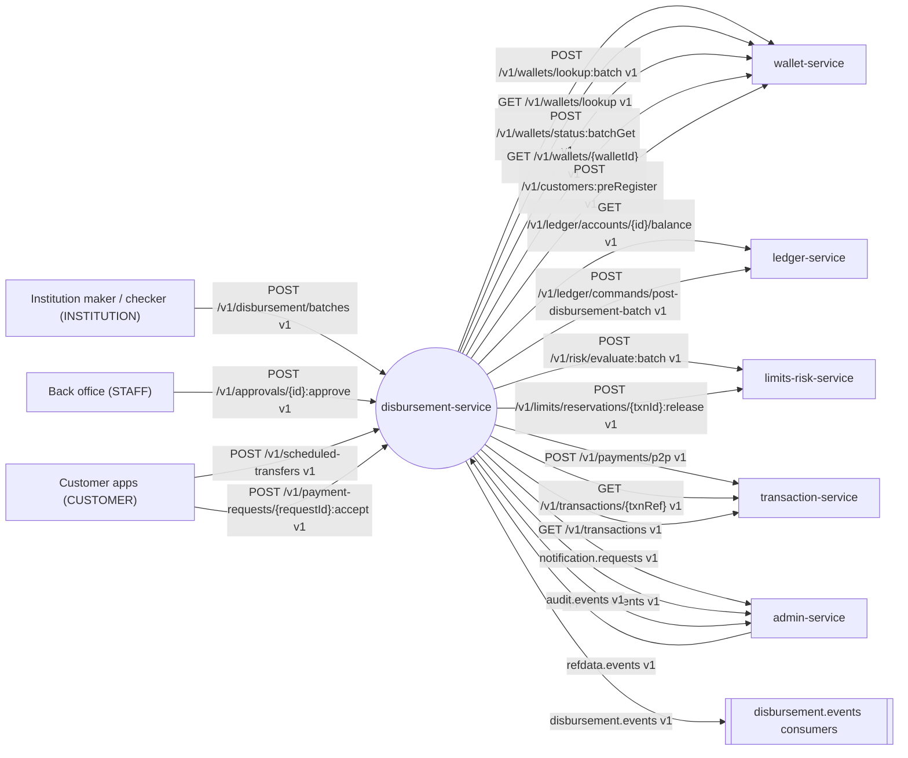

### 3.2 Component diagram

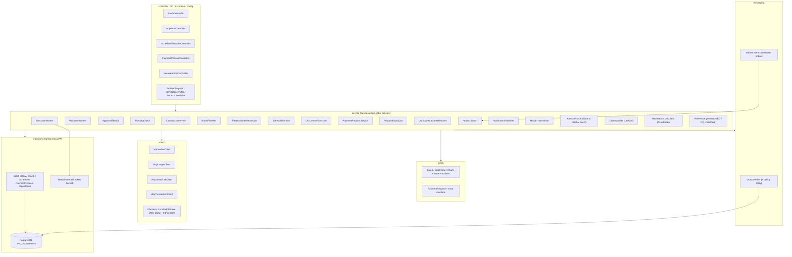

### 3.3 Runtime and deployment (Compose)

| Item | Value |
|---|---|
| Compose service | `disbursement-service`, ports 8108 / 9108, profile `dev`, `mem_limit` 384 MB, depends on (healthy) `postgres`, `kafka-init`, `object-store` |
| Roles | One image. `bitspay.disbursement.role = api \| worker \| all` (default `all`; locally always `all`). Workers: validation (2/pod), execution (4/pod), occurrence executor loop (60 s), expiry loop (5 min), unknown-outcome resolver (30 s), reservation-release sweeper (5 min), approval-expiry loop (5 min), auto-resume loop (2 min), outbox/idempotency cleanup (hourly). Every loop claims work with `FOR UPDATE SKIP LOCKED` (+ leases for chunks), so any number of pods may run them |
| Database | `jdbc:postgresql://postgres:5432/bitspay?currentSchema=svc_disbursement`; Flyway `spring.flyway.schemas=svc_disbursement` (`create-schemas=false` in the stack; Testcontainers `true`) |
| Redis | none |
| Object storage | raw upload files, `client.FileStore` (interface with two config-selected implementations, `bitspay.filestore.type`): `local-fs` (default for `local`, AES-GCM with `BITSPAY_FIELD_CIPHER_KEY`) or `s3` (Compose: bucket `bitspay-docs`, prefix `disbursement/`) |
| Env vars beyond kernel K8.3 | `BITSPAY_S3_ENDPOINT`, `BITSPAY_S3_ACCESSKEY`, `BITSPAY_S3_SECRETKEY`, `BITSPAY_S3_REGION`; `BITSPAY_CLIENTS_WALLET_BASEURL` (`http://wallet-service:8103`), `BITSPAY_CLIENTS_LEDGER_BASEURL` (`http://ledger-service:8101`), `BITSPAY_CLIENTS_RISK_BASEURL` (`http://limits-risk-service:8105`), `BITSPAY_CLIENTS_TRANSACTION_BASEURL` (`http://transaction-service:8102`); `BITSPAY_FILESTORE_TYPE` |
| Kafka consumer groups | `disbursement-service.refdata` → `refdata.events` (OPEN D-30) |
| Produced topics | `disbursement.events` (3 / 12 partitions, 7 d), plus inbound topics `notification.requests`, `approval.events`, `audit.events` — all through the single outbox `svc_disbursement.outbox` |
| Readiness | own infra only (Postgres, Kafka producer path via outbox needs no broker at start-up); never waits for another service |

### 3.4 Key flows

**D1 — Upload and validate (Dhaka Knit Ltd, 5,000 rows)**

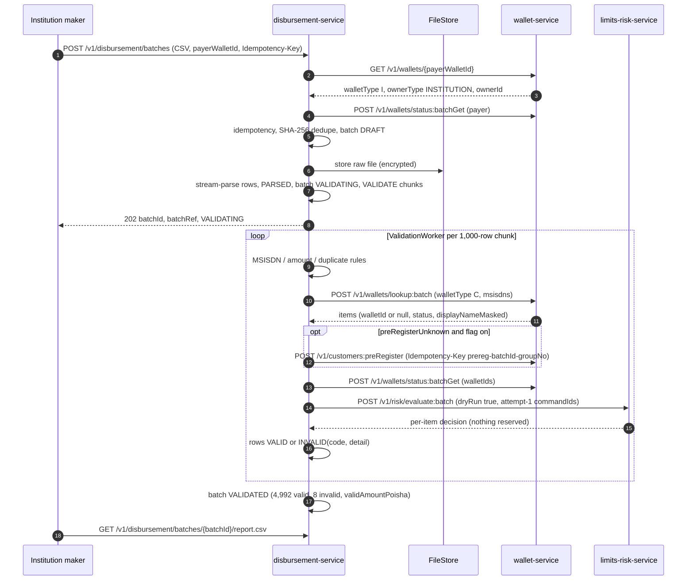

**D2 — Submit, approve, fund-check and execute**

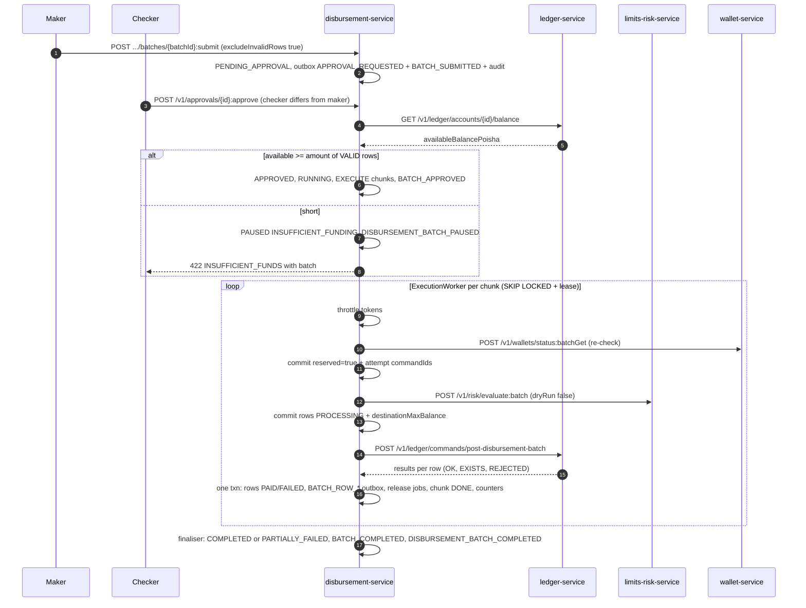

**D3 — Crash recovery / re-run (no double payment)**

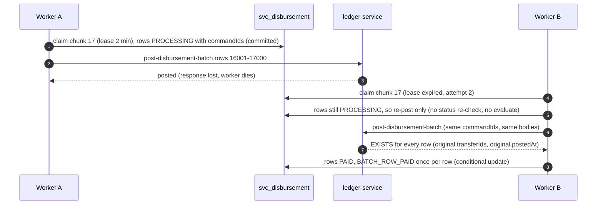

**D4 — Scheduled monthly transfer (Rahim to Rahima, Tk 2,000 on the 1st)**

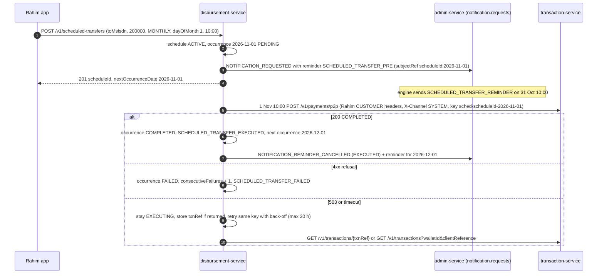

**D5 — Request money (Karim asks Rahim for Tk 300)**

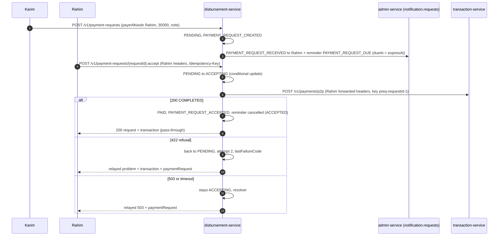

**D6 — Reservation release (a row fails after it was reserved)**

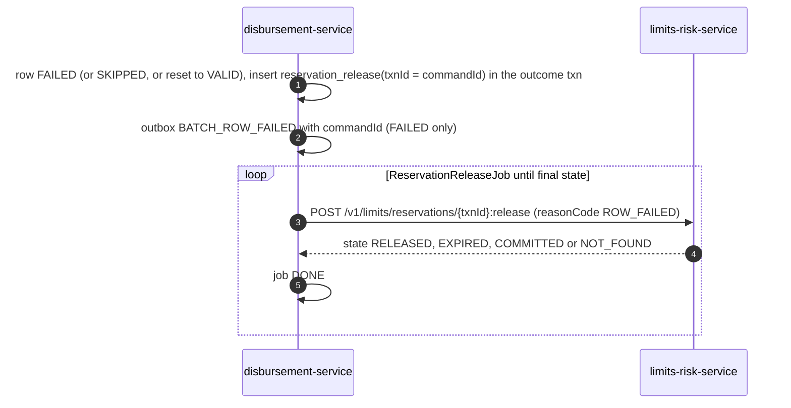

### 3.5 State machines

**Batch**

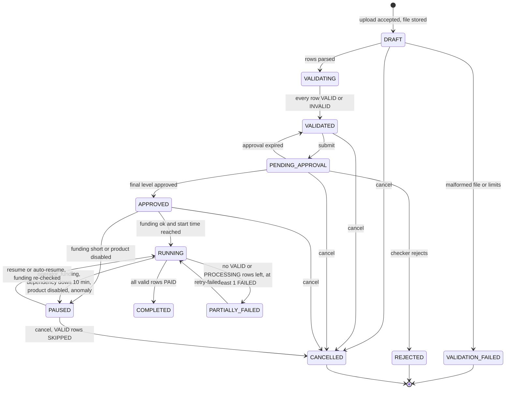

**Row**

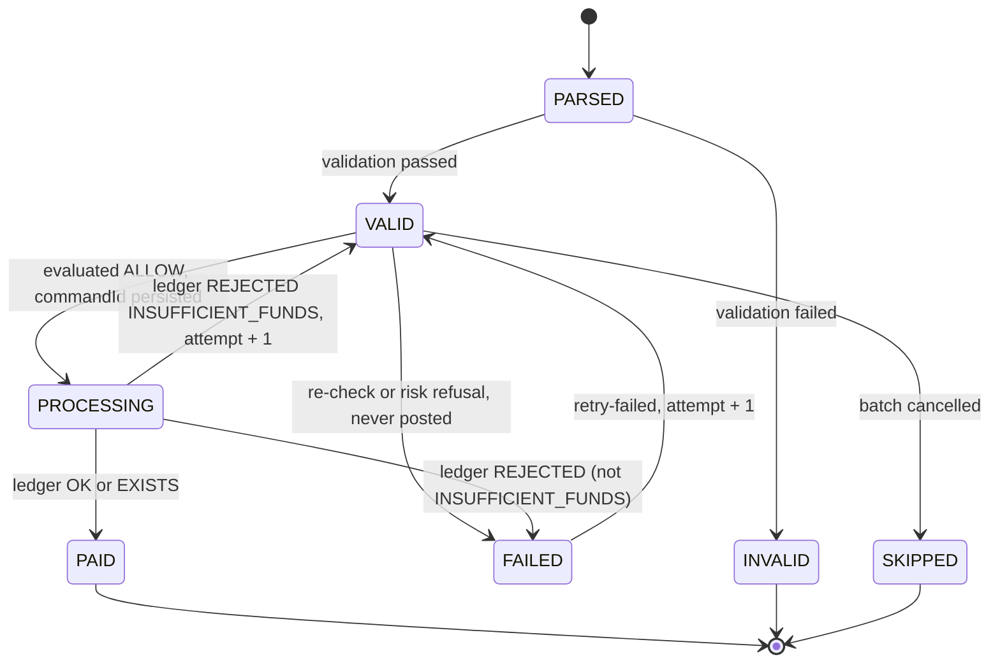

Every row transition is a conditional update on the expected status (`UPDATE … WHERE batch_id = ? AND row_no = ? AND status = ?`).

**Chunk** (`VALIDATE` and `EXECUTE` kinds)

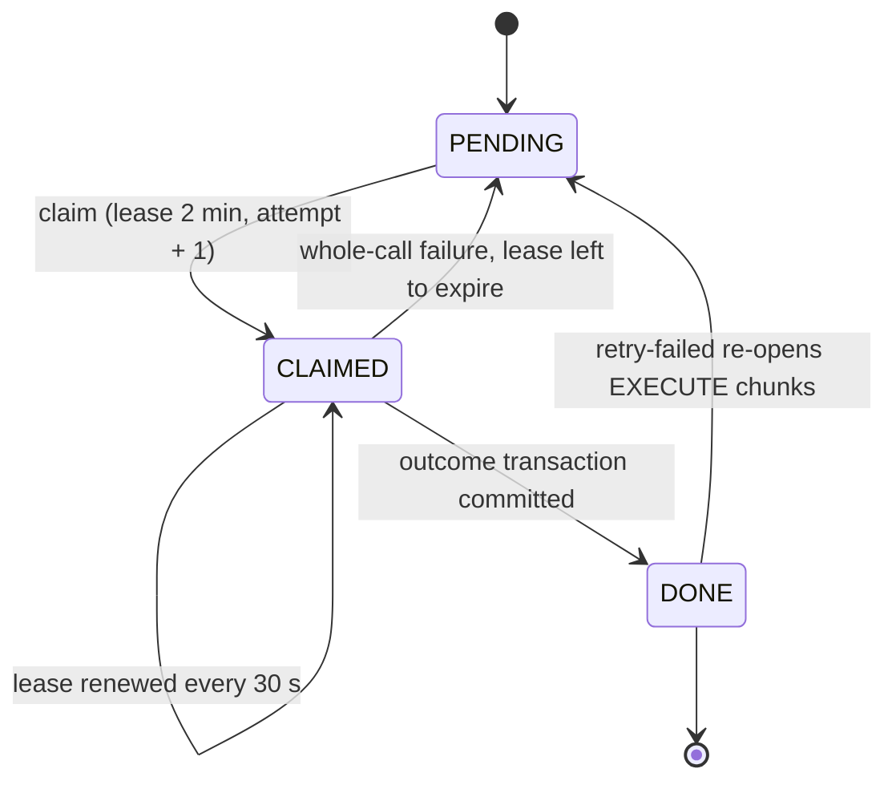

**Scheduled transfer**

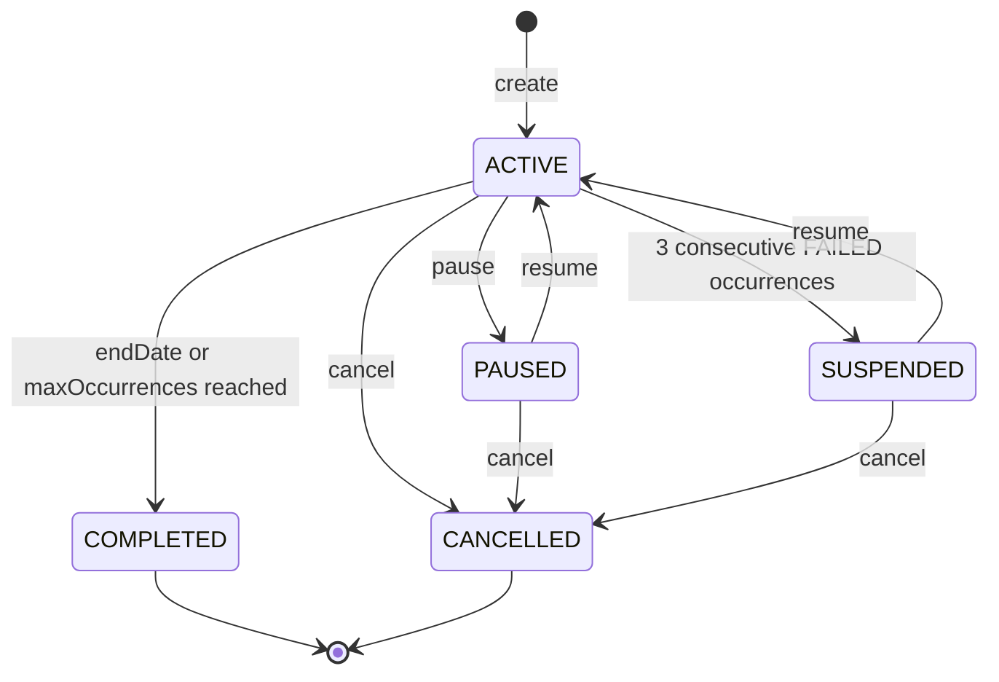

**Occurrence**

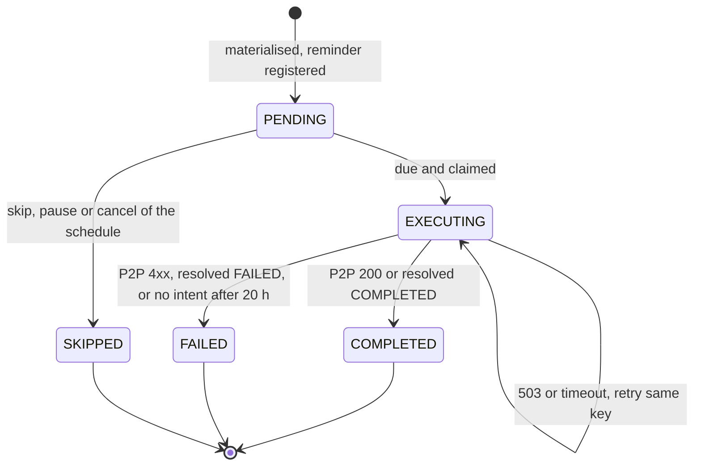

`REMINDED` is a legacy read value of `occurrenceStatus`; it is never set (reminders belong to the engine).

**Payment request**

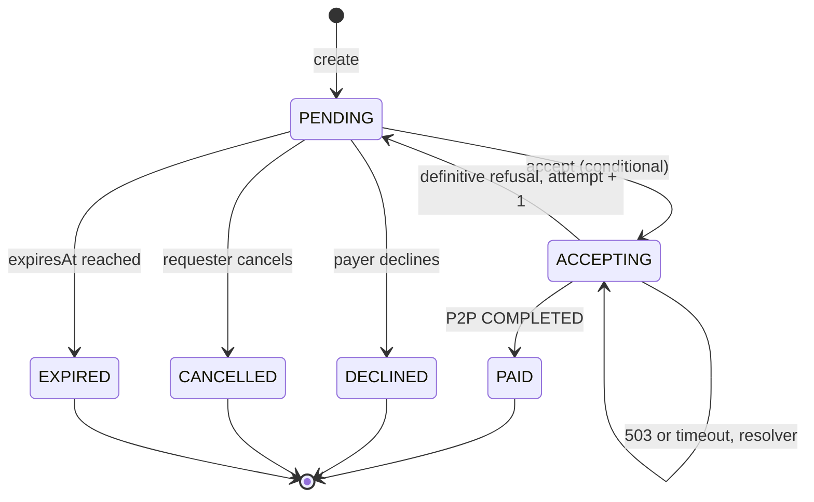

### 3.6 Architecture decisions

| ADR | Decision | Why | Consequence |
|---|---|---|---|
| ADR-01 Postgres job, not a workflow engine | Batches, chunks, occurrences and requests are rows with explicit states; workers claim with `FOR UPDATE SKIP LOCKED` and time-boxed leases | No external two-phase flow; restart-safety comes from deterministic ledger IDs | Any number of pods; no extra infrastructure |
| ADR-02 Deterministic, attempt-derived commandId | `commandId = UUIDv5(namespace = batchId, name = decimal(rowNo))` for attempt 1; `UUIDv5(batchId, rowNo + ":" + n)` for attempt n ≥ 2. The attempt increments only after a definitive ledger `REJECTED` of the current id, a reservation release of the current id, or a limits-risk 409 naming it | The ledger's `REJECTED` is final per `commandId`; limits-risk never re-uses a released `txnId` | Re-runs never pay twice; retries are always possible with a fresh id |
| ADR-03 Chunking | 1,000 rows per chunk (= ledger max per call = `status:batchGet` / `evaluate:batch` / `lookup:batch` max). Lease 2 min, renewed every 30 s | One call per dependency per chunk | Bounded memory; simple crash recovery |
| ADR-04 MSISDN resolution | `POST /v1/wallets/lookup:batch` once per VALIDATE chunk (normalised `8801…`); per-row `GET /v1/wallets/lookup` only for single schedule/request creation | No MSISDNs in URLs for bulk; 1M rows = 1,000 calls | Validation of 1M rows in minutes |
| ADR-05 Throttle | Global token bucket in Postgres (`rate_limiter` row, refilled by elapsed time in milli-tokens, `SELECT … FOR UPDATE` per chunk) + adaptive back-off: if ledger call p95 over the last 20 chunks > `ledger-latency-backoff-ms` (200 ms), halve the effective rate for 1 min | Protects online P2P latency (PER-009/010) without Redis | Throughput governed by config, not by worker count |
| ADR-06 Scheduled and requested payments through transaction-service | Executed as P2P with the payer's identity (delegated, OPEN D-33): `X-Channel SYSTEM` for schedules, the payer's forwarded channel for accept | Same limits, fees, fraud rules, receipts and events as any P2P; no ledger template | A non-empty `FEATURE.P2P.channels` must include `SYSTEM` |
| ADR-07 Raw files in object storage | `client.FileStore` with two config-selected implementations: `local-fs` (AES-GCM) and `s3`. DB keeps only hash, size and key | 1M-row files (~60 MB) do not belong in Postgres | Lifecycle 1 year |
| ADR-08 Reminders by the admin engine | Register `reminder{}` subjects and emit `NOTIFICATION_REMINDER_CANCELLED`; no local reminder loop (OPEN D-11) | One reminder mechanism platform-wide (NOT-005) | No `remind_at` columns |
| ADR-09 Explicit reservation release ledger | Every reserved attempt that will not be paid gets a `reservation_release` job row in the same transaction; a sweeper calls `:release` until a final state | Batch reservations never auto-expire (OPEN D-14) | Receiver limits never leak |

### 3.7 Latency and throughput budget

| Path | Budget |
|---|---|
| `POST /v1/disbursement/batches` | 202 ≤ 2 s for a 100 MB file (stream to FileStore, parse asynchronously) |
| Validation | 1,000-row chunk ≈ lookup:batch (≤ 150 ms) + status:batchGet (≤ 150 ms) + evaluate:batch dry run (≤ 300 ms) + DB → ≈ 0.8 s; 2 pods × 2 workers ≈ 5,000 rows/s → 1M rows ≈ 3.5 min |
| Execution | per chunk ≈ batchGet + evaluate:batch + ledger + 3 DB transactions ≈ 300–600 ms; governed by the throttle (default 500 rows/s ≈ 1.8 M/h) |
| Lists and reads | p95 ≤ 300 ms |
| `:accept` | p99 ≤ transaction-service P2P latency + 50 ms |
| Occurrence executor | due occurrences start within 60 s of `dueAt` |

---

## 4. Data model

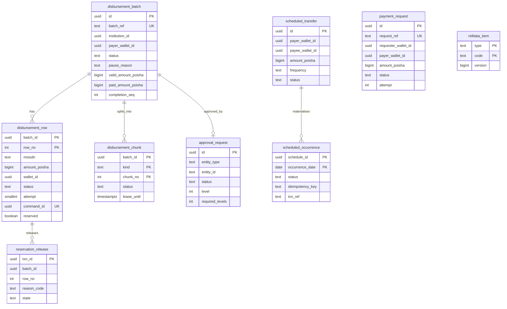

### 4.1 Tables — Flyway `V1__init.sql` (schema `svc_disbursement`)

```sql
-- ===================== bulk batches =====================
CREATE TABLE disbursement_batch (
  id                   uuid        PRIMARY KEY,                       -- UUIDv7
  batch_ref            text        NOT NULL UNIQUE,                   -- 'BD' + yyMMdd (Asia/Dhaka) + 8 Crockford base32 (16 chars)
  institution_id       uuid        NOT NULL,                          -- payer wallet ownerId (GET /v1/wallets/{walletId})
  payer_wallet_id      uuid        NOT NULL,
  title                text        NOT NULL CHECK (length(title) BETWEEN 1 AND 120),
  client_reference     text        CHECK (length(client_reference) <= 64),
  source               text        NOT NULL CHECK (source IN ('CSV','API')),
  file_key             text,                                          -- FileStore key (CSV only)
  file_sha256          bytea,                                         -- CSV: hash of the raw file; API: hash of canonical rows JSON
  file_size_bytes      bigint,
  status               text        NOT NULL CHECK (status IN ('DRAFT','VALIDATING','VALIDATION_FAILED','VALIDATED',
                          'PENDING_APPROVAL','APPROVED','RUNNING','PAUSED','COMPLETED','PARTIALLY_FAILED','CANCELLED','REJECTED')),
  pause_reason         text        CHECK (pause_reason IN ('INSUFFICIENT_FUNDING','OPERATOR','DEPENDENCY_UNAVAILABLE','PRODUCT_DISABLED')),
  failure_detail       text,
  pre_register_unknown boolean     NOT NULL DEFAULT false,
  total_rows           int         NOT NULL DEFAULT 0,
  valid_rows           int         NOT NULL DEFAULT 0,
  invalid_rows         int         NOT NULL DEFAULT 0,
  valid_amount_poisha  bigint      NOT NULL DEFAULT 0,
  paid_rows            int         NOT NULL DEFAULT 0,
  failed_rows          int         NOT NULL DEFAULT 0,
  skipped_rows         int         NOT NULL DEFAULT 0,
  paid_amount_poisha   bigint      NOT NULL DEFAULT 0,
  completion_seq       int         NOT NULL DEFAULT 0,                -- BATCH_COMPLETED.completionSeq of the last terminal transition
  maker_actor_type     text        NOT NULL CHECK (maker_actor_type IN ('INSTITUTION','STAFF')),
  maker_id             text        NOT NULL,                          -- X-Actor-Id (canonical uuid)
  maker_user_id        text,                                          -- X-Actor-User-Id
  approval_id          uuid,
  scheduled_start_at   timestamptz,
  dependency_failing_since timestamptz,                               -- first consecutive whole-call ledger failure (BR-DS-35)
  created_at           timestamptz NOT NULL DEFAULT now(),
  submitted_at         timestamptz,
  approved_at          timestamptz,
  started_at           timestamptz,
  completed_at         timestamptz,
  updated_at           timestamptz NOT NULL DEFAULT now(),
  version              bigint      NOT NULL DEFAULT 0,
  CHECK (paid_amount_poisha <= valid_amount_poisha),
  CHECK ((status = 'PAUSED') = (pause_reason IS NOT NULL))
);
CREATE UNIQUE INDEX batch_file_dedupe_uq ON disbursement_batch (payer_wallet_id, file_sha256)
  WHERE file_sha256 IS NOT NULL AND status NOT IN ('CANCELLED','REJECTED','VALIDATION_FAILED');
CREATE INDEX batch_payer_ix       ON disbursement_batch (payer_wallet_id, created_at DESC);
CREATE INDEX batch_institution_ix ON disbursement_batch (institution_id, created_at DESC);
CREATE INDEX batch_status_ix      ON disbursement_batch (status) WHERE status IN ('VALIDATING','APPROVED','RUNNING','PAUSED');

CREATE TABLE disbursement_row (
  batch_id              uuid        NOT NULL REFERENCES disbursement_batch(id),
  row_no                int         NOT NULL CHECK (row_no >= 1),     -- 1-based data row (header excluded)
  msisdn                text        NOT NULL,                         -- normalised 8801XXXXXXXXX (raw text kept if not normalisable)
  name_in_file          text        CHECK (length(name_in_file) <= 140),
  reference             text        CHECK (length(reference) <= 64),
  amount_poisha         bigint      NOT NULL,                         -- may be <= 0 only for INVALID rows (kept for the report)
  wallet_id             uuid,
  display_name_masked   text,
  wallet_status         char(1),
  kyc_tier              smallint,
  wallet_category_code  int,
  wallet_flags          int,
  status                text        NOT NULL CHECK (status IN ('PARSED','VALID','INVALID','PROCESSING','PAID','FAILED','SKIPPED')),
  failure_code          text,
  failure_detail        text,
  attempt               smallint    NOT NULL DEFAULT 1 CHECK (attempt >= 1),
  command_id            uuid,                                         -- current attempt; persisted before evaluate:batch
  reserved              boolean     NOT NULL DEFAULT false,           -- current attempt sent to evaluate:batch (reserving) and not yet released
  dest_max_balance_poisha bigint,                                     -- receiverMaxBalancePoisha stored at PROCESSING, re-sent unchanged
  chunk_no              int,
  transfer_ids          uuid[],
  paid_at               timestamptz,                                  -- ledger postedAt (EXISTS: original)
  updated_at            timestamptz NOT NULL DEFAULT now(),
  PRIMARY KEY (batch_id, row_no),
  CHECK (status = 'INVALID' OR amount_poisha > 0),
  CHECK (status <> 'PROCESSING' OR command_id IS NOT NULL),
  CHECK (status <> 'PAID' OR (command_id IS NOT NULL AND paid_at IS NOT NULL))
);
CREATE INDEX row_status_ix  ON disbursement_row (batch_id, status);
CREATE INDEX row_chunk_ix   ON disbursement_row (batch_id, chunk_no);
CREATE INDEX row_msisdn_ix  ON disbursement_row (batch_id, msisdn);             -- duplicate detection
CREATE UNIQUE INDEX row_command_uq ON disbursement_row (command_id) WHERE command_id IS NOT NULL;

CREATE TABLE disbursement_chunk (
  batch_id     uuid        NOT NULL REFERENCES disbursement_batch(id),
  kind         text        NOT NULL CHECK (kind IN ('VALIDATE','EXECUTE')),
  chunk_no     int         NOT NULL,
  first_row_no int         NOT NULL,
  last_row_no  int         NOT NULL,
  status       text        NOT NULL CHECK (status IN ('PENDING','CLAIMED','DONE')),
  attempt      int         NOT NULL DEFAULT 0,
  claimed_by   text,
  lease_until  timestamptz,
  not_before   timestamptz,                                           -- back-off after a whole-call failure
  last_error   text,
  completed_at timestamptz,
  updated_at   timestamptz NOT NULL DEFAULT now(),
  PRIMARY KEY (batch_id, kind, chunk_no)
);
CREATE INDEX chunk_claim_ix ON disbursement_chunk (kind, status, lease_until) WHERE status <> 'DONE';

-- every reserved attempt that will not be paid (BR-DS-38)
CREATE TABLE reservation_release (
  txn_id          uuid        PRIMARY KEY,                            -- = row commandId of the released attempt
  batch_id        uuid        NOT NULL,
  row_no          int         NOT NULL,
  reason_code     text        NOT NULL CHECK (reason_code IN ('ROW_FAILED','ROW_SKIPPED','ROW_RETRY')),
  state           text        NOT NULL DEFAULT 'PENDING' CHECK (state IN ('PENDING','RELEASED','COMMITTED','EXPIRED','NOT_FOUND')),
  attempts        int         NOT NULL DEFAULT 0,
  next_attempt_at timestamptz NOT NULL DEFAULT now(),
  last_error      text,
  created_at      timestamptz NOT NULL DEFAULT now(),
  updated_at      timestamptz NOT NULL DEFAULT now()
);
CREATE INDEX release_due_ix ON reservation_release (next_attempt_at) WHERE state = 'PENDING';

CREATE TABLE rate_limiter (
  name           text        PRIMARY KEY,                             -- 'ledger-disbursement'
  rate_per_sec   int         NOT NULL CHECK (rate_per_sec > 0),
  effective_rate int         NOT NULL,                                -- after adaptive back-off
  backoff_until  timestamptz,
  tokens_milli   bigint      NOT NULL,                                -- milli-tokens (no floating point anywhere)
  refreshed_at   timestamptz NOT NULL,
  updated_at     timestamptz NOT NULL DEFAULT now()
);
INSERT INTO rate_limiter (name, rate_per_sec, effective_rate, tokens_milli, refreshed_at)
  VALUES ('ledger-disbursement', 500, 500, 0, now()) ON CONFLICT DO NOTHING;

-- ===================== scheduled transfers =====================
CREATE TABLE scheduled_transfer (
  id                    uuid        PRIMARY KEY,
  payer_customer_id     uuid        NOT NULL,                         -- X-Actor-Id at creation (delegated P2P identity)
  payer_wallet_id       uuid        NOT NULL,
  payee_wallet_id       uuid        NOT NULL,
  payee_name_masked     text,                                         -- lookup displayNameMasked
  amount_poisha         bigint      NOT NULL CHECK (amount_poisha > 0 AND amount_poisha <= 10000000000000),
  purpose_code          text        CHECK (length(purpose_code) <= 32),
  note                  text        CHECK (length(note) <= 140),
  frequency             text        NOT NULL CHECK (frequency IN ('ONCE','DAILY','WEEKLY','MONTHLY')),
  day_of_week           smallint    CHECK (day_of_week BETWEEN 1 AND 7),
  day_of_month          smallint    CHECK (day_of_month BETWEEN 1 AND 31),
  local_time            time        NOT NULL DEFAULT '10:00',         -- Asia/Dhaka
  start_date            date        NOT NULL,
  end_date              date,
  max_occurrences       int         CHECK (max_occurrences >= 1),
  occurrences_done      int         NOT NULL DEFAULT 0,
  next_occurrence_date  date,
  status                text        NOT NULL CHECK (status IN ('ACTIVE','PAUSED','SUSPENDED','COMPLETED','CANCELLED')),
  consecutive_failures  int         NOT NULL DEFAULT 0,
  created_channel       text        NOT NULL,
  created_at            timestamptz NOT NULL DEFAULT now(),
  updated_at            timestamptz NOT NULL DEFAULT now(),
  version               bigint      NOT NULL DEFAULT 0,
  CHECK (frequency <> 'WEEKLY'  OR day_of_week  IS NOT NULL),
  CHECK (frequency <> 'MONTHLY' OR day_of_month IS NOT NULL)
);
CREATE INDEX sched_payer_ix ON scheduled_transfer (payer_wallet_id, status);

CREATE TABLE scheduled_occurrence (
  schedule_id      uuid        NOT NULL REFERENCES scheduled_transfer(id),
  occurrence_date  date        NOT NULL,                              -- Asia/Dhaka
  due_at           timestamptz NOT NULL,                              -- occurrence_date + local_time @ Asia/Dhaka, in UTC
  status           text        NOT NULL CHECK (status IN ('PENDING','REMINDED','EXECUTING','COMPLETED','FAILED','SKIPPED')),
  idempotency_key  text        NOT NULL,                              -- sched-{scheduleId}-{yyyy-MM-dd} (53 chars)
  amount_poisha    bigint      NOT NULL,                              -- frozen when EXECUTING starts
  txn_ref          text        CHECK (length(txn_ref) <= 32),
  failure_code     text,
  attempts         int         NOT NULL DEFAULT 0,
  first_attempt_at timestamptz,
  next_attempt_at  timestamptz,
  executed_at      timestamptz,
  updated_at       timestamptz NOT NULL DEFAULT now(),
  PRIMARY KEY (schedule_id, occurrence_date)
);
CREATE INDEX occ_due_ix   ON scheduled_occurrence (due_at)          WHERE status = 'PENDING';
CREATE INDEX occ_retry_ix ON scheduled_occurrence (next_attempt_at) WHERE status = 'EXECUTING';

-- ===================== request money =====================
CREATE TABLE payment_request (
  id                     uuid        PRIMARY KEY,
  request_ref            text        NOT NULL UNIQUE,                 -- 'RQ' + yyMMdd (Asia/Dhaka) + 8 Crockford base32 (16 chars)
  requester_customer_id  uuid        NOT NULL,
  requester_wallet_id    uuid        NOT NULL,                        -- payee
  requester_msisdn       text        NOT NULL,                        -- 8801…, for template variable requesterMsisdn
  requester_name_masked  text,
  payer_wallet_id        uuid        NOT NULL,
  payer_msisdn           text        NOT NULL,                        -- 8801…, for template variable payerMsisdn
  amount_poisha          bigint      NOT NULL CHECK (amount_poisha > 0),
  note                   text        CHECK (length(note) <= 140),
  status                 text        NOT NULL CHECK (status IN ('PENDING','ACCEPTING','PAID','DECLINED','CANCELLED','EXPIRED')),
  attempt                int         NOT NULL DEFAULT 1,
  accept_actor_id        text,
  accept_channel         text,
  accept_device_id       text,
  accept_correlation_id  text,
  txn_ref                text        CHECK (length(txn_ref) <= 32),
  last_failure_code      text,
  decline_reason         text        CHECK (length(decline_reason) <= 140),
  expires_at             timestamptz NOT NULL,
  first_attempt_at       timestamptz,                                 -- of the current attempt's P2P key
  next_resolve_at        timestamptz,
  created_at             timestamptz NOT NULL DEFAULT now(),
  updated_at             timestamptz NOT NULL DEFAULT now(),
  version                bigint      NOT NULL DEFAULT 0
);
CREATE INDEX preq_payer_ix     ON payment_request (payer_wallet_id, status, created_at DESC);
CREATE INDEX preq_requester_ix ON payment_request (requester_wallet_id, created_at DESC);
CREATE INDEX preq_expiry_ix    ON payment_request (expires_at)      WHERE status = 'PENDING';
CREATE INDEX preq_resolve_ix   ON payment_request (next_resolve_at) WHERE status = 'ACCEPTING';

-- ===================== cross-cutting =====================
-- idempotency of our own POSTs (kernel K3.3), retention 7 days (OPEN D-01)
CREATE TABLE idempotency_record (
  actor_id        text        NOT NULL,
  idem_key        text        NOT NULL,
  operation       text        NOT NULL,                               -- operationId
  request_hash    bytea       NOT NULL,                               -- SHA-256 of method + path + canonical body (multipart: + file SHA-256)
  response_status int,                                                -- NULL while in progress
  response_body   jsonb,
  created_at      timestamptz NOT NULL DEFAULT now(),
  PRIMARY KEY (actor_id, idem_key)
);
CREATE INDEX idem_created_ix ON idempotency_record (created_at);

-- local maker-checker (kernel K5)
CREATE TABLE approval_request (
  id               uuid        PRIMARY KEY,
  entity_type      text        NOT NULL CHECK (entity_type = 'DisbursementBatch'),
  entity_id        text        NOT NULL,
  action           text        NOT NULL CHECK (action = 'EXECUTE'),
  payload          jsonb       NOT NULL,                              -- {batchRef, validRows, validAmountPoisha, institutionId}
  maker_id         text        NOT NULL,
  maker_actor_type text        NOT NULL,
  maker_user_id    text,
  status           text        NOT NULL CHECK (status IN ('PENDING','APPROVED','REJECTED','EXPIRED','CANCELLED')),
  level            int         NOT NULL DEFAULT 1,
  required_levels  int         NOT NULL DEFAULT 1 CHECK (required_levels BETWEEN 1 AND 2),
  amount_poisha    bigint,
  comment          text,
  reject_reason_code text,
  created_at       timestamptz NOT NULL DEFAULT now(),
  expires_at       timestamptz NOT NULL,
  decided_by       text[]      NOT NULL DEFAULT '{}',                 -- checker ids in level order (STAFF uuid / institution X-Actor-User-Id)
  decided_by_actor text[]      NOT NULL DEFAULT '{}',                 -- 'STAFF:<uuid>' / 'INSTITUTION:<partnerId>:<userId>'
  decided_at       timestamptz,
  updated_at       timestamptz NOT NULL DEFAULT now(),
  version          bigint      NOT NULL DEFAULT 0
);
CREATE INDEX approval_pending_ix ON approval_request (status, expires_at) WHERE status = 'PENDING';
CREATE UNIQUE INDEX approval_entity_pending_uq ON approval_request (entity_type, entity_id) WHERE status = 'PENDING';

-- latest refdata items this service reads (FEATURE.*, WALLET.ALLOW_INBOUND_BEFORE_KYC)
CREATE TABLE refdata_item (
  type        text        NOT NULL,
  code        text        NOT NULL,
  version     bigint      NOT NULL,
  active      boolean     NOT NULL,
  attributes  jsonb       NOT NULL,
  updated_at  timestamptz NOT NULL DEFAULT now(),
  PRIMARY KEY (type, code)
);

-- kernel K8.2
CREATE TABLE IF NOT EXISTS outbox (
  id             uuid PRIMARY KEY,
  aggregate_type text        NOT NULL,
  aggregate_id   text        NOT NULL,
  event_type     text        NOT NULL,
  payload        jsonb       NULL,                                    -- never NULL from this service (no tombstones)
  created_at     timestamptz NOT NULL DEFAULT now(),
  published_at   timestamptz
);
CREATE INDEX IF NOT EXISTS outbox_unpublished ON outbox (created_at) WHERE published_at IS NULL;

CREATE TABLE IF NOT EXISTS processed_event (
  event_id     uuid PRIMARY KEY,
  topic        text NOT NULL,
  processed_at timestamptz NOT NULL DEFAULT now()
);
```

### 4.2 Redis keys / caches

None. Product switches and the credit-before-KYC flag are cached in-process (Caffeine, 10 s) over `refdata_item`.

### 4.3 Retention and archival

| Data | Retention |
|---|---|
| `idempotency_record` | 7 days (OPEN D-01) |
| `outbox` | 3 days; `processed_event` 14 days (kernel K8.2) |
| `reservation_release` | 35 days after a final state |
| Batches, rows, chunks | 1 year online; archival is a later platform job (deferred) |
| Raw upload files | 1 year (FileStore lifecycle) |
| Schedules, occurrences, payment requests | indefinite (small) |
| `approval_request` | 1 year |

---

## 5. Provided contracts (mirror of `contracts/provided/` — the artefact wins on conflict)

### 5.1 REST operations

Common rules (kernel K3): request headers K3.1 (`X-Actor-Wallet-Id` for CUSTOMER and INSTITUTION, `X-Actor-Roles` for STAFF; `X-Actor-User-Id` is required for institution makers/checkers when institution approval is used). `Idempotency-Key` rules K3.3 with 7-day retention (OPEN D-01): **required** on every batch POST, on `POST /v1/approvals/{id}:approve`, on schedule and request creation, and on `:accept`; optional (honoured when present) on the other POSTs. Pagination K3.4 (default 50, max 200). Errors K3.6. Product switch K3.7: `DISBURSEMENT` for `/v1/disbursement/**` and `/v1/approvals/**`, `SCHEDULED_TRANSFER` for `/v1/scheduled-transfers/**`, `REQUEST_MONEY` for `/v1/payment-requests/**`; checked on state-changing operations that start or continue money movement (create, submit, resume, retry-failed, approve, schedule create/patch/resume, request create/accept) → `422 SERVICE_DISABLED` before any side effect. Requests reject unknown fields (`additionalProperties: false`) → 400.

| Operation | Audience | Actors & roles | Idempotency | Purpose |
|---|---|---|---|---|
| `POST /v1/disbursement/batches` | partner | INSTITUTION (owner); STAFF `OPS_MAKER` | required | Create batch (JSON ≤ 10,000 rows or CSV ≤ 1,000,000 rows) |
| `GET /v1/disbursement/batches` | partner | INSTITUTION (own); STAFF `OPS_*`, `FIN_*`, `AUDITOR`, `READ_ONLY`; SERVICE (any, read) | — | List batches |
| `GET /v1/disbursement/batches/{batchId}` | partner | as list | — | Batch detail |
| `GET /v1/disbursement/batches/{batchId}/rows` | partner | as list | — | Rows (typed validation report / per-record status) |
| `GET /v1/disbursement/batches/{batchId}/report.csv` | partner | INSTITUTION (own); STAFF as list | — | Validation report / final report |
| `POST /v1/disbursement/batches/{batchId}:submit` | partner | INSTITUTION (owner); STAFF `OPS_MAKER` | required | VALIDATED → PENDING_APPROVAL |
| `POST /v1/disbursement/batches/{batchId}:cancel` | partner | INSTITUTION (owner); STAFF `OPS_MAKER`, `OPS_CHECKER` | required | → CANCELLED |
| `POST /v1/disbursement/batches/{batchId}:pause` | partner | INSTITUTION (owner); STAFF `OPS_CHECKER` | required | RUNNING → PAUSED (OPERATOR) |
| `POST /v1/disbursement/batches/{batchId}:resume` | partner | INSTITUTION (owner); STAFF `OPS_CHECKER` | required | PAUSED → RUNNING after funding check |
| `POST /v1/disbursement/batches/{batchId}:retry-failed` | partner | INSTITUTION (owner); STAFF `OPS_MAKER` | required | PARTIALLY_FAILED → RUNNING |
| `GET /v1/approvals` | staff | STAFF `OPS_CHECKER`, `FIN_CHECKER`, `AUDITOR`, `READ_ONLY`; INSTITUTION (own batches) | — | Approval inbox (K5) |
| `POST /v1/approvals/{id}:approve` | staff | STAFF `OPS_CHECKER` (L1), `FIN_CHECKER` (L2); INSTITUTION checker (L1) | required | Approve current level |
| `POST /v1/approvals/{id}:reject` | staff | as approve | optional | Reject |
| `POST /v1/scheduled-transfers` | customer | CUSTOMER (payer) | required | Create schedule |
| `GET /v1/scheduled-transfers` | customer | CUSTOMER (own wallet); STAFF `SUP_*`, `OPS_*`, `AUDITOR`, `READ_ONLY`; SERVICE (any, read) | — | List schedules |
| `GET /v1/scheduled-transfers/{scheduleId}` | customer | as list | — | Schedule detail |
| `PATCH /v1/scheduled-transfers/{scheduleId}` | customer | CUSTOMER (owner) | — | Change future occurrences |
| `POST /v1/scheduled-transfers/{scheduleId}:pause` | customer | CUSTOMER (owner); STAFF `SUP_AGENT` | optional | Pause |
| `POST /v1/scheduled-transfers/{scheduleId}:resume` | customer | CUSTOMER (owner); STAFF `SUP_AGENT` | optional | Resume |
| `POST /v1/scheduled-transfers/{scheduleId}:cancel` | customer | CUSTOMER (owner); STAFF `SUP_AGENT` | optional | Cancel |
| `GET /v1/scheduled-transfers/{scheduleId}/occurrences` | customer | as list | — | Occurrences |
| `POST /v1/scheduled-transfers/{scheduleId}/occurrences/{occurrenceDate}:skip` | customer | CUSTOMER (owner) | optional | Skip one occurrence |
| `POST /v1/payment-requests` | customer | CUSTOMER (requester) | required | Create request |
| `GET /v1/payment-requests` | customer | CUSTOMER (own wallet); STAFF `SUP_*`, `OPS_*`, `AUDITOR`, `READ_ONLY` | — | List requests |
| `GET /v1/payment-requests/{requestId}` | customer | parties; STAFF as list | — | Request detail |
| `POST /v1/payment-requests/{requestId}:accept` | customer | CUSTOMER (payer) | required | Pay through delegated P2P |
| `POST /v1/payment-requests/{requestId}:decline` | customer | CUSTOMER (payer) | optional | Decline |
| `POST /v1/payment-requests/{requestId}:cancel` | customer | CUSTOMER (requester) | optional | Cancel |
| `GET /v1/internal/admin/workers` | internal | STAFF `ADMIN` | — | Worker / lease / throttle snapshot |
| `PUT /v1/internal/admin/rate-limits/ledger-disbursement` | internal | STAFF `ADMIN`, `OPS_CHECKER` | — | Live throttle change (audited) |

Problem `reason` values owned by this service (`codes.yaml → problemReasons`): `VALIDATION_FAILED`: `INVALID_CURSOR` (kernel), `FILE_INVALID`, `NO_VALID_ROWS`, `INVALID_ROWS_PRESENT`, `ROW_NOT_RETRYABLE`, `SCHEDULE_CAP_EXCEEDED`, `REQUEST_CAP_EXCEEDED`; `STATE_CONFLICT`: `DUPLICATE_FILE`, `INVALID_TRANSITION`, `ROWS_IN_FLIGHT`, `APPROVAL_EXPIRED`. Problem extension members (`codes.yaml → problemExtensions`): `batch`, `paymentRequest`, and on `:accept` the relayed members of the consumed P2P problem (`transaction`, `limitCode`, `limitParty`, `remainingPoisha`, `remainingCount`, `resetsAt`, `walletId`, `walletStatus`); `walletId` / `walletStatus` also on own `WALLET_NOT_TRANSACTABLE` refusals.

#### 5.1.1 Shared objects

**Batch** (response of batch reads and actions; problem member `batch`)

| Field | Type | Req | Null | Constraints / enum | Notes |
|---|---|---|---|---|---|
| batchId | uuid | Y | N | UUIDv7 | |
| batchRef | string | Y | N | `^BD\d{6}[0-9A-HJKMNP-TV-Z]{8}$` (16) | non-ledger reference (OPEN D-13) |
| institutionId | uuid | Y | N | | payer wallet `ownerId` |
| payerWalletId | uuid | Y | N | | |
| title | string | Y | N | 1..120 | |
| clientReference | string | Y | Y | ≤ 64 | employer's payroll reference |
| source | enum{CSV, API} | Y | N | | |
| status | enum `batchStatus` | Y | N | DRAFT, VALIDATING, VALIDATION_FAILED, VALIDATED, PENDING_APPROVAL, APPROVED, RUNNING, PAUSED, COMPLETED, PARTIALLY_FAILED, CANCELLED, REJECTED | |
| pauseReason | enum `batchPauseReason` | Y | Y | INSUFFICIENT_FUNDING, OPERATOR, DEPENDENCY_UNAVAILABLE, PRODUCT_DISABLED | non-null iff PAUSED |
| failureDetail | string | Y | Y | | VALIDATION_FAILED reason text |
| totalRows / validRows / invalidRows / paidRows / failedRows / skippedRows | int32 | Y | N | ≥ 0 | |
| validAmountPoisha | int64 (poisha) | Y | N | ≥ 0 | Σ amount of VALID rows at validation (+ re-opened rows) |
| paidAmountPoisha | int64 (poisha) | Y | N | ≤ validAmountPoisha | |
| approvalId | uuid | Y | Y | | |
| scheduledStartAt | timestamp | Y | Y | | |
| createdAt | timestamp | Y | N | | |
| submittedAt / approvedAt / startedAt / completedAt | timestamp | Y | Y | | |

```json
{ "batchId": "0192fa10-0000-7000-8000-000000000001", "batchRef": "BD261009K7Q2M4ZD", "institutionId": "0192f2e0-0006-7000-8000-00000000f000",
  "payerWalletId": "0192f2ff-0006-7000-8000-00000000f006", "title": "October 2026 salary", "clientReference": "PAYROLL-2026-10", "source": "CSV",
  "status": "PARTIALLY_FAILED", "pauseReason": null, "failureDetail": null,
  "totalRows": 5000, "validRows": 4992, "invalidRows": 8, "paidRows": 4990, "failedRows": 2, "skippedRows": 0,
  "validAmountPoisha": 6240000000, "paidAmountPoisha": 6237500000, "approvalId": "0192fa22-0000-7000-8000-000000000002",
  "scheduledStartAt": null, "createdAt": "2026-10-09T09:00:00.000Z", "submittedAt": "2026-10-09T09:05:00.000Z",
  "approvedAt": "2026-10-09T09:30:00.000Z", "startedAt": "2026-10-09T09:30:01.000Z", "completedAt": "2026-10-09T09:41:12.000Z" }
```

**PaymentRequest** (response of request operations; problem member `paymentRequest`)

| Field | Type | Req | Null | Constraints / enum |
|---|---|---|---|---|
| requestId | uuid | Y | N | |
| requestRef | string | Y | N | `^RQ\d{6}[0-9A-HJKMNP-TV-Z]{8}$` (16), non-ledger reference (OPEN D-13) |
| status | enum `paymentRequestStatus` | Y | N | PENDING, ACCEPTING, PAID, DECLINED, CANCELLED, EXPIRED |
| requesterWalletId | uuid | Y | N | payee |
| payerWalletId | uuid | Y | N | |
| amountPoisha | int64 (poisha) | Y | N | 1..10^13 |
| note | string | Y | Y | ≤ 140 |
| expiresAt | timestamp | Y | N | |
| txnRef | string | Y | Y | opaque 1..32 `[A-Z0-9-]` (P2P) |
| lastFailureCode | string | Y | Y | problem `code` of the last refused accept |
| createdAt | timestamp | Y | N | |

**PaymentResult** (pass-through). The `transaction` member of the `:accept` 200 response and of relayed problems is the consumed transaction-service `PaymentResult`, relayed unchanged (never built or altered here). Fields as consumed (§6.4): `txnRef` string, `txnId` uuid, `txnType` enum, `status` enum{COMPLETED, FAILED, INITIATED (only inside a 503)}, `failureCode` enum|null, `amountPoisha`, `feePoisha`, `vatPoisha`, `totalDebitPoisha` int64, `feeBearer` enum{PAYER, PAYEE, OPERATOR}, `currency` `"BDT"`, `fromWalletId`, `toWalletId` uuid, `createdAt` timestamp, `completedAt` timestamp|null. Unknown members are passed through too.

#### 5.1.2 `POST /v1/disbursement/batches`

- **Actors:** INSTITUTION with `X-Actor-Wallet-Id = payerWalletId` and payer `ownerId = X-Actor-Id`; STAFF `OPS_MAKER` (on behalf; `payerWalletId` required). `Idempotency-Key` required (multipart: the request hash includes the file SHA-256). 202 ≤ 2 s for 100 MB.
- **Request (JSON, `application/json`, ≤ 10,000 rows):**

| Field | Type | Req | Null | Constraints / enum | Notes |
|---|---|---|---|---|---|
| payerWalletId | uuid | Y | N | wallet type `I`, `ownerType = INSTITUTION`, status `A` or `C` | |
| title | string | Y | N | 1..120 | |
| clientReference | string | N | Y | ≤ 64 | |
| preRegisterUnknown | bool | N | N | default false | honoured only when `pre-registration.enabled` |
| scheduledStartAt | timestamp | N | Y | now < x ≤ now + 30 d | |
| rows | array<Row> | Y | N | 1..10,000 | |
| rows[].msisdn | string | Y | N | ≤ 20; `01XXXXXXXXX` or `8801XXXXXXXXX` | invalid → row INVALID `INVALID_MSISDN` (not 400) |
| rows[].amountPoisha | int64 (poisha) | Y | N | | ≤ 0 or > `max-row-amount-poisha` → row INVALID `INVALID_AMOUNT` |
| rows[].reference | string | N | Y | ≤ 64 | |
| rows[].name | string | N | Y | ≤ 140 | stored for the report only |

- **Request (multipart, `multipart/form-data`):** parts `file` (CSV, UTF-8, comma, header required, case-insensitive names `msisdn`, `amount` (Taka, ≤ 2 decimals: `1500`, `1500.5`, `1500.50`) **or** `amount_poisha` (integer), optional `reference`, `name`; ≤ 1,000,000 data rows, ≤ 100 MB), `payerWalletId`, `title`, `clientReference?`, `preRegisterUnknown?`, `scheduledStartAt?`.

```json
{ "payerWalletId": "0192f2ff-0006-7000-8000-00000000f006", "title": "October 2026 salary", "clientReference": "PAYROLL-2026-10",
  "preRegisterUnknown": false, "scheduledStartAt": null,
  "rows": [ { "msisdn": "01711000002", "amountPoisha": 1250000, "reference": "EMP-0042", "name": "Karim Ahmed" },
            { "msisdn": "8801811000077", "amountPoisha": 1310000, "reference": "EMP-0043", "name": "Shila Akter" } ] }
```

- **Response 202:**

| Field | Type | Req | Null | Constraints / enum |
|---|---|---|---|---|
| batchId | uuid | Y | N | |
| batchRef | string | Y | N | 16 chars |
| status | enum{DRAFT, VALIDATING, VALIDATION_FAILED} | Y | N | normally VALIDATING |
| totalRows | int32 | Y | N | ≥ 0 |

```json
{ "batchId": "0192fa10-0000-7000-8000-000000000001", "batchRef": "BD261009K7Q2M4ZD", "status": "VALIDATING", "totalRows": 2 }
```

- **Errors:**

| HTTP | code | reason | extensions | when |
|---|---|---|---|---|
| 400 | VALIDATION_FAILED | — / `FILE_INVALID` | `errors[]` | schema, > 10,000 JSON rows, CSV unreadable / missing header / > 1,000,000 rows / > 100 MB |
| 403 | ACTOR_NOT_ALLOWED | — | — | role, `X-Actor-Wallet-Id` ≠ payer, payer not owned by the institution |
| 409 | STATE_CONFLICT | `DUPLICATE_FILE` | — | same `(payerWalletId, SHA-256)` with a live batch (`detail` names its `batchRef`, human text only) |
| 409 | IDEMPOTENCY_CONFLICT | — | — | same key, different body |
| 422 | WALLET_NOT_TRANSACTABLE | — | `walletId`, `walletStatus` (status name) | payer not type `I`, not INSTITUTION-owned, unknown / not READY, or not debit-capable |
| 422 | SERVICE_DISABLED | — | — | `DISBURSEMENT` switched off |
| 503 | DEPENDENCY_UNAVAILABLE | — | `retryable` | wallet-service unavailable at the payer check |

#### 5.1.3 `GET /v1/disbursement/batches` · `GET /v1/disbursement/batches/{batchId}`

- **Actors:** INSTITUTION (only batches with `institutionId = X-Actor-Id`); STAFF `OPS_MAKER`, `OPS_CHECKER`, `FIN_MAKER`, `FIN_CHECKER`, `AUDITOR`, `READ_ONLY`; SERVICE (any caller, read-only).
- **List query:** `payerWalletId` uuid (opt), `status` enum `batchStatus` (opt), `limit`, `cursor`. Response `{items: [Batch], nextCursor}` ordered `createdAt desc, batchId desc`.
- **Detail response 200:** Batch (§5.1.1).
- **Errors:** 400 (`limit`, cursor `INVALID_CURSOR`), 403, 404 (detail).

#### 5.1.4 `GET /v1/disbursement/batches/{batchId}/rows`

- **Actors:** as §5.1.3 (SERVICE sees masked MSISDN). Query `status` enum `rowStatus` (opt), `limit`, `cursor`; ordered `rowNo asc`.
- **Response 200:** `{items: [BatchRow], nextCursor}`:

| Field | Type | Req | Null | Constraints / enum | Notes |
|---|---|---|---|---|---|
| rowNo | int32 | Y | N | ≥ 1 | 1-based data row |
| rowRef | string | Y | N | `{batchRef}-{rowNo}`, ≤ 24 | human-readable credit ID (OPEN D-13) |
| msisdn | string | Y | N | clear `8801…` for STAFF `OPS_*`; otherwise masked `8801711****00` | |
| nameInFile | string | Y | Y | | |
| displayNameMasked | string | Y | Y | from wallet lookup | shown next to `nameInFile`; no automated name match |
| reference | string | Y | Y | ≤ 64 | |
| amountPoisha | int64 (poisha) | Y | N | | |
| status | enum `rowStatus` | Y | N | PARSED, VALID, INVALID, PROCESSING, PAID, FAILED, SKIPPED | |
| failureCode | string | Y | Y | INVALID: `rowInvalidCode`; FAILED: `rowFailureCode` | |
| failureDetail | string | Y | Y | e.g. violated `limitCode`, `PRE_REGISTRATION_PENDING`, `PRE_REGISTRATION_FAILED`, preRegister `reason` | |
| walletId | uuid | Y | Y | | |
| attempt | int32 | Y | N | ≥ 1 | |
| commandId | uuid | Y | Y | current attempt | |
| paidAt | timestamp | Y | Y | ledger `postedAt` | |

```json
{ "items": [ { "rowNo": 42, "rowRef": "BD261009K7Q2M4ZD-42", "msisdn": "8801711****02", "nameInFile": "Karim Ahmed", "displayNameMasked": "Karim A***",
               "reference": "EMP-0042", "amountPoisha": 1250000, "status": "PAID", "failureCode": null, "failureDetail": null,
               "walletId": "0192f2bb-0002-7000-8000-00000000b002", "attempt": 1, "commandId": "b767a223-29e4-5c21-a222-74e75e9ca80e",
               "paidAt": "2026-10-09T10:04:11.102Z" } ], "nextCursor": null }
```

- **Errors:** 400, 403, 404.

#### 5.1.5 `GET /v1/disbursement/batches/{batchId}/report.csv`

- **Actors:** INSTITUTION (owner), STAFF as §5.1.3. `text/csv`, UTF-8, streamed, not paged.
- **Columns:** `rowNo,rowRef,msisdnMasked,nameInFile,displayNameMasked,reference,amount,status,failureCode,failureDetail,walletId,commandId,paidAt`. `amount` is Taka with exactly 2 decimals (presentation only; computed from poisha by integer division and remainder). MSISDN always masked. Up to VALIDATED it is the **validation report** and ends with the line `# limits re-checked at payment time`; after submit it is the **final report**.

```
rowNo,rowRef,msisdnMasked,nameInFile,displayNameMasked,reference,amount,status,failureCode,failureDetail,walletId,commandId,paidAt
42,BD261009K7Q2M4ZD-42,8801711****02,Karim Ahmed,Karim A***,EMP-0042,12500.00,PAID,,,0192f2bb-0002-7000-8000-00000000b002,b767a223-29e4-5c21-a222-74e75e9ca80e,2026-10-09T10:04:11.102Z
```

- **Errors:** 403, 404.

#### 5.1.6 Batch actions

All are `POST`, require `Idempotency-Key`, and return **200 Batch** (§5.1.1).

| Path | Actors | Request body (Field · Type · Req · Null · Constraints) | Transition / rule |
|---|---|---|---|
| `/v1/disbursement/batches/{batchId}:submit` | INSTITUTION owner, STAFF `OPS_MAKER` | `excludeInvalidRows` · bool · Y · N | VALIDATED → PENDING_APPROVAL (BR-DS-20) |
| `/v1/disbursement/batches/{batchId}:cancel` | INSTITUTION owner, STAFF `OPS_MAKER`, `OPS_CHECKER` | `reason` · string · Y · N · 1..140 | DRAFT…APPROVED or PAUSED → CANCELLED (BR-DS-39) |
| `/v1/disbursement/batches/{batchId}:pause` | INSTITUTION owner, STAFF `OPS_CHECKER` | `{}` (optional) | RUNNING → PAUSED `OPERATOR` |
| `/v1/disbursement/batches/{batchId}:resume` | INSTITUTION owner, STAFF `OPS_CHECKER` | `{}` (optional) | PAUSED → RUNNING after funding check (BR-DS-23) |
| `/v1/disbursement/batches/{batchId}:retry-failed` | INSTITUTION owner, STAFF `OPS_MAKER` | `rowNos` · array<int32> · N · Y · null/absent = all retryable | PARTIALLY_FAILED → RUNNING (BR-DS-36) |

```json
{ "excludeInvalidRows": true }
```
```json
{ "reason": "Wrong salary month uploaded" }
```
```json
{ "rowNos": [43] }
```

Response example (`:submit`): the Batch of §5.1.1 with `status: "PENDING_APPROVAL"`, `approvalId` set, `submittedAt` set, `approvedAt/startedAt/completedAt: null`.

Errors:

| HTTP | code | reason | extensions | when |
|---|---|---|---|---|
| 400 | VALIDATION_FAILED | `NO_VALID_ROWS` / `INVALID_ROWS_PRESENT` | `errors[]` | `:submit` with `validRows = 0`, or `invalidRows > 0` and `excludeInvalidRows = false` |
| 400 | VALIDATION_FAILED | `ROW_NOT_RETRYABLE` | `errors[]` | `:retry-failed` names a row that is not FAILED with a retryable code |
| 403 | ACTOR_NOT_ALLOWED | — | — | not owner / role |
| 404 | NOT_FOUND | — | — | |
| 409 | STATE_CONFLICT | `INVALID_TRANSITION` | — | wrong batch status |
| 409 | STATE_CONFLICT | `ROWS_IN_FLIGHT` | — | `:cancel` while rows are PROCESSING ("retry shortly") |
| 409 | IDEMPOTENCY_CONFLICT | — | — | |
| 422 | INSUFFICIENT_FUNDS | — | `batch` (status PAUSED, `pauseReason INSUFFICIENT_FUNDING`) | `:resume` funding short |
| 422 | WALLET_NOT_TRANSACTABLE | — | `walletId`, `walletStatus` | `:resume`: payer ledger account closed / unknown |
| 422 | SERVICE_DISABLED | — | — | `:submit`, `:resume`, `:retry-failed` with `DISBURSEMENT` off |
| 503 | DEPENDENCY_UNAVAILABLE | — | `retryable` | `:resume` balance read failed |

```json
{ "type": "about:blank", "title": "Insufficient funds", "status": 422, "code": "INSUFFICIENT_FUNDS",
  "instance": "/v1/disbursement/batches/0192fa10-0000-7000-8000-000000000001:resume", "correlationId": "c-7d21aa",
  "batch": { "batchId": "0192fa10-0000-7000-8000-000000000001", "batchRef": "BD261009K7Q2M4ZD", "status": "PAUSED",
             "pauseReason": "INSUFFICIENT_FUNDING", "...": "all other Batch fields" } }
```

#### 5.1.7 Approvals (kernel K5) — `GET /v1/approvals` · `POST /v1/approvals/{id}:approve` · `POST /v1/approvals/{id}:reject`

- **Actors:** STAFF `OPS_CHECKER` (level 1), `FIN_CHECKER` (level 2, when `validAmountPoisha ≥ second-level-threshold-poisha`); INSTITUTION checker for level 1: `X-Actor-Id` = batch `institutionId` and a present `X-Actor-User-Id` ≠ the maker's (allowed while `institution-self-approval = true`, default; whether an operator approval is additionally mandatory is OPEN D-18). List also for `AUDITOR`, `READ_ONLY`; an INSTITUTION sees only approvals of its own batches.
- **List query:** `status` enum{PENDING, APPROVED, REJECTED, EXPIRED, CANCELLED} (opt), `entityType` = `DisbursementBatch` (opt), `limit`, `cursor`; ordered `createdAt desc`. Item **Approval**:

| Field | Type | Req | Null | Constraints / enum |
|---|---|---|---|---|
| approvalId | uuid | Y | N | |
| entityType | string | Y | N | `DisbursementBatch` |
| entityId | string | Y | N | batchId |
| action | string | Y | N | `EXECUTE` |
| status | enum | Y | N | PENDING, APPROVED, REJECTED, EXPIRED, CANCELLED |
| level | int32 | Y | N | 1-based current / decided level |
| requiredLevels | int32 | Y | N | 1 or 2 |
| checkerRoles | array<string> | Y | N | `["OPS_CHECKER"]` (L1) / `["FIN_CHECKER"]` (L2) |
| amountPoisha | int64 (poisha) | Y | N | = validAmountPoisha |
| makerActorType | enum{INSTITUTION, STAFF} | Y | N | |
| makerId | string | Y | N | |
| makerUserId | string | Y | Y | |
| summary | string | Y | N | ≤ 200, no PII |
| requestedAt / expiresAt | timestamp | Y | N | expiry = requestedAt + 72 h |
| decidedAt | timestamp | Y | Y | |

- **`:approve` request** (optional body): `comment` string (N, N, 1..500). **`:reject` request:** `comment` string (Y, N, 1..500), `reasonCode` string (N, N, `^[A-Z_]{3,40}$`).
- **Response 200** (both):

| Field | Type | Req | Null | Constraints / enum |
|---|---|---|---|---|
| approvalId | uuid | Y | N | |
| status | enum | Y | N | PENDING (intermediate level approved), APPROVED, REJECTED |
| level | int32 | Y | N | |
| requiredLevels | int32 | Y | N | |
| batch | Batch | Y | N | after the decision (final approve: RUNNING, APPROVED with future `scheduledStartAt`, or PAUSED) |

```json
{ "comment": "Checked against payroll register" }
```
```json
{ "approvalId": "0192fa22-0000-7000-8000-000000000002", "status": "APPROVED", "level": 1, "requiredLevels": 1,
  "batch": { "batchId": "0192fa10-0000-7000-8000-000000000001", "status": "RUNNING", "...": "all other Batch fields" } }
```

- **Errors:** 400 (body); 403 `ACTOR_NOT_ALLOWED` (role not in the current level's `checkerRoles`, or institution checker not allowed); 404; 409 `STATE_CONFLICT` reason `INVALID_TRANSITION` (not PENDING) / `APPROVAL_EXPIRED`; 409 `IDEMPOTENCY_CONFLICT`; 422 `MAKER_CHECKER_VIOLATION` (same actor or user as the maker, same person on two levels, institution checker without `X-Actor-User-Id`); 422 `INSUFFICIENT_FUNDS` with `batch` (final level, funding short — the approval stays APPROVED, the batch goes PAUSED `INSUFFICIENT_FUNDING`); 422 `SERVICE_DISABLED`; 503 (balance read failed — nothing decided).

#### 5.1.8 `POST /v1/scheduled-transfers`

- **Actors:** CUSTOMER with `X-Actor-Wallet-Id = fromWalletId` (`X-Actor-Id` = payer customerId, stored for delegated execution). `Idempotency-Key` required. 201. Product `SCHEDULED_TRANSFER`.
- **Request:**

| Field | Type | Req | Null | Constraints / enum | Notes |
|---|---|---|---|---|---|
| fromWalletId | uuid | Y | N | = actor wallet; type `C`, debit-capable | |
| toWalletId | uuid | cond. | Y | exactly one of toWalletId / toMsisdn | type `C`, credit-allowed, ≠ from |
| toMsisdn | string | cond. | Y | `01…` / `8801…` | resolved by `GET /v1/wallets/lookup` |
| amountPoisha | int64 (poisha) | Y | N | 1..10^13 | |
| purposeCode | string | N | Y | ≤ 32 | validated by transaction-service at execution |
| note | string | N | Y | ≤ 140 | |
| frequency | enum{ONCE, DAILY, WEEKLY, MONTHLY} | Y | N | | |
| dayOfWeek | int32 | cond. | Y | 1–7 (ISO), required for WEEKLY | |
| dayOfMonth | int32 | cond. | Y | 1–31, required for MONTHLY; 31 on a shorter month = last day | |
| localTime | string | N | N | `HH:mm` Asia/Dhaka, default `10:00` | |
| startDate | date | Y | N | ≥ today (Asia/Dhaka) | |
| endDate | date | N | Y | ≥ startDate | |
| maxOccurrences | int32 | N | Y | ≥ 1 | |

```json
{ "fromWalletId": "0192f2aa-0001-7000-8000-00000000a001", "toWalletId": null, "toMsisdn": "01911000055", "amountPoisha": 200000,
  "purposeCode": "FAMILY_SUPPORT", "note": "Ma", "frequency": "MONTHLY", "dayOfWeek": null, "dayOfMonth": 1, "localTime": "10:00",
  "startDate": "2026-11-01", "endDate": null, "maxOccurrences": 12 }
```

- **Response 201:**

| Field | Type | Req | Null | Notes |
|---|---|---|---|---|
| scheduleId | uuid | Y | N | |
| status | enum `scheduleStatus` | Y | N | ACTIVE |
| nextOccurrenceDate | date | Y | Y | |
| nextDueAt | timestamp | Y | Y | |
| toWalletId | uuid | Y | N | |
| toDisplayNameMasked | string | Y | Y | from lookup |

```json
{ "scheduleId": "0192fb01-0000-7000-8000-000000000001", "status": "ACTIVE", "nextOccurrenceDate": "2026-11-01",
  "nextDueAt": "2026-11-01T04:00:00.000Z", "toWalletId": "0192f2c9-0000-7000-8000-00000000c009", "toDisplayNameMasked": "Rahima B***" }
```

- **Errors:** 400 `VALIDATION_FAILED` (schema, payee = payer, past `startDate`, conditional fields) / reason `SCHEDULE_CAP_EXCEEDED` (> `max-active-schedules-per-wallet`); 403; 404 (payee MSISDN unknown); 409 `IDEMPOTENCY_CONFLICT`; 422 `WALLET_NOT_TRANSACTABLE` (`walletId`, `walletStatus`: payee not `C` / not credit-allowed, payer not debit-capable); 422 `SERVICE_DISABLED`; 503.

#### 5.1.9 Other schedule operations

**Schedule** object (GET detail, list items, PATCH and action responses):

| Field | Type | Req | Null | Notes |
|---|---|---|---|---|
| scheduleId | uuid | Y | N | |
| status | enum{ACTIVE, PAUSED, SUSPENDED, COMPLETED, CANCELLED} | Y | N | |
| fromWalletId, toWalletId | uuid | Y | N | |
| toDisplayNameMasked | string | Y | Y | |
| amountPoisha | int64 (poisha) | Y | N | |
| purposeCode, note | string | Y | Y | |
| frequency | enum | Y | N | |
| dayOfWeek, dayOfMonth | int32 | Y | Y | |
| localTime | string | Y | N | `HH:mm` |
| startDate | date | Y | N | |
| endDate | date | Y | Y | |
| maxOccurrences | int32 | Y | Y | |
| occurrencesDone, consecutiveFailures | int32 | Y | N | ≥ 0 |
| nextOccurrenceDate | date | Y | Y | |
| nextDueAt | timestamp | Y | Y | |
| createdAt, updatedAt | timestamp | Y | N | |

| Operation | Actors | Request | Response | Errors |
|---|---|---|---|---|
| `GET /v1/scheduled-transfers?walletId=&status=&limit=&cursor=` | CUSTOMER (`walletId` = own), STAFF `SUP_*`, `OPS_*`, `AUDITOR`, `READ_ONLY`, SERVICE (read) | `walletId` uuid (Y) | `{items: [Schedule], nextCursor}` createdAt desc | 400, 403 |
| `GET /v1/scheduled-transfers/{scheduleId}` | as list | — | Schedule | 403, 404 |
| `PATCH /v1/scheduled-transfers/{scheduleId}` | CUSTOMER owner | ≥ 1 of `amountPoisha` int64 1..10^13, `endDate` date\|null, `note` string\|null ≤ 140, `localTime` `HH:mm` | Schedule; applies to occurrences not yet EXECUTING; a materialised PENDING occurrence is re-timed and its reminder re-registered | 400, 403, 404, 409 `INVALID_TRANSITION` (COMPLETED/CANCELLED), 422 `SERVICE_DISABLED` |
| `POST …/{scheduleId}:pause` | CUSTOMER owner, STAFF `SUP_AGENT` | — | Schedule PAUSED; PENDING occurrence → SKIPPED, reminder cancelled (`PAUSED`) | 403, 404, 409 |
| `POST …/{scheduleId}:resume` | CUSTOMER owner, STAFF `SUP_AGENT` | — | Schedule ACTIVE, `consecutiveFailures = 0`, next occurrence materialised + reminder registered | 403, 404, 409, 422 `SERVICE_DISABLED` |
| `POST …/{scheduleId}:cancel` | CUSTOMER owner, STAFF `SUP_AGENT` | — | Schedule CANCELLED; PENDING occurrence → SKIPPED, reminder cancelled (`CANCELLED`); an EXECUTING occurrence always finishes | 403, 404, 409 |
| `GET …/{scheduleId}/occurrences?limit=&cursor=` | as list | — | `{items: [Occurrence], nextCursor}` occurrenceDate desc | 400, 403, 404 |
| `POST …/{scheduleId}/occurrences/{occurrenceDate}:skip` | CUSTOMER owner | — | Occurrence SKIPPED; next one materialised | 403, 404, 409 (not PENDING) |

**Occurrence**: `occurrenceDate` date (Y, N), `dueAt` timestamp (Y, N), `status` enum{PENDING, REMINDED, EXECUTING, COMPLETED, FAILED, SKIPPED} (Y, N; REMINDED never set), `txnRef` string (Y, Y), `failureCode` string (Y, Y), `executedAt` timestamp (Y, Y).

```json
{ "items": [ { "occurrenceDate": "2026-11-01", "dueAt": "2026-11-01T04:00:00.000Z", "status": "COMPLETED",
               "txnRef": "PP26110100M4K7Q2XB", "failureCode": null, "executedAt": "2026-11-01T04:00:01.180Z" } ], "nextCursor": null }
```

#### 5.1.10 `POST /v1/payment-requests`

- **Actors:** CUSTOMER (requester; `X-Actor-Wallet-Id = requesterWalletId`). `Idempotency-Key` required. 201. Product `REQUEST_MONEY`.
- **Request:**

| Field | Type | Req | Null | Constraints / enum | Notes |
|---|---|---|---|---|---|
| requesterWalletId | uuid | Y | N | = actor wallet | payee |
| payerWalletId | uuid | cond. | Y | exactly one of payerWalletId / payerMsisdn | type `C`, debit-capable `A`/`C`, ≠ requester |
| payerMsisdn | string | cond. | Y | `01…` / `8801…` | |
| amountPoisha | int64 (poisha) | Y | N | 1..`max-amount-poisha` (2,500,000) | |
| note | string | N | Y | ≤ 140 | |
| expiresInHours | int32 | N | Y | 1–168, default 72 | |

```json
{ "requesterWalletId": "0192f2bb-0002-7000-8000-00000000b002", "payerWalletId": null, "payerMsisdn": "01711000001",
  "amountPoisha": 30000, "note": "lunch", "expiresInHours": 72 }
```

- **Response 201:** PaymentRequest (§5.1.1), status PENDING.

```json
{ "requestId": "0192fc33-0000-7000-8000-000000000003", "requestRef": "RQ261009P3X8K2NM", "status": "PENDING",
  "requesterWalletId": "0192f2bb-0002-7000-8000-00000000b002", "payerWalletId": "0192f2aa-0001-7000-8000-00000000a001",
  "amountPoisha": 30000, "note": "lunch", "expiresAt": "2026-10-12T09:00:00.000Z", "txnRef": null, "lastFailureCode": null,
  "createdAt": "2026-10-09T09:00:00.000Z" }
```

- **Errors:** 400 `VALIDATION_FAILED` (schema, payer = requester, amount cap) / reason `REQUEST_CAP_EXCEEDED` (> 20 open per requester per Dhaka day, > 3 PENDING per pair); 403; 404 (payer MSISDN unknown); 409 `IDEMPOTENCY_CONFLICT`; 422 `WALLET_NOT_TRANSACTABLE` (`walletId`, `walletStatus`); 422 `SERVICE_DISABLED`; 503.

#### 5.1.11 `POST /v1/payment-requests/{requestId}:accept`

- **Actors:** CUSTOMER with `X-Actor-Wallet-Id = payerWalletId` (PIN verified upstream). `Idempotency-Key` required. Product `REQUEST_MONEY`. The payer's own `X-Actor-Type`, `X-Actor-Id`, `X-Actor-Wallet-Id`, `X-Channel`, `X-Device-Id`, `X-Correlation-Id` are forwarded to `POST /v1/payments/p2p` (delegated P2P, OPEN D-33) with `Idempotency-Key: preq-{requestId}-{attempt}`.
- **Request:** empty (`{}` or no body).
- **Response 200:**

| Field | Type | Req | Null | Notes |
|---|---|---|---|---|
| request | PaymentRequest | Y | N | status PAID, `txnRef` set |
| transaction | PaymentResult | Y | N | pass-through of the consumed P2P 200 body |

```json
{ "request": { "requestId": "0192fc33-0000-7000-8000-000000000003", "requestRef": "RQ261009P3X8K2NM", "status": "PAID", "amountPoisha": 30000,
               "requesterWalletId": "0192f2bb-0002-7000-8000-00000000b002", "payerWalletId": "0192f2aa-0001-7000-8000-00000000a001",
               "note": "lunch", "expiresAt": "2026-10-12T09:00:00.000Z", "txnRef": "PP26100900T5Z9C1HQ", "lastFailureCode": null,
               "createdAt": "2026-10-09T09:00:00.000Z" },
  "transaction": { "txnRef": "PP26100900T5Z9C1HQ", "txnId": "0192fc34-0000-7000-8000-000000000004", "txnType": "P2P", "status": "COMPLETED",
                   "failureCode": null, "amountPoisha": 30000, "feePoisha": 500, "vatPoisha": 75, "totalDebitPoisha": 30575,
                   "feeBearer": "PAYER", "currency": "BDT", "fromWalletId": "0192f2aa-0001-7000-8000-00000000a001",
                   "toWalletId": "0192f2bb-0002-7000-8000-00000000b002", "createdAt": "2026-10-09T10:00:00.020Z",
                   "completedAt": "2026-10-09T10:00:00.120Z" } }
```

- **Errors:**

| HTTP | code | reason | extensions | when |
|---|---|---|---|---|
| 400 | VALIDATION_FAILED | — | `errors[]` | headers / body |
| 403 | ACTOR_NOT_ALLOWED | — | — | actor wallet ≠ payer |
| 404 | NOT_FOUND | — | — | |
| 409 | STATE_CONFLICT | `INVALID_TRANSITION` | — | not PENDING (incl. a concurrent accept with another key; already PAID) |
| 409 | IDEMPOTENCY_CONFLICT | — | — | |
| 409 / 422 | relayed P2P `code` (e.g. `STATE_CONFLICT`, `WALLET_NOT_TRANSACTABLE`, `LIMIT_EXCEEDED`, `RISK_BLOCKED`, `RISK_HELD_FOR_REVIEW`, `RISK_STEP_UP_REQUIRED`, `INSUFFICIENT_FUNDS`, `MAX_BALANCE_EXCEEDED`, `SERVICE_DISABLED`) | relayed | relayed members unchanged (`transaction` when the intent was persisted; `limitCode`, `limitParty`, `remainingPoisha`, `remainingCount`, `resetsAt`; `walletId`, `walletStatus`) **+ `paymentRequest`** (status PENDING, attempt + 1, `lastFailureCode`) | definitive P2P refusal |
| 422 | SERVICE_DISABLED | — | — | own `REQUEST_MONEY` switch (no `paymentRequest`) |
| 503 | DEPENDENCY_UNAVAILABLE | relayed | relayed members (`transaction` with status INITIATED when persisted) **+ `paymentRequest`** (status ACCEPTING) | P2P 503 / timeout — outcome unknown |

```json
{ "type": "about:blank", "title": "Limit exceeded", "status": 422, "code": "LIMIT_EXCEEDED",
  "limitCode": "P2P_SEND_DAILY_AMOUNT", "limitParty": "FROM", "remainingPoisha": 12000, "remainingCount": null,
  "resetsAt": "2026-10-09T18:00:00.000Z", "instance": "/v1/payment-requests/0192fc33-0000-7000-8000-000000000003:accept",
  "correlationId": "c-preq-0192fc33",
  "transaction": { "txnRef": "PP26100900K3M9QX2A", "txnId": "0192fc35-0000-7000-8000-000000000005", "txnType": "P2P", "status": "FAILED",
                   "failureCode": "LIMIT_EXCEEDED", "amountPoisha": 30000, "feePoisha": 500, "vatPoisha": 75, "totalDebitPoisha": 30575,
                   "feeBearer": "PAYER", "currency": "BDT", "fromWalletId": "0192f2aa-0001-7000-8000-00000000a001",
                   "toWalletId": "0192f2bb-0002-7000-8000-00000000b002", "createdAt": "2026-10-09T10:00:00.020Z", "completedAt": "2026-10-09T10:00:00.040Z" },
  "paymentRequest": { "requestId": "0192fc33-0000-7000-8000-000000000003", "requestRef": "RQ261009P3X8K2NM", "status": "PENDING",
                      "requesterWalletId": "0192f2bb-0002-7000-8000-00000000b002", "payerWalletId": "0192f2aa-0001-7000-8000-00000000a001",
                      "amountPoisha": 30000, "note": "lunch", "expiresAt": "2026-10-12T09:00:00.000Z", "txnRef": null,
                      "lastFailureCode": "LIMIT_EXCEEDED", "createdAt": "2026-10-09T09:00:00.000Z" } }
```

#### 5.1.12 Other payment-request operations

| Operation | Actors | Request | Response | Errors |
|---|---|---|---|---|
| `GET /v1/payment-requests?walletId=&role=REQUESTER\|PAYER&status=&limit=&cursor=` | CUSTOMER (`walletId` = own), STAFF `SUP_*`, `OPS_*`, `AUDITOR`, `READ_ONLY` | `walletId` uuid (Y); `role` enum (opt; absent = both) | `{items: [PaymentRequest], nextCursor}` createdAt desc | 400, 403 |
| `GET /v1/payment-requests/{requestId}` | requester, payer, STAFF as list | — | PaymentRequest | 403, 404 |
| `POST …/{requestId}:decline` | CUSTOMER payer | `reason` string\|null ≤ 140 (opt) | PaymentRequest DECLINED | 400, 403, 404, 409 `INVALID_TRANSITION` |
| `POST …/{requestId}:cancel` | CUSTOMER requester | — | PaymentRequest CANCELLED | 403, 404, 409 `INVALID_TRANSITION` |

#### 5.1.13 Internal admin (`x-audience: internal`)

| Operation | Actors | Request | Response 200 |
|---|---|---|---|
| `GET /v1/internal/admin/workers` | STAFF `ADMIN` | — | `asOf` timestamp; `rateLimit` {`name` string, `ratePerSec` int32, `effectiveRatePerSec` int32, `backoffActive` bool}; `rowsPerSecond` int32; `claimedChunks[]` {`batchId` uuid, `kind` enum{VALIDATE, EXECUTE}, `chunkNo` int32, `attempt` int32, `claimedBy` string, `leaseUntil` timestamp} (bounded by claimed chunks, not paged) |
| `PUT /v1/internal/admin/rate-limits/ledger-disbursement` | STAFF `ADMIN`, `OPS_CHECKER` | `ratePerSec` int32 (Y, N, 1..10,000) | `name`, `ratePerSec`, `updatedAt`; audited `RATE_LIMIT_CHANGED` |

```json
{ "ratePerSec": 250 }
```
```json
{ "name": "ledger-disbursement", "ratePerSec": 250, "updatedAt": "2026-10-09T09:40:00.000Z" }
```

### 5.2 Events produced

Envelope per kernel K4.1 (`producer: "disbursement-service"`, `eventVersion: 1`, `eventId` = outbox row `id`, `aggregateId` = Kafka key). Published only through `svc_disbursement.outbox` (K4.2), in the same DB transaction as the state change. Row events of one chunk are written in the chunk's outcome transaction; at most one event per row transition (conditional update).

| Topic | Key (= aggregateId) | Compacted / tombstones | Partitions dev / prod | Retention | eventTypes |
|---|---|---|---|---|---|
| `disbursement.events` | batchId (BATCH_*) · scheduleId (SCHEDULED_TRANSFER_EXECUTED) · requestId (PAYMENT_REQUEST_*) | no / no | 3 / 12 | 7 d | `BATCH_SUBMITTED`, `BATCH_APPROVED`, `BATCH_ROW_PAID`, `BATCH_ROW_FAILED`, `BATCH_COMPLETED`, `SCHEDULED_TRANSFER_EXECUTED`, `PAYMENT_REQUEST_CREATED`, `PAYMENT_REQUEST_ACCEPTED`, `PAYMENT_REQUEST_DECLINED` |

Schemas: `contracts/provided/events/disbursement.events/<EVENT_TYPE>.v1.schema.json`; examples alongside.

#### 5.2.1 `BATCH_SUBMITTED` — aggregateType `DisbursementBatch`, key batchId; when VALIDATED → PENDING_APPROVAL

| Field | Type | Req | Null | Constraints / enum | Notes |
|---|---|---|---|---|---|
| batchId | uuid | Y | N | | |
| batchRef | string | Y | N | `BD…` (16) | |
| institutionId | uuid | Y | N | partnerId = `ownerId` of the payer wallet (type I) | |
| payerWalletId | uuid | Y | N | | |
| validRows | int32 | Y | N | ≥ 1 | |
| invalidRows | int32 | Y | N | ≥ 0 | |
| validAmountPoisha | int64 (poisha) | Y | N | > 0 | |
| makerId | uuid | Y | N | maker `X-Actor-Id` (institution partnerId or STAFF user id) | |
| makerUserId | string | N | Y | maker `X-Actor-User-Id` | key may be absent |

```json
{ "eventId": "0192fa71-0000-7000-8000-000000000071", "eventType": "BATCH_SUBMITTED", "eventVersion": 1, "occurredAt": "2026-10-09T09:05:00.000Z",
  "producer": "disbursement-service", "aggregateType": "DisbursementBatch", "aggregateId": "0192fa10-0000-7000-8000-000000000001",
  "correlationId": "c-batch-0192fa10",
  "data": { "batchId": "0192fa10-0000-7000-8000-000000000001", "batchRef": "BD261009K7Q2M4ZD", "institutionId": "0192f2e0-0006-7000-8000-00000000f000",
            "payerWalletId": "0192f2ff-0006-7000-8000-00000000f006", "validRows": 4992, "invalidRows": 8, "validAmountPoisha": 6240000000,
            "makerId": "0192f2e0-0006-7000-8000-00000000f000", "makerUserId": "hr-maker-01" } }
```

#### 5.2.2 `BATCH_APPROVED` — key batchId; when the final approval level is reached

| Field | Type | Req | Null | Constraints / enum | Notes |
|---|---|---|---|---|---|
| batchId | uuid | Y | N | | |
| batchRef | string | Y | N | | |
| approvalId | uuid | Y | N | | |
| checkerIds | array<string> | Y | N | 1–2 items, level order; STAFF = user uuid, INSTITUTION = `X-Actor-User-Id` | |
| validAmountPoisha | int64 (poisha) | Y | N | | |
| approvedAt | timestamp | Y | N | | |

```json
{ "eventId": "0192fa72-0000-7000-8000-000000000072", "eventType": "BATCH_APPROVED", "eventVersion": 1, "occurredAt": "2026-10-09T09:30:00.012Z",
  "producer": "disbursement-service", "aggregateType": "DisbursementBatch", "aggregateId": "0192fa10-0000-7000-8000-000000000001",
  "correlationId": "c-batch-0192fa10",
  "data": { "batchId": "0192fa10-0000-7000-8000-000000000001", "batchRef": "BD261009K7Q2M4ZD", "approvalId": "0192fa22-0000-7000-8000-000000000002",
            "checkerIds": ["hr-checker-02"], "validAmountPoisha": 6240000000, "approvedAt": "2026-10-09T09:30:00.000Z" } }
```

#### 5.2.3 `BATCH_ROW_PAID` — key batchId; when a row → PAID (ledger OK or EXISTS)

| Field | Type | Req | Null | Constraints / enum | Notes |
|---|---|---|---|---|---|
| batchId | uuid | Y | N | | |
| rowNo | int32 | Y | N | ≥ 1 | |
| walletId | uuid | Y | N | recipient (credit) | |
| amountPoisha | int64 (poisha) | Y | N | > 0 | |
| commandId | uuid | Y | N | ledger row commandId of the attempt that posted (= limits reservation id) | |
| payerWalletId | uuid | Y | N | debit account | |
| batchRef | string | Y | N | `BD…` (16) | OPEN D-13 |
| rowRef | string | Y | N | `{batchRef}-{rowNo}`, ≤ 24; human-readable ID of the credit, not a txnRef | OPEN D-13 |
| postedAt | timestamp | Y | N | ledger `postedAt` (EXISTS: original) | |

```json
{ "eventId": "0192fa77-0000-7000-8000-000000000077", "eventType": "BATCH_ROW_PAID", "eventVersion": 1, "occurredAt": "2026-10-09T10:04:11.231Z",
  "producer": "disbursement-service", "aggregateType": "DisbursementBatch", "aggregateId": "0192fa10-0000-7000-8000-000000000001",
  "correlationId": "c-batch-0192fa10",
  "data": { "batchId": "0192fa10-0000-7000-8000-000000000001", "rowNo": 42, "walletId": "0192f2bb-0002-7000-8000-00000000b002",
            "amountPoisha": 1250000, "commandId": "b767a223-29e4-5c21-a222-74e75e9ca80e",
            "payerWalletId": "0192f2ff-0006-7000-8000-00000000f006", "batchRef": "BD261009K7Q2M4ZD", "rowRef": "BD261009K7Q2M4ZD-42",
            "postedAt": "2026-10-09T10:04:11.102Z" } }
```

#### 5.2.4 `BATCH_ROW_FAILED` — key batchId; when a row → FAILED **during execution** (INVALID and SKIPPED rows never produce events)

| Field | Type | Req | Null | Constraints / enum | Notes |
|---|---|---|---|---|---|
| batchId | uuid | Y | N | | |
| rowNo | int32 | Y | N | ≥ 1 | |
| walletId | uuid | Y | N | | |
| amountPoisha | int64 (poisha) | Y | N | | |
| commandId | uuid | Y | **Y** | the **current attempt's** commandId if that attempt was sent to `evaluate:batch` (reserving) or to the ledger; else null | OPEN D-14 |
| failureCode | enum `rowFailureCode` | Y | N | WALLET_NOT_TRANSACTABLE, LIMIT_EXCEEDED, RISK_BLOCKED, RISK_HELD_FOR_REVIEW, RISK_STEP_UP_REQUIRED, SERVICE_DISABLED, MAX_BALANCE_EXCEEDED, LEDGER_INVALID_AMOUNT, LEDGER_OTHER | open enum (consumers tolerate new values); `DEPENDENCY_UNAVAILABLE` is never final for a row |
| payerWalletId | uuid | Y | N | | |
| batchRef | string | Y | N | `BD…` (16) | OPEN D-13 |
| rowRef | string | Y | N | `{batchRef}-{rowNo}`, ≤ 24, not a txnRef | no `postedAt`: failure time = envelope `occurredAt` |
| attempt | int32 | Y | N | ≥ 1 | |

```json
{ "eventId": "0192fa78-0000-7000-8000-000000000078", "eventType": "BATCH_ROW_FAILED", "eventVersion": 1, "occurredAt": "2026-10-09T10:04:11.232Z",
  "producer": "disbursement-service", "aggregateType": "DisbursementBatch", "aggregateId": "0192fa10-0000-7000-8000-000000000001",
  "correlationId": "c-batch-0192fa10",
  "data": { "batchId": "0192fa10-0000-7000-8000-000000000001", "rowNo": 43, "walletId": "0192f2bb-0003-7000-8000-00000000b003",
            "amountPoisha": 900000, "commandId": "13bc123c-e9c8-51ad-8d29-6df1718faa15", "failureCode": "LIMIT_EXCEEDED",
            "payerWalletId": "0192f2ff-0006-7000-8000-00000000f006", "batchRef": "BD261009K7Q2M4ZD", "rowRef": "BD261009K7Q2M4ZD-43", "attempt": 1 } }
```

A row that leaves the execution path **without** this event (SKIPPED on cancel, reset to VALID) has its reservation released explicitly (BR-DS-38).

#### 5.2.5 `BATCH_COMPLETED` — key batchId; when the batch reaches COMPLETED / PARTIALLY_FAILED / CANCELLED after ≥ 1 row was attempted; re-emitted after each retry-failed run

| Field | Type | Req | Null | Constraints / enum | Notes |
|---|---|---|---|---|---|
| batchId | uuid | Y | N | | |
| paidCount | int32 | Y | N | cumulative | |
| failedCount | int32 | Y | N | rows currently FAILED | |
| paidPoisha | int64 (poisha) | Y | N | cumulative paid amount | |
| status | enum{COMPLETED, PARTIALLY_FAILED, CANCELLED} | Y | N | | |
| skippedCount | int32 | Y | N | ≥ 0 | |
| batchRef | string | Y | N | | |
| payerWalletId | uuid | Y | N | | |
| completedAt | timestamp | Y | N | | |
| completionSeq | int32 | Y | N | 1, 2, … | consumers upsert by `batchId`; highest `completionSeq` wins |

```json
{ "eventId": "0192fa79-0000-7000-8000-000000000079", "eventType": "BATCH_COMPLETED", "eventVersion": 1, "occurredAt": "2026-10-09T09:41:12.004Z",
  "producer": "disbursement-service", "aggregateType": "DisbursementBatch", "aggregateId": "0192fa10-0000-7000-8000-000000000001",
  "correlationId": "c-batch-0192fa10",
  "data": { "batchId": "0192fa10-0000-7000-8000-000000000001", "paidCount": 4990, "failedCount": 2, "paidPoisha": 6237500000,
            "status": "PARTIALLY_FAILED", "skippedCount": 0, "batchRef": "BD261009K7Q2M4ZD",
            "payerWalletId": "0192f2ff-0006-7000-8000-00000000f006", "completedAt": "2026-10-09T09:41:12.000Z", "completionSeq": 1 } }
```

#### 5.2.6 `SCHEDULED_TRANSFER_EXECUTED` — aggregateType `ScheduledTransfer`, key scheduleId; when an occurrence is final (COMPLETED / FAILED / SKIPPED)

| Field | Type | Req | Null | Constraints / enum | Notes |
|---|---|---|---|---|---|
| scheduleId | uuid | Y | N | | |
| occurrenceDate | date | Y | N | Asia/Dhaka | |
| payerWalletId | uuid | Y | N | | |
| payeeWalletId | uuid | Y | N | | |
| amountPoisha | int64 (poisha) | Y | N | | |
| outcome | enum{COMPLETED, FAILED, SKIPPED} | Y | N | | |
| txnRef | string | Y | Y | P2P txnRef, opaque 1..32; null for SKIPPED or when no payment was created | |
| failureCode | string | Y | Y | non-null iff `outcome = FAILED`: the problem `code` returned by the P2P call, or `DEPENDENCY_UNAVAILABLE` | |

```json
{ "eventId": "0192fb7a-0000-7000-8000-00000000007a", "eventType": "SCHEDULED_TRANSFER_EXECUTED", "eventVersion": 1, "occurredAt": "2026-11-01T04:00:01.250Z",
  "producer": "disbursement-service", "aggregateType": "ScheduledTransfer", "aggregateId": "0192fb01-0000-7000-8000-000000000001",
  "correlationId": "sched-0192fb01-0000-7000-8000-000000000001-2026-11-01",
  "data": { "scheduleId": "0192fb01-0000-7000-8000-000000000001", "occurrenceDate": "2026-11-01",
            "payerWalletId": "0192f2aa-0001-7000-8000-00000000a001", "payeeWalletId": "0192f2c9-0000-7000-8000-00000000c009",
            "amountPoisha": 200000, "outcome": "COMPLETED", "txnRef": "PP26110100M4K7Q2XB", "failureCode": null } }
```

The P2P itself is published by its owner on its own topic; customer receipts come from there.

#### 5.2.7 `PAYMENT_REQUEST_CREATED` / `PAYMENT_REQUEST_ACCEPTED` / `PAYMENT_REQUEST_DECLINED` — aggregateType `PaymentRequest`, key requestId

| Field | Type | Req | Null | Applies to | Constraints / enum |
|---|---|---|---|---|---|
| requestId | uuid | Y | N | all | |
| requestRef | string | Y | N | all | `RQ…` (16) |
| requesterWalletId | uuid | Y | N | all | payee |
| payerWalletId | uuid | Y | N | all | |
| amountPoisha | int64 (poisha) | Y | N | all | > 0 |
| expiresAt | timestamp | cond | N | CREATED only (key absent on the others) | |
| txnRef | string | cond | N | ACCEPTED only (key absent on the others) | P2P txnRef, opaque |
| reason | enum{DECLINED, CANCELLED, EXPIRED} | cond | N | DECLINED only (key absent on the others) | |

When: CREATED on create; ACCEPTED on → PAID; DECLINED on → DECLINED / CANCELLED / EXPIRED.

```json
{ "eventId": "0192fc7c-0000-7000-8000-00000000007c", "eventType": "PAYMENT_REQUEST_ACCEPTED", "eventVersion": 1, "occurredAt": "2026-10-09T10:00:00.140Z",
  "producer": "disbursement-service", "aggregateType": "PaymentRequest", "aggregateId": "0192fc33-0000-7000-8000-000000000003",
  "correlationId": "c-preq-0192fc33",
  "data": { "requestId": "0192fc33-0000-7000-8000-000000000003", "requestRef": "RQ261009P3X8K2NM",
            "requesterWalletId": "0192f2bb-0002-7000-8000-00000000b002", "payerWalletId": "0192f2aa-0001-7000-8000-00000000a001",
            "amountPoisha": 30000, "txnRef": "PP26100900T5Z9C1HQ" } }
```

CREATED and DECLINED examples are in `contracts/provided/events/disbursement.events/`.

### 5.3 Owned codes (mirror of `contracts/provided/codes.yaml`)

| Set / list | Values |
|---|---|
| `batchStatus` | DRAFT, VALIDATING, VALIDATION_FAILED, VALIDATED, PENDING_APPROVAL, APPROVED, RUNNING, PAUSED, COMPLETED, PARTIALLY_FAILED, CANCELLED, REJECTED |
| `batchCompletionStatus` | COMPLETED, PARTIALLY_FAILED, CANCELLED |
| `batchPauseReason` (producer-local) | INSUFFICIENT_FUNDING, OPERATOR, DEPENDENCY_UNAVAILABLE, PRODUCT_DISABLED |
| `batchSource` | CSV, API |
| `rowStatus` | PARSED, VALID, INVALID, PROCESSING, PAID, FAILED, SKIPPED |
| `rowFailureCode` (open) | WALLET_NOT_TRANSACTABLE*, LIMIT_EXCEEDED*, RISK_BLOCKED, RISK_HELD_FOR_REVIEW*, RISK_STEP_UP_REQUIRED, SERVICE_DISABLED, MAX_BALANCE_EXCEEDED*, LEDGER_INVALID_AMOUNT, LEDGER_OTHER (* = retryable by `:retry-failed`) |
| `rowInvalidCode` | INVALID_MSISDN, INVALID_AMOUNT, DUPLICATE_IN_BATCH, WALLET_NOT_FOUND, WALLET_TYPE_NOT_ALLOWED, WALLET_NOT_TRANSACTABLE, LIMIT_EXCEEDED, RISK_BLOCKED, SERVICE_DISABLED |
| `rowInvalidDetail` | PRE_REGISTRATION_PENDING, PRE_REGISTRATION_FAILED |
| `reservationReleaseReason` (producer-local) | ROW_FAILED, ROW_SKIPPED, ROW_RETRY |
| `scheduleStatus` | ACTIVE, PAUSED, SUSPENDED, COMPLETED, CANCELLED |
| `scheduleFrequency` | ONCE, DAILY, WEEKLY, MONTHLY |
| `occurrenceStatus` | PENDING, REMINDED (never set), EXECUTING, COMPLETED, FAILED, SKIPPED |
| `occurrenceOutcome` | COMPLETED, FAILED, SKIPPED |
| `paymentRequestStatus` | PENDING, ACCEPTING, PAID, DECLINED, CANCELLED, EXPIRED |
| `paymentRequestCloseReason` | DECLINED, CANCELLED, EXPIRED |
| `reminderCancelReason` (producer-local) | ACCEPTED, DECLINED, EXPIRED, EXECUTED, SKIPPED, PAUSED, CANCELLED |
| `auditEntityType` | DisbursementBatch, ScheduledTransfer, PaymentRequest, RateLimit |
| `auditAction` | Batch: BATCH_CREATED, BATCH_SUBMITTED, BATCH_APPROVAL_DECIDED, BATCH_STARTED, BATCH_PAUSED, BATCH_RESUMED, BATCH_CANCELLED, BATCH_RETRY_REQUESTED, BATCH_COMPLETED · Schedule: SCHEDULE_CREATED, SCHEDULE_UPDATED, SCHEDULE_PAUSED, SCHEDULE_RESUMED, SCHEDULE_CANCELLED, SCHEDULE_SUSPENDED, OCCURRENCE_SKIPPED · Request: PAYMENT_REQUEST_CREATED, PAYMENT_REQUEST_ACCEPTED, PAYMENT_REQUEST_DECLINED, PAYMENT_REQUEST_CANCELLED, PAYMENT_REQUEST_EXPIRED · RATE_LIMIT_CHANGED |
| Problem reasons | see §5.1 |
| Problem extensions | `batch` (Batch), `paymentRequest` (PaymentRequest), relayed pass-through on `:accept`: `transaction` (PaymentResult), `limitCode`, `limitParty`, `remainingPoisha`, `remainingCount`, `resetsAt`, `walletId`, `walletStatus`; own `walletId`, `walletStatus` |
| `entityTypes` (K5) | `DisbursementBatch` — action `EXECUTE`; `checkerRoles` L1 `["OPS_CHECKER"]`, L2 `["FIN_CHECKER"]` |
| Reference prefixes | `BD` = `batchRef` `BD{yyMMdd}{8 Crockford}` (16); `RQ` = `requestRef` `RQ{yyMMdd}{8 Crockford}` (16) — reserved **non-ledger** references, never `txnRef`s, never sent to the ledger; derived `rowRef = {batchRef}-{rowNo}` (≤ 24), the human-readable ID of a credit; no per-row txnRef prefix exists (all OPEN D-13) |
| Product codes (K3.7) | `DISBURSEMENT`, `SCHEDULED_TRANSFER`, `REQUEST_MONEY` |
| Governance `REASON_CODE`s | none (pause and release reasons are producer-local) |

**Notification templates** sent by this service (category `SERVICE`; recipient = `recipient.walletId`; variables exactly as below — K4.4):

| Template | Trigger · recipient | Variable | Type | Req | Notes |
|---|---|---|---|---|---|
| `SCHEDULED_TRANSFER_FAILED` | occurrence FAILED · payer wallet | `amountPoisha` | MONEY | Y | |
| 〃 | 〃 | `payeeNameMasked` | TEXT | Y | |
| 〃 | 〃 | `occurrenceDate` | DATE | Y | |
| 〃 | 〃 | `failureCode` | TEXT | Y | |
| 〃 | 〃 | `scheduleId` | TEXT | Y | |
| `SCHEDULED_TRANSFER_SUSPENDED` | schedule suspended after consecutive failures · payer wallet | `amountPoisha` | MONEY | Y | |
| 〃 | 〃 | `payeeNameMasked` | TEXT | Y | |
| 〃 | 〃 | `consecutiveFailures` | INT | Y | |
| 〃 | 〃 | `scheduleId` | TEXT | Y | |
| `PAYMENT_REQUEST_RECEIVED` | request created · payer wallet | `amountPoisha` | MONEY | Y | |
| 〃 | 〃 | `requesterMsisdn` | MSISDN | Y | |
| 〃 | 〃 | `requesterNameMasked` | TEXT | Y | |
| 〃 | 〃 | `note` | TEXT | N | ≤ 140, may be empty |
| 〃 | 〃 | `requestRef` | TEXT | Y | RQ… |
| 〃 | 〃 | `expiresAt` | DATETIME | Y | |
| 〃 | 〃 | `requestId` | TEXT | Y | |
| `PAYMENT_REQUEST_DECLINED` | payer declined → requester wallet / requester cancelled → payer wallet | `amountPoisha` | MONEY | Y | |
| 〃 | 〃 | `payerMsisdn` | MSISDN | Y | |
| 〃 | 〃 | `requestRef` | TEXT | Y | |
| 〃 | 〃 | `reason` | TEXT | Y | enum{`DECLINED`, `CANCELLED`} |
| `PAYMENT_REQUEST_EXPIRED` | expiry job · requester wallet | `amountPoisha` | MONEY | Y | |
| 〃 | 〃 | `payerMsisdn` | MSISDN | Y | |
| 〃 | 〃 | `requestRef` | TEXT | Y | |
| `DISBURSEMENT_BATCH_COMPLETED` | BATCH_COMPLETED · payer institution wallet | `batchRef` | TEXT | Y | BD… |
| 〃 | 〃 | `title` | TEXT | Y | |
| 〃 | 〃 | `status` | TEXT | Y | enum{`COMPLETED`, `PARTIALLY_FAILED`, `CANCELLED`} |
| 〃 | 〃 | `paidCount` | INT | Y | |
| 〃 | 〃 | `failedCount` | INT | Y | |
| 〃 | 〃 | `paidPoisha` | MONEY | Y | |
| `DISBURSEMENT_BATCH_PAUSED` | batch PAUSED · payer institution wallet | `batchRef` | TEXT | Y | |
| 〃 | 〃 | `title` | TEXT | Y | |
| 〃 | 〃 | `pauseReason` | TEXT | Y | enum{`INSUFFICIENT_FUNDING`, `OPERATOR`, `DEPENDENCY_UNAVAILABLE`, `PRODUCT_DISABLED`} |
| 〃 | 〃 | `requiredPoisha` | MONEY | Y | Σ amount of VALID + PROCESSING rows |
| 〃 | 〃 | `availablePoisha` | MONEY | Y | payer `availableBalancePoisha`; 0 when not a funding pause |

Variable value rules (owned by the receiving topic, restated): MONEY = int64 poisha, never pre-formatted; DATETIME = ISO-8601 UTC ms `Z`; DATE = `YYYY-MM-DD` (Asia/Dhaka); MSISDN = full `8801…`, never pre-masked (the template masks it); INT = int64; TEXT = string ≤ 500. Optional variables are omitted, never sent as JSON null.

**Metrics** (names are contract, `codes.yaml → metrics`): §9.

### 5.4 Data contracts

None. (The `commandId` derivation is restated for the ledger in §6.2; known vectors are in §7.4.)

---

## 6. Consumed contracts (mirror of `contract.yaml → consumes`)

Outbound identity (kernel K3.2) for every call except the P2P calls: `X-Actor-Type: SERVICE`, `X-Actor-Id: disbursement-service`, `X-Channel` = the inbound channel of the request that caused the call, `SYSTEM` for workers and jobs, `X-Correlation-Id` propagated (workers: `c-batch-{first 8 hex of batchId}` per batch, `sched-{scheduleId}-{date}` per occurrence). P2P calls carry the payer's identity (§6.4). All clients are tolerant readers (unknown fields ignored; unknown enum values handled as stated). Every dependency is called through one concrete `client.Http<Svc>Client` (base URL `bitspay.clients.<svc>.base-url`); tests and profile `local` point it at WireMock.

| Producer | Artefact | Pinned (major / contractVersion) | Fields used | Why |
|---|---|---|---|---|
| wallet-service | `POST /v1/wallets/lookup:batch` | 1 / 1.0.0 | walletType, msisdns → items[].msisdn, walletId, walletType, status, displayNameMasked | resolve batch MSISDNs |
| wallet-service | `GET /v1/wallets/lookup` | 1 / 1.0.0 | msisdn, walletType → walletId, displayNameMasked, walletType, status | single MSISDN at schedule / request creation |
| wallet-service | `POST /v1/wallets/status:batchGet` | 1 / 1.0.0 | walletIds → items[] status object, notFound | eligibility, Party objects |
| wallet-service | `GET /v1/wallets/{walletId}` | 1 / 1.0.0 | walletType, ownerType, ownerId, status, msisdn | payer institution; MSISDN for template variables |
| wallet-service | `POST /v1/customers:preRegister` | 1 / 1.0.0 | institutionId, rows[] → results[] | optional pre-registration |
| ledger-service | `GET /v1/ledger/accounts/{id}/balance` | 1 / 1.0.0 | availableBalancePoisha, closed | funding check |
| ledger-service | `POST /v1/ledger/commands/post-disbursement-batch` | 1 / 1.0.0 | batch body → results[] | move the money |
| limits-risk-service | `POST /v1/risk/evaluate:batch` | 1 / 1.0.0 | dryRun, items[] → items[] decision, reservationId, receiverMaxBalancePoisha, violatedLimit.limitCode, reasonCodes; problem txnIds | headroom and reservation |
| limits-risk-service | `POST /v1/limits/reservations/{txnId}:release` | 1 / 1.0.0 | reasonCode → state | release unused reservations |
| transaction-service | `POST /v1/payments/p2p` | 1 / 1.0.0 | body → PaymentResult; problem `transaction` + limit / wallet extensions | scheduled and requested payments |
| transaction-service | `GET /v1/transactions/{txnRef}` | 1 / 1.0.0 | txnRef, status, failureCode | resolve unknown outcomes |
| transaction-service | `GET /v1/transactions` | 1 / 1.0.0 | walletId, clientReference → items[].txnRef, status, failureCode | resolve when txnRef unknown |
| admin-service | `refdata.events` `REFDATA_UPSERTED` v1 | 1 / 1.0.0 | type, code, version, active, attributes.valueType, .enabled, .channels, .value | product switches, credit-before-KYC |
| admin-service | inbound `notification.requests` (`NOTIFICATION_REQUESTED`, `NOTIFICATION_REMINDER_CANCELLED`) v1 | 1 / 1.0.0 | `*` (writer) | customer / institution messages, reminder registration |
| admin-service | inbound `approval.events` (`APPROVAL_REQUESTED`, `_DECIDED`, `_EXPIRED`) v1 | 1 / 1.0.0 | `*` (writer) | governance inbox |
| admin-service | inbound `audit.events` (`AUDIT_RECORDED`) v1 | 1 / 1.0.0 | `*` (writer) | audit trail |

### 6.1 wallet-service

**`POST /v1/wallets/lookup:batch`** — validation, one call per 1,000-row VALIDATE chunk (only rows still PARSED after MSISDN/amount/duplicate rules). Read; no idempotency key. Timeout 1 s, 2 retries, circuit breaker `wallet`.

| Send | Type | Req | Null | Value |
|---|---|---|---|---|
| walletType | enum{C, A, D, M, I} | Y | N | `"C"` |
| msisdns | array<string> | Y | N | 1..1000, normalised `8801XXXXXXXXX`, unique within the call |

| Use (`items[]`, same order and length as `msisdns`) | Type | Req | Null | Use |
|---|---|---|---|---|
| msisdn | string | Y | N | echoed exactly as sent (match key) |
| walletId | uuid | Y | Y | null = no READY non-CLOSED `C` wallet or malformed entry → INVALID `WALLET_NOT_FOUND` (or pre-registration) |
| walletType | enum{C, A, D, M, I} | Y | N | = request |
| status | enum{P, A, D, X, C, F, Q} | Y | Y | null iff walletId null |
| displayNameMasked | string | Y | Y | stored on the row for the report |

Failure: 400 (0 or > 1,000 entries, invalid walletType) → bug: batch VALIDATION_FAILED with detail, alert. 503 / timeout → the step is retried with back-off (30 s, 2 min, 5 min, then every 5 min); the batch stays VALIDATING. A malformed MSISDN never causes 400 (null item). Stubs: `stubs/wallet-service/lookup-batch-mixed.json`, `lookup-batch-503.json`.

**`GET /v1/wallets/lookup?msisdn=&walletType=C`** — schedule creation by `toMsisdn`, request creation by `payerMsisdn`, and the masked display name of the requester (by the requester's MSISDN). 300 ms, 2 retries.

| Use | Type | Req | Null |
|---|---|---|---|
| query.msisdn | string | Y | — (sent as `8801…`) |
| query.walletType | enum | N | — (sent `C`) |
| walletId | uuid | Y | N |
| displayNameMasked | string | Y | N |
| walletType | enum{C, A, D, M, I} | Y | N |
| status | enum{P, A, D, X, C, F, Q} | Y | N |

Failure: 400 (malformed MSISDN) → 400 `VALIDATION_FAILED` to our caller (`errors[].field` = `toMsisdn` / `payerMsisdn`); 404 → 404 `NOT_FOUND`; 503 / timeout → 503. Stubs: `lookup-karim.json`, `lookup-404.json`.

**`POST /v1/wallets/status:batchGet`** — validation (after lookup / preRegister), execution re-check per chunk, payer check at batch creation, schedule / request creation, Party objects for `evaluate:batch`. 1 s, 2 retries.

| Send / use | Type | Req | Null | Notes |
|---|---|---|---|---|
| req.walletIds | array<uuid> | Y | N | 1..1000 (duplicates ignored) |
| items[].walletId | uuid | Y | N | |
| items[].version | int64 | Y | N | stored, informational |
| items[].status | enum{P, A, D, X, C, F, Q, Z} | Y | N | credit allowed: A, D, X; P only when `WALLET.ALLOW_INBOUND_BEFORE_KYC = true`; debit-capable: A, C |
| items[].kycTier | int32 | Y | N | Party.kycTier |
| items[].walletType | enum{C, A, D, M, I} | Y | N | rows must be `C`; payer must be `I` |
| items[].categoryCode | int32 | Y | N | Party.categoryCode |
| items[].flags | int32 | Y | N | Party.flags (bit 4 = PRE_REGISTERED) |
| notFound | array<uuid> | Y | N | not eligible (`WALLET_UNKNOWN`), includes not-yet-READY pre-registered wallets; not retried within the same call |

Failure: 400 → bug (alert, chunk not processed); 503 / timeout → chunk retried later with rows untouched; API callers get 503. An unknown status letter is treated as "neither debit nor credit allowed". Stubs: `status-batch.json` (templated per id), `status-batch-503.json`.

**`GET /v1/wallets/{walletId}`** — (a) batch creation, payer: require `walletType = I` and `ownerType = INSTITUTION`, set `institutionId = ownerId`; for an INSTITUTION actor require `ownerId = X-Actor-Id` (else 403); (b) request creation: clear `msisdn` of the requester (and of the payer when given by walletId) for the template variables `requesterMsisdn` / `payerMsisdn`. Called as SERVICE without `X-Actor-Roles`, so `msisdn` is clear. 300 ms, 2 retries.

| Use | Type | Req | Null | Notes |
|---|---|---|---|---|
| path.walletId | uuid | Y | — | |
| walletType | enum{C, A, D, M, I} | Y | N | |
| ownerType | enum{CUSTOMER, AGENT, MERCHANT, DISTRIBUTOR, INSTITUTION} | Y | N | |
| ownerId | uuid | Y | N | → `institutionId` |
| status | enum{P, A, D, X, C, F, Q, Z} | Y | N | |
| msisdn | string | Y | N | clear `8801…` (SERVICE caller) |

Failure: 404 (unknown or not READY) → 422 `WALLET_NOT_TRANSACTABLE` (payer) / 404 (request party); 503 → 503. Stubs: `wallet-detail-dkl.json`, `wallet-detail-karim.json`.

**`POST /v1/customers:preRegister`** — validation, only if `pre-registration.enabled` and the batch has `preRegisterUnknown = true`. Groups of ≤ 1,000 rows (rows whose lookup returned null) in `rowNo` order. `Idempotency-Key: prereg-{batchId}-{groupNo}` (`groupNo` 1-based). 5 s, 1 retry (same key).

| Send | Type | Req | Null | Value |
|---|---|---|---|---|
| institutionId | uuid | Y | N | batch `institutionId` |
| rows | array<object> | Y | N | 1..1000 |
| rows[].rowRef | string | Y | N | decimal `rowNo` as a JSON **string** (≤ 32, unique) |
| rows[].msisdn | string | Y | N | `8801…` |
| rows[].nameEn | string | N | Y | 1..100 chars of the file name, else null |

| Use (`results[]`, request order) | Type | Req | Null | Use |
|---|---|---|---|---|
| rowRef | string | Y | N | match key |
| result | enum{CREATED, EXISTS, REJECTED} | Y | N | |
| reason | enum{INVALID_MSISDN, MSISDN_COOLING, CLOSED_WALLET} | Y | Y | non-null iff REJECTED → INVALID `WALLET_NOT_FOUND`, detail = reason |
| walletId | uuid | Y | Y | CREATED / EXISTS → re-checked with `status:batchGet` |
| status | enum{D, P, A, X, C, F} | Y | Y | informational |

Readiness: a returned `walletId` is usable only once `status:batchGet` returns it. Ids still in `notFound` are re-checked every 30 s for up to 10 min, then INVALID `WALLET_NOT_FOUND` with detail `PRE_REGISTRATION_PENDING`. Failure: 400 / 403 / 409 → bug (alert, rows INVALID `WALLET_NOT_FOUND` detail `PRE_REGISTRATION_FAILED`); 503 after the retry (whole request failed, nothing created) → rows INVALID `WALLET_NOT_FOUND` detail `PRE_REGISTRATION_FAILED`. Stubs: `preregister-ok.json`, `preregister-503.json`.

### 6.2 ledger-service

**`GET /v1/ledger/accounts/{id}/balance`** (`id` = payer wallet id) — at submit (warning only), final approval, start (incl. `scheduledStartAt`), resume and auto-resume. 500 ms, 2 retries, circuit breaker `ledger`.

| Use | Type | Req | Null | Use |
|---|---|---|---|---|
| path.id | uuid | Y | — | payer wallet id |
| availableBalancePoisha | int64 (poisha) | Y | N | funding OK ⇔ `available ≥ Σ amount(VALID + PROCESSING rows)` |
| closed | bool | Y | N | true → 422 `WALLET_NOT_TRANSACTABLE` |

Failure: 404 → 422 `WALLET_NOT_TRANSACTABLE`; 503 / timeout → 503 to the caller, batch not started / not resumed (auto-resume retries). Stubs: `balance-dkl-funded.json`, `balance-dkl-low.json`.

**`POST /v1/ledger/commands/post-disbursement-batch`** (command 8) — one call per EXECUTE chunk. Headers `X-Actor-Type: SERVICE`, `X-Actor-Id: disbursement-service`, `X-Channel: SYSTEM`, `Idempotency-Key: {batchId}-{chunkNo}-{chunkAttempt}` (informational only; ledger idempotency is the row `commandId`; the key is 46+ chars, ≤ 64). Read timeout 10 s, **no automatic retry**, circuit breaker `ledger`, behind the global throttle.

| Send | Type | Req | Null | Value |
|---|---|---|---|---|
| batchId | uuid | Y | N | |
| payerAccountId | uuid | Y | N | payer wallet id (ledger account type INSTITUTION_WALLET) |
| rows | array | Y | N | 1..1000, in `rowNo` order |
| rows[].commandId | uuid | Y | N | attempt 1 `UUIDv5(ns = batchId, name = decimal(rowNo))`; attempt n ≥ 2 `UUIDv5(batchId, rowNo + ":" + n)`; persisted before the call |
| rows[].toAccountId | uuid | Y | N | row `walletId` (ledger account type CUSTOMER_WALLET) |
| rows[].amountPoisha | int64 (poisha) | Y | N | 1..10^13 |
| rows[].constraints.destinationMaxBalancePoisha | int64 (poisha) | N | Y | from `receiverMaxBalancePoisha`; `constraints` omitted when null; stored and re-sent unchanged |

| Use | Type | Req | Null | Use |
|---|---|---|---|---|
| batchId | uuid | Y | N | echo |
| results[] | array | Y | N | exactly one per request row, request order; matched by `commandId` |
| results[].commandId | uuid | Y | N | |
| results[].result | enum{OK, EXISTS, REJECTED} | Y | N | |
| results[].rejectionCode | enum{INSUFFICIENT_FUNDS, ACCOUNT_NOT_FOUND, ACCOUNT_CLOSED, MAX_BALANCE_EXCEEDED, ORIGINAL_NOT_FOUND, ALREADY_REVERSED, HOLD_NOT_FOUND, INVALID_AMOUNT, OTHER} | Y | Y | non-null iff REJECTED |
| results[].detail | string | Y | Y | branch only on tokens `IDEMPOTENCY_CONFLICT`, `ACCOUNT_TYPE_MISMATCH` |
| results[].transferIds | array<uuid> | Y | N | stored on the row |
| results[].postedAt | timestamp | Y | Y | → row `paid_at`, `BATCH_ROW_PAID.postedAt` (EXISTS: original) |

Row handling (`REJECTED` is final for its `commandId`, OPEN D-16): see BR-DS-34. HTTP 409 `IDEMPOTENCY_CONFLICT` (every row conflicts) → batch PAUSED `OPERATOR` + critical alert; 400 / 403 → bug, batch PAUSED `OPERATOR`; 503 / timeout / 5xx / circuit open → no row change, the lease expires and the same `commandId`s and bodies are re-posted (BR-DS-35). Disbursement rows are reversible in the ledger but no R1 caller is authorised to reverse them (OPEN D-36). Stubs: `post-disb-batch-all-ok.json` (templated: `result OK`, `detail null`, `transferIds` = canonical UUID text, `postedAt` now), `-mixed.json`, `-exists.json`, `-insufficient.json`, `-row-conflict.json`, `-503.json`.

### 6.3 limits-risk-service

**`POST /v1/risk/evaluate:batch`** — two modes. Timeout 2 s, 1 retry on connection error only, circuit breaker `risk`.

- **Dry run** (validation, BR-DS-11): `dryRun: true`; item `txnId` = attempt-1 `commandId` (nothing reserved, no record; the same id may later be used for the real reservation).
- **Reserving** (execution, BR-DS-31): `dryRun: false`; `reserved = true` + the attempt's `commandId` are committed on the row **before** the call (OPEN D-14).

| Send | Type | Req | Null | Value |
|---|---|---|---|---|
| dryRun | bool | N | N | true / false |
| items | array | Y | N | 1..1000, unique `txnId` |
| items[].txnId | uuid | Y | N | row `commandId` of the current attempt |
| items[].txnType | enum | Y | N | `DISBURSEMENT` |
| items[].channel | enum | Y | N | `API` |
| items[].deviceId | string | N | Y | null |
| items[].amountPoisha | int64 (poisha) | Y | N | row amount |
| items[].from | Party | Y | N | `{walletId: payer, walletType: "I", kycTier, categoryCode, flags}` from `status:batchGet` |
| items[].to | Party | Y | N | `{walletId: row wallet, walletType: "C", kycTier, categoryCode, flags}` |
| items[].at | timestamp | N | Y | now |

| Use (`items[]`, positional, same order) | Type | Req | Null | Use |
|---|---|---|---|---|
| txnId | uuid | Y | N | verified equal to the request position |
| decision | enum{ALLOW, BLOCK, LIMIT_EXCEEDED, SERVICE_DISABLED} (+ tolerant: ALLOW_AND_ALERT, HOLD, STEP_UP) | Y | N | mapping below |
| reservationId | uuid | Y | Y | = txnId for ALLOW (reserving); null for dry run |
| receiverMaxBalancePoisha | int64 (poisha) | Y | Y | → `constraints.destinationMaxBalancePoisha` (null → no constraint) |
| violatedLimit.limitCode | string | Y (object nullable) | — | row `failure_detail` |
| reasonCodes | array<string> | Y | N | logged (no PII) |
| problem.txnIds | array<uuid> | with 409 | — | ids already released / expired |

Decision mapping — dry run: ALLOW / ALLOW_AND_ALERT → VALID; LIMIT_EXCEEDED → INVALID `LIMIT_EXCEEDED` (detail = limitCode); BLOCK → INVALID `RISK_BLOCKED`; SERVICE_DISABLED → INVALID `SERVICE_DISABLED`; HOLD / STEP_UP / unknown → VALID (re-evaluated at execution). Reserving: ALLOW / ALLOW_AND_ALERT → PROCESSING; LIMIT_EXCEEDED → FAILED `LIMIT_EXCEEDED`; BLOCK → FAILED `RISK_BLOCKED`; SERVICE_DISABLED → FAILED `SERVICE_DISABLED`; HOLD → FAILED `RISK_HELD_FOR_REVIEW`; STEP_UP → FAILED `RISK_STEP_UP_REQUIRED`; unknown decision → treat as not evaluated: release the id (`ROW_RETRY`), attempt + 1, chunk retried, alert.

Failure: **409 `STATE_CONFLICT` + `txnIds`** (some ids already released or expired; whole batch refused, nothing reserved) → those rows get attempt + 1 (new `commandId`), persisted, and the chunk is resubmitted. 400 → bug, batch PAUSED `OPERATOR`. 503 → whole batch refused, nothing reserved: chunk retried after back-off. Timeout (outcome unknown) → re-send the same ids (re-evaluating a held id is idempotent); if the chunk is abandoned (cancel), release every id. Never post without evaluation. Stubs: `evaluate-batch-all-allow.json`, `-one-limit.json`, `-dry-run.json`, `-409-txnids.json`, `-503.json`.

**`POST /v1/limits/reservations/{txnId}:release`** — from the persisted `reservation_release` job (BR-DS-38). 1 s timeout, 3 retries per run; the sweeper repeats every 5 min with back-off until a final state.

| Send / use | Type | Req | Null | Value / use |
|---|---|---|---|---|
| path.txnId | uuid | Y | — | the released attempt's `commandId` |
| req.reasonCode | string | N | Y | `ROW_FAILED`, `ROW_SKIPPED`, `ROW_RETRY` (producer-local, informational) |
| res.state | enum{RELEASED, COMMITTED, EXPIRED, NOT_FOUND} | Y | N | all final → job done; `COMMITTED` logged with a warning |

Failure: 503 / timeout → retry; 400 / 403 → bug alert, job stays PENDING. FAILED rows are also released by limits-risk itself from `BATCH_ROW_FAILED` (non-null `commandId`); the explicit call is idempotent. Stubs: `release-ok.json`, `release-not-found.json`.

### 6.4 transaction-service

**`POST /v1/payments/p2p`** — delegated P2P on behalf of the payer (OPEN D-33). Read timeout 2 s, no automatic retry (retries are scheduled by the resolver), circuit breaker `transaction`.

| Case | Headers sent |
|---|---|
| Scheduled occurrence | `X-Actor-Type: CUSTOMER`, `X-Actor-Id: <payer customerId captured at creation>`, `X-Actor-Wallet-Id: <payer wallet>`, `X-Channel: SYSTEM`, no `X-Device-Id`, `X-Correlation-Id: sched-{scheduleId}-{yyyy-MM-dd}`, `Idempotency-Key: sched-{scheduleId}-{yyyy-MM-dd}` (53 chars) |
| Request accept | the payer's own forwarded `X-Actor-Type`, `X-Actor-Id`, `X-Actor-Wallet-Id`, `X-Channel`, `X-Device-Id`, `X-Correlation-Id`; `Idempotency-Key: preq-{requestId}-{attempt}` (≤ 48 chars). The resolver re-sends with the headers stored at accept time |

| Send | Type | Req | Null | Value |
|---|---|---|---|---|
| fromWalletId | uuid | Y | N | payer wallet (type C) |
| toWalletId | uuid | Y | N | payee / requester wallet (type C) |
| amountPoisha | int64 (poisha) | Y | N | 1..10^13 |
| purposeCode | string | N | Y | schedule `purposeCode`; null for requests |
| note | string | N | Y | schedule / request note (≤ 140) |

| Use (200 `PaymentResult`; same object as problem member `transaction`) | Type | Req | Null | Use |
|---|---|---|---|---|
| txnRef | string | Y | N | opaque 1..32; stored |
| txnId | uuid | Y | N | relayed |
| txnType | enum | Y | N | relayed |
| status | enum{COMPLETED, FAILED, INITIATED} | Y | N | INITIATED only inside a 503 |
| failureCode | enum (WALLET_NOT_TRANSACTABLE, LIMIT_EXCEEDED, RISK_BLOCKED, RISK_HELD_FOR_REVIEW, RISK_STEP_UP_REQUIRED, SERVICE_DISABLED, INSUFFICIENT_FUNDS, MAX_BALANCE_EXCEEDED, LEDGER_*, …) | Y | Y | relayed; informational |
| amountPoisha, feePoisha, vatPoisha, totalDebitPoisha | int64 (poisha) | Y | N | relayed |
| feeBearer | enum{PAYER, PAYEE, OPERATOR} | Y | N | relayed |
| currency | string | Y | N | relayed |
| fromWalletId, toWalletId | uuid | Y | N | relayed |
| createdAt | timestamp | Y | N | relayed |
| completedAt | timestamp | Y | Y | relayed |
| problem.transaction | object (PaymentResult) | when the intent was persisted | — | `txnRef` stored; relayed unchanged on `:accept` |
| problem.limitCode, limitParty, remainingPoisha, remainingCount, resetsAt | string / enum / int64\|null / int32\|null / timestamp\|null | with 422 LIMIT_EXCEEDED | — | relayed unchanged on `:accept` |
| problem.walletId, walletStatus | uuid / string | with 422 WALLET_NOT_TRANSACTABLE | — | relayed unchanged on `:accept` |

Outcome rules (kernel K3.3): 200 → final (COMPLETED; a 200 with `status FAILED` is treated as definitive FAILED with `failureCode`). Any 4xx (400, 403, 404, 409, 422) → **final for that key**; a new attempt needs a new key. 503 / timeout / 5xx / connection error → outcome unknown: store `transaction.txnRef` if present, retry with the **same** key and the same body with back-off 1, 5, 15, 30, 60 min, then hourly, but only while `now − firstAttemptAt < 20 h` (`unknown-give-up-hours`). After that only resolve (below). Never re-send a key 72 h after its first use. Stubs: `p2p-ok.json`, `p2p-insufficient.json`, `p2p-limit.json`, `p2p-503-initiated.json` (matches `Idempotency-Key` `sched-.*-2099-.*`; `transaction.txnRef` `PP99010100AAAA1111`, status INITIATED), `p2p-503-before-intent.json`.

**`GET /v1/transactions/{txnRef}`** — resolver when a `txnRef` is known. 500 ms.

| Use | Type | Req | Null | Use |
|---|---|---|---|---|
| path.txnRef | string | Y | — | |
| txnRef | string | Y | N | |
| status | enum{INITIATED, COMPLETED, FAILED, REVERSED, PARTIALLY_REFUNDED, REFUNDED} | Y | N | COMPLETED / REVERSED / PARTIALLY_REFUNDED / REFUNDED → paid; FAILED → failed (`failureCode`); INITIATED → keep resolving |
| failureCode | enum | Y | Y | → occurrence `failure_code` / request `last_failure_code` |

Failure: 404 / 503 → retry later. Stub: `txn-get-completed.json`, `txn-get-initiated.json`.

**`GET /v1/transactions?walletId={payerWalletId}&clientReference={Idempotency-Key}`** — resolver when no `txnRef` is known (0..1 items). 500 ms.

| Use | Type | Req | Null | Use |
|---|---|---|---|---|
| query.walletId | uuid | Y | — | payer (debited) wallet |
| query.clientReference | string | — | — | our P2P `Idempotency-Key` |
| items[].txnRef | string | Y | N | stored |
| items[].status | enum (as above) | Y | N | as above |
| items[].failureCode | enum | Y | Y | as above |

No item → no payment intent exists for the key → definitive: occurrence FAILED `DEPENDENCY_UNAVAILABLE` / request back to PENDING with `last_failure_code = DEPENDENCY_UNAVAILABLE`. Failure: 400 / 503 → retry later. Stub: `txn-list-by-client-ref-empty.json`, `txn-list-by-client-ref-one.json`.

### 6.5 Events consumed — admin-service `refdata.events` `REFDATA_UPSERTED` v1

- Group `disbursement-service.refdata` (OPEN D-30). Compacted topic, key `{type}:{code}`.
- Filter: `type = SYSTEM_PARAM` and `code ∈ {FEATURE.DISBURSEMENT, FEATURE.SCHEDULED_TRANSFER, FEATURE.REQUEST_MONEY, WALLET.ALLOW_INBOUND_BEFORE_KYC}`; everything else → ignored and counted `bitspay_consumer_events_ignored_total{reason="FILTERED"}`; an unknown eventType → `UNKNOWN_TYPE`; a null value → `NULL_VALUE`.

| Field used | Type | Req | Null | Use |
|---|---|---|---|---|
| type | enum | Y | N | `SYSTEM_PARAM` |
| code | string | Y | N | filter |
| version | int64 | Y | N | apply only when higher than the stored version (latest wins); dedupe `(type, code, version)` |
| active | bool | Y | N | `false` → treated as "no item received" (fallback to local config) |
| attributes.valueType | enum | Y | N | `FEATURE` / `BOOL` |
| attributes.enabled | bool | Y (FEATURE) | N | product switch |
| attributes.channels | array<X-Channel> | Y (FEATURE) | N | `[]` = all channels |
| attributes.value | bool | Y (BOOL) | N | `WALLET.ALLOW_INBOUND_BEFORE_KYC` |

- Idempotency: upsert into `refdata_item` guarded by version, plus `processed_event` (kernel K4.3) in one transaction. Retries 5 × exponential, then `refdata.events.dlq`; malformed records → DLQ immediately.
- Action: §7.7 (BR-DS-60..62). Fixtures: `fixtures/events/refdata.events.REFDATA_UPSERTED.jsonl` (FEATURE.DISBURSEMENT enabled / disabled, channels `["APP"]`, WALLET.ALLOW_INBOUND_BEFORE_KYC true).

### 6.6 Inbound topics written (admin-owned schemas, kernel K4.4)

**`notification.requests` — `NOTIFICATION_REQUESTED`** (aggregateType `Notification`; key = `recipient.walletId`). Fields this service fills:

| Field | Type | Req | Null | Value from this service |
|---|---|---|---|---|
| requestId | uuid | Y | N | `UUIDv5(NS_NOTIF, "{templateCode}:{subjectId}:{discriminator}")`, `NS_NOTIF = c974e444-0d37-5834-9772-54b304cb2278`; reminder registrations: `"REMINDER:{subjectType}:{subjectRef}"` |
| templateCode | string | Y | N | §5.3 template; with `reminder` set: `SCHEDULED_TRANSFER_REMINDER` or `PAYREQ_REMINDER_DUE` |
| recipient.walletId | uuid | Y | Y | target wallet (always set) |
| recipient.staffUserId | uuid | Y | Y | null |
| recipient.msisdn | string | Y | Y | null |
| recipient.email | string | N | Y | null |
| recipient.role | enum | N | Y | null |
| channels | array<enum> | Y | N | `["IN_APP","SMS"]` |
| priority | enum | Y | Y | **null** (template category is authoritative) |
| language | enum{bn, en} | Y | Y | null |
| variables | object<string, string \| int64> | Y | N | exactly the template's variables (§5.3 / below) |
| dedupeKey | string | N | Y | `{templateCode}:{subjectId}` (+ `:{discriminator}`), ≤ 128 |
| reminder | object | N | Y | null, or a registration: |
| reminder.policyCode | enum | Y¹ | N | `SCHEDULED_TRANSFER_PRE` / `PAYMENT_REQUEST_DUE` |
| reminder.subjectType | enum | Y¹ | N | `SCHEDULED_TRANSFER` / `PAYMENT_REQUEST` |
| reminder.subjectRef | string | Y¹ | N | `{scheduleId}:{yyyy-MM-dd}` / `{requestId}` (≤ 64) |
| reminder.dueAt | timestamp | Y¹ | N | occurrence `due_at` / request `expiresAt` |

(¹ when `reminder` is non-null.)

Reminder registrations (OPEN D-11) — the engine renders the policy's templates with the registering request's variables plus the system variable `dueAt` (this service does not send `dueAt`):

| Policy · template | Registered when · recipient | Variables sent |
|---|---|---|
| `SCHEDULED_TRANSFER_PRE` · `SCHEDULED_TRANSFER_REMINDER` | each occurrence materialised (create, after each final outcome, resume, PATCH re-timing) · payer wallet | `amountPoisha` MONEY, `payeeNameMasked` TEXT (masked name, never an MSISDN), `scheduleId` TEXT |
| `PAYMENT_REQUEST_DUE` · `PAYREQ_REMINDER_ADVANCE` / `_DUE` / `_OVERDUE` (registered with `PAYREQ_REMINDER_DUE`) | request created · payer wallet | `amountPoisha` MONEY, `requesterMsisdn` MSISDN, `requestRef` TEXT, `requestId` TEXT, `expiresAt` DATETIME |

```json
{ "requestId": "99d0de2d-8988-5d1e-8a21-23ddc04e8b0d", "templateCode": "SCHEDULED_TRANSFER_REMINDER",
  "recipient": { "walletId": "0192f2aa-0001-7000-8000-00000000a001", "msisdn": null, "staffUserId": null, "email": null, "role": null },
  "channels": ["IN_APP","SMS"], "priority": null, "language": null,
  "variables": { "amountPoisha": 200000, "payeeNameMasked": "Rahima B***", "scheduleId": "0192fb01-0000-7000-8000-000000000001" },
  "dedupeKey": "SCHEDULED_TRANSFER_REMINDER:0192fb01-0000-7000-8000-000000000001:2026-11-01",
  "reminder": { "policyCode": "SCHEDULED_TRANSFER_PRE", "subjectType": "SCHEDULED_TRANSFER",
                "subjectRef": "0192fb01-0000-7000-8000-000000000001:2026-11-01", "dueAt": "2026-11-01T04:00:00.000Z" } }
```
```json
{ "requestId": "7f7f10db-4367-5f39-92e6-3b9b967b8e8a", "templateCode": "PAYMENT_REQUEST_RECEIVED",
  "recipient": { "walletId": "0192f2aa-0001-7000-8000-00000000a001", "msisdn": null, "staffUserId": null, "email": null, "role": null },
  "channels": ["IN_APP","SMS"], "priority": null, "language": null,
  "variables": { "amountPoisha": 30000, "requesterMsisdn": "8801711000002", "requesterNameMasked": "Karim A***", "note": "lunch",
                 "requestRef": "RQ261009P3X8K2NM", "expiresAt": "2026-10-12T09:00:00.000Z", "requestId": "0192fc33-0000-7000-8000-000000000003" },
  "dedupeKey": "PAYMENT_REQUEST_RECEIVED:0192fc33-0000-7000-8000-000000000003", "reminder": null }
```

**`notification.requests` — `NOTIFICATION_REMINDER_CANCELLED`** (key = the registering request's key, i.e. the payer wallet). Emitted on occurrence execute (final outcome) / skip, schedule pause / cancel, request accept / decline / cancel / expire.

| Field | Type | Req | Null | Value |
|---|---|---|---|---|
| requestId | uuid | Y | N | `UUIDv5(NS_NOTIF, "REMINDER_CANCELLED:{subjectType}:{subjectRef}")` |
| subjectType | enum | Y | N | `SCHEDULED_TRANSFER` / `PAYMENT_REQUEST` |
| subjectRef | string | Y | N | as registered |
| reason | string | Y | N | `reminderCancelReason`: ACCEPTED, DECLINED, EXPIRED, EXECUTED, SKIPPED, PAUSED, CANCELLED |

```json
{ "requestId": "4a27bf7c-00ed-5d2b-aa41-3b2f6b6a4e22", "subjectType": "SCHEDULED_TRANSFER",
  "subjectRef": "0192fb01-0000-7000-8000-000000000001:2026-11-01", "reason": "EXECUTED" }
```

**`approval.events`** — `APPROVAL_REQUESTED` / `APPROVAL_DECIDED` (one per level) / `APPROVAL_EXPIRED` (aggregateType `Approval`, key `approvalId`):

| Field | Type | Req | Null | Value |
|---|---|---|---|---|
| approvalId | uuid | Y | N | |
| service | string | Y | N | `"disbursement-service"` (no `module` key) |
| entityType | string | Y | N | `DisbursementBatch` |
| entityId | string | Y | N | batchId |
| action | string | Y | N | `EXECUTE` |
| makerId | string | Y | N | STAFF: canonical uuid; INSTITUTION: its `X-Actor-Id` (partnerId) |
| checkerId | string | Y | Y | decider of the reported level (STAFF uuid / institution `X-Actor-User-Id`); null on REQUESTED / EXPIRED |
| level | int32 | Y | N | 1-based |
| requiredLevels | int32 | Y | N | 1, or 2 when validAmount ≥ threshold |
| checkerRoles | array<enum> | Y | N | `["OPS_CHECKER"]` for level 1, `["FIN_CHECKER"]` for level 2 (an institution checker is never a role) |
| amountPoisha | int64 (poisha) | Y | Y | `validAmountPoisha` |
| status | enum{PENDING, APPROVED, REJECTED, EXPIRED, CANCELLED} | Y | N | REQUESTED → PENDING; DECIDED → PENDING (intermediate, next level) / APPROVED / REJECTED / CANCELLED (batch cancelled); EXPIRED → EXPIRED |
| summary | string | Y | N | `Disbursement {batchRef}: {validRows} rows` (≤ 200, no PII) |
| deepLink | string | Y | N | `/v1/approvals/{approvalId}` |
| requestedAt | timestamp | Y | N | |
| decidedAt | timestamp | Y | Y | |
| expiresAt | timestamp | Y | N | requestedAt + 72 h |

**`audit.events` — `AUDIT_RECORDED`** (aggregateType `Audit`, key `entityId`): `auditId` uuid; `service` `"disbursement-service"`; no `module`; `actorType`, `actorId`, `actorUserId` (when present), `actorRoles` (`[]` if none) from the actor context (jobs: `SYSTEM` / job name); `action` and `entityType` from §5.3 (`auditAction`, `auditEntityType`); `entityId` (batchId / scheduleId / requestId / `ledger-disbursement`); `before` / `after` (MSISDN masked `8801711****00`, notes truncated to 140, never file contents or names from files); `channel`, `ip` (null), `deviceId`; `outcome` SUCCESS / FAILURE / DENIED (maker-checker violations and authorisation refusals on state-changing calls = DENIED); `correlationId`; `occurredAt`. Written in the same DB transaction as the change (kernel K6).

### 6.7 Reference data read

| Type · code | Fallback until received | Use |
|---|---|---|
| `SYSTEM_PARAM` · `FEATURE.DISBURSEMENT` | config `bitspay.features.disbursement.enabled` (true) | batches + approvals |
| `SYSTEM_PARAM` · `FEATURE.SCHEDULED_TRANSFER` | config `bitspay.features.scheduled-transfer.enabled` (true) | schedules |
| `SYSTEM_PARAM` · `FEATURE.REQUEST_MONEY` | config `bitspay.features.request-money.enabled` (true) | payment requests |
| `SYSTEM_PARAM` · `WALLET.ALLOW_INBOUND_BEFORE_KYC` | `false` | credit to status `P` (BR-DS-09) |

---

## 7. Business rules and calculations

### 7.1 Intake and validation

- **BR-DS-01 Actor and payer.** INSTITUTION with `X-Actor-Wallet-Id = payerWalletId`, or STAFF `OPS_MAKER` naming `payerWalletId`. `GET /v1/wallets/{payerWalletId}` must return `walletType = I` and `ownerType = INSTITUTION`; `institutionId = ownerId`. For an INSTITUTION actor `ownerId` must equal `X-Actor-Id`, else 403 `ACTOR_NOT_ALLOWED`. The payer status (`status:batchGet`) must be debit-capable (`A` or `C`), else 422 `WALLET_NOT_TRANSACTABLE` (`walletId`, `walletStatus` = status name). Unknown / not READY payer → 422 `WALLET_NOT_TRANSACTABLE`.
- **BR-DS-02 Product switch.** Batch creation, submit, approve, resume and retry-failed check `DISBURSEMENT` (BR-DS-60) → 422 `SERVICE_DISABLED` before any side effect.
- **BR-DS-03 Dedupe.** CSV: SHA-256 of the raw file; JSON: SHA-256 of the canonical JSON of `rows`. Same `(payerWalletId, hash)` with a batch not in {CANCELLED, REJECTED, VALIDATION_FAILED} → 409 `STATE_CONFLICT` reason `DUPLICATE_FILE` (`detail` names the existing `batchRef`). An `Idempotency-Key` replay returns the original 202.
- **BR-DS-04 Limits.** ≤ `max-rows-per-batch` (1,000,000) data rows, ≤ `max-file-bytes` (100 MB), JSON ≤ `max-json-rows` (10,000); the CSV header must contain `msisdn` and one of `amount` / `amount_poisha`. A CSV that breaks these after the 202 → batch VALIDATION_FAILED with `failureDetail`; checks possible before the 202 (size, header, JSON row count) → 400 `VALIDATION_FAILED` reason `FILE_INVALID`.
- **BR-DS-05 MSISDN.** Strip spaces, dashes and a leading `+`; `01XXXXXXXXX` → `8801XXXXXXXXX`; `880…` kept; must match `^8801[3-9]\d{8}$`, else row INVALID `INVALID_MSISDN`.
- **BR-DS-06 Amount.** CSV `amount` (Taka) is parsed with `BigDecimal` from the string (never float): scale ≤ 2, `> 0`, × 100 exactly → poisha; `amount_poisha` must be an integer. `≤ 0`, scale > 2, non-numeric or `> max-row-amount-poisha` (20,000,000 = Tk 2 lakh, provisional) → INVALID `INVALID_AMOUNT`. *Example:* `"1500.5"` → 150,050; `"1500.50"` → 150,050; `"1500.505"` → INVALID.
- **BR-DS-07 Duplicates.** A second and later row with the same normalised MSISDN → INVALID `DUPLICATE_IN_BATCH`, unless `allow-duplicate-msisdn = true` (then only flagged in the report detail). A duplicate `reference` is a warning (report detail) only.
- **BR-DS-08 Resolution.** One `lookup:batch` per VALIDATE chunk with `walletType C`. `walletId = null` → INVALID `WALLET_NOT_FOUND` (or BR-DS-10). Because the request filters on `C`, a merchant / agent wallet behind the MSISDN appears as not found; `WALLET_TYPE_NOT_ALLOWED` is used when `status:batchGet` returns a type other than `C` for a resolved id. `displayNameMasked` is stored for the report.
- **BR-DS-09 Credit eligibility.** From `status:batchGet`: status must allow credit — `A`, `D`, `X`; `P` only when `WALLET.ALLOW_INBOUND_BEFORE_KYC = true` (refdata, fallback false); anything else (`C`, `F`, `Q`, `Z`, unknown) or `notFound` → INVALID `WALLET_NOT_TRANSACTABLE` with detail = status letter. Pre-registered wallets come back as `D` + flag 4 and are credit-allowed.
- **BR-DS-10 Pre-registration.** Only if `pre-registration.enabled` **and** batch `preRegisterUnknown`. Rows with `walletId = null` are sent to `POST /v1/customers:preRegister` in groups of ≤ 1,000 (`rowRef` = decimal rowNo string, `Idempotency-Key = prereg-{batchId}-{groupNo}`). CREATED / EXISTS → the returned `walletId` is re-checked with `status:batchGet`; still in `notFound` → re-checked every 30 s for up to 10 min, then INVALID `WALLET_NOT_FOUND` detail `PRE_REGISTRATION_PENDING`. REJECTED → INVALID `WALLET_NOT_FOUND` detail = `reason`. Whole call failed → INVALID `WALLET_NOT_FOUND` detail `PRE_REGISTRATION_FAILED`.
- **BR-DS-11 Limit headroom (dry run).** After the status check, each VALIDATE chunk's remaining VALID rows are sent to `evaluate:batch` with `dryRun: true` and item `txnId` = attempt-1 `commandId` (`UUIDv5(batchId, decimal(rowNo))`). ALLOW / ALLOW_AND_ALERT → VALID; LIMIT_EXCEEDED → INVALID `LIMIT_EXCEEDED` (detail = `violatedLimit.limitCode`); BLOCK → INVALID `RISK_BLOCKED`; SERVICE_DISABLED → INVALID `SERVICE_DISABLED`. A 503 retries the step with back-off; the batch stays VALIDATING. The dry run evaluates each row on its own, so payer-side cumulative limits can still fail at execution; the validation report says "limits re-checked at payment time".
- **BR-DS-12 VALIDATED summary.** `validRows`, `invalidRows`, `validAmountPoisha = Σ amount of VALID rows`. `validRows = 0` → cannot be submitted. *Example (S13):* 5,000 rows, 8 INVALID → `validRows 4,992`, `validAmountPoisha 6,240,000,000` (4,992 × 1,250,000).
- **BR-DS-13 VALIDATE chunk processing order.** Per chunk: local rules (05–07) → `lookup:batch` → optional preRegister → `status:batchGet` → dry run → commit row outcomes + chunk DONE in one transaction. A chunk is idempotent: re-running it re-evaluates only rows still PARSED. The batch moves to VALIDATED when no VALIDATE chunk is PENDING or CLAIMED (conditional update).

### 7.2 Approval and funding

- **BR-DS-20 Submit.** VALIDATED only. `excludeInvalidRows = true` is required when `invalidRows > 0` (else 400 `INVALID_ROWS_PRESENT`); `validRows = 0` → 400 `NO_VALID_ROWS`. Creates `approval_request` (`entityType DisbursementBatch`, `action EXECUTE`, `amountPoisha = validAmountPoisha`, `required_levels` per BR-DS-21, `expires_at = now + approval-expiry-hours`) and, in the same transaction: batch PENDING_APPROVAL, `APPROVAL_REQUESTED`, `BATCH_SUBMITTED`, audit `BATCH_SUBMITTED`. A funding shortfall at submit is only a warning (logged and counted; the submit still succeeds).
- **BR-DS-21 Maker-checker.** Checker ≠ maker by `actorType + actorId`, and by `X-Actor-User-Id` when both carry it; a level-2 checker differs from the level-1 checker. Level 1: STAFF `OPS_CHECKER`, or the institution checker (`X-Actor-Id` = batch `institutionId`, `X-Actor-User-Id` present and ≠ maker's `X-Actor-User-Id`; allowed while `institution-self-approval = true`, default). Level 2 (when `validAmountPoisha ≥ second-level-threshold-poisha`, 1,000,000,000 = Tk 1 crore, provisional): STAFF `FIN_CHECKER` only. An institution checker without `X-Actor-User-Id`, or the same user as the maker → 422 `MAKER_CHECKER_VIOLATION` (audit outcome DENIED). A role not in the current level's `checkerRoles` → 403. Whether an operator approval is additionally mandatory for institution-approved batches: OPEN D-18 (R1: not mandatory). `approval.events.checkerRoles` = `["OPS_CHECKER"]` (L1) / `["FIN_CHECKER"]` (L2); an institution decision records `checkerId = X-Actor-User-Id`.
- **BR-DS-22 Expiry.** A PENDING approval past `expires_at` (72 h) → EXPIRED, `APPROVAL_EXPIRED`, batch back to VALIDATED (it can be re-submitted). Batch cancel while PENDING → approval CANCELLED (`APPROVAL_DECIDED` status CANCELLED).
- **BR-DS-23 Funding check.** `available(payer) ≥ Σ amount of rows in VALID + PROCESSING` at final approval, at start (incl. `scheduledStartAt`), at resume and at auto-resume. Pass → RUNNING (EXECUTE chunks created on first start). Fail → batch PAUSED `INSUFFICIENT_FUNDING`, `DISBURSEMENT_BATCH_PAUSED` (`requiredPoisha` = the sum, `availablePoisha` = the balance); the approve / resume call returns 422 `INSUFFICIENT_FUNDS` with problem member `batch`. The approval itself stays APPROVED. Balance read 503 → 503 to the caller; nothing decided (approve: the level stays undecided).
- **BR-DS-24 Scheduled start.** Optional `scheduledStartAt` (now < x ≤ now + 30 d): an APPROVED batch waits; the scheduler starts it when reached (funding checked then).

### 7.3 Execution

- **BR-DS-30 Chunks and claiming.** EXECUTE chunks = consecutive 1,000-row ranges of the batch (by rowNo), created on first RUNNING. Claim: `UPDATE disbursement_chunk SET status='CLAIMED', claimed_by=:pod, lease_until=now()+interval '120 s', attempt=attempt+1 WHERE (batch_id, kind, chunk_no) = (SELECT c.batch_id, c.kind, c.chunk_no FROM disbursement_chunk c JOIN disbursement_batch b ON b.id = c.batch_id WHERE c.kind='EXECUTE' AND b.status='RUNNING' AND (c.status='PENDING' OR (c.status='CLAIMED' AND c.lease_until < now())) AND (c.not_before IS NULL OR c.not_before <= now()) ORDER BY b.started_at, c.chunk_no FOR UPDATE OF c SKIP LOCKED LIMIT 1) RETURNING *`. The lease is renewed every 30 s while working; a lost lease aborts the worker before its outcome transaction (the outcome transaction checks `claimed_by = :pod AND attempt = :attempt`).
- **BR-DS-31 Per-chunk steps for rows in VALID.** (a) Product switch check (BR-DS-60) — disabled → batch PAUSED `PRODUCT_DISABLED`, chunk released. (b) Acquire `n` throttle tokens (ADR-05). (c) `status:batchGet` re-check: rows no longer credit-allowed (BR-DS-09) → FAILED `WALLET_NOT_TRANSACTABLE` with `commandId = null` (nothing reserved), `BATCH_ROW_FAILED`. (d) Commit `reserved = true` and `command_id` = the current attempt's id for the remaining rows. (e) `evaluate:batch` (`dryRun: false`) with Party data from (c). (f) Map decisions (§6.3): non-ALLOW rows → FAILED with the mapped code, `BATCH_ROW_FAILED` (non-null `commandId`), `reservation_release` job (`ROW_FAILED`), `reserved = false`. (g) ALLOW rows → PROCESSING with `dest_max_balance_poisha` stored — committed **before** the ledger call. (h) `post-disbursement-batch` with every PROCESSING row of the chunk.
- **BR-DS-32 Re-claim.** Rows already PROCESSING at claim time skip (a)–(g) and are re-posted with the same `commandId`, `toAccountId`, amount and stored constraint. Rows VALID with `reserved = true` (crash between (d) and (g)) are re-evaluated with the same id (idempotent re-evaluation of a held reservation).
- **BR-DS-33 commandId.** Attempt 1: `UUIDv5(namespace = batchId bytes, name = UTF-8(decimal(rowNo)))`; attempt n ≥ 2: `UUIDv5(batchId, decimal(rowNo) + ":" + n)` (RFC 9562 name-based, SHA-1). The attempt (and so the id) changes only after (i) a ledger `REJECTED` for the current id, (ii) a release of the current id's reservation (`ROW_RETRY`, retry-failed), or (iii) a 409 from `evaluate:batch` naming the id. Vectors §7.4.
- **BR-DS-34 Ledger row result** (matched by `commandId`; all in the chunk's outcome transaction):

| Result | Row | Event | Reservation | Batch |
|---|---|---|---|---|
| `OK` / `EXISTS` | PAID, `transfer_ids`, `paid_at = postedAt` | `BATCH_ROW_PAID` | kept (counted as usage), `reserved = false` | `paid_rows`, `paid_amount_poisha` += |
| `REJECTED INSUFFICIENT_FUNDS` | VALID, attempt + 1, `command_id` cleared | none | release job `ROW_RETRY` | PAUSED `INSUFFICIENT_FUNDING` + `DISBURSEMENT_BATCH_PAUSED` |
| `REJECTED MAX_BALANCE_EXCEEDED` | FAILED `MAX_BALANCE_EXCEEDED` | `BATCH_ROW_FAILED` | release job `ROW_FAILED` | `failed_rows` += |
| `REJECTED ACCOUNT_NOT_FOUND` / `ACCOUNT_CLOSED` | FAILED `WALLET_NOT_TRANSACTABLE` | `BATCH_ROW_FAILED` | release job | 〃 |
| `REJECTED INVALID_AMOUNT` | FAILED `LEDGER_INVALID_AMOUNT` | `BATCH_ROW_FAILED` | release job | 〃 |
| `REJECTED OTHER` (incl. `ACCOUNT_TYPE_MISMATCH`) and any other code | FAILED `LEDGER_OTHER` | `BATCH_ROW_FAILED` | release job | 〃 |
| `REJECTED OTHER` with `detail = IDEMPOTENCY_CONFLICT` | stays PROCESSING | none | kept | PAUSED `OPERATOR` + critical alert (bug: same id, different body) |
| row missing from the response | stays PROCESSING | none | kept | re-posted on the next claim |

- **BR-DS-35 Whole-call failure** (timeout, 5xx, 503, circuit open): no row changes; chunk `last_error` set, `not_before` = back-off (30 s, 2 min, 5 min), status back to PENDING after the lease; `dependency_failing_since` set on the batch. After 10 min of consecutive whole-call failures the batch → PAUSED `DEPENDENCY_UNAVAILABLE` (+ notification); the auto-resume loop (every 2 min) checks the ledger with a balance read and resumes (funding re-checked). HTTP 409 for the chunk, 400 or 403 → batch PAUSED `OPERATOR` + alert.
- **BR-DS-36 Outcome transaction and retry-failed.** Per chunk one transaction: row updates + all `BATCH_ROW_*` outbox rows + release jobs + chunk DONE + batch counters (`UPDATE … SET paid_rows = paid_rows + :x, …`). `:retry-failed` re-opens FAILED rows whose code is retryable — `WALLET_NOT_TRANSACTABLE`, `LIMIT_EXCEEDED`, `MAX_BALANCE_EXCEEDED`, `RISK_HELD_FOR_REVIEW` — as VALID with attempt + 1 and `failed_rows` −=, re-opens their EXECUTE chunks (PENDING), batch → RUNNING. No new approval is needed while `Σ retried amounts ≤ validAmountPoisha − paidAmountPoisha` (always true: FAILED rows were part of `validAmountPoisha`). Audit `BATCH_RETRY_REQUESTED`.
- **BR-DS-37 Finaliser.** After each chunk outcome: when no row is VALID or PROCESSING and no EXECUTE chunk is PENDING / CLAIMED → COMPLETED (`failed_rows = 0`) or PARTIALLY_FAILED, by a conditional status update; `completion_seq += 1`; `BATCH_COMPLETED` (cumulative counts, `completionSeq`) + `DISBURSEMENT_BATCH_COMPLETED` notification to the payer wallet + audit `BATCH_COMPLETED`, exactly once per terminal transition. *Invariant:* `paid_rows + failed_rows + skipped_rows + (VALID + PROCESSING rows) = valid_rows`.
- **BR-DS-38 Reservation release.** Batch reservations never auto-expire (OPEN D-14). Every attempt id that was sent to `evaluate:batch` (reserving) and will not be paid gets a `reservation_release` row in the same transaction that takes it off the path: FAILED (`ROW_FAILED`), SKIPPED on cancel (`ROW_SKIPPED`), reset to VALID (`ROW_RETRY`), or abandoned after an unknown decision. The job calls `:release` until a final state (`RELEASED`, `EXPIRED`, `COMMITTED`, `NOT_FOUND`); retried with back-off (1, 5, 15, 60 min, then hourly), alert after 24 h. PAID rows keep their reservation (it becomes usage).
- **BR-DS-39 Pause and cancel.** Pause stops new claims; chunks in flight finish. Cancel is allowed in DRAFT, VALIDATING, VALIDATED, PENDING_APPROVAL, APPROVED and PAUSED; VALID rows → SKIPPED (`skipped_rows`, release jobs for those with `reserved = true`); PROCESSING rows block cancel → 409 `ROWS_IN_FLIGHT`. `BATCH_COMPLETED` (status CANCELLED) is emitted only if ≥ 1 row was attempted (PAID or FAILED).
- **BR-DS-40 Money movement.** Payer debit and recipient credit happen in one linked chain per row in the ledger; rows are applied in order, so a payer running out of funds rejects the later rows with `INSUFFICIENT_FUNDS`. No fee on disbursement in this phase.
- **BR-DS-41 Readable references.** `batchRef = "BD" + yyMMdd(createdAt @ Asia/Dhaka) + 8 random Crockford base32 chars` (alphabet `0123456789ABCDEFGHJKMNPQRSTVWXYZ`), unique (retry on collision); `rowRef = batchRef + "-" + rowNo`. `requestRef` likewise with `RQ`. These are never `txnRef`s and are never sent to the ledger (OPEN D-13).

### 7.4 commandId known vectors

| batchId (namespace) | name | commandId |
|---|---|---|
| `0192fa10-0000-7000-8000-000000000001` | `"1"` | `71822929-88cd-5340-82d2-012ae53db7fe` |
| same | `"2"` | `e16067fa-1a1b-5b10-ace5-e83c2811c1ad` |
| same | `"42"` | `b767a223-29e4-5c21-a222-74e75e9ca80e` |
| same | `"43"` | `13bc123c-e9c8-51ad-8d29-6df1718faa15` |
| same | `"43:2"` | `0a03442d-1c8b-551d-8af7-f717303547c8` |
| same | `"1000"` | `5727d37b-5b75-590c-8a6f-0be1a7644552` |
| `00000000-0000-0000-0000-000000000000` | `"1"` | `11116e73-1c03-5de6-9130-5f9925ae8ab4` |

### 7.5 Scheduled transfers

- **BR-DS-45 Create.** CUSTOMER; `fromWalletId` = actor wallet, type `C`, debit-capable (`A`/`C`). Payee by `toWalletId` (`status:batchGet` + `GET /v1/wallets/{walletId}` → `msisdn` → `GET /v1/wallets/lookup` for `displayNameMasked`) or by `toMsisdn` (`lookup`): type `C`, credit-allowed (BR-DS-09 rule), ≠ payer. ≤ `max-active-schedules-per-wallet` (10, provisional) ACTIVE/PAUSED/SUSPENDED schedules per payer wallet (else 400 `SCHEDULE_CAP_EXCEEDED`); `startDate ≥ today` (Asia/Dhaka); ONCE needs `startDate` only; WEEKLY needs `dayOfWeek`; MONTHLY needs `dayOfMonth`. `payer_customer_id = X-Actor-Id`.
- **BR-DS-46 Materialisation and reminder registration.** Occurrences are materialised one ahead: on create, after each final outcome, on resume and on skip. Next date: ONCE = `startDate`; DAILY = previous + 1 d; WEEKLY = next date ≥ start with ISO weekday `dayOfWeek`; MONTHLY = `dayOfMonth` of the next month, clamped to the month's last day (31 → 30 Apr, 28/29 Feb). `due_at = date + localTime @ Asia/Dhaka` (UTC; Dhaka has no DST: 10:00 → 04:00Z); `idempotency_key = sched-{scheduleId}-{yyyy-MM-dd}`. In the same transaction a reminder registration is written (`SCHEDULED_TRANSFER_PRE`, `subjectRef {scheduleId}:{yyyy-MM-dd}`, `dueAt = due_at`). Stop when `endDate` / `maxOccurrences` is reached → schedule COMPLETED.
- **BR-DS-47 No local reminders.** This service runs no reminder loop (ADR-08, OPEN D-11). Leaving PENDING (execute final, skip) or pausing / cancelling the schedule emits `NOTIFICATION_REMINDER_CANCELLED` with the matching `reason`.
- **BR-DS-48 Executor.** Every 60 s: due occurrences (`status = PENDING`, `due_at ≤ now`, schedule ACTIVE, product `SCHEDULED_TRANSFER` allowed — else they stay PENDING) are claimed with `FOR UPDATE SKIP LOCKED` → EXECUTING (`amount_poisha` frozen, `first_attempt_at = now`) → delegated P2P (§6.4) with body `{fromWalletId, toWalletId, amountPoisha, purposeCode, note}`.
- **BR-DS-49 Outcome.** 200 COMPLETED → occurrence COMPLETED, `txn_ref`, `consecutive_failures = 0`, `occurrences_done += 1`. Any 4xx (or 200 FAILED) → FAILED, `failure_code` = problem `code` (or `failureCode`), `consecutive_failures += 1`, `SCHEDULED_TRANSFER_FAILED` notification; at `suspend-after-failures` (3, provisional) consecutive failures → schedule SUSPENDED + `SCHEDULED_TRANSFER_SUSPENDED` + audit. 503 / timeout → stays EXECUTING, `txn_ref` stored if the problem carried `transaction`, `next_attempt_at` back-off 1, 5, 15, 30, 60 min, then hourly, same key and body — only while `now − first_attempt_at < unknown-give-up-hours` (20 h). After that (or for INITIATED results) resolve only: `GET /v1/transactions/{txnRef}` when a `txnRef` is known; otherwise `GET /v1/transactions?walletId=&clientReference=`; no item → FAILED `DEPENDENCY_UNAVAILABLE`; INITIATED → keep resolving hourly (alert after 2 h EXECUTING). Every final outcome emits `SCHEDULED_TRANSFER_EXECUTED`, cancels the reminder (`EXECUTED`) and materialises the next occurrence.
- **BR-DS-50 Pause / cancel / skip.** Pause or cancel: the PENDING occurrence → SKIPPED (`SCHEDULED_TRANSFER_EXECUTED` outcome SKIPPED, reminder cancelled `PAUSED` / `CANCELLED`); an EXECUTING occurrence always finishes. Skip (PENDING only) → SKIPPED (+ event, reminder cancelled `SKIPPED`) and the next one is materialised.
- **BR-DS-51 PATCH.** Applies to the schedule and to the materialised PENDING occurrence (re-timed; reminder re-registered with the same `subjectRef` — the engine upserts). Never touches an EXECUTING occurrence.

### 7.6 Request money

- **BR-DS-52 Create.** CUSTOMER; `requesterWalletId` = actor wallet. Payer by `payerWalletId` or `payerMsisdn` (lookup): type `C`, debit-capable `A`/`C` at creation, else 422 `WALLET_NOT_TRANSACTABLE`; payer ≠ requester. `amountPoisha ≤ max-amount-poisha` (2,500,000 = Tk 25,000, provisional, else 400). Caps (400 `REQUEST_CAP_EXCEEDED`): open requests per requester per Dhaka day ≤ 20; PENDING per (requester, payer) ≤ 3. `expiresInHours` 1–168, default 72. Requester and payer MSISDNs (clear `8801…`) and the requester's masked name are stored for template variables (§6.1).
- **BR-DS-53 Notifications and reminders.** On create, in the same transaction: `PAYMENT_REQUEST_CREATED`, `PAYMENT_REQUEST_RECEIVED` to the payer, and a reminder registration (`PAYMENT_REQUEST_DUE`, `subjectRef = requestId`, `dueAt = expiresAt`). On decline → `PAYMENT_REQUEST_DECLINED` (reason DECLINED) to the requester; on cancel → (reason CANCELLED) to the payer; on expiry → `PAYMENT_REQUEST_EXPIRED` to the requester. Every close and the accept cancel the reminder. The acceptance message comes from the P2P's own events.
- **BR-DS-54 Accept.** Actor CUSTOMER with actor wallet = `payerWalletId`; product `REQUEST_MONEY` allowed. `PENDING → ACCEPTING` by conditional update (a concurrent accept with another key → 409 `INVALID_TRANSITION`); store the forwarded headers and `first_attempt_at`. Delegated P2P with `Idempotency-Key = preq-{requestId}-{attempt}`; body `{fromWalletId: payer, toWalletId: requester, amountPoisha, purposeCode: null, note: request note}`.
- **BR-DS-55 Accept outcome.** 200 COMPLETED → PAID, `txn_ref`, `PAYMENT_REQUEST_ACCEPTED`, reminder cancelled (`ACCEPTED`), audit; respond 200 `{request, transaction}`. 4xx (or 200 FAILED) → back to PENDING, `attempt += 1`, `last_failure_code` = problem `code`; respond with the relayed problem + `paymentRequest` (our idempotency record stores this final response). 503 / timeout → stays ACCEPTING, `next_resolve_at` back-off; respond with the relayed 503 + `paymentRequest` (the idempotency record is **not** finalised, so a client retry with the same key re-drives the same P2P key). The resolver re-calls with the same key and the stored headers while `now − first_attempt_at < 20 h`, then resolves by GET (as BR-DS-49); no intent found → back to PENDING with `last_failure_code = DEPENDENCY_UNAVAILABLE`, attempt + 1. An ACCEPTING request is **never** reset without a definitive answer, and expiry does not apply to it.
- **BR-DS-56 Decline / cancel / expire.** Decline (payer) and cancel (requester) only from PENDING (else 409). Expiry job every 5 min: PENDING and `expires_at ≤ now` → EXPIRED. All emit `PAYMENT_REQUEST_DECLINED` with `reason` and cancel the reminder.
- **BR-DS-57 Disabled product.** While `REQUEST_MONEY` is off, create and accept return 422 `SERVICE_DISABLED`; decline, cancel and expiry continue.

### 7.7 Product switches and refdata

- **BR-DS-60 Effective switch** (kernel K3.7): product allowed ⇔ config `bitspay.features.<product>.enabled` **and** (no active `FEATURE.<PRODUCT>` item stored **or** its `enabled = true`) **and** (`channels` empty **or** the relevant channel ∈ `channels`). Relevant channel: the request's `X-Channel` for API calls; `SYSTEM` for worker steps (chunk claim, occurrence execution).
- **BR-DS-61 Disabled means paused, never failed.** New requests → 422 `SERVICE_DISABLED` before any side effect. Batches: the next chunk claim pauses the batch (`PRODUCT_DISABLED`, notification); the auto-resume loop resumes it when allowed again. Occurrences: stay PENDING while disabled (executed when re-enabled, even if late). Requests: cannot be accepted.
- **BR-DS-62 Credit-before-KYC.** `WALLET.ALLOW_INBOUND_BEFORE_KYC.value` (latest version; fallback false) governs whether status `P` is credit-allowed in BR-DS-09, BR-DS-31(c) and BR-DS-45.

### 7.8 Idempotency and concurrency

- **BR-DS-70 Own POSTs.** `idempotency_record (actor_id, idem_key)` inserted first (`response_status` NULL = in progress → a concurrent duplicate gets 409 `STATE_CONFLICT` `INVALID_TRANSITION`); same key + same hash after completion → stored status and body replayed; different hash → 409 `IDEMPOTENCY_CONFLICT`. 2xx and 4xx are stored; 5xx are not (the key may be reused, K3.3 rule 5). Retention 7 days.
- **BR-DS-71 State changes** are conditional updates on the expected status (plus `version` for schedules / requests / batches); every outbox row is written in the transaction of the change it reports.
- **BR-DS-72 Workers** claim with `FOR UPDATE SKIP LOCKED`; any number of pods may run them. No in-memory state is needed to recover.

---

## 8. Configuration

| Property | Default | Meaning | Provisional / OPEN |
|---|---|---|---|
| `bitspay.features.disbursement.enabled` / `.scheduled-transfer.enabled` / `.request-money.enabled` | true | static product switches (K3.7) | |
| `bitspay.disbursement.role` | `all` | `api` \| `worker` \| `all` | |
| `bitspay.disbursement.max-rows-per-batch` / `.max-file-bytes` / `.max-json-rows` | 1,000,000 / 104,857,600 / 10,000 | intake limits | |
| `bitspay.disbursement.max-row-amount-poisha` | 20,000,000 | per-row cap (Tk 2 lakh) | provisional (SRS App. B) |
| `bitspay.disbursement.allow-duplicate-msisdn` | false | BR-DS-07 | |
| `bitspay.disbursement.chunk-size` | 1,000 | rows per chunk (hard cap 1,000) | |
| `bitspay.disbursement.validation-workers` / `.execution-workers` | 2 / 4 per pod | | |
| `bitspay.disbursement.lease-seconds` / `.lease-renew-seconds` | 120 / 30 | | |
| `bitspay.disbursement.rate-limit.rows-per-second` | 500 | global throttle (≈ 1.8 M/h); seed of `rate_limiter` | |
| `bitspay.disbursement.rate-limit.ledger-latency-backoff-ms` | 200 | adaptive back-off trigger (p95 of the last 20 chunks) | |
| `bitspay.disbursement.dependency-pause-minutes` | 10 | BR-DS-35 | |
| `bitspay.disbursement.second-level-threshold-poisha` | 1,000,000,000 | 2-level approval (Tk 1 crore) | provisional |
| `bitspay.disbursement.approval-expiry-hours` | 72 | K5 | |
| `bitspay.disbursement.institution-self-approval` | true | institution checker allowed | OPEN D-18 |
| `bitspay.disbursement.pre-registration.enabled` | false | BR-DS-10 | |
| `bitspay.disbursement.pre-registration.readiness-wait-minutes` | 10 | BR-DS-10 | |
| `bitspay.disbursement.validation.dry-run-enabled` | true | BR-DS-11 | |
| `bitspay.disbursement.release.alert-after-hours` | 24 | BR-DS-38 | |
| `bitspay.scheduled.max-active-schedules-per-wallet` | 10 | | provisional |
| `bitspay.scheduled.suspend-after-failures` | 3 | | provisional |
| `bitspay.scheduled.default-local-time` | `10:00` | Asia/Dhaka | |
| `bitspay.scheduled.executor-interval-seconds` | 60 | | |
| `bitspay.scheduled.unknown-give-up-hours` | 20 | stop re-sending the P2P key; resolve by GET only | < 24 h (K3.3 rule 4) |
| `bitspay.requests.max-amount-poisha` | 2,500,000 | Tk 25,000 | provisional |
| `bitspay.requests.max-open-per-day` / `.max-pending-per-pair` | 20 / 3 | | provisional |
| `bitspay.requests.default-expiry-hours` | 72 | 1..168 | |
| `bitspay.requests.unknown-give-up-hours` | 20 | as schedules | |
| `bitspay.clients.{wallet,ledger,risk,transaction}.base-url` | service URL (WireMock in `local`) | client base URL | |
| `bitspay.clients.<svc>.base-url` | per K8.3 | | |
| `bitspay.filestore.type` / `.path` / `.bucket` / `.prefix` | `local-fs` / `./data/files` / `bitspay-docs` / `disbursement/` | ADR-07 | |
| `bitspay.outbox.relay` | `debezium` (`polling` in `local`) | K4.2 | |
| `bitspay.idempotency.retention-days` | 7 | K3.3 | OPEN D-01 |

---

## 9. Non-functional requirements

- **Throughput.** Design target is 5k TPS sustained system-wide (10k burst for 10 min); this service's share is the throttled ledger load: default 500 rows/s (configurable, PER-010 ≥ 1M rows/h = 278 rows/s). Validation ≈ 5,000 rows/s with 2 pods. Online API traffic is small (schedules, requests: < 50 TPS).
- **Online protection.** Throttle + adaptive back-off (ADR-05); execution workers can be scaled to zero (`role=api`) during peaks; PER-009: ≤ 10 % online P2P p99 degradation during a 1M-row run.
- **Latency.** §3.7.
- **Availability.** Stateless pods; any pod can take over any work within one lease (≤ 2 min).
- **Resilience:**

| Failure | Behaviour |
|---|---|
| wallet-service down | VALIDATE steps back off; batch stays VALIDATING; creation calls → 503 |
| ledger down | chunks retried; after 10 min batch PAUSED `DEPENDENCY_UNAVAILABLE`, auto-resume |
| limits-risk down | chunk retried after back-off (never post without evaluation); releases retried by the job |
| transaction-service down | occurrences / accepts stay EXECUTING / ACCEPTING; resolved later with the same key, then by GET |
| pod crash | leases expire (≤ 2 min), work re-claimed; PROCESSING rows re-posted with the same ids |
| Kafka down | outbox accumulates; no impact on payments |
| admin-service down | no runtime dependency (writes go through the outbox; refdata falls back to the last stored value / local config) |

- **`mem_limit`** 384 MB in Compose; CSV parsing streams (no full file in memory); row inserts in batches of 5,000 (`COPY` or batched insert).
- **Metrics** (contract names, `codes.yaml → metrics`; plus kernel K8.4 generic metrics):

| Metric | Type | Labels |
|---|---|---|
| `bitspay_disbursement_rows_total` | counter | `outcome` (paid, failed, invalid, skipped) |
| `bitspay_disbursement_rows_per_second` | gauge | — |
| `bitspay_disbursement_chunk_seconds` | histogram | `step` (status, evaluate, ledger, outcome) |
| `bitspay_disbursement_batches` | gauge | `status` |
| `bitspay_disbursement_lease_expired_total` | counter | `kind` |
| `bitspay_disbursement_rate_limit_current` | gauge | — |
| `bitspay_disbursement_ledger_errors_total` | counter | `status` |
| `bitspay_disbursement_reservation_release_failures_total` | counter | — |
| `bitspay_disbursement_reservations_outstanding` | gauge | — |
| `bitspay_disbursement_scheduled_occurrences_total` | counter | `outcome` |
| `bitspay_disbursement_scheduled_unknown_outcome` | gauge | — |
| `bitspay_disbursement_payment_requests_total` | counter | `outcome` |
| `bitspay_disbursement_payment_requests_accepting` | gauge | — |

- **Alert conditions** (exposed; dashboards deferred): batch RUNNING without progress for 10 min; PAUSED `DEPENDENCY_UNAVAILABLE`; any chunk HTTP 409 or row `IDEMPOTENCY_CONFLICT`; occurrences EXECUTING > 2 h; ACCEPTING requests > 1 h; release jobs pending > 24 h; lease expirations > 5/min.
- **Logging / PII.** JSON logs per K9; MSISDN masked `8801711****00`; names from files, notes and file contents never logged; ArchUnit / log-scan test forbids logging `msisdn`, `nameInFile`, `note` fields. Raw files encrypted at rest (local-fs AES-GCM; S3 server-side). Report CSV and non-OPS reads return masked MSISDNs.
- **Security.** Actor checks via `@RequiresActor`; ownership checks (institution ↔ batch, customer ↔ wallet) in the service layer; no secrets in Git.

---

## 10. Work packages (build order for Claude Code)

Scope tag: every WP is **[R1+]** (whole service out of MVP, SRS v1.2; delivered in R2). CR-DISBURSEMENT-1 is scope tagging only, so there is no WP-CR-1.

### [R1+] WP-1 Skeleton and contracts
- **Goal:** runnable service with provided contracts served and consumed contracts stubbed.
- **Scope:** Gradle standalone project (`com.bracits.bitspay.disbursement`), Flyway V1 (§4.1) incl. outbox / processed_event, `ActorContext` + `@RequiresActor`, problem+json mapper (kernel codes, own reasons and extensions), idempotency filter (`idempotency_record`), outbox writer + polling relay, refdata consumer skeleton, `contracts/provided/openapi.yaml` served (drift check), WireMock stubs from `stubs/`, fixtures wired, `Http<Svc>Client`s against WireMock, ArchUnit layering + money rules.
- **Acceptance:** `idempotency_sameKeyDifferentBody_409`, `idempotency_replay_sameResponse`, `openapi_matchesProvidedContract`, `actor_missingHeaders_400`, `actor_wrongRole_403`, `flyway_fromEmpty_idempotent`, `schema_cannotReadOtherSchema`.
- **Depends on:** —. **SRS:** LED-008, AUD-001.

### [R1+] WP-2 Batch intake and parsing
- **Scope:** JSON + multipart intake, payer checks (BR-DS-01), FileStore (`local-fs` encrypted, `s3`), SHA-256 dedupe, streaming CSV parser (Taka / poisha columns), row persistence in batches of 5,000, DRAFT → VALIDATING, VALIDATE chunks, `batchRef` generator.
- **Acceptance:** `csv_takaWithTwoDecimals_parsedExactly`, `csv_threeDecimals_rowInvalid`, `csv_missingHeader_validationFailed`, `csv_1MRows_ingestedUnder60s`, `upload_sameFileTwice_409DuplicateFile`, `upload_idempotentReplay_same202`, `payer_notInstitutionOwned_403`, `payer_debitBlocked_422`.
- **Depends on:** WP-1. **SRS:** PAY-007, PRT-012.

### [R1+] WP-3 Validation pipeline and report
- **Scope:** ValidationWorker (BR-DS-05..13), `lookup:batch`, `status:batchGet`, dry-run `evaluate:batch`, optional pre-registration with readiness wait, rows endpoint, report CSV.
- **Acceptance:** S13 data: 5,000 rows with 8 invalid (bad MSISDN, unknown number, merchant wallet, blocked wallet, duplicate, zero amount, > max, 3 decimals) → `validation_s13_4992Valid8Invalid`; `validation_limitHeadroom_dryRun_rowInvalid`; `validation_walletServiceDown_backsOffAndResumes`; `validation_preRegister_onlyWhenFlagged`; `validation_preRegister_notReady_pendingDetail`; `validation_pendingKyc_creditOnlyWhenRefdataAllows`; `report_masksMsisdn_showsDisplayNameMasked`.
- **Depends on:** WP-2. **SRS:** PAY-007, UC-03, ONB-020, LIM-002.

### [R1+] WP-4 Maker-checker and funding
- **Scope:** submit, approvals (multi-level, expiry, institution checker), `approval.events`, `BATCH_SUBMITTED` / `BATCH_APPROVED`, funding check, `scheduledStartAt`, cancel, audit.
- **Acceptance:** `approval_checkerEqualsMaker_422`, `approval_institutionCheckerDistinctUser_ok`, `approval_institutionCheckerWithoutUserId_422`, `approval_twoLevelsAbove1Crore`, `approval_expired_backToValidated`, `approve_insufficientFunding_pausedAnd422WithBatch`, `cancel_pendingApproval_cancelsApproval`, `approvalEvents_checkerRolesStaffOnly`.
- **Depends on:** WP-3. **SRS:** PAY-007, BOM-005, BOM-009, UC-03.

### [R1+] WP-5 Execution engine
- **Scope:** EXECUTE chunks, claim / lease / renew, throttle + adaptive back-off, BR-DS-30..41, reservation-release job, finaliser, pause / resume / auto-resume / retry-failed, product-switch pause.
- **Acceptance:** `execute_s13_allPaidOnce_eventsOncePerRow`, `execute_crashAfterLedgerPost_rerunPaysNobodyTwice`, `execute_twoWorkersSameBatch_noRowTwice` (8 workers, 50k rows), `execute_insufficientFundsMidway_pausesAndResumeContinues`, `execute_riskLimitRow_failedWithLimitExceeded_andReleased`, `execute_evaluate409_newAttemptIds`, `execute_rowIdempotencyConflict_pausedOperator`, `execute_ledger503For10Min_pausedDependency_autoResumes`, `retryFailed_newAttemptCommandId_completionSeq2`, `cancel_skipsValidRows_releasesReservations`, `commandId_uuidv5_knownVectors`, `throttle_respectsRowsPerSecond`, `productDisabled_pausesBatch`.
- **Depends on:** WP-4. **SRS:** PAY-007, PER-010, REL-001, LED-008, LIM-002.

### [R1+] WP-6 Scheduled and recurring transfers
- **Scope:** schedule CRUD, recurrence calculator (Asia/Dhaka, month end), materialisation + reminder registration / cancellation, executor via `HttpTransactionClient` (delegated headers), unknown-outcome resolver (same key ≤ 20 h, then GET), suspension, events, notifications.
- **Acceptance:** `recurrence_monthly31_inFebruary_lastDay`, `recurrence_weekly_dhakaTimezone`, `executor_sameOccurrenceTwoPods_oneCall`, `executor_503ThenRetry_sameIdempotencyKey`, `executor_threeFailures_suspended`, `executor_unknown20h_resolvesByTxnRef`, `executor_unknownNoTxnRef_resolvesByClientReference`, `reminder_registeredOnMaterialise_cancelledOnExecute`, `executor_productDisabled_staysPending`.
- **Depends on:** WP-1. **SRS:** PAY-010, NOT-005.

### [R1+] WP-7 Request money
- **Scope:** create / list / accept / decline / cancel, expiry job, resolver for ACCEPTING, problem relay with `paymentRequest`, events, notifications, reminder registration, caps.
- **Acceptance:** `request_accept_paysOnce_withPayerHeaders`, `request_concurrentAccept_one409`, `request_accept422_relayedWithTransactionAndPaymentRequest_backToPending`, `request_accept503_staysAccepting_sameKeyRetry`, `request_expiry_emitsDeclinedExpired_cancelsReminder`, `request_dailyCap_400`, `request_templateVariables_rawValues`.
- **Depends on:** WP-1. **SRS:** PAY-008, NOT-005.

### [R1+] WP-8 Integration in the Compose stack (M4)
- **Scope:** switch to real wallet / ledger / limits-risk / transaction / admin in the Compose stack; walk S13 by hand (5,000 rows, 8 invalid; second run pays nobody twice) and the scheduled / request-money scenarios; verify tolerant clients against real responses; raise change requests for any drift.
- **Acceptance:** S13 twice in a row (second run: 0 new transfers); reconciliation shows zero exceptions for the batch; reminders delivered once.
- **Depends on:** WP-5, WP-6, WP-7. **SRS:** PAY-007, PAY-008, PAY-010.

### [R1+] WP-9 Hardening
- **Scope:** 1M-row run against WireMock clients locally (`perf/bulk-1m.sh` generator, not a k6 suite), chaos test (kill workers), PII log scan, `docs/TRACEABILITY.md`, alert-condition metrics.
- **Acceptance:** 1M rows paid with WireMock clients without duplicates; chaos (kill workers every 5 min) → 0 duplicate posts, all rows final; PII log scan green.
- **Depends on:** WP-8. **SRS:** PER-009, PER-010, REL-001.

### [R1+] WP-10 (optional, Should) Voucher cash-out — **BLOCKED**
- **Scope:** voucher issue (institution funds escrow), one-time code, redemption at agent with ID check, expiry refund.
- **Status:** blocked until the deferred change request CCR-DS-08 (ledger voucher commands and an escrow account type) is approved. Do not start.
- **SRS:** CIC-004.

---

## 11. Test plan

| Layer | Must-have tests |
|---|---|
| Service unit | `msisdn_normalisation_table`, `amountParser_takaToPoisha_exact`, `commandId_uuidv5_knownVectors` (§7.4), `recurrence_*`, `batchState_illegalTransitions_rejected`, `rowState_processingNeverToFailedWithoutLedger`, `references_crockfordFormat` |
| Property (jqwik) | `amountParser_roundTrip`, `batchCounters_paidPlusFailedPlusSkippedPlusOpenEqualsValid`, `paidAmount_neverExceedsValidAmount`, `commandId_uniquePerRowAndAttempt` |
| Provider contract | every operation validates against `contracts/provided/openapi.yaml` (requests, responses, problem bodies incl. `batch` / `paymentRequest`); every produced event validates against `contracts/provided/events/disbursement.events/*.schema.json`; `notification_variables_matchCodesYaml` |
| Consumer contract | from `contracts/consumed/*` snapshots: `lookupBatch_request_matches`, `statusBatchGet_parsing`, `preRegister_rowRefIsString`, `postDisbursementBatch_requestMatches`, `evaluateBatch_dryRunAndReserving`, `evaluateBatch_409TxnIds`, `release_states`, `p2p_delegatedHeadersAndBody`, `p2p_problemTransactionRelayedUnchanged`, `transactions_getAndClientReference`, refdata fixture parsing |
| Integration (Testcontainers + WireMock) | all WP acceptance tests; `outbox_rowPaid_envelopeMatches`; `refdata_consumeTwice_appliedOnce` |
| Idempotency | `upload_idempotentReplay_same202`, `accept_sameKeyTwice_onePayment`, `execute_rerunCompletedBatch_noLedgerCall`, refdata fixture delivered twice |
| Concurrency (≥ 100 threads) | `execute_twoWorkersSameBatch_noRowTwice`, `request_concurrentAccept_one409`, `executor_sameOccurrenceTwoPods_oneCall`, `approve_concurrentCheckers_oneDecision` |
| Chaos / restart | `execute_crashAfterLedgerPost_rerunPaysNobodyTwice`, `execute_leaseExpiry_reclaimed`, `execute_crashBetweenReserveAndProcessing_reEvaluatesSameId`, `executor_unknown20h_resolvesByTxnRef`, `request_accept503_staysAcceptingThenResolves` |
| Events | one produce test per eventType (outbox row, topic, key, envelope); one test per notification template and per reminder registration / cancellation |
| Security / PII | `logs_neverContainFullMsisdn`, `report_masksMsisdnForInstitution`, `rows_clearMsisdnOnlyForOpsRoles` |
| Manual Compose scenarios | S13 batch, scheduled transfer with reminder, request accept / decline / expire, product switch off / on |

---

## 12. Definition of done (additions to kernel K10)

- [ ] S13 passes in the Compose stack twice consecutively; the second run produces zero new ledger transfers.
- [ ] 1M-row batch completes against WireMock clients without duplicate posts; results recorded in `docs/perf/`.
- [ ] Crash / restart chaos test green (no `commandId` posted with two bodies, no row paid twice, no reservation left unreleased).
- [ ] Every reserved-but-unpaid row has a final `reservation_release` state after the S13 run.
- [ ] Reminder registration and cancellation verified with admin-service in the stack (no local reminder loop exists).
- [ ] Tolerant clients verified against the real wallet, ledger, limits-risk and transaction responses.
- [ ] Human review of the `service` execution classes (`ExecutionWorker`, `BatchFinaliser`, `ReservationReleaseJob`) and the `entity` state machines.

---

## 13. Open decisions, deferred items, assumptions

| Tag | Topic | Provisional value used | Where used |
|---|---|---|---|
| OPEN D-01 | Idempotency-Key retention | 7 days | §5.1, §4.3, `idempotency_record`, §8 |
| OPEN D-10 | `txnRef` treated as opaque 1..32 `[A-Z0-9-]` | columns ≥ 32, never parsed | §4.1 `txn_ref`, §6.4 |
| OPEN D-11 | Reminders owned by the admin reminder engine | register `reminder{}` + `NOTIFICATION_REMINDER_CANCELLED`; no local loop | ADR-08, BR-DS-46/47/53, §6.6 |
| OPEN D-13 | Human-readable ID of disbursement credits; `BD` / `RQ` non-ledger prefixes | `batchRef`, `requestRef`, `rowRef = {batchRef}-{rowNo}` on `BATCH_ROW_PAID/FAILED` | §5.2, §5.3, BR-DS-41, `codes.yaml` |
| OPEN D-14 | Batch-reservation lifetime and re-use | never auto-expire; persist reserved before evaluate; `BATCH_ROW_FAILED.commandId` = current attempt or null; 409 + `txnIds` → attempt + 1 | BR-DS-31..38, §5.2.4, §6.3 |
| OPEN D-16 | Ledger `REJECTED` final per `commandId`, journaled | attempt + 1 after any REJECTED | ADR-02, BR-DS-33/34 |
| OPEN D-18 | Operator approval mandatory on top of the employer checker? | not mandatory; `institution-self-approval = true` | BR-DS-21, §5.1.7, §8 |
| OPEN D-25 | AML monitoring of `BATCH_ROW_PAID` | no field change | §5.2.3 |
| OPEN D-29 | limits-risk blacklist scope in `evaluate:batch` (PARTNER of both parties) | no change for this service | §6.3 |
| OPEN D-30 | Consumer group naming | `disbursement-service.refdata` | §3.3, §6.5, `contract.yaml` |
| OPEN D-33 | Delegated service-on-behalf-of-customer P2P under the future auth layer | payer CUSTOMER headers + `X-Channel SYSTEM` (schedules) / forwarded payer headers (accept) | ADR-06, BR-DS-48/54, §6.4 |
| OPEN D-36 | Reversal of wrongly paid disbursement rows | no reversal path in R1 | §1.3, §6.2 |

**Deferred change requests (interim behaviour):**
- **CCR-DS-08** (voucher cash-out, CIC-004): ledger voucher commands and an escrow account type. Interim: WP-10 not built.

**Assumptions:**
1. All amount caps, approval thresholds and schedule / request caps marked provisional are seeds (SRS Appendix B) until the product owner confirms them.
2. Institution wallets are funded beforehand (treasury issuance or float); no fee is charged on disbursement in this phase.
3. The ledger matches disbursement rows by `commandId`; `transferIds` are opaque to this service.
4. A non-empty `FEATURE.P2P.channels` includes `SYSTEM`, otherwise scheduled transfers fail with `SERVICE_DISABLED` from the P2P call.
5. SERVICE callers of `GET /v1/wallets/{walletId}` receive the clear MSISDN (no `X-Actor-Roles` sent).
6. The Compose object store bucket `bitspay-docs` (prefix `disbursement/`) holds raw upload files.

**Open questions (no contract impact):** fee to the institution for disbursements (pricing plan `DISBURSEMENT`); per-row callbacks to institutions (gateway phase); policy for credits to pre-registered wallets that never activate (LED-017).

**Provenance:**
- Old spec: `SVC-08-disbursement-service.md` v1.2 + v5.0 overlay (Gradle, `svc_disbursement`, 5k TPS, no Helm / CI / E2E / k6).
- Contract Catalogue v1.4: §1.1, §1.4 / §1.4.1 (`batch`, `paymentRequest`, `transaction` pass-through), §1.5, §2.3–§2.6 (command 8), §2.7.3, §3.1 (BD / RQ / rowRef), §3.2.2, §3.2.4, §3.3, §4.1, §4.3, §4.3.2, §4.3.6, §4.3.7, §5.1–§5.2, §7.2, §7.3 (`disbursement.events`, `notification.requests`, `approval.events`, `audit.events`, `refdata.events`), §8.1, §8.2, §8.5, §8.6, §8.6.1 groups C4 and B, §12.1.
- Contract audit §4.7 applied: C-001, C-008, C-009, C-010, C-011, C-013, C-015, C-039, C-051, C-052, C-057, C-058, C-061, C-063, C-066, C-073, C-082, C-089, C-110, C-138 (findings F-DISB-001..020 and contract sheet `sheets/disbursement.md`).
- GL addendum CCR-GL-01..08: none affect this service.

---

## 14. Changelog

| contractVersion | Date | CR | Change |
|---|---|---|---|
| 1.0.0 | 2026-10-13 | — | v6 baseline consolidated from SVC-08 v1.2 + v5.0 overlay + catalogue v1.4 + contract audit + GL CCRs |
| 1.0.0 | 2026-10-14 | CR-DISBURSEMENT-1 | MVP scope tagging (SRS v1.2): whole service R1+ (R2), not in MVP; `FEATURE.DISBURSEMENT` / `SCHEDULED_TRANSFER` / `REQUEST_MONEY` stay disabled in MVP; every WP tagged [R1+]; §2 baseline SRS v1.2. Contract version unchanged |
