# SVC-12 — finance-ops-service — Service Specification (v6)

| Field | Value |
|---|---|
| Service | `finance-ops-service` (`spring.application.name`) |
| Number / owner | SVC-12 · Dev-6, service lead (modules: `reconciliation` → Dev-6, lead module · `reporting` → Dev-7) |
| Layer / release | Back office: independent financial control (reconciliation) and read side / analytics (reporting) · R1 (R2: auto-resolution, settlement dashboard, ad-hoc builder, export feeds, retention TTL, GL-based datasets) |
| contractVersion | 1.0.0 (see `contracts/contract.yaml`) |
| Kernel | 1.0 (`../../../docs/global/GLOBAL-CONVENTIONS.md`) |
| Ports | HTTP 8112 · management 9112 |
| Schema / role | `svc_finance_ops` (Postgres, both modules) · ClickHouse database `rpt` (users `reporting_rw` / `reporting_ro`, reporting module only) |
| Depends on (pins) | ledger-service@1 (`ledger.changes`, balances batch, transfers, command lookup, system balance sheet, `post-adjustment`) · transaction-service@1 (`txn.events`, `GET /v1/transactions/{txnRef}`) · wallet-service@1 (`wallet.events`, `customer.events`, `partner.events`, `GET /v1/wallets/{walletId}`) · pricing-service@1 (`fee.rules`, `commission.events`, `campaign.events`) · treasury-service@1 (`treasury.events`) · disbursement-service@1 (`disbursement.events`) · limits-risk-service@1 (`risk.alerts`) · support-service@1 (`support.events`) · compliance-service@1 (`case.events`) · admin-service@1 (`refdata.events`, `approval.events`, `audit.events`, notification logs, inbound topics) · general-ledger-service@1 (`gl.events`, `GET /v1/gl/days/{businessDate}/control-totals`, R2 `GET /v1/gl/accounts`) |
| Open decisions | OPEN D-03, D-13, D-21, D-22, D-23, D-24, D-26, D-30, D-37, D-39, D-41, D-46, D-50, D-51 (§13) |

## 1. Mission and boundaries

### 1.1 Mission

finance-ops-service is the **finance control and read side** of Bits Pay. It has two modules in one Spring Boot application:

- **reconciliation** (lead module) is the independent proof that the money is right. It watches two independent streams all day: business facts (`txn.events`, `disbursement.events`, `treasury.events`, `campaign.events`, `commission.events`) and TigerBeetle's own change stream (`ledger.changes`). It checks that every business fact appears in the ledger with exactly the expected legs and amounts, and that every ledger movement has a business reason. At the business-day cut-off it closes the day without stopping payments: it snapshots every account's closing balance, proves the trial balance sums to zero, and proves Bangladesh Bank's 1:1 rule (total e-money = trust mirror in the ledger = trust bank balance confirmed by Finance). It ties out the general ledger's control totals against its own counters. Each morning Finance uploads the trust bank statement; the matching engine pairs bank lines with ledger trust movements, and everything left over becomes an exception that is investigated, adjusted (maker-checker ledger `post-adjustment`) and closed.
- **reporting** is the read side. It ingests every relevant topic into ClickHouse and answers the questions the payment databases must never be loaded with: statements and history, partner data, the report catalogue, management analytics and the regulatory datasets.

**Worked example (one business day, all amounts in poisha).** Treasury issues 100 000 000 (1 000 000 Tk) to the distributor from trust account #01. The distributor sends 10 000 000 float to **Salma** (agent, "Salma Store"). **Rahim** cashes in 100 000 at Salma; Salma earns commission 400 with AIT 40, paid from COMMISSION_PAYABLE. Rahim sends **Karim** 50 000 (P2P), fee 500, VAT 75, payer-borne.

- reconciliation receives `TRANSACTION_COMPLETED` for the P2P (expected legs: 50 000 Rahim → Karim, 500 Rahim → FEE_INCOME, 75 Rahim → VAT_PAYABLE) and three `LEDGER_TRANSFER_POSTED` events with the same `commandId`. All three legs match → item `MATCHED` within seconds.
- At midnight Dhaka (+ 15 min grace, + all `ledger.changes` partitions past the cut-off) the day closes: Σ debits posted = Σ credits posted = 110 150 975 (TB-1 ✓); total e-money (wallets 99 999 785 + system accounts 215) = trust mirror 100 000 000 (TB-6 ✓). Finance has confirmed the trust bank closing balance 100 000 000 → e-money `MATCHED`. The general ledger closes its own day; the GL tie-out compares its control totals with reconciliation's counters bucket by bucket → `MATCHED`.
- reporting turns the same `ledger.changes` into Rahim's statement: cash-in +100 000 → balance 100 000; P2P −50 575 → balance 49 425, every line carrying the ledger's own balance-after. **Nirob Store** (merchant) sees its settlement for the day: gross 35 000, MDR 525, VAT 79, refunds 10 000, net 24 396.
- If the bank had deducted a 100 Tk SMS charge (confirmed balance 99 990 000), e-money would be `VARIANCE` 10 000, Finance and Compliance are notified, the next morning's statement line becomes a `MISSING_IN_LEDGER` exception, Finance proposes an adjustment SUSPENSE → TRUST #01 of 10 000 (`RCA-` reference), a checker approves, the ledger posts it and the next run is `MATCHED`.

### 1.2 In scope

**reconciliation**
- Internal recon 1: ledger ↔ business sources by `commandId` (transaction commands 1–7, disbursement 8, treasury 9/10/11/16, campaign 12 and clawback 7, commission settlement 13, own adjustments 11).
- Per-account balance projection from `ledger.changes` (delta snapshots per business day); projection verification against ledger reads.
- EOD close (LED-013): balance snapshot, trial balance and integrity checks TB-1…TB-6 (REL-002), restatement on late ledger events.
- E-money reconciliation (REC-009, EMY-004/005): at EOD, on confirmation arrival and on demand (LIVE, via the ledger system balance sheet).
- GL tie-out (`GL_TIEOUT`): general-ledger-service control totals vs reconciliation counters, per closed GL day and revision.
- File-based reconciliation (REC-001…005): counterparties, file profiles (CSV, XLSX, MT940, camt.053), manual upload, configurable 1:1 / 1:n / n:1 matching with tolerances, exceptions, investigation workflow, maker-checker adjustments.
- Exception reports and run reports (REC-004, REC-010); auto-resolution (REC-011, R2); settlement-cycle definitions and ageing dashboard (REC-006/007, R2, OPEN D-41).

**reporting**
- Kafka → ClickHouse ingestion of every topic listed in §6, plus `refdata.events`.
- Statements (JSON/CSV/PDF), mini statement, asynchronous export, transaction history of any age within retention, reference lookup (LED-012, PER-004/008).
- Partner data APIs: transactions, balance summary, settlements, commissions, performance, agent EOD summary, children (PRT-002…005, CIC-009, AGT-007).
- Report catalogue engine: definitions in Postgres, parameterised ClickHouse SQL, RBAC, row scope, masking by role, sync/async runs, CSV/XLSX/PDF, every staff/partner view and every download audited (RPT-001, 003…008, 014).
- Scheduled reports into secure folders with in-app notification (RPT-006).
- Regulatory datasets RR-01…05 and RR-10 with maker-checker before download-for-submission (RPT-002, EMY-008, SUP-011).
- Management analytics with geography drill-down to union (RPT-003); uptime report (RPT-014).
- R2: ad-hoc builder (RPT-009), export feeds (RPT-013, POR-003/005), ClickHouse retention TTLs (ARC-001), GL-based datasets from `gl.events`.

### 1.3 Out of scope / deferred

| Deferred item | Replacement now |
|---|---|
| SFTP / API ingestion from banks, NPSB, schemes, billers, remittance partners (REC-001/002 external parts) | Manual statement upload API; `StatementSource` interface with an `upload` implementation; pull implementations later |
| Settlement instruction files / bank API calls (REC-008) | None this phase (no bank payouts exist) — OPEN D-41 |
| Chart of accounts, GL summary per GL code, GL journal export file (LED-014, BOM-007 GL part) | Owned by general-ledger-service. This service only ties out the GL's control totals (`GL_TIEOUT`) — OPEN D-26 is resolved this way |
| Real-time GL feed | general-ledger-service |
| NLQ and predictive analytics (RPT-011/012, R3) | None |
| E-mail distribution of reports | Secure folder + `notification.requests` (IN_APP to staff) |
| Regulator portal upload / goAML submission | File download after maker-checker + `:markSubmitted` |
| STR / CTR (RR-06/07) | compliance-service |
| RPT-005 notification-delivery report | admin-service staff report (OPEN D-37); reporting offers ad-hoc views through the notification logs API |
| UI | API + Swagger only |
| Archiver / cold storage, deletion after retention | R2 (data kept online meanwhile) |
| Helm, CI, E2E suite, k6/perf runs, observability stack | Not in this phase; scenarios are walked by hand on the Compose stack; metrics are still exposed |

### 1.4 This service must NEVER

1. Talk to TigerBeetle, or send any ledger command other than `post-adjustment` — and that only from the reconciliation module, only after maker-checker approval of a proposal linked to an exception.
2. "Fix" money by editing rows, change balances, or delete or alter ledger-derived facts (projection rows are only replaced by newer TigerBeetle facts).
3. Read another service's database, or call any service other than those pinned in `contracts/contract.yaml`.
4. Be on the payment hot path, or block or slow online payments: all heavy work runs on its own stores; ledger reads are rate-limited to 50 rps.
5. Compute a balance by summing a stream that may contain duplicates (reporting uses the ledger's `balanceAfter`; reconciliation uses the TigerBeetle cumulative counters, guarded by timestamp).
6. Expose a raw SQL endpoint, or let a caller-provided string reach ClickHouse unparameterised.
7. Return unmasked PII to a role that is not entitled to it, or serve a file without an audit record.
8. Auto-match ambiguous candidates in file reconciliation.
9. Build or own a chart of accounts or a GL export (general-ledger-service owns them).
10. Let the reconciliation module read ClickHouse, or let the reporting module touch reconciliation tables except through the in-process `ReconciliationFacade`.

### 1.5 Modules

| Module | Responsibility | Package root | Owner | Tables | Inbox | ClickHouse |
|---|---|---|---|---|---|---|
| `reconciliation` (lead) | Internal recon, projection, EOD close, trial balance, e-money, GL tie-out, file recon, exceptions, adjustments | `com.bracits.bitspay.financeops.reconciliation` | Dev-6 | no prefix | `processed_event` | never |
| `reporting` | Ingestion, statements/history, partner data, report catalogue, schedules, analytics, regulatory datasets, uptime, R2 ad-hoc/feeds | `com.bracits.bitspay.financeops.reporting` | Dev-7 | prefix `reporting_` | `reporting_processed_event` | database `rpt` |
| `common` (private shared kernel) | ActorContext (+ `module`), problem model, outbox writer + polling relay, maker-checker engine and `/v1/approvals`, ShedLock, business-date calendar, `ObjectStorageClient`, `HttpLedgerClient` | `com.bracits.bitspay.financeops.common` | Dev-6 (Dev-7 reviews) | `approval_request`, `outbox`, `idempotency_record`, `shedlock` | — | — |

Application class `com.bracits.bitspay.financeops.FinanceOpsServiceApplication`. Each module uses the traditional layered packages (`controller`, `dto`, `service`, `repository`, `entity`, `mapper`, `exception`, `client`, `messaging`, `config`; kernel K9 "Layout"). Modules talk only through their `<module>.service.<Module>Facade` interface and `<module>.dto` records (kernel K9 "Modular services", enforced by `ArchitectureTest`). The reporting module reads reconciliation results in-process through `reconciliation.service.ReconciliationFacade` (`eodStatus(d)`, `trialBalance(d, rev)`, `closingBalances(d, filter, page)`, `emoney(d, rev)`, `emoneyHistory(from, to)`, `adjustmentByTxnRef(ref)`, `adjustmentByCommandId(id)`); its DTOs are the §5.1 response shapes. Both modules publish through the single outbox `svc_finance_ops.outbox`; each module keeps its own consumer groups and inbox.

## 2. SRS traceability

| SRS ID | Requirement (short) | Covered by |
|---|---|---|
| REC-001 | Automated reconciliation ledger vs trust bank, schemes, billers, partners, disbursers | BR-REC-20…26 (internal recon), BR-REC-30…37 (file recon); external counterparties via upload only |
| REC-002 | Ingestion via API/SFTP/files with configurable parsers | `POST /v1/recon/statements`, file profiles, parsers CSV/XLSX/MT940/camt.053 (BR-REC-30…33); SFTP/API deferred |
| REC-003 | Matching 1:1, 1:n, n:1; exact and tolerance | `match_rule`, MatchingEngine (BR-REC-34…37) |
| REC-004 | Exception identification, categories, reports | `recon_exception` (§7.6), `GET /v1/recon/exceptions?format=csv`, `RECON_EXCEPTION_RAISED` |
| REC-005 | Investigation workflow with maker-checker adjustments | Exception state machine (§3.5), `adjustment_proposal`, ledger `post-adjustment` (BR-REC-40…42) |
| REC-006 / 007 | Settlement cycles; settlement dashboard with ageing | `counterparty.settlement_cycle`; `GET /v1/recon/settlements/dashboard` (R2, OPEN D-41) |
| REC-008 | Settlement instructions | Deferred (OPEN D-41) |
| REC-009 | Daily e-money recon with variance alert | BR-REC-10…12, `EMONEY_VARIANCE_DETECTED`, template `EMONEY_VARIANCE` |
| REC-010 | Recon status reports and audit trail | `recon_run`, run APIs, `audit.events` on every change |
| REC-011 | Auto-resolution of known exception types | `auto_resolution_rule` (BR-REC-44, R2); LATE_ARRIVAL baseline rule R1 |
| LED-013 | EOD snapshot, trial balance, EOD reports without stopping online processing | EOD close (BR-REC-05…09) |
| LED-012 | Full history and statements PDF/CSV | §5.1.1–5.1.5, BR-RPT-10…19 |
| LED-014 | CoA mapping + GL export | general-ledger-service; this service provides the GL tie-out (BR-REC-50…53) |
| LED-019 | System balance sheet (consumer cross-check) | LIVE e-money mode (BR-REC-12) |
| REL-002 | Daily integrity: balance = Σ postings; zero-sum; e-money = trust | TB-1…TB-6, projection verification (BR-REC-27), e-money recon |
| EMY-004 / 005 | 1:1 backing daily and on demand; per-trust attribution | BR-REC-10…12, `perTrust[]` |
| EMY-008 | Regulatory e-money datasets | RR-01 from `mart_emoney_daily` + trust interest (BR-RPT-35) |
| BOM-004/005/006 | Maker-checker, multi-level by amount | `approval_request` (kernel K5), BR-REC-40 |
| BOM-007 | Accounting exports, recon reports | Recon reports `RPT-RECON-*`; GL export owned by general-ledger-service |
| AUD-002 | Audit record per state change | `audit.events` outbox in the same DB transaction |
| PER-004 | History ≤ 300 ms p95 (30 days) | Hot window is transaction-service; mini statement ≤ 300 ms |
| PER-008 | Search 90 d ≤ 3 s; month report ≤ 60 s | ClickHouse keys §4.4; query limits |
| PER-009 | Batch window ≤ 2 h; online impact ≤ 10 % | EOD ≤ 30 min target; marts ≤ 30 min after the gate; own stores only |
| RPT-001 | Standard report catalogue | Seeded definitions (BR-RPT-28) |
| RPT-002 | Regulatory reports, scheduled, maker-checker | Regulatory module (BR-RPT-35…36) |
| RPT-003 | Dashboards with geography/channel/product drill-down | `GET /v1/analytics/*`, marts with GEO codes to union |
| RPT-004 | Audit reports | `RPT-AUDIT-*` over `domain_events` from `audit.events` / `approval.events` |
| RPT-005 | Operational reports | Failed txns, suspense/holds, reversals, disputes, settlement, recon exceptions; notification delivery: admin-service (OPEN D-37), ad-hoc view via logs API |
| RPT-006 | Scheduled generation and distribution | `reporting_report_schedule`, secure folders, `REPORT_READY` |
| RPT-007 | CSV, XLSX, PDF; XML for regulator | Renderers; `RegulatoryRenderer` SPI |
| RPT-008 | Role-based reports, masking, views/exports logged | `allowed_roles`, masking rules (BR-RPT-27), `audit.events` + `rpt.access_log` |
| RPT-009 | Ad-hoc builder | `POST /v1/adhoc/queries` (R2) |
| RPT-010 | Reporting off the transaction databases | ClickHouse fed from Kafka |
| RPT-013 | Export feeds | Daily Parquet feeds (R2) |
| RPT-014 | Uptime / SLA reports | `GET /v1/uptime`, incident register |
| PRT-002…005, PRT-011 | Partner history, balances, settlement, commissions, performance; hierarchy scope | `/v1/partner-data/*`, row scope HIER |
| CIC-009, AGT-007 | Agent EOD summary | `/v1/partner-data/{partnerId}/eod-summary`, `RPT-AGENT-EOD` |
| LIQ-006 | Liquidity pattern reports | `RPT-LIQUIDITY-*` (stock-out from treasury `LIQUIDITY_THRESHOLD_BREACHED`) |
| SUP-011 | Complaint data for BB | RR-05 (R2) from `support.events` |
| ARC-001 | Retention per category | ClickHouse TTL from `RETENTION.*` (R2) |
| DAT-003 | Data dictionary | `docs/DATA-DICTIONARY.md` generated from DDL comments |
| CX-008 | USSD mini statement | `GET /v1/statements/wallets/{walletId}/mini` |
| USA-003 | Bangla content | `lang=bn` statements (OPEN D-50) |

## 3. Architecture

### 3.1 Context diagram

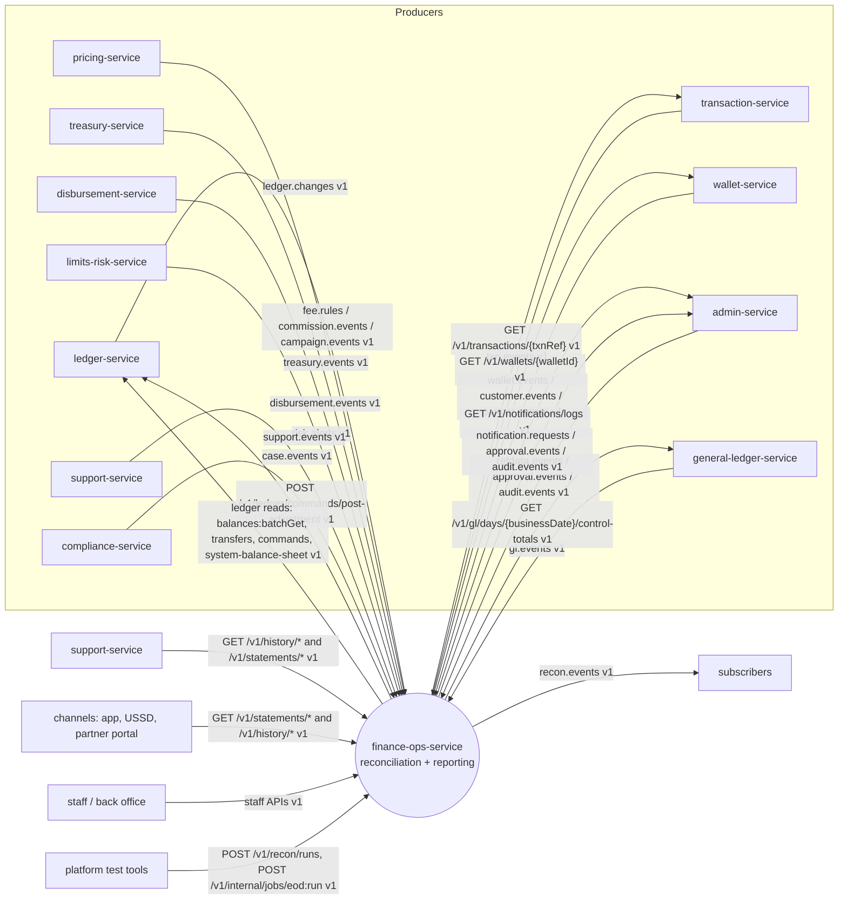

### 3.2 Component diagram

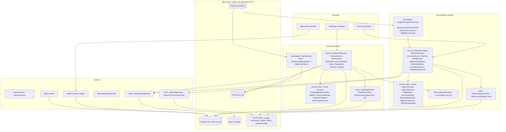

### 3.3 Runtime and deployment (Compose)

| Item | Value |
|---|---|
| Compose service | `finance-ops-service`, ports 8112 / 9112, `mem_limit` 448 MB, depends on `postgres`, `kafka-init`, `clickhouse`, `object-store` |
| Spring profiles | `api` (REST of both modules), `ingest` (consumers of both modules; switches `bitspay.recon.ingest.enabled`, `bitspay.reporting.ingest.enabled`), `jobs` (schedulers under ShedLock). Compose: `dev,api,ingest,jobs` in one container. Later deployments may split them (`api`; reconciliation ingest; reporting ingest; `jobs`) so that a ClickHouse outage never delays reconciliation ingestion |
| Database | `jdbc:postgresql://postgres:5432/bitspay?currentSchema=svc_finance_ops`, role `svc_finance_ops`; Flyway locations `db/migration/common`, `db/migration/reconciliation`, `db/migration/reporting`, one history table each (`flyway_history_common`, `flyway_history_reconciliation`, `flyway_history_reporting`), run in that order, `spring.flyway.schemas=svc_finance_ops`, `create-schemas=false` in the stack |
| ClickHouse | 26.8 LTS, database `rpt`, users `reporting_rw` (ingest, jobs) / `reporting_ro` (`readonly=2`, report execution). Migrations run by the reporting module at start-up of the `ingest` role (ADR-RPT-09) under a Postgres advisory lock in `svc_finance_ops` |
| Object storage | S3-compatible (`BITSPAY_S3_*`); bucket `bitspay-finance-ops`, prefixes `recon/…` and `reporting/…` |
| Redis / TigerBeetle | not used |
| Env vars beyond kernel K8.3 | `BITSPAY_CLICKHOUSE_URL` (`jdbc:clickhouse://clickhouse:8123/rpt`), `_USER`, `_PASSWORD`, `BITSPAY_CLICKHOUSE_RO_USER`, `_RO_PASSWORD`; `BITSPAY_S3_ENDPOINT`, `_ACCESSKEY`, `_SECRETKEY`, `_REGION`; `BITSPAY_CLIENTS_LEDGER_BASEURL`, `BITSPAY_CLIENTS_TRANSACTION_BASEURL`, `BITSPAY_CLIENTS_WALLET_BASEURL`, `BITSPAY_CLIENTS_NOTIFICATION_BASEURL`, `BITSPAY_CLIENTS_GENERALLEDGER_BASEURL` (`http://general-ledger-service:8116`); `BITSPAY_REPORTING_PROMETHEUS_URL` (empty in this phase → availability job records a gap) |
| Readiness | own infra only (Postgres, Kafka, ClickHouse for the reporting role, object storage); never waits for another service |

**Consumer groups** (pattern `finance-ops-service.reconciliation-<topic>` / `finance-ops-service.reporting-<purpose>`; OPEN D-30 — rename of the earlier `reconciliation.*` ids):

| Group id | Module | Topics | Start | Idempotency |
|---|---|---|---|---|
| `finance-ops-service.reconciliation-ledger` | reconciliation | `ledger.changes` | earliest | natural (timestamp guard, ADR-REC-01) |
| `finance-ops-service.reconciliation-txn` | reconciliation | `txn.events` | earliest | natural (business event id) |
| `finance-ops-service.reconciliation-disbursement` | reconciliation | `disbursement.events` | earliest | `processed_event` |
| `finance-ops-service.reconciliation-treasury` | reconciliation | `treasury.events` | earliest | `processed_event` |
| `finance-ops-service.reconciliation-campaign` | reconciliation | `campaign.events` | earliest | `processed_event` |
| `finance-ops-service.reconciliation-commission` | reconciliation | `commission.events` | earliest | `processed_event` |
| `finance-ops-service.reconciliation-refdata` | reconciliation | `refdata.events` (compacted) | earliest | version guard |
| `finance-ops-service.reconciliation-gl` | reconciliation | `gl.events` | earliest | `processed_event` |
| `finance-ops-service.reporting-ledger-sink` | reporting | `ledger.changes` | earliest | ReplacingMergeTree + dedup token (ADR-RPT-02) |
| `finance-ops-service.reporting-txn-sink` | reporting | `txn.events` | earliest | `row_version` |
| `finance-ops-service.reporting-wallet-sink` | reporting | `wallet.events` | earliest | `version` |
| `finance-ops-service.reporting-customer-sink` | reporting | `customer.events` | earliest | `version` = occurredAt ms |
| `finance-ops-service.reporting-partner-sink` | reporting | `partner.events` | earliest | `version` |
| `finance-ops-service.reporting-pricing-sink` | reporting | `fee.rules` | earliest | (planId, version) |
| `finance-ops-service.reporting-commission-sink` | reporting | `commission.events` | earliest | `event_id` key |
| `finance-ops-service.reporting-domain-sink` | reporting | `treasury.events`, `disbursement.events`, `campaign.events`, `support.events`, `case.events` | earliest | `event_id` key |
| `finance-ops-service.reporting-audit-sink` | reporting | `risk.alerts`, `approval.events`, `audit.events` | earliest | `event_id` key |
| `finance-ops-service.reporting-refdata` | reporting | `refdata.events` | earliest | version guard |
| `finance-ops-service.reporting-recon` | reporting | `recon.events` (own topic) | earliest | `reporting_processed_event` + job row |
| `finance-ops-service.reporting-gl-sink` | reporting | `gl.events` (R2, disabled by default) | earliest | `event_id` key |

**Scheduled jobs** (all under ShedLock, `jobs` profile, Asia/Dhaka):

| Job | Module | Schedule | Purpose |
|---|---|---|---|
| `AgingJob` | reconciliation | every 30 s | OPEN items past their window → exceptions (BR-REC-24) |
| `EodOrchestrator` | reconciliation | every minute | readiness, close steps (BR-REC-05…08) |
| `RestatementJob` | reconciliation | every 10 min | dirty closed days (BR-REC-09) |
| `GlTieOutRetryJob` | reconciliation | every 10 min | tie-out runs WAITING_FOR_DATA / FAILED (BR-REC-52) |
| `EmoneyIncompleteAlertJob` | reconciliation | every 15 min | INCOMPLETE notification at cut-off + 10 h (BR-REC-10) |
| `AdjustmentRetryJob` | reconciliation | every minute | POSTING proposals (BR-REC-41) |
| `ApprovalExpiryJob` | common | every 5 min | PENDING approvals past `expires_at` → EXPIRED |
| `PartitionMaintenanceJob` | reconciliation | daily 01:30 | monthly partitions 3 months ahead |
| `AutoCloseJob` | reconciliation | hourly | AUTO_RESOLVED exceptions older than 24 h → CLOSED |
| `AutoResolutionJob` | reconciliation | hourly (R2) | auto-resolution rules (BR-REC-44) |
| `daily-close`, `mart-txn`, `mart-partner`, `mart-emoney` | reporting | on the marts trigger (BR-RPT-40), fallback 01:00 | marts per date |
| `late-fix` | reporting | hourly | recompute marts of the last 7 days touched by late rows |
| `availability` | reporting | 00:30 | `service_availability_daily` |
| `regulatory-auto` | reporting | per dataset `auto_cron` | GENERATED runs + `REGULATORY_REVIEW_PENDING` |
| `schedule-dispatcher` | reporting | every minute | fire report schedules |
| `async-report-worker` | reporting | continuous poll | claim QUEUED runs |
| `purge-files` | reporting | 02:30 | expired report / statement files |
| `feeds`, `ttl-sync` | reporting | 04:00 / daily (R2) | Parquet feeds; TTL from `RETENTION.*` |
| outbox cleanup / inbox cleanup | common | daily | kernel K8.2 (outbox 3 days, inbox 14 days) |

### 3.4 Key flows

**F1 — Ledger ↔ transaction match**

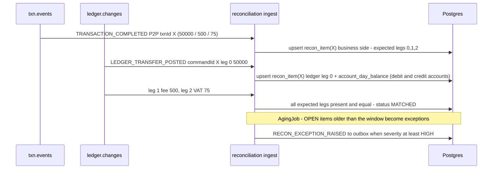

**F2 — EOD close**

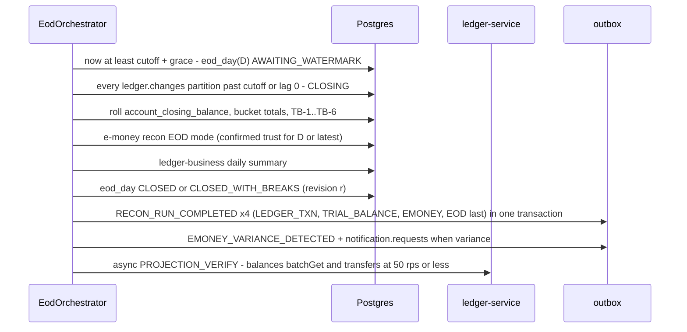

**F3 — GL tie-out (`GL_TIEOUT`)**

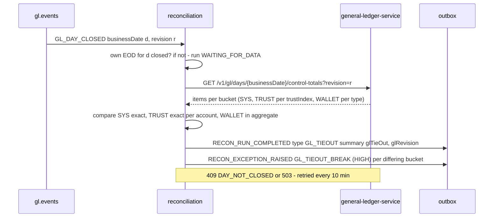

**F4 — File recon and adjustment**

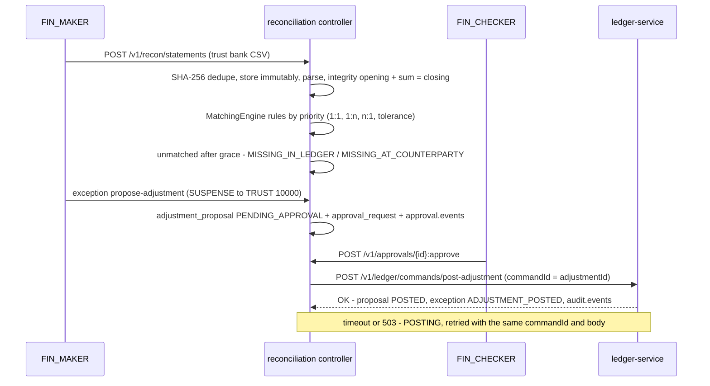

**F5 — Ledger sink ingestion (reporting)**

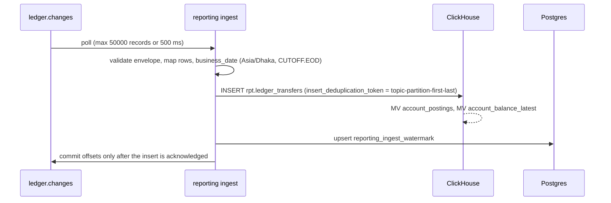

**F6 — Statement**

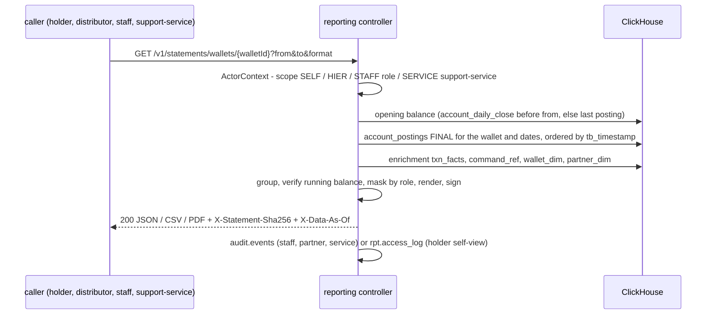

**F7 — Marts trigger (reporting, own topic)**

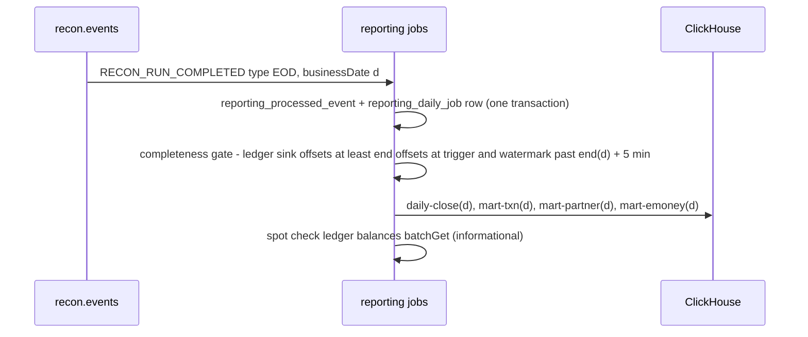

**F8 — Regulatory review**

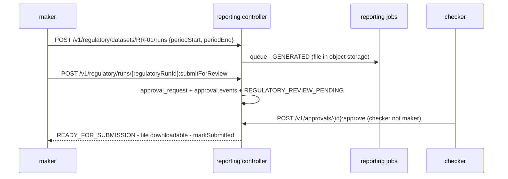

### 3.5 State machines

**EOD day (`eod_day.status`)**

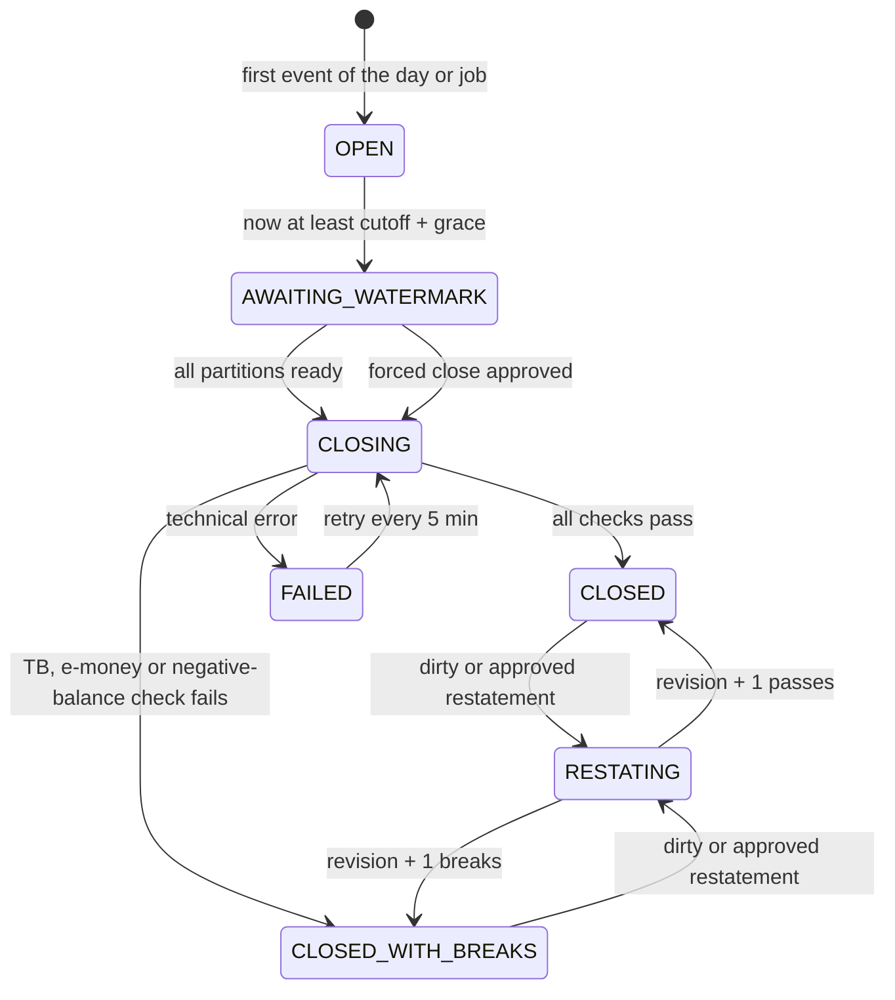

**Recon run (`recon_run.status`)**

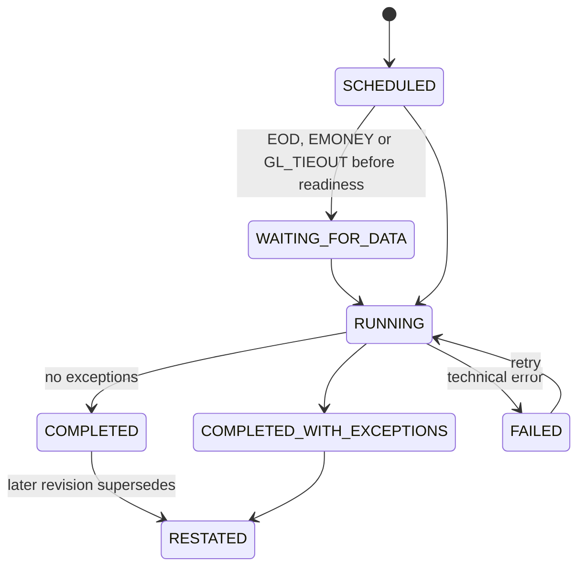
LEDGER_TXN runs are daily and continuous: created RUNNING at the first item of D and completed by EOD step 6.

**Recon exception (`recon_exception.status`)**

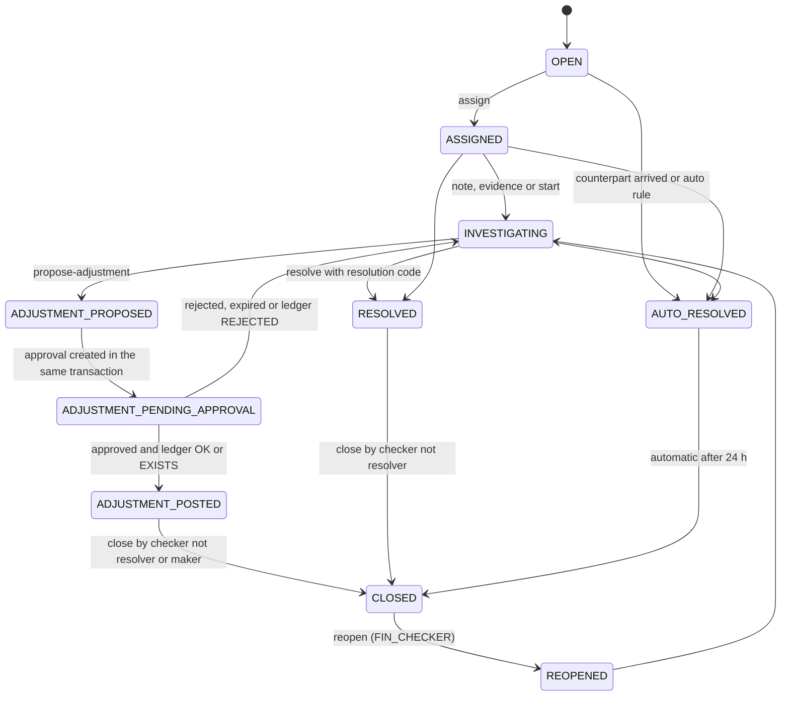

**Adjustment proposal (`adjustment_proposal.status`)**

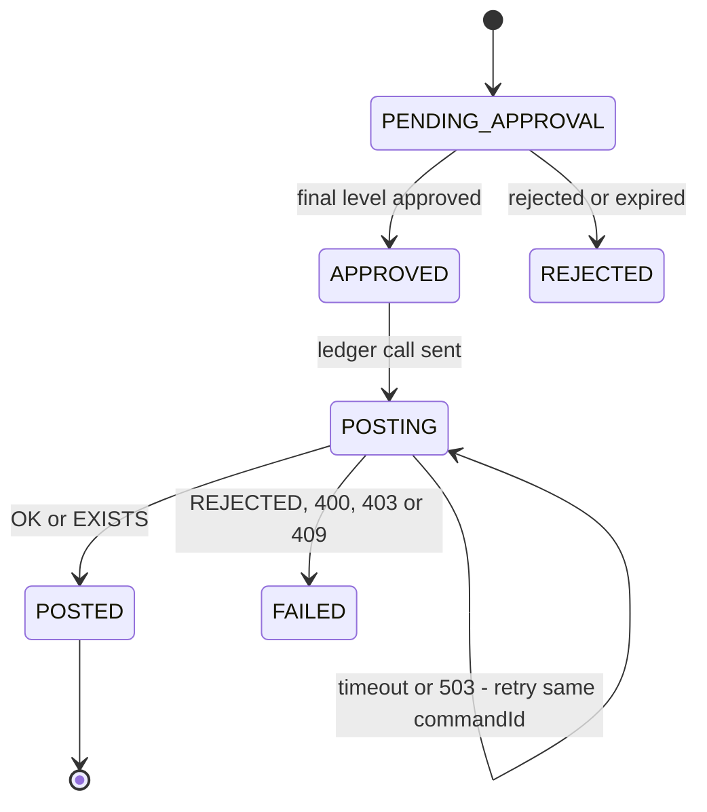

**Statement file (`statement_file.status`)**

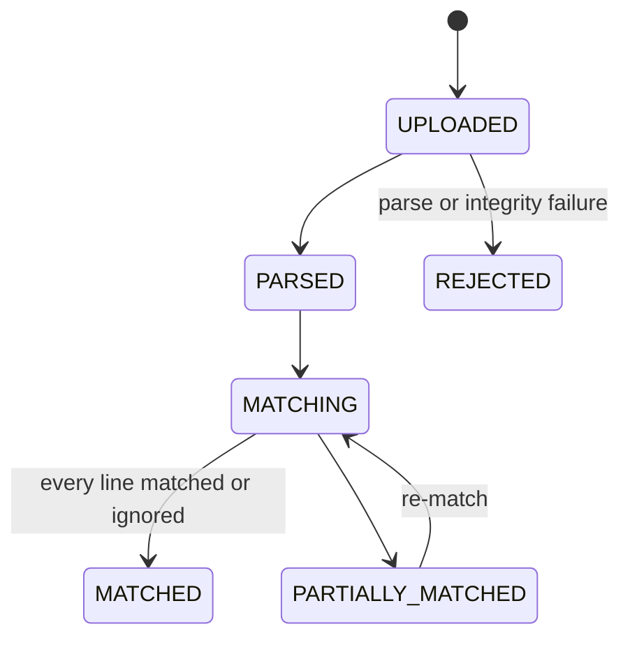

**Report definition (`reporting_report_definition.status`)**

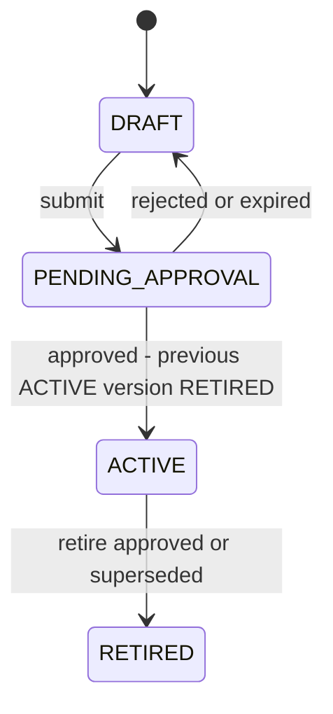

**Report run and statement export**

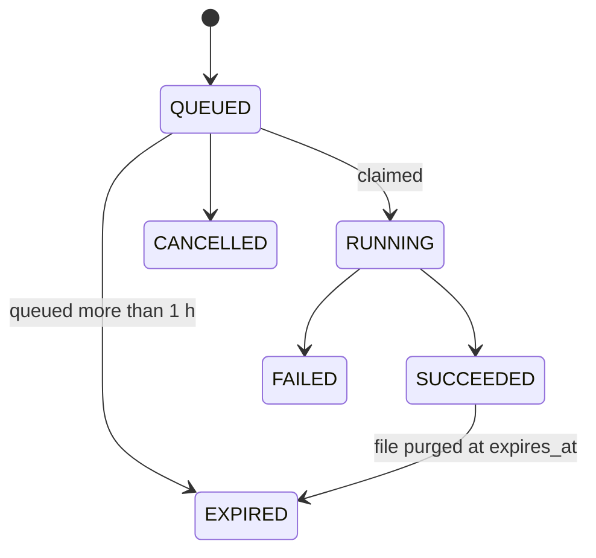
Statement exports use the same machine without CANCELLED.

**Regulatory run (`reporting_regulatory_run.status`)**

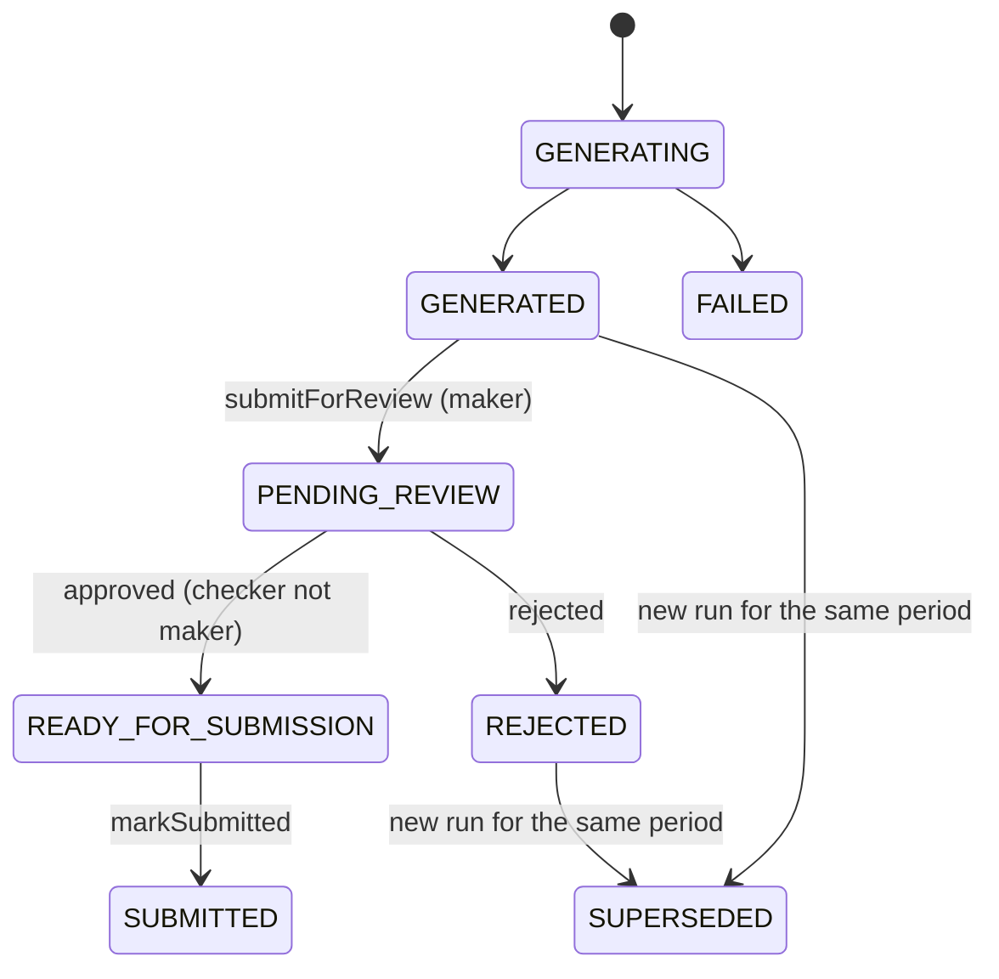

**Approval request (`approval_request.status`)** — kernel K5: `PENDING → APPROVED` (final level) · `PENDING → PENDING` (next level) · `PENDING → REJECTED` · `PENDING → EXPIRED` (72 h).

### 3.6 Architecture decisions

| ADR | Decision | Why | Consequence |
|---|---|---|---|
| ADR-FO-01 | One service, two modules (`reconciliation`, `reporting`), one schema, one outbox, one `/v1/approvals` engine | Both consume the same money topics on the same EOD calendar; reporting needs reconciliation results in-process | Module boundaries enforced by the `<Module>Facade` rule (`ArchitectureTest`) and review; separate consumer groups and inboxes per module |
| ADR-FO-02 | general-ledger-service owns the chart of accounts, GL summaries and the GL export; this service ties out the GL's control totals | Single CoA owner; reconciliation stays an independent check of the GL | No `gl_mapping`, `coa_mapping`, GL export here; `GL_TIEOUT` run type; `summary.glSummaryReady` always `false` |
| ADR-REC-01 | High-volume streams (`ledger.changes`, `txn.events`) use natural idempotency (upserts guarded by keys / TB timestamps) instead of `processed_event`; low-volume topics use `processed_event` | 3–5 inbox rows per payment would double the write load | Every write on those two streams is idempotent by construction (tested by double delivery) |
| ADR-REC-02 | Balance projection = `account_day_balance(account, businessDate)` storing the TB cumulative `*BalanceAfter` of the latest-timestamp transfer of that day (guard `last_ts`); a transfer whose `*BalanceAfter` is null (system account, poll fallback) adds its signed delta, deduplicated by `transferId` in `system_transfer_delta` | Exact as-of balances without storing every transfer | Closing balance as of D = latest row ≤ D; absent row = unchanged |
| ADR-REC-03 | EOD readiness = cut-off + grace **and** every `ledger.changes` partition has a watermark ≥ cut-off or zero lag; late events after close trigger automatic restatement (revision + 1) | Partitions are independent; the CDC bridge may lag | Online processing never pauses |
| ADR-REC-04 | One `recon_item` row per `commandId`, hash-partitioned (32), legs stored as arrays indexed by leg | Both sides upsert the same row; no join at match time | Matched rows archived after 12 months (R2), never deleted earlier |
| ADR-REC-05 | Business sources are read through a JSON-pointer mapping table (`business_source_mapping`) | Producer payload changes are config, not code | Mapping changes are maker-checker (`ReconSourceMapping`) |
| ADR-REC-06 | Adjustments only via an approved `adjustment_proposal`; `commandId = adjustmentId`; whitelisted account pairs; amount-based multi-level approval | REC-005, BOM-006 | The only ledger command in the codebase is `post-adjustment` |
| ADR-REC-07 | Matching is deterministic: inputs sorted canonically; ambiguous candidates never auto-matched | Reproducible runs | Property-tested |
| ADR-REC-08 | Statement files stored via `ObjectStorageClient`, SHA-256 dedupe per counterparty, immutable | Evidence retention (REC-010) | Re-upload of the same file → 409 |
| ADR-REC-09 | `account_closing_balance` fully aggregated at EOD (parallel seq scan) instead of incremental bucket totals | Self-correcting totals; minutes at 80 M rows | Revisit at scale |
| ADR-RPT-01 | Spring Kafka consumers write ClickHouse batches (clickhouse-java v2, `RowBinaryWithNamesAndTypes`); no ClickHouse Kafka engine | Envelope validation, DLQ, metrics, backpressure | One `TopicSink<T>` per topic |
| ADR-RPT-02 | Sink idempotency = ReplacingMergeTree keys containing the natural id + `insert_deduplication_token` per batch; no Postgres inbox for analytic sinks (declared exception to kernel K4.3) | 60k+ rows/s cannot go through a Postgres inbox | Exact reads use `FINAL` / `argMax`; side-effecting consumers (`recon.events`) use `reporting_processed_event` |
| ADR-RPT-03 | Running balance = the ledger's balance-after (credit-normal for wallets and system accounts, debit-normal for trust accounts); never cumulative sums | Exact and immune to duplicates; gaps detectable | `gaps[]` and `complete=false` on a broken chain |
| ADR-RPT-04 | Marts and daily close are recomputed per business date with `INSERT … SELECT … FINAL` into ReplacingMergeTree keyed by (date, dims), versioned by `computed_at`; no summing MVs on raw streams | Idempotent re-runs; late events fixed by recompute | `late-fix` job |
| ADR-RPT-05 | Report templates use ClickHouse server-side parameters `{name:Type}`, run as `reporting_ro` with limits; row scope is a mandatory engine-injected parameter; masking in Java by column PII class | No SQL injection; least privilege | Template validator (BR-RPT-23) |
| ADR-RPT-06 | Files live in object storage with SSE; downloads are always streamed through the API | Every download audited | No pre-signed URLs |
| ADR-RPT-07 | Staff / partner / service views and all downloads → `audit.events`; a holder viewing their own statement or history → `rpt.access_log` only | Avoid flooding the audit store with self-views | Retention of `access_log` = `RETENTION.AUDIT` (OPEN D-46) |
| ADR-RPT-08 | PDF via openhtmltopdf with embedded Noto Sans / Noto Sans Bengali; `lang=bn` must render Bangla; a fallback is signalled with `Content-Language: en` and must be off before go-live | USA-003 | Spike in WP-B5 decides the renderer (OPEN D-50) |
| ADR-RPT-09 | ClickHouse migrations by an in-repo runner (`src/main/resources/clickhouse/V<n>__*.sql`, table `rpt.schema_migrations`, checksum-verified, run by the `ingest` role under a Postgres advisory lock); Postgres via Flyway | Flyway's ClickHouse support is not production-grade | Same DDL for replicated engines via `${ENGINE_PREFIX}` |
| ADR-RPT-10 | `business_date` = `localDate(eventTime @ Asia/Dhaka − CUTOFF.EOD)`; event time = TB timestamp for ledger, `createdAt` for transactions, `occurredAt` otherwise; computed once at ingest | One definition for statements, marts and datasets | Partition stability |
| ADR-RPT-11 | Perf/prod use replicated engines; local/dev single-node with `non_replicated_deduplication_window` | Same DDL file | `bitspay.clickhouse.replicated` flag |

### 3.7 Latency / throughput budget

Not a hot-path service. Budgets: ingestion at the design load of 5k TPS sustained (≈ 15k `ledger.changes` + 5k `txn.events` per second; 10k TPS bursts for 10 min) with reconciliation lag < 60 s and reporting lag p99 ≤ 10 s; item MATCHED ≤ 10 s after the last counterpart (p95); EOD close ≤ 30 min target, ≤ 2 h hard (PER-009); statement JSON ≤ 90 days p95 ≤ 1 s; mini statement p95 ≤ 300 ms; history 90 days p95 ≤ 3 s; standard one-month report ≤ 60 s; marts ≤ 30 min after the gate. Ledger reads ≤ 50 rps across both modules (one shared limiter).

## 4. Data model

All Postgres objects live in schema `svc_finance_ops` (unqualified DDL lands there through `search_path`). Mutable rows carry `created_at`, `updated_at` and `row_version` (optimistic locking). Money is `bigint` poisha.

```mermaid
erDiagram
  recon_item }o--|| recon_source_rule : "command_type"
  recon_item }o--o| recon_exception : "exception_id"
  account_day_balance }o--|| account_registry : "account_id"
  account_closing_balance ||--|| account_registry : "account_id"
  eod_day ||--o{ eod_bucket_total : "business_date"
  eod_day ||--o{ eod_late_delta : "business_date"
  eod_day ||--o{ emoney_recon : "business_date"
  eod_day ||--o{ gl_tieout_result : "business_date"
  recon_run ||--o{ recon_exception : "run_id"
  counterparty ||--o{ file_profile : "counterparty_id"
  counterparty ||--o{ match_rule : "counterparty_id"
  counterparty ||--o{ statement_file : "counterparty_id"
  statement_file ||--o{ statement_line : "file_id"
  counterparty ||--o{ internal_item : "counterparty_id"
  match_group ||--o{ statement_line : "match_group_id"
  match_group ||--o{ internal_item : "match_group_id"
  recon_exception ||--o{ exception_note : "exception_id"
  recon_exception ||--o{ exception_evidence : "exception_id"
  recon_exception ||--o| adjustment_proposal : "exception_id"
  approval_request ||--o| adjustment_proposal : "approval_id"
  reporting_report_definition ||--o{ reporting_report_run : "definition_id"
  reporting_report_schedule ||--o{ reporting_report_run : "schedule_id"
  reporting_regulatory_dataset ||--o{ reporting_regulatory_run : "rr_code"
  reporting_regulatory_run }o--o| reporting_report_run : "report_run_id"
```

### 4.1 Flyway `common/V1__init.sql`

```sql
-- maker-checker (kernel K5), one engine for both modules
CREATE TABLE approval_request (
  id               uuid PRIMARY KEY,
  module           text NOT NULL CHECK (module IN ('reconciliation','reporting')),
  entity_type      text NOT NULL,                   -- codes.yaml entityTypes
  entity_id        text NOT NULL,
  action           text NOT NULL CHECK (action ~ '^[A-Z][A-Z_]{1,39}$'),
  payload          jsonb NOT NULL,
  summary          text NOT NULL CHECK (char_length(summary) <= 200),   -- no PII
  maker_id         uuid NOT NULL,
  maker_user_id    text,
  status           text NOT NULL CHECK (status IN ('PENDING','APPROVED','REJECTED','EXPIRED')),
  level            int  NOT NULL DEFAULT 1,          -- 1-based current level
  required_levels  int  NOT NULL DEFAULT 1,
  checker_roles    jsonb NOT NULL,                   -- per level: [["FIN_CHECKER"],["CAMLCO","FIN_CHECKER"]]
  amount_poisha    bigint,
  created_at       timestamptz NOT NULL DEFAULT now(),
  expires_at       timestamptz NOT NULL,             -- default created_at + 72 h
  decided_by       uuid[] NOT NULL DEFAULT '{}',
  decided_at       timestamptz,
  comment          text,                             -- truncated to 140 chars in audit
  reject_reason_code text,
  updated_at       timestamptz NOT NULL DEFAULT now(),
  row_version      bigint NOT NULL DEFAULT 0
);
CREATE INDEX approval_pending ON approval_request (created_at) WHERE status = 'PENDING';

-- kernel K8.2 outbox (both modules) and the lead module's inbox
CREATE TABLE IF NOT EXISTS outbox (
  id uuid PRIMARY KEY, aggregate_type text NOT NULL, aggregate_id text NOT NULL, event_type text NOT NULL,
  payload jsonb NULL, created_at timestamptz NOT NULL DEFAULT now(), published_at timestamptz);
CREATE INDEX IF NOT EXISTS outbox_unpublished ON outbox (created_at) WHERE published_at IS NULL;
CREATE TABLE IF NOT EXISTS processed_event (event_id uuid PRIMARY KEY, topic text NOT NULL, processed_at timestamptz NOT NULL DEFAULT now());

-- Idempotency-Key store (kernel K3.3; ≥ 7 days)
CREATE TABLE idempotency_record (
  actor_id text NOT NULL, idem_key text NOT NULL, operation text NOT NULL, request_sha256 text NOT NULL,
  response_status int NOT NULL, response_body jsonb NOT NULL, created_at timestamptz NOT NULL DEFAULT now(),
  PRIMARY KEY (actor_id, idem_key));

CREATE TABLE shedlock (name varchar(64) PRIMARY KEY, lock_until timestamptz NOT NULL, locked_at timestamptz NOT NULL, locked_by varchar(255) NOT NULL);

-- governance values read from refdata.events (both modules read through the common calendar)
CREATE TABLE refdata_param (type text NOT NULL, code text NOT NULL, attributes jsonb NOT NULL, version bigint NOT NULL,
  active boolean NOT NULL, received_at timestamptz NOT NULL DEFAULT now(), PRIMARY KEY (type, code));
```

### 4.2 Flyway `reconciliation/V1__init.sql`

```sql
-- ===== Configuration =====
CREATE TABLE recon_source_rule (
  command_type      smallint PRIMARY KEY,          -- ledger command type 1..17
  command_name      text NOT NULL,
  sources           text[] NOT NULL,               -- TXN | DISBURSEMENT | TREASURY | CAMPAIGN | COMMISSION | RECON
  policy            text NOT NULL CHECK (policy IN ('MATCH_REQUIRED','LEDGER_ONLY','IGNORE')),
  leg_positional    boolean NOT NULL,              -- true: compare by leg index; false: multiset (debit, credit, amount)
  window_seconds    int NOT NULL DEFAULT 300,
  updated_at timestamptz NOT NULL DEFAULT now(), row_version bigint NOT NULL DEFAULT 0
);

CREATE TABLE business_source_mapping (
  source            text NOT NULL,
  event_type        text NOT NULL,
  effect            text NOT NULL CHECK (effect IN ('EXPECT_POSTED','EXPECT_NONE','MARK_REVERSED','TRUST_CONFIRMATION','INFO')),
  command_type      smallint,
  command_id_ptr    text NOT NULL,                 -- JSON pointer into data, e.g. /commandId
  amount_ptr        text,
  debit_account_ptr text,                          -- null = not verified
  credit_account_ptr text,
  debit_account_const uuid,                        -- e.g. CAMPAIGN_FUNDING …0240
  txn_ref_ptr       text,
  bank_reference_ptr text,
  enabled           boolean NOT NULL DEFAULT true,
  updated_at timestamptz NOT NULL DEFAULT now(), row_version bigint NOT NULL DEFAULT 0,
  PRIMARY KEY (source, event_type)
);

-- ===== Account registry & balance projection =====
CREATE TABLE account_registry (
  account_id   uuid PRIMARY KEY,
  bucket       text NOT NULL,                      -- SYS:<TYPE> | TRUST | WALLET:C|A|D|M|I | WALLET:UNKNOWN
  trust_index  smallint,                           -- 1..99 for TRUST
  learned_from text NOT NULL,                      -- FIXED_ID | TXN_EVENT | DISBURSEMENT | CAMPAIGN | TREASURY | LEDGER
  first_seen_at timestamptz NOT NULL DEFAULT now(),
  updated_at   timestamptz NOT NULL DEFAULT now()
);

CREATE TABLE account_day_balance (
  business_date   date   NOT NULL,
  account_id      uuid   NOT NULL,
  last_ts         bigint NOT NULL,                 -- TB timestamp (ns) of the latest transfer applied
  debits_posted   bigint NOT NULL,
  credits_posted  bigint NOT NULL,
  debits_pending  bigint NOT NULL,
  credits_pending bigint NOT NULL,
  from_delta      boolean NOT NULL DEFAULT false,  -- true: built from system_transfer_delta (null *BalanceAfter)
  updated_at      timestamptz NOT NULL DEFAULT now(),
  PRIMARY KEY (business_date, account_id)
) PARTITION BY RANGE (business_date);
-- monthly partitions created by PartitionMaintenanceJob 3 months ahead, e.g.:
CREATE TABLE account_day_balance_2026_10 PARTITION OF account_day_balance FOR VALUES FROM ('2026-10-01') TO ('2026-11-01');
CREATE INDEX adb_account ON account_day_balance (account_id, business_date DESC);

-- signed deltas of transfers whose *BalanceAfter was null (system accounts in ledger poll fallback)
CREATE TABLE system_transfer_delta (
  transfer_id       uuid NOT NULL,
  account_id        uuid NOT NULL,
  business_date     date NOT NULL,
  tb_ts             bigint NOT NULL,
  d_debits_posted   bigint NOT NULL, d_credits_posted bigint NOT NULL,
  d_debits_pending  bigint NOT NULL, d_credits_pending bigint NOT NULL,
  PRIMARY KEY (transfer_id, account_id)
);

CREATE TABLE account_closing_balance (             -- latest CLOSED snapshot per account
  account_id      uuid PRIMARY KEY,
  as_of_date      date   NOT NULL,                 -- business date of the row it came from
  bucket          text   NOT NULL,
  debits_posted   bigint NOT NULL,
  credits_posted  bigint NOT NULL,
  debits_pending  bigint NOT NULL,
  credits_pending bigint NOT NULL,
  closed_through  date   NOT NULL                  -- last EOD that confirmed this row
);
CREATE INDEX acb_bucket ON account_closing_balance (bucket);

CREATE TABLE partition_watermark (
  topic text NOT NULL, partition int NOT NULL,
  max_tb_ts bigint NOT NULL DEFAULT 0, max_offset bigint NOT NULL DEFAULT -1,
  updated_at timestamptz NOT NULL DEFAULT now(),
  PRIMARY KEY (topic, partition)
);

CREATE TABLE watched_transfer (                    -- full detail for TRUST_SETTLEMENT (+ configured) accounts
  transfer_id   uuid PRIMARY KEY,
  command_id    uuid NOT NULL,
  command_type  smallint NOT NULL,
  leg_index     int NOT NULL,
  code          int NOT NULL,
  debit_account_id  uuid NOT NULL,
  credit_account_id uuid NOT NULL,
  amount_poisha bigint NOT NULL,
  flags         text[] NOT NULL,
  tb_ts         bigint NOT NULL,
  business_date date NOT NULL,
  created_at    timestamptz NOT NULL DEFAULT now()
);
CREATE INDEX wt_debit ON watched_transfer (debit_account_id, business_date);
CREATE INDEX wt_credit ON watched_transfer (credit_account_id, business_date);

-- ===== Internal recon (ledger ↔ business) =====
CREATE TABLE recon_item (
  command_id        uuid NOT NULL,
  command_type      smallint,                      -- from ledger or derived from the business source
  source            text,                          -- TXN | DISBURSEMENT | TREASURY | CAMPAIGN | COMMISSION | RECON
  txn_ref           text,
  txn_type          text,
  original_txn_ref  text,
  business_status   text,                          -- COMPLETED | FAILED | REVERSED | REFUNDED | PAID | GRANTED | SETTLED | POSTED …
  business_event_id uuid,
  business_seen_at  timestamptz,
  exp_amounts       bigint[],                      -- slot = leg (positional) or list (multiset)
  exp_debits        uuid[],                        -- null element = not verified
  exp_credits       uuid[],
  exp_alt_debits    uuid[],                        -- commission legs: FEE_INCOME or COMMISSION_PAYABLE
  led_amounts       bigint[] NOT NULL DEFAULT '{NULL,NULL,NULL,NULL,NULL}',
  led_debits        uuid[]   NOT NULL DEFAULT '{NULL,NULL,NULL,NULL,NULL}',
  led_credits       uuid[]   NOT NULL DEFAULT '{NULL,NULL,NULL,NULL,NULL}',
  led_extra         jsonb    NOT NULL DEFAULT '[]', -- pending/void legs, hold void of a reversal (informational)
  led_mask          int      NOT NULL DEFAULT 0,   -- bit i = posted slot i seen
  first_ledger_ts   bigint,
  first_seen_at     timestamptz NOT NULL DEFAULT now(),
  business_date     date NOT NULL,                 -- Dhaka business date of first observation
  status            text NOT NULL DEFAULT 'OPEN' CHECK (status IN ('OPEN','MATCHED','MATCHED_NO_MOVEMENT','EXCEPTION','AUTO_RESOLVED','LEDGER_ONLY_OK')),
  mismatch_code     text,
  exception_id      uuid,
  matched_at        timestamptz,
  updated_at        timestamptz NOT NULL DEFAULT now(),
  PRIMARY KEY (command_id)
) PARTITION BY HASH (command_id);
DO $$ BEGIN FOR i IN 0..31 LOOP
  EXECUTE format('CREATE TABLE recon_item_p%s PARTITION OF recon_item FOR VALUES WITH (MODULUS 32, REMAINDER %s)', lpad(i::text,2,'0'), i);
END LOOP; END $$;
CREATE INDEX ri_open   ON recon_item (first_seen_at) WHERE status = 'OPEN';
CREATE INDEX ri_txnref ON recon_item (txn_ref) WHERE txn_ref IS NOT NULL;
CREATE INDEX ri_date   ON recon_item (business_date, status);

-- ===== EOD, trial balance, e-money, GL tie-out =====
CREATE TABLE eod_day (
  business_date   date PRIMARY KEY,
  status          text NOT NULL CHECK (status IN ('OPEN','AWAITING_WATERMARK','CLOSING','CLOSED','CLOSED_WITH_BREAKS','RESTATING','FAILED')),
  revision        int  NOT NULL DEFAULT 0,
  forced          boolean NOT NULL DEFAULT false,
  cutoff_at       timestamptz NOT NULL,
  cutoff_tb_ns    bigint NOT NULL,
  dirty           boolean NOT NULL DEFAULT false,  -- late event arrived after close
  accounts_changed bigint,
  run_ids         jsonb,                           -- {EOD, TRIAL_BALANCE, EMONEY, LEDGER_TXN}
  report          jsonb,                           -- checks, timings, counts
  closed_at       timestamptz,
  created_at timestamptz NOT NULL DEFAULT now(), updated_at timestamptz NOT NULL DEFAULT now(), row_version bigint NOT NULL DEFAULT 0
);

CREATE TABLE eod_bucket_total (
  business_date   date NOT NULL, revision int NOT NULL, bucket text NOT NULL,
  account_count   bigint NOT NULL,
  debits_posted   bigint NOT NULL, credits_posted bigint NOT NULL,
  debits_pending  bigint NOT NULL, credits_pending bigint NOT NULL,
  net_credit_poisha bigint NOT NULL,               -- credits_posted − debits_posted
  PRIMARY KEY (business_date, revision, bucket)
);

CREATE TABLE eod_late_delta (                      -- per-account corrections for restatement (ADR-REC-03)
  business_date date NOT NULL, account_id uuid NOT NULL, transfer_id uuid NOT NULL,
  d_debits_posted bigint NOT NULL, d_credits_posted bigint NOT NULL,
  d_debits_pending bigint NOT NULL, d_credits_pending bigint NOT NULL,
  applied_revision int,
  created_at timestamptz NOT NULL DEFAULT now(),
  PRIMARY KEY (business_date, account_id, transfer_id)
);

CREATE TABLE trust_confirmation (                  -- only balanceKind = CLOSING; greatest balance_as_of wins
  ledger_trust_account_id uuid NOT NULL,           -- …0300nn
  business_date   date NOT NULL,
  trust_account_id uuid NOT NULL,                  -- treasury id
  confirmation_id uuid NOT NULL,
  bank_code       text NOT NULL,
  confirmed_balance_poisha bigint NOT NULL,
  balance_as_of   timestamptz NOT NULL,
  source          text NOT NULL,                   -- MANUAL | CSV | MT940 | CAMT053
  event_id        uuid NOT NULL,
  received_at     timestamptz NOT NULL DEFAULT now(),
  PRIMARY KEY (ledger_trust_account_id, business_date)
);

CREATE TABLE emoney_recon (
  recon_id uuid PRIMARY KEY,
  business_date date NOT NULL, revision int NOT NULL, mode text NOT NULL CHECK (mode IN ('EOD','LIVE')),
  status text NOT NULL CHECK (status IN ('MATCHED','VARIANCE','INCOMPLETE')),
  wallets_only_poisha bigint NOT NULL,             -- Σ WALLET:*
  system_emoney_poisha bigint NOT NULL,            -- Σ non-trust system accounts
  wallets_total_poisha bigint NOT NULL,            -- = wallets_only + system_emoney (total outstanding e-money)
  trust_mirror_poisha bigint NOT NULL,
  confirmed_trust_poisha bigint,
  ledger_identity_diff_poisha bigint NOT NULL,     -- wallets_total − trust_mirror (must be 0)
  variance_poisha bigint,                          -- wallets_total − confirmed_trust
  per_trust jsonb NOT NULL,                        -- [{trustAccountId, mirrorPoisha, confirmedPoisha, confirmedDate, stale, variancePoisha}]
  run_id uuid NOT NULL,
  created_at timestamptz NOT NULL DEFAULT now()
);
CREATE INDEX er_eod ON emoney_recon (business_date, revision, created_at DESC) WHERE mode = 'EOD';

CREATE TABLE gl_tieout_result (                    -- one row per compared bucket of a GL_TIEOUT run
  run_id          uuid NOT NULL,
  business_date   date NOT NULL,
  gl_revision     int  NOT NULL,
  recon_revision  int  NOT NULL,
  bucket          text NOT NULL,                   -- SYS:<TYPE> | TRUST:nn | WALLET:* (aggregate) | WALLET:<t> (informational)
  comparison      text NOT NULL CHECK (comparison IN ('EXACT','AGGREGATE','INFORMATIONAL')),
  gl_debits_posted bigint NOT NULL, gl_credits_posted bigint NOT NULL,
  recon_debits_posted bigint NOT NULL, recon_credits_posted bigint NOT NULL,
  result          text NOT NULL CHECK (result IN ('MATCHED','BREAK','INFO')),
  PRIMARY KEY (run_id, bucket)
);

-- ===== Runs =====
CREATE TABLE recon_run (
  run_id uuid PRIMARY KEY,
  type text NOT NULL CHECK (type IN ('LEDGER_TXN','EOD','TRIAL_BALANCE','EMONEY','FILE','PROJECTION_VERIFY','GL_TIEOUT')),
  business_date date,
  gl_revision int,                                 -- GL_TIEOUT only
  scope jsonb NOT NULL DEFAULT '{}',               -- mode, counterpartyId, fromDate, toDate, sampleSize
  status text NOT NULL CHECK (status IN ('SCHEDULED','WAITING_FOR_DATA','RUNNING','COMPLETED','COMPLETED_WITH_EXCEPTIONS','FAILED','RESTATED')),
  revision int NOT NULL DEFAULT 1,
  matched bigint NOT NULL DEFAULT 0, exceptions bigint NOT NULL DEFAULT 0,
  summary jsonb NOT NULL DEFAULT '{}',             -- = RECON_RUN_COMPLETED.summary
  triggered_by text NOT NULL, started_at timestamptz, finished_at timestamptz, error text, attempts int NOT NULL DEFAULT 0,
  created_at timestamptz NOT NULL DEFAULT now(), updated_at timestamptz NOT NULL DEFAULT now(), row_version bigint NOT NULL DEFAULT 0
);
CREATE UNIQUE INDEX rr_daily ON recon_run (type, business_date, revision) WHERE type IN ('LEDGER_TXN','EOD','TRIAL_BALANCE','EMONEY') AND (scope->>'mode') IS DISTINCT FROM 'LIVE';
CREATE UNIQUE INDEX rr_tieout ON recon_run (business_date, gl_revision, revision) WHERE type = 'GL_TIEOUT';

-- ===== File-based recon =====
CREATE TABLE counterparty (
  counterparty_id uuid PRIMARY KEY, code text NOT NULL UNIQUE, name text NOT NULL,
  type text NOT NULL CHECK (type IN ('TRUST_BANK','SCHEME','BILLER','PARTNER','DISBURSER','MERCHANT','OTHER')),
  internal_account_ids uuid[] NOT NULL,            -- e.g. {00000000-0000-0000-0000-000000030001}
  settlement_cycle text CHECK (settlement_cycle IN ('T0','T1','T2','INTRADAY')),
  net_settlement boolean NOT NULL DEFAULT false,
  active boolean NOT NULL DEFAULT true,
  status text NOT NULL CHECK (status IN ('PENDING_APPROVAL','ACTIVE','INACTIVE')),
  created_at timestamptz NOT NULL DEFAULT now(), updated_at timestamptz NOT NULL DEFAULT now(), row_version bigint NOT NULL DEFAULT 0
);

CREATE TABLE file_profile (
  profile_id uuid NOT NULL, profile_version int NOT NULL,
  counterparty_id uuid NOT NULL REFERENCES counterparty,
  format text NOT NULL CHECK (format IN ('CSV','XLSX','MT940','CAMT053')),
  mapping jsonb NOT NULL,
  status text NOT NULL CHECK (status IN ('DRAFT','PENDING_APPROVAL','ACTIVE','SUPERSEDED','REJECTED')),
  approval_id uuid, maker_id uuid NOT NULL, checker_id uuid,
  created_at timestamptz NOT NULL DEFAULT now(), updated_at timestamptz NOT NULL DEFAULT now(), row_version bigint NOT NULL DEFAULT 0,
  PRIMARY KEY (profile_id, profile_version)
);

CREATE TABLE match_rule (
  rule_id uuid NOT NULL, rule_version int NOT NULL,
  counterparty_id uuid NOT NULL REFERENCES counterparty,
  priority int NOT NULL,
  match_type text NOT NULL CHECK (match_type IN ('ONE_TO_ONE','ONE_TO_MANY','MANY_TO_ONE')),
  amount_mode text NOT NULL CHECK (amount_mode IN ('EXACT','TOLERANCE')),
  amount_tol_poisha bigint NOT NULL DEFAULT 0, amount_tol_bps int NOT NULL DEFAULT 0,
  date_window_days int NOT NULL DEFAULT 0,
  reference_mode text NOT NULL CHECK (reference_mode IN ('EXACT','CONTAINS','REGEX','NONE')),
  reference_regex text,
  max_group_size int NOT NULL DEFAULT 1 CHECK (max_group_size BETWEEN 1 AND 12),
  max_candidates int NOT NULL DEFAULT 20,
  status text NOT NULL CHECK (status IN ('DRAFT','PENDING_APPROVAL','ACTIVE','SUPERSEDED','REJECTED')),
  approval_id uuid, maker_id uuid NOT NULL, checker_id uuid,
  created_at timestamptz NOT NULL DEFAULT now(), updated_at timestamptz NOT NULL DEFAULT now(), row_version bigint NOT NULL DEFAULT 0,
  PRIMARY KEY (rule_id, rule_version)
);

CREATE TABLE statement_file (
  file_id uuid PRIMARY KEY, counterparty_id uuid NOT NULL REFERENCES counterparty,
  profile_id uuid NOT NULL, profile_version int NOT NULL,
  sha256 text NOT NULL, original_name text NOT NULL, storage_key text NOT NULL, size_bytes bigint NOT NULL,
  period_from date, period_to date,
  opening_balance_poisha bigint, closing_balance_poisha bigint,
  line_count int, status text NOT NULL CHECK (status IN ('UPLOADED','PARSED','REJECTED','MATCHING','MATCHED','PARTIALLY_MATCHED')),
  error jsonb, uploaded_by uuid NOT NULL,
  created_at timestamptz NOT NULL DEFAULT now(), updated_at timestamptz NOT NULL DEFAULT now(), row_version bigint NOT NULL DEFAULT 0,
  UNIQUE (counterparty_id, sha256)
);

CREATE TABLE statement_line (
  line_id uuid PRIMARY KEY, file_id uuid NOT NULL REFERENCES statement_file,
  counterparty_id uuid NOT NULL, line_no int NOT NULL,
  value_date date NOT NULL, booking_date date,
  amount_poisha bigint NOT NULL CHECK (amount_poisha <> 0),   -- + = credit to our account at the bank, − = debit
  reference text, reference_norm text, bank_txn_id text, description text,
  reversal_flag boolean NOT NULL DEFAULT false,               -- camt RvslInd / MT940 R mark
  status text NOT NULL CHECK (status IN ('UNMATCHED','MATCHED','EXCEPTION','IGNORED')),
  match_group_id uuid,
  UNIQUE (file_id, line_no)
);
CREATE INDEX sl_open ON statement_line (counterparty_id, value_date) WHERE status = 'UNMATCHED';
CREATE UNIQUE INDEX sl_banktxn ON statement_line (counterparty_id, bank_txn_id) WHERE bank_txn_id IS NOT NULL AND status <> 'IGNORED';

CREATE TABLE internal_item (                       -- ledger side for file recon (from watched_transfer)
  item_id uuid PRIMARY KEY,                        -- = transfer_id
  counterparty_id uuid NOT NULL, account_id uuid NOT NULL,
  command_id uuid NOT NULL, command_type smallint NOT NULL, txn_ref text,
  value_date date NOT NULL,
  amount_poisha bigint NOT NULL,                   -- + = trust mirror debited (money expected IN at the bank), − = credited
  reference text, reference_norm text,             -- treasury bankReference / payoutReference, else txn_ref
  status text NOT NULL CHECK (status IN ('UNMATCHED','MATCHED','EXCEPTION','IGNORED')),
  match_group_id uuid, created_at timestamptz NOT NULL DEFAULT now(), updated_at timestamptz NOT NULL DEFAULT now()
);
CREATE INDEX ii_open ON internal_item (counterparty_id, value_date) WHERE status = 'UNMATCHED';
CREATE INDEX ii_command ON internal_item (command_id);

CREATE TABLE match_group (
  group_id uuid PRIMARY KEY, counterparty_id uuid NOT NULL, run_id uuid,
  rule_id uuid, rule_version int,
  match_type text NOT NULL CHECK (match_type IN ('ONE_TO_ONE','ONE_TO_MANY','MANY_TO_ONE','MANY_TO_MANY')),
  method text NOT NULL CHECK (method IN ('AUTO','MANUAL')),
  line_ids uuid[] NOT NULL, item_ids uuid[] NOT NULL,
  line_total_poisha bigint NOT NULL, item_total_poisha bigint NOT NULL, difference_poisha bigint NOT NULL,
  status text NOT NULL CHECK (status IN ('ACTIVE','PENDING_APPROVAL','UNMATCHED')),
  created_by text NOT NULL, approval_id uuid, created_at timestamptz NOT NULL DEFAULT now()
);

-- ===== Exceptions & adjustments =====
CREATE TABLE recon_exception (
  exception_id uuid PRIMARY KEY,
  dedupe_key text NOT NULL UNIQUE,                 -- e.g. LEDGER_TXN:<commandId>:<category>, EMONEY:<date>, GL:<date>:<glRev>:<bucket>
  category text NOT NULL,                          -- §7.6
  source text NOT NULL CHECK (source IN ('LEDGER_TXN','FILE','EMONEY','EOD','PROJECTION','GL')),
  severity text NOT NULL CHECK (severity IN ('CRITICAL','HIGH','MEDIUM','LOW','INFO')),
  business_date date NOT NULL,
  run_id uuid NOT NULL,                            -- exceptions outside a run attach to the day's LEDGER_TXN run
  command_id uuid, txn_ref text, account_id uuid, counterparty_id uuid,
  line_ids uuid[] NOT NULL DEFAULT '{}', item_ids uuid[] NOT NULL DEFAULT '{}',
  amount_poisha bigint,                            -- signed (§5.2)
  expected jsonb, actual jsonb,
  status text NOT NULL CHECK (status IN ('OPEN','ASSIGNED','INVESTIGATING','ADJUSTMENT_PROPOSED','ADJUSTMENT_PENDING_APPROVAL','ADJUSTMENT_POSTED','RESOLVED','AUTO_RESOLVED','CLOSED','REOPENED')),
  assignee uuid, due_at timestamptz,
  resolution_code text, resolved_by uuid, closed_by uuid,
  created_at timestamptz NOT NULL DEFAULT now(), updated_at timestamptz NOT NULL DEFAULT now(), row_version bigint NOT NULL DEFAULT 0
);
CREATE INDEX re_queue ON recon_exception (status, severity, due_at);
CREATE INDEX re_date ON recon_exception (business_date, category);

CREATE TABLE exception_note (note_id uuid PRIMARY KEY, exception_id uuid NOT NULL REFERENCES recon_exception, author uuid NOT NULL,
  body text NOT NULL, created_at timestamptz NOT NULL DEFAULT now());
CREATE TABLE exception_evidence (evidence_id uuid PRIMARY KEY, exception_id uuid NOT NULL REFERENCES recon_exception,
  file_name text NOT NULL, content_type text NOT NULL, storage_key text NOT NULL, sha256 text NOT NULL, uploaded_by uuid NOT NULL,
  created_at timestamptz NOT NULL DEFAULT now());

CREATE TABLE adjustment_proposal (
  adjustment_id uuid PRIMARY KEY,                  -- = ledger commandId (UUIDv7), persisted before the call
  exception_id uuid NOT NULL REFERENCES recon_exception,
  txn_ref text NOT NULL UNIQUE,                    -- RCA-yyyyMMdd-XXXXXXXX
  debit_account_id uuid NOT NULL, credit_account_id uuid NOT NULL,
  amount_poisha bigint NOT NULL CHECK (amount_poisha > 0 AND amount_poisha <= 10000000000000),
  reason_code text NOT NULL, justification text NOT NULL,
  status text NOT NULL CHECK (status IN ('PENDING_APPROVAL','APPROVED','POSTING','POSTED','REJECTED','FAILED')),
  approval_id uuid, maker_id uuid NOT NULL,
  ledger_result text, rejection_code text, attempts int NOT NULL DEFAULT 0, next_attempt_at timestamptz, posted_at timestamptz,
  created_at timestamptz NOT NULL DEFAULT now(), updated_at timestamptz NOT NULL DEFAULT now(), row_version bigint NOT NULL DEFAULT 0,
  CHECK (debit_account_id <> credit_account_id)
);

CREATE TABLE auto_resolution_rule (                -- R2
  rule_id text PRIMARY KEY, category text NOT NULL, condition jsonb NOT NULL,
  action text NOT NULL CHECK (action IN ('AUTO_RESOLVE','DOWNGRADE_SEVERITY')),
  enabled boolean NOT NULL DEFAULT true, status text NOT NULL CHECK (status IN ('PENDING_APPROVAL','ACTIVE','REJECTED')),
  approval_id uuid, maker_id uuid NOT NULL, checker_id uuid,
  updated_at timestamptz NOT NULL DEFAULT now(), row_version bigint NOT NULL DEFAULT 0
);

CREATE TABLE holiday (business_date date PRIMARY KEY, name text, source_version bigint);
```

**Seed `reconciliation/V2__seed.sql`** (provisional values, changeable through the config APIs with approval):

| command_type | Name | sources | policy | positional | window |
|---|---|---|---|---|---|
| 1–6 | payment commands | {TXN} | MATCH_REQUIRED | true | 300 s |
| 7 | `post-reversal` | {TXN, CAMPAIGN} | MATCH_REQUIRED | true (mirror rule BR-REC-21) | 300 s |
| 8 | `post-disbursement-batch` | {DISBURSEMENT} | MATCH_REQUIRED | false | 900 s |
| 9, 10 | e-money issue / redeem | {TREASURY} | MATCH_REQUIRED | false | 900 s |
| 11 | `post-adjustment` | {RECON, TREASURY} | MATCH_REQUIRED | false | 900 s |
| 12 | `post-campaign-reward` | {CAMPAIGN} | MATCH_REQUIRED | false | 300 s |
| 13 | `post-commission-settlement` | {COMMISSION} | MATCH_REQUIRED | false (net leg + AIT leg) | 300 s |
| 14, 15 | holds | {} | LEDGER_ONLY | false | 300 s |
| 16 | `post-trust-rebalance` | {TREASURY} | MATCH_REQUIRED | false | 900 s |
| 17 | `post-closure-payout` | {} | LEDGER_ONLY (single leg, code 1016, wallet → wallet) | false | 300 s |

`business_source_mapping` rows: those of §6.2 (BR-REC-22). `account_registry`: every fixed system id (`…0200` FEE_INCOME, `…0210` VAT_PAYABLE, `…0220` COMMISSION_PAYABLE, `…0230` AIT_PAYABLE, `…0240` CAMPAIGN_FUNDING, `…0400` SUSPENSE, `…0410` ADJUSTMENT_CLEARING, `…0420` HOLD_CONTROL) and TRUST `…030001`…`…030099` (bucket `TRUST`, `trust_index` nn). Technical accounts 900/910 never appear.

### 4.3 Flyway `reporting/V1__init.sql`

```sql
CREATE TABLE reporting_report_definition (
  id               uuid PRIMARY KEY,
  code             text NOT NULL CHECK (code ~ '^[A-Z0-9-]{3,64}$'),
  def_version      int  NOT NULL,
  status           text NOT NULL CHECK (status IN ('DRAFT','PENDING_APPROVAL','ACTIVE','RETIRED')),
  name_en          text NOT NULL,
  name_bn          text,
  category         text NOT NULL CHECK (category IN ('BUSINESS','OPERATIONAL','AUDIT','FINANCE','PARTNER','RISK','UPTIME','REGULATORY')),
  source           text NOT NULL CHECK (source IN ('CLICKHOUSE','PROMETHEUS','LOCAL')),
  query_template   text NOT NULL,                  -- ClickHouse SQL with {name:Type} placeholders / PromQL / local query id
  parameters       jsonb NOT NULL,                 -- [{"name":"from","type":"Date","required":true,"default":"D-1"}]
  columns          jsonb NOT NULL,                 -- [{"name":"msisdn","labelEn":"Mobile","piiClass":"MSISDN","format":"TEXT"}]
  allowed_roles    text[] NOT NULL DEFAULT '{}',
  allowed_actor_types text[] NOT NULL DEFAULT '{STAFF}',
  row_scope        text NOT NULL DEFAULT 'NONE' CHECK (row_scope IN ('NONE','PARTNER_SELF','PARTNER_HIERARCHY','INSTITUTION_SELF')),
  formats          text[] NOT NULL DEFAULT '{JSON,CSV,XLSX,PDF}',
  sync_max_rows    int  NOT NULL DEFAULT 10000,
  max_rows         int  NOT NULL DEFAULT 5000000,
  timeout_seconds  int  NOT NULL DEFAULT 60 CHECK (timeout_seconds BETWEEN 1 AND 900),
  srs_refs         text[] NOT NULL DEFAULT '{}',
  approval_id      uuid,
  created_by       text NOT NULL,
  created_at       timestamptz NOT NULL DEFAULT now(), updated_at timestamptz NOT NULL DEFAULT now(), row_version bigint NOT NULL DEFAULT 0,
  UNIQUE (code, def_version)
);
CREATE UNIQUE INDEX reporting_report_definition_one_active ON reporting_report_definition (code) WHERE status = 'ACTIVE';

CREATE TABLE reporting_masking_rule (
  role       text NOT NULL,                        -- K7 role, or actor type for non-staff (CUSTOMER, AGENT, …, SERVICE)
  pii_class  text NOT NULL CHECK (pii_class IN ('MSISDN','NAME','NID_HASH','ACCOUNT_NO','BIRTH_YEAR','DEVICE_ID','ADDRESS')),
  mode       text NOT NULL CHECK (mode IN ('FULL','MASKED','HASHED','HIDDEN')),
  updated_at timestamptz NOT NULL DEFAULT now(), row_version bigint NOT NULL DEFAULT 0,
  PRIMARY KEY (role, pii_class)
);

CREATE TABLE reporting_report_run (
  id             uuid PRIMARY KEY,
  definition_id  uuid NOT NULL REFERENCES reporting_report_definition(id),
  code           text NOT NULL, def_version int NOT NULL,
  parameters     jsonb NOT NULL,
  format         text NOT NULL CHECK (format IN ('JSON','CSV','XLSX','PDF','XML')),
  mode           text NOT NULL CHECK (mode IN ('SYNC','ASYNC','SCHEDULED')),
  schedule_id    uuid,
  actor_type     text NOT NULL, actor_id text NOT NULL, actor_roles text[] NOT NULL DEFAULT '{}',
  status         text NOT NULL CHECK (status IN ('QUEUED','RUNNING','SUCCEEDED','FAILED','EXPIRED','CANCELLED')),
  row_count      bigint, file_key text, file_sha256 text, file_bytes bigint,
  error_code     text, error_detail text,
  correlation_id text NOT NULL,
  queued_at      timestamptz NOT NULL DEFAULT now(), started_at timestamptz, finished_at timestamptz,
  expires_at     timestamptz NOT NULL,             -- file retention (default 30 d)
  row_version    bigint NOT NULL DEFAULT 0
);
CREATE INDEX reporting_report_run_queue ON reporting_report_run (queued_at) WHERE status = 'QUEUED';
CREATE INDEX reporting_report_run_actor ON reporting_report_run (actor_id, queued_at DESC);

CREATE TABLE reporting_report_schedule (
  id            uuid PRIMARY KEY,
  code          text NOT NULL,
  parameters    jsonb NOT NULL,                    -- relative dates allowed: "D-1", "M-1:start", "M-1:end"
  format        text NOT NULL,
  cron          text NOT NULL,                     -- Spring cron, zone Asia/Dhaka
  folder        text NOT NULL CHECK (folder ~ '^secure/[a-z0-9-]+$'),
  notify_staff_ids uuid[] NOT NULL DEFAULT '{}',
  status        text NOT NULL CHECK (status IN ('PENDING_APPROVAL','ACTIVE','PAUSED','RETIRED')),
  owner_id      uuid NOT NULL, run_as_roles text[] NOT NULL,
  last_run_id   uuid, next_fire_at timestamptz, approval_id uuid,
  created_at timestamptz NOT NULL DEFAULT now(), updated_at timestamptz NOT NULL DEFAULT now(), row_version bigint NOT NULL DEFAULT 0
);

CREATE TABLE reporting_secure_folder_acl (folder text NOT NULL, role text NOT NULL, PRIMARY KEY (folder, role));
CREATE TABLE reporting_secure_file (
  file_id uuid PRIMARY KEY, folder text NOT NULL, name text NOT NULL, code text NOT NULL, run_id uuid NOT NULL,
  business_date date, file_key text NOT NULL, file_sha256 text NOT NULL, file_bytes bigint NOT NULL,
  created_at timestamptz NOT NULL DEFAULT now());

CREATE TABLE reporting_statement_export (
  id uuid PRIMARY KEY, wallet_id uuid NOT NULL, date_from date NOT NULL, date_to date NOT NULL,
  format text NOT NULL CHECK (format IN ('CSV','PDF')), lang text NOT NULL DEFAULT 'en',
  actor_type text NOT NULL, actor_id text NOT NULL, actor_wallet_id uuid,
  status text NOT NULL CHECK (status IN ('QUEUED','RUNNING','SUCCEEDED','FAILED','EXPIRED')),
  file_key text, file_sha256 text, complete boolean, error_code text,
  created_at timestamptz NOT NULL DEFAULT now(), finished_at timestamptz, expires_at timestamptz NOT NULL,
  row_version bigint NOT NULL DEFAULT 0
);

CREATE TABLE reporting_regulatory_dataset (
  rr_code        text PRIMARY KEY,                 -- RR-01 …
  name           text NOT NULL,
  definition_code text NOT NULL,                   -- report definition used to produce rows
  frequency      text NOT NULL CHECK (frequency IN ('DAILY','MONTHLY','QUARTERLY','ON_DEMAND')),
  auto_cron      text,                             -- e.g. '0 0 6 * * *' (06:00 Dhaka) for RR-01
  layout_version text NOT NULL DEFAULT 'PROVISIONAL-1',
  renderer       text NOT NULL DEFAULT 'XLSX',     -- XLSX | CSV | XML:<rendererId>
  maker_roles    text[] NOT NULL, checker_roles text[] NOT NULL,
  enabled        boolean NOT NULL DEFAULT true,
  updated_at timestamptz NOT NULL DEFAULT now(), row_version bigint NOT NULL DEFAULT 0
);

CREATE TABLE reporting_regulatory_run (
  id uuid PRIMARY KEY, rr_code text NOT NULL REFERENCES reporting_regulatory_dataset(rr_code),
  period_start date NOT NULL, period_end date NOT NULL, run_no int NOT NULL,
  status text NOT NULL CHECK (status IN ('GENERATING','GENERATED','PENDING_REVIEW','READY_FOR_SUBMISSION','REJECTED','SUBMITTED','FAILED','SUPERSEDED')),
  report_run_id uuid REFERENCES reporting_report_run(id), file_key text, file_sha256 text, summary jsonb,
  approval_id uuid, submission_reference text, submitted_at timestamptz, submitted_by uuid, reason text,
  created_by uuid NOT NULL, created_at timestamptz NOT NULL DEFAULT now(), updated_at timestamptz NOT NULL DEFAULT now(),
  row_version bigint NOT NULL DEFAULT 0,
  UNIQUE (rr_code, period_start, period_end, run_no)
);

CREATE TABLE reporting_incident_register (       -- RPT-014 MTTR / RR-10 inputs (manual until an ITSM exists)
  id uuid PRIMARY KEY, service text NOT NULL, channel text,
  severity text NOT NULL CHECK (severity IN ('SEV1','SEV2','SEV3','SEV4')),
  started_at timestamptz NOT NULL, resolved_at timestamptz, summary text NOT NULL, created_by uuid NOT NULL,
  created_at timestamptz NOT NULL DEFAULT now(), updated_at timestamptz NOT NULL DEFAULT now(), row_version bigint NOT NULL DEFAULT 0
);

CREATE TABLE reporting_ingest_watermark (
  sink text NOT NULL, topic text NOT NULL, kafka_partition int NOT NULL, committed_offset bigint NOT NULL,
  max_occurred_at timestamptz, updated_at timestamptz NOT NULL DEFAULT now(),
  PRIMARY KEY (sink, topic, kafka_partition)
);

CREATE TABLE reporting_daily_job (                -- marts trigger and gate state per business date
  business_date date NOT NULL, job text NOT NULL,
  status text NOT NULL CHECK (status IN ('WAITING_GATE','RUNNING','DONE','FAILED')),
  trigger text NOT NULL,                           -- RECON_EOD:<runId> | FALLBACK | MANUAL | LATE_FIX
  gate_end_offsets jsonb,                          -- ledger.changes end offsets captured at trigger time
  recon_revision int, spot_check text,             -- OK | MISMATCH | SKIPPED
  started_at timestamptz, finished_at timestamptz, detail jsonb,
  PRIMARY KEY (business_date, job)
);

CREATE TABLE reporting_processed_event (event_id uuid PRIMARY KEY, topic text NOT NULL, processed_at timestamptz NOT NULL DEFAULT now());
```

**Seeds** `reporting/V2__seed_reports.sql`: the standard catalogue of BR-RPT-28 (all `ACTIVE`, `created_by = 'seed'`); `reporting_masking_rule` of BR-RPT-27; `reporting_regulatory_dataset` of BR-RPT-35; secure folders `secure/ops-daily` (OPS_*), `secure/finance` (FIN_*), `secure/compliance` (COMPLIANCE_OFFICER, CAMLCO).

### 4.4 ClickHouse `rpt` (`V1__core.sql`, `V2__dims.sql`, `V3__marts.sql`)

All money columns are `Int64` poisha; all times `DateTime64(3,'UTC')`. With `bitspay.clickhouse.replicated=true` the runner rewrites `ReplacingMergeTree` → `ReplicatedReplacingMergeTree` and `MergeTree` → `ReplicatedMergeTree`. Geography columns hold **GEO refdata codes** (OPEN D-21); names come from `refdata_dim`.

```sql
CREATE DATABASE IF NOT EXISTS rpt;
CREATE TABLE rpt.schema_migrations
( version UInt32, name String, checksum String, applied_at DateTime64(3,'UTC') DEFAULT now64(3) )
ENGINE = MergeTree ORDER BY version;

-- ───────────── Ledger (ledger.changes LEDGER_TRANSFER_POSTED) ─────────────
CREATE TABLE rpt.ledger_transfers
(
    transfer_id         UUID              COMMENT 'canonical UUID text; = envelope eventId',
    command_id          UUID,
    command_type        UInt16,
    leg_index           UInt8             COMMENT '0..5 business legs (reversal: 0 = hold void, 1..5 mirror legs); technical codes 9001-9099 are never published',
    code                UInt16,
    debit_account_id    UUID,
    credit_account_id   UUID,
    amount_poisha       Int64,
    pending_id          Nullable(UUID),
    flags               Array(LowCardinality(String)),
    is_pending          UInt8             COMMENT 'has(flags,''pending'')',
    is_void             UInt8             COMMENT 'has(flags,''void_pending_transfer'')',
    tb_timestamp        UInt64            COMMENT 'TB ns timestamp; total order across the cluster',
    posted_at           DateTime64(3,'UTC'),
    business_date       Date,
    dr_balance_known    UInt8             COMMENT '0 when debitAccountBalanceAfter is null (system account, ledger poll fallback)',
    cr_balance_known    UInt8,
    dr_is_trust         UInt8             COMMENT 'debit account is …0300nn (debit-normal)',
    cr_is_trust         UInt8,
    dr_debits_posted Int64, dr_credits_posted Int64, dr_debits_pending Int64, dr_credits_pending Int64,
    cr_debits_posted Int64, cr_credits_posted Int64, cr_debits_pending Int64, cr_credits_pending Int64,
    event_id            UUID,
    ingested_at         DateTime64(3,'UTC') DEFAULT now64(3),
    INDEX idx_cmd command_id TYPE bloom_filter GRANULARITY 4
)
ENGINE = ReplacingMergeTree(ingested_at)
PARTITION BY toYYYYMM(business_date)
ORDER BY (business_date, code, transfer_id)
SETTINGS non_replicated_deduplication_window = 1000;

CREATE TABLE rpt.account_postings
(
    account_id UUID, tb_timestamp UInt64, transfer_id UUID,
    side Enum8('DEBIT' = 1, 'CREDIT' = 2), counter_account_id UUID,
    command_id UUID, command_type UInt16, leg_index UInt8, code UInt16, amount_poisha Int64,
    delta_poisha         Int64 COMMENT 'by the account normal side: credit-normal +credit/-debit; trust (debit-normal) +debit/-credit; 0 for pending/void',
    balance_after_poisha Int64 COMMENT 'credit-normal: credits_posted - debits_posted; trust: debits_posted - credits_posted',
    held_after_poisha    Int64 COMMENT 'credit-normal: debits_pending; trust: credits_pending',
    balance_known UInt8, pending_id Nullable(UUID), is_pending UInt8, is_void UInt8,
    posted_at DateTime64(3,'UTC'), business_date Date
)
ENGINE = ReplacingMergeTree
PARTITION BY toYYYYMM(business_date)
ORDER BY (account_id, tb_timestamp, transfer_id, side);

CREATE MATERIALIZED VIEW rpt.mv_account_postings TO rpt.account_postings AS
SELECT
    if(s = 1, debit_account_id, credit_account_id)                                   AS account_id,
    tb_timestamp, transfer_id,
    CAST(s, 'Enum8(\'DEBIT\' = 1, \'CREDIT\' = 2)')                                 AS side,
    if(s = 1, credit_account_id, debit_account_id)                                   AS counter_account_id,
    command_id, command_type, leg_index, code, amount_poisha,
    if(is_pending = 1 OR is_void = 1, 0,
       if(if(s = 1, dr_is_trust, cr_is_trust) = 1,
          if(s = 1, amount_poisha, -amount_poisha),
          if(s = 1, -amount_poisha, amount_poisha)))                                 AS delta_poisha,
    if(s = 1,
       if(dr_is_trust = 1, dr_debits_posted - dr_credits_posted, dr_credits_posted - dr_debits_posted),
       if(cr_is_trust = 1, cr_debits_posted - cr_credits_posted, cr_credits_posted - cr_debits_posted)) AS balance_after_poisha,
    if(s = 1, if(dr_is_trust = 1, dr_credits_pending, dr_debits_pending),
              if(cr_is_trust = 1, cr_credits_pending, cr_debits_pending))           AS held_after_poisha,
    if(s = 1, dr_balance_known, cr_balance_known)                                    AS balance_known,
    pending_id, is_pending, is_void, posted_at, business_date
FROM rpt.ledger_transfers
ARRAY JOIN [1, 2] AS s;

CREATE TABLE rpt.account_balance_latest
( account_id UUID, tb_timestamp UInt64, balance_poisha Int64, held_poisha Int64, posted_at DateTime64(3,'UTC') )
ENGINE = ReplacingMergeTree(tb_timestamp) ORDER BY account_id;

CREATE MATERIALIZED VIEW rpt.mv_account_balance_latest TO rpt.account_balance_latest AS
SELECT account_id, tb_timestamp, balance_after_poisha AS balance_poisha, held_after_poisha AS held_poisha, posted_at
FROM rpt.account_postings WHERE balance_known = 1;

CREATE TABLE rpt.account_daily_close          -- built by daily-close (ADR-RPT-04); sparse: accounts with postings that day
( business_date Date, account_id UUID,
  closing_balance_poisha Int64, closing_held_poisha Int64,
  debits_day_poisha Int64, credits_day_poisha Int64, postings_day UInt32,
  last_tb_timestamp UInt64, from_deltas UInt8 COMMENT '1 when derived from previous close + FINAL deltas (balance unknown)',
  computed_at DateTime64(3,'UTC') )
ENGINE = ReplacingMergeTree(computed_at)
PARTITION BY toYYYYMM(business_date)
ORDER BY (account_id, business_date);

-- ───────────── Transactions (txn.events) ─────────────
CREATE TABLE rpt.txn_facts
(
    txn_id UUID, txn_ref String, txn_type LowCardinality(String), status LowCardinality(String),
    channel LowCardinality(String), initiator_actor_type LowCardinality(String), initiator_actor_id String,
    client_reference String,
    from_wallet_id UUID, from_wallet_type LowCardinality(String), to_wallet_id UUID, to_wallet_type LowCardinality(String),
    amount_poisha Int64, fee_poisha Int64, vat_poisha Int64, fee_bearer LowCardinality(String),
    commission_poisha Int64, ait_poisha Int64, commission_beneficiary_wallet_id Nullable(UUID),
    pricing_plan_id Nullable(String), pricing_plan_version Nullable(UInt32),
    risk_decision LowCardinality(Nullable(String)), risk_score Nullable(Int32), device_id Nullable(String),
    purpose_code Nullable(String), note Nullable(String), reason_code Nullable(String),
    original_txn_ref Nullable(String), reversal_txn_ref Nullable(String), reversed_amount_poisha Nullable(Int64),
    refunded_total_poisha Int64 DEFAULT 0,
    failure_code Nullable(String), ledger_transfer_ids Array(String),
    created_at DateTime64(3,'UTC'), completed_at Nullable(DateTime64(3,'UTC')), business_date Date,
    last_event_type LowCardinality(String), last_event_id UUID,
    row_version UInt64 COMMENT 'status_rank * 1e13 + occurredAt epoch ms',
    INDEX idx_ref txn_ref TYPE bloom_filter GRANULARITY 4
)
ENGINE = ReplacingMergeTree(row_version)
PARTITION BY toYYYYMM(business_date)
ORDER BY txn_id;

CREATE TABLE rpt.wallet_txn
( wallet_id UUID, created_at DateTime64(3,'UTC'), txn_id UUID, role Enum8('PAYER' = 1, 'PAYEE' = 2),
  counterparty_wallet_id UUID, txn_ref String, txn_type LowCardinality(String), status LowCardinality(String),
  amount_poisha Int64, fee_poisha Int64, vat_poisha Int64, fee_bearer LowCardinality(String),
  commission_net_poisha Int64, channel LowCardinality(String), failure_code Nullable(String),
  original_txn_ref Nullable(String), business_date Date, row_version UInt64 )
ENGINE = ReplacingMergeTree(row_version)
PARTITION BY toYYYYMM(business_date)
ORDER BY (wallet_id, created_at, txn_id, role);

CREATE MATERIALIZED VIEW rpt.mv_wallet_txn TO rpt.wallet_txn AS
SELECT if(r = 1, from_wallet_id, to_wallet_id) AS wallet_id, created_at, txn_id,
       CAST(r, 'Enum8(\'PAYER\' = 1, \'PAYEE\' = 2)') AS role,
       if(r = 1, to_wallet_id, from_wallet_id) AS counterparty_wallet_id,
       txn_ref, txn_type, status, amount_poisha, fee_poisha, vat_poisha, fee_bearer,
       if(commission_beneficiary_wallet_id = if(r = 1, from_wallet_id, to_wallet_id),
          if(txn_type = 'REVERSAL', -(commission_poisha - ait_poisha), commission_poisha - ait_poisha), 0) AS commission_net_poisha,
       channel, failure_code, original_txn_ref, business_date, row_version
FROM rpt.txn_facts ARRAY JOIN [1, 2] AS r;

CREATE TABLE rpt.command_ref                  -- statement / lookup enrichment for every ref-carrying command
( command_id UUID, source LowCardinality(String) COMMENT 'TRANSACTION|DISBURSEMENT|CAMPAIGN|COMMISSION|TREASURY|RECON|LEDGER',
  ref String, description_key LowCardinality(String), related_wallet_id Nullable(UUID), status LowCardinality(String),
  attrs String, occurred_at DateTime64(3,'UTC'),
  INDEX idx_ref ref TYPE bloom_filter GRANULARITY 4 )
ENGINE = ReplacingMergeTree(occurred_at) ORDER BY command_id;
```

```sql
-- ───────────── Dimensions (V2) ─────────────
CREATE TABLE rpt.wallet_dim
( wallet_id UUID, version UInt64, owner_type LowCardinality(String), owner_id String, wallet_type LowCardinality(String),
  msisdn String, status LowCardinality(String), kyc_tier UInt8, category_code Int32, flags UInt32,
  previous_status LowCardinality(Nullable(String)), status_reason_code LowCardinality(String), display_name String,
  language LowCardinality(String), created_at DateTime64(3,'UTC'), updated_at DateTime64(3,'UTC'),
  INDEX idx_msisdn msisdn TYPE bloom_filter GRANULARITY 4 )
ENGINE = ReplacingMergeTree(version) ORDER BY wallet_id;

CREATE TABLE rpt.wallet_status_history       -- every WALLET_UPSERTED version (dormancy / active statistics)
( wallet_id UUID, version UInt64, status LowCardinality(String), previous_status LowCardinality(Nullable(String)),
  reason_code LowCardinality(String), kyc_tier UInt8, updated_at DateTime64(3,'UTC') )
ENGINE = ReplacingMergeTree PARTITION BY toYYYYMM(updated_at) ORDER BY (wallet_id, version);

CREATE TABLE rpt.customer_dim                 -- PII minimised: no NID, birth year only; geography = GEO codes
( customer_id UUID, wallet_ids Array(UUID), msisdn String, name_en Nullable(String), name_bn Nullable(String), nid_hash Nullable(String),
  birth_year Nullable(UInt16), gender LowCardinality(String) DEFAULT 'UNKNOWN', kyc_tier UInt8, risk_grade LowCardinality(Nullable(String)),
  occupation LowCardinality(Nullable(String)), income_band LowCardinality(Nullable(String)),
  division_code LowCardinality(String) DEFAULT '', district_code LowCardinality(String) DEFAULT '',
  upazila_code LowCardinality(String) DEFAULT '', union_code LowCardinality(String) DEFAULT '',
  language LowCardinality(String), last_event_type LowCardinality(String),
  registered_at Nullable(DateTime64(3,'UTC')), updated_at DateTime64(3,'UTC'),
  version UInt64 COMMENT 'occurredAt epoch ms' )
ENGINE = ReplacingMergeTree(version) ORDER BY customer_id;

CREATE TABLE rpt.partner_dim
( partner_id UUID, version UInt64, partner_type LowCardinality(String), sub_type LowCardinality(Nullable(String)),
  category_code Int32, mcc Nullable(String), wallet_id Nullable(UUID), parent_partner_id Nullable(UUID),
  ancestor_partner_ids Array(UUID), ancestor_wallet_ids Array(UUID),
  division_code LowCardinality(String), district_code LowCardinality(String), upazila_code LowCardinality(String), union_code LowCardinality(String),
  status LowCardinality(String), display_name String, msisdn String, settlement_mode LowCardinality(String),
  effective_from DateTime64(3,'UTC') )
ENGINE = ReplacingMergeTree(version) ORDER BY partner_id;

CREATE TABLE rpt.partner_dim_history          -- effective-dated hierarchy for period reports
AS rpt.partner_dim ENGINE = ReplacingMergeTree ORDER BY (partner_id, version);

CREATE TABLE rpt.pricing_plan_dim             -- fee.rules (tombstone → deleted = 1)
( plan_id String, version UInt32, status LowCardinality(String), txn_type LowCardinality(String),
  plan_json String, effective_from DateTime64(3,'UTC'), effective_to Nullable(DateTime64(3,'UTC')),
  deleted UInt8, received_at DateTime64(3,'UTC') )
ENGINE = ReplacingMergeTree(received_at) ORDER BY (plan_id, version);

CREATE TABLE rpt.refdata_dim
( type LowCardinality(String), code String, parent_code Nullable(String), name_en String, name_bn String,
  attributes String, version UInt64, active UInt8 )
ENGINE = ReplacingMergeTree(version) ORDER BY (type, code);

-- ───────────── Facts from other topics ─────────────
CREATE TABLE rpt.commission_facts             -- sole source of commission earnings (never add txn.events commission on top)
( event_id UUID, event_type LowCardinality(String),
  accrual_id Nullable(UUID), settlement_id Nullable(UUID), kind LowCardinality(Nullable(String)) COMMENT 'INLINE|SHARE|CLAWBACK|ADJUSTMENT|BONUS',
  level Nullable(UInt8), txn_ref Nullable(String), txn_type LowCardinality(Nullable(String)), reverses_accrual_id Nullable(UUID),
  beneficiary_wallet_id UUID, period Nullable(String),
  gross_poisha Int64, ait_poisha Int64, net_poisha Int64 COMMENT 'ACCRUED: gross - ait (signed)',
  ledger_command_id Nullable(UUID), accrual_count Nullable(UInt32),
  occurred_at DateTime64(3,'UTC'), business_date Date )
ENGINE = ReplacingMergeTree PARTITION BY toYYYYMM(business_date)
ORDER BY (beneficiary_wallet_id, business_date, event_id);

CREATE TABLE rpt.domain_events                -- treasury, disbursement, campaign, support, case, recon, risk, approval, audit, gl (R2)
( topic LowCardinality(String), event_type LowCardinality(String), event_id UUID, event_version UInt16,
  aggregate_id String, occurred_at DateTime64(3,'UTC'), business_date Date, producer LowCardinality(String),
  correlation_id String, wallet_id Nullable(UUID), amount_poisha Nullable(Int64), command_id Nullable(UUID),
  ref Nullable(String), data String )
ENGINE = ReplacingMergeTree
PARTITION BY (topic, toYYYYMM(business_date))
ORDER BY (topic, event_type, business_date, event_id);

CREATE TABLE rpt.access_log                   -- ADR-RPT-07 holder self-views; TTL from RETENTION.AUDIT (OPEN D-46)
( at DateTime64(3,'UTC'), actor_type LowCardinality(String), actor_id String, resource LowCardinality(String),
  subject_id String, params String, rows UInt32, correlation_id String )
ENGINE = MergeTree PARTITION BY toYYYYMM(at) ORDER BY (actor_id, at)
TTL toDateTime(at) + INTERVAL 12 MONTH;        -- rewritten by ttl-sync from RETENTION.AUDIT.onlineMonths
```

```sql
-- ───────────── Marts (V3; rebuilt per business_date) ─────────────
CREATE TABLE rpt.mart_txn_daily
( business_date Date, txn_type LowCardinality(String), status LowCardinality(String), channel LowCardinality(String),
  from_wallet_type LowCardinality(String), to_wallet_type LowCardinality(String),
  division_code LowCardinality(String), district_code LowCardinality(String), upazila_code LowCardinality(String), union_code LowCardinality(String),
  txn_count UInt64, amount_poisha Int64, fee_poisha Int64, vat_poisha Int64, commission_poisha Int64,
  unique_payers UInt64, computed_at DateTime64(3,'UTC') )
ENGINE = ReplacingMergeTree(computed_at) PARTITION BY toYYYYMM(business_date)
ORDER BY (business_date, txn_type, status, channel, from_wallet_type, to_wallet_type, division_code, district_code, upazila_code, union_code);

CREATE TABLE rpt.mart_partner_daily
( business_date Date, partner_id UUID, wallet_id UUID, partner_type LowCardinality(String), txn_type LowCardinality(String),
  direction Enum8('IN' = 1, 'OUT' = 2), txn_count UInt64, amount_poisha Int64, fee_poisha Int64, vat_poisha Int64,
  commission_net_poisha Int64, unique_customers UInt64, computed_at DateTime64(3,'UTC') )
ENGINE = ReplacingMergeTree(computed_at) PARTITION BY toYYYYMM(business_date)
ORDER BY (partner_id, business_date, txn_type, direction);

CREATE TABLE rpt.mart_emoney_daily            -- RR-01 / EMY-008
( business_date Date,
  bucket LowCardinality(String) COMMENT 'WALLET_C|WALLET_A|WALLET_D|WALLET_M|WALLET_I|SYS_<accountType>|TRUST_<nn>',
  closing_balance_poisha Int64 COMMENT 'by account normal side (trust: debit-normal mirror)',
  issued_day_poisha Int64, redeemed_day_poisha Int64,
  confirmed_trust_poisha Nullable(Int64) COMMENT 'TRUST rows: CLOSING confirmation, greatest balanceAsOf',
  interest_month_poisha Nullable(Int64) COMMENT 'TRUST rows: TRUST_INTEREST_RECORDED of the month (latest recordedAt)',
  computed_at DateTime64(3,'UTC') )
ENGINE = ReplacingMergeTree(computed_at) PARTITION BY toYYYYMM(business_date) ORDER BY (business_date, bucket);

CREATE TABLE rpt.service_availability_daily   -- RPT-014 / RR-10
( business_date Date, service LowCardinality(String), availability_ratio Float64 COMMENT 'not money',
  requests UInt64, errors_5xx UInt64, computed_at DateTime64(3,'UTC') )
ENGINE = ReplacingMergeTree(computed_at) ORDER BY (business_date, service);
```

Object storage keys: `recon/statements/{counterpartyId}/{fileId}`, `recon/evidence/{exceptionId}/{evidenceId}`, `reporting/runs/{yyyy}/{mm}/{runId}.{ext}`, `reporting/statements/{walletId}/{exportId}.{ext}`, `reporting/secure/{folder}/{yyyy-mm-dd}/{code}_{runId}.{ext}`, `reporting/regulatory/{rrCode}/{period}/{runId}.{ext}`, `reporting/feeds/{feed}/business_date={d}/part-*.parquet` (R2).

### 4.5 Redis keys / caches

None.

### 4.6 Retention and archival

| Data | Online | Rule |
|---|---|---|
| `recon_item` (all statuses) | 12 months | then archived (R2 archiver); never deleted before `RETENTION.RECON.totalYears` |
| exceptions, runs, EOD, trial balance, e-money, GL tie-out, statements, evidence, adjustments | ≥ `RETENTION.RECON.totalYears` (≥ 10 years assumed) | archival R2 |
| `account_day_balance`, `watched_transfer`, `system_transfer_delta` | 24 months (monthly partitions) | then archived |
| ClickHouse facts (`ledger_transfers`, `account_postings`, `txn_facts`, `wallet_txn`, `domain_events`, `commission_facts`) | `RETENTION.FINANCIAL_TXN.onlineMonths` (OPEN D-24) | R2 `ttl-sync`: `TTL … TO VOLUME 'cold'` when a cold volume exists, `DELETE` after `totalYears`, only for dates whose feed exists in object storage with a manifest |
| dims, marts | no TTL | — |
| `rpt.access_log` | `RETENTION.AUDIT.onlineMonths` (12 months seed) | then archived; ≥ `RETENTION.AUDIT.totalYears` (OPEN D-46) |
| report / statement files | 30 days (`expires_at`) | purge job, audit `REPORT_FILE_PURGED`; regulatory files 10 years |
| outbox / inboxes | 3 days / 14 days | kernel K8.2 |

## 5. Provided contracts

Mirror of `contracts/provided/` (the artefacts win on any conflict). §5.1 is generated from `openapi.yaml` (108 operations: 54 reporting, 51 reconciliation, 3 approvals); §5.2 mirrors the `recon.events` schemas; §5.3 mirrors `codes.yaml`.

**Cross-service and test-support operations** (the ones other services or platform tools call):

| Operation | Callers | Notes |
|---|---|---|
| `GET /v1/statements/wallets/{walletId}` (+ `/mini`, `:export`, `/v1/statement-exports/{exportId}[/file]`) | wallet holders through the channels, DISTRIBUTOR ancestors, STAFF, SERVICE `support-service` only | Statement display/download only — never used for transaction enquiry; PDF > 92 days → `400 reason RANGE_TOO_LARGE_FOR_PDF` (use export) |
| `GET /v1/history/wallets/{walletId}` | same | Any age within `RETENTION.FINANCIAL_TXN` (OPEN D-24); support-service maps its `fromTs`, `toTs`, `txnType`, `status`, `minAmountPoisha`, `maxAmountPoisha`, `limit`, `cursor` 1:1 (transaction-service list `DEBIT`/`CREDIT` ↔ history `OUT`/`IN`) |
| `GET /v1/history/transactions/{txnRef}` | party wallet holder, STAFF, SERVICE `support-service` | Reference lookup; resolution table BR-RPT-22 |
| `GET /v1/recon/eod/{businessDate}`, `/trial-balance`, `/balances`, `GET /v1/recon/emoney`, `/emoney/history` | STAFF only (the reporting module reads them in-process; a SERVICE caller gets 403) | Read-only |
| `POST /v1/recon/runs`, `GET /v1/recon/runs/{runId}` | STAFF `FIN_MAKER`, `OPS_MAKER`; SYSTEM (platform test tools, scenario S12) | Test-support contract kept stable; additive run type `GL_TIEOUT` |
| `POST /v1/internal/jobs/eod:run` | STAFF `ADMIN`; SYSTEM | `x-audience: internal`; bean present only in `local`, `dev`, `e2e` profiles (404 otherwise); emits the EOD cycle's `RECON_RUN_COMPLETED` events as the scheduled job would |

**Masking on §5.1 statement/history fields** (BR-RPT-27): fields keep the names `msisdnMasked` / `displayName`; the value is masked (MSISDN first 7 + `****` + last 2, e.g. `8801900****01`; NAME first token + first letter of the second token + `****`, e.g. `Karim A****`) unless the actor is entitled to FULL (own data for the holder; `SUP_*`, `RISK_*`, `COMPLIANCE_OFFICER`, `CAMLCO`, SERVICE `support-service` for MSISDN). Merchant, agent and distributor display names are public and never masked.

### 5.1 REST operations

Common to every operation (kernel K3): headers K3.1 (`X-Correlation-Id`, `X-Actor-Type`, `X-Actor-Id`, `X-Actor-Wallet-Id`, `X-Actor-Roles`, `X-Actor-User-Id`, `X-Channel`), problem+json K3.6, cursor pagination K3.4 (`limit` 1..200 default 50, `cursor` 24 h, `reason: INVALID_CURSOR`). Reporting data responses carry `X-Data-As-Of` (minimum ingestion watermark of the sinks used) and return `503 DEPENDENCY_UNAVAILABLE` when ClickHouse is unreachable. Nothing here moves money except the ledger adjustment that follows an approval, so reads take no `Idempotency-Key`; run-creating POSTs accept or require one as listed (retention ≥ 7 days, kernel K3.3). `x-audience` values: `customer` (wallet holders and support-service), `partner`, `staff`, `internal` (operations / test support). The artefact `contracts/provided/openapi.yaml` wins over this mirror.

| # | Operation | Module | Audience | Actors & roles | Idempotency | Release | Purpose |
|---|---|---|---|---|---|---|---|
| 1 | `GET /v1/statements/wallets/{walletId}` | reporting | customer | CUSTOMER, AGENT, MERCHANT, DISTRIBUTOR, INSTITUTION, STAFF, SERVICE (SUP_AGENT, SUP_MAKER, SUP_CHECKER, OPS_MAKER, OPS_CHECKER, FIN_MAKER, FIN_CHECKER, COMPLIANCE_OFFICER, CAMLCO, AUDITOR, READ_ONLY); SERVICE support-service | — | R1 | Wallet statement (JSON/CSV/PDF) |
| 2 | `GET /v1/statements/wallets/{walletId}/mini` | reporting | customer | CUSTOMER, AGENT, MERCHANT, DISTRIBUTOR, INSTITUTION, STAFF, SERVICE (SUP_AGENT, SUP_MAKER, SUP_CHECKER, OPS_MAKER, OPS_CHECKER, FIN_MAKER, FIN_CHECKER, COMPLIANCE_OFFICER, CAMLCO, AUDITOR, READ_ONLY); SERVICE support-service | — | R1 | Mini statement (last ≤ 5 grouped lines) |
| 3 | `POST /v1/statements/wallets/{walletId}:export` | reporting | customer | CUSTOMER, AGENT, MERCHANT, DISTRIBUTOR, INSTITUTION, STAFF, SERVICE (SUP_AGENT, SUP_MAKER, SUP_CHECKER, OPS_MAKER, OPS_CHECKER, FIN_MAKER, FIN_CHECKER, COMPLIANCE_OFFICER, CAMLCO, AUDITOR, READ_ONLY); SERVICE support-service | optional | R1 | Asynchronous CSV/PDF statement export |
| 4 | `GET /v1/statement-exports/{exportId}` | reporting | customer | CUSTOMER, AGENT, MERCHANT, DISTRIBUTOR, INSTITUTION, STAFF (SUP_AGENT, SUP_MAKER, SUP_CHECKER, OPS_MAKER, OPS_CHECKER, FIN_MAKER, FIN_CHECKER, COMPLIANCE_OFFICER, CAMLCO, AUDITOR, READ_ONLY) | — | R1 | Statement export status |
| 5 | `GET /v1/statement-exports/{exportId}/file` | reporting | customer | CUSTOMER, AGENT, MERCHANT, DISTRIBUTOR, INSTITUTION, STAFF (SUP_AGENT, SUP_MAKER, SUP_CHECKER, OPS_MAKER, OPS_CHECKER, FIN_MAKER, FIN_CHECKER, COMPLIANCE_OFFICER, CAMLCO, AUDITOR, READ_ONLY) | — | R1 | Download a statement export file (audited) |
| 6 | `GET /v1/history/wallets/{walletId}` | reporting | customer | CUSTOMER, AGENT, MERCHANT, DISTRIBUTOR, INSTITUTION, STAFF, SERVICE (SUP_AGENT, SUP_MAKER, SUP_CHECKER, OPS_MAKER, OPS_CHECKER, FIN_MAKER, FIN_CHECKER, COMPLIANCE_OFFICER, CAMLCO, AUDITOR, READ_ONLY); SERVICE support-service | — | R1 | Transaction history of a wallet (any age within retention) |
| 7 | `GET /v1/history/transactions/{txnRef}` | reporting | customer | CUSTOMER, AGENT, MERCHANT, DISTRIBUTOR, INSTITUTION, STAFF, SERVICE (SUP_AGENT, SUP_MAKER, SUP_CHECKER, OPS_MAKER, OPS_CHECKER, FIN_MAKER, FIN_CHECKER, COMPLIANCE_OFFICER, CAMLCO, AUDITOR, READ_ONLY); SERVICE support-service | — | R1 | Reference lookup (transaction and non-transaction references) |
| 8 | `GET /v1/partner-data/{partnerId}/transactions` | reporting | partner | AGENT, MERCHANT, DISTRIBUTOR, INSTITUTION, STAFF (PARTNER_OPS_MAKER, PARTNER_OPS_CHECKER, OPS_MAKER, OPS_CHECKER, FIN_MAKER, FIN_CHECKER, AUDITOR, READ_ONLY) | — | R1 | Partner transactions |
| 9 | `GET /v1/partner-data/{partnerId}/balance-summary` | reporting | partner | AGENT, MERCHANT, DISTRIBUTOR, INSTITUTION, STAFF (PARTNER_OPS_MAKER, PARTNER_OPS_CHECKER, OPS_MAKER, OPS_CHECKER, FIN_MAKER, FIN_CHECKER, AUDITOR, READ_ONLY) | — | R1 | Partner day balance summary |
| 10 | `GET /v1/partner-data/{partnerId}/settlements` | reporting | partner | AGENT, MERCHANT, DISTRIBUTOR, INSTITUTION, STAFF (PARTNER_OPS_MAKER, PARTNER_OPS_CHECKER, OPS_MAKER, OPS_CHECKER, FIN_MAKER, FIN_CHECKER, AUDITOR, READ_ONLY) | — | R1 | Merchant settlement per day |
| 11 | `GET /v1/partner-data/{partnerId}/commissions` | reporting | partner | AGENT, MERCHANT, DISTRIBUTOR, INSTITUTION, STAFF (PARTNER_OPS_MAKER, PARTNER_OPS_CHECKER, OPS_MAKER, OPS_CHECKER, FIN_MAKER, FIN_CHECKER, AUDITOR, READ_ONLY) | — | R1 | Partner commission earnings (accruals of all kinds) |
| 12 | `GET /v1/partner-data/{partnerId}/performance` | reporting | partner | AGENT, MERCHANT, DISTRIBUTOR, INSTITUTION, STAFF (PARTNER_OPS_MAKER, PARTNER_OPS_CHECKER, OPS_MAKER, OPS_CHECKER, FIN_MAKER, FIN_CHECKER, AUDITOR, READ_ONLY) | — | R1 | Partner performance series |
| 13 | `GET /v1/partner-data/{partnerId}/eod-summary` | reporting | partner | AGENT, MERCHANT, DISTRIBUTOR, INSTITUTION, STAFF (PARTNER_OPS_MAKER, PARTNER_OPS_CHECKER, OPS_MAKER, OPS_CHECKER, FIN_MAKER, FIN_CHECKER, AUDITOR, READ_ONLY) | — | R1 | Agent EOD summary |
| 14 | `GET /v1/partner-data/{partnerId}/children` | reporting | partner | AGENT, MERCHANT, DISTRIBUTOR, INSTITUTION, STAFF (PARTNER_OPS_MAKER, PARTNER_OPS_CHECKER, OPS_MAKER, OPS_CHECKER, FIN_MAKER, FIN_CHECKER, AUDITOR, READ_ONLY) | — | R1 | Descendants of a distributor with float balance |
| 15 | `GET /v1/reports` | reporting | staff | STAFF, AGENT, MERCHANT, DISTRIBUTOR, INSTITUTION | — | R1 | ACTIVE report definitions the actor may run |
| 16 | `GET /v1/reports/{code}` | reporting | staff | STAFF, AGENT, MERCHANT, DISTRIBUTOR, INSTITUTION | — | R1 | Report definition (parameters, columns, formats) |
| 17 | `POST /v1/reports/{code}/runs` | reporting | staff | STAFF, AGENT, MERCHANT, DISTRIBUTOR, INSTITUTION | optional | R1 | Run a report (SYNC → 200 rows; ASYNC → 202) |
| 18 | `GET /v1/report-runs` | reporting | staff | STAFF, AGENT, MERCHANT, DISTRIBUTOR, INSTITUTION (ADMIN, AUDITOR) | — | R1 | Report runs of the actor (mine=true) or all (ADMIN, AUDITOR) |
| 19 | `GET /v1/report-runs/{runId}` | reporting | staff | STAFF, AGENT, MERCHANT, DISTRIBUTOR, INSTITUTION (ADMIN, AUDITOR) | — | R1 | Report run status |
| 20 | `GET /v1/report-runs/{runId}/file` | reporting | staff | STAFF, AGENT, MERCHANT, DISTRIBUTOR, INSTITUTION (ADMIN, AUDITOR) | — | R1 | Download a report file (audited) |
| 21 | `POST /v1/report-definitions` | reporting | staff | STAFF (ADMIN) | — | R1 | Create a definition or a new version (DRAFT) |
| 22 | `POST /v1/report-definitions/{code}/versions/{version}:dryRun` | reporting | staff | STAFF (ADMIN) | — | R1 | Dry run (first 20 rows, masked as the requester) |
| 23 | `POST /v1/report-definitions/{code}/versions/{version}:submit` | reporting | staff | STAFF (ADMIN) | — | R1 | Submit a DRAFT version for approval |
| 24 | `POST /v1/report-definitions/{code}:retire` | reporting | staff | STAFF (ADMIN) | — | R1 | Retire the ACTIVE version (maker-checker) |
| 25 | `GET /v1/report-schedules` | reporting | staff | STAFF (ADMIN, OPS_MAKER, OPS_CHECKER, FIN_MAKER, FIN_CHECKER, AUDITOR) | — | R1 | Report schedules |
| 26 | `POST /v1/report-schedules` | reporting | staff | STAFF (ADMIN, OPS_MAKER, FIN_MAKER) | — | R1 | Create a schedule (approval by OPS_CHECKER / FIN_CHECKER) |
| 27 | `PATCH /v1/report-schedules/{scheduleId}` | reporting | staff | STAFF (ADMIN, OPS_MAKER, FIN_MAKER) | — | R1 | Change a schedule (approval required) |
| 28 | `POST /v1/report-schedules/{scheduleId}:pause` | reporting | staff | STAFF (ADMIN, OPS_MAKER, FIN_MAKER) | — | R1 | Pause a schedule |
| 29 | `POST /v1/report-schedules/{scheduleId}:resume` | reporting | staff | STAFF (ADMIN, OPS_MAKER, FIN_MAKER) | — | R1 | Resume a paused schedule |
| 30 | `GET /v1/secure-folders/{folder}/files` | reporting | staff | STAFF | — | R1 | Files in a secure folder |
| 31 | `GET /v1/secure-folders/{folder}/files/{fileId}` | reporting | staff | STAFF | — | R1 | Download a secure-folder file (audited) |
| 32 | `GET /v1/masking-rules` | reporting | staff | STAFF (ADMIN, AUDITOR) | — | R1 | Masking matrix (role × PII class) |
| 33 | `PUT /v1/masking-rules` | reporting | staff | STAFF (ADMIN) | — | R1 | Replace masking rules (maker-checker, ADMIN) |
| 34 | `GET /v1/analytics/txn-summary` | reporting | staff | STAFF (OPS_MAKER, OPS_CHECKER, FIN_MAKER, FIN_CHECKER, RISK_ANALYST, RISK_CHECKER, COMPLIANCE_OFFICER, READ_ONLY, ADMIN) | — | R1 | Transaction summary with geography/channel/product drill-down |
| 35 | `GET /v1/analytics/user-growth` | reporting | staff | STAFF (OPS_MAKER, OPS_CHECKER, FIN_MAKER, FIN_CHECKER, RISK_ANALYST, RISK_CHECKER, COMPLIANCE_OFFICER, READ_ONLY, ADMIN) | — | R1 | Wallet growth |
| 36 | `GET /v1/analytics/liquidity` | reporting | staff | STAFF (OPS_MAKER, OPS_CHECKER, FIN_MAKER, FIN_CHECKER, RISK_ANALYST, RISK_CHECKER, COMPLIANCE_OFFICER, READ_ONLY, ADMIN) | — | R1 | Float positions of distributors / agents |
| 37 | `GET /v1/regulatory/datasets` | reporting | staff | STAFF (FIN_MAKER, FIN_CHECKER, COMPLIANCE_OFFICER, CAMLCO, AUDITOR, PARTNER_OPS_MAKER, PARTNER_OPS_CHECKER, SUP_MAKER, SUP_CHECKER, OPS_MAKER, OPS_CHECKER) | — | R1 | Regulatory datasets |
| 38 | `POST /v1/regulatory/datasets/{rrCode}/runs` | reporting | staff | STAFF | optional | R1 | Generate a regulatory dataset for a period |
| 39 | `GET /v1/regulatory/runs` | reporting | staff | STAFF (FIN_MAKER, FIN_CHECKER, COMPLIANCE_OFFICER, CAMLCO, AUDITOR, PARTNER_OPS_MAKER, PARTNER_OPS_CHECKER, SUP_MAKER, SUP_CHECKER, OPS_MAKER, OPS_CHECKER) | — | R1 | Regulatory runs |
| 40 | `GET /v1/regulatory/runs/{regulatoryRunId}` | reporting | staff | STAFF (FIN_MAKER, FIN_CHECKER, COMPLIANCE_OFFICER, CAMLCO, AUDITOR, PARTNER_OPS_MAKER, PARTNER_OPS_CHECKER, SUP_MAKER, SUP_CHECKER, OPS_MAKER, OPS_CHECKER) | — | R1 | Regulatory run |
| 41 | `POST /v1/regulatory/runs/{regulatoryRunId}:submitForReview` | reporting | staff | STAFF | — | R1 | Submit a GENERATED run for review (maker) |
| 42 | `GET /v1/regulatory/runs/{regulatoryRunId}/file` | reporting | staff | STAFF | — | R1 | Download the dataset file (audited) |
| 43 | `POST /v1/regulatory/runs/{regulatoryRunId}:markSubmitted` | reporting | staff | STAFF | — | R1 | Record the manual submission to the regulator |
| 44 | `GET /v1/uptime` | reporting | staff | STAFF (OPS_MAKER, OPS_CHECKER, ADMIN, AUDITOR) | — | R1 | Availability per service and incidents (RPT-014) |
| 45 | `POST /v1/incidents` | reporting | staff | STAFF (OPS_MAKER) | — | R1 | Register an incident (audited, no approval) |
| 46 | `PATCH /v1/incidents/{incidentId}` | reporting | staff | STAFF (OPS_MAKER) | — | R1 | Update an incident |
| 47 | `GET /v1/adhoc/model` | reporting | staff | STAFF | — | R2 | Ad-hoc semantic model (R2) |
| 48 | `POST /v1/adhoc/queries` | reporting | staff | STAFF | — | R2 | Run an ad-hoc query over the whitelisted model (R2, audited) |
| 49 | `GET /v1/feeds` | reporting | staff | STAFF (ADMIN, AUDITOR) | — | R2 | Export feeds (R2) |
| 50 | `GET /v1/feeds/{feed}/partitions` | reporting | staff | STAFF (ADMIN, AUDITOR) | — | R2 | Feed partitions (R2) |
| 51 | `GET /v1/feeds/{feed}/partitions/{businessDate}/file` | reporting | staff | STAFF (ADMIN, AUDITOR) | — | R2 | Download a feed partition (R2, audited) |
| 52 | `GET /v1/internal/ingestion/status` | reporting | internal | STAFF, SYSTEM (ADMIN, AUDITOR, OPS_MAKER, OPS_CHECKER) | — | R1 | Per-sink lag, offsets, watermark, DLQ counts |
| 53 | `POST /v1/internal/ingestion/{sink}:replay` | reporting | internal | STAFF (ADMIN) | — | R1 | Reset a sink's consumer group to a timestamp (maker-checker) |
| 54 | `POST /v1/internal/reporting-jobs/{job}:run` | reporting | internal | STAFF, SYSTEM (ADMIN) | — | R1 | Re-run a reporting job for a business date |
| 55 | `GET /v1/recon/runs` | reconciliation | staff | STAFF, SYSTEM (FIN_MAKER, FIN_CHECKER, OPS_MAKER, OPS_CHECKER, COMPLIANCE_OFFICER, CAMLCO, AUDITOR, READ_ONLY, ADMIN) | — | R1 | Reconciliation runs |
| 56 | `POST /v1/recon/runs` | reconciliation | staff | STAFF, SYSTEM (FIN_MAKER, OPS_MAKER) | required | R1 | Start a run (EMONEY LIVE/EOD, LEDGER_TXN re-evaluation, FILE, PROJECTION_VERIFY, GL_TIEOUT) |
| 57 | `GET /v1/recon/runs/{runId}` | reconciliation | staff | STAFF, SYSTEM (FIN_MAKER, FIN_CHECKER, OPS_MAKER, OPS_CHECKER, COMPLIANCE_OFFICER, CAMLCO, AUDITOR, READ_ONLY, ADMIN) | — | R1 | Reconciliation run |
| 58 | `POST /v1/internal/jobs/eod:run` | reconciliation | internal | STAFF, SYSTEM (ADMIN) | — | R1 | Run the full EOD cycle now (local, dev, e2e profiles only) |
| 59 | `GET /v1/recon/eod/{businessDate}` | reconciliation | staff | STAFF (FIN_MAKER, FIN_CHECKER, AUDITOR, COMPLIANCE_OFFICER, CAMLCO) | — | R1 | EOD status, revision, checks, timings |
| 60 | `GET /v1/recon/eod/{businessDate}/trial-balance` | reconciliation | staff | STAFF (FIN_MAKER, FIN_CHECKER, AUDITOR, COMPLIANCE_OFFICER, CAMLCO) | — | R1 | Trial balance by bucket |
| 61 | `GET /v1/recon/eod/{businessDate}/balances` | reconciliation | staff | STAFF (FIN_MAKER, FIN_CHECKER, AUDITOR) | — | R1 | Closing balance per account as of the date |
| 62 | `POST /v1/recon/eod/{businessDate}:close` | reconciliation | staff | STAFF, SYSTEM (FIN_MAKER) | required | R1 | Manual EOD close (force=true needs approval) |
| 63 | `POST /v1/recon/eod/{businessDate}:restate` | reconciliation | staff | STAFF (FIN_MAKER) | — | R1 | Request a restatement of a closed day (approval) |
| 64 | `GET /v1/recon/emoney` | reconciliation | staff | STAFF (FIN_MAKER, FIN_CHECKER, COMPLIANCE_OFFICER, CAMLCO, AUDITOR) | — | R1 | E-money reconciliation result (latest EOD-mode for the date) |
| 65 | `GET /v1/recon/emoney/history` | reconciliation | staff | STAFF (FIN_MAKER, FIN_CHECKER, COMPLIANCE_OFFICER, CAMLCO, AUDITOR) | — | R1 | E-money results, latest revision per date (not paged) |
| 66 | `GET /v1/recon/items` | reconciliation | staff | STAFF (FIN_MAKER, FIN_CHECKER, OPS_MAKER, OPS_CHECKER, COMPLIANCE_OFFICER, CAMLCO, AUDITOR, READ_ONLY, ADMIN) | — | R1 | Ledger ↔ business items |
| 67 | `GET /v1/recon/items/{commandId}` | reconciliation | staff | STAFF (FIN_MAKER, FIN_CHECKER, OPS_MAKER, OPS_CHECKER, COMPLIANCE_OFFICER, CAMLCO, AUDITOR, READ_ONLY, ADMIN) | — | R1 | Expected vs ledger legs of one command |
| 68 | `GET /v1/recon/items:byTxnRef/{txnRef}` | reconciliation | staff | STAFF (FIN_MAKER, FIN_CHECKER, OPS_MAKER, OPS_CHECKER, COMPLIANCE_OFFICER, CAMLCO, AUDITOR, READ_ONLY, ADMIN) | — | R1 | Item by business reference |
| 69 | `GET /v1/recon/counterparties` | reconciliation | staff | STAFF (FIN_MAKER, FIN_CHECKER, OPS_MAKER, OPS_CHECKER, COMPLIANCE_OFFICER, CAMLCO, AUDITOR, READ_ONLY, ADMIN) | — | R1 | Counterparties |
| 70 | `POST /v1/recon/counterparties` | reconciliation | staff | STAFF (FIN_MAKER) | — | R1 | Create a counterparty (approval FIN_CHECKER) |
| 71 | `GET /v1/recon/counterparties/{counterpartyId}` | reconciliation | staff | STAFF (FIN_MAKER, FIN_CHECKER, OPS_MAKER, OPS_CHECKER, COMPLIANCE_OFFICER, CAMLCO, AUDITOR, READ_ONLY, ADMIN) | — | R1 | Counterparty |
| 72 | `PUT /v1/recon/counterparties/{counterpartyId}` | reconciliation | staff | STAFF (FIN_MAKER) | — | R1 | Change a counterparty (approval) |
| 73 | `GET /v1/recon/counterparties/{counterpartyId}/file-profiles` | reconciliation | staff | STAFF (FIN_MAKER, FIN_CHECKER, OPS_MAKER, OPS_CHECKER, COMPLIANCE_OFFICER, CAMLCO, AUDITOR, READ_ONLY, ADMIN) | — | R1 | File profiles of a counterparty |
| 74 | `POST /v1/recon/counterparties/{counterpartyId}/file-profiles` | reconciliation | staff | STAFF (FIN_MAKER) | — | R1 | Create a file profile (DRAFT) |
| 75 | `PUT /v1/recon/counterparties/{counterpartyId}/file-profiles/{profileId}` | reconciliation | staff | STAFF (FIN_MAKER) | — | R1 | New DRAFT version of a profile |
| 76 | `POST /v1/recon/counterparties/{counterpartyId}/file-profiles/{profileId}:submit` | reconciliation | staff | STAFF (FIN_MAKER) | — | R1 | Submit a DRAFT profile for approval |
| 77 | `POST /v1/recon/counterparties/{counterpartyId}/file-profiles/{profileId}:test` | reconciliation | staff | STAFF (FIN_MAKER) | — | R1 | Parse a sample file (nothing stored) |
| 78 | `GET /v1/recon/counterparties/{counterpartyId}/match-rules` | reconciliation | staff | STAFF (FIN_MAKER, FIN_CHECKER, OPS_MAKER, OPS_CHECKER, COMPLIANCE_OFFICER, CAMLCO, AUDITOR, READ_ONLY, ADMIN) | — | R1 | Match rules of a counterparty |
| 79 | `POST /v1/recon/counterparties/{counterpartyId}/match-rules` | reconciliation | staff | STAFF (FIN_MAKER) | — | R1 | Create a match rule (DRAFT) |
| 80 | `PUT /v1/recon/counterparties/{counterpartyId}/match-rules/{ruleId}` | reconciliation | staff | STAFF (FIN_MAKER) | — | R1 | New DRAFT version of a rule |
| 81 | `POST /v1/recon/counterparties/{counterpartyId}/match-rules/{ruleId}:submit` | reconciliation | staff | STAFF (FIN_MAKER) | — | R1 | Submit a DRAFT rule for approval |
| 82 | `POST /v1/recon/statements` | reconciliation | staff | STAFF (FIN_MAKER, OPS_MAKER) | required | R1 | Upload a counterparty statement (≤ 50 MB); parsing and matching start |
| 83 | `GET /v1/recon/statements` | reconciliation | staff | STAFF (FIN_MAKER, FIN_CHECKER, OPS_MAKER, OPS_CHECKER, COMPLIANCE_OFFICER, CAMLCO, AUDITOR, READ_ONLY, ADMIN) | — | R1 | Statement files |
| 84 | `GET /v1/recon/statements/{fileId}` | reconciliation | staff | STAFF (FIN_MAKER, FIN_CHECKER, OPS_MAKER, OPS_CHECKER, COMPLIANCE_OFFICER, CAMLCO, AUDITOR, READ_ONLY, ADMIN) | — | R1 | Statement file |
| 85 | `GET /v1/recon/statements/{fileId}/lines` | reconciliation | staff | STAFF (FIN_MAKER, FIN_CHECKER, OPS_MAKER, OPS_CHECKER, COMPLIANCE_OFFICER, CAMLCO, AUDITOR, READ_ONLY, ADMIN) | — | R1 | Statement lines |
| 86 | `POST /v1/recon/statements/{fileId}:match` | reconciliation | staff | STAFF, SYSTEM (FIN_MAKER) | — | R1 | Run matching for the file's counterparty window |
| 87 | `POST /v1/recon/matches` | reconciliation | staff | STAFF (FIN_MAKER) | — | R1 | Manual match (approval when difference ≠ 0 or many-to-many) |
| 88 | `POST /v1/recon/matches/{groupId}:unmatch` | reconciliation | staff | STAFF (FIN_MAKER) | — | R1 | Unmatch a group (approval) |
| 89 | `POST /v1/recon/statements/lines/{lineId}:ignore` | reconciliation | staff | STAFF (FIN_MAKER) | — | R1 | Ignore a statement line (approval) |
| 90 | `GET /v1/recon/settlements/dashboard` | reconciliation | staff | STAFF (FIN_MAKER, FIN_CHECKER, OPS_MAKER, OPS_CHECKER, COMPLIANCE_OFFICER, CAMLCO, AUDITOR, READ_ONLY, ADMIN) | — | R2 | Unmatched items by age (R2, OPEN D-41) |
| 91 | `GET /v1/recon/exceptions` | reconciliation | staff | STAFF (FIN_MAKER, FIN_CHECKER, OPS_MAKER, OPS_CHECKER, COMPLIANCE_OFFICER, CAMLCO, AUDITOR, READ_ONLY, ADMIN) | — | R1 | Exception queue / report (format=csv for the exception report) |
| 92 | `GET /v1/recon/exceptions/{exceptionId}` | reconciliation | staff | STAFF (FIN_MAKER, FIN_CHECKER, OPS_MAKER, OPS_CHECKER, COMPLIANCE_OFFICER, CAMLCO, AUDITOR, READ_ONLY, ADMIN) | — | R1 | Exception with notes, evidence, adjustment |
| 93 | `POST /v1/recon/exceptions/{exceptionId}:assign` | reconciliation | staff | STAFF (FIN_MAKER, OPS_MAKER, FIN_CHECKER, OPS_CHECKER) | — | R1 | Assign an exception |
| 94 | `POST /v1/recon/exceptions/{exceptionId}/notes` | reconciliation | staff | STAFF (FIN_MAKER, FIN_CHECKER, OPS_MAKER, OPS_CHECKER, COMPLIANCE_OFFICER, CAMLCO, ADMIN) | — | R1 | Add a note (immutable) |
| 95 | `POST /v1/recon/exceptions/{exceptionId}/evidence` | reconciliation | staff | STAFF (FIN_MAKER, FIN_CHECKER, OPS_MAKER, OPS_CHECKER, COMPLIANCE_OFFICER, CAMLCO, ADMIN) | — | R1 | Upload evidence (≤ 20 MB, immutable) |
| 96 | `POST /v1/recon/exceptions/{exceptionId}:propose-adjustment` | reconciliation | staff | STAFF (FIN_MAKER) | required | R1 | Propose a ledger adjustment (maker-checker) |
| 97 | `POST /v1/recon/exceptions/{exceptionId}:resolve` | reconciliation | staff | STAFF (FIN_MAKER, OPS_MAKER) | — | R1 | Resolve without adjustment |
| 98 | `POST /v1/recon/exceptions/{exceptionId}:close` | reconciliation | staff | STAFF (FIN_CHECKER, OPS_CHECKER) | — | R1 | Close (checker ≠ resolver / maker) |
| 99 | `POST /v1/recon/exceptions/{exceptionId}:reopen` | reconciliation | staff | STAFF (FIN_CHECKER) | — | R1 | Reopen a closed exception |
| 100 | `GET /v1/recon/auto-resolution-rules` | reconciliation | staff | STAFF (FIN_MAKER, FIN_CHECKER, OPS_MAKER, OPS_CHECKER, COMPLIANCE_OFFICER, CAMLCO, AUDITOR, READ_ONLY, ADMIN) | — | R2 | Auto-resolution rules (R2) |
| 101 | `POST /v1/recon/auto-resolution-rules` | reconciliation | staff | STAFF (FIN_MAKER) | — | R2 | Create or change an auto-resolution rule (R2, approval) |
| 102 | `GET /v1/recon/config/source-rules/{commandType}` | reconciliation | staff | STAFF (FIN_MAKER, FIN_CHECKER, OPS_MAKER, OPS_CHECKER, COMPLIANCE_OFFICER, CAMLCO, AUDITOR, READ_ONLY, ADMIN) | — | R1 | Recon policy per ledger command type |
| 103 | `PUT /v1/recon/config/source-rules/{commandType}` | reconciliation | staff | STAFF (FIN_MAKER, ADMIN) | — | R1 | Change a source rule (approval) |
| 104 | `GET /v1/recon/config/source-mappings/{source}/{eventType}` | reconciliation | staff | STAFF (FIN_MAKER, FIN_CHECKER, OPS_MAKER, OPS_CHECKER, COMPLIANCE_OFFICER, CAMLCO, AUDITOR, READ_ONLY, ADMIN) | — | R1 | JSON-pointer mapping of a business event |
| 105 | `PUT /v1/recon/config/source-mappings/{source}/{eventType}` | reconciliation | staff | STAFF (FIN_MAKER, ADMIN) | — | R1 | Change a source mapping (approval) |
| 106 | `GET /v1/approvals` | approvals | staff | STAFF | — | R1 | Approval requests (both modules) |
| 107 | `POST /v1/approvals/{id}:approve` | approvals | staff | STAFF (FIN_CHECKER, OPS_CHECKER, CAMLCO, ADMIN, PARTNER_OPS_CHECKER, SUP_CHECKER, COMPLIANCE_OFFICER) | — | R1 | Approve (checker ≠ maker; level-2 checker ≠ level-1) |
| 108 | `POST /v1/approvals/{id}:reject` | approvals | staff | STAFF (FIN_CHECKER, OPS_CHECKER, CAMLCO, ADMIN, PARTNER_OPS_CHECKER, SUP_CHECKER, COMPLIANCE_OFFICER) | — | R1 | Reject |

#### 5.1.A Operation details

Request and response bodies are typed by the schemas of §5.1.B (field tables). Examples for every operation are in `openapi.yaml`; the key ones are repeated here.

##### 5.1.A.1 `GET /v1/statements/wallets/{walletId}`

- Wallet statement (JSON/CSV/PDF). Module `reporting`, audience `customer`, release R1.
- Actors: CUSTOMER, AGENT, MERCHANT, DISTRIBUTOR, INSTITUTION, STAFF, SERVICE; roles SUP_AGENT, SUP_MAKER, SUP_CHECKER, OPS_MAKER, OPS_CHECKER, FIN_MAKER, FIN_CHECKER, COMPLIANCE_OFFICER, CAMLCO, AUDITOR, READ_ONLY; SERVICE callers support-service. Holder: X-Actor-Wallet-Id = walletId (SELF); DISTRIBUTOR ancestor of the wallet's partner (HIER); listed STAFF roles; SERVICE support-service only.
- Also serves text/csv and application/pdf for format=csv|pdf (header X-Statement-Sha256). Statement display/download only, not for transaction enquiry.

| Param | In | Type | Req | Constraints / notes |
|---|---|---|---|---|
| walletId | path | uuid | Y |  |
| from | query | date | Y |  |
| to | query | date | Y | to − from ≤ 366 days |
| format | query | enum{json,csv,pdf} | N | default json; csv/pdf stream the file |
| view | query | enum{grouped,postings} | N | default grouped |
| lang | query | enum{en,bn} | N | default en; Bangla fallback is signalled with Content-Language: en (OPEN D-50) |

- Response 200: `application/json` `Statement`; `text/csv` file stream; `application/pdf` file stream; headers `X-Data-As-Of`, `X-Statement-Sha256`.
```json
{"walletId": "0192f2aa-7c11-7d00-8a10-1b2c3d4e5f60", "walletType": "C", "holder": {"displayName": "Rahim Uddin", "msisdnMasked": "8801900****01"}, "period": {"from": "2026-10-09", "to": "2026-10-09", "timezone": "Asia/Dhaka"}, "currency": "BDT", "openingBalancePoisha": 0, "totalCreditsPoisha": 100000, "totalDebitsPoisha": 50575, "closingBalancePoisha": 49425, "lines": [{"lineNo": 1, "postedAt": "2026-10-09T04:01:10.120Z", "businessDate": "2026-10-09", "commandId": "0192f3c0-0000-7000-8000-000000000a01", "txnRef": "CI26100900A1B2C3D4", "txnType": "CASH_IN", "source": "TRANSACTION", "description": "Cash in at Salma Store", "counterparty": {"walletId": "0192f2a0-0000-7000-8000-00000000a010", "displayName": "Salma Store", "msisdnMasked": "8801900****10"}, "direction": "CREDIT", "principalPoisha": 100000, "feePoisha": 0, "vatPoisha": 0, "commissionPoisha": 0, "netPoisha": 100000, "balanceAfterPoisha": 100000, "status": "COMPLETED"}, {"lineNo": 2, "postedAt": "2026-10-09T04:03:22.123Z", "businessDate": "2026-10-09", "commandId": "0192f3c1-7a2b-7c00-9a51-3f2c8e1d0a11", "txnRef": "PP26100900K3M9QX2A", "txnType": "P2P", "source": "TRANSACTION", "description": "Send money to Karim A****", "counterparty": {"walletId": "0192f2bb-0000-7000-8000-00000000b001", "displayName": "Karim A****", "msisdnMasked": "8801900****02"}, "direction": "DEBIT", "principalPoisha": -50000, "feePoisha": -500, "vatPoisha": -75, "commissionPoisha": 0, "netPoisha": -50575, "balanceAfterPoisha": 49425, "status": "COMPLETED"}], "holds": {"openAtPeriodEndPoisha": 0, "items": []}, "complete": true, "gaps": [], "asOf": "2026-10-09T09:15:00.000Z", "statementSha256": "5d0c9b7e2f4a1c3d5e6f708192a3b4c5d6e7f8091a2b3c4d5e6f708192a3b4c5"}
```

| HTTP | code | reason |
|---|---|---|
| 400 | VALIDATION_FAILED | {RANGE_TOO_LARGE_FOR_PDF, RANGE_TOO_LARGE, INVALID_DATE_RANGE} |
| 403 | ACTOR_NOT_ALLOWED | — |
| 404 | NOT_FOUND | — |
| 503 | DEPENDENCY_UNAVAILABLE | — |

##### 5.1.A.2 `GET /v1/statements/wallets/{walletId}/mini`

- Mini statement (last ≤ 5 grouped lines). Module `reporting`, audience `customer`, release R1.
- Actors: CUSTOMER, AGENT, MERCHANT, DISTRIBUTOR, INSTITUTION, STAFF, SERVICE; roles SUP_AGENT, SUP_MAKER, SUP_CHECKER, OPS_MAKER, OPS_CHECKER, FIN_MAKER, FIN_CHECKER, COMPLIANCE_OFFICER, CAMLCO, AUDITOR, READ_ONLY; SERVICE callers support-service. Holder: X-Actor-Wallet-Id = walletId (SELF); DISTRIBUTOR ancestor of the wallet's partner (HIER); listed STAFF roles; SERVICE support-service only.

| Param | In | Type | Req | Constraints / notes |
|---|---|---|---|---|
| walletId | path | uuid | Y |  |

- Response 200: `application/json` `MiniStatement`; headers `X-Data-As-Of`.
```json
{"walletId": "0192f2aa-7c11-7d00-8a10-1b2c3d4e5f60", "currentBalancePoisha": 49425, "asOf": "2026-10-09T09:15:00.000Z", "lines": [{"lineNo": 2, "postedAt": "2026-10-09T04:03:22.123Z", "businessDate": "2026-10-09", "commandId": "0192f3c1-7a2b-7c00-9a51-3f2c8e1d0a11", "txnRef": "PP26100900K3M9QX2A", "txnType": "P2P", "source": "TRANSACTION", "description": "Send money to Karim A****", "counterparty": {"walletId": "0192f2bb-0000-7000-8000-00000000b001", "displayName": "Karim A****", "msisdnMasked": "8801900****02"}, "direction": "DEBIT", "principalPoisha": -50000, "feePoisha": -500, "vatPoisha": -75, "commissionPoisha": 0, "netPoisha": -50575, "balanceAfterPoisha": 49425, "status": "COMPLETED"}, {"lineNo": 1, "postedAt": "2026-10-09T04:01:10.120Z", "businessDate": "2026-10-09", "commandId": "0192f3c0-0000-7000-8000-000000000a01", "txnRef": "CI26100900A1B2C3D4", "txnType": "CASH_IN", "source": "TRANSACTION", "description": "Cash in at Salma Store", "counterparty": {"walletId": "0192f2a0-0000-7000-8000-00000000a010", "displayName": "Salma Store", "msisdnMasked": "8801900****10"}, "direction": "CREDIT", "principalPoisha": 100000, "feePoisha": 0, "vatPoisha": 0, "commissionPoisha": 0, "netPoisha": 100000, "balanceAfterPoisha": 100000, "status": "COMPLETED"}]}
```

| HTTP | code | reason |
|---|---|---|
| 403 | ACTOR_NOT_ALLOWED | — |
| 404 | NOT_FOUND | — |
| 503 | DEPENDENCY_UNAVAILABLE | — |

##### 5.1.A.3 `POST /v1/statements/wallets/{walletId}:export`

- Asynchronous CSV/PDF statement export. Module `reporting`, audience `customer`, release R1.
- Actors: CUSTOMER, AGENT, MERCHANT, DISTRIBUTOR, INSTITUTION, STAFF, SERVICE; roles SUP_AGENT, SUP_MAKER, SUP_CHECKER, OPS_MAKER, OPS_CHECKER, FIN_MAKER, FIN_CHECKER, COMPLIANCE_OFFICER, CAMLCO, AUDITOR, READ_ONLY; SERVICE callers support-service. Holder: X-Actor-Wallet-Id = walletId (SELF); DISTRIBUTOR ancestor of the wallet's partner (HIER); listed STAFF roles; SERVICE support-service only.
- `Idempotency-Key` optional; same key and body within 7 days replays the original response.

| Param | In | Type | Req | Constraints / notes |
|---|---|---|---|---|
| walletId | path | uuid | Y |  |

- Request body (`application/json`): `StatementExportRequest` (§5.1.B).
```json
{"from": "2026-01-01", "to": "2026-09-30", "format": "PDF", "lang": "en"}
```
- Response 202: `application/json` `StatementExportAccepted`.
```json
{"exportId": "0192f560-0000-7000-8000-000000000001", "status": "QUEUED"}
```

| HTTP | code | reason |
|---|---|---|
| 400 | VALIDATION_FAILED | {RANGE_TOO_LARGE, INVALID_DATE_RANGE} |
| 403 | ACTOR_NOT_ALLOWED | — |
| 404 | NOT_FOUND | — |
| 409 | STATE_CONFLICT | IDEMPOTENCY_CONFLICT | — |
| 503 | DEPENDENCY_UNAVAILABLE | — |

##### 5.1.A.4 `GET /v1/statement-exports/{exportId}`

- Statement export status. Module `reporting`, audience `customer`, release R1.
- Actors: CUSTOMER, AGENT, MERCHANT, DISTRIBUTOR, INSTITUTION, STAFF; roles SUP_AGENT, SUP_MAKER, SUP_CHECKER, OPS_MAKER, OPS_CHECKER, FIN_MAKER, FIN_CHECKER, COMPLIANCE_OFFICER, CAMLCO, AUDITOR, READ_ONLY. The requesting actor, or a STAFF role of the statement endpoint.

| Param | In | Type | Req | Constraints / notes |
|---|---|---|---|---|
| exportId | path | uuid | Y |  |

- Response 200: `application/json` `StatementExport`.
```json
{"exportId": "0192f560-0000-7000-8000-000000000001", "walletId": "0192f2aa-7c11-7d00-8a10-1b2c3d4e5f60", "from": "2026-01-01", "to": "2026-09-30", "format": "PDF", "lang": "en", "status": "SUCCEEDED", "complete": true, "fileSha256": "5d0c9b7e2f4a1c3d5e6f708192a3b4c5d6e7f8091a2b3c4d5e6f708192a3b4c5", "errorCode": null, "createdAt": "2026-10-09T09:20:00.000Z", "finishedAt": "2026-10-09T09:21:12.400Z", "expiresAt": "2026-10-16T09:21:12.400Z"}
```

| HTTP | code | reason |
|---|---|---|
| 403 | ACTOR_NOT_ALLOWED | — |
| 404 | NOT_FOUND | — |
| 503 | DEPENDENCY_UNAVAILABLE | — |

##### 5.1.A.5 `GET /v1/statement-exports/{exportId}/file`

- Download a statement export file (audited). Module `reporting`, audience `customer`, release R1.
- Actors: CUSTOMER, AGENT, MERCHANT, DISTRIBUTOR, INSTITUTION, STAFF; roles SUP_AGENT, SUP_MAKER, SUP_CHECKER, OPS_MAKER, OPS_CHECKER, FIN_MAKER, FIN_CHECKER, COMPLIANCE_OFFICER, CAMLCO, AUDITOR, READ_ONLY. The requesting actor, or a STAFF role of the statement endpoint.

| Param | In | Type | Req | Constraints / notes |
|---|---|---|---|---|
| exportId | path | uuid | Y |  |

- Response 200: `text/csv` file stream; `application/pdf` file stream; headers `X-Statement-Sha256`.

| HTTP | code | reason |
|---|---|---|
| 403 | ACTOR_NOT_ALLOWED | — |
| 404 | NOT_FOUND | — |
| 409 | STATE_CONFLICT | {EXPORT_NOT_READY, EXPORT_EXPIRED} |
| 503 | DEPENDENCY_UNAVAILABLE | — |

##### 5.1.A.6 `GET /v1/history/wallets/{walletId}`

- Transaction history of a wallet (any age within retention). Module `reporting`, audience `customer`, release R1.
- Actors: CUSTOMER, AGENT, MERCHANT, DISTRIBUTOR, INSTITUTION, STAFF, SERVICE; roles SUP_AGENT, SUP_MAKER, SUP_CHECKER, OPS_MAKER, OPS_CHECKER, FIN_MAKER, FIN_CHECKER, COMPLIANCE_OFFICER, CAMLCO, AUDITOR, READ_ONLY; SERVICE callers support-service. Holder: X-Actor-Wallet-Id = walletId (SELF); DISTRIBUTOR ancestor of the wallet's partner (HIER); listed STAFF roles; SERVICE support-service only.

| Param | In | Type | Req | Constraints / notes |
|---|---|---|---|---|
| walletId | path | uuid | Y |  |
| fromTs | query | timestamp | N |  |
| toTs | query | timestamp | N |  |
| txnType | query | string | N |  |
| status | query | enum{COMPLETED,FAILED,REVERSED,PARTIALLY_REFUNDED,REFUNDED} | N |  |
| direction | query | enum{IN,OUT} | N |  |
| minAmountPoisha | query | int64 | N | minimum 0 |
| maxAmountPoisha | query | int64 | N | minimum 0 |
| counterpartyWalletId | query | uuid | N |  |
| counterpartyMsisdn | query | string | N | `^8801[0-9]{9}$` |
| txnRef | query | string | N | `^[A-Z0-9-]{1,32}$` |
| limit | query | int32 | N | minimum 1; maximum 200 |
| cursor | query | string | N | opaque, 24 h |

- Response 200: `application/json` `HistoryPage`; headers `X-Data-As-Of`.
```json
{"items": [{"txnRef": "PP26100900K3M9QX2A", "txnType": "P2P", "status": "COMPLETED", "direction": "OUT", "amountPoisha": 50000, "feePoisha": 500, "vatPoisha": 75, "totalDebitPoisha": 50575, "counterparty": {"walletId": "0192f2bb-0000-7000-8000-00000000b001", "displayName": "Karim A****", "msisdnMasked": "8801900****02"}, "channel": "APP", "createdAt": "2026-10-09T04:03:22.000Z", "completedAt": "2026-10-09T04:03:22.123Z", "failureCode": null, "originalTxnRef": null, "source": "TRANSACTION"}], "nextCursor": null}
```

| HTTP | code | reason |
|---|---|---|
| 400 | VALIDATION_FAILED | {INVALID_CURSOR, INVALID_DATE_RANGE, INVALID_AMOUNT_RANGE} |
| 403 | ACTOR_NOT_ALLOWED | — |
| 404 | NOT_FOUND | — |
| 503 | DEPENDENCY_UNAVAILABLE | — |

##### 5.1.A.7 `GET /v1/history/transactions/{txnRef}`

- Reference lookup (transaction and non-transaction references). Module `reporting`, audience `customer`, release R1.
- Actors: CUSTOMER, AGENT, MERCHANT, DISTRIBUTOR, INSTITUTION, STAFF, SERVICE; roles SUP_AGENT, SUP_MAKER, SUP_CHECKER, OPS_MAKER, OPS_CHECKER, FIN_MAKER, FIN_CHECKER, COMPLIANCE_OFFICER, CAMLCO, AUDITOR, READ_ONLY; SERVICE callers support-service. Party wallet holder, STAFF, SERVICE support-service.

| Param | In | Type | Req | Constraints / notes |
|---|---|---|---|---|
| txnRef | path | string | Y | `^[A-Z0-9-]{1,32}$` |

- Response 200: `application/json` `HistoryItem`; headers `X-Data-As-Of`.
```json
{"txnRef": "BD261009K7Q2M4ZD-1", "txnType": null, "status": "COMPLETED", "direction": "OUT", "amountPoisha": 1500000, "feePoisha": 0, "vatPoisha": 0, "totalDebitPoisha": 1500000, "counterparty": {"walletId": "0192f2aa-7c11-7d00-8a10-1b2c3d4e5f60", "displayName": "Rahim Uddin", "msisdnMasked": "8801900****01"}, "channel": null, "createdAt": "2026-10-09T05:00:01.000Z", "completedAt": "2026-10-09T05:00:01.210Z", "failureCode": null, "originalTxnRef": null, "source": "DISBURSEMENT"}
```

| HTTP | code | reason |
|---|---|---|
| 400 | VALIDATION_FAILED | — |
| 403 | ACTOR_NOT_ALLOWED | — |
| 404 | NOT_FOUND | — |
| 503 | DEPENDENCY_UNAVAILABLE | — |

##### 5.1.A.8 `GET /v1/partner-data/{partnerId}/transactions`

- Partner transactions. Module `reporting`, audience `partner`, release R1.
- Actors: AGENT, MERCHANT, DISTRIBUTOR, INSTITUTION, STAFF; roles PARTNER_OPS_MAKER, PARTNER_OPS_CHECKER, OPS_MAKER, OPS_CHECKER, FIN_MAKER, FIN_CHECKER, AUDITOR, READ_ONLY. Partner SELF (X-Actor-Id = partnerId) or DISTRIBUTOR ancestor (HIER).

| Param | In | Type | Req | Constraints / notes |
|---|---|---|---|---|
| partnerId | path | uuid | Y |  |
| from | query | date | Y |  |
| to | query | date | Y |  |
| txnType | query | string | N |  |
| status | query | enum{COMPLETED,FAILED,REVERSED,PARTIALLY_REFUNDED,REFUNDED} | N |  |
| direction | query | enum{IN,OUT} | N |  |
| format | query | enum{json,csv,xlsx,pdf} | N | default json |
| limit | query | int32 | N | minimum 1; maximum 200 |
| cursor | query | string | N | opaque, 24 h |

- Response 200: `application/json` `PartnerTxnPage`; headers `X-Data-As-Of`.

| HTTP | code | reason |
|---|---|---|
| 400 | VALIDATION_FAILED | — |
| 403 | ACTOR_NOT_ALLOWED | — |
| 404 | NOT_FOUND | — |
| 503 | DEPENDENCY_UNAVAILABLE | — |

##### 5.1.A.9 `GET /v1/partner-data/{partnerId}/balance-summary`

- Partner day balance summary. Module `reporting`, audience `partner`, release R1.
- Actors: AGENT, MERCHANT, DISTRIBUTOR, INSTITUTION, STAFF; roles PARTNER_OPS_MAKER, PARTNER_OPS_CHECKER, OPS_MAKER, OPS_CHECKER, FIN_MAKER, FIN_CHECKER, AUDITOR, READ_ONLY. Partner SELF (X-Actor-Id = partnerId) or DISTRIBUTOR ancestor (HIER).

| Param | In | Type | Req | Constraints / notes |
|---|---|---|---|---|
| partnerId | path | uuid | Y |  |
| businessDate | query | date | Y |  |

- Response 200: `application/json` `BalanceSummary`; headers `X-Data-As-Of`.

| HTTP | code | reason |
|---|---|---|
| 400 | VALIDATION_FAILED | — |
| 403 | ACTOR_NOT_ALLOWED | — |
| 404 | NOT_FOUND | — |
| 503 | DEPENDENCY_UNAVAILABLE | — |

##### 5.1.A.10 `GET /v1/partner-data/{partnerId}/settlements`

- Merchant settlement per day. Module `reporting`, audience `partner`, release R1.
- Actors: AGENT, MERCHANT, DISTRIBUTOR, INSTITUTION, STAFF; roles PARTNER_OPS_MAKER, PARTNER_OPS_CHECKER, OPS_MAKER, OPS_CHECKER, FIN_MAKER, FIN_CHECKER, AUDITOR, READ_ONLY. Partner SELF (X-Actor-Id = partnerId) or DISTRIBUTOR ancestor (HIER).

| Param | In | Type | Req | Constraints / notes |
|---|---|---|---|---|
| partnerId | path | uuid | Y |  |
| from | query | date | Y |  |
| to | query | date | Y |  |
| format | query | enum{json,csv,xlsx,pdf} | N | default json |

- Response 200: `application/json` `SettlementList`; headers `X-Data-As-Of`.
```json
{"partnerId": "0192f1c0-0000-7000-8000-00000000c020", "items": [{"businessDate": "2026-10-09", "grossReceivedPoisha": 35000, "mdrPoisha": 525, "vatPoisha": 79, "refundsPoisha": 10000, "netPoisha": 24396, "settlementMode": "WALLET", "status": "SETTLED_TO_WALLET"}], "asOf": "2026-10-09T18:05:00.000Z"}
```

| HTTP | code | reason |
|---|---|---|
| 400 | VALIDATION_FAILED | — |
| 403 | ACTOR_NOT_ALLOWED | — |
| 404 | NOT_FOUND | — |
| 503 | DEPENDENCY_UNAVAILABLE | — |

##### 5.1.A.11 `GET /v1/partner-data/{partnerId}/commissions`

- Partner commission earnings (accruals of all kinds). Module `reporting`, audience `partner`, release R1.
- Actors: AGENT, MERCHANT, DISTRIBUTOR, INSTITUTION, STAFF; roles PARTNER_OPS_MAKER, PARTNER_OPS_CHECKER, OPS_MAKER, OPS_CHECKER, FIN_MAKER, FIN_CHECKER, AUDITOR, READ_ONLY. Partner SELF (X-Actor-Id = partnerId) or DISTRIBUTOR ancestor (HIER).

| Param | In | Type | Req | Constraints / notes |
|---|---|---|---|---|
| partnerId | path | uuid | Y |  |
| from | query | date | Y |  |
| to | query | date | Y |  |
| groupBy | query | enum{day,month,txnType} | N |  |
| format | query | enum{json,csv,xlsx,pdf} | N | default json |

- Response 200: `application/json` `CommissionSummary`; headers `X-Data-As-Of`.
```json
{"partnerId": "0192f1c0-0000-7000-8000-00000000c010", "from": "2026-10-01", "to": "2026-10-31", "groupBy": "month", "rows": [{"period": "2026-10", "txnType": null, "kind": "INLINE", "grossPoisha": 400, "aitPoisha": 40, "netPoisha": 360, "accrualCount": 1}], "totals": {"grossPoisha": 400, "aitPoisha": 40, "netPoisha": 360}, "settlements": [], "asOf": "2026-10-31T18:05:00.000Z"}
```

| HTTP | code | reason |
|---|---|---|
| 400 | VALIDATION_FAILED | — |
| 403 | ACTOR_NOT_ALLOWED | — |
| 404 | NOT_FOUND | — |
| 503 | DEPENDENCY_UNAVAILABLE | — |

##### 5.1.A.12 `GET /v1/partner-data/{partnerId}/performance`

- Partner performance series. Module `reporting`, audience `partner`, release R1.
- Actors: AGENT, MERCHANT, DISTRIBUTOR, INSTITUTION, STAFF; roles PARTNER_OPS_MAKER, PARTNER_OPS_CHECKER, OPS_MAKER, OPS_CHECKER, FIN_MAKER, FIN_CHECKER, AUDITOR, READ_ONLY. Partner SELF (X-Actor-Id = partnerId) or DISTRIBUTOR ancestor (HIER).

| Param | In | Type | Req | Constraints / notes |
|---|---|---|---|---|
| partnerId | path | uuid | Y |  |
| from | query | date | Y |  |
| to | query | date | Y |  |
| granularity | query | enum{DAY,WEEK,MONTH} | N |  |
| format | query | enum{json,csv,xlsx,pdf} | N | default json |

- Response 200: `application/json` `Performance`; headers `X-Data-As-Of`.

| HTTP | code | reason |
|---|---|---|
| 400 | VALIDATION_FAILED | — |
| 403 | ACTOR_NOT_ALLOWED | — |
| 404 | NOT_FOUND | — |
| 503 | DEPENDENCY_UNAVAILABLE | — |

##### 5.1.A.13 `GET /v1/partner-data/{partnerId}/eod-summary`

- Agent EOD summary. Module `reporting`, audience `partner`, release R1.
- Actors: AGENT, MERCHANT, DISTRIBUTOR, INSTITUTION, STAFF; roles PARTNER_OPS_MAKER, PARTNER_OPS_CHECKER, OPS_MAKER, OPS_CHECKER, FIN_MAKER, FIN_CHECKER, AUDITOR, READ_ONLY. Partner SELF (X-Actor-Id = partnerId) or DISTRIBUTOR ancestor (HIER).

| Param | In | Type | Req | Constraints / notes |
|---|---|---|---|---|
| partnerId | path | uuid | Y |  |
| businessDate | query | date | Y |  |
| format | query | enum{json,csv,xlsx,pdf} | N | default json |

- Response 200: `application/json` `AgentEodSummary`; headers `X-Data-As-Of`.

| HTTP | code | reason |
|---|---|---|
| 400 | VALIDATION_FAILED | — |
| 403 | ACTOR_NOT_ALLOWED | — |
| 404 | NOT_FOUND | — |
| 503 | DEPENDENCY_UNAVAILABLE | — |

##### 5.1.A.14 `GET /v1/partner-data/{partnerId}/children`

- Descendants of a distributor with float balance. Module `reporting`, audience `partner`, release R1.
- Actors: AGENT, MERCHANT, DISTRIBUTOR, INSTITUTION, STAFF; roles PARTNER_OPS_MAKER, PARTNER_OPS_CHECKER, OPS_MAKER, OPS_CHECKER, FIN_MAKER, FIN_CHECKER, AUDITOR, READ_ONLY. Partner SELF (X-Actor-Id = partnerId) or DISTRIBUTOR ancestor (HIER).

| Param | In | Type | Req | Constraints / notes |
|---|---|---|---|---|
| partnerId | path | uuid | Y |  |
| limit | query | int32 | N | minimum 1; maximum 200 |
| cursor | query | string | N | opaque, 24 h |

- Response 200: `application/json` `PartnerChildPage`; headers `X-Data-As-Of`.

| HTTP | code | reason |
|---|---|---|
| 400 | VALIDATION_FAILED | — |
| 403 | ACTOR_NOT_ALLOWED | — |
| 404 | NOT_FOUND | — |
| 503 | DEPENDENCY_UNAVAILABLE | — |

##### 5.1.A.15 `GET /v1/reports`

- ACTIVE report definitions the actor may run. Module `reporting`, audience `staff`, release R1.
- Actors: STAFF, AGENT, MERCHANT, DISTRIBUTOR, INSTITUTION. Per definition allowed_roles / allowed_actor_types.

| Param | In | Type | Req | Constraints / notes |
|---|---|---|---|---|
| category | query | enum{BUSINESS,OPERATIONAL,AUDIT,FINANCE,PARTNER,RISK,UPTIME,REGULATORY} | N |  |

- Response 200: `application/json` `ReportList`.

| HTTP | code | reason |
|---|---|---|
| 400 | VALIDATION_FAILED | — |
| 403 | ACTOR_NOT_ALLOWED | — |

##### 5.1.A.16 `GET /v1/reports/{code}`

- Report definition (parameters, columns, formats). Module `reporting`, audience `staff`, release R1.
- Actors: STAFF, AGENT, MERCHANT, DISTRIBUTOR, INSTITUTION. Per definition allowed_roles / allowed_actor_types.

| Param | In | Type | Req | Constraints / notes |
|---|---|---|---|---|
| code | path | string | Y | `^[A-Z0-9-]{3,64}$` |

- Response 200: `application/json` `ReportDefinition`.

| HTTP | code | reason |
|---|---|---|
| 403 | ACTOR_NOT_ALLOWED | — |
| 404 | NOT_FOUND | — |

##### 5.1.A.17 `POST /v1/reports/{code}/runs`

- Run a report (SYNC → 200 rows; ASYNC → 202). Module `reporting`, audience `staff`, release R1.
- Actors: STAFF, AGENT, MERCHANT, DISTRIBUTOR, INSTITUTION. Per definition allowed_roles / allowed_actor_types.
- mode=SYNC returns 200 with ReportRows (JSON) or the file stream when rows ≤ syncMaxRows; mode=ASYNC returns 202.
- `Idempotency-Key` optional; same key and body within 7 days replays the original response.

| Param | In | Type | Req | Constraints / notes |
|---|---|---|---|---|
| code | path | string | Y | `^[A-Z0-9-]{3,64}$` |

- Request body (`application/json`): `ReportRunRequest` (§5.1.B).
```json
{"parameters": {"from": "2026-10-01", "to": "2026-10-08", "txnType": null, "divisionCode": "30"}, "format": "XLSX", "mode": "ASYNC"}
```
- Response 202: `application/json` `ReportRunAccepted`.
```json
{"runId": "0192f400-0000-7000-8000-000000000001", "status": "QUEUED", "statusUrl": "/v1/report-runs/0192f400-0000-7000-8000-000000000001"}
```
- Response 200: `application/json` `ReportRows`.
```json
{"runId": "0192f400-0000-7000-8000-000000000002", "code": "RPT-TXN-VOLUME-DAILY", "defVersion": 2, "columns": ["business_date", "txn_count", "amount_poisha"], "rows": [["2026-10-01", 412, 18234500]], "rowCount": 1, "asOf": "2026-10-09T09:15:00.000Z"}
```

| HTTP | code | reason |
|---|---|---|
| 400 | VALIDATION_FAILED | {TOO_LARGE_FOR_SYNC, TOO_MANY_ROWS_FOR_PDF, PARAMETER_INVALID, RANGE_TOO_LARGE, FORMAT_NOT_ALLOWED} |
| 403 | ACTOR_NOT_ALLOWED | — |
| 404 | NOT_FOUND | — |
| 409 | STATE_CONFLICT | IDEMPOTENCY_CONFLICT | — |
| 503 | DEPENDENCY_UNAVAILABLE | — |

##### 5.1.A.18 `GET /v1/report-runs`

- Report runs of the actor (mine=true) or all (ADMIN, AUDITOR). Module `reporting`, audience `staff`, release R1.
- Actors: STAFF, AGENT, MERCHANT, DISTRIBUTOR, INSTITUTION; roles ADMIN, AUDITOR. requester sees own runs.

| Param | In | Type | Req | Constraints / notes |
|---|---|---|---|---|
| mine | query | bool | N |  |
| limit | query | int32 | N | minimum 1; maximum 200 |
| cursor | query | string | N | opaque, 24 h |

- Response 200: `application/json` `ReportRunPage`.

| HTTP | code | reason |
|---|---|---|
| 400 | VALIDATION_FAILED | — |
| 403 | ACTOR_NOT_ALLOWED | — |

##### 5.1.A.19 `GET /v1/report-runs/{runId}`

- Report run status. Module `reporting`, audience `staff`, release R1.
- Actors: STAFF, AGENT, MERCHANT, DISTRIBUTOR, INSTITUTION; roles ADMIN, AUDITOR. requester, ADMIN, AUDITOR.

| Param | In | Type | Req | Constraints / notes |
|---|---|---|---|---|
| runId | path | uuid | Y |  |

- Response 200: `application/json` `ReportRun`.

| HTTP | code | reason |
|---|---|---|
| 403 | ACTOR_NOT_ALLOWED | — |
| 404 | NOT_FOUND | — |

##### 5.1.A.20 `GET /v1/report-runs/{runId}/file`

- Download a report file (audited). Module `reporting`, audience `staff`, release R1.
- Actors: STAFF, AGENT, MERCHANT, DISTRIBUTOR, INSTITUTION; roles ADMIN, AUDITOR. requester, ADMIN, AUDITOR.

| Param | In | Type | Req | Constraints / notes |
|---|---|---|---|---|
| runId | path | uuid | Y |  |

- Response 200: `text/csv` file stream; `application/pdf` file stream; `application/vnd.openxmlformats-officedocument.spreadsheetml.sheet` file stream; `application/xml` file stream.

| HTTP | code | reason |
|---|---|---|
| 403 | ACTOR_NOT_ALLOWED | — |
| 404 | NOT_FOUND | — |
| 409 | STATE_CONFLICT | {RUN_NOT_SUCCEEDED, FILE_EXPIRED} |
| 503 | DEPENDENCY_UNAVAILABLE | — |

##### 5.1.A.21 `POST /v1/report-definitions`

- Create a definition or a new version (DRAFT). Module `reporting`, audience `staff`, release R1.
- Actors: STAFF; roles ADMIN.
- Request body (`application/json`): `ReportDefinitionCreate` (§5.1.B).
- Response 201: `application/json` `ReportDefinitionDraft`.

| HTTP | code | reason |
|---|---|---|
| 400 | VALIDATION_FAILED | {TEMPLATE_INVALID, TEMPLATE_FORBIDDEN_CONSTRUCT, PARAMETER_MISMATCH, PII_ALIAS_NOT_DECLARED, ROW_SCOPE_PARAMETER_MISSING} |
| 403 | ACTOR_NOT_ALLOWED | — |
| 409 | STATE_CONFLICT | IDEMPOTENCY_CONFLICT | — |

##### 5.1.A.22 `POST /v1/report-definitions/{code}/versions/{version}:dryRun`

- Dry run (first 20 rows, masked as the requester). Module `reporting`, audience `staff`, release R1.
- Actors: STAFF; roles ADMIN.

| Param | In | Type | Req | Constraints / notes |
|---|---|---|---|---|
| code | path | string | Y | `^[A-Z0-9-]{3,64}$` |
| version | path | int32 | Y | minimum 1 |

- Request body (`application/json`): `DryRunRequest` (§5.1.B).
- Response 200: `application/json` `DryRunResult`.

| HTTP | code | reason |
|---|---|---|
| 400 | VALIDATION_FAILED | {PARAMETER_INVALID} |
| 403 | ACTOR_NOT_ALLOWED | — |
| 404 | NOT_FOUND | — |
| 503 | DEPENDENCY_UNAVAILABLE | — |

##### 5.1.A.23 `POST /v1/report-definitions/{code}/versions/{version}:submit`

- Submit a DRAFT version for approval. Module `reporting`, audience `staff`, release R1.
- Actors: STAFF; roles ADMIN.

| Param | In | Type | Req | Constraints / notes |
|---|---|---|---|---|
| code | path | string | Y | `^[A-Z0-9-]{3,64}$` |
| version | path | int32 | Y | minimum 1 |

- Response 202: `application/json` `ApprovalPending`.

| HTTP | code | reason |
|---|---|---|
| 403 | ACTOR_NOT_ALLOWED | — |
| 404 | NOT_FOUND | — |
| 409 | STATE_CONFLICT | {NOT_DRAFT} |

##### 5.1.A.24 `POST /v1/report-definitions/{code}:retire`

- Retire the ACTIVE version (maker-checker). Module `reporting`, audience `staff`, release R1.
- Actors: STAFF; roles ADMIN.

| Param | In | Type | Req | Constraints / notes |
|---|---|---|---|---|
| code | path | string | Y | `^[A-Z0-9-]{3,64}$` |

- Request body (`application/json`): `ReasonRequest` (§5.1.B).
- Response 202: `application/json` `ApprovalPending`.

| HTTP | code | reason |
|---|---|---|
| 400 | VALIDATION_FAILED | — |
| 403 | ACTOR_NOT_ALLOWED | — |
| 404 | NOT_FOUND | — |
| 409 | STATE_CONFLICT | {NOT_ACTIVE} |

##### 5.1.A.25 `GET /v1/report-schedules`

- Report schedules. Module `reporting`, audience `staff`, release R1.
- Actors: STAFF; roles ADMIN, OPS_MAKER, OPS_CHECKER, FIN_MAKER, FIN_CHECKER, AUDITOR.

| Param | In | Type | Req | Constraints / notes |
|---|---|---|---|---|
| status | query | enum{PENDING_APPROVAL,ACTIVE,PAUSED,RETIRED} | N |  |
| limit | query | int32 | N | minimum 1; maximum 200 |
| cursor | query | string | N | opaque, 24 h |

- Response 200: `application/json` `ReportSchedulePage`.

| HTTP | code | reason |
|---|---|---|
| 400 | VALIDATION_FAILED | — |
| 403 | ACTOR_NOT_ALLOWED | — |

##### 5.1.A.26 `POST /v1/report-schedules`

- Create a schedule (approval by OPS_CHECKER / FIN_CHECKER). Module `reporting`, audience `staff`, release R1.
- Actors: STAFF; roles ADMIN, OPS_MAKER, FIN_MAKER.
- Request body (`application/json`): `ReportScheduleCreate` (§5.1.B).
- Response 202: `application/json` `ApprovalPending`.

| HTTP | code | reason |
|---|---|---|
| 400 | VALIDATION_FAILED | — |
| 403 | ACTOR_NOT_ALLOWED | — |
| 404 | NOT_FOUND | — |

##### 5.1.A.27 `PATCH /v1/report-schedules/{scheduleId}`

- Change a schedule (approval required). Module `reporting`, audience `staff`, release R1.
- Actors: STAFF; roles ADMIN, OPS_MAKER, FIN_MAKER.

| Param | In | Type | Req | Constraints / notes |
|---|---|---|---|---|
| scheduleId | path | uuid | Y |  |

- Request body (`application/json`): `ReportSchedulePatch` (§5.1.B).
- Response 202: `application/json` `ApprovalPending`.

| HTTP | code | reason |
|---|---|---|
| 400 | VALIDATION_FAILED | — |
| 403 | ACTOR_NOT_ALLOWED | — |
| 404 | NOT_FOUND | — |
| 409 | STATE_CONFLICT | {SCHEDULE_RETIRED} |

##### 5.1.A.28 `POST /v1/report-schedules/{scheduleId}:pause`

- Pause a schedule. Module `reporting`, audience `staff`, release R1.
- Actors: STAFF; roles ADMIN, OPS_MAKER, FIN_MAKER.

| Param | In | Type | Req | Constraints / notes |
|---|---|---|---|---|
| scheduleId | path | uuid | Y |  |

- Response 200: `application/json` `ReportSchedule`.

| HTTP | code | reason |
|---|---|---|
| 403 | ACTOR_NOT_ALLOWED | — |
| 404 | NOT_FOUND | — |
| 409 | STATE_CONFLICT | {NOT_ACTIVE} |

##### 5.1.A.29 `POST /v1/report-schedules/{scheduleId}:resume`

- Resume a paused schedule. Module `reporting`, audience `staff`, release R1.
- Actors: STAFF; roles ADMIN, OPS_MAKER, FIN_MAKER.

| Param | In | Type | Req | Constraints / notes |
|---|---|---|---|---|
| scheduleId | path | uuid | Y |  |

- Response 200: `application/json` `ReportSchedule`.

| HTTP | code | reason |
|---|---|---|
| 403 | ACTOR_NOT_ALLOWED | — |
| 404 | NOT_FOUND | — |
| 409 | STATE_CONFLICT | {NOT_PAUSED} |

##### 5.1.A.30 `GET /v1/secure-folders/{folder}/files`

- Files in a secure folder. Module `reporting`, audience `staff`, release R1.
- Actors: STAFF. roles listed in reporting_secure_folder_acl for the folder.

| Param | In | Type | Req | Constraints / notes |
|---|---|---|---|---|
| folder | path | string | Y | `^[a-z0-9-]+$` |
| limit | query | int32 | N | minimum 1; maximum 200 |
| cursor | query | string | N | opaque, 24 h |

- Response 200: `application/json` `SecureFilePage`.

| HTTP | code | reason |
|---|---|---|
| 400 | VALIDATION_FAILED | — |
| 403 | ACTOR_NOT_ALLOWED | — |
| 404 | NOT_FOUND | — |

##### 5.1.A.31 `GET /v1/secure-folders/{folder}/files/{fileId}`

- Download a secure-folder file (audited). Module `reporting`, audience `staff`, release R1.
- Actors: STAFF. roles in the folder ACL.

| Param | In | Type | Req | Constraints / notes |
|---|---|---|---|---|
| folder | path | string | Y | `^[a-z0-9-]+$` |
| fileId | path | uuid | Y |  |

- Response 200: `text/csv` file stream; `application/pdf` file stream; `application/vnd.openxmlformats-officedocument.spreadsheetml.sheet` file stream.

| HTTP | code | reason |
|---|---|---|
| 403 | ACTOR_NOT_ALLOWED | — |
| 404 | NOT_FOUND | — |
| 503 | DEPENDENCY_UNAVAILABLE | — |

##### 5.1.A.32 `GET /v1/masking-rules`

- Masking matrix (role × PII class). Module `reporting`, audience `staff`, release R1.
- Actors: STAFF; roles ADMIN, AUDITOR.
- Response 200: `application/json` `MaskingRules`.

| HTTP | code | reason |
|---|---|---|
| 403 | ACTOR_NOT_ALLOWED | — |

##### 5.1.A.33 `PUT /v1/masking-rules`

- Replace masking rules (maker-checker, ADMIN). Module `reporting`, audience `staff`, release R1.
- Actors: STAFF; roles ADMIN.
- Request body (`application/json`): `MaskingRules` (§5.1.B).
- Response 202: `application/json` `ApprovalPending`.

| HTTP | code | reason |
|---|---|---|
| 400 | VALIDATION_FAILED | — |
| 403 | ACTOR_NOT_ALLOWED | — |

##### 5.1.A.34 `GET /v1/analytics/txn-summary`

- Transaction summary with geography/channel/product drill-down. Module `reporting`, audience `staff`, release R1.
- Actors: STAFF; roles OPS_MAKER, OPS_CHECKER, FIN_MAKER, FIN_CHECKER, RISK_ANALYST, RISK_CHECKER, COMPLIANCE_OFFICER, READ_ONLY, ADMIN.

| Param | In | Type | Req | Constraints / notes |
|---|---|---|---|---|
| from | query | date | Y |  |
| to | query | date | Y |  |
| groupBy | query | enum{division,district,upazila,union,channel,txnType,partnerType,day,week,month} | Y |  |
| divisionCode | query | string | N |  |
| districtCode | query | string | N |  |
| upazilaCode | query | string | N |  |
| unionCode | query | string | N |  |
| channel | query | string | N |  |
| txnType | query | string | N |  |

- Response 200: `application/json` `TxnSummary`; headers `X-Data-As-Of`.

| HTTP | code | reason |
|---|---|---|
| 400 | VALIDATION_FAILED | — |
| 403 | ACTOR_NOT_ALLOWED | — |
| 503 | DEPENDENCY_UNAVAILABLE | — |

##### 5.1.A.35 `GET /v1/analytics/user-growth`

- Wallet growth. Module `reporting`, audience `staff`, release R1.
- Actors: STAFF; roles OPS_MAKER, OPS_CHECKER, FIN_MAKER, FIN_CHECKER, RISK_ANALYST, RISK_CHECKER, COMPLIANCE_OFFICER, READ_ONLY, ADMIN.

| Param | In | Type | Req | Constraints / notes |
|---|---|---|---|---|
| from | query | date | Y |  |
| to | query | date | Y |  |
| groupBy | query | enum{day,month} | N |  |
| by | query | enum{kycTier,district} | N |  |

- Response 200: `application/json` `UserGrowth`; headers `X-Data-As-Of`.

| HTTP | code | reason |
|---|---|---|
| 400 | VALIDATION_FAILED | — |
| 403 | ACTOR_NOT_ALLOWED | — |
| 503 | DEPENDENCY_UNAVAILABLE | — |

##### 5.1.A.36 `GET /v1/analytics/liquidity`

- Float positions of distributors / agents. Module `reporting`, audience `staff`, release R1.
- Actors: STAFF; roles OPS_MAKER, OPS_CHECKER, FIN_MAKER, FIN_CHECKER, RISK_ANALYST, RISK_CHECKER, COMPLIANCE_OFFICER, READ_ONLY, ADMIN.

| Param | In | Type | Req | Constraints / notes |
|---|---|---|---|---|
| businessDate | query | date | Y |  |
| level | query | enum{distributor,agent} | Y |  |
| parentPartnerId | query | uuid | N |  |

- Response 200: `application/json` `Liquidity`; headers `X-Data-As-Of`.

| HTTP | code | reason |
|---|---|---|
| 400 | VALIDATION_FAILED | — |
| 403 | ACTOR_NOT_ALLOWED | — |
| 503 | DEPENDENCY_UNAVAILABLE | — |

##### 5.1.A.37 `GET /v1/regulatory/datasets`

- Regulatory datasets. Module `reporting`, audience `staff`, release R1.
- Actors: STAFF; roles FIN_MAKER, FIN_CHECKER, COMPLIANCE_OFFICER, CAMLCO, AUDITOR, PARTNER_OPS_MAKER, PARTNER_OPS_CHECKER, SUP_MAKER, SUP_CHECKER, OPS_MAKER, OPS_CHECKER. per dataset maker_roles / checker_roles; AUDITOR read.
- Response 200: `application/json` `RegulatoryDatasetList`.

| HTTP | code | reason |
|---|---|---|
| 403 | ACTOR_NOT_ALLOWED | — |

##### 5.1.A.38 `POST /v1/regulatory/datasets/{rrCode}/runs`

- Generate a regulatory dataset for a period. Module `reporting`, audience `staff`, release R1.
- Actors: STAFF. maker roles of the dataset.
- `Idempotency-Key` optional; same key and body within 7 days replays the original response.

| Param | In | Type | Req | Constraints / notes |
|---|---|---|---|---|
| rrCode | path | string | Y | `^RR-[0-9]{2}$` |

- Request body (`application/json`): `RegulatoryRunRequest` (§5.1.B).
- Response 202: `application/json` `RegulatoryRunAccepted`.

| HTTP | code | reason |
|---|---|---|
| 400 | VALIDATION_FAILED | {INVALID_PERIOD} |
| 403 | ACTOR_NOT_ALLOWED | — |
| 404 | NOT_FOUND | — |
| 409 | STATE_CONFLICT | {DATASET_DISABLED, PERIOD_ALREADY_SUBMITTED} |
| 503 | DEPENDENCY_UNAVAILABLE | — |

##### 5.1.A.39 `GET /v1/regulatory/runs`

- Regulatory runs. Module `reporting`, audience `staff`, release R1.
- Actors: STAFF; roles FIN_MAKER, FIN_CHECKER, COMPLIANCE_OFFICER, CAMLCO, AUDITOR, PARTNER_OPS_MAKER, PARTNER_OPS_CHECKER, SUP_MAKER, SUP_CHECKER, OPS_MAKER, OPS_CHECKER. per dataset maker_roles / checker_roles; AUDITOR read.

| Param | In | Type | Req | Constraints / notes |
|---|---|---|---|---|
| rrCode | query | string | N | `^RR-[0-9]{2}$` |
| status | query | string | N |  |
| limit | query | int32 | N | minimum 1; maximum 200 |
| cursor | query | string | N | opaque, 24 h |

- Response 200: `application/json` `RegulatoryRunPage`.

| HTTP | code | reason |
|---|---|---|
| 400 | VALIDATION_FAILED | — |
| 403 | ACTOR_NOT_ALLOWED | — |

##### 5.1.A.40 `GET /v1/regulatory/runs/{regulatoryRunId}`

- Regulatory run. Module `reporting`, audience `staff`, release R1.
- Actors: STAFF; roles FIN_MAKER, FIN_CHECKER, COMPLIANCE_OFFICER, CAMLCO, AUDITOR, PARTNER_OPS_MAKER, PARTNER_OPS_CHECKER, SUP_MAKER, SUP_CHECKER, OPS_MAKER, OPS_CHECKER. per dataset maker_roles / checker_roles; AUDITOR read.

| Param | In | Type | Req | Constraints / notes |
|---|---|---|---|---|
| regulatoryRunId | path | uuid | Y |  |

- Response 200: `application/json` `RegulatoryRun`.
```json
{"regulatoryRunId": "0192f500-0000-7000-8000-0000000000b1", "rrCode": "RR-01", "periodStart": "2026-10-08", "periodEnd": "2026-10-08", "runNo": 1, "status": "READY_FOR_SUBMISSION", "layoutVersion": "PROVISIONAL-1", "fileSha256": "5d0c9b7e2f4a1c3d5e6f708192a3b4c5d6e7f8091a2b3c4d5e6f708192a3b4c5", "approval": {"approvalId": "0192f501-0000-7000-8000-0000000000b2", "makerId": "0192e001-0000-7000-8000-000000000001", "checkerIds": ["0192e001-0000-7000-8000-000000000002"], "decidedAt": "2026-10-09T05:10:00.000Z"}, "submissionReference": null, "submittedAt": null, "summary": {"walletsTotalPoisha": 9000000000, "trustMirrorPoisha": 9000000000, "confirmedTrustPoisha": 9000000000, "variancePoisha": 0}}
```

| HTTP | code | reason |
|---|---|---|
| 403 | ACTOR_NOT_ALLOWED | — |
| 404 | NOT_FOUND | — |

##### 5.1.A.41 `POST /v1/regulatory/runs/{regulatoryRunId}:submitForReview`

- Submit a GENERATED run for review (maker). Module `reporting`, audience `staff`, release R1.
- Actors: STAFF. maker roles of the dataset.

| Param | In | Type | Req | Constraints / notes |
|---|---|---|---|---|
| regulatoryRunId | path | uuid | Y |  |

- Response 202: `application/json` `ApprovalPending`.

| HTTP | code | reason |
|---|---|---|
| 403 | ACTOR_NOT_ALLOWED | — |
| 404 | NOT_FOUND | — |
| 409 | STATE_CONFLICT | {NOT_GENERATED} |

##### 5.1.A.42 `GET /v1/regulatory/runs/{regulatoryRunId}/file`

- Download the dataset file (audited). Module `reporting`, audience `staff`, release R1.
- Actors: STAFF. checkers while PENDING_REVIEW; all dataset roles when READY_FOR_SUBMISSION / SUBMITTED.

| Param | In | Type | Req | Constraints / notes |
|---|---|---|---|---|
| regulatoryRunId | path | uuid | Y |  |

- Response 200: `application/vnd.openxmlformats-officedocument.spreadsheetml.sheet` file stream; `text/csv` file stream; `application/xml` file stream.

| HTTP | code | reason |
|---|---|---|
| 403 | ACTOR_NOT_ALLOWED | — |
| 404 | NOT_FOUND | — |
| 409 | STATE_CONFLICT | {NOT_DOWNLOADABLE} |

##### 5.1.A.43 `POST /v1/regulatory/runs/{regulatoryRunId}:markSubmitted`

- Record the manual submission to the regulator. Module `reporting`, audience `staff`, release R1.
- Actors: STAFF. maker roles of the dataset.

| Param | In | Type | Req | Constraints / notes |
|---|---|---|---|---|
| regulatoryRunId | path | uuid | Y |  |

- Request body (`application/json`): `MarkSubmittedRequest` (§5.1.B).
- Response 200: `application/json` `RegulatoryRun`.

| HTTP | code | reason |
|---|---|---|
| 400 | VALIDATION_FAILED | — |
| 403 | ACTOR_NOT_ALLOWED | — |
| 404 | NOT_FOUND | — |
| 409 | STATE_CONFLICT | {NOT_READY_FOR_SUBMISSION, RUN_SUBMITTED} |

##### 5.1.A.44 `GET /v1/uptime`

- Availability per service and incidents (RPT-014). Module `reporting`, audience `staff`, release R1.
- Actors: STAFF; roles OPS_MAKER, OPS_CHECKER, ADMIN, AUDITOR.

| Param | In | Type | Req | Constraints / notes |
|---|---|---|---|---|
| from | query | date | Y |  |
| to | query | date | Y |  |
| service | query | string | N |  |

- Response 200: `application/json` `Uptime`.

| HTTP | code | reason |
|---|---|---|
| 400 | VALIDATION_FAILED | — |
| 403 | ACTOR_NOT_ALLOWED | — |
| 503 | DEPENDENCY_UNAVAILABLE | — |

##### 5.1.A.45 `POST /v1/incidents`

- Register an incident (audited, no approval). Module `reporting`, audience `staff`, release R1.
- Actors: STAFF; roles OPS_MAKER.
- Request body (`application/json`): `IncidentCreate` (§5.1.B).
- Response 201: `application/json` `Incident`.

| HTTP | code | reason |
|---|---|---|
| 400 | VALIDATION_FAILED | — |
| 403 | ACTOR_NOT_ALLOWED | — |

##### 5.1.A.46 `PATCH /v1/incidents/{incidentId}`

- Update an incident. Module `reporting`, audience `staff`, release R1.
- Actors: STAFF; roles OPS_MAKER.

| Param | In | Type | Req | Constraints / notes |
|---|---|---|---|---|
| incidentId | path | uuid | Y |  |

- Request body (`application/json`): `IncidentPatch` (§5.1.B).
- Response 200: `application/json` `Incident`.

| HTTP | code | reason |
|---|---|---|
| 400 | VALIDATION_FAILED | — |
| 403 | ACTOR_NOT_ALLOWED | — |
| 404 | NOT_FOUND | — |

##### 5.1.A.47 `GET /v1/adhoc/model`

- Ad-hoc semantic model (R2). Module `reporting`, audience `staff`, release R2.
- Actors: STAFF. per dataset allowedRoles.
- Response 200: `application/json` `AdhocModel`.

| HTTP | code | reason |
|---|---|---|
| 403 | ACTOR_NOT_ALLOWED | — |

##### 5.1.A.48 `POST /v1/adhoc/queries`

- Run an ad-hoc query over the whitelisted model (R2, audited). Module `reporting`, audience `staff`, release R2.
- Actors: STAFF. per dataset allowedRoles.
- Request body (`application/json`): `AdhocQuery` (§5.1.B).
- Response 200: `application/json` `AdhocResult`.

| HTTP | code | reason |
|---|---|---|
| 400 | VALIDATION_FAILED | {UNKNOWN_DIMENSION, UNKNOWN_MEASURE, UNKNOWN_FILTER_FIELD, RANGE_TOO_LARGE} |
| 403 | ACTOR_NOT_ALLOWED | — |
| 503 | DEPENDENCY_UNAVAILABLE | — |

##### 5.1.A.49 `GET /v1/feeds`

- Export feeds (R2). Module `reporting`, audience `staff`, release R2.
- Actors: STAFF; roles ADMIN, AUDITOR.
- Response 200: `application/json` `FeedList`.

| HTTP | code | reason |
|---|---|---|
| 403 | ACTOR_NOT_ALLOWED | — |

##### 5.1.A.50 `GET /v1/feeds/{feed}/partitions`

- Feed partitions (R2). Module `reporting`, audience `staff`, release R2.
- Actors: STAFF; roles ADMIN, AUDITOR.

| Param | In | Type | Req | Constraints / notes |
|---|---|---|---|---|
| feed | path | string | Y | `^[a-z0-9-]+$` |
| businessDate | query | date | N |  |

- Response 200: `application/json` `FeedPartitionList`.

| HTTP | code | reason |
|---|---|---|
| 400 | VALIDATION_FAILED | — |
| 403 | ACTOR_NOT_ALLOWED | — |
| 404 | NOT_FOUND | — |

##### 5.1.A.51 `GET /v1/feeds/{feed}/partitions/{businessDate}/file`

- Download a feed partition (R2, audited). Module `reporting`, audience `staff`, release R2.
- Actors: STAFF; roles ADMIN, AUDITOR.

| Param | In | Type | Req | Constraints / notes |
|---|---|---|---|---|
| feed | path | string | Y | `^[a-z0-9-]+$` |
| businessDate | path | date | Y |  |

- Response 200: `application/vnd.apache.parquet` file stream; `application/json` file stream.

| HTTP | code | reason |
|---|---|---|
| 403 | ACTOR_NOT_ALLOWED | — |
| 404 | NOT_FOUND | — |

##### 5.1.A.52 `GET /v1/internal/ingestion/status`

- Per-sink lag, offsets, watermark, DLQ counts. Module `reporting`, audience `internal`, release R1.
- Actors: STAFF, SYSTEM; roles ADMIN, AUDITOR, OPS_MAKER, OPS_CHECKER.
- Response 200: `application/json` `IngestionStatus`.

| HTTP | code | reason |
|---|---|---|
| 403 | ACTOR_NOT_ALLOWED | — |

##### 5.1.A.53 `POST /v1/internal/ingestion/{sink}:replay`

- Reset a sink's consumer group to a timestamp (maker-checker). Module `reporting`, audience `internal`, release R1.
- Actors: STAFF; roles ADMIN.

| Param | In | Type | Req | Constraints / notes |
|---|---|---|---|---|
| sink | path | string | Y | `^[a-z0-9-]+$` |

- Request body (`application/json`): `ReplayRequest` (§5.1.B).
- Response 202: `application/json` `ApprovalPending`.

| HTTP | code | reason |
|---|---|---|
| 400 | VALIDATION_FAILED | — |
| 403 | ACTOR_NOT_ALLOWED | — |
| 404 | NOT_FOUND | — |

##### 5.1.A.54 `POST /v1/internal/reporting-jobs/{job}:run`

- Re-run a reporting job for a business date. Module `reporting`, audience `internal`, release R1.
- Actors: STAFF, SYSTEM; roles ADMIN.

| Param | In | Type | Req | Constraints / notes |
|---|---|---|---|---|
| job | path | enum{daily-close,mart-txn,mart-partner,mart-emoney,late-fix,availability,regulatory-auto,purge-files,feeds,ttl-sync} | Y |  |

- Request body (`application/json`): `JobRunRequest` (§5.1.B).
- Response 202: `application/json` `JobRunAccepted`.

| HTTP | code | reason |
|---|---|---|
| 400 | VALIDATION_FAILED | — |
| 403 | ACTOR_NOT_ALLOWED | — |
| 409 | STATE_CONFLICT | {JOB_ALREADY_RUNNING, GATE_NOT_PASSED} |

##### 5.1.A.55 `GET /v1/recon/runs`

- Reconciliation runs. Module `reconciliation`, audience `staff`, release R1.
- Actors: STAFF, SYSTEM; roles FIN_MAKER, FIN_CHECKER, OPS_MAKER, OPS_CHECKER, COMPLIANCE_OFFICER, CAMLCO, AUDITOR, READ_ONLY, ADMIN.

| Param | In | Type | Req | Constraints / notes |
|---|---|---|---|---|
| type | query | enum{LEDGER_TXN,EOD,TRIAL_BALANCE,EMONEY,FILE,PROJECTION_VERIFY,GL_TIEOUT} | N |  |
| businessDate | query | date | N |  |
| status | query | string | N |  |
| limit | query | int32 | N | minimum 1; maximum 200 |
| cursor | query | string | N | opaque, 24 h |

- Response 200: `application/json` `ReconRunPage`.

| HTTP | code | reason |
|---|---|---|
| 400 | VALIDATION_FAILED | — |
| 403 | ACTOR_NOT_ALLOWED | — |

##### 5.1.A.56 `POST /v1/recon/runs`

- Start a run (EMONEY LIVE/EOD, LEDGER_TXN re-evaluation, FILE, PROJECTION_VERIFY, GL_TIEOUT). Module `reconciliation`, audience `staff`, release R1.
- Actors: STAFF, SYSTEM; roles FIN_MAKER, OPS_MAKER.
- Test-support contract kept stable for the platform E2E suite (scenario S12). 503 when mode = LIVE and the ledger is unavailable, or GL_TIEOUT and general-ledger-service is unavailable.
- `Idempotency-Key` required (kernel K3.3).
- Request body (`application/json`): `ReconRunRequest` (§5.1.B).
```json
{"type": "LEDGER_TXN", "businessDate": "2026-10-09"}
```
- Response 202: `application/json` `ReconRunAccepted`.
```json
{"runId": "0192f5c0-0e01-7a00-8b00-00000000e001", "type": "LEDGER_TXN", "status": "RUNNING"}
```

| HTTP | code | reason |
|---|---|---|
| 400 | VALIDATION_FAILED | {MISSING_CONDITIONAL_FIELD, INVALID_DATE_RANGE} |
| 403 | ACTOR_NOT_ALLOWED | — |
| 409 | STATE_CONFLICT | {RUN_IN_PROGRESS, EOD_NOT_CLOSED} · or IDEMPOTENCY_CONFLICT (same key, different body) |
| 503 | DEPENDENCY_UNAVAILABLE | — |

##### 5.1.A.57 `GET /v1/recon/runs/{runId}`

- Reconciliation run. Module `reconciliation`, audience `staff`, release R1.
- Actors: STAFF, SYSTEM; roles FIN_MAKER, FIN_CHECKER, OPS_MAKER, OPS_CHECKER, COMPLIANCE_OFFICER, CAMLCO, AUDITOR, READ_ONLY, ADMIN.

| Param | In | Type | Req | Constraints / notes |
|---|---|---|---|---|
| runId | path | uuid | Y |  |

- Response 200: `application/json` `ReconRun`.
```json
{"runId": "0192f500-0a1b-7c2d-8e3f-4a5b6c7d8e9f", "type": "EOD", "businessDate": "2026-10-09", "revision": 1, "status": "COMPLETED", "matched": 1843211, "exceptions": 0, "triggeredBy": "SYSTEM", "startedAt": "2026-10-09T18:15:02.004Z", "finishedAt": "2026-10-09T18:41:37.920Z", "summary": {"trialBalance": "OK", "emoney": "MATCHED", "glSummaryReady": false}, "countsByCategory": {}}
```

| HTTP | code | reason |
|---|---|---|
| 403 | ACTOR_NOT_ALLOWED | — |
| 404 | NOT_FOUND | — |

##### 5.1.A.58 `POST /v1/internal/jobs/eod:run`

- Run the full EOD cycle now (local, dev, e2e profiles only). Module `reconciliation`, audience `internal`, release R1.
- Actors: STAFF, SYSTEM; roles ADMIN.
- Bean absent outside local/dev/e2e profiles → 404. Emits the EOD cycle's RECON_RUN_COMPLETED events as the scheduled job would.
- Request body (`application/json`): `EodRunRequest` (§5.1.B).
```json
{"businessDate": "2026-10-09", "ignoreCutoff": true}
```
- Response 202: `application/json` `EodRunAccepted`.
```json
{"runId": "0192f5c0-0e01-7a00-8b00-00000000e002", "status": "RUNNING"}
```

| HTTP | code | reason |
|---|---|---|
| 400 | VALIDATION_FAILED | — |
| 403 | ACTOR_NOT_ALLOWED | — |
| 404 | NOT_FOUND | — |

##### 5.1.A.59 `GET /v1/recon/eod/{businessDate}`

- EOD status, revision, checks, timings. Module `reconciliation`, audience `staff`, release R1.
- Actors: STAFF; roles FIN_MAKER, FIN_CHECKER, AUDITOR, COMPLIANCE_OFFICER, CAMLCO.

| Param | In | Type | Req | Constraints / notes |
|---|---|---|---|---|
| businessDate | path | date | Y |  |

- Response 200: `application/json` `EodDay`.
```json
{"businessDate": "2026-10-09", "revision": 1, "status": "CLOSED", "forced": false, "accountsChanged": 7, "closedAt": "2026-10-09T18:41:38.002Z", "checks": [{"id": "TB-1", "result": "PASS"}, {"id": "TB-3", "result": "PASS", "negativeWallets": 0}, {"id": "EMONEY", "result": "FAIL", "detail": {"variancePoisha": 10000}}], "timings": [{"step": "READINESS", "startedAt": "2026-10-09T18:15:00.000Z", "finishedAt": "2026-10-09T18:40:02.000Z"}], "runIds": {"EOD": "0192f500-0a1b-7c2d-8e3f-4a5b6c7d8e9f", "TRIAL_BALANCE": "0192f500-0a1b-7c2d-8e3f-4a5b6c7d8ea0", "EMONEY": "0192f501-0000-7000-8000-000000000001", "LEDGER_TXN": "0192f500-0a1b-7c2d-8e3f-4a5b6c7d8ea1"}}
```

| HTTP | code | reason |
|---|---|---|
| 400 | VALIDATION_FAILED | — |
| 403 | ACTOR_NOT_ALLOWED | — |
| 404 | NOT_FOUND | — |
| 503 | DEPENDENCY_UNAVAILABLE | — |

##### 5.1.A.60 `GET /v1/recon/eod/{businessDate}/trial-balance`

- Trial balance by bucket. Module `reconciliation`, audience `staff`, release R1.
- Actors: STAFF; roles FIN_MAKER, FIN_CHECKER, AUDITOR, COMPLIANCE_OFFICER, CAMLCO.

| Param | In | Type | Req | Constraints / notes |
|---|---|---|---|---|
| businessDate | path | date | Y |  |
| revision | query | int32 | N | minimum 0; absent → latest revision |

- Response 200: `application/json` `TrialBalance`.
```json
{"businessDate": "2026-10-09", "revision": 1, "status": "CLOSED", "lines": [{"bucket": "TRUST", "accountCount": 1, "debitsPostedPoisha": 100000000, "creditsPostedPoisha": 0, "debitsPendingPoisha": 0, "creditsPendingPoisha": 0, "netCreditPoisha": -100000000}, {"bucket": "WALLET:C", "accountCount": 2, "debitsPostedPoisha": 50575, "creditsPostedPoisha": 150000, "debitsPendingPoisha": 0, "creditsPendingPoisha": 0, "netCreditPoisha": 99425}], "totals": {"debitsPostedPoisha": 110150975, "creditsPostedPoisha": 110150975, "netCreditPoisha": 0, "debitsPendingPoisha": 0, "creditsPendingPoisha": 0}, "checks": [{"id": "TB-1", "result": "PASS"}, {"id": "TB-3", "result": "PASS", "negativeWallets": 0}]}
```

| HTTP | code | reason |
|---|---|---|
| 400 | VALIDATION_FAILED | — |
| 403 | ACTOR_NOT_ALLOWED | — |
| 404 | NOT_FOUND | — |
| 503 | DEPENDENCY_UNAVAILABLE | — |

##### 5.1.A.61 `GET /v1/recon/eod/{businessDate}/balances`

- Closing balance per account as of the date. Module `reconciliation`, audience `staff`, release R1.
- Actors: STAFF; roles FIN_MAKER, FIN_CHECKER, AUDITOR.

| Param | In | Type | Req | Constraints / notes |
|---|---|---|---|---|
| businessDate | path | date | Y |  |
| accountId | query | uuid | N |  |
| bucket | query | string | N |  |
| limit | query | int32 | N | minimum 1; maximum 200 |
| cursor | query | string | N | opaque, 24 h |

- Response 200: `application/json` `AccountBalancePage`.
```json
{"items": [{"accountId": "0192f2aa-7c11-7d00-8a10-1b2c3d4e5f60", "bucket": "WALLET:C", "asOfDate": "2026-10-09", "ledgerBalancePoisha": 49425, "debitsPostedPoisha": 50575, "creditsPostedPoisha": 100000, "debitsPendingPoisha": 0, "creditsPendingPoisha": 0}], "nextCursor": null}
```

| HTTP | code | reason |
|---|---|---|
| 400 | VALIDATION_FAILED | — |
| 403 | ACTOR_NOT_ALLOWED | — |
| 404 | NOT_FOUND | — |
| 503 | DEPENDENCY_UNAVAILABLE | — |

##### 5.1.A.62 `POST /v1/recon/eod/{businessDate}:close`

- Manual EOD close (force=true needs approval). Module `reconciliation`, audience `staff`, release R1.
- Actors: STAFF, SYSTEM; roles FIN_MAKER.
- `Idempotency-Key` required (kernel K3.3).

| Param | In | Type | Req | Constraints / notes |
|---|---|---|---|---|
| businessDate | path | date | Y |  |

- Request body (`application/json`): `EodCloseRequest` (§5.1.B).
- Response 202: `application/json` `EodCloseAccepted`.

| HTTP | code | reason |
|---|---|---|
| 400 | VALIDATION_FAILED | — |
| 403 | ACTOR_NOT_ALLOWED | — |
| 409 | STATE_CONFLICT | {ALREADY_CLOSED, NOT_YET_CUTOFF, PREVIOUS_DAY_OPEN} · or IDEMPOTENCY_CONFLICT (same key, different body) |

##### 5.1.A.63 `POST /v1/recon/eod/{businessDate}:restate`

- Request a restatement of a closed day (approval). Module `reconciliation`, audience `staff`, release R1.
- Actors: STAFF; roles FIN_MAKER.

| Param | In | Type | Req | Constraints / notes |
|---|---|---|---|---|
| businessDate | path | date | Y |  |

- Request body (`application/json`): `ReasonRequest` (§5.1.B).
- Response 202: `application/json` `ApprovalPending`.

| HTTP | code | reason |
|---|---|---|
| 400 | VALIDATION_FAILED | — |
| 403 | ACTOR_NOT_ALLOWED | — |
| 404 | NOT_FOUND | — |
| 409 | STATE_CONFLICT | {NOT_CLOSED} |

##### 5.1.A.64 `GET /v1/recon/emoney`

- E-money reconciliation result (latest EOD-mode for the date). Module `reconciliation`, audience `staff`, release R1.
- Actors: STAFF; roles FIN_MAKER, FIN_CHECKER, COMPLIANCE_OFFICER, CAMLCO, AUDITOR.

| Param | In | Type | Req | Constraints / notes |
|---|---|---|---|---|
| businessDate | query | date | Y |  |
| revision | query | int32 | N | minimum 0; absent → latest revision |

- Response 200: `application/json` `EmoneyRecon`.
```json
{"reconId": "0192f501-0000-7000-8000-000000000002", "businessDate": "2026-10-09", "revision": 1, "mode": "EOD", "status": "VARIANCE", "walletsOnlyPoisha": 99999785, "systemEmoneyPoisha": 215, "walletsTotalPoisha": 100000000, "trustMirrorPoisha": 100000000, "confirmedTrustPoisha": 99990000, "ledgerIdentityDiffPoisha": 0, "variancePoisha": 10000, "perTrust": [{"trustAccountId": "00000000-0000-0000-0000-000000030001", "mirrorPoisha": 100000000, "confirmedPoisha": 99990000, "confirmedDate": "2026-10-09", "stale": false, "variancePoisha": 10000}], "runId": "0192f501-0000-7000-8000-000000000001"}
```

| HTTP | code | reason |
|---|---|---|
| 400 | VALIDATION_FAILED | — |
| 403 | ACTOR_NOT_ALLOWED | — |
| 404 | NOT_FOUND | — |
| 503 | DEPENDENCY_UNAVAILABLE | — |

##### 5.1.A.65 `GET /v1/recon/emoney/history`

- E-money results, latest revision per date (not paged). Module `reconciliation`, audience `staff`, release R1.
- Actors: STAFF; roles FIN_MAKER, FIN_CHECKER, COMPLIANCE_OFFICER, CAMLCO, AUDITOR.

| Param | In | Type | Req | Constraints / notes |
|---|---|---|---|---|
| fromDate | query | date | Y |  |
| toDate | query | date | Y | fromDate ≤ toDate ≤ fromDate + 366 d |

- Response 200: `application/json` `EmoneyHistory`.
```json
{"items": [{"reconId": "0192f501-0000-7000-8000-000000000002", "businessDate": "2026-10-09", "revision": 1, "mode": "EOD", "status": "VARIANCE", "walletsOnlyPoisha": 99999785, "systemEmoneyPoisha": 215, "walletsTotalPoisha": 100000000, "trustMirrorPoisha": 100000000, "confirmedTrustPoisha": 99990000, "ledgerIdentityDiffPoisha": 0, "variancePoisha": 10000, "perTrust": [{"trustAccountId": "00000000-0000-0000-0000-000000030001", "mirrorPoisha": 100000000, "confirmedPoisha": 99990000, "confirmedDate": "2026-10-09", "stale": false, "variancePoisha": 10000}], "runId": "0192f501-0000-7000-8000-000000000001"}]}
```

| HTTP | code | reason |
|---|---|---|
| 400 | VALIDATION_FAILED | {INVALID_DATE_RANGE, RANGE_TOO_LARGE} |
| 403 | ACTOR_NOT_ALLOWED | — |
| 503 | DEPENDENCY_UNAVAILABLE | — |

##### 5.1.A.66 `GET /v1/recon/items`

- Ledger ↔ business items. Module `reconciliation`, audience `staff`, release R1.
- Actors: STAFF; roles FIN_MAKER, FIN_CHECKER, OPS_MAKER, OPS_CHECKER, COMPLIANCE_OFFICER, CAMLCO, AUDITOR, READ_ONLY, ADMIN.

| Param | In | Type | Req | Constraints / notes |
|---|---|---|---|---|
| status | query | enum{OPEN,MATCHED,MATCHED_NO_MOVEMENT,EXCEPTION,AUTO_RESOLVED,LEDGER_ONLY_OK} | N |  |
| businessDate | query | date | N |  |
| source | query | string | N |  |
| commandType | query | int32 | N | minimum 1; maximum 17 |
| limit | query | int32 | N | minimum 1; maximum 200 |
| cursor | query | string | N | opaque, 24 h |

- Response 200: `application/json` `ReconItemPage`.

| HTTP | code | reason |
|---|---|---|
| 400 | VALIDATION_FAILED | — |
| 403 | ACTOR_NOT_ALLOWED | — |

##### 5.1.A.67 `GET /v1/recon/items/{commandId}`

- Expected vs ledger legs of one command. Module `reconciliation`, audience `staff`, release R1.
- Actors: STAFF; roles FIN_MAKER, FIN_CHECKER, OPS_MAKER, OPS_CHECKER, COMPLIANCE_OFFICER, CAMLCO, AUDITOR, READ_ONLY, ADMIN.

| Param | In | Type | Req | Constraints / notes |
|---|---|---|---|---|
| commandId | path | uuid | Y |  |

- Response 200: `application/json` `ReconItem`.

| HTTP | code | reason |
|---|---|---|
| 403 | ACTOR_NOT_ALLOWED | — |
| 404 | NOT_FOUND | — |

##### 5.1.A.68 `GET /v1/recon/items:byTxnRef/{txnRef}`

- Item by business reference. Module `reconciliation`, audience `staff`, release R1.
- Actors: STAFF; roles FIN_MAKER, FIN_CHECKER, OPS_MAKER, OPS_CHECKER, COMPLIANCE_OFFICER, CAMLCO, AUDITOR, READ_ONLY, ADMIN.

| Param | In | Type | Req | Constraints / notes |
|---|---|---|---|---|
| txnRef | path | string | Y | `^[A-Z0-9-]{1,32}$` |

- Response 200: `application/json` `ReconItem`.

| HTTP | code | reason |
|---|---|---|
| 400 | VALIDATION_FAILED | — |
| 403 | ACTOR_NOT_ALLOWED | — |
| 404 | NOT_FOUND | — |

##### 5.1.A.69 `GET /v1/recon/counterparties`

- Counterparties. Module `reconciliation`, audience `staff`, release R1.
- Actors: STAFF; roles FIN_MAKER, FIN_CHECKER, OPS_MAKER, OPS_CHECKER, COMPLIANCE_OFFICER, CAMLCO, AUDITOR, READ_ONLY, ADMIN.

| Param | In | Type | Req | Constraints / notes |
|---|---|---|---|---|
| limit | query | int32 | N | minimum 1; maximum 200 |
| cursor | query | string | N | opaque, 24 h |

- Response 200: `application/json` `CounterpartyPage`.

| HTTP | code | reason |
|---|---|---|
| 400 | VALIDATION_FAILED | — |
| 403 | ACTOR_NOT_ALLOWED | — |

##### 5.1.A.70 `POST /v1/recon/counterparties`

- Create a counterparty (approval FIN_CHECKER). Module `reconciliation`, audience `staff`, release R1.
- Actors: STAFF; roles FIN_MAKER.
- Request body (`application/json`): `CounterpartyCreate` (§5.1.B).
- Response 202: `application/json` `ApprovalPending`.

| HTTP | code | reason |
|---|---|---|
| 400 | VALIDATION_FAILED | — |
| 403 | ACTOR_NOT_ALLOWED | — |
| 409 | STATE_CONFLICT | {CODE_EXISTS} |

##### 5.1.A.71 `GET /v1/recon/counterparties/{counterpartyId}`

- Counterparty. Module `reconciliation`, audience `staff`, release R1.
- Actors: STAFF; roles FIN_MAKER, FIN_CHECKER, OPS_MAKER, OPS_CHECKER, COMPLIANCE_OFFICER, CAMLCO, AUDITOR, READ_ONLY, ADMIN.

| Param | In | Type | Req | Constraints / notes |
|---|---|---|---|---|
| counterpartyId | path | uuid | Y |  |

- Response 200: `application/json` `CounterpartyDef`.

| HTTP | code | reason |
|---|---|---|
| 403 | ACTOR_NOT_ALLOWED | — |
| 404 | NOT_FOUND | — |

##### 5.1.A.72 `PUT /v1/recon/counterparties/{counterpartyId}`

- Change a counterparty (approval). Module `reconciliation`, audience `staff`, release R1.
- Actors: STAFF; roles FIN_MAKER.

| Param | In | Type | Req | Constraints / notes |
|---|---|---|---|---|
| counterpartyId | path | uuid | Y |  |

- Request body (`application/json`): `CounterpartyCreate` (§5.1.B).
- Response 202: `application/json` `ApprovalPending`.

| HTTP | code | reason |
|---|---|---|
| 400 | VALIDATION_FAILED | — |
| 403 | ACTOR_NOT_ALLOWED | — |
| 404 | NOT_FOUND | — |

##### 5.1.A.73 `GET /v1/recon/counterparties/{counterpartyId}/file-profiles`

- File profiles of a counterparty. Module `reconciliation`, audience `staff`, release R1.
- Actors: STAFF; roles FIN_MAKER, FIN_CHECKER, OPS_MAKER, OPS_CHECKER, COMPLIANCE_OFFICER, CAMLCO, AUDITOR, READ_ONLY, ADMIN.

| Param | In | Type | Req | Constraints / notes |
|---|---|---|---|---|
| counterpartyId | path | uuid | Y |  |
| limit | query | int32 | N | minimum 1; maximum 200 |
| cursor | query | string | N | opaque, 24 h |

- Response 200: `application/json` `FileProfilePage`.

| HTTP | code | reason |
|---|---|---|
| 400 | VALIDATION_FAILED | — |
| 403 | ACTOR_NOT_ALLOWED | — |
| 404 | NOT_FOUND | — |

##### 5.1.A.74 `POST /v1/recon/counterparties/{counterpartyId}/file-profiles`

- Create a file profile (DRAFT). Module `reconciliation`, audience `staff`, release R1.
- Actors: STAFF; roles FIN_MAKER.

| Param | In | Type | Req | Constraints / notes |
|---|---|---|---|---|
| counterpartyId | path | uuid | Y |  |

- Request body (`application/json`): `FileProfileWrite` (§5.1.B).
- Response 201: `application/json` `FileProfile`.

| HTTP | code | reason |
|---|---|---|
| 400 | VALIDATION_FAILED | {MAPPING_INVALID} |
| 403 | ACTOR_NOT_ALLOWED | — |
| 404 | NOT_FOUND | — |

##### 5.1.A.75 `PUT /v1/recon/counterparties/{counterpartyId}/file-profiles/{profileId}`

- New DRAFT version of a profile. Module `reconciliation`, audience `staff`, release R1.
- Actors: STAFF; roles FIN_MAKER.

| Param | In | Type | Req | Constraints / notes |
|---|---|---|---|---|
| counterpartyId | path | uuid | Y |  |
| profileId | path | uuid | Y |  |

- Request body (`application/json`): `FileProfileWrite` (§5.1.B).
- Response 200: `application/json` `FileProfile`.

| HTTP | code | reason |
|---|---|---|
| 400 | VALIDATION_FAILED | {MAPPING_INVALID} |
| 403 | ACTOR_NOT_ALLOWED | — |
| 404 | NOT_FOUND | — |
| 409 | STATE_CONFLICT | {PENDING_APPROVAL} |

##### 5.1.A.76 `POST /v1/recon/counterparties/{counterpartyId}/file-profiles/{profileId}:submit`

- Submit a DRAFT profile for approval. Module `reconciliation`, audience `staff`, release R1.
- Actors: STAFF; roles FIN_MAKER.

| Param | In | Type | Req | Constraints / notes |
|---|---|---|---|---|
| counterpartyId | path | uuid | Y |  |
| profileId | path | uuid | Y |  |

- Response 202: `application/json` `ApprovalPending`.

| HTTP | code | reason |
|---|---|---|
| 403 | ACTOR_NOT_ALLOWED | — |
| 404 | NOT_FOUND | — |
| 409 | STATE_CONFLICT | {NOT_DRAFT} |

##### 5.1.A.77 `POST /v1/recon/counterparties/{counterpartyId}/file-profiles/{profileId}:test`

- Parse a sample file (nothing stored). Module `reconciliation`, audience `staff`, release R1.
- Actors: STAFF; roles FIN_MAKER.

| Param | In | Type | Req | Constraints / notes |
|---|---|---|---|---|
| counterpartyId | path | uuid | Y |  |
| profileId | path | uuid | Y |  |

- Request body (`multipart/form-data`): `SampleFileUpload` (§5.1.B).
- Response 200: `application/json` `ParsePreview`.

| HTTP | code | reason |
|---|---|---|
| 400 | VALIDATION_FAILED | — |
| 403 | ACTOR_NOT_ALLOWED | — |
| 404 | NOT_FOUND | — |

##### 5.1.A.78 `GET /v1/recon/counterparties/{counterpartyId}/match-rules`

- Match rules of a counterparty. Module `reconciliation`, audience `staff`, release R1.
- Actors: STAFF; roles FIN_MAKER, FIN_CHECKER, OPS_MAKER, OPS_CHECKER, COMPLIANCE_OFFICER, CAMLCO, AUDITOR, READ_ONLY, ADMIN.

| Param | In | Type | Req | Constraints / notes |
|---|---|---|---|---|
| counterpartyId | path | uuid | Y |  |
| limit | query | int32 | N | minimum 1; maximum 200 |
| cursor | query | string | N | opaque, 24 h |

- Response 200: `application/json` `MatchRulePage`.

| HTTP | code | reason |
|---|---|---|
| 400 | VALIDATION_FAILED | — |
| 403 | ACTOR_NOT_ALLOWED | — |
| 404 | NOT_FOUND | — |

##### 5.1.A.79 `POST /v1/recon/counterparties/{counterpartyId}/match-rules`

- Create a match rule (DRAFT). Module `reconciliation`, audience `staff`, release R1.
- Actors: STAFF; roles FIN_MAKER.

| Param | In | Type | Req | Constraints / notes |
|---|---|---|---|---|
| counterpartyId | path | uuid | Y |  |

- Request body (`application/json`): `MatchRuleWrite` (§5.1.B).
- Response 201: `application/json` `MatchRuleDef`.

| HTTP | code | reason |
|---|---|---|
| 400 | VALIDATION_FAILED | {RULE_INVALID} |
| 403 | ACTOR_NOT_ALLOWED | — |
| 404 | NOT_FOUND | — |

##### 5.1.A.80 `PUT /v1/recon/counterparties/{counterpartyId}/match-rules/{ruleId}`

- New DRAFT version of a rule. Module `reconciliation`, audience `staff`, release R1.
- Actors: STAFF; roles FIN_MAKER.

| Param | In | Type | Req | Constraints / notes |
|---|---|---|---|---|
| counterpartyId | path | uuid | Y |  |
| ruleId | path | string | Y | `^[A-Za-z0-9_-]{3,40}$` |

- Request body (`application/json`): `MatchRuleWrite` (§5.1.B).
- Response 200: `application/json` `MatchRuleDef`.

| HTTP | code | reason |
|---|---|---|
| 400 | VALIDATION_FAILED | {RULE_INVALID} |
| 403 | ACTOR_NOT_ALLOWED | — |
| 404 | NOT_FOUND | — |
| 409 | STATE_CONFLICT | {PENDING_APPROVAL} |

##### 5.1.A.81 `POST /v1/recon/counterparties/{counterpartyId}/match-rules/{ruleId}:submit`

- Submit a DRAFT rule for approval. Module `reconciliation`, audience `staff`, release R1.
- Actors: STAFF; roles FIN_MAKER.

| Param | In | Type | Req | Constraints / notes |
|---|---|---|---|---|
| counterpartyId | path | uuid | Y |  |
| ruleId | path | string | Y | `^[A-Za-z0-9_-]{3,40}$` |

- Response 202: `application/json` `ApprovalPending`.

| HTTP | code | reason |
|---|---|---|
| 403 | ACTOR_NOT_ALLOWED | — |
| 404 | NOT_FOUND | — |
| 409 | STATE_CONFLICT | {NOT_DRAFT} |

##### 5.1.A.82 `POST /v1/recon/statements`

- Upload a counterparty statement (≤ 50 MB); parsing and matching start. Module `reconciliation`, audience `staff`, release R1.
- Actors: STAFF; roles FIN_MAKER, OPS_MAKER.
- Parse/integrity failure → 400 with errors[] (line, field, message); the file is stored as REJECTED. Duplicate content → 409 with extension existingFileId.
- `Idempotency-Key` required (kernel K3.3).
- Request body (`multipart/form-data`): `StatementUpload` (§5.1.B).
```json
{"file": "(binary, ≤ 50 MB)", "counterpartyId": "0192f0aa-0000-7000-8000-000000000001"}
```
- Response 201: `application/json` `StatementFile`.
```json
{"fileId": "0192f510-0000-7000-8000-000000000001", "counterpartyId": "0192f0aa-0000-7000-8000-000000000001", "profileId": "0192f0ab-0000-7000-8000-000000000001", "profileVersion": 1, "sha256": "5d0c9b7e2f4a1c3d5e6f708192a3b4c5d6e7f8091a2b3c4d5e6f708192a3b4c5", "originalName": "sonali-trust01-20261009.csv", "sizeBytes": 18234, "periodFrom": "2026-10-09", "periodTo": "2026-10-09", "openingBalancePoisha": 0, "closingBalancePoisha": 99990000, "lineCount": 4, "status": "PARSED", "errors": [], "uploadedBy": "0192e001-0000-7000-8000-000000000001", "createdAt": "2026-10-10T04:10:00.000Z"}
```

| HTTP | code | reason |
|---|---|---|
| 400 | VALIDATION_FAILED | {STATEMENT_PARSE_FAILED, STATEMENT_BALANCE_BREAK, FILE_TOO_LARGE, NO_ACTIVE_PROFILE} |
| 403 | ACTOR_NOT_ALLOWED | — |
| 404 | NOT_FOUND | — |
| 409 | STATE_CONFLICT | {DUPLICATE_STATEMENT_FILE} · or IDEMPOTENCY_CONFLICT (same key, different body) |
| 503 | DEPENDENCY_UNAVAILABLE | — |

##### 5.1.A.83 `GET /v1/recon/statements`

- Statement files. Module `reconciliation`, audience `staff`, release R1.
- Actors: STAFF; roles FIN_MAKER, FIN_CHECKER, OPS_MAKER, OPS_CHECKER, COMPLIANCE_OFFICER, CAMLCO, AUDITOR, READ_ONLY, ADMIN.

| Param | In | Type | Req | Constraints / notes |
|---|---|---|---|---|
| counterpartyId | query | uuid | N |  |
| status | query | string | N |  |
| limit | query | int32 | N | minimum 1; maximum 200 |
| cursor | query | string | N | opaque, 24 h |

- Response 200: `application/json` `StatementFilePage`.

| HTTP | code | reason |
|---|---|---|
| 400 | VALIDATION_FAILED | — |
| 403 | ACTOR_NOT_ALLOWED | — |

##### 5.1.A.84 `GET /v1/recon/statements/{fileId}`

- Statement file. Module `reconciliation`, audience `staff`, release R1.
- Actors: STAFF; roles FIN_MAKER, FIN_CHECKER, OPS_MAKER, OPS_CHECKER, COMPLIANCE_OFFICER, CAMLCO, AUDITOR, READ_ONLY, ADMIN.

| Param | In | Type | Req | Constraints / notes |
|---|---|---|---|---|
| fileId | path | uuid | Y |  |

- Response 200: `application/json` `StatementFile`.

| HTTP | code | reason |
|---|---|---|
| 403 | ACTOR_NOT_ALLOWED | — |
| 404 | NOT_FOUND | — |

##### 5.1.A.85 `GET /v1/recon/statements/{fileId}/lines`

- Statement lines. Module `reconciliation`, audience `staff`, release R1.
- Actors: STAFF; roles FIN_MAKER, FIN_CHECKER, OPS_MAKER, OPS_CHECKER, COMPLIANCE_OFFICER, CAMLCO, AUDITOR, READ_ONLY, ADMIN.

| Param | In | Type | Req | Constraints / notes |
|---|---|---|---|---|
| fileId | path | uuid | Y |  |
| status | query | enum{UNMATCHED,MATCHED,EXCEPTION,IGNORED} | N |  |
| limit | query | int32 | N | minimum 1; maximum 200 |
| cursor | query | string | N | opaque, 24 h |

- Response 200: `application/json` `StatementLinePage`.

| HTTP | code | reason |
|---|---|---|
| 400 | VALIDATION_FAILED | — |
| 403 | ACTOR_NOT_ALLOWED | — |
| 404 | NOT_FOUND | — |

##### 5.1.A.86 `POST /v1/recon/statements/{fileId}:match`

- Run matching for the file's counterparty window. Module `reconciliation`, audience `staff`, release R1.
- Actors: STAFF, SYSTEM; roles FIN_MAKER.

| Param | In | Type | Req | Constraints / notes |
|---|---|---|---|---|
| fileId | path | uuid | Y |  |

- Response 202: `application/json` `MatchRunAccepted`.

| HTTP | code | reason |
|---|---|---|
| 403 | ACTOR_NOT_ALLOWED | — |
| 404 | NOT_FOUND | — |
| 409 | STATE_CONFLICT | {FILE_REJECTED, RUN_IN_PROGRESS} |

##### 5.1.A.87 `POST /v1/recon/matches`

- Manual match (approval when difference ≠ 0 or many-to-many). Module `reconciliation`, audience `staff`, release R1.
- Actors: STAFF; roles FIN_MAKER.
- Returns status ACTIVE, or PENDING_APPROVAL with approvalId.
- Request body (`application/json`): `ManualMatchRequest` (§5.1.B).
```json
{"counterpartyId": "0192f0aa-0000-7000-8000-000000000001", "lineIds": ["0192f511-0000-7000-8000-000000000002"], "itemIds": ["4a0e1c2b-5a4f-6e7d-8c9b-0a1f2e3d4c5b"], "comment": "Same deposit, bank ref truncated"}
```
- Response 201: `application/json` `MatchGroup`.
```json
{"groupId": "0192f512-0000-7000-8000-000000000001", "counterpartyId": "0192f0aa-0000-7000-8000-000000000001", "matchType": "ONE_TO_ONE", "method": "MANUAL", "lineIds": ["0192f511-0000-7000-8000-000000000002"], "itemIds": ["4a0e1c2b-5a4f-6e7d-8c9b-0a1f2e3d4c5b"], "lineTotalPoisha": 50000000, "itemTotalPoisha": 50000000, "differencePoisha": 0, "status": "ACTIVE", "approvalId": null}
```

| HTTP | code | reason |
|---|---|---|
| 400 | VALIDATION_FAILED | — |
| 403 | ACTOR_NOT_ALLOWED | — |
| 404 | NOT_FOUND | — |
| 409 | STATE_CONFLICT | {ALREADY_MATCHED} |

##### 5.1.A.88 `POST /v1/recon/matches/{groupId}:unmatch`

- Unmatch a group (approval). Module `reconciliation`, audience `staff`, release R1.
- Actors: STAFF; roles FIN_MAKER.

| Param | In | Type | Req | Constraints / notes |
|---|---|---|---|---|
| groupId | path | uuid | Y |  |

- Request body (`application/json`): `CommentRequest` (§5.1.B).
- Response 202: `application/json` `ApprovalPending`.

| HTTP | code | reason |
|---|---|---|
| 400 | VALIDATION_FAILED | — |
| 403 | ACTOR_NOT_ALLOWED | — |
| 404 | NOT_FOUND | — |
| 409 | STATE_CONFLICT | {NOT_ACTIVE} |

##### 5.1.A.89 `POST /v1/recon/statements/lines/{lineId}:ignore`

- Ignore a statement line (approval). Module `reconciliation`, audience `staff`, release R1.
- Actors: STAFF; roles FIN_MAKER.

| Param | In | Type | Req | Constraints / notes |
|---|---|---|---|---|
| lineId | path | uuid | Y |  |

- Request body (`application/json`): `CommentRequest` (§5.1.B).
- Response 202: `application/json` `ApprovalPending`.

| HTTP | code | reason |
|---|---|---|
| 400 | VALIDATION_FAILED | — |
| 403 | ACTOR_NOT_ALLOWED | — |
| 404 | NOT_FOUND | — |
| 409 | STATE_CONFLICT | {NOT_UNMATCHED} |

##### 5.1.A.90 `GET /v1/recon/settlements/dashboard`

- Unmatched items by age (R2, OPEN D-41). Module `reconciliation`, audience `staff`, release R2.
- Actors: STAFF; roles FIN_MAKER, FIN_CHECKER, OPS_MAKER, OPS_CHECKER, COMPLIANCE_OFFICER, CAMLCO, AUDITOR, READ_ONLY, ADMIN.

| Param | In | Type | Req | Constraints / notes |
|---|---|---|---|---|
| counterpartyId | query | uuid | N |  |

- Response 200: `application/json` `SettlementDashboard`.

| HTTP | code | reason |
|---|---|---|
| 400 | VALIDATION_FAILED | — |
| 403 | ACTOR_NOT_ALLOWED | — |

##### 5.1.A.91 `GET /v1/recon/exceptions`

- Exception queue / report (format=csv for the exception report). Module `reconciliation`, audience `staff`, release R1.
- Actors: STAFF; roles FIN_MAKER, FIN_CHECKER, OPS_MAKER, OPS_CHECKER, COMPLIANCE_OFFICER, CAMLCO, AUDITOR, READ_ONLY, ADMIN.

| Param | In | Type | Req | Constraints / notes |
|---|---|---|---|---|
| status | query | string | N |  |
| category | query | string | N |  |
| severity | query | string | N |  |
| businessDate | query | date | N |  |
| assignee | query | uuid | N |  |
| format | query | enum{json,csv} | N |  |
| limit | query | int32 | N | minimum 1; maximum 200 |
| cursor | query | string | N | opaque, 24 h |

- Response 200: `application/json` `ReconExceptionPage`.

| HTTP | code | reason |
|---|---|---|
| 400 | VALIDATION_FAILED | — |
| 403 | ACTOR_NOT_ALLOWED | — |

##### 5.1.A.92 `GET /v1/recon/exceptions/{exceptionId}`

- Exception with notes, evidence, adjustment. Module `reconciliation`, audience `staff`, release R1.
- Actors: STAFF; roles FIN_MAKER, FIN_CHECKER, OPS_MAKER, OPS_CHECKER, COMPLIANCE_OFFICER, CAMLCO, AUDITOR, READ_ONLY, ADMIN.

| Param | In | Type | Req | Constraints / notes |
|---|---|---|---|---|
| exceptionId | path | uuid | Y |  |

- Response 200: `application/json` `ReconException`.

| HTTP | code | reason |
|---|---|---|
| 403 | ACTOR_NOT_ALLOWED | — |
| 404 | NOT_FOUND | — |

##### 5.1.A.93 `POST /v1/recon/exceptions/{exceptionId}:assign`

- Assign an exception. Module `reconciliation`, audience `staff`, release R1.
- Actors: STAFF; roles FIN_MAKER, OPS_MAKER, FIN_CHECKER, OPS_CHECKER.

| Param | In | Type | Req | Constraints / notes |
|---|---|---|---|---|
| exceptionId | path | uuid | Y |  |

- Request body (`application/json`): `AssignRequest` (§5.1.B).
- Response 200: `application/json` `ReconException`.

| HTTP | code | reason |
|---|---|---|
| 400 | VALIDATION_FAILED | — |
| 403 | ACTOR_NOT_ALLOWED | — |
| 404 | NOT_FOUND | — |
| 409 | STATE_CONFLICT | {CLOSED} |

##### 5.1.A.94 `POST /v1/recon/exceptions/{exceptionId}/notes`

- Add a note (immutable). Module `reconciliation`, audience `staff`, release R1.
- Actors: STAFF; roles FIN_MAKER, FIN_CHECKER, OPS_MAKER, OPS_CHECKER, COMPLIANCE_OFFICER, CAMLCO, ADMIN.

| Param | In | Type | Req | Constraints / notes |
|---|---|---|---|---|
| exceptionId | path | uuid | Y |  |

- Request body (`application/json`): `NoteRequest` (§5.1.B).
- Response 201: `application/json` `ExceptionNote`.

| HTTP | code | reason |
|---|---|---|
| 400 | VALIDATION_FAILED | — |
| 403 | ACTOR_NOT_ALLOWED | — |
| 404 | NOT_FOUND | — |
| 409 | STATE_CONFLICT | {CLOSED} |

##### 5.1.A.95 `POST /v1/recon/exceptions/{exceptionId}/evidence`

- Upload evidence (≤ 20 MB, immutable). Module `reconciliation`, audience `staff`, release R1.
- Actors: STAFF; roles FIN_MAKER, FIN_CHECKER, OPS_MAKER, OPS_CHECKER, COMPLIANCE_OFFICER, CAMLCO, ADMIN.

| Param | In | Type | Req | Constraints / notes |
|---|---|---|---|---|
| exceptionId | path | uuid | Y |  |

- Request body (`multipart/form-data`): `EvidenceUpload` (§5.1.B).
- Response 201: `application/json` `ExceptionEvidence`.

| HTTP | code | reason |
|---|---|---|
| 400 | VALIDATION_FAILED | {FILE_TOO_LARGE} |
| 403 | ACTOR_NOT_ALLOWED | — |
| 404 | NOT_FOUND | — |
| 409 | STATE_CONFLICT | {CLOSED} |
| 503 | DEPENDENCY_UNAVAILABLE | — |

##### 5.1.A.96 `POST /v1/recon/exceptions/{exceptionId}:propose-adjustment`

- Propose a ledger adjustment (maker-checker). Module `reconciliation`, audience `staff`, release R1.
- Actors: STAFF; roles FIN_MAKER.
- `Idempotency-Key` required (kernel K3.3).

| Param | In | Type | Req | Constraints / notes |
|---|---|---|---|---|
| exceptionId | path | uuid | Y |  |

- Request body (`application/json`): `ProposeAdjustmentRequest` (§5.1.B).
```json
{"debitAccountId": "00000000-0000-0000-0000-000000000400", "creditAccountId": "00000000-0000-0000-0000-000000030001", "amountPoisha": 10000, "reasonCode": "RECON_BANK_CHARGE", "justification": "Bank SMS alert charge for October, statement line 4"}
```
- Response 202: `application/json` `AdjustmentProposal`.
```json
{"adjustmentId": "0192f540-0000-7000-8000-000000000001", "exceptionId": "0192f520-0000-7000-8000-000000000021", "txnRef": "RCA-20261010-K3M9QX2A", "debitAccountId": "00000000-0000-0000-0000-000000000400", "creditAccountId": "00000000-0000-0000-0000-000000030001", "amountPoisha": 10000, "reasonCode": "RECON_BANK_CHARGE", "justification": "Bank SMS alert charge for October, statement line 4", "status": "PENDING_APPROVAL", "approvalId": "0192f501-0000-7000-8000-0000000000c1", "makerId": "0192e001-0000-7000-8000-000000000001", "ledgerResult": null, "rejectionCode": null, "postedAt": null}
```

| HTTP | code | reason |
|---|---|---|
| 400 | VALIDATION_FAILED | {ACCOUNT_PAIR_NOT_ALLOWED, WALLET_DEBIT_NOT_ALLOWED, SAME_ACCOUNT, AMOUNT_EXCEEDS_EXCEPTION} |
| 403 | ACTOR_NOT_ALLOWED | — |
| 404 | NOT_FOUND | — |
| 409 | STATE_CONFLICT | {ADJUSTMENT_PENDING, NOT_INVESTIGATING} · or IDEMPOTENCY_CONFLICT (same key, different body) |

##### 5.1.A.97 `POST /v1/recon/exceptions/{exceptionId}:resolve`

- Resolve without adjustment. Module `reconciliation`, audience `staff`, release R1.
- Actors: STAFF; roles FIN_MAKER, OPS_MAKER. assignee or FIN_MAKER.

| Param | In | Type | Req | Constraints / notes |
|---|---|---|---|---|
| exceptionId | path | uuid | Y |  |

- Request body (`application/json`): `ResolveRequest` (§5.1.B).
- Response 200: `application/json` `ReconException`.

| HTTP | code | reason |
|---|---|---|
| 400 | VALIDATION_FAILED | — |
| 403 | ACTOR_NOT_ALLOWED | — |
| 404 | NOT_FOUND | — |
| 409 | STATE_CONFLICT | {INVALID_TRANSITION} |

##### 5.1.A.98 `POST /v1/recon/exceptions/{exceptionId}:close`

- Close (checker ≠ resolver / maker). Module `reconciliation`, audience `staff`, release R1.
- Actors: STAFF; roles FIN_CHECKER, OPS_CHECKER.

| Param | In | Type | Req | Constraints / notes |
|---|---|---|---|---|
| exceptionId | path | uuid | Y |  |

- Request body (`application/json`): `CloseRequest` (§5.1.B).
- Response 200: `application/json` `ReconException`.

| HTTP | code | reason |
|---|---|---|
| 400 | VALIDATION_FAILED | — |
| 403 | ACTOR_NOT_ALLOWED | — |
| 404 | NOT_FOUND | — |
| 409 | STATE_CONFLICT | {INVALID_TRANSITION} |
| 422 | MAKER_CHECKER_VIOLATION | — |

##### 5.1.A.99 `POST /v1/recon/exceptions/{exceptionId}:reopen`

- Reopen a closed exception. Module `reconciliation`, audience `staff`, release R1.
- Actors: STAFF; roles FIN_CHECKER.

| Param | In | Type | Req | Constraints / notes |
|---|---|---|---|---|
| exceptionId | path | uuid | Y |  |

- Request body (`application/json`): `ReopenRequest` (§5.1.B).
- Response 200: `application/json` `ReconException`.

| HTTP | code | reason |
|---|---|---|
| 400 | VALIDATION_FAILED | — |
| 403 | ACTOR_NOT_ALLOWED | — |
| 404 | NOT_FOUND | — |
| 409 | STATE_CONFLICT | {NOT_CLOSED} |

##### 5.1.A.100 `GET /v1/recon/auto-resolution-rules`

- Auto-resolution rules (R2). Module `reconciliation`, audience `staff`, release R2.
- Actors: STAFF; roles FIN_MAKER, FIN_CHECKER, OPS_MAKER, OPS_CHECKER, COMPLIANCE_OFFICER, CAMLCO, AUDITOR, READ_ONLY, ADMIN.
- Response 200: `application/json` `AutoResolutionRuleList`.

| HTTP | code | reason |
|---|---|---|
| 403 | ACTOR_NOT_ALLOWED | — |

##### 5.1.A.101 `POST /v1/recon/auto-resolution-rules`

- Create or change an auto-resolution rule (R2, approval). Module `reconciliation`, audience `staff`, release R2.
- Actors: STAFF; roles FIN_MAKER.
- Request body (`application/json`): `AutoResolutionRuleWrite` (§5.1.B).
- Response 202: `application/json` `ApprovalPending`.

| HTTP | code | reason |
|---|---|---|
| 400 | VALIDATION_FAILED | {CONDITION_INVALID} |
| 403 | ACTOR_NOT_ALLOWED | — |

##### 5.1.A.102 `GET /v1/recon/config/source-rules/{commandType}`

- Recon policy per ledger command type. Module `reconciliation`, audience `staff`, release R1.
- Actors: STAFF; roles FIN_MAKER, FIN_CHECKER, OPS_MAKER, OPS_CHECKER, COMPLIANCE_OFFICER, CAMLCO, AUDITOR, READ_ONLY, ADMIN.

| Param | In | Type | Req | Constraints / notes |
|---|---|---|---|---|
| commandType | path | int32 | Y | minimum 1; maximum 17 |

- Response 200: `application/json` `SourceRule`.

| HTTP | code | reason |
|---|---|---|
| 403 | ACTOR_NOT_ALLOWED | — |
| 404 | NOT_FOUND | — |

##### 5.1.A.103 `PUT /v1/recon/config/source-rules/{commandType}`

- Change a source rule (approval). Module `reconciliation`, audience `staff`, release R1.
- Actors: STAFF; roles FIN_MAKER, ADMIN.

| Param | In | Type | Req | Constraints / notes |
|---|---|---|---|---|
| commandType | path | int32 | Y | minimum 1; maximum 17 |

- Request body (`application/json`): `SourceRuleWrite` (§5.1.B).
- Response 202: `application/json` `ApprovalPending`.

| HTTP | code | reason |
|---|---|---|
| 400 | VALIDATION_FAILED | — |
| 403 | ACTOR_NOT_ALLOWED | — |
| 404 | NOT_FOUND | — |

##### 5.1.A.104 `GET /v1/recon/config/source-mappings/{source}/{eventType}`

- JSON-pointer mapping of a business event. Module `reconciliation`, audience `staff`, release R1.
- Actors: STAFF; roles FIN_MAKER, FIN_CHECKER, OPS_MAKER, OPS_CHECKER, COMPLIANCE_OFFICER, CAMLCO, AUDITOR, READ_ONLY, ADMIN.

| Param | In | Type | Req | Constraints / notes |
|---|---|---|---|---|
| source | path | string | Y |  |
| eventType | path | string | Y | `^[A-Z][A-Z0-9_]*$` |

- Response 200: `application/json` `SourceMapping`.

| HTTP | code | reason |
|---|---|---|
| 403 | ACTOR_NOT_ALLOWED | — |
| 404 | NOT_FOUND | — |

##### 5.1.A.105 `PUT /v1/recon/config/source-mappings/{source}/{eventType}`

- Change a source mapping (approval). Module `reconciliation`, audience `staff`, release R1.
- Actors: STAFF; roles FIN_MAKER, ADMIN.

| Param | In | Type | Req | Constraints / notes |
|---|---|---|---|---|
| source | path | string | Y |  |
| eventType | path | string | Y | `^[A-Z][A-Z0-9_]*$` |

- Request body (`application/json`): `SourceMappingWrite` (§5.1.B).
- Response 202: `application/json` `ApprovalPending`.

| HTTP | code | reason |
|---|---|---|
| 400 | VALIDATION_FAILED | {POINTER_INVALID} |
| 403 | ACTOR_NOT_ALLOWED | — |
| 404 | NOT_FOUND | — |

##### 5.1.A.106 `GET /v1/approvals`

- Approval requests (both modules). Module `approvals`, audience `staff`, release R1.
- Actors: STAFF. any staff role; items filtered to the caller's checker roles unless AUDITOR/ADMIN.

| Param | In | Type | Req | Constraints / notes |
|---|---|---|---|---|
| status | query | enum{PENDING,APPROVED,REJECTED,EXPIRED} | N |  |
| entityType | query | enum{ReconAdjustment,EodForceClose,EodRestatement,ReconCounterparty,ReconFileProfile,ReconMatchRule,ReconManualMatch,ReconUnmatch,StatementLineIgnore,AutoResolutionRule,ReconSourceRule,ReconSourceMapping,ReportDefinition,ReportSchedule,MaskingRule,RegulatoryRun,IngestionReplay} | N |  |
| limit | query | int32 | N | minimum 1; maximum 200 |
| cursor | query | string | N | opaque, 24 h |

- Response 200: `application/json` `ApprovalPage`.

| HTTP | code | reason |
|---|---|---|
| 400 | VALIDATION_FAILED | — |
| 403 | ACTOR_NOT_ALLOWED | — |

##### 5.1.A.107 `POST /v1/approvals/{id}:approve`

- Approve (checker ≠ maker; level-2 checker ≠ level-1). Module `approvals`, audience `staff`, release R1.
- Actors: STAFF; roles FIN_CHECKER, OPS_CHECKER, CAMLCO, ADMIN, PARTNER_OPS_CHECKER, SUP_CHECKER, COMPLIANCE_OFFICER. role must be in the current level's checkerRoles.

| Param | In | Type | Req | Constraints / notes |
|---|---|---|---|---|
| id | path | uuid | Y |  |

- Request body (`application/json`): `ApproveRequest` (§5.1.B).
```json
{"comment": "Checked against bank letter"}
```
- Response 200: `application/json` `Approval`.
```json
{"id": "0192f501-0000-7000-8000-0000000000c1", "module": "reconciliation", "entityType": "ReconAdjustment", "entityId": "0192f540-0000-7000-8000-000000000001", "action": "POST_ADJUSTMENT", "makerId": "0192e001-0000-7000-8000-000000000001", "status": "APPROVED", "level": 1, "requiredLevels": 1, "checkerRoles": ["FIN_CHECKER"], "amountPoisha": 10000, "summary": "Adjustment 100.00 Tk SUSPENSE -> TRUST #01 (RECON_BANK_CHARGE)", "payload": {"adjustmentId": "0192f540-0000-7000-8000-000000000001"}, "createdAt": "2026-10-10T05:02:00.000Z", "expiresAt": "2026-10-13T05:02:00.000Z", "decidedBy": ["0192e001-0000-7000-8000-000000000002"], "decidedAt": "2026-10-10T05:30:00.000Z"}
```

| HTTP | code | reason |
|---|---|---|
| 400 | VALIDATION_FAILED | — |
| 403 | ACTOR_NOT_ALLOWED | — |
| 404 | NOT_FOUND | — |
| 409 | STATE_CONFLICT | {NOT_PENDING, EXPIRED, REVALIDATION_FAILED} |
| 422 | MAKER_CHECKER_VIOLATION | — |

##### 5.1.A.108 `POST /v1/approvals/{id}:reject`

- Reject. Module `approvals`, audience `staff`, release R1.
- Actors: STAFF; roles FIN_CHECKER, OPS_CHECKER, CAMLCO, ADMIN, PARTNER_OPS_CHECKER, SUP_CHECKER, COMPLIANCE_OFFICER. role must be in the current level's checkerRoles.

| Param | In | Type | Req | Constraints / notes |
|---|---|---|---|---|
| id | path | uuid | Y |  |

- Request body (`application/json`): `RejectRequest` (§5.1.B).
- Response 200: `application/json` `Approval`.

| HTTP | code | reason |
|---|---|---|
| 400 | VALIDATION_FAILED | — |
| 403 | ACTOR_NOT_ALLOWED | — |
| 404 | NOT_FOUND | — |
| 409 | STATE_CONFLICT | {NOT_PENDING, EXPIRED} |
| 422 | MAKER_CHECKER_VIOLATION | — |

#### 5.1.B Schemas (field tables)

`Req` = key always present; `Null` = may be JSON null. Nested members are listed with dotted paths; `[]` marks array elements.

**`Counterparty`** — Counterparty wallet; null when the command has no counterparty wallet

| Field | Type | Req | Null | Constraints / notes |
|---|---|---|---|---|
| walletId | uuid | Y | Y |  |
| displayName | string | Y | Y |  |
| msisdnMasked | string | Y | Y | Value masked (first 7 + **** + last 2) unless the actor is entitled to FULL; the name stays msisdnMasked |

**`StatementLine`**

| Field | Type | Req | Null | Constraints / notes |
|---|---|---|---|---|
| lineNo | int32 | Y | N | minimum 1 |
| postedAt | timestamp | Y | N |  |
| businessDate | date | Y | N |  |
| commandId | uuid | Y | N |  |
| txnRef | string | Y | Y | `^[A-Z0-9-]{1,32}$`; Reference of the command: transaction txnRef, reserved-prefix reference, or the disbursement rowRef; opaque |
| txnType | string | Y | Y |  |
| source | enum{TRANSACTION,DISBURSEMENT,CAMPAIGN,COMMISSION,TREASURY,RECON,LEDGER} | Y | N |  |
| description | string | Y | N |  |
| counterparty | Counterparty | Y | N |  |
| direction | enum{CREDIT,DEBIT} | Y | N |  |
| principalPoisha | int64 (poisha) | Y | N |  |
| feePoisha | int64 (poisha) | Y | N |  |
| vatPoisha | int64 (poisha) | Y | N |  |
| commissionPoisha | int64 (poisha) | Y | N |  |
| netPoisha | int64 (poisha) | Y | N |  |
| balanceAfterPoisha | int64 (poisha) | Y | N |  |
| status | enum{COMPLETED,REVERSED,PARTIALLY_REFUNDED,REFUNDED} | Y | Y |  |

**`HoldItem`**

| Field | Type | Req | Null | Constraints / notes |
|---|---|---|---|---|
| holdCommandId | uuid | Y | N |  |
| amountPoisha | int64 (poisha) | Y | N | minimum 1 |
| reasonCode | string | Y | Y |  |
| placedAt | timestamp | Y | N |  |
| releasedAt | timestamp | Y | Y |  |
| status | enum{OPEN,RELEASED} | Y | N |  |

**`Gap`**

| Field | Type | Req | Null | Constraints / notes |
|---|---|---|---|---|
| afterTbTimestamp | int64 | Y | N | TigerBeetle timestamp (ns) of the last good posting |
| expectedPoisha | int64 (poisha) | Y | N |  |
| actualPoisha | int64 (poisha) | Y | N |  |

**`Statement`**

| Field | Type | Req | Null | Constraints / notes |
|---|---|---|---|---|
| walletId | uuid | Y | N |  |
| walletType | enum{C,A,D,M,I} | Y | N |  |
| holder | object | Y | N |  |
| holder.displayName | string | Y | Y |  |
| holder.msisdnMasked | string | Y | Y |  |
| period | object | Y | N |  |
| period.from | date | Y | N |  |
| period.to | date | Y | N |  |
| period.timezone | string | Y | N | = `Asia/Dhaka` |
| currency | string | Y | N | = `BDT` |
| openingBalancePoisha | int64 (poisha) | Y | N |  |
| totalCreditsPoisha | int64 (poisha) | Y | N | minimum 0 |
| totalDebitsPoisha | int64 (poisha) | Y | N | minimum 0 |
| closingBalancePoisha | int64 (poisha) | Y | N |  |
| lines | array<StatementLine> | Y | N |  |
| holds | object | Y | N |  |
| holds.openAtPeriodEndPoisha | int64 (poisha) | Y | N | minimum 0 |
| holds.items | array<HoldItem> | Y | N |  |
| complete | bool | Y | N |  |
| gaps | array<Gap> | Y | N |  |
| asOf | timestamp | Y | N |  |
| statementSha256 | string | Y | N | `^[0-9a-f]{64}$` |

**`MiniStatement`**

| Field | Type | Req | Null | Constraints / notes |
|---|---|---|---|---|
| walletId | uuid | Y | N |  |
| currentBalancePoisha | int64 (poisha) | Y | N |  |
| asOf | timestamp | Y | N |  |
| lines | array<StatementLine> | Y | N | maxItems 5 |

**`StatementExportRequest`**

| Field | Type | Req | Null | Constraints / notes |
|---|---|---|---|---|
| from | date | Y | N |  |
| to | date | Y | N |  |
| format | enum{CSV,PDF} | Y | N |  |
| lang | enum{en,bn} | N | N |  |

**`StatementExportAccepted`**

| Field | Type | Req | Null | Constraints / notes |
|---|---|---|---|---|
| exportId | uuid | Y | N |  |
| status | enum{QUEUED} | Y | N |  |

**`StatementExport`**

| Field | Type | Req | Null | Constraints / notes |
|---|---|---|---|---|
| exportId | uuid | Y | N |  |
| walletId | uuid | Y | N |  |
| from | date | Y | N |  |
| to | date | Y | N |  |
| format | enum{CSV,PDF} | Y | N |  |
| lang | enum{en,bn} | Y | N |  |
| status | enum{QUEUED,RUNNING,SUCCEEDED,FAILED,EXPIRED} | Y | N |  |
| complete | bool | Y | Y |  |
| fileSha256 | string | Y | Y |  |
| errorCode | string | Y | Y |  |
| createdAt | timestamp | Y | N |  |
| finishedAt | timestamp | Y | Y |  |
| expiresAt | timestamp | Y | N |  |

**`HistoryItem`**

| Field | Type | Req | Null | Constraints / notes |
|---|---|---|---|---|
| txnRef | string | Y | Y | `^[A-Z0-9-]{1,32}$` |
| txnType | string | Y | Y |  |
| status | enum{COMPLETED,FAILED,REVERSED,PARTIALLY_REFUNDED,REFUNDED} | Y | N |  |
| direction | enum{IN,OUT} | Y | N |  |
| amountPoisha | int64 (poisha) | Y | N | minimum 0 |
| feePoisha | int64 (poisha) | Y | N | minimum 0 |
| vatPoisha | int64 (poisha) | Y | N | minimum 0 |
| totalDebitPoisha | int64 (poisha) | Y | N | minimum 0 |
| counterparty | Counterparty | Y | N |  |
| channel | string | Y | Y |  |
| createdAt | timestamp | Y | N |  |
| completedAt | timestamp | Y | Y |  |
| failureCode | string | Y | Y |  |
| originalTxnRef | string | Y | Y |  |
| source | enum{TRANSACTION,DISBURSEMENT,CAMPAIGN,COMMISSION,TREASURY,RECON,LEDGER} | Y | N |  |

**`HistoryPage`**

| Field | Type | Req | Null | Constraints / notes |
|---|---|---|---|---|
| items | array<HistoryItem> | Y | N |  |
| nextCursor | string | Y | Y |  |

**`PartnerTxn`**

| Field | Type | Req | Null | Constraints / notes |
|---|---|---|---|---|
| txnRef | string | Y | Y | `^[A-Z0-9-]{1,32}$` |
| txnType | string | Y | Y |  |
| status | enum{COMPLETED,FAILED,REVERSED,PARTIALLY_REFUNDED,REFUNDED} | Y | N |  |
| direction | enum{IN,OUT} | Y | N |  |
| amountPoisha | int64 (poisha) | Y | N | minimum 0 |
| feePoisha | int64 (poisha) | Y | N | minimum 0 |
| vatPoisha | int64 (poisha) | Y | N | minimum 0 |
| commissionNetPoisha | int64 (poisha) | Y | N |  |
| counterparty | Counterparty | Y | N |  |
| channel | string | Y | Y |  |
| createdAt | timestamp | Y | N |  |
| failureCode | string | Y | Y |  |

**`PartnerTxnPage`**

| Field | Type | Req | Null | Constraints / notes |
|---|---|---|---|---|
| items | array<PartnerTxn> | Y | N |  |
| nextCursor | string | Y | Y |  |

**`BalanceSummary`**

| Field | Type | Req | Null | Constraints / notes |
|---|---|---|---|---|
| partnerId | uuid | Y | N |  |
| walletId | uuid | Y | N |  |
| businessDate | date | Y | N |  |
| openingBalancePoisha | int64 (poisha) | Y | N |  |
| closingBalancePoisha | int64 (poisha) | Y | N |  |
| heldPoisha | int64 (poisha) | Y | N | minimum 0 |
| creditsDayPoisha | int64 (poisha) | Y | N | minimum 0 |
| debitsDayPoisha | int64 (poisha) | Y | N | minimum 0 |
| latestBalancePoisha | int64 (poisha) | Y | N |  |
| asOf | timestamp | Y | N |  |

**`SettlementDay`**

| Field | Type | Req | Null | Constraints / notes |
|---|---|---|---|---|
| businessDate | date | Y | N |  |
| grossReceivedPoisha | int64 (poisha) | Y | N | minimum 0 |
| mdrPoisha | int64 (poisha) | Y | N | minimum 0 |
| vatPoisha | int64 (poisha) | Y | N | minimum 0 |
| refundsPoisha | int64 (poisha) | Y | N | minimum 0 |
| netPoisha | int64 (poisha) | Y | N |  |
| settlementMode | enum{WALLET,BANK} | Y | N |  |
| status | enum{SETTLED_TO_WALLET,NOT_SUPPORTED} | Y | N |  |

**`SettlementList`**

| Field | Type | Req | Null | Constraints / notes |
|---|---|---|---|---|
| partnerId | uuid | Y | N |  |
| items | array<SettlementDay> | Y | N |  |
| asOf | timestamp | Y | N |  |

**`CommissionSummary`**

| Field | Type | Req | Null | Constraints / notes |
|---|---|---|---|---|
| partnerId | uuid | Y | N |  |
| from | date | Y | N |  |
| to | date | Y | N |  |
| groupBy | enum{day,month,txnType} | Y | N |  |
| rows | array<object> | Y | N |  |
| rows[].period | string | Y | N |  |
| rows[].txnType | string | Y | Y |  |
| rows[].kind | enum{INLINE,SHARE,CLAWBACK,ADJUSTMENT,BONUS} | Y | N |  |
| rows[].grossPoisha | int64 (poisha) | Y | N |  |
| rows[].aitPoisha | int64 (poisha) | Y | N |  |
| rows[].netPoisha | int64 (poisha) | Y | N |  |
| rows[].accrualCount | int64 | Y | N | minimum 0 |
| totals | object | Y | N |  |
| totals.grossPoisha | int64 (poisha) | Y | N |  |
| totals.aitPoisha | int64 (poisha) | Y | N |  |
| totals.netPoisha | int64 (poisha) | Y | N |  |
| settlements | array<object> | Y | N |  |
| settlements[].settlementId | uuid | Y | N |  |
| settlements[].period | string | Y | N |  |
| settlements[].netPoisha | int64 (poisha) | Y | N |  |
| settlements[].txnRef | string | Y | N | `^[A-Z0-9-]{1,32}$` |
| asOf | timestamp | Y | N |  |

**`Performance`**

| Field | Type | Req | Null | Constraints / notes |
|---|---|---|---|---|
| partnerId | uuid | Y | N |  |
| granularity | enum{DAY,WEEK,MONTH} | Y | N |  |
| from | date | Y | N |  |
| to | date | Y | N |  |
| series | array<object> | Y | N |  |
| series[].period | string | Y | N |  |
| series[].txnCount | int64 | Y | N | minimum 0 |
| series[].valuePoisha | int64 (poisha) | Y | N | minimum 0 |
| series[].uniqueCustomers | int64 | Y | N | minimum 0 |
| series[].commissionNetPoisha | int64 (poisha) | Y | N |  |
| children | array<object> | Y | N | per-child breakdown; distributors only, else empty |
| children[].partnerId | uuid | Y | N |  |
| children[].displayName | string | Y | N |  |
| children[].txnCount | int64 | Y | N | minimum 0 |
| children[].valuePoisha | int64 (poisha) | Y | N | minimum 0 |
| totals | object | Y | N |  |
| totals.txnCount | int64 | Y | N | minimum 0 |
| totals.valuePoisha | int64 (poisha) | Y | N | minimum 0 |
| totals.commissionNetPoisha | int64 (poisha) | Y | N |  |
| asOf | timestamp | Y | N |  |

**`AgentEodSummary`**

| Field | Type | Req | Null | Constraints / notes |
|---|---|---|---|---|
| partnerId | uuid | Y | N |  |
| walletId | uuid | Y | N |  |
| businessDate | date | Y | N |  |
| floatOpeningPoisha | int64 (poisha) | Y | N |  |
| floatClosingPoisha | int64 (poisha) | Y | N |  |
| cashInCount | int64 | Y | N | minimum 0 |
| cashInTotalPoisha | int64 (poisha) | Y | N | minimum 0 |
| cashOutCount | int64 | Y | N | minimum 0 |
| cashOutTotalPoisha | int64 (poisha) | Y | N | minimum 0 |
| floatInPoisha | int64 (poisha) | Y | N | minimum 0 |
| floatOutPoisha | int64 (poisha) | Y | N | minimum 0 |
| commissionNetPoisha | int64 (poisha) | Y | N |  |
| failedTxnCount | int64 | Y | N | minimum 0 |
| asOf | timestamp | Y | N |  |

**`PartnerChild`**

| Field | Type | Req | Null | Constraints / notes |
|---|---|---|---|---|
| partnerId | uuid | Y | N |  |
| walletId | uuid | Y | Y |  |
| partnerType | enum{AGENT,MERCHANT,DISTRIBUTOR,INSTITUTION} | Y | N |  |
| subType | string | Y | Y |  |
| status | string | Y | N |  |
| displayName | string | Y | N |  |
| level | int32 | Y | N | minimum 1 |
| floatBalancePoisha | int64 (poisha) | Y | Y |  |

**`PartnerChildPage`**

| Field | Type | Req | Null | Constraints / notes |
|---|---|---|---|---|
| items | array<PartnerChild> | Y | N |  |
| nextCursor | string | Y | Y |  |

**`ReportParameter`**

| Field | Type | Req | Null | Constraints / notes |
|---|---|---|---|---|
| name | string | Y | N |  |
| type | string | Y | N |  |
| required | bool | Y | N |  |
| default | string | Y | Y |  |

**`ReportColumn`**

| Field | Type | Req | Null | Constraints / notes |
|---|---|---|---|---|
| name | string | Y | N |  |
| labelEn | string | Y | N |  |
| labelBn | string | Y | Y |  |
| piiClass | enum{MSISDN,NAME,NID_HASH,ACCOUNT_NO,BIRTH_YEAR,DEVICE_ID,ADDRESS} | Y | Y |  |
| format | enum{TEXT,POISHA,INT,DATE,TS} | Y | N |  |

**`ReportSummary`**

| Field | Type | Req | Null | Constraints / notes |
|---|---|---|---|---|
| code | string | Y | N |  |
| defVersion | int32 | Y | N | minimum 1 |
| nameEn | string | Y | N |  |
| nameBn | string | Y | Y |  |
| category | enum{BUSINESS,OPERATIONAL,AUDIT,FINANCE,PARTNER,RISK,UPTIME,REGULATORY} | Y | N |  |
| formats | array<enum{JSON,CSV,XLSX,PDF,XML}> | Y | N |  |

**`ReportList`** — Not paged; bounded by the number of ACTIVE definitions the actor may run

| Field | Type | Req | Null | Constraints / notes |
|---|---|---|---|---|
| items | array<ReportSummary> | Y | N |  |

**`ReportDefinition`**

| Field | Type | Req | Null | Constraints / notes |
|---|---|---|---|---|
| code | string | Y | N | `^[A-Z0-9-]{3,64}$` |
| defVersion | int32 | Y | N | minimum 1 |
| status | enum{DRAFT,PENDING_APPROVAL,ACTIVE,RETIRED} | Y | N |  |
| nameEn | string | Y | N |  |
| nameBn | string | Y | Y |  |
| category | enum{BUSINESS,OPERATIONAL,AUDIT,FINANCE,PARTNER,RISK,UPTIME,REGULATORY} | Y | N |  |
| source | enum{CLICKHOUSE,PROMETHEUS,LOCAL} | Y | N |  |
| parameters | array<ReportParameter> | Y | N |  |
| columns | array<ReportColumn> | Y | N |  |
| allowedRoles | array<enum{OPS_MAKER,OPS_CHECKER,FIN_MAKER,FIN_CHECKER,SUP_AGENT,SUP_MAKER,SUP_CHECKER,RISK_ANALYST,RISK_CHECKER,COMPLIANCE_OFFICER,CAMLCO,PARTNER_OPS_MAKER,PARTNER_OPS_CHECKER,PRICING_MAKER,PRICING_CHECKER,ADMIN,AUDITOR,READ_ONLY}> | Y | N |  |
| allowedActorTypes | array<string> | Y | N |  |
| rowScope | enum{NONE,PARTNER_SELF,PARTNER_HIERARCHY,INSTITUTION_SELF} | Y | N |  |
| formats | array<enum{JSON,CSV,XLSX,PDF,XML}> | Y | N |  |
| syncMaxRows | int32 | Y | N | minimum 1 |
| maxRows | int32 | Y | N | minimum 1 |
| timeoutSeconds | int32 | Y | N | minimum 1; maximum 900 |
| srsRefs | array<string> | Y | N |  |

**`ReportDefinitionCreate`**

| Field | Type | Req | Null | Constraints / notes |
|---|---|---|---|---|
| code | string | Y | N | `^[A-Z0-9-]{3,64}$` |
| nameEn | string | Y | N | minLength 1; maxLength 200 |
| nameBn | string | N | Y |  |
| category | enum{BUSINESS,OPERATIONAL,AUDIT,FINANCE,PARTNER,RISK,UPTIME,REGULATORY} | Y | N |  |
| source | enum{CLICKHOUSE,PROMETHEUS,LOCAL} | Y | N |  |
| queryTemplate | string | Y | N | minLength 1 |
| parameters | array<ReportParameter> | Y | N |  |
| columns | array<ReportColumn> | Y | N | minItems 1 |
| allowedRoles | array<enum{OPS_MAKER,OPS_CHECKER,FIN_MAKER,FIN_CHECKER,SUP_AGENT,SUP_MAKER,SUP_CHECKER,RISK_ANALYST,RISK_CHECKER,COMPLIANCE_OFFICER,CAMLCO,PARTNER_OPS_MAKER,PARTNER_OPS_CHECKER,PRICING_MAKER,PRICING_CHECKER,ADMIN,AUDITOR,READ_ONLY}> | Y | N |  |
| allowedActorTypes | array<string> | N | N |  |
| rowScope | enum{NONE,PARTNER_SELF,PARTNER_HIERARCHY,INSTITUTION_SELF} | N | N |  |
| formats | array<enum{JSON,CSV,XLSX,PDF,XML}> | N | N |  |
| syncMaxRows | int32 | N | N | minimum 1 |
| maxRows | int32 | N | N | minimum 1 |
| timeoutSeconds | int32 | N | N | minimum 1; maximum 900 |
| srsRefs | array<string> | N | N |  |

**`ReportDefinitionDraft`**

| Field | Type | Req | Null | Constraints / notes |
|---|---|---|---|---|
| code | string | Y | N |  |
| defVersion | int32 | Y | N | minimum 1 |
| status | enum{DRAFT} | Y | N |  |

**`DryRunRequest`**

| Field | Type | Req | Null | Constraints / notes |
|---|---|---|---|---|
| parameters | object | Y | N |  |

**`DryRunResult`**

| Field | Type | Req | Null | Constraints / notes |
|---|---|---|---|---|
| columns | array<string> | Y | N |  |
| rows | array<array<None>> | Y | N |  |
| estimatedRows | int64 | Y | Y |  |
| explain | string | Y | Y |  |

**`ReportRunRequest`**

| Field | Type | Req | Null | Constraints / notes |
|---|---|---|---|---|
| parameters | object | Y | N |  |
| format | enum{JSON,CSV,XLSX,PDF,XML} | Y | N |  |
| mode | enum{SYNC,ASYNC} | Y | N |  |

**`ReportRunAccepted`**

| Field | Type | Req | Null | Constraints / notes |
|---|---|---|---|---|
| runId | uuid | Y | N |  |
| status | enum{QUEUED} | Y | N |  |
| statusUrl | string | Y | N |  |

**`ReportRows`**

| Field | Type | Req | Null | Constraints / notes |
|---|---|---|---|---|
| runId | uuid | Y | N |  |
| code | string | Y | N |  |
| defVersion | int32 | Y | N | minimum 1 |
| columns | array<string> | Y | N |  |
| rows | array<array<None>> | Y | N |  |
| rowCount | int64 | Y | N | minimum 0 |
| asOf | timestamp | Y | N |  |

**`ReportRun`**

| Field | Type | Req | Null | Constraints / notes |
|---|---|---|---|---|
| runId | uuid | Y | N |  |
| code | string | Y | N |  |
| defVersion | int32 | Y | N | minimum 1 |
| status | enum{QUEUED,RUNNING,SUCCEEDED,FAILED,EXPIRED,CANCELLED} | Y | N |  |
| format | enum{JSON,CSV,XLSX,PDF,XML} | Y | N |  |
| mode | enum{SYNC,ASYNC,SCHEDULED} | Y | N |  |
| rowCount | int64 | Y | Y |  |
| fileSha256 | string | Y | Y |  |
| fileBytes | int64 | Y | Y |  |
| fileUrl | string | Y | Y |  |
| errorCode | string | Y | Y |  |
| queuedAt | timestamp | Y | N |  |
| startedAt | timestamp | Y | Y |  |
| finishedAt | timestamp | Y | Y |  |
| expiresAt | timestamp | Y | N |  |

**`ReportRunPage`**

| Field | Type | Req | Null | Constraints / notes |
|---|---|---|---|---|
| items | array<ReportRun> | Y | N |  |
| nextCursor | string | Y | Y |  |

**`ApprovalPending`**

| Field | Type | Req | Null | Constraints / notes |
|---|---|---|---|---|
| approvalId | uuid | Y | N |  |
| entityType | string | Y | N |  |
| entityId | string | Y | N |  |
| status | enum{PENDING} | Y | N |  |

**`ReasonRequest`**

| Field | Type | Req | Null | Constraints / notes |
|---|---|---|---|---|
| reason | string | Y | N | minLength 1; maxLength 500 |

**`ReportSchedule`**

| Field | Type | Req | Null | Constraints / notes |
|---|---|---|---|---|
| scheduleId | uuid | Y | N |  |
| code | string | Y | N |  |
| parameters | object | Y | N |  |
| format | enum{JSON,CSV,XLSX,PDF,XML} | Y | N |  |
| cron | string | Y | N |  |
| folder | string | Y | N | `^secure/[a-z0-9-]+$` |
| notifyStaffIds | array<uuid> | Y | N |  |
| status | enum{PENDING_APPROVAL,ACTIVE,PAUSED,RETIRED} | Y | N |  |
| ownerId | uuid | Y | N |  |
| runAsRoles | array<enum{OPS_MAKER,OPS_CHECKER,FIN_MAKER,FIN_CHECKER,SUP_AGENT,SUP_MAKER,SUP_CHECKER,RISK_ANALYST,RISK_CHECKER,COMPLIANCE_OFFICER,CAMLCO,PARTNER_OPS_MAKER,PARTNER_OPS_CHECKER,PRICING_MAKER,PRICING_CHECKER,ADMIN,AUDITOR,READ_ONLY}> | Y | N |  |
| lastRunId | uuid | Y | Y |  |
| nextFireAt | timestamp | Y | Y |  |

**`ReportScheduleCreate`**

| Field | Type | Req | Null | Constraints / notes |
|---|---|---|---|---|
| code | string | Y | N |  |
| parameters | object | Y | N |  |
| format | enum{JSON,CSV,XLSX,PDF,XML} | Y | N |  |
| cron | string | Y | N |  |
| folder | string | Y | N | `^secure/[a-z0-9-]+$` |
| notifyStaffIds | array<uuid> | N | N |  |

**`ReportSchedulePatch`**

| Field | Type | Req | Null | Constraints / notes |
|---|---|---|---|---|
| parameters | object | N | N |  |
| format | enum{JSON,CSV,XLSX,PDF,XML} | N | N |  |
| cron | string | N | N |  |
| folder | string | N | N | `^secure/[a-z0-9-]+$` |
| notifyStaffIds | array<uuid> | N | N |  |

**`ReportSchedulePage`**

| Field | Type | Req | Null | Constraints / notes |
|---|---|---|---|---|
| items | array<ReportSchedule> | Y | N |  |
| nextCursor | string | Y | Y |  |

**`SecureFile`**

| Field | Type | Req | Null | Constraints / notes |
|---|---|---|---|---|
| fileId | uuid | Y | N |  |
| folder | string | Y | N |  |
| name | string | Y | N |  |
| code | string | Y | N |  |
| runId | uuid | Y | N |  |
| businessDate | date | Y | Y |  |
| fileSha256 | string | Y | N |  |
| fileBytes | int64 | Y | N | minimum 0 |
| createdAt | timestamp | Y | N |  |

**`SecureFilePage`**

| Field | Type | Req | Null | Constraints / notes |
|---|---|---|---|---|
| items | array<SecureFile> | Y | N |  |
| nextCursor | string | Y | Y |  |

**`MaskingRule`**

| Field | Type | Req | Null | Constraints / notes |
|---|---|---|---|---|
| role | string | Y | N |  |
| piiClass | enum{MSISDN,NAME,NID_HASH,ACCOUNT_NO,BIRTH_YEAR,DEVICE_ID,ADDRESS} | Y | N |  |
| mode | enum{FULL,MASKED,HASHED,HIDDEN} | Y | N |  |

**`MaskingRules`** — Not paged (≤ 30 roles × 7 classes)

| Field | Type | Req | Null | Constraints / notes |
|---|---|---|---|---|
| items | array<MaskingRule> | Y | N |  |

**`TxnSummary`**

| Field | Type | Req | Null | Constraints / notes |
|---|---|---|---|---|
| from | date | Y | N |  |
| to | date | Y | N |  |
| groupBy | string | Y | N |  |
| rows | array<object> | Y | N |  |
| rows[].key | string | Y | N |  |
| rows[].keyName | string | Y | Y |  |
| rows[].txnCount | int64 | Y | N | minimum 0 |
| rows[].amountPoisha | int64 (poisha) | Y | N | minimum 0 |
| rows[].feePoisha | int64 (poisha) | Y | N | minimum 0 |
| rows[].vatPoisha | int64 (poisha) | Y | N | minimum 0 |
| rows[].commissionPoisha | int64 (poisha) | Y | N |  |
| rows[].uniquePayers | int64 | Y | N | minimum 0 |
| asOf | timestamp | Y | N |  |

**`UserGrowth`**

| Field | Type | Req | Null | Constraints / notes |
|---|---|---|---|---|
| from | date | Y | N |  |
| to | date | Y | N |  |
| rows | array<object> | Y | N |  |
| rows[].period | string | Y | N |  |
| rows[].key | string | Y | Y |  |
| rows[].newWallets | int64 | Y | N | minimum 0 |
| rows[].activeWallets | int64 | Y | N | minimum 0 |
| rows[].totalWallets | int64 | Y | N | minimum 0 |
| asOf | timestamp | Y | N |  |

**`Liquidity`**

| Field | Type | Req | Null | Constraints / notes |
|---|---|---|---|---|
| businessDate | date | Y | N |  |
| level | enum{distributor,agent} | Y | N |  |
| rows | array<object> | Y | N |  |
| rows[].partnerId | uuid | Y | N |  |
| rows[].walletId | uuid | Y | N |  |
| rows[].displayName | string | Y | N |  |
| rows[].districtCode | string | Y | Y |  |
| rows[].closingBalancePoisha | int64 (poisha) | Y | N |  |
| rows[].heldPoisha | int64 (poisha) | Y | N | minimum 0 |
| asOf | timestamp | Y | N |  |

**`RegulatoryDataset`**

| Field | Type | Req | Null | Constraints / notes |
|---|---|---|---|---|
| rrCode | string | Y | N | `^RR-[0-9]{2}$` |
| name | string | Y | N |  |
| frequency | enum{DAILY,MONTHLY,QUARTERLY,ON_DEMAND} | Y | N |  |
| autoCron | string | Y | Y |  |
| layoutVersion | string | Y | N |  |
| renderer | string | Y | N |  |
| makerRoles | array<enum{OPS_MAKER,OPS_CHECKER,FIN_MAKER,FIN_CHECKER,SUP_AGENT,SUP_MAKER,SUP_CHECKER,RISK_ANALYST,RISK_CHECKER,COMPLIANCE_OFFICER,CAMLCO,PARTNER_OPS_MAKER,PARTNER_OPS_CHECKER,PRICING_MAKER,PRICING_CHECKER,ADMIN,AUDITOR,READ_ONLY}> | Y | N |  |
| checkerRoles | array<enum{OPS_MAKER,OPS_CHECKER,FIN_MAKER,FIN_CHECKER,SUP_AGENT,SUP_MAKER,SUP_CHECKER,RISK_ANALYST,RISK_CHECKER,COMPLIANCE_OFFICER,CAMLCO,PARTNER_OPS_MAKER,PARTNER_OPS_CHECKER,PRICING_MAKER,PRICING_CHECKER,ADMIN,AUDITOR,READ_ONLY}> | Y | N |  |
| enabled | bool | Y | N |  |

**`RegulatoryDatasetList`** — Not paged (≤ 20 datasets)

| Field | Type | Req | Null | Constraints / notes |
|---|---|---|---|---|
| items | array<RegulatoryDataset> | Y | N |  |

**`RegulatoryRunRequest`**

| Field | Type | Req | Null | Constraints / notes |
|---|---|---|---|---|
| periodStart | date | Y | N |  |
| periodEnd | date | Y | N |  |
| reason | string | N | Y | maxLength 500 |

**`RegulatoryRunAccepted`**

| Field | Type | Req | Null | Constraints / notes |
|---|---|---|---|---|
| regulatoryRunId | uuid | Y | N |  |
| status | enum{GENERATING} | Y | N |  |

**`RegulatoryRun`**

| Field | Type | Req | Null | Constraints / notes |
|---|---|---|---|---|
| regulatoryRunId | uuid | Y | N |  |
| rrCode | string | Y | N |  |
| periodStart | date | Y | N |  |
| periodEnd | date | Y | N |  |
| runNo | int32 | Y | N | minimum 1 |
| status | enum{GENERATING,GENERATED,PENDING_REVIEW,READY_FOR_SUBMISSION,REJECTED,SUBMITTED,FAILED,SUPERSEDED} | Y | N |  |
| layoutVersion | string | Y | N |  |
| fileSha256 | string | Y | Y |  |
| approval | object | Y | Y |  |
| approval.approvalId | uuid | Y | N |  |
| approval.makerId | uuid | Y | N |  |
| approval.checkerIds | array<uuid> | Y | N |  |
| approval.decidedAt | timestamp | Y | Y |  |
| submissionReference | string | Y | Y |  |
| submittedAt | timestamp | Y | Y |  |
| summary | object | Y | Y |  |

**`RegulatoryRunPage`**

| Field | Type | Req | Null | Constraints / notes |
|---|---|---|---|---|
| items | array<RegulatoryRun> | Y | N |  |
| nextCursor | string | Y | Y |  |

**`MarkSubmittedRequest`**

| Field | Type | Req | Null | Constraints / notes |
|---|---|---|---|---|
| submissionReference | string | Y | N | minLength 1; maxLength 128 |
| submittedAt | timestamp | Y | N |  |

**`Incident`**

| Field | Type | Req | Null | Constraints / notes |
|---|---|---|---|---|
| incidentId | uuid | Y | N |  |
| service | string | Y | N |  |
| channel | string | Y | Y |  |
| severity | enum{SEV1,SEV2,SEV3,SEV4} | Y | N |  |
| startedAt | timestamp | Y | N |  |
| resolvedAt | timestamp | Y | Y |  |
| summary | string | Y | N | maxLength 500 |
| createdBy | uuid | Y | N |  |
| createdAt | timestamp | Y | N |  |
| updatedAt | timestamp | Y | N |  |

**`IncidentCreate`**

| Field | Type | Req | Null | Constraints / notes |
|---|---|---|---|---|
| service | string | Y | N |  |
| channel | string | N | Y |  |
| severity | enum{SEV1,SEV2,SEV3,SEV4} | Y | N |  |
| startedAt | timestamp | Y | N |  |
| resolvedAt | timestamp | N | Y |  |
| summary | string | Y | N | minLength 1; maxLength 500 |

**`IncidentPatch`**

| Field | Type | Req | Null | Constraints / notes |
|---|---|---|---|---|
| resolvedAt | timestamp | N | Y |  |
| severity | enum{SEV1,SEV2,SEV3,SEV4} | N | N |  |
| summary | string | N | N | minLength 1; maxLength 500 |

**`Uptime`**

| Field | Type | Req | Null | Constraints / notes |
|---|---|---|---|---|
| from | date | Y | N |  |
| to | date | Y | N |  |
| rows | array<object> | Y | N |  |
| rows[].businessDate | date | Y | N |  |
| rows[].service | string | Y | N |  |
| rows[].availabilityRatio | number | Y | N | minimum 0; maximum 1 |
| rows[].requests | int64 | Y | N | minimum 0 |
| rows[].errors5xx | int64 | Y | N | minimum 0 |
| incidents | array<Incident> | Y | N |  |
| mttrMinutes | number | Y | Y |  |

**`AdhocModel`**

| Field | Type | Req | Null | Constraints / notes |
|---|---|---|---|---|
| datasets | array<object> | Y | N |  |
| datasets[].name | string | Y | N |  |
| datasets[].dimensions | array<string> | Y | N |  |
| datasets[].measures | array<string> | Y | N |  |
| datasets[].allowedRoles | array<enum{OPS_MAKER,OPS_CHECKER,FIN_MAKER,FIN_CHECKER,SUP_AGENT,SUP_MAKER,SUP_CHECKER,RISK_ANALYST,RISK_CHECKER,COMPLIANCE_OFFICER,CAMLCO,PARTNER_OPS_MAKER,PARTNER_OPS_CHECKER,PRICING_MAKER,PRICING_CHECKER,ADMIN,AUDITOR,READ_ONLY}> | Y | N |  |

**`AdhocQuery`**

| Field | Type | Req | Null | Constraints / notes |
|---|---|---|---|---|
| dataset | string | Y | N |  |
| dimensions | array<string> | N | N |  |
| measures | array<string> | Y | N | minItems 1 |
| filters | array<object> | N | N |  |
| filters[].field | string | Y | N |  |
| filters[].op | enum{EQ,IN,BETWEEN,GTE,LTE} | Y | N |  |
| filters[].value | None | Y | N |  |
| from | date | Y | N |  |
| to | date | Y | N |  |
| limit | int32 | N | N | minimum 1; maximum 10000 |
| format | enum{JSON,CSV,XLSX,PDF,XML} | N | N |  |

**`AdhocResult`**

| Field | Type | Req | Null | Constraints / notes |
|---|---|---|---|---|
| columns | array<string> | Y | N |  |
| rows | array<array<None>> | Y | N |  |
| rowCount | int64 | Y | N | minimum 0 |
| asOf | timestamp | Y | N |  |

**`Feed`**

| Field | Type | Req | Null | Constraints / notes |
|---|---|---|---|---|
| feed | string | Y | N |  |
| description | string | Y | N |  |
| latestBusinessDate | date | Y | Y |  |

**`FeedList`** — Not paged (≤ 20 feeds)

| Field | Type | Req | Null | Constraints / notes |
|---|---|---|---|---|
| items | array<Feed> | Y | N |  |

**`FeedPartition`**

| Field | Type | Req | Null | Constraints / notes |
|---|---|---|---|---|
| feed | string | Y | N |  |
| businessDate | date | Y | N |  |
| rowCount | int64 | Y | N | minimum 0 |
| files | array<string> | Y | N |  |
| manifestSha256 | string | Y | N |  |

**`FeedPartitionList`**

| Field | Type | Req | Null | Constraints / notes |
|---|---|---|---|---|
| items | array<FeedPartition> | Y | N |  |

**`IngestionStatus`**

| Field | Type | Req | Null | Constraints / notes |
|---|---|---|---|---|
| sinks | array<object> | Y | N |  |
| sinks[].sink | string | Y | N |  |
| sinks[].groupId | string | Y | N |  |
| sinks[].topics | array<string> | Y | N |  |
| sinks[].lagSeconds | number | Y | N | minimum 0 |
| sinks[].watermark | timestamp | Y | Y |  |
| sinks[].dlqCount | int64 | Y | N | minimum 0 |
| sinks[].partitions | array<object> | Y | N |  |
| sinks[].partitions[].topic | string | Y | N |  |
| sinks[].partitions[].partition | int32 | Y | N | minimum 0 |
| sinks[].partitions[].committedOffset | int64 | Y | N |  |
| asOf | timestamp | Y | N |  |

**`ReplayRequest`**

| Field | Type | Req | Null | Constraints / notes |
|---|---|---|---|---|
| fromTimestamp | timestamp | Y | N |  |
| reason | string | Y | N | minLength 1; maxLength 500 |

**`JobRunRequest`**

| Field | Type | Req | Null | Constraints / notes |
|---|---|---|---|---|
| businessDate | date | Y | N |  |

**`JobRunAccepted`**

| Field | Type | Req | Null | Constraints / notes |
|---|---|---|---|---|
| job | string | Y | N |  |
| businessDate | date | Y | N |  |
| status | enum{RUNNING} | Y | N |  |

**`RunSummary`** — All members optional; glTieOut and glRevision present iff type = GL_TIEOUT

| Field | Type | Req | Null | Constraints / notes |
|---|---|---|---|---|
| trialBalance | enum{OK,BREAK} | N | N |  |
| emoney | enum{MATCHED,VARIANCE,INCOMPLETE} | N | N |  |
| glSummaryReady | bool | N | N | Always false: GL summaries are owned by general-ledger-service; kept for compatibility |
| mode | enum{EOD,LIVE} | N | N |  |
| fromDate | date | N | N |  |
| toDate | date | N | N |  |
| counterpartyId | uuid | N | N |  |
| partial | bool | N | N |  |
| forced | bool | N | N |  |
| glTieOut | enum{MATCHED,BREAK} | N | N |  |
| glRevision | int32 | N | N | minimum 1 |

**`ReconRunRequest`**

| Field | Type | Req | Null | Constraints / notes |
|---|---|---|---|---|
| type | enum{EMONEY,LEDGER_TXN,FILE,PROJECTION_VERIFY,GL_TIEOUT} | Y | N |  |
| mode | enum{LIVE,EOD} | N | N | required if type = EMONEY |
| businessDate | date | N | N | required if type = LEDGER_TXN, GL_TIEOUT, or EMONEY with mode = EOD |
| counterpartyId | uuid | N | N | required if type = FILE |
| fromDate | date | N | N | required if type = FILE |
| toDate | date | N | N | required if type = FILE; ≥ fromDate |
| sampleSize | int32 | N | N | minimum 1; PROJECTION_VERIFY only; default 1000 |
| glRevision | int32 | N | N | minimum 1; GL_TIEOUT only; absent = latest GL revision |

**`ReconRunAccepted`**

| Field | Type | Req | Null | Constraints / notes |
|---|---|---|---|---|
| runId | uuid | Y | N |  |
| type | enum{LEDGER_TXN,EOD,TRIAL_BALANCE,EMONEY,FILE,PROJECTION_VERIFY,GL_TIEOUT} | Y | N |  |
| status | enum{RUNNING} | Y | N |  |

**`ReconRun`**

| Field | Type | Req | Null | Constraints / notes |
|---|---|---|---|---|
| runId | uuid | Y | N |  |
| type | enum{LEDGER_TXN,EOD,TRIAL_BALANCE,EMONEY,FILE,PROJECTION_VERIFY,GL_TIEOUT} | Y | N |  |
| businessDate | date | Y | Y |  |
| revision | int32 | Y | N | minimum 0 |
| status | enum{SCHEDULED,WAITING_FOR_DATA,RUNNING,COMPLETED,COMPLETED_WITH_EXCEPTIONS,FAILED,RESTATED} | Y | N |  |
| matched | int64 | Y | N | minimum 0 |
| exceptions | int64 | Y | N | minimum 0 |
| triggeredBy | string | Y | N |  |
| startedAt | timestamp | Y | Y |  |
| finishedAt | timestamp | Y | Y |  |
| summary | RunSummary | Y | N |  |
| countsByCategory | object | N | N | exception counts by category (additive) |

**`ReconRunPage`**

| Field | Type | Req | Null | Constraints / notes |
|---|---|---|---|---|
| items | array<ReconRun> | Y | N |  |
| nextCursor | string | Y | Y |  |

**`EodRunRequest`**

| Field | Type | Req | Null | Constraints / notes |
|---|---|---|---|---|
| businessDate | date | Y | N |  |
| ignoreCutoff | bool | N | N |  |

**`EodRunAccepted`**

| Field | Type | Req | Null | Constraints / notes |
|---|---|---|---|---|
| runId | uuid | Y | N |  |
| status | enum{RUNNING} | Y | N |  |

**`Check`**

| Field | Type | Req | Null | Constraints / notes |
|---|---|---|---|---|
| id | enum{TB-1,TB-2,TB-3,TB-4,TB-5,TB-6,EMONEY,PROJECTION_VERIFY} | Y | N |  |
| result | enum{PASS,FAIL,SKIPPED} | Y | N |  |
| detail | object | N | Y |  |
| negativeWallets | int64 | N | N | minimum 0 |

**`Timing`**

| Field | Type | Req | Null | Constraints / notes |
|---|---|---|---|---|
| step | string | Y | N |  |
| startedAt | timestamp | Y | N |  |
| finishedAt | timestamp | Y | Y |  |

**`EodDay`**

| Field | Type | Req | Null | Constraints / notes |
|---|---|---|---|---|
| businessDate | date | Y | N |  |
| revision | int32 | Y | N | minimum 0 |
| status | enum{OPEN,AWAITING_WATERMARK,CLOSING,CLOSED,CLOSED_WITH_BREAKS,RESTATING,FAILED} | Y | N |  |
| forced | bool | Y | N |  |
| accountsChanged | int64 | Y | Y | minimum 0 |
| closedAt | timestamp | Y | Y |  |
| checks | array<Check> | Y | N |  |
| timings | array<Timing> | Y | N |  |
| runIds | object | Y | Y |  |
| runIds.EOD | uuid | Y | N |  |
| runIds.TRIAL_BALANCE | uuid | Y | N |  |
| runIds.EMONEY | uuid | Y | N |  |
| runIds.LEDGER_TXN | uuid | Y | N |  |

**`TbLine`**

| Field | Type | Req | Null | Constraints / notes |
|---|---|---|---|---|
| bucket | string | Y | N | TRUST \| TRUST:nn \| WALLET:C\|A\|D\|M\|I \| UNKNOWN \| SYS:<accountType> |
| accountCount | int64 | Y | N | minimum 0 |
| debitsPostedPoisha | int64 (poisha) | Y | N |  |
| creditsPostedPoisha | int64 (poisha) | Y | N |  |
| debitsPendingPoisha | int64 (poisha) | Y | N |  |
| creditsPendingPoisha | int64 (poisha) | Y | N |  |
| netCreditPoisha | int64 (poisha) | Y | N |  |

**`TrialBalance`**

| Field | Type | Req | Null | Constraints / notes |
|---|---|---|---|---|
| businessDate | date | Y | N |  |
| revision | int32 | Y | N | minimum 0 |
| status | enum{OPEN,AWAITING_WATERMARK,CLOSING,CLOSED,CLOSED_WITH_BREAKS,RESTATING,FAILED} | Y | N |  |
| lines | array<TbLine> | Y | N |  |
| totals | object | Y | N |  |
| totals.debitsPostedPoisha | int64 (poisha) | Y | N |  |
| totals.creditsPostedPoisha | int64 (poisha) | Y | N |  |
| totals.netCreditPoisha | int64 (poisha) | Y | N |  |
| totals.debitsPendingPoisha | int64 (poisha) | Y | N |  |
| totals.creditsPendingPoisha | int64 (poisha) | Y | N |  |
| checks | array<Check> | Y | N |  |

**`AccountBalance`**

| Field | Type | Req | Null | Constraints / notes |
|---|---|---|---|---|
| accountId | uuid | Y | N |  |
| bucket | string | Y | N |  |
| asOfDate | date | Y | N |  |
| ledgerBalancePoisha | int64 (poisha) | Y | N |  |
| debitsPostedPoisha | int64 (poisha) | Y | N |  |
| creditsPostedPoisha | int64 (poisha) | Y | N |  |
| debitsPendingPoisha | int64 (poisha) | Y | N |  |
| creditsPendingPoisha | int64 (poisha) | Y | N |  |

**`AccountBalancePage`**

| Field | Type | Req | Null | Constraints / notes |
|---|---|---|---|---|
| items | array<AccountBalance> | Y | N |  |
| nextCursor | string | Y | Y |  |

**`EodCloseRequest`**

| Field | Type | Req | Null | Constraints / notes |
|---|---|---|---|---|
| force | bool | N | N |  |
| reason | string | N | Y | maxLength 500 |

**`EodCloseAccepted`**

| Field | Type | Req | Null | Constraints / notes |
|---|---|---|---|---|
| businessDate | date | Y | N |  |
| status | enum{OPEN,AWAITING_WATERMARK,CLOSING,CLOSED,CLOSED_WITH_BREAKS,RESTATING,FAILED} | Y | N |  |
| approvalId | uuid | Y | Y |  |

**`PerTrust`**

| Field | Type | Req | Null | Constraints / notes |
|---|---|---|---|---|
| trustAccountId | uuid | Y | N |  |
| mirrorPoisha | int64 (poisha) | Y | N |  |
| confirmedPoisha | int64 (poisha) | Y | Y |  |
| confirmedDate | date | Y | Y |  |
| stale | bool | Y | N |  |
| variancePoisha | int64 (poisha) | Y | Y |  |

**`EmoneyRecon`**

| Field | Type | Req | Null | Constraints / notes |
|---|---|---|---|---|
| reconId | uuid | Y | N |  |
| businessDate | date | Y | N |  |
| revision | int32 | Y | N | minimum 0 |
| mode | enum{EOD,LIVE} | Y | N |  |
| status | enum{MATCHED,VARIANCE,INCOMPLETE} | Y | N |  |
| walletsOnlyPoisha | int64 (poisha) | Y | N |  |
| systemEmoneyPoisha | int64 (poisha) | Y | N |  |
| walletsTotalPoisha | int64 (poisha) | Y | N |  |
| trustMirrorPoisha | int64 (poisha) | Y | N |  |
| confirmedTrustPoisha | int64 (poisha) | Y | Y |  |
| ledgerIdentityDiffPoisha | int64 (poisha) | Y | N |  |
| variancePoisha | int64 (poisha) | Y | Y |  |
| perTrust | array<PerTrust> | Y | N |  |
| runId | uuid | Y | N |  |

**`EmoneyHistory`** — Latest revision per date; not paged (bounded by the date range, ≤ 366 days)

| Field | Type | Req | Null | Constraints / notes |
|---|---|---|---|---|
| items | array<EmoneyRecon> | Y | N |  |

**`Leg`**

| Field | Type | Req | Null | Constraints / notes |
|---|---|---|---|---|
| legIndex | int32 | Y | N | minimum 0 |
| debitAccountId | uuid | Y | Y |  |
| creditAccountId | uuid | Y | Y |  |
| amountPoisha | int64 (poisha) | Y | Y |  |

**`ReconItem`**

| Field | Type | Req | Null | Constraints / notes |
|---|---|---|---|---|
| commandId | uuid | Y | N |  |
| commandType | int32 | Y | Y |  |
| source | string | Y | Y |  |
| txnRef | string | Y | Y |  |
| txnType | string | Y | Y |  |
| originalTxnRef | string | Y | Y |  |
| businessStatus | string | Y | Y |  |
| businessDate | date | Y | N |  |
| status | enum{OPEN,MATCHED,MATCHED_NO_MOVEMENT,EXCEPTION,AUTO_RESOLVED,LEDGER_ONLY_OK} | Y | N |  |
| mismatchCode | string | Y | Y |  |
| exceptionId | uuid | Y | Y |  |
| expectedLegs | array<Leg> | Y | N |  |
| ledgerLegs | array<Leg> | Y | N |  |
| extraLegs | array<object> | Y | N |  |
| firstSeenAt | timestamp | Y | N |  |
| matchedAt | timestamp | Y | Y |  |

**`ReconItemPage`**

| Field | Type | Req | Null | Constraints / notes |
|---|---|---|---|---|
| items | array<ReconItem> | Y | N |  |
| nextCursor | string | Y | Y |  |

**`CounterpartyDef`**

| Field | Type | Req | Null | Constraints / notes |
|---|---|---|---|---|
| counterpartyId | uuid | Y | N |  |
| code | string | Y | N |  |
| name | string | Y | N |  |
| type | enum{TRUST_BANK,SCHEME,BILLER,PARTNER,DISBURSER,MERCHANT,OTHER} | Y | N |  |
| internalAccountIds | array<uuid> | Y | N |  |
| settlementCycle | enum{T0,T1,T2,INTRADAY} | Y | Y |  |
| netSettlement | bool | Y | N |  |
| active | bool | Y | N |  |
| status | enum{PENDING_APPROVAL,ACTIVE,INACTIVE} | Y | N |  |

**`CounterpartyCreate`**

| Field | Type | Req | Null | Constraints / notes |
|---|---|---|---|---|
| code | string | Y | N | `^[A-Z0-9-]{3,40}$` |
| name | string | Y | N | minLength 1; maxLength 200 |
| type | enum{TRUST_BANK,SCHEME,BILLER,PARTNER,DISBURSER,MERCHANT,OTHER} | Y | N |  |
| internalAccountIds | array<uuid> | Y | N | minItems 1 |
| settlementCycle | enum{T0,T1,T2,INTRADAY} | N | Y |  |
| netSettlement | bool | N | N |  |
| active | bool | N | N |  |

**`CounterpartyPage`**

| Field | Type | Req | Null | Constraints / notes |
|---|---|---|---|---|
| items | array<CounterpartyDef> | Y | N |  |
| nextCursor | string | Y | Y |  |

**`FileProfile`**

| Field | Type | Req | Null | Constraints / notes |
|---|---|---|---|---|
| profileId | uuid | Y | N |  |
| profileVersion | int32 | Y | N | minimum 1 |
| counterpartyId | uuid | Y | N |  |
| format | enum{CSV,XLSX,MT940,CAMT053} | Y | N |  |
| mapping | object | Y | N |  |
| status | enum{DRAFT,PENDING_APPROVAL,ACTIVE,SUPERSEDED,REJECTED} | Y | N |  |
| approvalId | uuid | Y | Y |  |
| makerId | uuid | Y | N |  |
| checkerId | uuid | Y | Y |  |

**`FileProfileWrite`**

| Field | Type | Req | Null | Constraints / notes |
|---|---|---|---|---|
| format | enum{CSV,XLSX,MT940,CAMT053} | Y | N |  |
| mapping | object | Y | N |  |

**`FileProfilePage`**

| Field | Type | Req | Null | Constraints / notes |
|---|---|---|---|---|
| items | array<FileProfile> | Y | N |  |
| nextCursor | string | Y | Y |  |

**`ParsePreview`**

| Field | Type | Req | Null | Constraints / notes |
|---|---|---|---|---|
| lines | array<StatementLineRow> | Y | N | maxItems 50 |
| errors | array<object> | Y | N |  |
| errors[].line | int32 | Y | N | minimum 1 |
| errors[].field | string | Y | N |  |
| errors[].message | string | Y | N |  |
| periodFrom | date | Y | Y |  |
| periodTo | date | Y | Y |  |
| openingBalancePoisha | int64 (poisha) | Y | Y |  |
| closingBalancePoisha | int64 (poisha) | Y | Y |  |

**`MatchRuleDef`**

| Field | Type | Req | Null | Constraints / notes |
|---|---|---|---|---|
| ruleId | uuid | Y | N |  |
| ruleVersion | int32 | Y | N | minimum 1 |
| counterpartyId | uuid | Y | N |  |
| priority | int32 | Y | N | minimum 1 |
| matchType | enum{ONE_TO_ONE,ONE_TO_MANY,MANY_TO_ONE} | Y | N |  |
| amountMode | enum{EXACT,TOLERANCE} | Y | N |  |
| amountTolPoisha | int64 (poisha) | Y | N | minimum 0 |
| amountTolBps | int32 | Y | N | minimum 0 |
| dateWindowDays | int32 | Y | N | minimum 0 |
| referenceMode | enum{EXACT,CONTAINS,REGEX,NONE} | Y | N |  |
| referenceRegex | string | Y | Y |  |
| maxGroupSize | int32 | Y | N | minimum 1; maximum 12 |
| maxCandidates | int32 | Y | N | minimum 1 |
| status | enum{DRAFT,PENDING_APPROVAL,ACTIVE,SUPERSEDED,REJECTED} | Y | N |  |

**`MatchRuleWrite`**

| Field | Type | Req | Null | Constraints / notes |
|---|---|---|---|---|
| priority | int32 | Y | N | minimum 1 |
| matchType | enum{ONE_TO_ONE,ONE_TO_MANY,MANY_TO_ONE} | Y | N |  |
| amountMode | enum{EXACT,TOLERANCE} | Y | N |  |
| amountTolPoisha | int64 (poisha) | N | N | minimum 0 |
| amountTolBps | int32 | N | N | minimum 0 |
| dateWindowDays | int32 | Y | N | minimum 0 |
| referenceMode | enum{EXACT,CONTAINS,REGEX,NONE} | Y | N |  |
| referenceRegex | string | N | Y |  |
| maxGroupSize | int32 | N | N | minimum 1; maximum 12 |
| maxCandidates | int32 | N | N | minimum 1 |

**`MatchRulePage`**

| Field | Type | Req | Null | Constraints / notes |
|---|---|---|---|---|
| items | array<MatchRuleDef> | Y | N |  |
| nextCursor | string | Y | Y |  |

**`StatementFile`**

| Field | Type | Req | Null | Constraints / notes |
|---|---|---|---|---|
| fileId | uuid | Y | N |  |
| counterpartyId | uuid | Y | N |  |
| profileId | uuid | Y | N |  |
| profileVersion | int32 | Y | N | minimum 1 |
| sha256 | string | Y | N |  |
| originalName | string | Y | N |  |
| sizeBytes | int64 | Y | N | minimum 0 |
| periodFrom | date | Y | Y |  |
| periodTo | date | Y | Y |  |
| openingBalancePoisha | int64 (poisha) | Y | Y |  |
| closingBalancePoisha | int64 (poisha) | Y | Y |  |
| lineCount | int32 | Y | Y |  |
| status | enum{UPLOADED,PARSED,REJECTED,MATCHING,MATCHED,PARTIALLY_MATCHED} | Y | N |  |
| errors | array<object> | Y | N |  |
| errors[].line | int32 | Y | Y |  |
| errors[].field | string | Y | N |  |
| errors[].message | string | Y | N |  |
| uploadedBy | uuid | Y | N |  |
| createdAt | timestamp | Y | N |  |

**`StatementFilePage`**

| Field | Type | Req | Null | Constraints / notes |
|---|---|---|---|---|
| items | array<StatementFile> | Y | N |  |
| nextCursor | string | Y | Y |  |

**`StatementLineRow`**

| Field | Type | Req | Null | Constraints / notes |
|---|---|---|---|---|
| lineId | uuid | Y | N |  |
| fileId | uuid | Y | N |  |
| lineNo | int32 | Y | N | minimum 1 |
| valueDate | date | Y | N |  |
| bookingDate | date | Y | Y |  |
| amountPoisha | int64 | Y | N | + = credit to our account at the bank |
| reference | string | Y | Y |  |
| bankTxnId | string | Y | Y |  |
| description | string | Y | Y |  |
| status | enum{UNMATCHED,MATCHED,EXCEPTION,IGNORED} | Y | N |  |
| matchGroupId | uuid | Y | Y |  |

**`StatementLinePage`**

| Field | Type | Req | Null | Constraints / notes |
|---|---|---|---|---|
| items | array<StatementLineRow> | Y | N |  |
| nextCursor | string | Y | Y |  |

**`StatementUpload`**

| Field | Type | Req | Null | Constraints / notes |
|---|---|---|---|---|
| file | binary | Y | N |  |
| counterpartyId | uuid | Y | N |  |
| profileId | uuid | N | N |  |

**`SampleFileUpload`**

| Field | Type | Req | Null | Constraints / notes |
|---|---|---|---|---|
| file | binary | Y | N |  |

**`MatchRunAccepted`**

| Field | Type | Req | Null | Constraints / notes |
|---|---|---|---|---|
| runId | uuid | Y | N |  |
| status | enum{RUNNING} | Y | N |  |

**`ManualMatchRequest`**

| Field | Type | Req | Null | Constraints / notes |
|---|---|---|---|---|
| counterpartyId | uuid | Y | N |  |
| lineIds | array<uuid> | Y | N | minItems 1 |
| itemIds | array<string> | Y | N | minItems 1 |
| comment | string | Y | N | minLength 1; maxLength 500 |

**`MatchGroup`**

| Field | Type | Req | Null | Constraints / notes |
|---|---|---|---|---|
| groupId | uuid | Y | N |  |
| counterpartyId | uuid | Y | N |  |
| matchType | enum{ONE_TO_ONE,ONE_TO_MANY,MANY_TO_ONE,MANY_TO_MANY} | Y | N |  |
| method | enum{AUTO,MANUAL} | Y | N |  |
| lineIds | array<uuid> | Y | N |  |
| itemIds | array<string> | Y | N |  |
| lineTotalPoisha | int64 (poisha) | Y | N |  |
| itemTotalPoisha | int64 (poisha) | Y | N |  |
| differencePoisha | int64 (poisha) | Y | N |  |
| status | enum{ACTIVE,PENDING_APPROVAL,UNMATCHED} | Y | N |  |
| approvalId | uuid | Y | Y |  |

**`CommentRequest`**

| Field | Type | Req | Null | Constraints / notes |
|---|---|---|---|---|
| comment | string | Y | N | minLength 1; maxLength 500 |

**`SettlementDashboard`**

| Field | Type | Req | Null | Constraints / notes |
|---|---|---|---|---|
| counterpartyId | uuid | Y | Y |  |
| asOf | timestamp | Y | N |  |
| buckets | array<object> | Y | N |  |
| buckets[].ageBucket | enum{0-1d,1-3d,3-7d,>7d} | Y | N |  |
| buckets[].unmatchedLines | int64 | Y | N | minimum 0 |
| buckets[].unmatchedLinesPoisha | int64 (poisha) | Y | N |  |
| buckets[].unmatchedItems | int64 | Y | N | minimum 0 |
| buckets[].unmatchedItemsPoisha | int64 (poisha) | Y | N |  |
| cycles | array<object> | Y | N |  |
| cycles[].settlementCycle | string | Y | N |  |
| cycles[].expectedPoisha | int64 (poisha) | Y | N |  |
| cycles[].receivedPoisha | int64 (poisha) | Y | N |  |

**`AdjustmentProposal`**

| Field | Type | Req | Null | Constraints / notes |
|---|---|---|---|---|
| adjustmentId | uuid | Y | N |  |
| exceptionId | uuid | Y | N |  |
| txnRef | string | Y | N | `^[A-Z0-9-]{1,32}$` |
| debitAccountId | uuid | Y | N |  |
| creditAccountId | uuid | Y | N |  |
| amountPoisha | int64 (poisha) | Y | N | minimum 1 |
| reasonCode | enum{RECON_BANK_CHARGE,RECON_BANK_INTEREST,RECON_MISSING_CREDIT,RECON_CORRECTION,RECON_SUSPENSE_CLEARING} | Y | N |  |
| justification | string | Y | N |  |
| status | enum{PENDING_APPROVAL,APPROVED,POSTING,POSTED,REJECTED,FAILED} | Y | N |  |
| approvalId | uuid | Y | Y |  |
| makerId | uuid | Y | N |  |
| ledgerResult | string | Y | Y |  |
| rejectionCode | string | Y | Y |  |
| postedAt | timestamp | Y | Y |  |

**`ReconException`**

| Field | Type | Req | Null | Constraints / notes |
|---|---|---|---|---|
| exceptionId | uuid | Y | N |  |
| category | enum{MISSING_IN_LEDGER,MISSING_IN_TXN,MISSING_IN_SOURCE,MISSING_AT_COUNTERPARTY,AMOUNT_MISMATCH,ACCOUNT_MISMATCH,STATUS_MISMATCH,DUPLICATE,NEGATIVE_BALANCE,TRIAL_BALANCE_BREAK,EMONEY_VARIANCE,PROJECTION_DRIFT,LATE_LEDGER_EVENT,STATEMENT_BALANCE_BREAK,GL_UNMAPPED,GL_TIEOUT_BREAK} | Y | N |  |
| source | enum{LEDGER_TXN,FILE,EMONEY,EOD,PROJECTION,GL} | Y | N |  |
| severity | enum{CRITICAL,HIGH,MEDIUM,LOW,INFO} | Y | N |  |
| businessDate | date | Y | N |  |
| runId | uuid | Y | Y |  |
| commandId | uuid | Y | Y |  |
| txnRef | string | Y | Y |  |
| accountId | uuid | Y | Y |  |
| counterpartyId | uuid | Y | Y |  |
| lineIds | array<uuid> | Y | N |  |
| itemIds | array<string> | Y | N |  |
| amountPoisha | int64 (poisha) | Y | Y |  |
| expected | object | Y | Y |  |
| actual | object | Y | Y |  |
| status | enum{OPEN,ASSIGNED,INVESTIGATING,ADJUSTMENT_PROPOSED,ADJUSTMENT_PENDING_APPROVAL,ADJUSTMENT_POSTED,RESOLVED,AUTO_RESOLVED,CLOSED,REOPENED} | Y | N |  |
| assignee | uuid | Y | Y |  |
| dueAt | timestamp | Y | Y |  |
| resolutionCode | string | Y | Y |  |
| createdAt | timestamp | Y | N |  |
| notes | array<ExceptionNote> | N | N |  |
| evidence | array<ExceptionEvidence> | N | N |  |
| adjustment | AdjustmentProposal | N | Y |  |

**`ReconExceptionPage`**

| Field | Type | Req | Null | Constraints / notes |
|---|---|---|---|---|
| items | array<ReconException> | Y | N |  |
| nextCursor | string | Y | Y |  |

**`AssignRequest`**

| Field | Type | Req | Null | Constraints / notes |
|---|---|---|---|---|
| assignee | uuid | Y | N |  |

**`NoteRequest`**

| Field | Type | Req | Null | Constraints / notes |
|---|---|---|---|---|
| body | string | Y | N | minLength 1; maxLength 4000 |

**`ExceptionNote`**

| Field | Type | Req | Null | Constraints / notes |
|---|---|---|---|---|
| noteId | uuid | Y | N |  |
| exceptionId | uuid | Y | N |  |
| author | uuid | Y | N |  |
| body | string | Y | N |  |
| createdAt | timestamp | Y | N |  |

**`EvidenceUpload`**

| Field | Type | Req | Null | Constraints / notes |
|---|---|---|---|---|
| file | binary | Y | N |  |

**`ExceptionEvidence`**

| Field | Type | Req | Null | Constraints / notes |
|---|---|---|---|---|
| evidenceId | uuid | Y | N |  |
| exceptionId | uuid | Y | N |  |
| fileName | string | Y | N |  |
| contentType | string | Y | N |  |
| sha256 | string | Y | N |  |
| uploadedBy | uuid | Y | N |  |
| createdAt | timestamp | Y | N |  |

**`ProposeAdjustmentRequest`**

| Field | Type | Req | Null | Constraints / notes |
|---|---|---|---|---|
| debitAccountId | uuid | Y | N |  |
| creditAccountId | uuid | Y | N |  |
| amountPoisha | int64 (poisha) | Y | N | minimum 1; maximum 10000000000000 |
| reasonCode | enum{RECON_BANK_CHARGE,RECON_BANK_INTEREST,RECON_MISSING_CREDIT,RECON_CORRECTION,RECON_SUSPENSE_CLEARING} | Y | N |  |
| justification | string | Y | N | minLength 10; maxLength 1000 |

**`ResolveRequest`**

| Field | Type | Req | Null | Constraints / notes |
|---|---|---|---|---|
| resolutionCode | enum{TIMING_DIFFERENCE,COUNTERPARTY_ERROR_REPORTED,DUPLICATE_CONFIRMED_NO_IMPACT,OTHER} | Y | N |  |
| comment | string | Y | N | minLength 1; maxLength 500 |

**`ReopenRequest`**

| Field | Type | Req | Null | Constraints / notes |
|---|---|---|---|---|
| reason | string | Y | N | minLength 1; maxLength 500 |

**`CloseRequest`**

| Field | Type | Req | Null | Constraints / notes |
|---|---|---|---|---|
| comment | string | N | Y | maxLength 500 |

**`AutoResolutionRule`**

| Field | Type | Req | Null | Constraints / notes |
|---|---|---|---|---|
| ruleId | string | Y | N | `^[A-Z0-9_]{3,40}$` |
| category | enum{MISSING_IN_LEDGER,MISSING_IN_TXN,MISSING_IN_SOURCE,MISSING_AT_COUNTERPARTY,AMOUNT_MISMATCH,ACCOUNT_MISMATCH,STATUS_MISMATCH,DUPLICATE,NEGATIVE_BALANCE,TRIAL_BALANCE_BREAK,EMONEY_VARIANCE,PROJECTION_DRIFT,LATE_LEDGER_EVENT,STATEMENT_BALANCE_BREAK,GL_UNMAPPED,GL_TIEOUT_BREAK} | Y | N |  |
| condition | object | Y | N |  |
| action | enum{AUTO_RESOLVE,DOWNGRADE_SEVERITY} | Y | N |  |
| enabled | bool | Y | N |  |
| status | enum{PENDING_APPROVAL,ACTIVE,REJECTED} | Y | N |  |

**`AutoResolutionRuleWrite`**

| Field | Type | Req | Null | Constraints / notes |
|---|---|---|---|---|
| ruleId | string | Y | N | `^[A-Z0-9_]{3,40}$` |
| category | enum{MISSING_IN_LEDGER,MISSING_IN_TXN,MISSING_IN_SOURCE,MISSING_AT_COUNTERPARTY,AMOUNT_MISMATCH,ACCOUNT_MISMATCH,STATUS_MISMATCH,DUPLICATE,NEGATIVE_BALANCE,TRIAL_BALANCE_BREAK,EMONEY_VARIANCE,PROJECTION_DRIFT,LATE_LEDGER_EVENT,STATEMENT_BALANCE_BREAK,GL_UNMAPPED,GL_TIEOUT_BREAK} | Y | N |  |
| condition | object | Y | N |  |
| action | enum{AUTO_RESOLVE,DOWNGRADE_SEVERITY} | Y | N |  |
| enabled | bool | Y | N |  |

**`AutoResolutionRuleList`** — Not paged (≤ 100 rules)

| Field | Type | Req | Null | Constraints / notes |
|---|---|---|---|---|
| items | array<AutoResolutionRule> | Y | N |  |

**`SourceRule`**

| Field | Type | Req | Null | Constraints / notes |
|---|---|---|---|---|
| commandType | int32 | Y | N | minimum 1; maximum 17 |
| commandName | string | Y | N |  |
| sources | array<enum{TXN,DISBURSEMENT,TREASURY,CAMPAIGN,COMMISSION,RECON}> | Y | N |  |
| policy | enum{MATCH_REQUIRED,LEDGER_ONLY,IGNORE} | Y | N |  |
| legPositional | bool | Y | N |  |
| windowSeconds | int32 | Y | N | minimum 1 |

**`SourceRuleWrite`**

| Field | Type | Req | Null | Constraints / notes |
|---|---|---|---|---|
| sources | array<enum{TXN,DISBURSEMENT,TREASURY,CAMPAIGN,COMMISSION,RECON}> | Y | N |  |
| policy | enum{MATCH_REQUIRED,LEDGER_ONLY,IGNORE} | Y | N |  |
| legPositional | bool | Y | N |  |
| windowSeconds | int32 | Y | N | minimum 1 |

**`SourceMapping`**

| Field | Type | Req | Null | Constraints / notes |
|---|---|---|---|---|
| source | string | Y | N |  |
| eventType | string | Y | N |  |
| effect | enum{EXPECT_POSTED,EXPECT_NONE,MARK_REVERSED,TRUST_CONFIRMATION,INFO} | Y | N |  |
| commandType | int32 | Y | Y |  |
| commandIdPtr | string | Y | N |  |
| amountPtr | string | Y | Y |  |
| debitAccountPtr | string | Y | Y |  |
| creditAccountPtr | string | Y | Y |  |
| debitAccountConst | uuid | Y | Y |  |
| txnRefPtr | string | Y | Y |  |
| bankReferencePtr | string | Y | Y |  |
| enabled | bool | Y | N |  |

**`SourceMappingWrite`**

| Field | Type | Req | Null | Constraints / notes |
|---|---|---|---|---|
| effect | enum{EXPECT_POSTED,EXPECT_NONE,MARK_REVERSED,TRUST_CONFIRMATION,INFO} | Y | N |  |
| commandType | int32 | Y | Y |  |
| commandIdPtr | string | Y | N |  |
| amountPtr | string | Y | Y |  |
| debitAccountPtr | string | Y | Y |  |
| creditAccountPtr | string | Y | Y |  |
| debitAccountConst | uuid | Y | Y |  |
| txnRefPtr | string | Y | Y |  |
| bankReferencePtr | string | Y | Y |  |
| enabled | bool | Y | N |  |

**`Approval`**

| Field | Type | Req | Null | Constraints / notes |
|---|---|---|---|---|
| id | uuid | Y | N |  |
| module | enum{reconciliation,reporting} | Y | N |  |
| entityType | enum{ReconAdjustment,EodForceClose,EodRestatement,ReconCounterparty,ReconFileProfile,ReconMatchRule,ReconManualMatch,ReconUnmatch,StatementLineIgnore,AutoResolutionRule,ReconSourceRule,ReconSourceMapping,ReportDefinition,ReportSchedule,MaskingRule,RegulatoryRun,IngestionReplay} | Y | N |  |
| entityId | string | Y | N |  |
| action | string | Y | N |  |
| makerId | uuid | Y | N |  |
| status | enum{PENDING,APPROVED,REJECTED,EXPIRED} | Y | N |  |
| level | int32 | Y | N | minimum 1 |
| requiredLevels | int32 | Y | N | minimum 1 |
| checkerRoles | array<enum{OPS_MAKER,OPS_CHECKER,FIN_MAKER,FIN_CHECKER,SUP_AGENT,SUP_MAKER,SUP_CHECKER,RISK_ANALYST,RISK_CHECKER,COMPLIANCE_OFFICER,CAMLCO,PARTNER_OPS_MAKER,PARTNER_OPS_CHECKER,PRICING_MAKER,PRICING_CHECKER,ADMIN,AUDITOR,READ_ONLY}> | Y | N | minItems 1 |
| amountPoisha | int64 (poisha) | Y | Y |  |
| summary | string | Y | N | maxLength 200 |
| payload | object | Y | N |  |
| createdAt | timestamp | Y | N |  |
| expiresAt | timestamp | Y | N |  |
| decidedBy | array<uuid> | Y | N |  |
| decidedAt | timestamp | Y | Y |  |

**`ApprovalPage`**

| Field | Type | Req | Null | Constraints / notes |
|---|---|---|---|---|
| items | array<Approval> | Y | N |  |
| nextCursor | string | Y | Y |  |

**`ApproveRequest`**

| Field | Type | Req | Null | Constraints / notes |
|---|---|---|---|---|
| comment | string | N | Y | minLength 1; maxLength 500 |

**`RejectRequest`**

| Field | Type | Req | Null | Constraints / notes |
|---|---|---|---|---|
| comment | string | Y | N | minLength 1; maxLength 500 |
| reasonCode | string | N | Y | `^[A-Z_]{3,40}$` |

**`Problem`** — kernel K3.6 body; provider-owned extension member `existingFileId` (uuid; with `reason = DUPLICATE_STATEMENT_FILE`).


### 5.2 Events produced

| Topic | Key (= `aggregateId`) | Compacted / tombstones | Partitions dev / prod | Retention | eventTypes |
|---|---|---|---|---|---|
| `recon.events` | `runId` for all three types (exceptions raised outside a run attach to the day's LEDGER_TXN run, so the key is never null) | no / no | 1 / 3 | 14 d | `RECON_RUN_COMPLETED`, `EMONEY_VARIANCE_DETECTED`, `RECON_EXCEPTION_RAISED` (all `eventVersion` 1, `aggregateType` `ReconRun`) |

Transport: transactional outbox `svc_finance_ops.outbox` (kernel K4.2), `aggregate_type = recon.events`, `aggregate_id = runId`, `id = eventId`. Envelope `producer = "finance-ops-service"`. Only the reconciliation module writes this topic. The service also writes the inbound topics `notification.requests`, `approval.events`, `audit.events` (§6.12).

#### 5.2.1 `RECON_RUN_COMPLETED`

Trigger: end of every run (EOD, TRIAL_BALANCE, EMONEY, LEDGER_TXN at EOD step 6, FILE, PROJECTION_VERIFY, GL_TIEOUT). The four EOD-close runs are written in one DB transaction, EOD last. Re-emitted with `status = RESTATED` and a higher `revision` when a closed day is restated. Schema `provided/events/recon.events/RECON_RUN_COMPLETED.v1.schema.json`.

| Field | Type | Req | Null | Constraints / enum | Notes |
|---|---|---|---|---|---|
| runId | uuid | Y | N | | = key |
| type | enum{LEDGER_TXN, EOD, TRIAL_BALANCE, EMONEY, FILE, PROJECTION_VERIFY, GL_TIEOUT} | Y | N | | `GL_TIEOUT`: one run per (businessDate, GL revision) |
| businessDate | date | Y | Y | null only for FILE | |
| matched | int64 | Y | N | ≥ 0 | GL_TIEOUT: buckets compared and equal |
| exceptions | int64 | Y | N | ≥ 0 | GL_TIEOUT: buckets in BREAK |
| status | enum{COMPLETED, COMPLETED_WITH_EXCEPTIONS, FAILED, RESTATED} | Y | N | | |
| revision | int32 | Y | N | ≥ 1 | reconciliation revision of the day |
| summary | object | N | Y | all members optional | |
| summary.trialBalance | enum{OK, BREAK} | N | N | | EOD, TRIAL_BALANCE |
| summary.emoney | enum{MATCHED, VARIANCE, INCOMPLETE} | N | N | | EOD, EMONEY |
| summary.glSummaryReady | bool | N | N | always `false` | GL summaries are owned by general-ledger-service; kept for compatibility |
| summary.mode | enum{EOD, LIVE} | N | N | | EMONEY |
| summary.fromDate / summary.toDate | date | N | N | | FILE |
| summary.counterpartyId | uuid | N | N | | FILE |
| summary.partial | bool | N | N | | a dependency was unavailable for part of the run |
| summary.forced | bool | N | N | | EOD force-closed by approval |
| summary.glTieOut | enum{MATCHED, BREAK} | N | N | present iff `type = GL_TIEOUT` | |
| summary.glRevision | int32 | N | N | ≥ 1, present iff `type = GL_TIEOUT` | GL revision tied out |

```json
{ "eventId": "0192f530-0000-7000-8000-000000000001", "eventType": "RECON_RUN_COMPLETED", "eventVersion": 1,
  "occurredAt": "2026-10-09T18:41:38.002Z", "producer": "finance-ops-service", "aggregateType": "ReconRun",
  "aggregateId": "0192f500-0a1b-7c2d-8e3f-4a5b6c7d8e9f", "correlationId": "c-eod-2026-10-09",
  "data": { "runId": "0192f500-0a1b-7c2d-8e3f-4a5b6c7d8e9f", "type": "EOD", "businessDate": "2026-10-09",
            "matched": 1843211, "exceptions": 0, "status": "COMPLETED", "revision": 1,
            "summary": { "trialBalance": "OK", "emoney": "MATCHED", "glSummaryReady": false } } }
```
GL tie-out `data` example:
```json
{ "runId": "0192f500-0a1b-7c2d-8e3f-4a5b6c7d8e01", "type": "GL_TIEOUT", "businessDate": "2026-10-09",
  "matched": 10, "exceptions": 0, "status": "COMPLETED", "revision": 1,
  "summary": { "glTieOut": "MATCHED", "glRevision": 1 } }
```

#### 5.2.2 `EMONEY_VARIANCE_DETECTED`

Key = `runId` of the EMONEY run. Trigger: e-money result VARIANCE (EOD or LIVE). Schema `…/EMONEY_VARIANCE_DETECTED.v1.schema.json`.

| Field | Type | Req | Null | Constraints / enum | Notes |
|---|---|---|---|---|---|
| businessDate | date | Y | N | | |
| walletsTotalPoisha | int64 (poisha) | Y | N | total outstanding e-money = all wallets + non-trust system accounts | equals the ledger system balance sheet's `eMoneyLiabilityPoisha` (not its `walletsTotalPoisha`, which is wallets only) |
| trustMirrorPoisha | int64 (poisha) | Y | N | Σ trust mirrors | |
| confirmedTrustPoisha | int64 (poisha) | Y | Y | Σ CLOSING confirmations (BR-REC-13) | null if never confirmed |
| variancePoisha | int64 (poisha) | Y | Y | `walletsTotalPoisha − confirmedTrustPoisha` (signed) | null iff `confirmedTrustPoisha` null |
| runId | uuid | Y | N | = key | |
| mode | enum{EOD, LIVE} | Y | N | | |

```json
{ "eventId": "0192f530-0000-7000-8000-000000000002", "eventType": "EMONEY_VARIANCE_DETECTED", "eventVersion": 1,
  "occurredAt": "2026-10-09T18:41:37.990Z", "producer": "finance-ops-service", "aggregateType": "ReconRun",
  "aggregateId": "0192f501-0000-7000-8000-000000000001", "correlationId": "c-eod-2026-10-09",
  "data": { "businessDate": "2026-10-09", "walletsTotalPoisha": 100000000, "trustMirrorPoisha": 100000000,
            "confirmedTrustPoisha": 99990000, "variancePoisha": 10000, "runId": "0192f501-0000-7000-8000-000000000001", "mode": "EOD" } }
```

#### 5.2.3 `RECON_EXCEPTION_RAISED`

Key = `runId`. Only `severity ≥ HIGH` is published. Schema `…/RECON_EXCEPTION_RAISED.v1.schema.json`.

| Field | Type | Req | Null | Constraints / enum | Notes |
|---|---|---|---|---|---|
| runId | uuid | Y | N | = key | |
| exceptionId | uuid | Y | N | | |
| category | enum{MISSING_IN_LEDGER, MISSING_IN_TXN, MISSING_IN_SOURCE, MISSING_AT_COUNTERPARTY, AMOUNT_MISMATCH, ACCOUNT_MISMATCH, STATUS_MISMATCH, DUPLICATE, NEGATIVE_BALANCE, TRIAL_BALANCE_BREAK, EMONEY_VARIANCE, PROJECTION_DRIFT, LATE_LEDGER_EVENT, STATEMENT_BALANCE_BREAK, GL_UNMAPPED, GL_TIEOUT_BREAK} | Y | N | closed enum | `GL_UNMAPPED` is reserved and never emitted |
| source | enum{LEDGER_TXN, FILE, EMONEY, EOD, PROJECTION, GL} | Y | N | | `GL` with `GL_TIEOUT_BREAK` |
| severity | enum{CRITICAL, HIGH} | Y | N | | |
| businessDate | date | Y | N | | |
| commandId | uuid | Y | Y | | |
| txnRef | string | Y | Y | opaque 1..32 `[A-Z0-9-]` | |
| amountPoisha | int64 (poisha) | Y | Y | signed | FILE: statement sign (+ = credit at the bank); ledger categories: expected − actual; GL_TIEOUT_BREAK: GL − reconciliation (debits posted, then credits) |

```json
{ "eventId": "0192f530-0000-7000-8000-000000000003", "eventType": "RECON_EXCEPTION_RAISED", "eventVersion": 1,
  "occurredAt": "2026-10-09T08:09:01.250Z", "producer": "finance-ops-service", "aggregateType": "ReconRun",
  "aggregateId": "0192f500-0a1b-7c2d-8e3f-4a5b6c7d8e90", "correlationId": "c-aging-2026-10-09",
  "data": { "runId": "0192f500-0a1b-7c2d-8e3f-4a5b6c7d8e90", "exceptionId": "0192f520-0000-7000-8000-000000000011",
            "category": "MISSING_IN_LEDGER", "source": "LEDGER_TXN", "severity": "CRITICAL", "businessDate": "2026-10-09",
            "commandId": "0192f2ab-0000-7000-8000-000000000501", "txnRef": "PP26100900K3M9QX2A", "amountPoisha": 50000 } }
```

### 5.3 Owned codes (mirror of `codes.yaml`)

**Code sets.** `reconRunType` (7 values above), `reconRunCompletedStatus`, `reconRunStatus` (`SCHEDULED`, `WAITING_FOR_DATA`, `RUNNING`, `COMPLETED`, `COMPLETED_WITH_EXCEPTIONS`, `FAILED`, `RESTATED`), `eodStatus`, `emoneyStatus`, `trialBalanceResult`, `glTieOutResult`, `reconExceptionCategory`, `reconExceptionSource`, `reconExceptionPublishedSeverity`, `reconExceptionStatus`, `adjustmentReasonCode` (`RECON_BANK_CHARGE`, `RECON_BANK_INTEREST`, `RECON_MISSING_CREDIT`, `RECON_CORRECTION`, `RECON_SUSPENSE_CLEARING` — producer-local, sent on the ledger command, not governance `REASON_CODE`), `exceptionResolutionCode` (`TIMING_DIFFERENCE`, `COUNTERPARTY_ERROR_REPORTED`, `DUPLICATE_CONFIRMED_NO_IMPACT`, `OTHER`, `LATE_ARRIVAL`, `CONFIRMATION_ARRIVED`), `statementSource` (`TRANSACTION`, `DISBURSEMENT`, `CAMPAIGN`, `COMMISSION`, `TREASURY`, `RECON`, `LEDGER`), `historyStatus`, `statementExportStatus`, `reportRunStatus`, `regulatoryRunStatus`.

**Problem reasons and extensions.** 67 `(code, reason)` pairs, each listed with its operations in `codes.yaml → problemReasons` and on each operation in §5.1.A. Kernel-reserved `INVALID_CURSOR` on every paged list. One extension member: `existingFileId` (uuid) with `STATE_CONFLICT` `reason = DUPLICATE_STATEMENT_FILE` on `POST /v1/recon/statements`.

**Maker-checker `entityType` values** (kernel K5; `approval.events.data.module` is set):

| Module | entityType | Action(s) | checkerRoles |
|---|---|---|---|
| reconciliation | `ReconAdjustment` | `POST_ADJUSTMENT` | L1 `FIN_CHECKER`; amount ≥ 10 000 000 poisha (1 lakh Tk) or any wallet side → L2 `CAMLCO` or `FIN_CHECKER` (distinct users) |
| reconciliation | `EodForceClose` | `FORCE_CLOSE` | `FIN_CHECKER` |
| reconciliation | `EodRestatement` | `RESTATE` | `FIN_CHECKER` |
| reconciliation | `ReconCounterparty` | `CREATE`, `UPDATE` | `FIN_CHECKER` |
| reconciliation | `ReconFileProfile` | `ACTIVATE` | `FIN_CHECKER` |
| reconciliation | `ReconMatchRule` | `ACTIVATE` | `FIN_CHECKER` |
| reconciliation | `ReconManualMatch` | `MATCH` | `FIN_CHECKER` |
| reconciliation | `ReconUnmatch` | `UNMATCH` | `FIN_CHECKER` |
| reconciliation | `StatementLineIgnore` | `IGNORE` | `FIN_CHECKER` |
| reconciliation | `AutoResolutionRule` | `UPSERT` | `FIN_CHECKER` |
| reconciliation | `ReconSourceRule` | `UPDATE` | `FIN_CHECKER` or `ADMIN` |
| reconciliation | `ReconSourceMapping` | `UPDATE` | `FIN_CHECKER` or `ADMIN` |
| reporting | `ReportDefinition` | `ACTIVATE`, `RETIRE` | `ADMIN` (≠ maker) |
| reporting | `ReportSchedule` | `CREATE`, `UPDATE` | `OPS_CHECKER` or `FIN_CHECKER` |
| reporting | `MaskingRule` | `UPDATE` | `ADMIN` |
| reporting | `RegulatoryRun` | `REVIEW` | dataset `checker_roles` |
| reporting | `IngestionReplay` | `REPLAY` | `ADMIN` |

**Notification templates sent** (`codes.yaml → notificationTemplates`; variables exactly as declared; MONEY = int64 poisha, name ends `Poisha`; DATE = `YYYY-MM-DD`; DATETIME = ISO-8601 UTC ms `Z`; INT = int64; TEXT = string):

| Template [category] | Module · trigger · recipient | Variable | Type | Req | Notes |
|---|---|---|---|---|---|
| `EMONEY_VARIANCE` [INTERNAL] | reconciliation · daily e-money VARIANCE / INCOMPLETE · Finance + Compliance | `businessDate` | DATE | Y | |
| | | `status` | TEXT | Y | enum{VARIANCE, INCOMPLETE} |
| | | `variancePoisha` | MONEY | N | |
| | | `walletsTotalPoisha` | MONEY | Y | |
| | | `trustMirrorPoisha` | MONEY | Y | |
| | | `confirmedTrustPoisha` | MONEY | N | |
| | | `runId` | TEXT | Y | |
| `TRIAL_BALANCE_BREAK` [INTERNAL] | reconciliation · trial-balance check failed · Finance | `businessDate` | DATE | Y | |
| | | `revision` | INT | Y | |
| | | `failedChecks` | TEXT | Y | comma list, e.g. `TB-1,TB-3` |
| | | `netCreditTotalPoisha` | MONEY | Y | |
| | | `runId` | TEXT | Y | |
| `EOD_FAILED` [INTERNAL] | reconciliation · EOD failed / waiting for watermark · Finance | `businessDate` | DATE | Y | |
| | | `status` | TEXT | Y | enum{FAILED, AWAITING_WATERMARK} |
| | | `errorCode` | TEXT | Y | |
| | | `blockedMinutes` | INT | Y | |
| `RECON_CRITICAL_EXCEPTION` [INTERNAL] | reconciliation · CRITICAL exception opened · Finance | `exceptionId` | TEXT | Y | |
| | | `category` | TEXT | Y | |
| | | `businessDate` | DATE | Y | |
| | | `amountPoisha` | MONEY | N | signed |
| | | `txnRef` | TEXT | N | |
| | | `dueAt` | DATETIME | Y | |
| `REPORT_READY` [INTERNAL] | reporting · report run completed · requesting `staffUserId` (schedules: `notify_staff_ids`) | `code` | TEXT | Y | report code |
| | | `runId` | TEXT | Y | |
| | | `format` | TEXT | Y | |
| | | `businessDate` | DATE | N | |
| `STATEMENT_READY` [SERVICE] | reporting · statement export ready · `walletId` (holder) or `staffUserId` | `exportId` | TEXT | Y | |
| | | `walletId` | TEXT | Y | uuid text |
| | | `from` | DATE | Y | |
| | | `to` | DATE | Y | |
| | | `format` | TEXT | Y | |
| `REGULATORY_REVIEW_PENDING` [INTERNAL] | reporting · regulatory run awaiting review · dataset checker role | `rrCode` | TEXT | Y | |
| | | `regulatoryRunId` | TEXT | Y | |
| | | `periodStart` | DATE | Y | |
| | | `periodEnd` | DATE | Y | |

Recipients: configured `staffUserId`s (`bitspay.recon.notify.finance`, `…compliance`), else `recipient.role` `FIN_CHECKER` (Finance) / `COMPLIANCE_OFFICER` (Compliance), one request per role.

**Reason codes** (governance `REASON_CODE`): none introduced. **txnRef prefixes:** `RCA-` — reconciliation ledger adjustment, format `RCA-{yyyyMMdd}-{8 Crockford base32}` (21 characters; consumers treat it as opaque). **Product codes:** none. **Metrics:** §9.

### 5.4 Data contracts

None (no cache formats, shared algorithms or golden vectors are provided).

## 6. Consumed contracts

Mirror of `contracts/contract.yaml → consumes`. Every pin is `major 1`, `pinnedContractVersion 1.0.0`. Outbound calls follow kernel K3.2: `X-Actor-Type: SERVICE` (`SYSTEM` from jobs and consumers), `X-Actor-Id: finance-ops-service` (never `<service>/<module>`), `X-Channel` = inbound channel or `SYSTEM`, `X-Correlation-Id` propagated. A provider that restricts a caller to one module (ledger `post-adjustment`: reconciliation only) is honoured by calling it only from that module's service layer (`reconciliation.service.AdjustmentService`), enforced by `ArchitectureTest`. Consumers follow kernel K4.3 (inbox or the declared natural idempotency, 5 retries then `<topic>.dlq`, non-retryable → DLQ at once, unknown `eventType` ignored and counted in `bitspay_consumer_events_ignored_total`), are tolerant readers (K1) and handle unknown enum values safely.

| Producer | Artefact | Module | Fields used | Why |
|---|---|---|---|---|
| ledger-service | `ledger.changes` `LEDGER_TRANSFER_POSTED` | reconciliation | 13 fields (§6.1) | projection, ledger side of items, watermarks, restatement |
| ledger-service | `ledger.changes` `LEDGER_TRANSFER_POSTED` | reporting | `*` (sink) | `rpt.ledger_transfers` |
| ledger-service | `POST /v1/ledger/accounts/balances:batchGet` | both | §6.3 | projection verification; marts spot check |
| ledger-service | `GET /v1/ledger/accounts/{id}/transfers` | reconciliation | §6.3 | posting-sum check; trust backfill |
| ledger-service | `GET /v1/ledger/commands/{commandId}` | reconciliation | §6.3 | investigation, reversal originals, unknown outcome |
| ledger-service | `GET /v1/ledger/system-balance-sheet` | reconciliation | §6.3 | LIVE e-money |
| ledger-service | `POST /v1/ledger/commands/post-adjustment` | reconciliation | §6.3 | approved adjustments |
| transaction-service | `txn.events` (4 types) | reconciliation | §6.2.1 | business side of commands 1–7 |
| transaction-service | `txn.events` (4 types) | reporting | `*` | `txn_facts`, `wallet_txn` |
| transaction-service | `GET /v1/transactions/{txnRef}` | reconciliation | §6.4 | exception enrichment |
| wallet-service | `wallet.events`, `customer.events`, `partner.events` | reporting | `*` | dimensions |
| wallet-service | `GET /v1/wallets/{walletId}` | reporting | §6.5 | statement header fallback |
| pricing-service | `fee.rules` | reporting | `*` | `pricing_plan_dim` |
| pricing-service | `commission.events` `COMMISSION_SETTLED` | reconciliation | §6.2.5 | command 13 |
| pricing-service | `commission.events` (2 types) | reporting | `*` | `commission_facts` |
| pricing-service | `campaign.events` (2 types) | reconciliation | §6.2.4 | commands 12 and 7 (clawback) |
| pricing-service | `campaign.events` (2 types) | reporting | `*` | `domain_events`, `command_ref` |
| treasury-service | `treasury.events` (6 types) | reconciliation | §6.2.3 | commands 9/10/11/16, trust confirmations |
| treasury-service | `treasury.events` (9 types) | reporting | `*` | `domain_events`, RR-01 |
| disbursement-service | `disbursement.events` `BATCH_ROW_PAID`, `BATCH_ROW_FAILED` | reconciliation | §6.2.2 | command 8 |
| disbursement-service | `disbursement.events` (9 types) | reporting | `*` | `domain_events`, `command_ref` |
| limits-risk-service | `risk.alerts` | reporting | `*` | RPT-001 indicators |
| support-service | `support.events` (6 types) | reporting | `*` | RPT-005, RR-05 |
| compliance-service | `case.events` (8 types) | reporting | `*` | RPT-001 indicators |
| admin-service | `refdata.events` | both | §6.10 | cut-off, calendar, holidays, retention, GEO/MCC/REASON_CODE names |
| admin-service | `approval.events`, `audit.events` (schema owner, K4.4) | reporting | `*` | RPT-004 audit reports |
| admin-service | `GET /v1/notifications/logs`, `GET /v1/notifications/{notificationId}` | reporting | §6.9 | ad-hoc RPT-005 views (OPEN D-37) |
| admin-service | inbound `notification.requests`, `approval.events`, `audit.events` | both | `*` (writer) | §6.12 |
| general-ledger-service | `gl.events` `GL_DAY_CLOSED` | reconciliation | §6.8 | GL tie-out trigger |
| general-ledger-service | `GET /v1/gl/days/{businessDate}/control-totals` | reconciliation | §6.8 | GL tie-out |
| general-ledger-service | `gl.events` (6 types), `GET /v1/gl/accounts` | reporting | `*` / §6.8 | R2, optional, disabled by default |

Stubs and fixtures: `stubs/<producer>/…` (WireMock, generated from `contracts/consumed/`) and `fixtures/events/<topic>.<EVENT_TYPE>.jsonl` (generated). Additional hand-made fixture sets: the worked-example day (§7.2) and the Rahim statement story (§7.9) under `src/test/resources/`.

### 6.1 ledger-service — `ledger.changes` `LEDGER_TRANSFER_POSTED`

Key = `debitAccountId`; `eventId = transferId`; `correlationId = commandId`; partitions 3 / 48. One event per committed business transfer (codes 1001–1016, 2001–2004, including pending creation, void and post of holds); technical codes 9001–9099 never appear. Within a partition events appear in ascending TigerBeetle `timestamp`; the bridge may re-publish, never reorder. Delivery at least once.

Fields used by reconciliation (`finance-ops-service.reconciliation-ledger`); reporting (`finance-ops-service.reporting-ledger-sink`) stores the whole payload plus envelope `eventId`, `occurredAt`.

| Field | Type | Req | Null | Constraints / enum | Use |
|---|---|---|---|---|---|
| transferId | uuid | Y | N | = envelope `eventId` | dedupe key of deltas, watched transfers, internal items |
| commandId | uuid | Y | N | TB `user_data_128`; disbursement: the row commandId | `recon_item` key |
| commandType | int32 | Y | N | 1..17 | source rule |
| legIndex | int32 | Y | N | 0..5 business legs; type 7: 0 = hold void, 1..5 = mirror legs | slot |
| code | int32 | Y | N | 1001–1016, 2001–2004 | classification; technical legs are identified by code only, never by leg index |
| debitAccountId | uuid | Y | N | | |
| creditAccountId | uuid | Y | N | | |
| amountPoisha | int64 (poisha) | Y | N | ≥ 0; void legs carry the pending amount | |
| pendingId | uuid | Y | Y | set on post/void legs | holds |
| flags | array<enum> | Y | N | `linked`, `pending`, `post_pending_transfer`, `void_pending_transfer`, `balancing_debit`, `balancing_credit`, `closing_debit`, `closing_credit` | posted vs pending/void |
| timestamp | int64 | Y | N | TB ns, unique and increasing cluster-wide | business date, guard, watermark |
| debitAccountBalanceAfter | object | Y | Y | `{debitsPosted, creditsPosted, debitsPending, creditsPending}` int64 (poisha) | projection |
| creditAccountBalanceAfter | object | Y | Y | same | projection |

Null rules: `*BalanceAfter` is always present for accounts with the TB `history` flag (all wallets and trust accounts). It may be null only for system accounts 200–240 and 400–420 when the bridge runs in poll fallback (once the ledger flags those accounts with `history`, it is never null; the handling stays). Reconciliation then accumulates the signed delta in `system_transfer_delta` (per `transferId`); reporting stores `*_balance_known = 0` and daily-close derives the balance from the previous close plus `FINAL` deltas. A null `*BalanceAfter` for a wallet or trust account is a contract violation → DLQ with `x-error = MISSING_BALANCE_AFTER` (never stored with zeros) and a CRITICAL alert in reconciliation (the projection would drift silently).

### 6.2 Business event sources (reconciliation)

The business side of `recon_item` is built through `business_source_mapping` (ADR-REC-05). Seed rows below; fields marked are the subset used.

| source / eventType | effect | command type | commandId ← | amount ← | debit ← | credit ← | ref ← | bank ref ← |
|---|---|---|---|---|---|---|---|---|
| TXN `TRANSACTION_COMPLETED` | EXPECT_POSTED | 1–7 (positional, BR-REC-20/21) | `/txnId` | legs from amounts | legs | legs | `/txnRef` | — |
| TXN `TRANSACTION_FAILED` | EXPECT_NONE | — | `/txnId` | — | — | — | `/txnRef` | — |
| TXN `TRANSACTION_REVERSED` / `_REFUNDED` | MARK_REVERSED | — | `/txnId` | — | — | — | `/txnRef` | — |
| DISBURSEMENT `BATCH_ROW_PAID` | EXPECT_POSTED | 8 | `/commandId` | `/amountPoisha` | `/payerWalletId` | `/walletId` | `/rowRef` | — |
| DISBURSEMENT `BATCH_ROW_FAILED` | EXPECT_NONE | 8 | `/commandId` (null → ignored) | — | — | — | — | — |
| TREASURY `EMONEY_ISSUED` | EXPECT_POSTED | 9 | `/ledgerCommandId` | `/amountPoisha` | `/ledgerTrustAccountId` | `/destinationAccountId` | `/txnRef` | `/bankReference` |
| TREASURY `EMONEY_REDEEMED` | EXPECT_POSTED | 10 | `/ledgerCommandId` | `/amountPoisha` | `/sourceAccountId` | `/ledgerTrustAccountId` | `/txnRef` | `/bankReference` (nullable) |
| TREASURY `EMONEY_REDEMPTION_PAID_OUT` | INFO (matching reference) | 10 | `/ledgerCommandId` | — | — | — | — | `/payoutReference` |
| TREASURY `MANUAL_JOURNAL_POSTED` | EXPECT_POSTED | 11 | `/ledgerCommandId` | `/amountPoisha` | `/debitAccountId` | `/creditAccountId` | `/txnRef` | — (absent) |
| TREASURY `TRUST_REBALANCED` | EXPECT_POSTED | 16 | `/ledgerCommandId` | `/amountPoisha` | `/ledgerToTrustAccountId` | `/ledgerFromTrustAccountId` | `/txnRef` | `/bankReference` |
| TREASURY `TRUST_BALANCE_CONFIRMED` | TRUST_CONFIRMATION | — | — | `/confirmedBalancePoisha` | — | — | — | — |
| CAMPAIGN `REWARD_GRANTED` | EXPECT_POSTED | 12 | `/commandId` | `/rewardPoisha` | const `…0240` (CAMPAIGN_FUNDING) | `/walletId` | `/txnRef` | — |
| CAMPAIGN `REWARD_CLAWED_BACK` | EXPECT_POSTED if `clawbackMode = LEDGER_REVERSAL`, else INFO | 7 | `/clawbackCommandId` | `/rewardPoisha` | `/walletId` | const `…0240` | `/clawbackTxnRef` | — |
| COMMISSION `COMMISSION_SETTLED` | EXPECT_POSTED | 13 (multiset) | `/ledgerCommandId` | `/netPoisha`, `/aitPoisha` | COMMISSION_PAYABLE `…0220` | `/beneficiaryWalletId`, AIT_PAYABLE `…0230` | `/txnRef` | — |

#### 6.2.1 transaction-service — `txn.events` (group `finance-ops-service.reconciliation-txn`)

Key = sender (from) walletId; REVERSED/REFUNDED: the original's from walletId. Ordering is per sender only: a REVERSAL's own COMPLETED and the original's REVERSED may arrive in either order. Idempotency natural (ADR-REC-01): business columns are set only when `business_event_id` is null or equal; a differing re-delivery for the same `txnId` → `DUPLICATE` exception.

| Field | Type | Req | Null | Constraints / enum | Used on |
|---|---|---|---|---|---|
| txnId | uuid | Y | N | = ledger commandId; REVERSED/REFUNDED: the original's | all |
| txnRef | string | Y | N | 18 chars, opaque | all |
| txnType | enum | Y | N | `P2P`, `CASH_IN`, `CASH_OUT`, `MERCHANT_PAYMENT`, `MERCHANT_REFUND`, `FLOAT_TRANSFER`, `REVERSAL` | COMPLETED, FAILED |
| status | enum | Y | N | `COMPLETED`, `FAILED`, `REVERSED`, `PARTIALLY_REFUNDED`, `REFUNDED` | all |
| fromWalletId / toWalletId | uuid | Y | N | | COMPLETED |
| fromWalletType / toWalletType | enum | Y | N | `C`, `A`, `D`, `M`, `I` | COMPLETED (registry buckets) |
| amountPoisha | int64 (poisha) | Y | N | > 0; REVERSAL row: principal reversed | COMPLETED |
| feePoisha, vatPoisha | int64 (poisha) | Y | N | ≥ 0 | COMPLETED |
| feeBearer | enum | Y | N | `PAYER`, `PAYEE`, `OPERATOR` (`SHARED` reserved, OPEN D-03 — an unknown bearer makes the fee/VAT debit "not verified" and raises `ACCOUNT_MISMATCH` only if amounts also differ) | COMPLETED |
| commissionPoisha, aitPoisha | int64 (poisha) | Y | N | ≥ 0, ait ≤ commission | COMPLETED |
| commissionBeneficiaryWalletId | uuid | Y | Y | null when commission 0 | COMPLETED |
| originalTxnRef | string | Y | Y | set on REVERSAL and MERCHANT_REFUND rows | COMPLETED |
| ledgerTransferIds | array<uuid> | Y | N | `[]` for pre-ledger failures | COMPLETED, FAILED |
| completedAt | timestamp | Y | N | | COMPLETED, FAILED |
| failureCode | enum | Y | Y | non-null only on FAILED | FAILED |
| reversalTxnRef | string | Y | Y | REVERSED only | REVERSED |
| reversedAmountPoisha | int64 (poisha) | Y | Y | REVERSED only; < amount ⇒ partial | REVERSED |
| reverseFee, reverseCommission | bool | Y | Y | REVERSED only | REVERSED |
| refundedTotalPoisha | int64 (poisha) | Y | Y | REFUNDED only, cumulative | REFUNDED |

#### 6.2.2 disbursement-service — `disbursement.events` (group `finance-ops-service.reconciliation-disbursement`, inbox)

| eventType | Field | Type | Req | Null | Notes |
|---|---|---|---|---|---|
| `BATCH_ROW_PAID` | commandId | uuid | Y | N | ledger row commandId of the attempt that posted |
| | amountPoisha | int64 (poisha) | Y | N | > 0 |
| | payerWalletId | uuid | Y | N | debit account |
| | walletId | uuid | Y | N | credit account |
| | rowRef | string | Y | N | `{batchRef}-{rowNo}`, ≤ 24 — the human reference of the credit (OPEN D-13) |
| `BATCH_ROW_FAILED` | commandId | uuid | Y | Y | the current attempt's commandId if sent to limits or ledger, else null → ignored |

#### 6.2.3 treasury-service — `treasury.events` (group `finance-ops-service.reconciliation-treasury`, inbox)

Key = trustAccountId (issue, redeem, paid-out, confirmation), fromTrustAccountId (rebalance), debitAccountId (manual journal).

| eventType | Fields used (type; all Req Y, Null N unless marked) |
|---|---|
| `EMONEY_ISSUED` | `ledgerCommandId` uuid · `txnRef` string · `amountPoisha` int64 (poisha) · `ledgerTrustAccountId` uuid (debit) · `destinationAccountId` uuid (credit; wallet or `…0240`) · `bankReference` string · `businessDate` date |
| `EMONEY_REDEEMED` | `ledgerCommandId` · `txnRef` · `amountPoisha` · `sourceAccountId` uuid (debit) · `ledgerTrustAccountId` uuid (credit) · `bankReference` string **Null Y** (no source at POSTED) · `businessDate` |
| `EMONEY_REDEMPTION_PAID_OUT` (OPEN D-22) | `ledgerCommandId` uuid (join key) · `payoutReference` string · `bankReference` string (= payoutReference) · `paidOutAt` timestamp · `businessDate` date |
| `MANUAL_JOURNAL_POSTED` | `ledgerCommandId` · `txnRef` · `debitAccountId` uuid · `creditAccountId` uuid · `amountPoisha` · `businessDate` (no `bankReference` — absence tolerated) |
| `TRUST_REBALANCED` | `ledgerCommandId` · `txnRef` · `ledgerFromTrustAccountId` uuid (credit) · `ledgerToTrustAccountId` uuid (debit) · `amountPoisha` · `bankReference` · `businessDate` |
| `TRUST_BALANCE_CONFIRMED` | `trustAccountId` uuid · `ledgerTrustAccountId` uuid (key of `trust_confirmation`) · `confirmationId` uuid · `businessDate` date · `confirmedBalancePoisha` int64 (poisha) ≥ 0 · `bankCode` string · `source` enum{MANUAL, CSV, MT940, CAMT053} · `balanceKind` enum{CLOSING, INTRADAY} · `balanceAsOf` timestamp |

#### 6.2.4 pricing-service (campaign module) — `campaign.events` (group `finance-ops-service.reconciliation-campaign`, inbox)

| eventType | Field | Type | Req | Null | Notes |
|---|---|---|---|---|---|
| `REWARD_GRANTED` | commandId | uuid | Y | N | command 12 of the successful attempt |
| | rewardPoisha | int64 (poisha) | Y | N | |
| | walletId | uuid | Y | N | credit; debit is CAMPAIGN_FUNDING `…0240` |
| | txnRef | string | Y | N | `CR…` |
| `REWARD_CLAWED_BACK` | commandId | uuid | Y | N | the original reward |
| | clawbackCommandId | uuid | Y | N | command 7 (LEDGER_REVERSAL) or the manual recovery's commandId |
| | clawbackMode | enum{LEDGER_REVERSAL, MANUAL} | Y | N | MANUAL → informational (business side is `MANUAL_JOURNAL_POSTED`) |
| | clawbackTxnRef | string | Y | Y | `CC…` when LEDGER_REVERSAL |
| | rewardPoisha, walletId | int64 (poisha), uuid | Y | N | mirror leg expectation |

#### 6.2.5 pricing-service — `commission.events` `COMMISSION_SETTLED` (group `finance-ops-service.reconciliation-commission`, inbox)

| Field | Type | Req | Null | Notes |
|---|---|---|---|---|
| ledgerCommandId | uuid | Y | N | command 13 |
| beneficiaryWalletId | uuid | Y | N | credit of the net leg |
| netPoisha | int64 (poisha) | Y | N | leg COMMISSION_PAYABLE → beneficiary (code 1012) |
| aitPoisha | int64 (poisha) | Y | N | leg COMMISSION_PAYABLE → AIT_PAYABLE (code 2004), only if > 0 |
| txnRef | string | Y | N | `CMS-…` |

### 6.3 ledger-service — REST reads and the adjustment command

All through the shared `common.client.HttpLedgerClient` (one circuit breaker `ledger`, one rate limiter 50 rps for both modules). Stub files `stubs/ledger-service/*`.

| Operation | Request fields sent | Response fields used | Timeout | Failure behaviour |
|---|---|---|---|---|
| `POST /v1/ledger/accounts/balances:batchGet` | `accountIds` array<uuid> 1..500 | `items[].accountId`, `.ledgerBalancePoisha`, `.heldPoisha`, `.asOf`, `.accountType`; `notFound[]` | 300 ms connect / 2 s read | check `SKIPPED`, run `summary.partial = true`; marts `spot_check = SKIPPED` |
| `GET /v1/ledger/accounts/{id}/transfers?fromTs&toTs&limit&cursor` | path `id`; `fromTs` (inclusive), `toTs` (exclusive), `limit` ≤ 200, `cursor` | `items[]` `transferId, commandId, commandType, legIndex, code, direction, debitAccountId, creditAccountId, amountPoisha, pendingId, flags, timestamp, postedAt, balanceAfterPoisha` (nullable), `nextCursor` | 3 s | posting-sum check `SKIPPED`; `400 INVALID_CURSOR` → restart from `fromTs` |
| `GET /v1/ledger/commands/{commandId}` (never 404) | — | `found`, `result` (OK \| REJECTED \| null), `rejectionCode`, `transfers[]` (`transferId, legIndex, code, commandType, debitAccountId, creditAccountId, amountPoisha, pendingId, flags, timestamp, postedAt`) | 1 s | exception stays open; retried by job |
| `GET /v1/ledger/system-balance-sheet` | — | `asOf`, `trustMirrorTotalPoisha`, `trustAccounts[].{accountId, trustIndex, mirrorBalancePoisha}`, `systemAccounts[].{accountType, accountId, balancePoisha}`, `walletsTotalPoisha` (wallets only), `eMoneyLiabilityPoisha`, `byWalletType`, `projectionLagMs` | 2 s | LIVE run FAILED → caller gets 503; EOD unaffected |
| `POST /v1/ledger/commands/post-adjustment` | body below; `Idempotency-Key` = `commandId` (logged only by the ledger) | `commandId`, `result` (OK \| EXISTS \| REJECTED), `rejectionCode`, `detail`, `transferIds`, `postedAt` | 2 s, no inline retry | BR-REC-41 |

Interpretation of a command lookup (`GET /v1/ledger/commands/{commandId}`): `result = REJECTED` → rejected (whatever `found` says); `found = true` and `result ∈ {OK, EXISTS}` → posted; otherwise not posted.

`post-adjustment` request (single transfer, code 1010, command type 11):

| Field | Type | Req | Null | Constraints |
|---|---|---|---|---|
| commandId | uuid | Y | N | = `adjustmentId` (UUIDv7), persisted before the call, stable across retries |
| txnRef | string | Y | N | `RCA-{yyyyMMdd}-{8 Crockford base32}` |
| debitAccountId | uuid | Y | N | existing account, never 900/910, ≠ credit; caller policy: one side ∈ {SUSPENSE `…0400`, ADJUSTMENT_CLEARING `…0410`}; wallet accounts only on the credit side |
| creditAccountId | uuid | Y | N | existing account, never 900/910 |
| amountPoisha | int64 (poisha) | Y | N | 1..10^13 |
| reasonCode | string | Y | N | 1..40; `adjustmentReasonCode` set (§5.3) |

```json
{ "commandId": "0192f540-0000-7000-8000-000000000001", "txnRef": "RCA-20261010-K3M9QX2A",
  "debitAccountId": "00000000-0000-0000-0000-000000000400", "creditAccountId": "00000000-0000-0000-0000-000000030001",
  "amountPoisha": 10000, "reasonCode": "RECON_BANK_CHARGE" }
```
Mapping of the system balance sheet to reconciliation terms (LIVE mode): walletsOnly ← `walletsTotalPoisha`; systemEmoney ← Σ `systemAccounts[].balancePoisha`; walletsTotal ← `eMoneyLiabilityPoisha`; trustMirror ← `trustMirrorTotalPoisha`; per trust ← `trustAccounts[].mirrorBalancePoisha`; per wallet type (informational, eventually consistent, lag `projectionLagMs`) ← `byWalletType[]`.

### 6.4 transaction-service — `GET /v1/transactions/{txnRef}`

Used by reconciliation to enrich exceptions and to resolve a reversal's original when the original's `recon_item` is gone. Fields used: path `txnRef`; response `txnId`, `txnType`, `status` (enum{INITIATED, COMPLETED, FAILED, REVERSED, PARTIALLY_REFUNDED, REFUNDED}), `originalTxnRef` (nullable), `reversalTxnRef` (nullable). Timeout 300 ms / 1 s, circuit breaker `transaction`. 404 (archived, non-transaction prefix) or failure → enrichment omitted. Stub `stubs/transaction-service/…`.

### 6.5 wallet-service — events (reporting sinks) and `GET /v1/wallets/{walletId}`

| Topic · eventType | Group | Stored in | Key fields mapped |
|---|---|---|---|
| `wallet.events` `WALLET_UPSERTED` (compacted, no tombstones) | `finance-ops-service.reporting-wallet-sink` | `wallet_dim`, `wallet_status_history` | `walletId, version, ownerType, ownerId, walletType, msisdn, status, kycTier, categoryCode, flags, previousStatus, statusReasonCode, displayName, language, createdAt, updatedAt` |
| `customer.events` (7 types) | `finance-ops-service.reporting-customer-sink` | `customer_dim` | `customerId, walletIds, msisdn, nameEn, nameBn, nidHash, dob → birth_year, gender, kycTier, riskGrade, occupation, incomeBand, division, district, upazila, union` (GEO codes, OPEN D-21), `language, registeredAt` — NID never present or stored |
| `partner.events` `PARTNER_UPSERTED` (compacted) | `finance-ops-service.reporting-partner-sink` | `partner_dim`, `partner_dim_history` | `partnerId, version, partnerType, subType, categoryCode, mcc, walletId` (null until ACTIVE — the version is still recorded), `parentPartnerId, ancestorPartnerIds, ancestorWalletIds, territory{division, district, upazila, union}` (GEO codes), `status, displayName, msisdn, settlementMode, effectiveFrom` |

`GET /v1/wallets/{walletId}`: used when `wallet_dim` lacks the wallet (new wallet, ingest lag). Fields used: `walletId`, `displayName`, `msisdn` (clear for a SERVICE caller without forwarded roles; this service masks it per BR-RPT-27), `walletType`, `status`, `version`. A copy is kept only when `version` is newer. Timeout 300 ms, circuit breaker `wallet`; 404 or failure → `holder.displayName = null`, statement still served.

### 6.6 pricing-service — `fee.rules`, `commission.events`, `campaign.events` (reporting sinks)

| Topic · eventType | Group | Stored in | Notes |
|---|---|---|---|
| `fee.rules` `PRICING_PLAN_UPSERTED` + tombstone (compacted, tombstones allowed) | `finance-ops-service.reporting-pricing-sink` | `pricing_plan_dim` | tombstone (null value, key `planId`) → latest version `deleted = 1` |
| `commission.events` `COMMISSION_ACCRUED`, `COMMISSION_SETTLED` | `finance-ops-service.reporting-commission-sink` | `commission_facts`; SETTLED → `command_ref(COMMISSION, command_id = ledgerCommandId, ref = txnRef)` | ACCRUED `accrualId, txnRef, beneficiaryWalletId, level, grossPoisha, aitPoisha, kind, txnType, businessDate, reversesAccrualId`; SETTLED `settlementId, beneficiaryWalletId, period, grossPoisha, aitPoisha, netPoisha, ledgerCommandId, txnRef, accrualCount` |
| `campaign.events` `REWARD_GRANTED`, `REWARD_CLAWED_BACK` | `finance-ops-service.reporting-domain-sink` | `domain_events`; `command_ref(CAMPAIGN)` for `commandId`/`txnRef` and `clawbackCommandId`/`clawbackTxnRef` | |

### 6.7 treasury, disbursement, support, compliance, limits-risk (reporting sinks)

| Topic | eventTypes | Group | Stored in / special mapping |
|---|---|---|---|
| `treasury.events` | `EMONEY_ISSUED`, `EMONEY_REDEEMED`, `EMONEY_REDEMPTION_PAID_OUT`, `TRUST_BALANCE_CONFIRMED`, `FLOAT_REQUEST_UPDATED`, `LIQUIDITY_THRESHOLD_BREACHED`, `MANUAL_JOURNAL_POSTED`, `TRUST_REBALANCED`, `TRUST_INTEREST_RECORDED` | `finance-ops-service.reporting-domain-sink` | `domain_events`; `command_ref(TREASURY, command_id = ledgerCommandId, ref = txnRef)` for EI/ER/MJ/TR; CLOSING confirmations (greatest `balanceAsOf`) → `mart_emoney_daily.confirmed_trust_poisha`; `TRUST_INTEREST_RECORDED` (`interestId, trustAccountId, ledgerTrustAccountId, bankCode, month` (first day), `interestPoisha, recordedAt`; latest `recordedAt` per (trustAccountId, month) wins; OPEN D-23) → `interest_month_poisha`; `LIQUIDITY_THRESHOLD_BREACHED` (`walletId, thresholdType` incl. `STOCK_OUT`, `incidentId, realert, detectedAt, district`) → LIQ-006 reports |
| `disbursement.events` | `BATCH_SUBMITTED`, `BATCH_APPROVED`, `BATCH_ROW_PAID`, `BATCH_ROW_FAILED`, `BATCH_COMPLETED`, `SCHEDULED_TRANSFER_EXECUTED`, `PAYMENT_REQUEST_CREATED`, `PAYMENT_REQUEST_ACCEPTED`, `PAYMENT_REQUEST_DECLINED` | same | `domain_events`; PAID → `command_ref(DISBURSEMENT, command_id = commandId, ref = rowRef, status COMPLETED)`; FAILED → `command_ref(…, ref = rowRef, status FAILED)` with time = envelope `occurredAt` (OPEN D-13) |
| `support.events` | `TICKET_CREATED`, `TICKET_STATUS_CHANGED`, `DISPUTE_OPENED`, `DISPUTE_RESOLVED`, `REVERSAL_REQUESTED`, `REVERSAL_COMPLETED` | same | `domain_events`; RR-05 reads `category, bbCategory, source, channel, priority, status, createdAt, changedAt` |
| `case.events` | `SCREENING_COMPLETED`, `SCREENING_DECIDED`, `CASE_OPENED`, `CASE_CLOSED`, `FREEZE_APPLIED`, `FREEZE_LIFTED`, `RISK_REGRADE_RECOMMENDED`, `REVERSAL_RECOMMENDED` | same | `domain_events` (staff reports only; never customer-facing) |
| `risk.alerts` | `RISK_ALERT_RAISED` | `finance-ops-service.reporting-audit-sink` | `domain_events` (`walletId`, `details.amountPoisha`) |

### 6.8 general-ledger-service — `gl.events`, control totals, accounts

**`gl.events` `GL_DAY_CLOSED`** (group `finance-ops-service.reconciliation-gl`, inbox; key `businessDate`; partitions 1 / 3). Trigger of the GL tie-out (BR-REC-50). Fields used:

| Field | Type | Req | Null | Notes |
|---|---|---|---|---|
| businessDate | date | Y | N | = key |
| revision | int32 | Y | N | ≥ 1; +1 per GL restatement |
| status | enum{CLOSED, CLOSED_WITH_EXCEPTIONS} | Y | N | both trigger a tie-out |
| restated | bool | Y | N | revision > 1 |

**`GET /v1/gl/days/{businessDate}/control-totals?revision=`** (base URL `BITSPAY_CLIENTS_GENERALLEDGER_BASEURL`, SERVICE caller `finance-ops-service`; timeout 300 ms / 2 s; circuit breaker `generalledger`). Fields used:

| Field | Type | Req | Null | Notes |
|---|---|---|---|---|
| path `businessDate` | date | Y | N | |
| query `revision` | int32 | N | — | the GL revision from `GL_DAY_CLOSED` |
| businessDate | date | Y | N | |
| revision | int32 | Y | N | ≥ 1 |
| dayStatus | enum{CLOSED, CLOSED_WITH_EXCEPTIONS} | Y | N | only closed days are served |
| items[].bucket | string | Y | N | `WALLET:{C\|A\|D\|M\|I}`, `SYS:{FEE_INCOME\|VAT_PAYABLE\|COMMISSION_PAYABLE\|AIT_PAYABLE\|CAMPAIGN_FUNDING\|SUSPENSE\|ADJUSTMENT_CLEARING\|HOLD_CONTROL}`, `TRUST` |
| items[].trustIndex | int32 | Y | Y | 1..99, TRUST rows only |
| items[].ledgerAccountId | uuid | Y | Y | SYS and TRUST rows |
| items[].debitsPostedPoisha | int64 (poisha) | Y | N | cumulative, posted legs only |
| items[].creditsPostedPoisha | int64 (poisha) | Y | N | cumulative |
| totals | object | Y | N | `{debitsPostedPoisha, creditsPostedPoisha}` — equal |

Errors handled: `409 STATE_CONFLICT reason DAY_NOT_CLOSED` → run `WAITING_FOR_DATA`, retried on the next `GL_DAY_CLOSED` or every 10 min; `404` (unknown revision) → run FAILED, alert; `503` / timeout → run FAILED, retried every 10 min. Stub `stubs/general-ledger-service/…` (golden day control totals).

**R2 (optional, disabled by default; CCR-GL-08):** reporting group `finance-ops-service.reporting-gl-sink` stores all six `gl.events` types (`GL_DAY_CLOSED`, `GL_DAY_CERTIFIED`, `GL_PERIOD_STATUS_CHANGED`, `GL_JOURNAL_POSTED`, `GL_ACCOUNT_UPSERTED`, `GL_EXCEPTION_RAISED`) in `domain_events`, and `GET /v1/gl/accounts?status=&limit&cursor` supplies `code, nameEn, nameBn, accountClass, normalSide, parentCode, level, status, version` for GL-based regulatory datasets.

### 6.9 admin-service — notification logs (reporting, ad-hoc RPT-005 views)

`GET /v1/notifications/logs` with exactly one of `walletId` / `msisdn` / `txnRef` / `staffUserId`, plus `from`, `to` (span ≤ 93 d), optional `channel`, `status`, `cursor`, `limit`; fields used `items[].notificationId, createdAt, templateCode, category, recipient, txnRef, deliveries`, `nextCursor`. `GET /v1/notifications/{notificationId}` returns one such item. Called only from a staff-initiated view; admin-service audits each call (`NOTIFICATION_LOG_VIEWED`). Timeout 1 s; failure → the view shows "delivery data unavailable". The RPT-005 delivery report itself is owned by admin-service (OPEN D-37).

### 6.10 admin-service — `refdata.events` (compacted)

Groups `finance-ops-service.reconciliation-refdata` and `finance-ops-service.reporting-refdata`, started from earliest (the compacted topic is the bootstrap). Fields used: `type`, `code`, `attributes` (SYSTEM_PARAM: `valueType`, `value`), `version`, `active` (reporting also `parentCode`, `nameEn`, `nameBn`). Dedupe on `(type, code, version)`; apply only a higher version.

### 6.11 admin-service — `approval.events`, `audit.events` (reporting sink)

Group `finance-ops-service.reporting-audit-sink`, whole payload into `domain_events` for RPT-004 audit and maker-checker reports (`RPT-AUDIT-CONFIG-CHANGES`, `RPT-AUDIT-MAKER-CHECKER`, `RPT-AUDIT-USER-ACTIVITY`). These topics are written by every service; admin-service owns their schema (kernel K4.4). Customer payment outcomes are not on `audit.events`; audit reports use `txn_facts` for them.

### 6.12 Inbound topics written (`notification.requests`, `approval.events`, `audit.events`)

Pinned to admin-service 1.0.0 (`consumes.inboundTopics`, `fieldsUsed: ["*"]`). Written through the outbox in the same DB transaction as the state change.

- **`notification.requests` `NOTIFICATION_REQUESTED`**: templates of §5.3 only; `priority: null` and `language: null` (template category is authoritative; contact language applies); `channels: ["IN_APP"]`; `recipient` = `staffUserId`, or `role` (one request per role), or `walletId` for `STATEMENT_READY` to a holder; `requestId` = UUIDv5 of the business event and recipient; `dedupeKey` e.g. `EMONEY:2026-10-09:1`; `reminder: null`; variables exactly as declared — money as int64 poisha, never pre-formatted.

```json
{ "requestId": "0192f531-0000-7000-8000-000000000001", "templateCode": "EMONEY_VARIANCE",
  "recipient": { "walletId": null, "msisdn": null, "staffUserId": "0192e001-0000-7000-8000-000000000001", "email": null, "role": null },
  "channels": ["IN_APP"], "priority": null, "language": null,
  "variables": { "businessDate": "2026-10-09", "status": "VARIANCE", "variancePoisha": 10000, "walletsTotalPoisha": 100000000,
                 "trustMirrorPoisha": 100000000, "confirmedTrustPoisha": 99990000, "runId": "0192f501-0000-7000-8000-000000000001" },
  "dedupeKey": "EMONEY:2026-10-09:1", "reminder": null }
```
- **`approval.events` `APPROVAL_REQUESTED` / `APPROVAL_DECIDED` (one per level) / `APPROVAL_EXPIRED`**: `service = "finance-ops-service"`, `module ∈ {reconciliation, reporting}`, `entityType` from §5.3, `checkerRoles` (staff roles only), `amountPoisha` for `ReconAdjustment` else null, `summary` ≤ 200 without PII, `deepLink = /v1/approvals/{approvalId}`, `expiresAt` = requestedAt + 72 h.
- **`audit.events` `AUDIT_RECORDED`**: every state-changing API and job transition (kernel K6), `service = "finance-ops-service"`, `module` set. Actions: `RECON_RUN_STARTED`, `EOD_CLOSED`, `EOD_FORCE_CLOSE_REQUESTED`, `EOD_RESTATED`, `GL_TIEOUT_COMPLETED`, `RECON_EXCEPTION_CREATED|ASSIGNED|NOTE_ADDED|EVIDENCE_ADDED|RESOLVED|CLOSED|REOPENED|AUTO_RESOLVED`, `ADJUSTMENT_PROPOSED|APPROVED|POSTED|FAILED`, `STATEMENT_FILE_UPLOADED|REJECTED`, `MATCH_CREATED`, `MATCH_UNMATCHED`, `STATEMENT_LINE_IGNORED`, `RECON_CONFIG_CHANGED`, `REPORT_VIEWED`, `REPORT_FILE_DOWNLOADED`, `REPORT_FILE_PURGED`, `STATEMENT_VIEWED`, `STATEMENT_EXPORTED`, `REPORT_DEFINITION_*`, `REPORT_SCHEDULE_*`, `MASKING_RULES_CHANGED`, `REGULATORY_RUN_GENERATED|SUBMITTED_FOR_REVIEW|APPROVED|REJECTED|MARKED_SUBMITTED`, `INCIDENT_*`, `INGESTION_REPLAY_*`, `APPROVAL_*`. `before`/`after` never carry PII, account numbers or narratives; free text truncated to 140 characters.

### 6.13 Own topic consumed internally — `recon.events`

The reporting module consumes `recon.events` with group `finance-ops-service.reporting-recon` (all types → `domain_events`; `RECON_RUN_COMPLETED` with `type = EOD` and `status ∈ {COMPLETED, COMPLETED_WITH_EXCEPTIONS, RESTATED}` → marts trigger, BR-RPT-40). This is a module boundary inside one service, not a cross-service pin (`contract.yaml → internal`).

### 6.14 Reference data read

| Type / code | Reader | Use | Fallback until received |
|---|---|---|---|
| `SYSTEM_PARAM CUTOFF.EOD` (TIME) | both | business date (kernel K1) | `00:00` |
| `SYSTEM_PARAM CUTOFF.EOD_GRACE_MINUTES` (INT) | reconciliation | EOD readiness = cut-off + grace | 15 |
| `SYSTEM_PARAM CALENDAR.WEEKEND_DAYS`, `CALENDAR.TIMEZONE` | both | exception SLA business days; scheduling zone | `FRI,SAT`; `Asia/Dhaka` |
| `HOLIDAY` | both | SLA business days; expected bank statement dates; `refdata_dim` | none |
| `SYSTEM_PARAM RETENTION.RECON` | reconciliation | recon data retention | ≥ 10 years, nothing deleted |
| `SYSTEM_PARAM RETENTION.*` (`FINANCIAL_TXN`, `AUDIT`, …) | reporting | ClickHouse TTL (R2), `access_log`, history age (OPEN D-24, D-46) | no TTL applied |
| `GEO`, `MCC`, `REASON_CODE` | reporting | names for dimensions and reports | codes shown |

`EOD.SCHEDULE` and `CUTOFF.SETTLEMENT_BANK` are not read. Nothing is written to refdata.

## 7. Business rules and calculations

### 7.1 Calendar, buckets and projection (reconciliation)

- **BR-REC-01 Business date.** `businessDate = localDate(ts @ Asia/Dhaka − CUTOFF.EOD)` for a ledger transfer (`ts` = TB `timestamp` ns). `cutoff_D` = (D + 1) at `CUTOFF.EOD` local time; for `00:00` that is `D T18:00:00Z`. EOD runs every calendar day (the service is 24×7); holidays and weekends (`CALENDAR.WEEKEND_DAYS`, `HOLIDAY`) only affect SLA business days and expected bank statement dates. One implementation (`BusinessDateCalendar` in `common`) serves both modules.
- **BR-REC-02 Bucket of an account.** Fixed system ids → `SYS:<TYPE>`; `…0300nn` → `TRUST` (trust index nn); otherwise a wallet → `WALLET:<C|A|D|M|I>` learned from `txn.events` wallet types (disbursement payer → I, rows → C; campaign recipient → C; treasury destination from `destinationWalletType` when present), else `WALLET:UNKNOWN`. Bucket refinement never changes e-money totals (all wallet buckets are summed).
- **BR-REC-03 Projection.** For each `LEDGER_TRANSFER_POSTED` and each side (debit, credit) with a non-null `*BalanceAfter`:

```sql
INSERT INTO account_day_balance AS t (business_date, account_id, last_ts, debits_posted, credits_posted, debits_pending, credits_pending)
VALUES (:bd, :acct, :ts, :dp, :cp, :dpe, :cpe)
ON CONFLICT (business_date, account_id) DO UPDATE
  SET last_ts = EXCLUDED.last_ts, debits_posted = EXCLUDED.debits_posted, credits_posted = EXCLUDED.credits_posted,
      debits_pending = EXCLUDED.debits_pending, credits_pending = EXCLUDED.credits_pending, updated_at = now()
  WHERE EXCLUDED.last_ts > t.last_ts;
```
  Values are the cumulative TB counters; redelivery or reordering cannot regress a row; TB timestamps are unique and increasing cluster-wide, so the latest row of a day is the closing state. When `*BalanceAfter` is null (system account in poll fallback) the signed delta of that side is inserted into `system_transfer_delta` (`ON CONFLICT (transfer_id, account_id) DO NOTHING`) and the account's day row = previous closing counters + Σ deltas of the day (`from_delta = true`).
- **BR-REC-04 Late event.** If `bd` is already CLOSED or CLOSED_WITH_BREAKS: before the upsert compute the delta against the row (or the account's prior closing when no row exists), append `eod_late_delta` (key includes `transferId`), set `eod_day.dirty = true`, raise `LATE_LEDGER_EVENT` (INFO). RestatementJob handles it (BR-REC-09).

### 7.2 EOD close (LED-013, REL-002)

- **BR-REC-05 Readiness.** `now ≥ cutoff_D + CUTOFF.EOD_GRACE_MINUTES` (seed 15) **and** for every `ledger.changes` partition p: `watermark(p).max_tb_ts ≥ cutoff_D_ns` or consumer lag(p) = 0 (committed offset = end offset, via the Kafka admin client). The same check on `txn.events` gates only the LEDGER_TXN summary. Not ready after 90 min → `EOD_FAILED` notification (`status = AWAITING_WATERMARK`, `blockedMinutes`) and alert `ReconEodBlocked`.
- **BR-REC-06 Close steps** (EodOrchestrator, ShedLock `eod`, each step idempotent per `(D, revision)`):
  1. `revision = revision + 1`; create runs EOD, TRIAL_BALANCE, EMONEY (`RUNNING`); the day's LEDGER_TXN run already exists.
  2. **Roll snapshot**: `INSERT … ON CONFLICT (account_id) DO UPDATE` into `account_closing_balance` from `account_day_balance WHERE business_date = D` (new accounts inserted with the registry bucket); `closed_through = D`. `accounts_changed` = rows of D.
  3. **Bucket totals**: `SELECT bucket, count(*), sum(debits_posted), sum(credits_posted), sum(debits_pending), sum(credits_pending) FROM account_closing_balance GROUP BY bucket` → `eod_bucket_total(D, rev)` (session `max_parallel_workers_per_gather = 8`).
  4. **Trial-balance checks**:
     - TB-1 zero-sum: Σ debits_posted = Σ credits_posted over all buckets (⇔ Σ net_credit = 0). Every TB transfer adds the same amount to one account's debits and another's credits, so it holds at any consistent cut.
     - TB-2 pending zero-sum: Σ debits_pending = Σ credits_pending.
     - TB-3 no negative wallet: count of `WALLET:%` accounts with `credits_posted − debits_posted < 0` = 0 (each offender → `NEGATIVE_BALANCE` CRITICAL); also `SYS:CAMPAIGN_FUNDING` net ≥ 0 and every trust mirror (debits − credits) ≥ 0.
     - TB-4 movement zero-sum: Σ (debits_D − debits_{D−1}) = Σ (credits_D − credits_{D−1}).
     - TB-5 monotonic counters: no bucket's posted counters decreased vs D−1.
     - TB-6 e-money identity: walletsTotal − trustMirror = 0 (BR-REC-10).
     Any failure → `TRIAL_BALANCE_BREAK` CRITICAL exception, template `TRIAL_BALANCE_BREAK` to Finance, day `CLOSED_WITH_BREAKS` (data still published, flagged).
  5. **E-money reconciliation** in EOD mode (BR-REC-10).
  6. **Ledger ↔ business daily summary**: counts of `recon_item` by status for `business_date = D`; LEDGER_TXN run → COMPLETED / COMPLETED_WITH_EXCEPTIONS (items still OPEN are reported and keep aging).
  7. **Commit**: `eod_day` CLOSED / CLOSED_WITH_BREAKS with `run_ids`; runs completed; outbox `RECON_RUN_COMPLETED` × 4 (LEDGER_TXN, TRIAL_BALANCE, EMONEY, then EOD) with `summary.glSummaryReady = false`; notifications; audit `EOD_CLOSED`; then an asynchronous `PROJECTION_VERIFY` run (BR-REC-27).
- **BR-REC-07** EOD never locks ingest tables beyond row level; ingestion continues (rows of D+1 accumulate in their own partition range).
- **BR-REC-08 Forced close.** `POST /v1/recon/eod/{businessDate}:close` with `force = true` creates an `EodForceClose` approval; on approval the day closes without readiness (`forced = true`, `summary.forced = true`). Without `force`, the call only requests an early evaluation (still waits for readiness). A failed close retries every 5 min.
- **BR-REC-09 Restatement** (RestatementJob every 10 min for dirty days, oldest first; or an approved `EodRestatement`): for a closed day D with unapplied `eod_late_delta`, for each closed day X from D to the latest closed day add the account's delta to X's bucket totals **only if** the account has no `account_day_balance` row in (D, X] (a later row already contains the late transfer — counters are cumulative); refresh `account_closing_balance` for accounts with `as_of_date ≤ D`; recompute steps 4–6 per affected day as a new revision; emit `RECON_RUN_COMPLETED` with `status = RESTATED`; previous runs → RESTATED.

**Worked EOD example** (all poisha; the day of §1.1):

| Account (bucket) | debits_posted | credits_posted | net credit |
|---|---|---|---|
| Trust #01 (TRUST) | 100 000 000 | 0 | −100 000 000 |
| Distributor (WALLET:D) | 10 000 000 | 100 000 000 | 90 000 000 |
| Salma (WALLET:A) | 100 000 | 10 000 360 | 9 900 360 |
| Rahim (WALLET:C) | 50 575 | 100 000 | 49 425 |
| Karim (WALLET:C) | 0 | 50 000 | 50 000 |
| FEE_INCOME | 0 | 500 | 500 |
| VAT_PAYABLE | 0 | 75 | 75 |
| COMMISSION_PAYABLE | 400 | 0 | −400 |
| AIT_PAYABLE | 0 | 40 | 40 |
| **Total** | **110 150 975** | **110 150 975** | **0** (TB-1 ✓) |

E-money: walletsOnly = 99 999 785; systemEmoney = 500 + 75 − 400 + 40 = 215; walletsTotal = 100 000 000 = trustMirror (TB-6 ✓). Finance confirms 1 000 000.00 Tk → variance 0 → MATCHED. Variance scenario: Finance confirms 999 900.00 Tk (bank deducted a 100 Tk charge) → `variancePoisha = 10 000` → VARIANCE, `EMONEY_VARIANCE_DETECTED`, notifications; the next morning's statement shows the charge as `MISSING_IN_LEDGER`; Finance proposes debit SUSPENSE / credit TRUST #01 10 000 with `RECON_BANK_CHARGE`; after approval and posting, SUSPENSE carries −10 000, walletsTotal = 99 990 000 = trust mirror = confirmed → the next run is MATCHED and the `EMONEY_VARIANCE` exception auto-resolves (`CONFIRMATION_ARRIVED`). SUSPENSE is later cleared by a treasury manual journal.

### 7.3 E-money reconciliation (REC-009, EMY-004/005)

```
for date D (EOD mode, revision r), from eod_bucket_total(D, r) and account_closing_balance:
  walletsOnly      = Σ net_credit over buckets WALLET:*
  systemEmoney     = Σ net_credit over buckets SYS:*             (all non-trust system accounts)
  walletsTotal     = walletsOnly + systemEmoney                   (total outstanding e-money)
  trustMirror_t    = debits_posted − credits_posted of trust account t
  trustMirror      = Σ_t trustMirror_t
  ledgerIdentity   = walletsTotal − trustMirror                   (must be 0; ≠ 0 ⇒ CRITICAL)
  confirmed_t      = trust_confirmation(t, D) ?? latest before D (stale = true)
  confirmedTrust   = Σ_t confirmed_t   (null if no confirmation exists at all)
  variance         = walletsTotal − confirmedTrust
  variance_t       = trustMirror_t − confirmed_t                  (EMY-005 attribution)
status = INCOMPLETE if any active trust account has no confirmation for D (computed anyway)
       = VARIANCE   if |variance| > tol or ledgerIdentity ≠ 0 or any |variance_t| > tol   (tol seed 0)
       = MATCHED    otherwise
```
- **BR-REC-10** VARIANCE → `EMONEY_VARIANCE_DETECTED`, exception `EMONEY_VARIANCE` (CRITICAL, dedupe key `EMONEY:<D>`, updated on re-runs), template `EMONEY_VARIANCE` to Finance and Compliance. INCOMPLETE → template `EMONEY_VARIANCE` (`status = INCOMPLETE`) to Finance only, at cut-off + 10 h if still missing. A stale confirmation sets `perTrust.stale = true` (staleness threshold OPEN D-39; provisional: any confirmation older than D is stale).
- **BR-REC-11** Re-run the EOD-mode e-money (new `recon_id`, same revision; latest wins) when a `TRUST_BALANCE_CONFIRMED` for a closed date arrives, or on restatement. A VARIANCE date that becomes MATCHED → exception AUTO_RESOLVED (`CONFIRMATION_ARRIVED`).
- **BR-REC-12 LIVE mode** (on demand, `POST /v1/recon/runs {type: EMONEY, mode: LIVE}`): reads the ledger system balance sheet (independent of the projection) with the mapping of §6.3, stores `mode = LIVE`, `business_date = today`; also reports the difference between the sheet and the projection's current totals as informational (lag-sensitive).
- **BR-REC-13 Confirmation selection.** Only `balanceKind = CLOSING` confirmations are stored; per (`ledgerTrustAccountId`, `businessDate`) the one with the greatest `balanceAsOf` wins (not the latest `confirmationId`); `INTRADAY` confirmations are ignored (counted).

### 7.4 Ledger ↔ business matching (internal recon 1)

Expected legs for `TRANSACTION_COMPLETED` (positional; bearer = from if `feeBearer = PAYER`, to if `PAYEE`; OPERATOR → fee legs not expected; CS = {FEE_INCOME, COMMISSION_PAYABLE}):

| Leg | Present when | Debit | Credit | Amount |
|---|---|---|---|---|
| 0 | always | fromWalletId | toWalletId | amountPoisha |
| 1 | feePoisha > 0 | bearer | FEE_INCOME | feePoisha |
| 2 | vatPoisha > 0 | bearer | VAT_PAYABLE | vatPoisha |
| 3 | commissionPoisha − aitPoisha > 0 | ∈ CS | commissionBeneficiaryWalletId | commissionPoisha − aitPoisha |
| 4 | aitPoisha > 0 | same as leg 3 (∈ CS) | AIT_PAYABLE | aitPoisha |

- **BR-REC-20** Only posted transfers (no `pending`, no `void_pending_transfer` flag) fill `led_*`: slot = `legIndex` for commands 1–6 (0..4); for command 7 the business legs are `legIndex 1..5` and fill slot `legIndex − 1`, leg 0 (hold void) goes to `led_extra`. Pending and void legs go to `led_extra` (informational). Technical transfers never arrive (codes 9001–9099).
- **BR-REC-21 Reversal** (`txnType = REVERSAL`, command 7): expected slot 0 = original leg 0 mirrored (debit/credit swapped) with amount = the REVERSAL row's `amountPoisha` (less than the original principal for a partial reversal); for ledger legs 2–5 present, leg `1 + i` must mirror original leg `i` exactly; missing fee/commission mirror legs are allowed (`reverseFee` / `reverseCommission` false). Original legs come from `recon_item` by `original_txn_ref`, else via `GET /v1/transactions/{txnRef}` → `txnId` → `GET /v1/ledger/commands/{commandId}`. A campaign clawback (`clawbackMode = LEDGER_REVERSAL`) is a command 7 mirror of the reward (single leg).
- **BR-REC-22 Multiset sources** (commands 8–13, 16): expected multiset of `(debit?, credit, amount)` from the mapping (§6.2); posted ledger legs must equal it (null debit = wildcard). Command 13: {COMMISSION_PAYABLE → beneficiary `netPoisha`; COMMISSION_PAYABLE → AIT_PAYABLE `aitPoisha` if > 0}. Command 11 with source RECON: the proposal's single leg.
- **BR-REC-23 Evaluation** on every upsert (row returned by `RETURNING`): all expected legs present and equal and no unexpected posted legs → `MATCHED` (`matched_at`). FAILED / EXPECT_NONE with no ledger legs after the window → `MATCHED_NO_MOVEMENT`. `LEDGER_ONLY` rows (commands 14, 15, 17) are checked for internal consistency → `LEDGER_ONLY_OK`.
- **BR-REC-24 AgingJob** (every 30 s, `status = 'OPEN' AND first_seen_at < now() − window`):

| Condition after window | Category | Severity |
|---|---|---|
| business COMPLETED/PAID/GRANTED/SETTLED/POSTED, no posted ledger legs | `MISSING_IN_LEDGER` | CRITICAL |
| posted ledger legs, no business fact, source TXN | `MISSING_IN_TXN` | CRITICAL |
| posted ledger legs, no business fact, other sources | `MISSING_IN_SOURCE` | HIGH |
| both, a leg amount differs / leg missing / extra leg | `AMOUNT_MISMATCH` | CRITICAL |
| both, amounts equal but a debit/credit account differs | `ACCOUNT_MISMATCH` | CRITICAL |
| business FAILED (or EXPECT_NONE) but posted legs exist | `STATUS_MISMATCH` | CRITICAL |
| second business fact with the same commandId and different content, or one `txnRef` on two commandIds | `DUPLICATE` | HIGH |

  Exceptions raised outside a run attach to the day's LEDGER_TXN run (`run_id`). `amountPoisha` = expected − actual. CRITICAL → template `RECON_CRITICAL_EXCEPTION`; ≥ HIGH → `RECON_EXCEPTION_RAISED`.
- **BR-REC-25 Window** per command type (`recon_source_rule.window_seconds`, seed 300 s; 900 s for 8, 9–11 and 16 because back-office postings may outlive a sweeper).
- **BR-REC-26 Late arrival.** An exception item that later becomes consistent → `AUTO_RESOLVED` with resolution `LATE_ARRIVAL` and audit (baseline rule, R1, enabled).
- **BR-REC-27 Projection verification** (after each EOD, `PROJECTION_VERIFY` run, also via `POST /v1/recon/runs`): sample N (seed 1 000) wallet accounts changed on D + all TRUST accounts + `SYS:*` accounts. (a) `balances:batchGet` vs `account_closing_balance`, only for accounts with no `account_day_balance` row after D; trust compared with the debit-normal formula. (b) For up to 200 sampled wallets: transfers between `cutoff_{D−1}` and `cutoff_D` → `opening + Σ posted = closing`. A mismatch confirmed by a re-check after 60 s → `PROJECTION_DRIFT` CRITICAL; run COMPLETED_WITH_EXCEPTIONS. Dependency failure → check `SKIPPED`, `summary.partial = true`. Ledger calls ≤ 50 rps.

**Worked match example** (P2P Rahim → Karim): expected `[{0: Rahim→Karim 50 000}, {1: Rahim→FEE_INCOME 500}, {2: Rahim→VAT_PAYABLE 75}]`; ledger legs 0/1/2 equal → MATCHED. If the VAT leg posted 70 → `AMOUNT_MISMATCH` CRITICAL with `amountPoisha = 5`.

### 7.5 File-based reconciliation (REC-002/003)

- **BR-REC-30** SHA-256 dedupe per counterparty (duplicate → `409 STATE_CONFLICT reason DUPLICATE_STATEMENT_FILE`, extension `existingFileId`); size ≤ 50 MB; the file is stored immutably before parsing; the profile is the counterparty's ACTIVE profile unless `profileId` is given (none → `400 NO_ACTIVE_PROFILE`).
- **BR-REC-31** Amount parsing: decimal string → `BigDecimal` → scale ≤ `maxScale` (2) else line error → `× 100` → `longValueExact`. Debit/credit columns: exactly one non-empty. Sign: + = credit to our account at the bank. Never `double`.
- **BR-REC-32** Integrity: when balances are available, `opening + Σ lines = closing` exactly, else REJECTED (`400 STATEMENT_BALANCE_BREAK`, `errors[]`; profile option `warnOnly` turns it into a `STATEMENT_BALANCE_BREAK` exception instead). Parse errors → `400 STATEMENT_PARSE_FAILED` with `errors[]` (`field = line:<n>.<column>`), file stored REJECTED. Lines with an existing `(counterparty, bank_txn_id)` → `IGNORED` + `DUPLICATE` (LOW) — overlapping statements are normal.
- **BR-REC-33** `reference_norm` = upper-case, strip spaces, `-` and `/`, then the first capture of `referenceExtract` if configured.
- **BR-REC-34** Internal items of a counterparty = posted `watched_transfer`s on its `internal_account_ids`: `amount = +amount` when the trust account is debited (mirror up: issuance → bank credit expected), `−amount` when credited (redemption → bank debit expected); `value_date` = business date; `reference` = treasury `bankReference` (issue, rebalance) or the redemption's `payoutReference` from `EMONEY_REDEMPTION_PAID_OUT` (joined on `ledgerCommandId`, updated when it arrives), else `txn_ref`.
- **BR-REC-35 Matching algorithm** (per counterparty, window `[periodFrom − maxWindow, periodTo + maxWindow]`):

```
L = unmatched statement lines,  I = unmatched internal items   (both sorted by (date, amount, id) — ADR-REC-07)
for rule in ACTIVE rules ordered by priority asc:
  for x in (rule.type == MANY_TO_ONE ? I : L):                 # the "single" side
     C = opposite-side unmatched y with sign(y.amount) == sign(x.amount)
           and |y.date − x.date| ≤ rule.dateWindowDays and refOk(rule, x, y)
           # EXACT: norm equal; CONTAINS: either contains the other; REGEX: extracted groups equal; NONE: true
     C = top rule.maxCandidates of C by (|date diff|, |amount diff|, id)
     if ONE_TO_ONE:
        M = { y ∈ C : amtOk(rule, x.amount, y.amount) }
        best = min over M by (|amount diff|, |date diff|, refScore desc)
        if exactly one element attains best's key → match {x} ↔ {y}; else skip (ambiguous)
     else (ONE_TO_MANY / MANY_TO_ONE):
        find subsets S ⊆ C, 2 ≤ |S| ≤ maxGroupSize, with amtOk(rule, x.amount, Σ S)
          via DFS over C sorted by |amount| desc with pruning (partial sum beyond target + tol ⇒ cut)
          stop at the smallest |S| found; collect all subsets of that size (cap 2)
        if exactly one subset → match {x} ↔ S; else skip
amtOk(EXACT, a, b)     = a == b
amtOk(TOLERANCE, a, b) = |a − b| ≤ max(amountTolPoisha, |a| × amountTolBps / 10 000)   (integer arithmetic, floor)
```
- **BR-REC-36** A match with difference ≠ 0 (tolerance) → group ACTIVE + `AMOUNT_MISMATCH` (MEDIUM) for the difference, unless `|diff| ≤ bitspay.recon.file.auto-accept-diff-poisha` (seed 0). After all rules: lines still UNMATCHED older than the counterparty's settlement grace (T0: 1 day, T1: 2 days, T2: 3 days; seed 1 day) → `MISSING_IN_LEDGER` (HIGH, amount = line amount); internal items beyond the grace → `MISSING_AT_COUNTERPARTY` (HIGH). A reversed/returned bank line matched to a posted item → `STATUS_MISMATCH`.
- **BR-REC-37 Seed rules for trust banks**: P10 1:1 EXACT, date ±1, reference EXACT; P20 1:1 EXACT, date ±2, CONTAINS; P30 1:n EXACT, date 0, NONE, maxGroup 6 (bank batches deposits); P40 n:1 EXACT, date ±1, NONE, maxGroup 4; P50 1:1 TOLERANCE 100 poisha, date ±2, EXACT.
- **BR-REC-38 Manual match / unmatch / ignore.** Manual match with difference = 0 and 1:n or n:1 → ACTIVE immediately; difference ≠ 0 or many-to-many → `ReconManualMatch` approval. Unmatch and line-ignore always need approval (`ReconUnmatch`, `StatementLineIgnore`).

**Matching worked example** (trust #01, 2026-10-09):

| Statement line | Internal items | Rule | Result |
|---|---|---|---|
| +100 000 000 ref `DS-778812` | issuance +100 000 000 bankRef `DS-778812` | P10 | 1:1 |
| +50 000 000 ref `BATCH-DEP-1009` | issuances +20 000 000 (`DS-1`), +20 000 000 (`DS-2`), +10 000 000 (`DS-3`), same date | P30 | 1:n |
| +30 000 000 and +20 000 000 ref `DS-990` | issuance +50 000 000 (`DS-990`) | P40 | n:1 |
| −10 000 `CHG/SMS/OCT` | none | — | `MISSING_IN_LEDGER` after grace |

### 7.6 Exceptions, workflow and adjustments (REC-004/005)

- **BR-REC-39 Categories and SLA.** Categories of `reconExceptionCategory` (§5.3). `due_at`: CRITICAL 4 h; HIGH 1 business day; MEDIUM 3; LOW 5 (business days skip `CALENDAR.WEEKEND_DAYS` and `HOLIDAY`). Every exception has a `dedupe_key`; re-detection updates instead of duplicating.
- **BR-REC-40 Adjustment validation.** `debit ≠ credit`; at least one side ∈ {SUSPENSE, ADJUSTMENT_CLEARING} (whitelist config); a wallet account only on the credit side and then with 2 levels; `amount ≤ |exception.amount|` unless justified with 2 levels; `reasonCode` ∈ `adjustmentReasonCode`; one open proposal per exception (`409 ADJUSTMENT_PENDING`); the exception must be INVESTIGATING (or ASSIGNED, moved to INVESTIGATING). Approval levels (`ReconAdjustment`): < 10 000 000 poisha → 1 × `FIN_CHECKER`; ≥ 10 000 000 or any wallet side → 2 levels (`FIN_CHECKER`, then `CAMLCO` or a second `FIN_CHECKER`, distinct users). Expiry 72 h.
- **BR-REC-41 Posting.** On final approval: `adjustmentId` (UUIDv7) = ledger `commandId` and `txnRef = "RCA-" + yyyyMMdd + "-" + 8 Crockford base32` were persisted at proposal time; status APPROVED → POSTING, `post-adjustment` called (body §6.3). OK / EXISTS → POSTED + exception ADJUSTMENT_POSTED + audit in one DB transaction. REJECTED → FAILED (`rejection_code`), exception back to INVESTIGATING (a new attempt is a new proposal with a new commandId). 400 / 403 → FAILED + CRITICAL alert (caller bug, never retried unchanged). 409 `IDEMPOTENCY_CONFLICT` → FAILED, CRITICAL. Timeout / 503 / other 5xx → stays POSTING, retried with the **same** commandId and body after 1, 2, 5, 10, 10… min; after 24 h of POSTING the outcome is resolved through `GET /v1/ledger/commands/{commandId}` before any retry. The resulting transfers (code 1010, command 11) arrive on `ledger.changes` and match the proposal (source RECON) — never an exception. Concurrent approvals produce one ledger call (row lock on the proposal).
- **BR-REC-42** Every transition writes `audit.events`; notes and evidence are immutable; close requires a checker different from the resolver and the maker (`422 MAKER_CHECKER_VIOLATION`); AUTO_RESOLVED exceptions close automatically after 24 h.
- **BR-REC-43 Maker-checker engine** (kernel K5, shared by both modules): checker ≠ maker (also compared on `X-Actor-User-Id`); a level-2 checker ≠ the level-1 checker; the caller's roles must intersect the current level's `checkerRoles` (else 403); revalidation on approve (state still valid, else `409 REVALIDATION_FAILED`); `approval.events` per transition.
- **BR-REC-44 Auto-resolution** (R2): rule condition JSON, e.g. `{"category":"MISSING_IN_LEDGER","source":"FILE","maxAgeHours":48,"when":"MATCHED_LATER"}`, `{"category":"EMONEY_VARIANCE","when":"VARIANCE_ZERO_ON_RERUN"}`, `{"category":"DUPLICATE","source":"FILE","when":"IDENTICAL_LINE"}` → `AUTO_RESOLVE` (resolution code = rule id) or `DOWNGRADE_SEVERITY`; rules are maker-checker; evaluated on every exception update and hourly.

### 7.7 GL tie-out (`GL_TIEOUT`)

- **BR-REC-50 Trigger.** `GL_DAY_CLOSED (businessDate = d, revision = r)` → create run `GL_TIEOUT (d, glRevision r)` (unique per (d, r, recon revision)). If reconciliation's own EOD for d is not CLOSED / CLOSED_WITH_BREAKS → `WAITING_FOR_DATA` (started when the day closes). Also re-run on a reconciliation restatement of d (against the latest GL revision) and on demand via `POST /v1/recon/runs {type: GL_TIEOUT, businessDate, glRevision?}`.
- **BR-REC-51 Comparison** (posted counters only; pending and voided legs excluded on both sides; latest reconciliation revision of d):

| GL bucket | Compared with | Rule |
|---|---|---|
| `SYS:<TYPE>` (200…420) | `eod_bucket_total` row of the same bucket | exact, per bucket |
| `TRUST` per `trustIndex` | that trust account's `account_closing_balance` posted counters as of d | exact, per trust account |
| `WALLET:*` (all wallet types) | Σ `WALLET:*` rows of `eod_bucket_total` (incl. `WALLET:UNKNOWN`) | exact **in aggregate**; per wallet type informational only (reconciliation buckets wallets from `txn.events`, the GL from `wallet.events`) |

  All exact comparisons equal ⇒ `MATCHED`; otherwise one `GL_TIEOUT_BREAK` (HIGH, source `GL`, dedupe `GL:<d>:<r>:<bucket>`, amount = GL − reconciliation) per differing bucket and `BREAK`. Results stored in `gl_tieout_result`; `RECON_RUN_COMPLETED{type: GL_TIEOUT, matched, exceptions, summary: {glTieOut, glRevision}}`. A later MATCHED tie-out for the same d auto-resolves earlier `GL_TIEOUT_BREAK` exceptions of d.
- **BR-REC-52 Retry.** 409 `DAY_NOT_CLOSED` → `WAITING_FOR_DATA`; 503 / timeout → FAILED; `GlTieOutRetryJob` retries both every 10 min for 24 h, then alerts.
- **BR-REC-53** The tie-out never changes reconciliation data and never calls the GL for anything else; certification of the GL day is the GL's own decision from this event.

**Worked tie-out** (golden day of §7.2): GL items `SYS:FEE_INCOME 0/500`, `SYS:VAT_PAYABLE 0/75`, `SYS:COMMISSION_PAYABLE 400/0`, `SYS:AIT_PAYABLE 0/40`, `TRUST` #1 `100 000 000/0`, wallets in aggregate `10 150 575/110 150 360` → all equal to reconciliation's counters → `MATCHED` (`matched` = buckets compared).

### 7.8 Ingestion (reporting)

- **BR-RPT-01 Business date** per ADR-RPT-10, computed once at ingest; a row's `business_date` never changes.
- **BR-RPT-02 Ledger mapping.** `is_pending = has(flags,'pending')`, `is_void = has(flags,'void_pending_transfer')`; `dr_is_trust` / `cr_is_trust` = account id matches `…0300nn`; balances after from `*BalanceAfter`. A null balance object is accepted only for a fixed system id (`*_balance_known = 0`); null for a wallet or trust account → DLQ `MISSING_BALANCE_AFTER`. All legs are business legs (no `leg_index` filter).
- **BR-RPT-03 Transactions.** `txn_facts.row_version = status_rank × 10^13 + occurredAt_ms`, rank COMPLETED/FAILED 1, PARTIALLY_REFUNDED 2, REFUNDED 3, REVERSED 4 (a REVERSED that arrives before COMPLETED keeps REVERSED). `TRANSACTION_REVERSED` sets `reversal_txn_ref`, `reversed_amount_poisha`; `TRANSACTION_REFUNDED` sets `refunded_total_poisha`. REVERSAL rows negate their commission in `wallet_txn`. Correlation of REVERSED/REFUNDED to the original is by `data.txnRef` / `txnId`.
- **BR-RPT-04 Batching.** Flush at 50 000 rows or 500 ms; `insert_deduplication_token = "{topic}-{partition}-{firstOffset}-{lastOffset}"`; commit offsets only after the insert is acknowledged; lag = now − max(occurredAt) of the last committed batch (`bitspay_reporting_ingest_lag_seconds{sink}`); a poisoned record goes to `<topic>.dlq` after 5 retries and the batch continues without it.
- **BR-RPT-05 Exact reads** use `FINAL` or `argMax` on the version column; every query prunes by `business_date` and/or `account_id`.
- **BR-RPT-06 PII minimisation.** `customer.events.dob` → `birth_year`; `nidHash` stored, NID never; free text (`note`) truncated to 140 characters.
- **BR-RPT-07 Command references.** `command_ref` is filled for every reference-carrying event: transactions (`TRANSACTION`), `REWARD_GRANTED` / `REWARD_CLAWED_BACK` (`CAMPAIGN`), EI/ER/MJ/TR (`TREASURY`), `COMMISSION_SETTLED` (`COMMISSION`, `CMS-`), `BATCH_ROW_PAID` / `BATCH_ROW_FAILED` (`DISBURSEMENT`, ref = `rowRef`), reconciliation adjustments (`RECON`, `RCA-`, read in-process through `ReconciliationFacade`). Closure payouts (`WC`) have no reference event yet: `source LEDGER`, `txnRef null` (OPEN D-51).
- **BR-RPT-08 Geography** is stored as GEO codes (division, district, upazila, union) on customer, partner and marts; names are joined from `refdata_dim` at query time (OPEN D-21).

### 7.9 Statements and history (LED-012)

Inputs: wallet W, business dates D1..D2, `view`, actor.

- **BR-RPT-10 Authorise and scope.** Holder: `X-Actor-Wallet-Id == W`. DISTRIBUTOR: SELF, or HIER (`X-Actor-Id` ∈ `partner_dim.ancestor_partner_ids` of the partner owning W). STAFF: listed roles. SERVICE: `support-service` only. Else 403.
- **BR-RPT-11 As-of.** `asOf` = minimum over `ledger.changes` partitions of `reporting_ingest_watermark.max_occurred_at`; `complete = end(D2) ≤ asOf` (end = next cut-off).
- **BR-RPT-12 Opening balance.** `lastClose = argMax((closing_balance_poisha, business_date), business_date)` from `account_daily_close FINAL` where `account_id = W AND business_date < D1`; then postings with `business_date ∈ (lastClose.date, D1)`; opening = `balance_after_poisha` of the last such posting by `tb_timestamp`, else `lastClose.closing`, else 0.
- **BR-RPT-13 Postings.** `SELECT … FROM rpt.account_postings FINAL WHERE account_id = {w:UUID} AND business_date BETWEEN {d1:Date} AND {d2:Date} ORDER BY tb_timestamp, transfer_id`.
- **BR-RPT-14 Classify** by `code`: 1001–1016 principal; 2001 fee; 2002 VAT; 2003 commission; 2004 AIT (shown as tax if it ever touches a wallet); 1014 with `is_pending` → hold placed; `is_void` → hold released. Holds have delta 0 and go to `holds`, not lines; `holds.openAtPeriodEndPoisha` = Σ pending amounts without a void (by `pending_id`) with `tb_timestamp ≤ end(D2)`.
- **BR-RPT-15 Group** (`view = grouped`) consecutive postings by `command_id`: per-class Σ signed deltas; `net` = Σ delta; `balanceAfter` = the group's last `balance_after_poisha`; `direction = net ≥ 0 ? CREDIT : DEBIT`. A reversal (code 1013) is its own group. `view = postings`: one line per business posting with the same fields.
- **BR-RPT-16 Verify** (ADR-RPT-03): for each group i, `balanceAfter_i == balanceAfter_{i−1} + net_i` with `balanceAfter_0 = opening`. A mismatch appends `{afterTbTimestamp, expectedPoisha, actualPoisha}` to `gaps`, sets `complete = false`, increments `bitspay_reporting_statement_gap_total`; the statement is still returned with the ledger's balances.
- **BR-RPT-17 Totals.** `totalCredits` = Σ positive deltas; `totalDebits` = Σ |negative deltas|; `closing` = last `balanceAfter` (or opening); assert `opening + totalCredits − totalDebits == closing` (else a gap).
- **BR-RPT-18 Enrich** by `command_id`: `txn_facts` (txnRef, txnType, status, channel, note, purposeCode; counterparty = the other wallet of the principal leg), else `command_ref` (source and ref), else a description by command type (9 "E-money issued", 10 "E-money redeemed", 11 "Adjustment", 12 "Cashback", 13 "Commission settlement", 16 "Trust rebalance", 17 "Closure payout"). Description templates `STMT.<txnType>.<direction>` in EN/BN bundles (`STMT.P2P.DEBIT = "Send money to {cp}"`, `STMT.MERCHANT_PAYMENT.DEBIT = "Payment to {cp}"`, `STMT.REVERSAL.CREDIT = "Reversal of {originalTxnRef}"`). Counterparty fields masked per BR-RPT-27.
- **BR-RPT-19 Render, sign, log.** `statementSha256` = SHA-256 of the canonical JSON (sorted keys, no whitespace) of the statement as rendered for this caller, excluding `asOf` and `statementSha256`; shown in the PDF footer and `X-Statement-Sha256`. CSV columns `line_no, posted_at_dhaka, txn_ref, txn_type, description, counterparty, debit_tk, credit_tk, fee_tk, vat_tk, commission_tk, balance_tk`, UTF-8 with BOM, Taka from `BigDecimal.valueOf(poisha, 2)`. Range ≤ 366 days; PDF > 92 days → `400 RANGE_TOO_LARGE_FOR_PDF`. `lang = bn` renders Bangla; a renderer fallback answers `Content-Language: en` (OPEN D-50). Logging per ADR-RPT-07 (`STATEMENT_VIEWED` for staff/partner/service).
- **BR-RPT-20 Mini statement.** BR-RPT-10, 13–18 over the last 60 days, query `ORDER BY tb_timestamp DESC LIMIT 50`, then the last ≤ 5 groups newest first; `currentBalancePoisha` = `account_balance_latest FINAL` with `asOf`. Real-time balance remains the ledger's.
- **BR-RPT-21 History.** `wallet_txn FINAL` (transaction-sourced, all statuses) `UNION ALL` grouped postings whose `command_id` is not in `txn_facts` (non-orchestrator credits/debits, status COMPLETED; disbursement FAILED rows from `command_ref` with status FAILED). Filters: `direction` IN = PAYEE, OUT = PAYER; `counterpartyMsisdn` resolved through `wallet_dim` (bloom index) to wallet ids; amount filters on `amountPoisha`; `txnRef` matches transaction refs and `rowRef`. Keyset cursor = base64url(`createdAt|txnId`) descending, signed with the endpoint, actor and filter hash (24 h). Max `limit` 200.
- **BR-RPT-22 Reference lookup** (`GET /v1/history/transactions/{txnRef}`): transaction references first (`txn_facts`), then `command_ref`:

| Reference | Source event | `source` |
|---|---|---|
| `PP` `CI` `CO` `MP` `MR` `FT` `RV` | `txn.events` | TRANSACTION |
| `CR` / `CC` | `campaign.events` `REWARD_GRANTED.txnRef` / `REWARD_CLAWED_BACK.clawbackTxnRef` | CAMPAIGN |
| `EI` / `ER` / `TR` / `MJ` | `treasury.events` issue / redeem / rebalance / manual journal | TREASURY |
| `CMS-` | `commission.events` `COMMISSION_SETTLED.txnRef` | COMMISSION |
| `RCA-` | reconciliation module (in-process) | RECON |
| `rowRef` `{batchRef}-{rowNo}` | `disbursement.events` `BATCH_ROW_PAID` / `BATCH_ROW_FAILED` (→ `status FAILED`, time = envelope `occurredAt`) | DISBURSEMENT (OPEN D-13) |
| `WC` | none yet (OPEN D-51) | → 404 |
| `BD`, `RQ` | non-ledger references | → 404 |

  `direction` is relative to the caller's wallet when the caller is a party; for STAFF / SERVICE it is relative to the payer (`OUT`, counterparty = payee). Unknown, unresolvable, or caller neither party nor STAFF/SERVICE → 404.

**Worked statement** (Rahim, 2026-10-09, five grouped lines): CI +100 000 → 100 000; PP −50 575 → 49 425; MP −35 000 → 14 425; MR +10 000 → 24 425; PP −1 575 → 22 850. Opening 0, credits 110 000, debits 87 150, closing 22 850.

### 7.10 Report engine, masking and schedules

- **BR-RPT-23 Templates** reference only `rpt`; one `SELECT` (or `WITH … SELECT`), checked by `EXPLAIN SYNTAX`; no `SETTINGS`, `INTO OUTFILE`, `FORMAT`, table functions (`url`, `s3`, `file`, `remote`, `mysql`, `postgresql`) or `system.` references (`400 TEMPLATE_FORBIDDEN_CONSTRUCT`); every `{name:Type}` placeholder declared and vice versa (`PARAMETER_MISMATCH`); output columns named like PII (`msisdn`, `name_*`, `display_name`, `nid_hash`, `device_id`) must declare a `piiClass` (`PII_ALIAS_NOT_DECLARED`).
- **BR-RPT-24 Parameter types**: `Date`, `DateTime64`, `String`, `Int64`, `UUID`, `Array(String)`, `Array(UUID)`, `Nullable(...)`; relative defaults `D-1`, `D-0`, `M-1:start`, `M-1:end`, `W-1:start` (Asia/Dhaka); date ranges capped per definition (default 366 days).
- **BR-RPT-25 Row scope.** `PARTNER_SELF` / `PARTNER_HIERARCHY` / `INSTITUTION_SELF`: the engine computes `{scope_wallet_ids:Array(UUID)}` (self wallet, or self + descendants from `partner_dim`) and the template must filter on it (`ROW_SCOPE_PARAMETER_MISSING`). STAFF get the full set unless the definition demands a scope.
- **BR-RPT-26 Execution** as `reporting_ro`: `readonly=2`, `max_execution_time = timeout_seconds`, `max_result_rows = max_rows + 1`, `result_overflow_mode='throw'`, `max_memory_usage = 8 GiB` (2 GiB in Compose); streamed into renderers.
- **BR-RPT-27 Masking** by column `piiClass`; the effective mode is the most permissive among the actor's roles; a column without `piiClass` is never masked. Seed matrix:

| Role / actor | MSISDN | NAME | NID_HASH | ACCOUNT_NO | BIRTH_YEAR | DEVICE_ID |
|---|---|---|---|---|---|---|
| CUSTOMER (own data) | FULL own / MASKED others | FULL own / MASKED | HIDDEN | MASKED | FULL own | HIDDEN |
| AGENT, MERCHANT, DISTRIBUTOR, INSTITUTION | MASKED | MASKED | HIDDEN | MASKED | HIDDEN | HIDDEN |
| SUP_AGENT, SUP_MAKER, SUP_CHECKER | FULL | FULL | HIDDEN | MASKED | FULL | MASKED |
| OPS_*, FIN_*, PARTNER_OPS_*, PRICING_*, READ_ONLY | MASKED | FULL | HIDDEN | MASKED | HIDDEN | HIDDEN |
| RISK_ANALYST, RISK_CHECKER | FULL | FULL | HASHED | MASKED | FULL | FULL |
| COMPLIANCE_OFFICER, CAMLCO | FULL | FULL | HASHED | FULL | FULL | FULL |
| AUDITOR | MASKED | FULL | HIDDEN | MASKED | HIDDEN | MASKED |
| ADMIN | MASKED | MASKED | HIDDEN | MASKED | HIDDEN | HIDDEN |
| SERVICE `support-service` | FULL | FULL | HIDDEN | MASKED | FULL | MASKED |

  Formats: MSISDN first 7 + `****` + last 2 (`8801711****00`); NAME first token + first letter of the second + `****` (`Karim A****`); ACCOUNT_NO `****` + last 4; DEVICE_ID first 4 + `…`; HASHED first 12 hex; HIDDEN drops the column. Public partner names are never masked.
- **BR-RPT-28 Seeded catalogue** (`V2__seed_reports.sql`, all ACTIVE):

| Code | Category | Roles | Source | SRS |
|---|---|---|---|---|
| RPT-TXN-VOLUME-DAILY | BUSINESS | OPS_*, FIN_*, READ_ONLY | `mart_txn_daily` | RPT-001 |
| RPT-USER-GROWTH | BUSINESS | OPS_*, READ_ONLY | `wallet_status_history`, `customer_dim` | RPT-001 |
| RPT-AGENT-PERFORMANCE / RPT-MERCHANT-PERFORMANCE | BUSINESS | PARTNER_OPS_*, OPS_* | `mart_partner_daily` | RPT-001, AGT-008 |
| RPT-LIQUIDITY-POSITION | BUSINESS | OPS_*, FIN_* | `account_daily_close`, `partner_dim` | LIQ-006 |
| RPT-LIQUIDITY-STOCKOUT | BUSINESS | OPS_* | `domain_events` treasury `LIQUIDITY_THRESHOLD_BREACHED` `thresholdType = STOCK_OUT` | LIQ-006 |
| RPT-SUSPICIOUS-INDICATORS | RISK | RISK_*, COMPLIANCE_OFFICER, CAMLCO | `txn_facts` (riskDecision ≠ ALLOW), `domain_events` (risk.alerts, case) | RPT-001 |
| RPT-FAILED-TXN | OPERATIONAL | OPS_*, SUP_* | `txn_facts` FAILED by failure code | RPT-005 |
| RPT-PENDING-SUSPENSE | OPERATIONAL | OPS_*, FIN_* | `account_postings` (SUSPENSE, HOLD_CONTROL), open holds | RPT-005 |
| RPT-REVERSALS-REFUNDS | OPERATIONAL | OPS_*, SUP_*, FIN_* | `txn_facts` | RPT-005 |
| RPT-DISPUTES | OPERATIONAL | SUP_* | `domain_events` support | RPT-005 |
| RPT-MERCHANT-SETTLEMENT | FINANCE | FIN_*, PARTNER_OPS_* | `wallet_txn`, `txn_facts` | RPT-005, PRT-003 |
| RPT-RECON-EXCEPTIONS / RPT-RECON-STATUS | FINANCE | FIN_*, OPS_* | `domain_events` recon | RPT-005, REC-010 |
| RPT-COMMISSION-STATEMENT | PARTNER | FIN_*, PARTNER_OPS_*; partners (SELF/HIER) | `commission_facts` only | PRT-004 |
| RPT-AGENT-EOD | PARTNER | partners (SELF/HIER), OPS_* | `account_daily_close`, `wallet_txn` | CIC-009, AGT-007 |
| RPT-EMONEY-POSITION | FINANCE | FIN_*, CAMLCO | `mart_emoney_daily` | EMY-008 |
| RPT-SERVICE-UPTIME | UPTIME | OPS_*, ADMIN | `service_availability_daily`, incident register | RPT-014 |
| RPT-DATA-EXPORTS | AUDIT | AUDITOR, ADMIN | `reporting_report_run` (LOCAL) | RPT-004 |
| RPT-AUDIT-CONFIG-CHANGES / RPT-AUDIT-MAKER-CHECKER / RPT-AUDIT-USER-ACTIVITY | AUDIT | AUDITOR | `domain_events` (audit, approval) | RPT-004 |

  Example template (`RPT-TXN-VOLUME-DAILY` v1):
```sql
SELECT m.business_date, m.txn_type, m.channel, m.division_code, d.name_en AS division_name,
       sum(m.txn_count) AS txn_count, sum(m.amount_poisha) AS amount_poisha,
       sum(m.fee_poisha) AS fee_poisha, sum(m.vat_poisha) AS vat_poisha
FROM rpt.mart_txn_daily AS m FINAL
LEFT JOIN (SELECT code, argMax(name_en, version) AS name_en FROM rpt.refdata_dim WHERE type = 'GEO' GROUP BY code) AS d
       ON d.code = m.division_code
WHERE m.business_date BETWEEN {from:Date} AND {to:Date}
  AND m.status = 'COMPLETED'
  AND ({txnType:Nullable(String)} IS NULL OR m.txn_type = {txnType:Nullable(String)})
  AND ({divisionCode:Nullable(String)} IS NULL OR m.division_code = {divisionCode:Nullable(String)})
GROUP BY m.business_date, m.txn_type, m.channel, m.division_code, division_name
ORDER BY m.business_date, m.txn_type, m.channel, m.division_code
```
- **BR-RPT-29 Formats.** CSV: RFC 4180, UTF-8 with BOM, money (`POISHA`) → Tk decimal string. XLSX: SXSSF streaming, ≤ 1 048 575 rows per sheet, then the next sheet. PDF ≤ 20 000 rows (else `400 TOO_MANY_ROWS_FOR_PDF`). JSON: sync only. SYNC with more rows than `sync_max_rows` → `400 TOO_LARGE_FOR_SYNC`.
- **BR-RPT-30 Run audit.** Every run writes `reporting_report_run`. SYNC runs by STAFF / partners → `AUDIT_RECORDED REPORT_VIEWED`; every file download → `REPORT_FILE_DOWNLOADED` with the sha256. Files expire after 30 days (purge job, `REPORT_FILE_PURGED`).
- **BR-RPT-31 Definition lifecycle.** DRAFT → `:submit` → PENDING_APPROVAL → (ADMIN checker ≠ maker) ACTIVE; the previous ACTIVE version becomes RETIRED in the same transaction. Runs record `def_version`.
- **BR-RPT-32 Async queue.** The `jobs` role claims runs with `SELECT … FOR UPDATE SKIP LOCKED`; max 4 concurrent runs per pod and 2 per actor; queued > 1 h → EXPIRED; success → `REPORT_READY` to the requester.
- **BR-RPT-33 Schedules** fire via Spring `CronExpression` in Asia/Dhaka, evaluated each minute; each firing creates a SCHEDULED run with relative parameters resolved at fire time; the file is copied to `secure/{folder}/…` and `REPORT_READY` goes to `notify_staff_ids`. A missed firing runs once on recovery when < 24 h late. Create / change needs approval (`ReportSchedule`).
- **BR-RPT-34** A schedule runs with the `run_as_roles` captured at approval; if they no longer satisfy the definition the run FAILS (`ACTOR_NOT_ALLOWED`) and the owner is notified.

### 7.11 Regulatory datasets (RPT-002, EMY-008)

- **BR-RPT-35 Datasets** (layouts `PROVISIONAL-1`, pending SRS B-07):

| RR | Content | Frequency / auto | Maker → checker |
|---|---|---|---|
| RR-01 | Per business date: e-money outstanding by wallet type, e-money system accounts, trust mirror per trust account (debit-normal), confirmed trust balance (CLOSING, greatest `balanceAsOf` ≤ date), issuance and redemption of the day (codes 1008/1009), variance; monthly = month-end + daily series + trust interest of the month (`TRUST_INTEREST_RECORDED`, OPEN D-23) | daily 06:00 for D-1; monthly on day 3 | FIN_MAKER → FIN_CHECKER |
| RR-02 | Transaction statistics by type × channel: count, value, fees | monthly day 3 | FIN_MAKER → FIN_CHECKER |
| RR-03 | Customers / wallets by gender, district, KYC tier, status; active = ≥ 1 COMPLETED txn as payer or payee in 90 days | monthly | COMPLIANCE_OFFICER → CAMLCO |
| RR-04 | Agents / merchants / distributors by type, subType, status, district; new in period; active (txn in 30 days) | monthly / quarterly | PARTNER_OPS_MAKER → PARTNER_OPS_CHECKER |
| RR-05 (R2) | Complaints received / resolved / open by category, channel, ageing (`support.events`) | monthly / quarterly | SUP_MAKER → SUP_CHECKER |
| RR-10 | Availability per service / channel, downtime minutes, incidents, MTTR | on demand | OPS_MAKER → OPS_CHECKER |

  RR-06/07 (STR/CTR) belong to compliance-service; RR-08, RR-11 deferred; RR-09 manual.
- **BR-RPT-36 Review and submission.** Status machine §3.5. A SUBMITTED run is immutable (`409 RUN_SUBMITTED`); corrections need a new run (`run_no + 1`) with a reason, which supersedes GENERATED / REJECTED runs of the same period. The file is downloadable by checkers while PENDING_REVIEW and by all dataset roles in READY_FOR_SUBMISSION / SUBMITTED (else `409 NOT_DOWNLOADABLE` or 403). Each file's header block carries operator name, licence number (config), dataset, period, layout version, generatedAt, maker, checker and the SHA-256 of the data section.

### 7.12 Partner data

- **BR-RPT-37 Scope.** `{partnerId}`: SELF (`X-Actor-Id = partnerId`), HIER (a DISTRIBUTOR ancestor), or the listed STAFF roles. Customer MSISDN and names are masked for partner actors. `format = csv|xlsx|pdf` streams the same rows.
- **BR-RPT-38 Commissions** come from `commission_facts` only (accruals of every kind, clawbacks signed negative); `txn_facts` commission is shown only on per-transaction lines and never added on top. Settlements (`COMMISSION_SETTLED`) are cash movements of accrued commission, listed separately, not extra earnings.
- **BR-RPT-39 Merchant settlement** (WALLET mode) per day: net = gross received − MDR − VAT on MDR − refunds; status `SETTLED_TO_WALLET` (BANK mode `NOT_SUPPORTED`). Worked: Nirob Store 35 000 − 525 − 79 − 10 000 = 24 396. Commission worked figures: Salma in-line 400 gross / 40 AIT / 360 net.

### 7.13 Marts, daily close and jobs

- **BR-RPT-40 Marts trigger.** `RECON_RUN_COMPLETED` with `type = EOD` and `status ∈ {COMPLETED, COMPLETED_WITH_EXCEPTIONS, RESTATED}` for d → `reporting_processed_event` + `reporting_daily_job(d, …)` rows in one transaction; `RESTATED` recomputes d. Fallback: if nothing arrives by 01:00 Dhaka on d + 1 the jobs run with `trigger = FALLBACK`.
- **BR-RPT-41 Completeness gate.** Capture `ledger.changes` end offsets at trigger time; wait until the ledger sink's committed offsets ≥ those offsets **and** `min(max_occurred_at) ≥ end(d) + 5 min`; time out after 2 h → job FAILED `INGEST_INCOMPLETE` (alert; `late-fix` retries).
- **BR-RPT-42 Daily close.** `account_daily_close(d)` = `argMax(balance_after, tb_timestamp)` and Σ debits/credits per account with postings on d; accounts with `balance_known = 0` (system accounts in poll fallback) get previous close + Σ `FINAL` deltas of d (`from_deltas = 1`). Spot check (informational): `balances:batchGet` for system and trust accounts plus a 10 000-wallet sample vs the latest balance-after ≤ now (trust with the debit-normal formula) → `spot_check = OK | MISMATCH | SKIPPED`; MISMATCH alerts, never blocks.
- **BR-RPT-43 Marts.** `mart-txn(d)`: geography = the payer's customer GEO codes (partner territory when the payer is a partner). `mart-partner(d)`. `mart-emoney(d)`: wallet-type totals = Σ latest closing ≤ d over wallets of each type (`argMax` over `account_daily_close ≤ d` joined `wallet_dim`); system and trust accounts likewise (trust debit-normal); Σ buckets of wallets + system = Σ trust (asserted, logged).
- **BR-RPT-44 Other jobs.** `late-fix` hourly recomputes marts of the last 7 days whose raw rows have `ingested_at > computed_at`; `availability` 00:30 from Prometheus (no Prometheus in this phase → the job records a gap and RR-10 shows it); `regulatory-auto` per `auto_cron` → GENERATED + `REGULATORY_REVIEW_PENDING`; `purge-files` 02:30; manual re-run `POST /v1/internal/reporting-jobs/{job}:run` (ADMIN, idempotent per date).
- **BR-RPT-45 Retention TTL (R2).** `ttl-sync` applies `RETENTION.*` to ClickHouse TTLs only for dates already exported as feeds with a manifest; dims and marts have no TTL.

## 8. Configuration

| Property | Default | Meaning | Provisional / OPEN |
|---|---|---|---|
| `bitspay.recon.eod.cutoff-local-time` | `00:00` | used until `CUTOFF.EOD` is received | refdata wins |
| `bitspay.recon.eod.grace` | `15m` | until `CUTOFF.EOD_GRACE_MINUTES` is received | refdata wins |
| `bitspay.recon.eod.blocked-alert-after` | `90m` | `EOD_FAILED` (AWAITING_WATERMARK) | provisional |
| `bitspay.recon.eod.parallel-workers` | 8 | bucket aggregation | |
| `bitspay.recon.ledger-txn.default-window` | `300s` | aging window (per command type in `recon_source_rule`) | provisional |
| `bitspay.recon.ledger-txn.aging-interval` | `30s` | AgingJob | |
| `bitspay.recon.items.online-retention` | `12mo` | then archive (R2) | `RETENTION.RECON` |
| `bitspay.recon.emoney.tolerance-poisha` | 0 | EMY-009 | provisional |
| `bitspay.recon.emoney.incomplete-alert-after` | `10h` | after cut-off | |
| `bitspay.recon.emoney.stale-after` | `P1D` | `perTrust.stale` | OPEN D-39 |
| `bitspay.recon.verify.sample-size` / `transfer-sum-sample` | 1000 / 200 | projection verification | |
| `bitspay.recon.ledger-rps` | 50 | shared ledger rate limit | |
| `bitspay.recon.file.max-size` | `50MB` | upload | |
| `bitspay.recon.file.auto-accept-diff-poisha` | 0 | tolerance difference auto-accept | provisional |
| `bitspay.recon.file.missing-grace-days` | 1 | default settlement grace | provisional (OPEN D-41) |
| `bitspay.recon.adjustments.single-level-max-poisha` | 10 000 000 | 1 lakh Tk | provisional |
| `bitspay.recon.adjustments.whitelist-one-side` | `[SUSPENSE, ADJUSTMENT_CLEARING]` | account policy | provisional |
| `bitspay.recon.gl-tieout.enabled` | `true` | GL tie-out consumer and runs | |
| `bitspay.recon.gl-tieout.retry` | `10m` for `24h` | BR-REC-52 | |
| `bitspay.recon.notify.finance` / `.compliance` | `[]` | staffUserIds; empty → role recipients | |
| `bitspay.approval.expiry` | `72h` | kernel K5 | |
| `bitspay.reporting.statement.max-range-days` / `pdf-max-range-days` | 366 / 92 | statements | |
| `bitspay.reporting.active-days` / `agent-active-days` | 90 / 30 | RR-03 / RR-04 | provisional (B-07) |
| `bitspay.reporting.files.retention-days` | 30 | report / statement files | |
| `bitspay.reporting.marts.fallback-time` | `01:00` | BR-RPT-40 | |
| `bitspay.reporting.marts.gate-max-wait` | `PT2H` | BR-RPT-41 | |
| `bitspay.reporting.ingest.batch-rows` / `batch-ms` | 50 000 / 500 | BR-RPT-04 | |
| `bitspay.reporting.sync-run.max-concurrency` | 8 per pod | | |
| `bitspay.reporting.async.per-actor` | 2 | BR-RPT-32 | |
| `bitspay.reporting.operator.licence-no` | `PROVISIONAL` | regulatory header | provisional (B-01) |
| `bitspay.reporting.pdf.bangla-fallback` | `true` in dev, must be `false` before go-live | ADR-RPT-08 | OPEN D-50 |
| `bitspay.reporting.gl-sink.enabled` | `false` | R2 `gl.events` sink | |
| `bitspay.clickhouse.replicated` | `false` | ADR-RPT-11 | |
| `bitspay.clients.<ledger\|transaction\|wallet\|notification\|generalledger>.base-url` | service URL | WireMock (`stubs/`) in tests and profile `local` | |
| `bitspay.storage.type` | `s3` | `local` for unit tests | |

## 9. Non-functional requirements

| Area | Target |
|---|---|
| Throughput | Design target 5k TPS sustained system-wide (10k burst for 10 min) ⇒ ≈ 15k `ledger.changes` and 5k `txn.events` per second into both modules. Batch listeners (500 for reconciliation, 50 000 rows / 500 ms for reporting), batch upserts (native-query JPA repositories on Postgres, JDBC batches on ClickHouse); ingest replicas ≤ partitions. Never measured on a laptop |
| Lag | reconciliation ingest < 60 s; reporting p99 ≤ 10 s; alert at 300 s |
| Matching latency | item MATCHED ≤ 10 s after the last counterpart (p95) |
| EOD | close steps ≤ 30 min target, ≤ 2 h hard (PER-009); marts ≤ 30 min after the gate |
| Online impact | zero writes to shared stores; ledger reads ≤ 50 rps; p99 impact on payments < 10 % |
| File recon | 100k-line statement parsed ≤ 60 s, matched ≤ 5 min |
| Reads | statement JSON ≤ 90 d p95 ≤ 1 s; mini ≤ 300 ms; history 90 d ≤ 3 s; one-month report ≤ 60 s |
| Resilience | ledger down → ingest unaffected, verification / LIVE e-money / adjustments wait and retry; Kafka down → ingest pauses, EOD waits and alerts, forced close possible; ClickHouse down → reporting ingest pauses (no commit, Kafka retains 14 d), reporting APIs 503, reconciliation unaffected; object storage down → uploads / runs FAILED with retry; general-ledger-service down → tie-out retried |
| Memory | Compose `mem_limit` 448 MB (`MaxRAMPercentage=60`); ClickHouse is a separate 900 MB container |
| Security | No PII in logs (log-scan test); statement files and evidence encrypted at rest (storage SSE) and access audited; `reporting_ro` read-only; templates validated; masking enforced in code (ArchUnit: API DTO PII fields pass through `Masker`); AUDITOR read-only |

**Metrics** (`codes.yaml → metrics`, plus kernel K8.4 generic ones; tag `module` on HTTP metrics): `bitspay_reconciliation_items_total{status,source}`, `bitspay_reconciliation_open_items`, `bitspay_reconciliation_exceptions_open{category,severity}`, `bitspay_reconciliation_eod_duration_seconds{step}`, `bitspay_reconciliation_eod_status{status}`, `bitspay_reconciliation_run_last_success_timestamp_seconds{type}`, `bitspay_reconciliation_emoney_variance_poisha{business_date}`, `bitspay_reconciliation_ledger_identity_diff_poisha`, `bitspay_reconciliation_projection_drift_total`, `bitspay_reconciliation_partition_watermark_lag_seconds{partition}`, `bitspay_reconciliation_late_ledger_events_total`, `bitspay_reconciliation_file_lines_total{status}`, `bitspay_reconciliation_adjustments_total{status}`, `bitspay_reconciliation_gl_tieout_breaks_total{bucket}`, `bitspay_reporting_ingest_lag_seconds{sink}`, `bitspay_reporting_ingest_rows_total{sink}`, `bitspay_reporting_ingest_batch_seconds{sink}`, `bitspay_reporting_statement_gap_total`, `bitspay_reporting_report_runs_total{code,status}`, `bitspay_reporting_report_run_seconds{code}`, `bitspay_reporting_marts_last_success_timestamp_seconds{job}`. Platform alert rules (variance, EOD not completed, statement gaps, lag) are defined outside this pack and are not built in this phase.

**Logging:** JSON logs per kernel K9; wallet ids allowed; MSISDN, names, NID never logged; statement line contents never logged.

## 10. Work packages

Every WP builds and tests with the service's own infra only (Postgres, Kafka, ClickHouse, object storage, WireMock on 8099 from `stubs/`, fixtures from `fixtures/events/`). Branches `finance-ops-service/<module>/wp-<n>-<slug>`.

### WP-1 Skeleton and contracts (Dev-6, Dev-7 reviews)
- Goal: green standalone project serving the provided contract.
- Scope: packages `common`, `reconciliation`, `reporting` with the layered sub-packages, `<Module>Facade` interfaces and `docs/MODULES.md`; ActorContext (+ module), `@RequiresActor`, problem model; Flyway `common`/`reconciliation`/`reporting` V1 (+ seeds) with separate history tables; outbox writer + polling relay; inboxes; ShedLock; idempotency store; one maker-checker engine and `/v1/approvals`; ClickHouse migration runner with V1–V3 (apply twice = no-op; checksum drift fails); OpenAPI served and identical to `contracts/provided/openapi.yaml` (all 108 operations answering stub examples); WireMock stubs and event fixtures wired; profiles `api`, `ingest`, `jobs`.
- Acceptance: `./gradlew check` green; `openApi_driftCheck_green`; `flyway_emptySchema_migratesIdempotently`; `schemaIsolation_cannotReadOtherSchema`; `clickhouseMigrations_applyTwice_noop`; `clickhouseMigrations_checksumDrift_fails`; `approval_checkerEqualsMaker_422`; `allFixtures_deserialiseIntoEnvelope`; `ArchitectureTest` (ArchUnit) green.

### Reconciliation (Dev-6)

**WP-A2 Ledger ingestion and projection** — `LedgerChangesConsumer` (batch), `account_day_balance` upsert with timestamp guard, `system_transfer_delta` for null balances, registry, watermarks, watched transfers, partition maintenance. Acceptance: replaying the worked-day fixtures shuffled and twice gives identical rows; `ingest_outOfOrderEvents_keepsLatestTs`; `ingest_nullBalanceSystemAccount_accumulatesDelta`; `ingest_nullBalanceWallet_goesToDlq`.

**WP-A3 Ledger ↔ transaction recon** — `txn.events` consumer, expected-leg builder, comparator, AgingJob, exceptions + `RECON_EXCEPTION_RAISED` + `RECON_CRITICAL_EXCEPTION`, reversal mirroring (legs 1..5), items API. Acceptance: P2P / cash-in / cash-out / merchant / refund / float / reversal / partial reversal fixtures MATCH; one test per BR-REC-24 category; late counterpart → AUTO_RESOLVED.

**WP-A4 Other business sources** — mapping-driven consumers for disbursement, treasury (incl. paid-out reference), campaign (LEDGER_REVERSAL vs MANUAL), commission (command 13 MATCH_REQUIRED), own adjustments; multiset comparator; LEDGER_ONLY checks; config APIs with approval. Acceptance: `BATCH_ROW_PAID` + command 8 → MATCHED; issuance → MATCHED; `COMMISSION_SETTLED` + net and AIT legs → MATCHED; command 16 with `TRUST_REBALANCED` → MATCHED; MANUAL clawback raises nothing; mapping change (approved) takes effect without restart.

**WP-A5 EOD close and trial balance** — readiness, close steps 1–7, TB-1…TB-6, runs, `RECON_RUN_COMPLETED` × 4, EOD / trial-balance / balances APIs, restatement, forced close, `POST /v1/internal/jobs/eod:run`. Acceptance: worked example reproduced exactly (110 150 975, net 0); corrupt projection row → TB break + CRITICAL + `TRIAL_BALANCE_BREAK`; late event after close → revision 2 with `RESTATED`; `eodRun_ignoreCutoff_completes`; 1 M synthetic accounts close ≤ 60 s locally.

**WP-A5b GL tie-out** — `gl.events` consumer, `HttpGeneralLedgerClient` (control totals), `GL_TIEOUT` runs, `gl_tieout_result`, `GL_TIEOUT_BREAK`, retry job, `POST /v1/recon/runs {type: GL_TIEOUT}`. Acceptance: golden-day control totals tie out with the worked example (`MATCHED`); one SYS bucket off by 1 → `BREAK` + one HIGH exception; wallet per-type difference with equal aggregate → `MATCHED`; 409 DAY_NOT_CLOSED → WAITING_FOR_DATA then completes; GL revision 2 → new run.

**WP-A6 E-money reconciliation** — `TRUST_BALANCE_CONFIRMED` consumer (CLOSING, greatest `balanceAsOf`), EOD mode, re-run on confirmation, LIVE mode through the system-balance-sheet stub, variance event + notifications, e-money APIs. Acceptance: variance 10 000 produces exactly one `EMONEY_VARIANCE_DETECTED` with all fields; late confirmation turns INCOMPLETE → MATCHED and auto-resolves; INTRADAY ignored; two trust accounts attributed.

**WP-A7 Exception workflow and adjustments** — assign / notes / evidence / resolve / close / reopen, proposals, approvals (levels, expiry), `post-adjustment` with retry and outcome resolution, audit. Acceptance: maker approving own proposal → 422; ledger 503 then OK → POSTED with the same commandId; adjustment legs match the proposal (no new exception); close by resolver → 422; parallel approve → one ledger call.

**WP-A8 Statement ingestion** — counterparties, file profiles (`:test`), parsers CSV (Commons CSV), XLSX (POI streaming), MT940 (Prowide Core), camt.053 v02/v08 (StAX), upload API, storage, integrity and dedupe, internal items from watched transfers. Acceptance: one golden sample per format parses to identical lines; balance-break file rejected with line errors (400); same file twice → 409 with `existingFileId`; amount `1,000.005` rejected.

**WP-A9 Matching engine** — algorithm BR-REC-35, seed rules, manual match / unmatch / ignore with approval, missing-side exceptions after grace, match runs. Acceptance: worked example reproduced; ambiguity → no auto-match; property tests green; 100k × 100k ≤ 5 min.

**WP-A10 Auto-resolution, settlement dashboard, reports (R2)** — rules + evaluator, settlement dashboard (OPEN D-41), exception CSV report, run reports. Acceptance: `MATCHED_LATER` auto-resolves with audit; dashboard buckets correct for fixture ages.

**WP-A11 Integration on the Compose stack** — real ledger, transaction, general-ledger-service; walk scenario S12 by hand (zero-sum, e-money = mirror = confirmed; injected mismatch raises variance); one full day closes with no unexplained exceptions.

### Reporting (Dev-7)

**WP-B2 Ingestion framework + ledger sink** — generic `TopicSink<T>` (envelope validation, mapper, batcher, writer with dedup token, watermark, commit-after-ack, DLQ, metrics), ledger mapper → `ledger_transfers` + MVs, `/v1/internal/ingestion/status`. Acceptance: `ledgerSink_p2pThreeLegs_producesSixPostings`; `ledgerSink_duplicateDelivery_finalHasOneRow`; `ledgerSink_missingBalanceAfterWallet_goesToDlq`; `ledgerSink_pendingAndVoid_deltaZero`; `ledgerSink_trustAccount_debitNormalBalance`; `ledgerSink_reversalLeg5_kept`; `ledgerSink_businessDate_cutoffDhaka`; `sink_clickhouseDown_doesNotCommitOffsets`.

**WP-B3 Business sinks and dimensions** — sinks for `txn.events`, `wallet.events`, `customer.events`, `partner.events`, `fee.rules` (tombstone), `commission.events`, domain sink (treasury, disbursement, campaign, support, case), audit sink (risk, approval, audit), `refdata.events`, `command_ref` extraction (BR-RPT-07); `recon.events` consumer (`reporting_processed_event` + job row). Acceptance: `txnSink_reversedAfterCompleted_finalStatusReversed`; `txnSink_outOfOrder_keepsReversed`; `customerSink_neverStoresNid`; `partnerSink_nullWalletId_recordsVersion`; `feeRulesSink_tombstone_marksDeleted`; `reconConsumer_deliveredTwice_triggersOnce`; `allFixtures_ingestWithoutDlq`.

**WP-B4 Statements, mini statement, history, reference lookup** — BR-RPT-10…22, EN/BN bundles, CSV, scope checks, logging. Acceptance: `statement_rahimStory_matchesGoldenJson` (closing 22 850, balances 100 000 / 49 425 / 14 425 / 24 425 / 22 850); `statement_runningBalance_equalsLedgerBalanceAfter`; `statement_missingEvent_reportsGap`; `statement_holds_listedNotLines`; `statement_reversal_ownLine`; `statement_disbursementCredit_rowRef`; `statement_otherWallet_403`; `statement_distributorChildAgent_allowedHier`; `statement_pdfOver92Days_400`; `history_failedTxns_listed`; `history_counterpartyMsisdn_resolves`; `lookup_rcaRef_resolvesFromRecon`; `lookup_wcRef_404`.

**WP-B5 PDF, exports, files, download audit** — object storage, PDF renderer (Bangla spike, ADR-RPT-08, OPEN D-50), statement export flow, download streaming, `STATEMENT_READY`, purge. Acceptance: `statementPdf_sha256FooterMatchesHeader`; `statementPdf_bn_rendersOrSignalsFallback`; `export_async_notifiesStatementReady`; `exportFile_notReady_409`; `download_emitsAudit`; `purge_expired_audited`.

**WP-B6 Report catalogue engine** — definitions, validator, binder, row scope, executor, masker and masking admin, renderers, sync/async runs, audit, seeds. Acceptance: `template_tableFunction_rejected`; `template_undeclaredParam_rejected`; `template_piiAlias_rejected`; `param_injection_boundNotConcatenated`; `run_partnerScope_ownAndDescendantsOnly`; `masking_mostPermissiveWins`; `syncRun_overLimit_400`; `asyncRun_twoPerActor_queuesThird`; `definitionActivate_retiresPrevious`; `seededReports_dryRunGreen`.

**WP-B7 Marts, daily close, analytics, schedules** — trigger + gate (BR-RPT-40…44), jobs, analytics endpoints (union drill-down), schedules with approval, secure folders, `REPORT_READY`. Acceptance: `dailyClose_rerun_identical`; `dailyClose_nullBalanceSystem_fromDeltas`; `martTxn_lateEvent_fixed`; `martEmoney_walletsPlusSystemEqualsTrust`; `analytics_groupByUnion_matchesRaw`; `schedule_firesInDhaka`; `schedule_rolesRevoked_failsAndNotifies`; `secureFolder_roleNotInAcl_403`.

**WP-B8 Partner data APIs** — §5.1 partner operations. Acceptance: `partnerTransactions_agentOwnOnly`; `partnerTransactions_distributorDescendantsNotSiblings`; `commissions_fromCommissionFactsOnly` (Salma 400/40/360); `settlements_nirob_24396`; `eodSummary_openingPlusMovementsEqualsClosing`; `performance_uniqueCustomers_distinctPayers`.

**WP-B9 Regulatory datasets** — seeds RR-01…05, RR-10, generation, renderer SPI, status machine, maker-checker, `:markSubmitted`, auto cron, header block. Acceptance: `rr01_walletsPlusSystemEqualsTrustMirror`; `rr01_closingConfirmationOnly`; `rr01_monthlyIncludesInterest`; `regulatory_downloadBeforeApproval_forbidden`; `regulatory_checkerEqualsMaker_422`; `regulatory_submitted_immutable_409`; `regulatory_newRun_supersedes`.

**WP-B10 R2: ad-hoc builder, feeds, retention TTL, GL sink** — semantic model, compiler, limits; Parquet feeds + manifest + dictionary; `ttl-sync`; optional `gl.events` sink. Acceptance: `adhoc_unknownDimension_400`; `adhoc_noUserLiteralsInSql`; `feeds_rowCountEqualsSource`; `ttlSync_neverBeforeFeedExists`.

**WP-B11 Integration and hardening** — real topics on the Compose stack; walk scenario S9 (statements) by hand; statement closing = ledger balance for every story character; PII log scan; `docs/TRACEABILITY.md`; `docs/DATA-DICTIONARY.md` generated from DDL comments.

Order: WP-1 → (A2…A11) ∥ (B2…B11). Reporting code that needs reconciliation results mocks `ReconciliationFacade` with Mockito in its service unit tests until WP-A5/A6 are merged.

## 11. Test plan

| Layer | Must-have tests |
|---|---|
| Provider contract | every operation of `openapi.yaml` validated (requests, responses, problem bodies, reasons); `recon.events` envelopes validate against the three schemas; `RECON_EXCEPTION_RAISED` never emitted below HIGH; `summary.glSummaryReady` always false; outbox key = `runId` |
| Consumer contract | every consumed operation exercised against `stubs/` generated from `contracts/consumed/` (ledger reads and `post-adjustment` body exact fields; transaction lookup; wallet read; notification logs; GL control totals incl. 409 DAY_NOT_CLOSED); every consumed event fixture parsed with only the declared `fieldsUsed` |
| Service unit (Mockito / WireMock; `service` package ≥ 90 %) | `expectedLegs_p2p_payerBearer`, `expectedLegs_merchant_payeeBearer`, `expectedLegs_cashIn_commissionFromCommissionPayable`, `comparator_pendingLegs_ignored`, `reversal_partial_mirrorsReversedAmount`, `businessDate_cutoffMidnightDhaka_1759Z_vs_1800Z`, `trialBalance_workedExample_zeroSum`, `emoney_workedExample_variance10000`, `emoney_multiTrust_attribution`, `tieOut_walletAggregateOnly`, parser tests per format, matching 1:1 / 1:n / n:1 / ambiguous / tolerance, `grouper_classifiesByCode`, `verifier_detectsGap`, `masker_msisdnFormat`, `poishaToTk_noFloat` |
| Property (jqwik) | `projection_anyOrderAndDuplicates_sameRows`; `trialBalance_randomBalancedTransfers_zeroSum`; `emoneyIdentity_randomTransfers`; `matching_permutation_sameGroups`; `matching_noItemInTwoGroups`; `amountParse_roundTrip`; `restatement_equalsFullRecompute`; `statement_openingPlusCreditsMinusDebits_equalsClosing`; `poishaToTk_roundTrip` |
| Integration (Testcontainers Postgres, Kafka, ClickHouse, MinIO + WireMock) | `kafka_ledgerAndTxnFixtures_matchEndToEnd`; `eod_fullClose_publishesFourRunEvents`; `eod_lateEvent_restatesRevision2`; `glTieOut_goldenDay_matched`; `trustConfirmed_afterClose_reRunsEmoney`; `upload_parse_match_exception_adjust_close`; sink and marts tests of WP-B2…B9 |
| Event idempotency | every consumed fixture delivered twice → single effect (natural keys, inboxes, `FINAL`) |
| Concurrency (≥ 100 threads) | `ingest_parallelPartitions_sameAccount_latestTsWins`; `adjustment_parallelApprove_singleLedgerCall`; `eod_twoSchedulers_singleClose`; `asyncQueue_100Runs_eachOnce`; `jobs_twoInstances_oneRuns` |
| Security | scope matrix for all actor types; masking matrix role × PII class; template validation; `noPiiInLogs_logScan` |
| Golden vectors | worked EOD day; matching table; Rahim statement; Nirob settlement; GL tie-out golden day |
| Manual Compose scenarios | S9 (statement), S12 (EOD + e-money variance + adjustment) walked by hand; GL tie-out after the GL day closes |

## 12. Definition of done (additions to kernel K10)

- [ ] Worked examples of §7 (EOD day, matching table, GL tie-out, Rahim statement, Nirob settlement) are executable tests with the exact numbers.
- [ ] No ledger command other than `post-adjustment` in the codebase, and only called from `reconciliation.service.AdjustmentService` (`ArchitectureTest` + grep test).
- [ ] The reconciliation module never touches ClickHouse; reporting reads reconciliation data only through `ReconciliationFacade` (`ArchitectureTest`).
- [ ] ClickHouse down for 15 minutes does not affect reconciliation ingestion or EOD (test).
- [ ] All reporting sinks ingest the full fixture set with zero DLQ; replay from offset 0 gives identical `FINAL` results.
- [ ] Seeded reports dry-run green; masking matrix test covers every role × PII class.
- [ ] RR-01 generated, reviewed (maker-checker) and downloadable on the Compose stack.
- [ ] `docs/MODULES.md`, `docs/DATA-DICTIONARY.md`, `docs/TRACEABILITY.md` current.

## 13. Open decisions, deferred items, assumptions

| Tag | Topic | Provisional value used | Where used |
|---|---|---|---|
| OPEN D-03 | "Shared" fee bearer | `SHARED` reserved; unknown bearer → fee/VAT debit not verified | §6.2.1, BR-REC-20 table |
| OPEN D-13 | Human reference of disbursement credits | `rowRef = {batchRef}-{rowNo}`; statement `txnRef` = rowRef, `source DISBURSEMENT` | §6.2.2, §6.7, BR-RPT-07, BR-RPT-22 |
| OPEN D-21 | Geography vocabulary | GEO refdata codes in dims and marts; names joined from `refdata_dim` | §4.4, §6.5, BR-RPT-08 |
| OPEN D-22 | Bank reference of redemptions | `EMONEY_REDEMPTION_PAID_OUT.payoutReference` used for trust-statement matching | §6.2.3, BR-REC-34 |
| OPEN D-23 | Trust interest for RR-01 | `TRUST_INTEREST_RECORDED` → `interest_month_poisha` | §4.4, §6.7, BR-RPT-35 |
| OPEN D-24 | Online retention of transactions | history age = `RETENTION.FINANCIAL_TXN`; no TTL applied until R2 | §4.6, §5.1, §6.14 |
| OPEN D-26 | Single chart-of-accounts mapping | resolved by giving the CoA, GL summary and GL export to general-ledger-service (no `gl_mapping`, `coa_mapping`, GL export here); reconciliation ties out the GL's control totals | §1.3, ADR-FO-02, §7.7 |
| OPEN D-30 | Consumer group ids | `finance-ops-service.reconciliation-<topic>`, `finance-ops-service.reporting-<purpose>` | §3.3, `contract.yaml` |
| OPEN D-37 | Owner of the notification-delivery report (RPT-005) | admin-service staff report; reporting offers ad-hoc views via the logs API | §1.3, §6.9 |
| OPEN D-39 | Trust-confirmation staleness | any confirmation older than D is `stale` | BR-REC-10, §8 |
| OPEN D-41 | Settlement cycles / dashboard / instructions | dashboard R2, instructions deferred, grace seed 1 day | §1.3, §2, WP-A10 |
| OPEN D-46 | Customer self-view logs as audit trail | `access_log` kept `RETENTION.AUDIT` online months (seed 12) then archived | ADR-RPT-07, §4.4, §4.6 |
| OPEN D-50 | Bangla PDF renderer | fallback signalled with `Content-Language: en`; must be off before go-live | ADR-RPT-08, BR-RPT-19, §8 |
| OPEN D-51 | Reference event for `WC` closure payouts | statement `source LEDGER`, `txnRef null`; lookup 404 | BR-RPT-07, BR-RPT-22 |

**Deferred items:** SFTP/API statement ingestion; settlement instructions (REC-008); NLQ / predictive (R3); e-mail distribution; regulator portal upload; archiver (R2); real-time GL (general-ledger-service); notification delivery-status feed.

**Assumptions:**
1. `ledger.changes` carries cumulative balance-after counters for every wallet and trust account in every CDC mode; system accounts may be null only in poll fallback.
2. TigerBeetle `timestamp` is cluster time close to wall-clock UTC; business dates derive from it.
3. The confirmed trust balance (`TRUST_BALANCE_CONFIRMED`, CLOSING) is the bank's closing balance for the business date; timing differences surface as variance until explained by statement recon (tolerance 0).
4. SUSPENSE debit balances created by bank-charge adjustments are cleared later by a treasury manual journal, outside this service.
5. general-ledger-service buckets match reconciliation's bucket names (`SYS:<TYPE>`, `TRUST` + `trustIndex`, `WALLET:<t>`) and counts posted legs only.
6. Partner actors are identified by `X-Actor-Id = partnerId` and `X-Actor-Wallet-Id` = partner wallet; partner sub-user roles do not exist yet.
7. Regulatory layouts, active-customer definitions and adjustment thresholds are provisional seeds pending SRS Appendix B and Finance / Compliance sign-off.

**Provenance:** consolidated from SVC-12 finance-ops-service v1.2 (Part 0, Part A reconciliation, Part B reporting) + v5.0 overlay; Contract Catalogue v1.4 §2.1–2.7 (ledger contract as consumed), §3.3, §4.3.6, §7.2, §7.3 (`recon.events` and consumed payloads), §8.6.1 C8, §11.1, §11.2, §11.3, §12.1, §12.3.3–12.3.4; contract audit §4.10 edits C-001, C-003, C-008, C-013, C-014, C-024, C-036, C-042, C-043, C-046, C-053, C-054, C-055, C-056, C-057, C-058, C-059, C-060, C-061, C-063, C-064, C-069, C-071, C-086, C-087, C-093, C-098, C-113, C-114, C-115, C-116, C-117, C-118, C-119, C-122, C-140 (C-142 superseded by CCR-GL-04); GL addendum CCR-GL-04 (removal of `gl_mapping`, `coa_mapping`, GL export, EOD GL-summary step, the GL export work package, `GET …/gl-summary`, templates `GL_EXPORT_READY`/`GL_EXPORT_FAILED`, entity types `CoaMapping`/`GlExport`, alert and metric of the GL export) and CCR-GL-05 (`GL_TIEOUT`, `GL_TIEOUT_BREAK`, source `GL`, `gl.events` consumer, control-totals client), CCR-GL-08 (optional R2 `gl.events` sink); local stack doc (ports, `mem_limit`, env, topics). Work packages renumbered: old A-WP-n → WP-An, new WP-A5b; old B-WP-1…9 → WP-B1…B9 (B1 merged into WP-1), old B-WP-11/12 → WP-B10/B11.

## 14. Changelog

| contractVersion | Date | CR | Change |
|---|---|---|---|
| 1.0.0 | 2026-10-13 | — | v6 baseline consolidated from SVC-12 v1.2 + v5.0 overlay + catalogue v1.4 + contract audit + GL CCRs (GL-04, GL-05, GL-08) |
