# SVC-16 — general-ledger-service — Service Specification (v6)

| Field | Value |
|---|---|
| Service | `general-ledger-service` (`spring.application.name`) |
| Number / owner | SVC-16 · Dev-9 (GL track; fallback Dev-7) · single module, package root `com.bracits.bitspay.generalledger` |
| Layer / release | Ledger & data (back office) · **MVP** — slice GL-R1a (books for the seven-feature MVP slice) · **R1+** — slice GL-R1b (journals, periods and fiscal year, hardening) |
| contractVersion | 2.0.0 (see `contracts/contract.yaml`) |
| Kernel | 1.0 (`../../../docs/global/GLOBAL-CONVENTIONS.md`) |
| Ports | HTTP 8116 · management 9116 · edge paths `/general-ledger/` and `/gl/` (dev/local) |
| Schema / role | `svc_general_ledger` (login role `svc_general_ledger`; outbox `svc_general_ledger.outbox`) |
| Depends on (pins) | ledger-service@1 (`ledger.changes`, account balance, `balances:batchGet`, `system-balance-sheet`) · wallet-service@1 (`wallet.events`) · treasury-service@1 (`treasury.events`) · finance-ops-service@1 (`recon.events`) · admin-service@1 (`refdata.events`; inbound `notification.requests`, `approval.events`, `audit.events`) — all `pinnedContractVersion 1.0.0` |
| Open decisions | OPEN D-01 · OPEN D-02 · OPEN D-07 · OPEN D-23 · OPEN D-35 · OPEN G-06 · OPEN G-07 · OPEN G-08 · OPEN G-10 · OPEN G-11 · OPEN GL-Q3 · OPEN GL-Q8 · OPEN GL-Q9 · OPEN GL-Q10 (§13) |

## 1. Mission and boundaries

### 1.1 Mission

general-ledger-service keeps **the Operator's official books**. TigerBeetle (through ledger-service) remains the only place where money moves. This service turns every committed ledger transfer into double-entry accounting in the Operator's **chart of accounts (CoA)**. It adds the entries that never touch e-money: bank charges paid from the operating account, accruals, opening capital and the year-end close. It closes the books day by day, month by month and year by year, and it produces the trial balance, balance sheet and profit and loss.

**Worked example (golden day GLD-1, 2026-10-09).** Padma Distribution receives 1,000,000 Tk of e-money against trust bank account #01 and floats 100,000 Tk to Salma Store (agent). Rahim cashes in 1,000 Tk at Salma (Salma earns 4 Tk commission: 3.60 Tk net + 0.40 Tk AIT). Rahim sends Karim 500 Tk and pays a 5 Tk fee plus 0.75 Tk VAT. Karim cashes out 400 Tk at Salma (fee 6 Tk, VAT 0.90 Tk, Salma's commission 2.40 Tk). Rahim pays Nirob Store 350 Tk by QR (MDR 5.25 Tk borne by Nirob, VAT 0.79 Tk) and Nirob refunds 100 Tk.

Seconds after each ledger command this service has summarised its legs. At the close of 2026-10-09 (cut-off 00:00 Asia/Dhaka, plus 15 min grace, once every `ledger.changes` partition is past the cut-off) it derives one `LEDGER_DAY` journal of 110,237,509 poisha on each side:
- customer e-money liability 2101 closes at 337.35 Tk credit (Rahim 244.25 + Karim 93.10)
- P2P fee income 4101 is 5.00 Tk, cash-out fee 4103 is 6.00 Tk, MDR income 4104 is 5.25 Tk
- commission expense 5101 is 6.40 Tk, VAT payable 2201 is 2.44 Tk, AIT payable 2202 is 0.64 Tk
- trust account 1101-01 equals the TigerBeetle trust mirror, 1,000,000.00 Tk

The trial balance sums to zero. The balance sheet shows assets 1,000,000.00 = liabilities 999,990.15 + current-year result 9.85 Tk. `GL_DAY_CLOSED` is published. Reconciliation, independently, ties the GL control totals to its own ledger projection and certifies the day (`GL_DAY_CERTIFIED`). At month end Finance closes October; at the end of June the fiscal year's result moves to retained earnings 3201.

### 1.2 In scope

- **Chart of accounts master:** hierarchy, class, normal side, contra, postable, ledger-controlled, must-be-zero, template instances; provisional seed v0 (59 accounts: 56 + the MVP biller accounts 2106, 4108, 4109); maker-checker changes; published on `gl.events` and served to finance-ops-service. The service is the **single CoA owner** of the platform.
- **Posting rules:** versioned, effective-dated rule sets, most-specific match, validated against the complete posting universe (986 combinations at ledger 1.0.0; regenerated for account type 150 and commands 18/19 in WP-CR-2), simulation.
- **Ledger ingestion:** `ledger.changes` ingested exactly once into a **sub-ledger summary**, then one **ledger day journal** per business day and revision.
- **Day close:** readiness watermark, control checks GL-1…GL-7, restatement, force close, control totals for reconciliation, certification by reconciliation.
- **Journals:** manual journals, accruals with automatic reversal, journal reversal, opening balances (GL-only accounts, maker-checker), trust-interest auto-journal (flagged).
- **Periods:** month close/reopen; fiscal-year close to retained earnings.
- **Reports:** trial balance, balance sheet, profit and loss (by account or product), GL account statement; JSON and CSV; real-time view of open days (overlay).
- Exceptions, staff notifications, audit and approval events.

**Release scope (SRS v1.2).** **MVP** = slice GL-R1a: CoA, posting rules, ledger ingestion, day close and certification, reports (trial balance, balance sheet, P&L, account statement), exceptions and notifications, for the seven MVP products P2P, cash-in, cash-out, merchant payment, merchant refund, bill payment (`BILL_PAY`, ledger command 18) and mobile recharge (`RECHARGE`, ledger command 19), plus float, e-money issuance/redemption, reversals and adjustments. **R1+** = slice GL-R1b: manual and accrual journals, opening balances, trust-interest journal, month and fiscal-year close, hardening.

### 1.3 Out of scope / deferred

| Deferred / not here | Replacement now |
|---|---|
| Moving money, ledger commands, editing TigerBeetle data | Never. Corrections of e-money balances are ledger commands owned by other services; the GL books them when they arrive on `ledger.changes` |
| Bank statement reconciliation, e-money vs trust variance, ledger ↔ transaction matching | Owned by the reconciliation side of finance-ops; the GL is **checked** by reconciliation (GL tie-out), it never checks itself against business events |
| Per-wallet statements and transaction history | finance-ops reporting; GL holds bucket-level data only |
| Hierarchical commission accrual (SRS COM-002) | R2: `commission.events` `COMMISSION_ACCRUED` → ACCRUAL journals Dr 5102 / Cr 2301 (OPEN D-07); rule set v1 expenses commission at settlement (5102) |
| VAT withheld on commission | When the ledger posts it under a new transfer code, a new rule set maps it; no code change (OPEN D-02) |
| GL journal file export to an external accounting system | None: withdrawn in SRS v1.2 (GLD-031, INT-01, B-18; CR-GENERALLEDGER-2). The GL is the system of record; books are read through the report APIs (JSON and CSV) and the open-day overlay |
| Journals, opening balances, month and fiscal-year close (slice GL-R1b) | R1+ after the MVP; the MVP closes and certifies days and serves the reports |
| Biller commission | R1 (deferred in the MVP pricing seed); a later rule set maps it (OPEN GL-Q9) |
| Unclaimed-balance account (SRS LED-017) | No CoA account until the ledger has an account type for it (OPEN D-35) |
| Multi-currency, revaluation, cost centres, budgeting, fixed assets, payroll, AP/AR sub-ledgers | Not in this phase |
| Back-office UI | Swagger only |
| Bootstrap of an environment whose ledger ran beyond `ledger.changes` retention | Deploy the GL before the first business transfer (greenfield); opening-baseline tool in R2 (OPEN GL-Q8) |
| Helm, CI pipelines, E2E suite, k6, observability stack | Deferred platform-wide; Compose stack only |

### 1.4 This service must NEVER

1. Move money, call a ledger command (`POST /v1/ledger/commands/*`), or write another service's schema.
2. Multiply, divide or round money: it only adds amounts the ledger posted (and amounts a maker typed). Money is `long` poisha.
3. Count a ledger leg twice or drop one: a leg is booked exactly once (DB-stored offsets), an unmapped leg goes to 1999 with a CRITICAL exception, an unreadable record raises `INVALID_LEDGER_EVENT`.
4. Guess a wallet type: an unknown account is looked up in the ledger, else deferred, else booked to 1999 and re-keyed later.
5. Hard-code a GL account for a ledger leg in Java: the active rule set decides (exceptions: 1999 for unmapped, 3201 for year-end close).
6. Post a manual, accrual, reversal, opening or interest line to a ledger-controlled account.
7. Edit or delete a POSTED journal or line, or change anything dated in a CLOSED period.
8. Certify its own day: certification comes only from reconciliation's GL tie-out.
9. Put personal data (MSISDN, names, NID) in tables, events, logs or audit.
10. Wait for another service at start-up: readiness covers Postgres and Kafka only.

### 1.5 Modules

Single module. Package root `com.bracits.bitspay.generalledger`; no table prefix.

## 2. SRS traceability

Baseline: Bits Pay SRS v1.2 (14 Oct 2026). SRS v1.1 added module **4.34 General Ledger & Accounting (GLD-001 – GLD-034)**, REC-012, PER-014 and UC-13 for this service; LED-013 and LED-014 delegate their GL part to GLD. SRS v1.2 adds the MVP release (BIL-011, BIL-012, UC-16, UC-17), withdraws GLD-031, INT-01 and B-18, renames UC-13 "Daily GL close" and rewords LED-014 and A-37. Rows the MVP delivers (slice GL-R1a and WP-CR-2) end with "· MVP".

| SRS ID | Requirement (short) | Covered by (BR / WP / API / event) |
|---|---|---|
| LED-001 | Balanced double entry | BR-GL-01, BR-GL-37 (each TB leg → one debit + one credit line), GL-1 · WP-4, WP-5 · MVP |
| LED-002 | Separate ledgers incl. system/GL accounts | CoA classes, ledger buckets per wallet type / system account / trust account (BR-GL-04…12) · WP-2, WP-3 · MVP |
| LED-011 | Reversals as compensating postings | journal reversal BR-GL-64; ledger reversals mapped to contra accounts 4190/5190 (BR-GL-23) · WP-7 |
| LED-013 | EOD without stopping OLTP; GL trial balance and summary delegated to GLD-014/015/028 | day close BR-GL-40…45; reports BR-GL-110…114; ingestion never touches the payment path · WP-5, WP-6 · MVP |
| LED-014 | Ledger accounts mapped to the Operator's chart of accounts by the General Ledger service (GLD-006, GLD-013); the real-time view is the GL open-day overlay (GLD-030) | CoA BR-GL-04…11, rules BR-GL-20…25, ledger day journal BR-GL-37; real-time view = open-day overlay BR-GL-110 · WP-2, WP-3, WP-5, WP-6 · MVP |
| LED-019 | System balance sheet | GL balance sheet BR-GL-112 (complements the ledger's system balance sheet, shown as a panel) · WP-6 · MVP |
| BOM-004 / BOM-005 | Maker-checker, segregation | approvals BR-GL-120 (kernel K5) · WP-1 · MVP |
| BOM-007 | Accounting exports and GL integration | GL books and reports in JSON and CSV (BR-GL-110…115); the journal file export is withdrawn in SRS v1.2 · WP-6 · MVP |
| REL-002 | Trial balance zero-sum, integrity checks | GL-1…GL-7 (BR-GL-43) + certification BR-GL-70…72 · WP-5, WP-10 · MVP |
| AUD-001 / AUD-002 | Audit of every state change | `audit.events` in the same DB transaction (§6.8) · WP-1 · MVP |
| COM-003 / COM-005 | Commission ledger entries; AIT/VAT at source | 5101 gross commission, 2202 AIT payable; VAT on commission OPEN D-02 · WP-3 · MVP |
| FEE-003 | VAT payable ledger | 2201 mirrors TB VAT_PAYABLE (GL-3b) · WP-3, WP-5 · MVP |
| EMY-004 | 1:1 backing | GL view only: 1101-nn = TB trust mirror (GL-3a); the backing check itself is reconciliation's · WP-5 · MVP |
| GLD-001 | Separate GL service, never moves money | §1.1, §1.4 · all WPs · MVP |
| GLD-002 | Single CoA owner; hierarchy and account attributes | BR-GL-04…08 · WP-2 · MVP |
| GLD-003 | CoA changes under maker-checker; code and class immutable | BR-GL-10 · WP-2 · MVP |
| GLD-004 | Provisional seed CoA v0 (59 accounts incl. MVP 2106, 4108, 4109), published | BR-GL-11 (OPEN G-06) · WP-2 · MVP |
| GLD-005 | Template instance accounts | BR-GL-09 · WP-2 · MVP |
| GLD-006 | Versioned, effective-dated posting rules; most specific wins | BR-GL-20, BR-GL-23, BR-GL-24 · WP-3 · MVP |
| GLD-007 | Rule-set validation against the posting universe; approval; retroactive restatement | BR-GL-21, BR-GL-22, BR-GL-24 · WP-3 · MVP |
| GLD-008 | Rule-set simulation | BR-GL-25 · WP-3 · MVP |
| GLD-009 | Exactly-once ingestion of the ledger change stream | BR-GL-30, BR-GL-30a, BR-GL-31 · WP-4 · MVP |
| GLD-010 | One debit + one credit line per leg; pending/void produce none | BR-GL-14, BR-GL-37 · WP-4, WP-5 · MVP |
| GLD-011 | Unmapped / unknown legs to suspense 1999, re-keyed later | BR-GL-13, BR-GL-20, BR-GL-34 · WP-4 · MVP |
| GLD-012 | Business date from EOD cut-off; value vs posting date; late legs | BR-GL-32, BR-GL-33 · WP-4 · MVP |
| GLD-013 | One ledger day journal per day and revision | BR-GL-37, BR-GL-38 · WP-5 · MVP |
| GLD-014 | Automatic day close after cut-off + grace | BR-GL-40, BR-GL-41 · WP-5 · MVP |
| GLD-015 | Close control checks; Closed / Closed with exceptions / Failed | BR-GL-42, BR-GL-43 (GL-1…GL-7) · WP-5 · MVP |
| GLD-016 | Control totals; certification only by reconciliation | BR-GL-44, BR-GL-70…72 · WP-5, WP-10 · MVP (MVP days stay `PENDING`; certified in R1, GL-Q11) |
| GLD-017 | Blocked-close alert; force close with approval | BR-GL-41 · WP-5, WP-10 · MVP |
| GLD-018 | Restatement as a new revision | BR-GL-45 · WP-5 · MVP |
| GLD-019 | Manual journals with maker-checker and threshold | BR-GL-60…62, BR-GL-65 (OPEN G-10) · WP-7 |
| GLD-020 | Ledger-controlled accounts take ledger lines only | BR-GL-07, BR-GL-60, GL-6 · WP-2, WP-7 · MVP |
| GLD-021 | Accruals with automatic reversal | BR-GL-63 · WP-7 |
| GLD-022 | Immutable posted journals; reversal journals | BR-GL-64 · WP-7 |
| GLD-023 | Opening balances before GL start, two levels | BR-GL-67 · WP-7 |
| GLD-024 | Trust-interest auto-journal (flag, default off) | BR-GL-68 (OPEN G-08, OPEN D-23) · WP-7 |
| GLD-025 | Fiscal calendar; fiscal-year start configurable | BR-GL-89 (OPEN G-07) · WP-8 |
| GLD-026 | Month close preconditions and approval; reopen | BR-GL-90…92 (OPEN GL-Q3) · WP-8 |
| GLD-027 | Fiscal-year close to retained earnings | BR-GL-95, BR-GL-96 · WP-8 |
| GLD-028 | Trial balance (postable / roll-up), JSON and CSV | BR-GL-111, BR-GL-115 · WP-6 · MVP |
| GLD-029 | Balance sheet, P&L, account statement | BR-GL-112…114 · WP-6 · MVP |
| GLD-030 | Open-day provisional overlay | BR-GL-110 · WP-6 · MVP |
| GLD-031 | Withdrawn in SRS v1.2 | — (removed by CR-GENERALLEDGER-2) |
| GLD-032 | Exceptions register; staff notifications | §7.11, §7.14 · WP-10 · MVP |
| GLD-033 | Audit, maker-checker, no personal data, 10-year retention | §7.13, §6.8, §4.3, §1.4 rule 9 · WP-1, WP-12 · MVP |
| GLD-034 | Hierarchical commission accruals (R2) | Deferred (§1.3, OPEN D-07); rule set v1 expenses at settlement (5102) |
| REC-012 | Daily GL tie-out certifies each closed GL day (owned by finance-ops) | Consumes `RECON_RUN_COMPLETED` `GL_TIEOUT` (§6.7); provides control totals BR-GL-44 · WP-10 · MVP listener; tie-outs arrive in R1 (finance-ops R1+, GL-Q11) |
| PER-014 | GL ingestion lag, close duration, report latency; no payment impact | §9 · WP-12 |
| UC-13 | Daily GL close | §3.4 key flows · WP-5, WP-10 · MVP |
| SRS §8.3 retention | Financial records 10 years | journals, balances and summary kept 10 years online (§4.3) · WP-12 |
| INT-01 | Withdrawn in SRS v1.2 | — (removed by CR-GENERALLEDGER-2) |
| BIL-011 | Internal biller catalogue and simulated biller settlement (MVP) — GL part: biller e-money liability and bill-payment fee income | CoA 2106, 4108 (§7.1); rules W-150, F-FEE-BP (BR-GL-23); product `BILL_PAY` (BR-GL-38); bucket `WALLET:B` (BR-GL-12, BR-GL-44) · WP-CR-2 · MVP |
| BIL-012 | Mobile recharge via the operator catalogue (MVP) — GL part: biller (MNO) e-money liability and recharge fee income | CoA 2106, 4109 (§7.1); rules W-150, F-FEE-RC (BR-GL-23); product `RECHARGE` (BR-GL-38) · WP-CR-2 · MVP |
| UC-16 / UC-17 | Bill payment / mobile recharge, as booked by the daily GL close | seven-feature table (§7.3), BR-GL-42 · WP-CR-2 · MVP |
| A-37 | The GL service is the system of record for the Operator's books; financial statements are produced from it | §1.1, BR-GL-110…115 · WP-6 · MVP |

## 3. Architecture

### 3.1 Context diagram

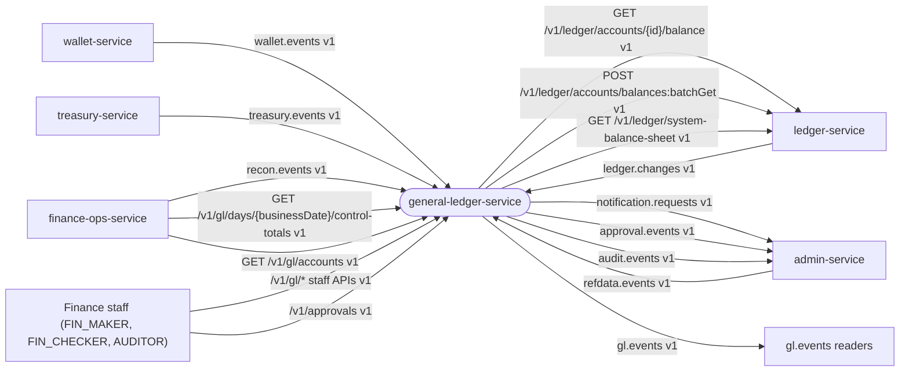

### 3.2 Component diagram

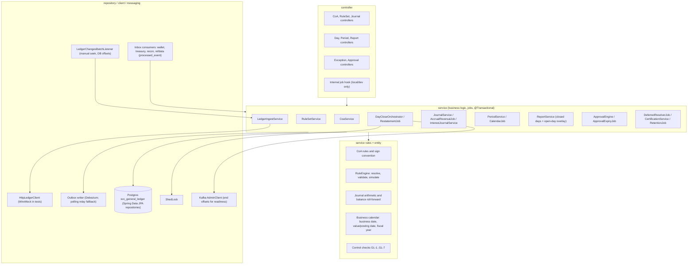

Layering per kernel K9 (`ArchitectureTest`, ArchUnit): controller → service → repository / client / messaging; controllers never touch repositories, clients or entities. The **same** `RuleEngine` class serves ingestion-time derivation, restatement, `:simulate` and the open-day overlay.

### 3.3 Runtime and deployment (Compose)

| Item | Value |
|---|---|
| Compose service | `general-ledger-service`, image `bitspay/general-ledger-service:local`, `mem_limit: 384m` (Serial GC on laptops) |
| Ports | 8116 (HTTP) / 9116 (management) |
| Spring profiles | `dev,api,ingest,jobs` in Compose (all roles in one container); role profiles: `api` (REST), `ingest` (Kafka listeners), `jobs` (scheduled jobs under ShedLock); `local` and `hybrid` per kernel K9 |
| Infra `depends_on` | postgres (healthy), kafka-init (completed). Readiness covers Postgres and Kafka only |
| Database | `jdbc:postgresql://postgres:5432/bitspay?currentSchema=svc_general_ledger`, user `svc_general_ledger`; Flyway `spring.flyway.schemas=svc_general_ledger`, `create-schemas=false` in the stack |
| Kafka topics | produces `gl.events` (1/3 partitions, 14 days; `gl.events.dlq` created by the stack), `approval.events`, `audit.events`, `notification.requests`; consumes per §6 |
| Redis / TigerBeetle / ClickHouse / object store | none |
| Edge proxy | `/general-ledger/` and `/gl/` → `general-ledger-service:8116` (dev/local) |
| Swagger | `http://localhost:8000/general-ledger/swagger-ui.html` |
| Hybrid | `application-hybrid.yaml`: Postgres `localhost:5432/bitspay?currentSchema=svc_general_ledger`, Kafka `localhost:19092`, ledger `http://localhost:8101` |

Service-specific environment variables (beyond kernel K8.3):

| Env var | Property | Compose value |
|---|---|---|
| `BITSPAY_CLIENTS_LEDGER_BASEURL` | `bitspay.clients.ledger.base-url` | `http://ledger-service:8101` |
| `BITSPAY_GL_STARTDATE` | `bitspay.gl.start-date` | `2026-10-01` |
| `BITSPAY_GL_CERTIFICATION_REQUIRED` | `bitspay.gl.certification.required` | `true` |
| `BITSPAY_GL_CONTROL_SYSTEMACCOUNTS` | `bitspay.gl.control.system-accounts` | `EXACT` |
| `BITSPAY_FIELD_CIPHER_KEY` | kernel | `${FIELD_CIPHER_KEY_GENERAL_LEDGER}` (unused; kept for uniformity) |

Consumer groups (§6): `general-ledger-service.ledger`, `.wallet`, `.treasury`, `.refdata`, `.recon`.

Scheduled jobs (role `jobs`, ShedLock name in brackets):

| Job | Schedule | Purpose |
|---|---|---|
| `DayCloseOrchestrator` (`gl-day-close`) | every 1 min | readiness and close, oldest OPEN day first, several days per run (BR-GL-41) |
| `RestatementJob` (`gl-restate`) | every 10 min | dirty closed days of OPEN periods (BR-GL-45) |
| `DeferredResolverJob` (`gl-deferred`) | every 30 s | resolve, time out and re-key deferred legs (BR-GL-34) |
| `CalendarJob` (`gl-calendar`) | daily 00:05 Asia/Dhaka + at start-up | create fiscal years, months, days (BR-GL-89) |
| `AccrualReversalJob` (`gl-accrual-reversal`) | after each close + hourly | post ACCRUAL_REVERSAL journals (BR-GL-63) |
| `ApprovalExpiryJob` (`gl-approval-expiry`) | every 5 min | expire approvals after 72 h (kernel K5) |
| `RetentionJob` (`gl-retention`) | daily 03:00 | outbox > 3 days, `processed_event` > 14 days, resolved deferred rows > 30 days (§4.3) |

### 3.4 Key flows

**Ledger ingestion (exactly once).**

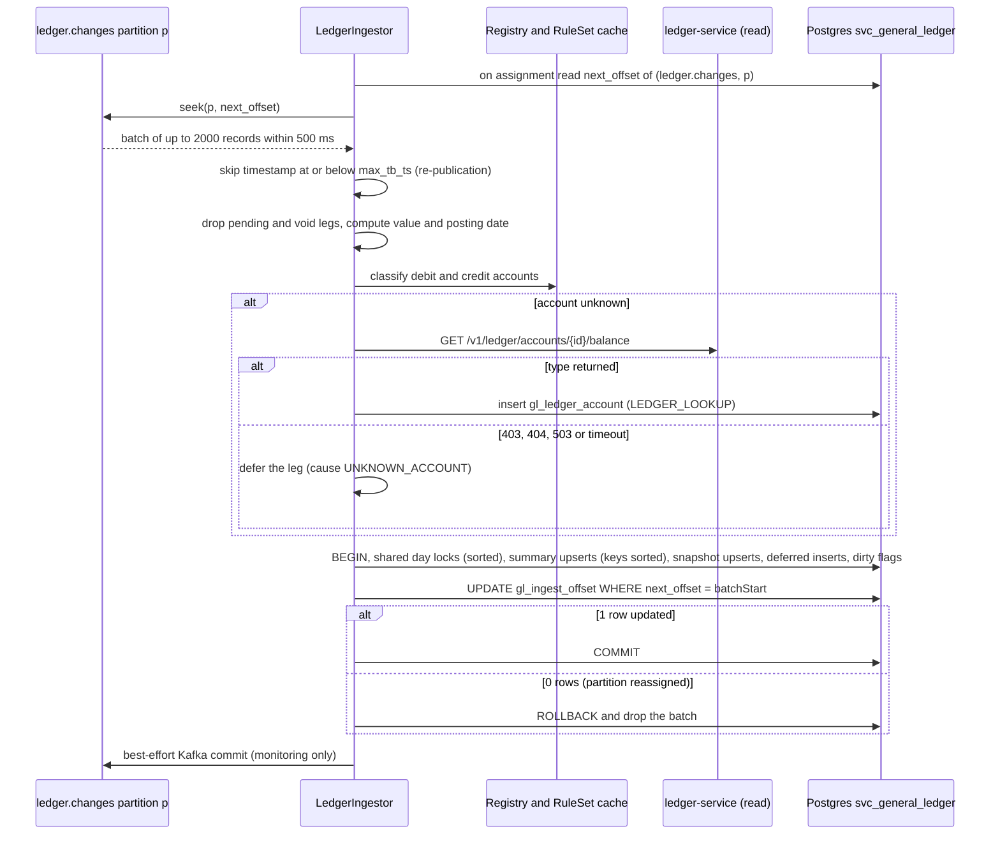

**Day close and restatement.**

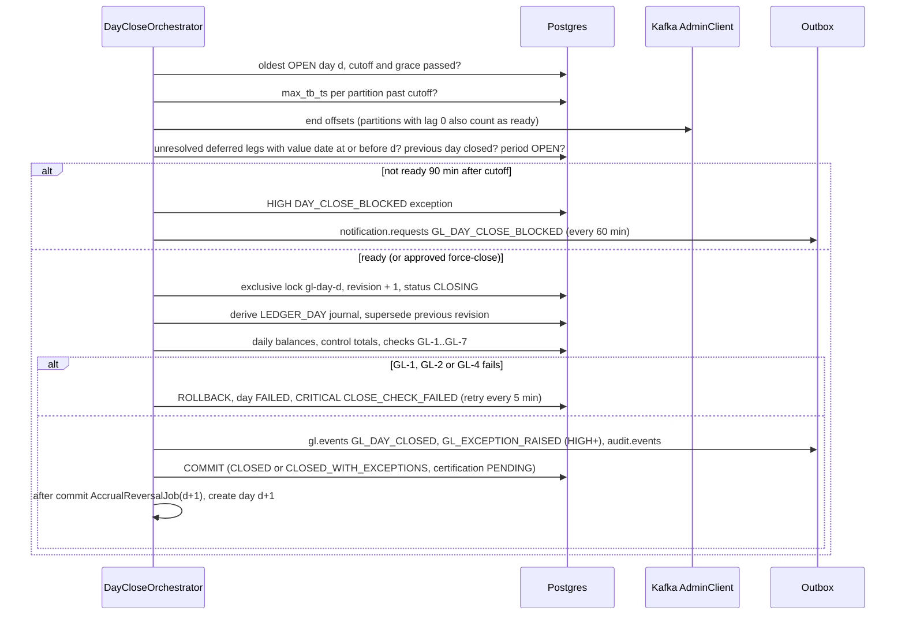

**Certification by reconciliation.**

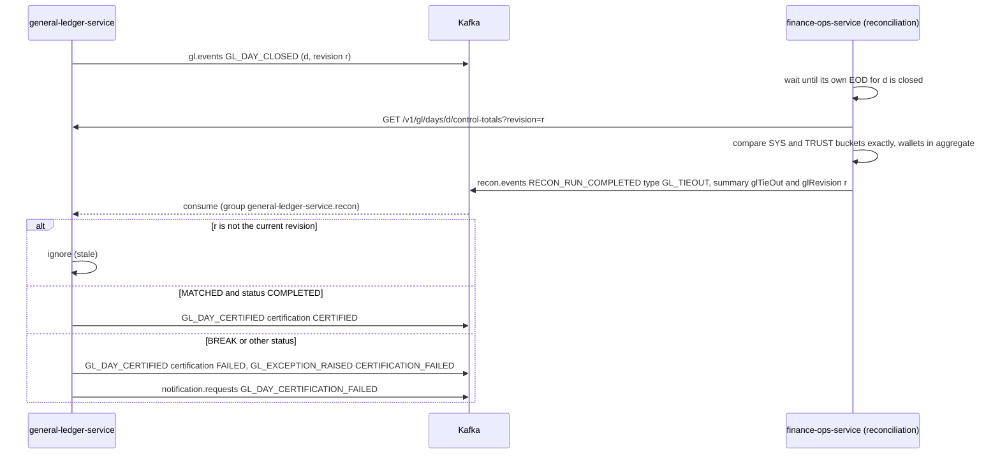

**Manual journal (maker-checker).**

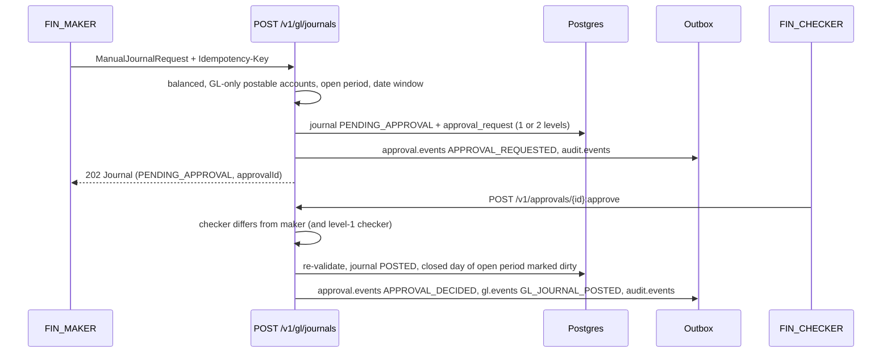

**Unknown wallet: deferral, timeout and re-keying.**

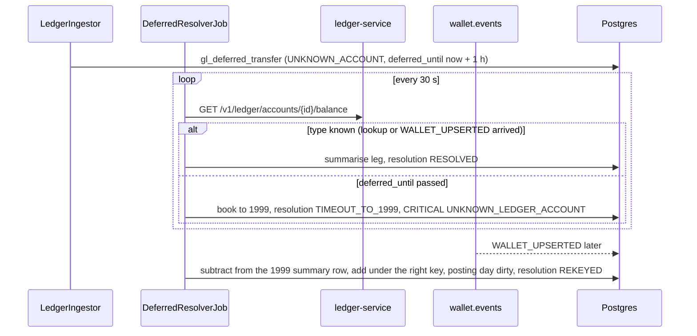

**Month and year close.**

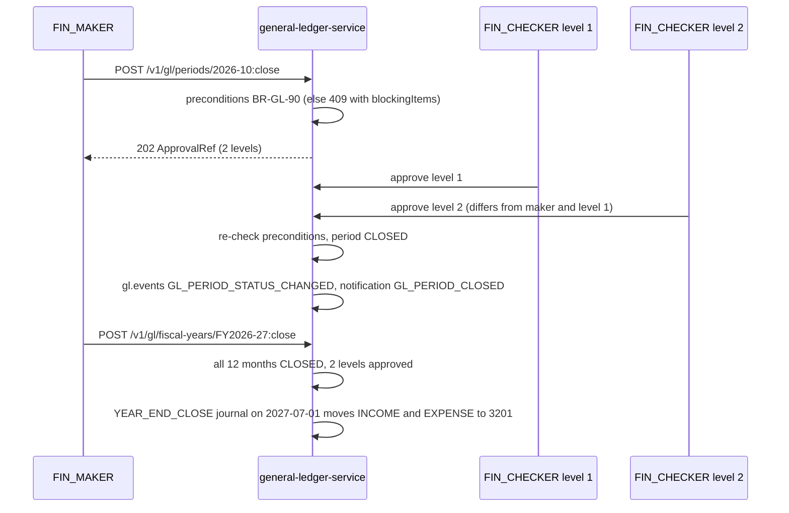

### 3.5 State machines

**GL day** (`gl_day.status`).

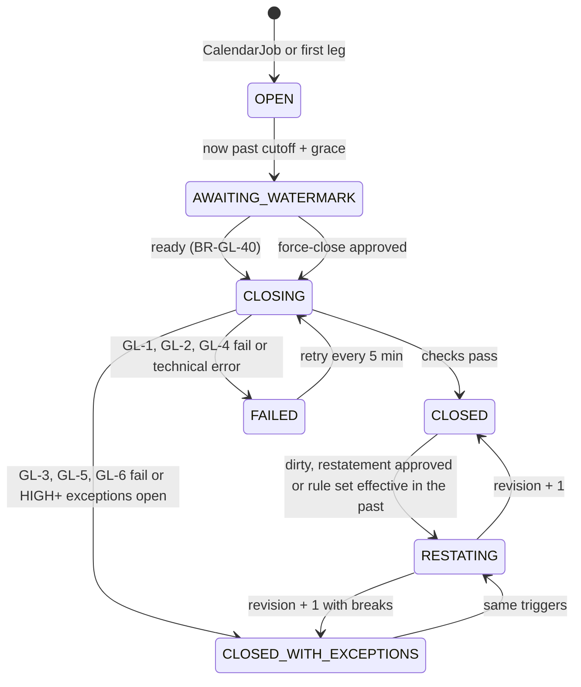

Day certification: `PENDING → CERTIFIED | FAILED` on a matching `RECON_RUN_COMPLETED`; any new revision → `PENDING`; `NOT_REQUIRED` when certification is switched off.

**Journal** (`gl_journal.status`).

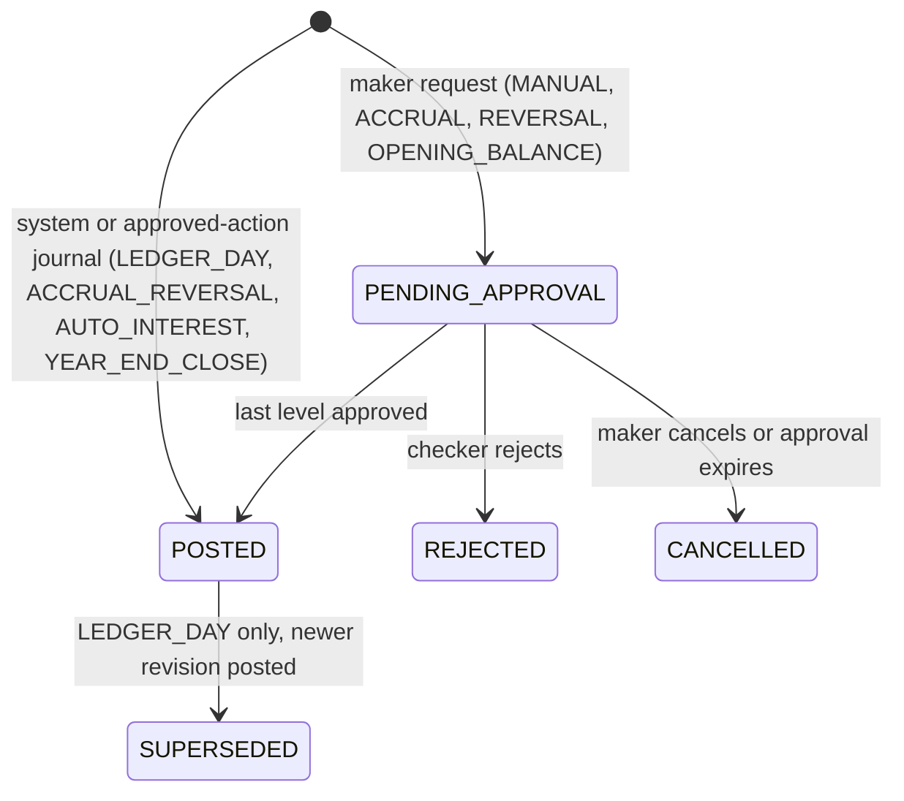

**Period (month) and fiscal year.**

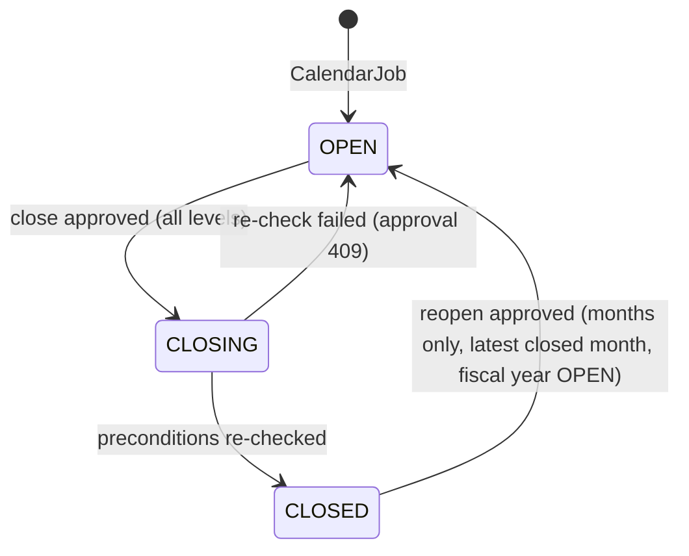

**Posting rule set.**

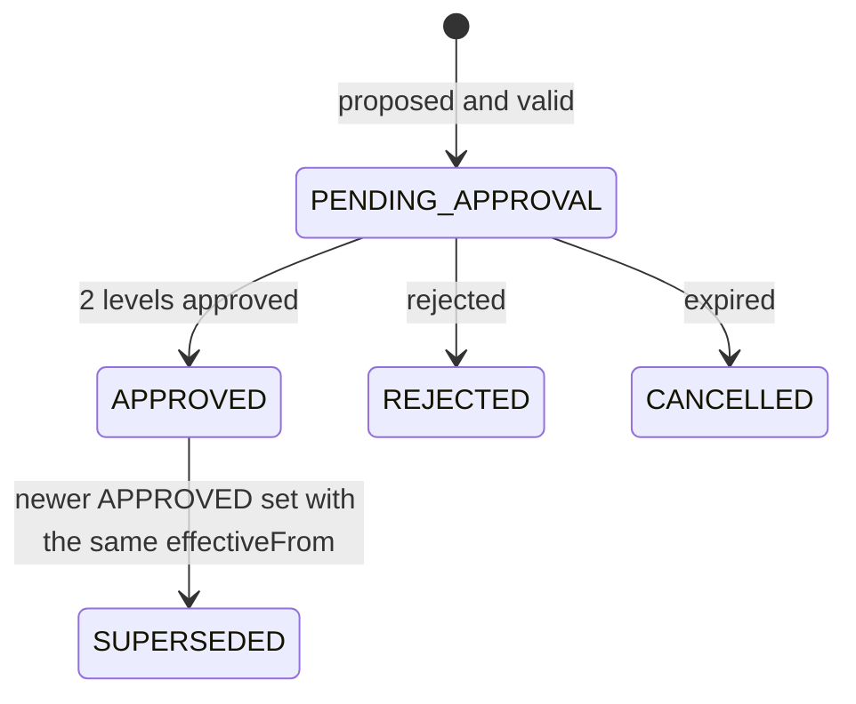

**Approval request** (kernel K5).

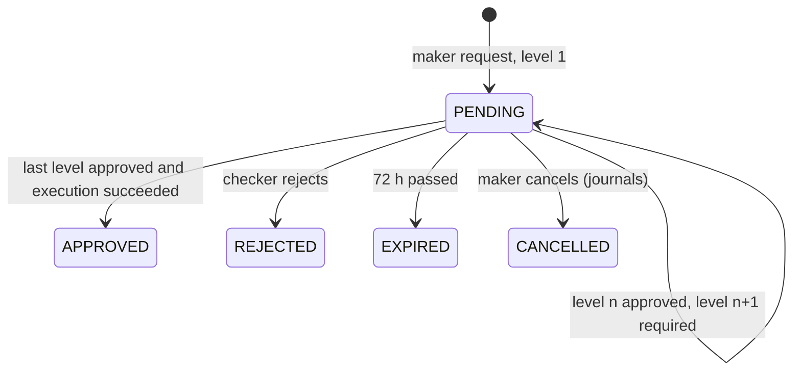

**Deferred ledger leg** (`gl_deferred_transfer`).

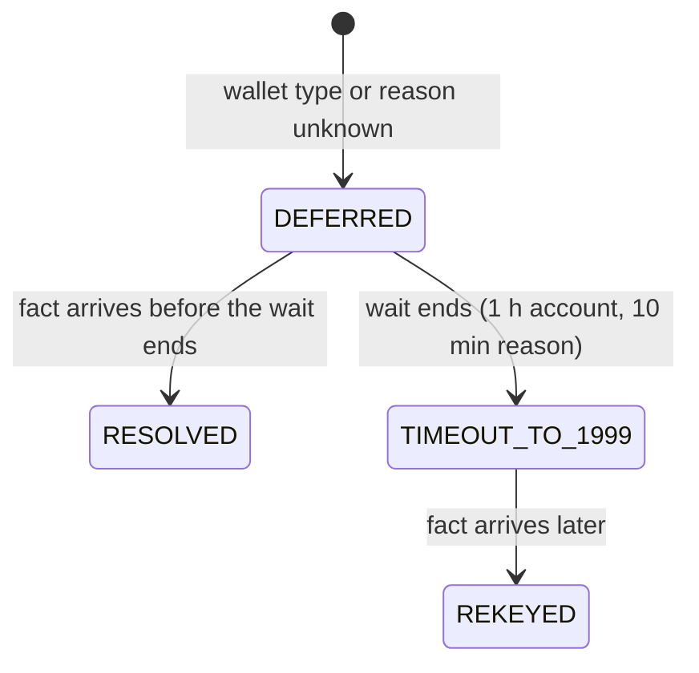

**Exception** (`gl_exception.status`): `OPEN → RESOLVED` (note 20..500 chars; CRITICAL needs `FIN_CHECKER`; `DAY_CLOSE_BLOCKED` auto-resolves when the day closes).

### 3.6 Architecture decisions

| ADR | Decision | Why | Consequence |
|---|---|---|---|
| ADR-GL-01 | Standalone service on Postgres + Kafka only (no ClickHouse, no object store) | The books need small, durable, relational data; the GL must keep running when reporting is down | Reports are computed from Postgres (`gl_daily_balance` + open-day overlay) |
| ADR-GL-02 | **Two stages.** Stage 1 aggregates every ledger leg into `gl_subledger_summary`, keyed by exactly the attributes rules can match on (+ bucket, value date, posting date). Stage 2 applies the rule set to the summary to derive the day's journal. No transfer-level copy is kept | Re-mapping history (rule fix, restatement) never needs a Kafka replay; volume is O(attribute combinations), a day is hundreds of rows at 15k legs/s | Drill-down to single transfers is the ledger's and reporting's job |
| ADR-GL-03 | **Exactly-once ingestion** of `ledger.changes`: Kafka offsets stored in `gl_ingest_offset` in the same transaction as the summary upserts, updated by compare-and-set on the batch start offset, seek on assignment; plus a **per-partition TB-timestamp watermark** that skips producer re-publications. Kafka commits are not used for correctness. This is the service's declared alternative to the kernel K4.3 inbox for this topic | One `processed_event` row per leg would be ≈ 1.3 billion rows/day at the 5k TPS target; the watermark is exact because the ledger publishes each partition in ascending TB-timestamp order and only re-publishes, never reorders | Other topics keep `processed_event` |
| ADR-GL-04 | Posting rules are **data** (versioned rule sets, effective date, maker-checker), resolved by **most specific match**; complete coverage of the posting universe is a validation error, not a runtime surprise | Finance changes the mapping without a deploy; ambiguity and gaps are caught before activation | Every new ledger command/code/account type needs a regenerated universe (BR-GL-22) |
| ADR-GL-05 | A rule maps **one side of one TB transfer to one GL account**; every leg yields exactly one debit and one credit line of the same amount | GL-1 holds by construction; per-TB-account control totals stay exact | Splits of income/expense happen by rule keys, never by amount |
| ADR-GL-06 | Operator pools (FEE_INCOME 200, COMMISSION_PAYABLE 220, CAMPAIGN_FUNDING 240) are not mirrored 1:1; their legs are mapped by transfer code / command to income, expense, operating bank or internal-transfer accounts | A 1:1 mirror books commission as negative fee income and revenue sweeps as lost income | Per-pool control stays exact through source-tagged lines (GL-3b) |
| ADR-GL-07 | Business date = `localDate(ts@Asia/Dhaka − CUTOFF.EOD)` of the TB timestamp; **value date** (when it happened) and **posting date** (GL day it lands in) are separate; only CLOSED periods force a different posting date | Same calendar as reconciliation; closed periods stay immutable | Late legs carry their value date on the line |
| ADR-GL-08 | Day readiness = cut-off + grace AND every `ledger.changes` partition past the cut-off (or lag 0) AND no deferred legs ≤ d — the same readiness rule as reconciliation | Both books close on identical data | A stopped CDC bridge blocks the close (by design; force close exists) |
| ADR-GL-09 | Rule set v1 maps adjustments between operator pools by **counterparty account type**, so no leg needs a reason. Reason-keyed rule sets remain possible: the reason then comes from `ledger.changes.reasonCode` (preferred) or `treasury.events`; the leg waits at most `enrichment-wait`, a timeout books **1999** (CRITICAL, never P&L) and a late reason **re-keys** the leg | Accounting must not depend on event arrival timing | Rule set v1 never defers for reasons |
| ADR-GL-10 | Year-end close posts a `YEAR_END_CLOSE` journal on the **first day of the next fiscal year**; P&L reports exclude that source | Closed days and periods never change; balance sheet and P&L stay consistent | The first day of a fiscal year may be restated by the year close |
| ADR-GL-11 | Certification is external (reconciliation GL tie-out); month close requires certified days | Segregation of duties: the keeper of the books is not its checker | `bitspay.gl.certification.required=false` is for isolated local runs only |
| ADR-GL-12 | System accounts 200–240 and 400–420 carry the TigerBeetle `history` flag, so `*BalanceAfter` is present for every account; GL-3b compares source-tagged GL lines with the TB counters exactly | Exact control of every pool | A null `*BalanceAfter` on a system account is tolerated defensively: GL-3b reports `NOT_VERIFIED` for that account and day |
| ADR-GL-13 | Withdrawn (CR-GENERALLEDGER-2: no journal file export) | — | — |

### 3.7 Latency / throughput budget

| Path | Budget |
|---|---|
| Ingestion | ≥ 20k legs/s per instance (prod sizing); ≈ 15k `ledger.changes` events/s at the 5k TPS design target; lag p99 < 5 s at 15k legs/s; batch ≤ 2,000 records / 500 ms, one DB transaction per partition batch |
| Day close | ≤ 5 min after readiness at 5k TPS day volume (summary ≤ 50k rows) |
| Reports | p95 < 2 s for ranges ≤ 400 days and ≤ 500 accounts |
| Service reads (`control-totals`, `days/{d}`, `accounts`) | p95 < 200 ms (indexed primary-key reads) |
| Payment path | none: the GL is a consumer only; no synchronous caller on the money path |

## 4. Data model

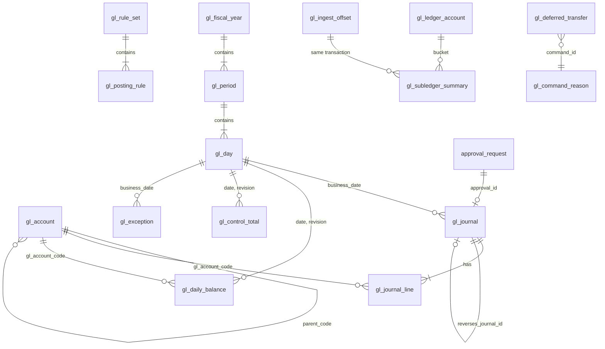

### 4.1 Tables

Flyway migrations live in `src/main/resources/db/migration/` and start as copies of the pack's `reference/db/`:

| File | Content |
|---|---|
| `V1__outbox.sql` | kernel K8.2 outbox (payload nullable; the GL never writes tombstones) |
| `V2__gl_schema.sql` | every table below + fixed ledger accounts (8 system, trust 01–99) |
| `V3__coa_v0_provisional.sql` | CoA v0 (56 accounts, `provisional = true`; regenerated in WP-CR-2 with the MVP accounts 2106, 4108, 4109 = 59), generated from `reference/seed/coa-v0-provisional.csv` |
| `V4__posting_rules_v1_provisional.sql` | rule set 1 (51 rules, effective 2026-10-01; regenerated in WP-CR-2 with the MVP rules W-150, F-FEE-BP, F-FEE-RC = 54), generated from `reference/seed/posting-rules-v1-provisional.yaml` |

Merged migrations are never edited; data changes in shared environments go through the APIs (maker-checker) or a new `V<n>`.

| Table | Purpose | Key rules |
|---|---|---|
| `gl_account` | CoA | code `^[0-9]{4}(-[0-9]{2})?$`; `normal_side` derived from class and `contra` (CHECK); `ledger_controlled ⇒ NOT manual_posting_allowed` (CHECK); headers not postable |
| `gl_rule_set`, `gl_posting_rule` | versioned rules | one APPROVED set per `effective_from`; rule keys nullable = wildcard |
| `gl_ledger_account` | TB account → bucket registry | sources FIXED, WALLET_EVENT, LEDGER_LOOKUP |
| `gl_ingest_offset` | Kafka offsets + `max_tb_ts` per partition | written only in the ingest transaction |
| `gl_subledger_summary` | stage 1 | PK = (posting_date, value_date, bucket, side, transfer_code, command_type, leg_index, reason_code, counterparty_account_type); `amount_poisha`, `leg_count` only grow (except re-keying) |
| `gl_command_reason`, `gl_deferred_transfer` | legs waiting for a fact (reason or wallet type) | rows kept after resolution (`RESOLVED` / `TIMEOUT_TO_1999` / `REKEYED`) for dedupe and re-keying |
| `gl_tb_snapshot` | last TB counters per (value_date, account) for trust and system accounts | `last_tb_ts` guard |
| `gl_fiscal_year`, `gl_period`, `gl_day` | calendar and status | §3.5 |
| `gl_journal`, `gl_journal_line` | journals | Σ debit = Σ credit (header CHECK + GL-1); one LEDGER_DAY journal per (date, revision) |
| `gl_daily_balance` | per account per day revision | `closing = opening + debit − credit` (CHECK); signed **net debit** |
| `gl_control_total` | per bucket per day revision | served by `GET /v1/gl/days/{businessDate}/control-totals` |
| `gl_exception` | exceptions | §7.11 |
| `approval_request`, `outbox`, `processed_event`, `idempotency_record`, `shedlock`, `system_param` | standard | kernel K5, K8.2, K3.3; `system_param` = refdata projection |

Full DDL (V1 + V2; V3/V4 are seed data in `reference/db/`):

```sql
-- Standard outbox (kernel K8.2; payload nullable).
-- The local stack pre-creates svc_general_ledger.outbox (the Compose init scripts); IF NOT EXISTS keeps
-- Testcontainers and the stack both working. Lands in schema svc_general_ledger via search_path.
-- general-ledger-service never writes tombstones (gl.events is not compacted), so payload is always set in practice.
CREATE TABLE IF NOT EXISTS outbox (
  id             uuid PRIMARY KEY,           -- = envelope eventId (UUIDv7)
  aggregate_type text        NOT NULL,       -- = Kafka topic name: 'gl.events', 'approval.events', 'audit.events', 'notification.requests'
  aggregate_id   text        NOT NULL,       -- = Kafka key = envelope aggregateId
  event_type     text        NOT NULL,
  payload        jsonb,                      -- full envelope
  created_at     timestamptz NOT NULL DEFAULT now(),
  published_at   timestamptz                 -- polling relay only
);
CREATE INDEX IF NOT EXISTS outbox_unpublished ON outbox (created_at) WHERE published_at IS NULL;
-- V2__gl_schema.sql — general-ledger-service. Schema svc_general_ledger (search_path), PostgreSQL 18.
-- Money: bigint poisha. Signed balances are stored as NET DEBIT (debit positive, credit negative) (BR-GL-02).
-- Nothing here is ever UPDATEd after POSTED except status transitions named in §3.5; corrections are new journals.

-- ===================================================================== 1. Chart of accounts (§7.1)
CREATE TABLE gl_account (
  code                   text PRIMARY KEY CHECK (code ~ '^[0-9]{4}(-[0-9]{2})?$'),
  name_en                text NOT NULL CHECK (length(name_en) BETWEEN 1 AND 120),
  name_bn                text CHECK (name_bn IS NULL OR length(name_bn) BETWEEN 1 AND 120),
  account_class          text NOT NULL CHECK (account_class IN ('ASSET','LIABILITY','EQUITY','INCOME','EXPENSE')),
  normal_side            text NOT NULL CHECK (normal_side IN ('DEBIT','CREDIT')),
  contra                 boolean NOT NULL DEFAULT false,
  parent_code            text REFERENCES gl_account(code),
  level                  smallint NOT NULL CHECK (level BETWEEN 1 AND 6),
  postable               boolean NOT NULL,
  ledger_controlled      boolean NOT NULL DEFAULT false,   -- balance must equal a TigerBeetle aggregate (GL-3)
  manual_posting_allowed boolean NOT NULL DEFAULT true,
  must_be_zero           boolean NOT NULL DEFAULT false,   -- 1950, 1999 (GL-5)
  template_code          text,                             -- '1101-{nn}': instances are created from this account
  description            text,
  status                 text NOT NULL CHECK (status IN ('PENDING_APPROVAL','ACTIVE','INACTIVE')),
  provisional            boolean NOT NULL DEFAULT false,
  effective_from         date NOT NULL,
  created_by             text NOT NULL,
  created_at             timestamptz NOT NULL DEFAULT now(),
  updated_at             timestamptz NOT NULL DEFAULT now(),
  version                bigint NOT NULL DEFAULT 0,
  CHECK (NOT (ledger_controlled AND manual_posting_allowed)),
  CHECK ((normal_side = 'DEBIT') = ((account_class IN ('ASSET','EXPENSE')) <> contra))
);
CREATE INDEX gl_account_parent ON gl_account (parent_code);

-- ===================================================================== 2. Posting rules (§7.3)
CREATE TABLE gl_rule_set (
  version        int PRIMARY KEY,
  status         text NOT NULL CHECK (status IN ('DRAFT','PENDING_APPROVAL','APPROVED','SUPERSEDED','REJECTED','CANCELLED')),
                                                 -- SUPERSEDED: replaced by a newer APPROVED set with the same effective_from
  effective_from date NOT NULL,                  -- business date from which the set applies (never in a CLOSED period)
  description    text NOT NULL,
  checksum       text NOT NULL,                  -- sha256 of the canonical rules JSON
  provisional    boolean NOT NULL DEFAULT false,
  created_by     text NOT NULL,
  approved_by    text[] NOT NULL DEFAULT '{}',
  approval_id    uuid,
  created_at     timestamptz NOT NULL DEFAULT now(),
  activated_at   timestamptz
);
CREATE UNIQUE INDEX gl_rule_set_effective ON gl_rule_set (effective_from) WHERE status = 'APPROVED';

CREATE TABLE gl_posting_rule (
  rule_set_version          int  NOT NULL REFERENCES gl_rule_set(version),
  rule_id                   text NOT NULL CHECK (rule_id ~ '^[A-Z0-9-]{1,32}$'),
  priority                  int  NOT NULL CHECK (priority BETWEEN 1 AND 999),
  tb_account_type           int  NOT NULL,
  side                      text CHECK (side IN ('DEBIT','CREDIT')),
  transfer_code             int,
  command_type              int CHECK (command_type BETWEEN 1 AND 19),
  leg_index                 int CHECK (leg_index BETWEEN 0 AND 5),
  reason_code               text CHECK (reason_code IS NULL OR length(reason_code) BETWEEN 1 AND 40),
  counterparty_account_type int,
  gl_account_code           text NOT NULL,       -- postable code or template '1101-{nn}'
  note                      text,
  PRIMARY KEY (rule_set_version, rule_id)
);

-- ===================================================================== 3. Ledger account registry (§7.2)
CREATE TABLE gl_ledger_account (
  account_id      uuid PRIMARY KEY,
  tb_account_type int  NOT NULL,
  bucket          text NOT NULL,                 -- 'WALLET:C' · 'WALLET:B' · 'SYS:FEE_INCOME' · 'TRUST:01'
  wallet_type     char(1) CHECK (wallet_type IN ('C','A','D','M','I','B')),
  trust_index     smallint CHECK (trust_index BETWEEN 1 AND 99),
  source          text NOT NULL CHECK (source IN ('FIXED','WALLET_EVENT','LEDGER_LOOKUP')),
  source_version  bigint,                        -- wallet.events version
  first_seen_at   timestamptz NOT NULL DEFAULT now()
);

-- ===================================================================== 4. Ingestion (§7.4)
-- Kafka offsets live HERE, written in the same DB transaction as the summary upserts (exactly-once; ADR-GL-03).
CREATE TABLE gl_ingest_offset (
  topic        text NOT NULL,
  partition    int  NOT NULL,
  next_offset  bigint NOT NULL,                  -- updated only with compare-and-set on the batch's start offset (BR-GL-31)
  max_tb_ts    bigint,                           -- greatest TB timestamp (ns) applied from this partition; legs with
                                                 -- timestamp <= max_tb_ts are producer re-publications and are skipped (BR-GL-30a)
  updated_at   timestamptz NOT NULL DEFAULT now(),
  PRIMARY KEY (topic, partition)
);

-- Stage 1: sub-ledger summary — one row per rule-relevant attribute combination (pre-mapping, re-mappable).
CREATE TABLE gl_subledger_summary (
  posting_date              date   NOT NULL,     -- GL day the amount belongs to (= value_date unless the period was closed)
  value_date                date   NOT NULL,     -- businessDate of the TB timestamp (CUTOFF.EOD)
  bucket                    text   NOT NULL,
  tb_account_type           int    NOT NULL,
  side                      text   NOT NULL CHECK (side IN ('DEBIT','CREDIT')),
  transfer_code             int    NOT NULL,
  command_type              int    NOT NULL,
  leg_index                 int    NOT NULL,
  reason_code               text   NOT NULL DEFAULT '',
  counterparty_account_type int    NOT NULL,
  amount_poisha             bigint NOT NULL CHECK (amount_poisha >= 0),
  leg_count                 bigint NOT NULL CHECK (leg_count >= 0),
  first_tb_ts               bigint NOT NULL,
  last_tb_ts                bigint NOT NULL,
  updated_at                timestamptz NOT NULL DEFAULT now(),
  PRIMARY KEY (posting_date, value_date, bucket, side, transfer_code, command_type, leg_index, reason_code, counterparty_account_type)
);

-- Deferred legs (BR-GL-34): a reason-keyed rule could match and the reason is unknown, or the wallet is not yet in the
-- registry. Rows are kept after resolution (dedupe by transfer_id; re-keying when a late fact arrives after a timeout).
CREATE TABLE gl_command_reason (
  command_id  uuid PRIMARY KEY,
  reason_code text NOT NULL CHECK (length(reason_code) BETWEEN 1 AND 40),   -- 1..40 chars, as the ledger command body
  source      text NOT NULL CHECK (source IN ('LEDGER_EVENT','TREASURY_EVENT')),
  received_at timestamptz NOT NULL DEFAULT now()
);
CREATE TABLE gl_deferred_transfer (
  transfer_id    uuid PRIMARY KEY,
  command_id     uuid NOT NULL,
  value_date     date NOT NULL,
  data           jsonb NOT NULL,                 -- the ledger.changes data object
  cause          text NOT NULL CHECK (cause IN ('REASON','UNKNOWN_ACCOUNT')),
  deferred_until timestamptz NOT NULL,
  resolved_at    timestamptz,
  resolution     text CHECK (resolution IN ('RESOLVED','TIMEOUT_TO_1999','REKEYED')),
  summary_key    jsonb,                          -- the summary key the leg was booked under (needed to re-key after a timeout)
  created_at     timestamptz NOT NULL DEFAULT now()
);
CREATE INDEX gl_deferred_open ON gl_deferred_transfer (value_date) WHERE resolved_at IS NULL;
CREATE INDEX gl_deferred_by_command ON gl_deferred_transfer (command_id);

-- TB counters of trust and system accounts at the last leg of each day (GL-3a, GL-3b).
CREATE TABLE gl_tb_snapshot (
  value_date      date   NOT NULL,
  account_id      uuid   NOT NULL,
  last_tb_ts      bigint NOT NULL,
  debits_posted   bigint NOT NULL,
  credits_posted  bigint NOT NULL,
  PRIMARY KEY (value_date, account_id)
);

-- ===================================================================== 5. Calendar: days, periods, fiscal years (§7.6, §7.9)
CREATE TABLE gl_fiscal_year (
  fiscal_year        text PRIMARY KEY CHECK (fiscal_year ~ '^FY[0-9]{4}-[0-9]{2}$'),   -- FY2026-27
  from_date          date NOT NULL,
  to_date            date NOT NULL,
  status             text NOT NULL CHECK (status IN ('OPEN','CLOSING','CLOSED')),
  closing_journal_id uuid,
  closed_at          timestamptz,
  version            bigint NOT NULL DEFAULT 0
);
CREATE TABLE gl_period (
  period_id    text PRIMARY KEY CHECK (period_id ~ '^[0-9]{4}-[0-9]{2}$'),             -- calendar month 2026-10
  fiscal_year  text NOT NULL REFERENCES gl_fiscal_year(fiscal_year),
  from_date    date NOT NULL,
  to_date      date NOT NULL,
  status       text NOT NULL CHECK (status IN ('OPEN','CLOSING','CLOSED')),
  closed_at    timestamptz,
  reopen_count int NOT NULL DEFAULT 0,
  version      bigint NOT NULL DEFAULT 0
);
CREATE TABLE gl_day (
  business_date     date PRIMARY KEY,
  period_id         text NOT NULL REFERENCES gl_period(period_id),
  status            text NOT NULL CHECK (status IN ('OPEN','AWAITING_WATERMARK','CLOSING','CLOSED','CLOSED_WITH_EXCEPTIONS','FAILED','RESTATING')),
  revision          int  NOT NULL DEFAULT 0,
  dirty             boolean NOT NULL DEFAULT false,
  forced            boolean NOT NULL DEFAULT false,
  certification     text NOT NULL DEFAULT 'PENDING' CHECK (certification IN ('PENDING','CERTIFIED','FAILED','NOT_REQUIRED')),
  certified_run_id  uuid,
  rule_set_version  int,
  ledger_journal_id uuid,
  checks            jsonb,
  closed_at         timestamptz,
  version           bigint NOT NULL DEFAULT 0
);

-- ===================================================================== 6. Journals (§7.5, §7.7)
CREATE TABLE gl_journal (
  journal_id          uuid PRIMARY KEY,
  journal_ref         text NOT NULL UNIQUE,      -- GLJ-20261009-L-R1 · GLJ-20261010-M-000123 · GLJ-20270701-Y-000001
  source              text NOT NULL CHECK (source IN ('LEDGER_DAY','MANUAL','ACCRUAL','ACCRUAL_REVERSAL',
                                                       'REVERSAL','AUTO_INTEREST','YEAR_END_CLOSE','OPENING_BALANCE')),
  business_date       date NOT NULL,             -- the GL day the journal posts into
  revision            int,                       -- LEDGER_DAY only
  status              text NOT NULL CHECK (status IN ('PENDING_APPROVAL','POSTED','SUPERSEDED','REJECTED','CANCELLED')),
  narration           text NOT NULL CHECK (length(narration) BETWEEN 1 AND 500),
  document_reference  text CHECK (document_reference IS NULL OR length(document_reference) <= 64),
  reverses_journal_id uuid REFERENCES gl_journal(journal_id),
  auto_reverse_on     date,
  rule_set_version    int,
  total_debit_poisha  bigint NOT NULL,
  total_credit_poisha bigint NOT NULL,
  line_count          int NOT NULL,
  maker_id            text,
  checker_ids         text[] NOT NULL DEFAULT '{}',
  approval_id         uuid,
  idempotency_key     text,
  created_at          timestamptz NOT NULL DEFAULT now(),
  posted_at           timestamptz,
  CHECK (total_debit_poisha = total_credit_poisha),
  CHECK (source <> 'LEDGER_DAY' OR revision IS NOT NULL)
);
CREATE UNIQUE INDEX gl_journal_ledger_day ON gl_journal (business_date, revision) WHERE source = 'LEDGER_DAY';
CREATE INDEX gl_journal_by_date ON gl_journal (business_date, status);

CREATE TABLE gl_journal_line (
  journal_id        uuid NOT NULL REFERENCES gl_journal(journal_id),
  line_no           int  NOT NULL,
  gl_account_code   text NOT NULL REFERENCES gl_account(code),
  side              text NOT NULL CHECK (side IN ('DEBIT','CREDIT')),
  amount_poisha     bigint NOT NULL CHECK (amount_poisha > 0),
  value_date        date,                        -- ledger lines: TB businessDate; ≠ business_date for late legs routed past a closed period
  product           text,                        -- P2P, CASH_IN, … (command type), null for manual lines
  transfer_code     int,
  source_bucket     text,                        -- WALLET:C · SYS:FEE_INCOME · TRUST (ledger lines only)
  trust_index       smallint,
  reason_code       text,
  rule_id           text,
  leg_count         bigint,
  narration         text CHECK (narration IS NULL OR length(narration) <= 200),
  PRIMARY KEY (journal_id, line_no)
);
CREATE INDEX gl_journal_line_account ON gl_journal_line (gl_account_code);

-- Daily balances per GL account and day revision (BR-GL-42 step 3). Reports read only this table + the open-day overlay.
CREATE TABLE gl_daily_balance (
  business_date             date   NOT NULL,
  revision                  int    NOT NULL,
  gl_account_code           text   NOT NULL REFERENCES gl_account(code),
  opening_net_debit_poisha  bigint NOT NULL,
  debit_movement_poisha     bigint NOT NULL,
  credit_movement_poisha    bigint NOT NULL,
  closing_net_debit_poisha  bigint NOT NULL,
  PRIMARY KEY (business_date, revision, gl_account_code),
  CHECK (closing_net_debit_poisha = opening_net_debit_poisha + debit_movement_poisha - credit_movement_poisha)
);

-- Control totals per ledger bucket (cumulative, posted only) — served by GET /v1/gl/days/{businessDate}/control-totals.
CREATE TABLE gl_control_total (
  business_date         date   NOT NULL,
  revision              int    NOT NULL,
  bucket                text   NOT NULL,         -- recon naming: WALLET:C · SYS:FEE_INCOME · TRUST
  trust_index           smallint NOT NULL DEFAULT 0,
  debits_posted_poisha  bigint NOT NULL,
  credits_posted_poisha bigint NOT NULL,
  day_debit_poisha      bigint NOT NULL,
  day_credit_poisha     bigint NOT NULL,
  leg_count             bigint NOT NULL,
  PRIMARY KEY (business_date, revision, bucket, trust_index)
);

-- ===================================================================== 8. Exceptions (§7.11)
CREATE TABLE gl_exception (
  id            uuid PRIMARY KEY,
  category      text NOT NULL CHECK (category IN ('UNMAPPED_POSTING','UNKNOWN_LEDGER_ACCOUNT','INVALID_LEDGER_EVENT','CLOSE_CHECK_FAILED',
                                                   'CONTROL_BREAK','MUST_BE_ZERO_BREAK',
                                                   'LATE_LEDGER_EVENT','PRIOR_PERIOD_LATE_EVENT','ENRICHMENT_TIMEOUT',
                                                   'CERTIFICATION_FAILED','DAY_CLOSE_BLOCKED','NORMAL_BALANCE_VIOLATION')),
  severity      text NOT NULL CHECK (severity IN ('CRITICAL','HIGH','INFO')),
  business_date date,
  detail        jsonb NOT NULL,
  status        text NOT NULL CHECK (status IN ('OPEN','RESOLVED')),
  resolved_by   text,
  resolution    text,
  created_at    timestamptz NOT NULL DEFAULT now(),
  resolved_at   timestamptz
);
CREATE INDEX gl_exception_open ON gl_exception (status, severity, business_date);

-- ===================================================================== 9. Standard tables (kernel K5, K8.2, K3.3)
CREATE TABLE processed_event (event_id uuid PRIMARY KEY, topic text NOT NULL, processed_at timestamptz NOT NULL DEFAULT now());
CREATE TABLE idempotency_record (
  actor_id text NOT NULL, idem_key text NOT NULL, request_sha256 text NOT NULL, response_status int NOT NULL,
  response_body jsonb NOT NULL, created_at timestamptz NOT NULL DEFAULT now(), PRIMARY KEY (actor_id, idem_key));
CREATE TABLE shedlock (name varchar(64) PRIMARY KEY, lock_until timestamptz NOT NULL, locked_at timestamptz NOT NULL, locked_by varchar(255) NOT NULL);
CREATE TABLE approval_request (
  id              uuid PRIMARY KEY,
  entity_type     text NOT NULL CHECK (entity_type IN ('GlAccount','PostingRuleSet','GlManualJournal','GlJournalReversal',
                                                       'GlOpeningBalance','GlDayForceClose','GlDayRestatement','GlPeriodClose',
                                                       'GlPeriodReopen','GlYearClose')),
  entity_id       text NOT NULL,
  action          text NOT NULL,
  payload         jsonb NOT NULL,
  maker_id        text NOT NULL,
  maker_user_id   text,
  status          text NOT NULL CHECK (status IN ('PENDING','APPROVED','REJECTED','EXPIRED','CANCELLED')),
  level           int  NOT NULL DEFAULT 1,
  required_levels int  NOT NULL DEFAULT 1 CHECK (required_levels BETWEEN 1 AND 3),
  checker_roles   text[] NOT NULL,
  amount_poisha   bigint,
  created_at      timestamptz NOT NULL DEFAULT now(),
  expires_at      timestamptz NOT NULL,
  decided_by      text[] NOT NULL DEFAULT '{}',
  decided_at      timestamptz,
  version         bigint NOT NULL DEFAULT 0
);
CREATE INDEX approval_request_pending ON approval_request (status, entity_type) WHERE status = 'PENDING';
CREATE TABLE system_param (code text PRIMARY KEY, value text NOT NULL, source_version bigint);  -- refdata projection

-- ===================================================================== 10. Fixed ledger accounts (ledger fixed account ids)
INSERT INTO gl_ledger_account (account_id, tb_account_type, bucket, source) VALUES
  ('00000000-0000-0000-0000-000000000200', 200, 'SYS:FEE_INCOME', 'FIXED'),
  ('00000000-0000-0000-0000-000000000210', 210, 'SYS:VAT_PAYABLE', 'FIXED'),
  ('00000000-0000-0000-0000-000000000220', 220, 'SYS:COMMISSION_PAYABLE', 'FIXED'),
  ('00000000-0000-0000-0000-000000000230', 230, 'SYS:AIT_PAYABLE', 'FIXED'),
  ('00000000-0000-0000-0000-000000000240', 240, 'SYS:CAMPAIGN_FUNDING', 'FIXED'),
  ('00000000-0000-0000-0000-000000000400', 400, 'SYS:SUSPENSE', 'FIXED'),
  ('00000000-0000-0000-0000-000000000410', 410, 'SYS:ADJUSTMENT_CLEARING', 'FIXED'),
  ('00000000-0000-0000-0000-000000000420', 420, 'SYS:HOLD_CONTROL', 'FIXED');
INSERT INTO gl_ledger_account (account_id, tb_account_type, bucket, trust_index, source)
SELECT ('00000000-0000-0000-0000-0000000300' || lpad(n::text, 2, '0'))::uuid, 300, 'TRUST:' || lpad(n::text, 2, '0'), n, 'FIXED'
FROM generate_series(1, 99) AS n;
```

**BR-GL-01 Money.** `bigint` poisha only; the GL never multiplies, divides or rounds — it only adds amounts the ledger already posted and amounts a maker typed. Presentation in Tk uses `BigDecimal.valueOf(poisha, 2)`.

**BR-GL-02 Sign convention.** Balances are stored as **net debit** (debit − credit, signed). Presentation converts by the account's normal side: assets and expenses show net debit, liabilities, equity and income show net credit; contra accounts show the opposite of their parent class.

**BR-GL-03 Immutability.** `gl_journal_line` rows are never updated or deleted; `gl_journal.status` moves only `PENDING_APPROVAL → POSTED | REJECTED | CANCELLED` and `POSTED → SUPERSEDED` (LEDGER_DAY, when a newer revision posts).

### 4.2 Redis keys / caches

No Redis. In-process Caffeine caches only: the active rule sets by `effective_from` (invalidated on approval), the `gl_ledger_account` registry (write-through), the CoA (invalidated on `GL_ACCOUNT_UPSERTED`), `system_param` (invalidated on refdata apply).

### 4.3 Retention and archival

| Data | Retention |
|---|---|
| `gl_journal`, `gl_journal_line`, `gl_daily_balance`, `gl_control_total`, `gl_subledger_summary`, `gl_exception`, `gl_account`, rule sets, calendar | 10 years online (small volume; SRS §8.3 financial records) |
| `approval_request`, `idempotency_record` | approvals 10 years; idempotency records 7 days (kernel K3.3, OPEN D-01) |
| `gl_deferred_transfer` (resolved), `gl_command_reason` | 30 days after resolution / receipt |
| `processed_event` | 14 days (kernel K8.2) |
| `outbox` | 3 days (kernel K8.2) |
| `gl_ingest_offset`, `gl_tb_snapshot` | offsets permanent; snapshots 10 years |

Production durability: Postgres with PITR. The ledger-derived part is rebuildable from `ledger.changes` within its 14-day retention; GL-only journals are originals and must be backed up.

## 5. Provided contracts

Mirror of `contracts/provided/` — the artefacts win on any conflict.

### 5.1 REST operations

Source of truth: `contracts/provided/openapi.yaml` (OpenAPI 3.1, 37 operations; #32–#35 were removed in 2.0.0 and their numbers are not reused). Kernel rules apply: headers K3.1, idempotency K3.3, pagination K3.4 (`limit` 1..200, default 50; `{items, nextCursor}`), problem+json K3.6. Every state-changing operation also accepts `X-Actor-User-Id` (maker ≠ checker comparison and audit only). Every list and report that declares `text/csv` answers `Accept: text/csv` with the same rows.

| # | Operation | operationId | Audience | Actors & roles | Idempotency | Purpose |
|---|---|---|---|---|---|---|
| 1 | `GET /v1/gl/accounts` | `listGlAccounts` | service | SERVICE finance-ops-service; STAFF FIN_MAKER, FIN_CHECKER, AUDITOR | — | List chart-of-accounts entries |
| 2 | `POST /v1/gl/accounts` | `createGlAccount` | staff | STAFF FIN_MAKER | Idempotency-Key | Propose a new GL account (maker-checker GlAccount/CREATE) |
| 3 | `GET /v1/gl/accounts/{code}` | `getGlAccount` | service | SERVICE finance-ops-service; STAFF FIN_MAKER, FIN_CHECKER, AUDITOR | — | Get a GL account |
| 4 | `PATCH /v1/gl/accounts/{code}` | `updateGlAccount` | staff | STAFF FIN_MAKER | Idempotency-Key | Propose a change (maker-checker GlAccount/UPDATE) |
| 5 | `POST /v1/gl/accounts/{code}:deactivate` | `deactivateGlAccount` | staff | STAFF FIN_MAKER | Idempotency-Key | Propose deactivation (zero balance, no rule targets it) |
| 6 | `GET /v1/gl/rule-sets` | `listRuleSets` | staff | STAFF FIN_MAKER, FIN_CHECKER, AUDITOR | — | List posting rule sets |
| 7 | `POST /v1/gl/rule-sets` | `proposeRuleSet` | staff | STAFF FIN_MAKER | Idempotency-Key | Propose a new rule set (validated, then maker-checker PostingRuleSet) |
| 8 | `POST /v1/gl/rule-sets:validate` | `validateRuleSet` | staff | STAFF FIN_MAKER, FIN_CHECKER, AUDITOR | — | Validate a rule set against the CoA and the posting universe (no side effects) |
| 9 | `GET /v1/gl/rule-sets/{version}` | `getRuleSet` | staff | STAFF FIN_MAKER, FIN_CHECKER, AUDITOR | — | Get a rule set with its rules |
| 10 | `POST /v1/gl/rule-sets/{version}:simulate` | `simulateRuleSet` | staff | STAFF FIN_MAKER, FIN_CHECKER, AUDITOR | — | Map sample ledger transfers with this rule set (no side effects) |
| 11 | `GET /v1/gl/journals` | `listJournals` | staff | STAFF FIN_MAKER, FIN_CHECKER, AUDITOR | — | List journals |
| 12 | `POST /v1/gl/journals` | `createManualJournal` | staff | STAFF FIN_MAKER | Idempotency-Key | Create a manual or accrual journal (maker-checker GlManualJournal) |
| 13 | `GET /v1/gl/journals/{journalId}` | `getJournal` | staff | STAFF FIN_MAKER, FIN_CHECKER, AUDITOR | — | Get a journal with its lines |
| 14 | `POST /v1/gl/journals/{journalId}:reverse` | `reverseJournal` | staff | STAFF FIN_MAKER | Idempotency-Key | Reverse a POSTED non-ledger journal (maker-checker GlJournalReversal) |
| 15 | `POST /v1/gl/journals/{journalId}:cancel` | `cancelJournal` | staff | STAFF FIN_MAKER | — | Maker withdraws a PENDING_APPROVAL journal |
| 16 | `POST /v1/gl/opening-balances` | `createOpeningBalances` | staff | STAFF FIN_MAKER | Idempotency-Key | Load opening balances of GL-only accounts (maker-checker GlOpeningBalance) |
| 17 | `GET /v1/gl/days` | `listGlDays` | staff | STAFF FIN_MAKER, FIN_CHECKER, AUDITOR | — | List GL days |
| 18 | `GET /v1/gl/days/{businessDate}` | `getGlDay` | service | SERVICE finance-ops-service; STAFF FIN_MAKER, FIN_CHECKER, AUDITOR | — | Get one GL day (status, checks, readiness, certification) |
| 19 | `GET /v1/gl/days/{businessDate}/control-totals` | `getControlTotals` | service | SERVICE finance-ops-service; STAFF FIN_MAKER, FIN_CHECKER, AUDITOR | — | Control totals per ledger bucket for a closed day (reconciliation GL_TIEOUT) |
| 20 | `POST /v1/gl/days/{businessDate}:force-close` | `forceCloseGlDay` | staff | STAFF FIN_MAKER | Idempotency-Key | Force-close a day whose readiness is not met (maker-checker GlDayForceClose) |
| 21 | `POST /v1/gl/days/{businessDate}:restate` | `restateGlDay` | staff | STAFF FIN_MAKER | Idempotency-Key | Restate a closed day of an OPEN period (maker-checker GlDayRestatement) |
| 22 | `GET /v1/gl/periods` | `listPeriods` | staff | STAFF FIN_MAKER, FIN_CHECKER, AUDITOR | — | List accounting periods (months) |
| 23 | `GET /v1/gl/periods/{periodId}` | `getPeriod` | staff | STAFF FIN_MAKER, FIN_CHECKER, AUDITOR | — | Get a period |
| 24 | `POST /v1/gl/periods/{periodId}:close` | `closePeriod` | staff | STAFF FIN_MAKER | Idempotency-Key | Close a month (maker-checker GlPeriodClose, 2 levels) |
| 25 | `POST /v1/gl/periods/{periodId}:reopen` | `reopenPeriod` | staff | STAFF FIN_MAKER | Idempotency-Key | Reopen the latest closed month of an OPEN fiscal year (maker-checker GlPeriodReopen, 2 levels) |
| 26 | `GET /v1/gl/fiscal-years` | `listFiscalYears` | staff | STAFF FIN_MAKER, FIN_CHECKER, AUDITOR | — | List fiscal years |
| 27 | `POST /v1/gl/fiscal-years/{fiscalYear}:close` | `closeFiscalYear` | staff | STAFF FIN_MAKER | Idempotency-Key | Close a fiscal year: P&L to retained earnings (maker-checker GlYearClose, 2 levels) |
| 28 | `GET /v1/gl/reports/trial-balance` | `getTrialBalance` | staff | STAFF FIN_MAKER, FIN_CHECKER, AUDITOR | — | Trial balance (day, date range or period) |
| 29 | `GET /v1/gl/reports/balance-sheet` | `getBalanceSheet` | staff | STAFF FIN_MAKER, FIN_CHECKER, AUDITOR | — | Balance sheet as of a date |
| 30 | `GET /v1/gl/reports/profit-and-loss` | `getProfitAndLoss` | staff | STAFF FIN_MAKER, FIN_CHECKER, AUDITOR | — | Profit and loss for a date range |
| 31 | `GET /v1/gl/reports/account-ledger/{code}` | `getAccountLedger` | staff | STAFF FIN_MAKER, FIN_CHECKER, AUDITOR | — | GL account statement with running balance |
| 36 | `GET /v1/gl/exceptions` | `listExceptions` | staff | STAFF FIN_MAKER, FIN_CHECKER, AUDITOR | — | List GL exceptions |
| 37 | `POST /v1/gl/exceptions/{id}:resolve` | `resolveException` | staff | STAFF FIN_MAKER, FIN_CHECKER | — | Resolve an exception (FIN_MAKER or FIN_CHECKER) |
| 38 | `GET /v1/approvals` | `listApprovals` | staff | STAFF FIN_MAKER, FIN_CHECKER, AUDITOR | — | Pending approvals |
| 39 | `POST /v1/approvals/{id}:approve` | `approveApproval` | staff | STAFF FIN_CHECKER | — | Approve |
| 40 | `POST /v1/approvals/{id}:reject` | `rejectApproval` | staff | STAFF FIN_CHECKER | — | Reject |
| 41 | `POST /v1/internal/jobs/gl-day-close:run` | `runGlDayCloseNow` | internal | STAFF ADMIN; SYSTEM * | — | Test hook: run the day close now (profiles local/dev only; bean absent otherwise) |

Common error responses on every operation: `403 ACTOR_NOT_ALLOWED` (actor type, role or caller not in `x-actors`), `503 DEPENDENCY_UNAVAILABLE` (`retryable: true`; the database is unreachable). `400 VALIDATION_FAILED` covers headers, path/query parameters and body schema (with `errors[]`). Operation-specific `reason` values are listed below and in §5.3.

#### 5.1.0 Shared schemas

Response and nested schemas used by several operations. A field table appears once here; operations name the schema.

**`GlAccount`**

| Field | Type | Req | Null | Constraints / enum | Notes |
|---|---|---|---|---|---|
| `code` | string | Y | N |  | `^[0-9]{4}(-[0-9]{2})?$`; = key |
| `nameEn` | string | Y | N |  | 1..120 |
| `nameBn` | string | Y | Y |  | 1..120 |
| `accountClass` | enum | Y | N | {ASSET, LIABILITY, EQUITY, INCOME, EXPENSE} |  |
| `normalSide` | enum | Y | N | {DEBIT, CREDIT} |  |
| `contra` | bool | Y | N |  |  |
| `parentCode` | string | Y | Y |  | null for level-1 headers |
| `level` | int32 | Y | N |  | 1..6 |
| `postable` | bool | Y | N |  | headers are not postable |
| `ledgerControlled` | bool | Y | N |  | must equal a TigerBeetle aggregate |
| `manualPostingAllowed` | bool | Y | N |  | never true when ledgerControlled |
| `mustBeZero` | bool | Y | N |  |  |
| `status` | enum | Y | N | {ACTIVE, INACTIVE} |  |
| `provisional` | bool | Y | N |  | true until Finance confirms the chart of accounts |
| `version` | int64 | Y | N |  | strictly +1; consumers apply only if newer |
| `updatedAt` | timestamp | Y | N |  |  |
| `templateCode` | string | Y | Y |  | e.g. `1101-{nn}` |
| `description` | string | Y | Y |  | ≤ 500 |
| `effectiveFrom` | date | Y | N |  |  |
| `createdAt` | timestamp | Y | N |  |  |

**`ApprovalRef`**

| Field | Type | Req | Null | Constraints / enum | Notes |
|---|---|---|---|---|---|
| `approvalId` | uuid | Y | N |  |  |
| `entityType` | string | Y | N |  |  |
| `entityId` | string | Y | N |  |  |
| `status` | enum | Y | N | {PENDING} |  |
| `requiredLevels` | int32 | Y | N |  | 1..3 |
| `checkerRoles` | array<string> | Y | N |  | kernel K7 staff role codes |
| `expiresAt` | timestamp | Y | N |  |  |

**`Approval`**

| Field | Type | Req | Null | Constraints / enum | Notes |
|---|---|---|---|---|---|
| `id` | uuid | Y | N |  |  |
| `entityType` | string | Y | N |  |  |
| `entityId` | string | Y | N |  |  |
| `action` | string | Y | N |  |  |
| `payload` | object | Y | N |  |  |
| `makerId` | string | Y | N |  |  |
| `status` | enum | Y | N | {PENDING, APPROVED, REJECTED, EXPIRED, CANCELLED} |  |
| `level` | int32 | Y | N |  |  |
| `requiredLevels` | int32 | Y | N |  |  |
| `checkerRoles` | array<string> | Y | N |  |  |
| `amountPoisha` | int64 | Y | Y |  |  |
| `createdAt` | timestamp | Y | N |  |  |
| `expiresAt` | timestamp | Y | N |  |  |
| `decidedBy` | array<string> | Y | N |  |  |
| `decidedAt` | timestamp | Y | Y |  |  |

**`Journal`**

| Field | Type | Req | Null | Constraints / enum | Notes |
|---|---|---|---|---|---|
| `journalId` | uuid | Y | N |  |  |
| `journalRef` | string | Y | N |  |  |
| `source` | enum | Y | N | {LEDGER_DAY, MANUAL, ACCRUAL, ACCRUAL_REVERSAL, REVERSAL, AUTO_INTEREST, YEAR_END_CLOSE, OPENING_BALANCE} |  |
| `businessDate` | date | Y | N |  |  |
| `revision` | int32 | Y | Y |  | LEDGER_DAY |
| `status` | enum | Y | N | {PENDING_APPROVAL, POSTED, SUPERSEDED, REJECTED, CANCELLED} |  |
| `narration` | string | Y | N |  |  |
| `totalDebitPoisha` | int64 | Y | N |  |  |
| `totalCreditPoisha` | int64 | Y | N |  |  |
| `lineCount` | int32 | Y | N |  |  |
| `reversesJournalId` | uuid | Y | Y |  |  |
| `autoReverseOn` | date | Y | Y |  |  |
| `approvalId` | uuid | Y | Y |  |  |
| `makerId` | string | Y | Y |  |  |
| `checkerIds` | array<string> | Y | N |  |  |
| `createdAt` | timestamp | Y | N |  |  |
| `postedAt` | timestamp | Y | Y |  |  |
| `documentReference` | string | Y | Y |  | ≤ 64 |
| `lines` | array<JournalLine> | Y | N |  |  |

**`JournalSummary`**

| Field | Type | Req | Null | Constraints / enum | Notes |
|---|---|---|---|---|---|
| `journalId` | uuid | Y | N |  |  |
| `journalRef` | string | Y | N |  |  |
| `source` | enum | Y | N | {LEDGER_DAY, MANUAL, ACCRUAL, ACCRUAL_REVERSAL, REVERSAL, AUTO_INTEREST, YEAR_END_CLOSE, OPENING_BALANCE} |  |
| `businessDate` | date | Y | N |  |  |
| `revision` | int32 | Y | Y |  | LEDGER_DAY |
| `status` | enum | Y | N | {PENDING_APPROVAL, POSTED, SUPERSEDED, REJECTED, CANCELLED} |  |
| `narration` | string | Y | N |  |  |
| `totalDebitPoisha` | int64 | Y | N |  |  |
| `totalCreditPoisha` | int64 | Y | N |  |  |
| `lineCount` | int32 | Y | N |  |  |
| `reversesJournalId` | uuid | Y | Y |  |  |
| `autoReverseOn` | date | Y | Y |  |  |
| `approvalId` | uuid | Y | Y |  |  |
| `makerId` | string | Y | Y |  |  |
| `checkerIds` | array<string> | Y | N |  |  |
| `createdAt` | timestamp | Y | N |  |  |
| `postedAt` | timestamp | Y | Y |  |  |

**`JournalLine`**

| Field | Type | Req | Null | Constraints / enum | Notes |
|---|---|---|---|---|---|
| `lineNo` | int32 | Y | N |  |  |
| `glAccountCode` | string | Y | N |  |  |
| `glAccountName` | string | Y | N |  |  |
| `side` | enum | Y | N | {DEBIT, CREDIT} |  |
| `amountPoisha` | int64 | Y | N |  | > 0 |
| `valueDate` | date | Y | Y |  | ledger lines |
| `product` | string | Y | Y |  | P2P, CASH_IN, … (command type); ledger lines |
| `transferCode` | int32 | Y | Y |  | ledger lines |
| `sourceBucket` | string | Y | Y |  | ledger lines |
| `trustIndex` | int32 | Y | Y |  |  |
| `reasonCode` | string | Y | Y |  |  |
| `ruleId` | string | Y | Y |  | ledger lines |
| `legCount` | int64 | Y | Y |  | ledger lines: TB legs aggregated |
| `narration` | string | Y | Y |  | ≤ 200 |

**`ManualJournalLine`**

| Field | Type | Req | Null | Constraints / enum | Notes |
|---|---|---|---|---|---|
| `glAccountCode` | string | Y | N |  | ACTIVE, postable, manualPostingAllowed, not ledgerControlled |
| `side` | enum | Y | N | {DEBIT, CREDIT} |  |
| `amountPoisha` | int64 | Y | N |  | 1..10^13 |
| `narration` | string | N | Y |  | ≤ 200 |

**`GlDay`**

| Field | Type | Req | Null | Constraints / enum | Notes |
|---|---|---|---|---|---|
| `businessDate` | date | Y | N |  |  |
| `periodId` | string | Y | N |  |  |
| `status` | enum | Y | N | {OPEN, AWAITING_WATERMARK, CLOSING, CLOSED, CLOSED_WITH_EXCEPTIONS, FAILED, RESTATING} |  |
| `revision` | int32 | Y | N |  | 0 while never closed |
| `dirty` | bool | Y | N |  | late event / back-dated journal waiting for restatement |
| `forced` | bool | Y | N |  |  |
| `certification` | enum | Y | N | {PENDING, CERTIFIED, FAILED, NOT_REQUIRED} |  |
| `certifiedRunId` | uuid | Y | Y |  |  |
| `ruleSetVersion` | int32 | Y | Y |  |  |
| `ledgerJournalId` | uuid | Y | Y |  |  |
| `checks` | `GlDayChecks` | Y | Y |  | null until closed |
| `readiness` | object | Y | Y |  | `{cutoffAt, graceUntil, partitionsReady, partitionsTotal, deferredTransfers, previousDayClosed}`; while OPEN/AWAITING_WATERMARK |
| `openExceptionCount` | int64 | Y | N |  |  |
| `closedAt` | timestamp | Y | Y |  |  |

**`GlDayChecks`**

| Field | Type | Req | Null | Constraints / enum | Notes |
|---|---|---|---|---|---|
| `journalBalanced` | enum | Y | N | {PASS, FAIL, NOT_VERIFIED} | GL-1 Σ debit = Σ credit in every journal of the day |
| `trialBalanceZero` | enum | Y | N | {PASS, FAIL, NOT_VERIFIED} | GL-2 cumulative Σ closing net debit = 0 |
| `ledgerControlTrust` | enum | Y | N | {PASS, FAIL, NOT_VERIFIED} | GL-3a GL trust accounts = TB trust mirror (exact, history flag) |
| `ledgerControlSystem` | enum | Y | N | {PASS, FAIL, NOT_VERIFIED} | GL-3b per TB system account (exact; NOT_VERIFIED only when bitspay.gl.control.system-accounts=NOT_VERIFIED) |
| `summaryComplete` | enum | Y | N | {PASS, FAIL, NOT_VERIFIED} | GL-4 Σ debit-side = Σ credit-side summary amounts and leg counts for the day |
| `mustBeZero` | enum | Y | N | {PASS, FAIL, NOT_VERIFIED} | GL-5 accounts flagged must_be_zero close at 0 |
| `ledgerControlledIntegrity` | enum | Y | N | {PASS, FAIL, NOT_VERIFIED} | GL-6 no non-ledger line on a ledger-controlled account |
| `normalBalance` | enum | Y | N | {PASS, FAIL, NOT_VERIFIED} | GL-7 (informational) wrong-sign balances |

**`ControlTotals`**

| Field | Type | Req | Null | Constraints / enum | Notes |
|---|---|---|---|---|---|
| `businessDate` | date | Y | N |  |  |
| `revision` | int32 | Y | N |  | ≥ 1 |
| `dayStatus` | enum | Y | N | {CLOSED, CLOSED_WITH_EXCEPTIONS} | only closed days are served (else 409) |
| `ruleSetVersion` | int32 | Y | N |  |  |
| `cutoffAt` | timestamp | Y | N |  | end of businessDate per CUTOFF.EOD |
| `items` | array<ControlTotalItem> | Y | N |  |  |
| `totals` | object | Y | N |  | `{debitsPostedPoisha, creditsPostedPoisha}` — equal |

**`ControlTotalItem`**

| Field | Type | Req | Null | Constraints / enum | Notes |
|---|---|---|---|---|---|
| `bucket` | string | Y | N |  | `WALLET:{C\|A\|D\|M\|I}` · `SYS:{FEE_INCOME\|VAT_PAYABLE\|COMMISSION_PAYABLE\|AIT_PAYABLE\|CAMPAIGN_FUNDING\|SUSPENSE\|ADJUSTMENT_CLEARING\|HOLD_CONTROL}` · `TRUST`; bucket names shared with reconciliation |
| `trustIndex` | int32 | Y | Y |  | 1..99; TRUST rows only (one row per trust account) |
| `ledgerAccountId` | uuid | Y | Y |  | SYS and TRUST rows |
| `debitsPostedPoisha` | int64 | Y | N |  | ≥ 0; cumulative since GL start (+ opening baseline), posted legs only |
| `creditsPostedPoisha` | int64 | Y | N |  | ≥ 0; cumulative |
| `dayDebitPoisha` | int64 | Y | N |  | ≥ 0; movement of businessDate |
| `dayCreditPoisha` | int64 | Y | N |  | ≥ 0 |
| `legCount` | int64 | Y | N |  | ≥ 0; posted leg SIDES in this bucket on businessDate (a leg between two accounts of the same bucket counts twice) |

**`RuleSetSummary`**

| Field | Type | Req | Null | Constraints / enum | Notes |
|---|---|---|---|---|---|
| `version` | int32 | Y | N |  |  |
| `status` | enum | Y | N | {DRAFT, PENDING_APPROVAL, APPROVED, SUPERSEDED, REJECTED, CANCELLED} | SUPERSEDED = replaced by a newer set with the same effectiveFrom |
| `effectiveFrom` | date | Y | N |  |  |
| `description` | string | Y | N |  |  |
| `checksum` | string | Y | N |  | sha256 hex |
| `ruleCount` | int32 | Y | N |  |  |
| `provisional` | bool | Y | N |  |  |
| `approvalId` | uuid | Y | Y |  |  |
| `createdBy` | string | Y | N |  |  |
| `activatedAt` | timestamp | Y | Y |  |  |

**`RuleSet`**

| Field | Type | Req | Null | Constraints / enum | Notes |
|---|---|---|---|---|---|
| `version` | int32 | Y | N |  |  |
| `status` | enum | Y | N | {DRAFT, PENDING_APPROVAL, APPROVED, SUPERSEDED, REJECTED, CANCELLED} | SUPERSEDED = replaced by a newer set with the same effectiveFrom |
| `effectiveFrom` | date | Y | N |  |  |
| `description` | string | Y | N |  |  |
| `checksum` | string | Y | N |  | sha256 hex |
| `ruleCount` | int32 | Y | N |  |  |
| `provisional` | bool | Y | N |  |  |
| `approvalId` | uuid | Y | Y |  |  |
| `createdBy` | string | Y | N |  |  |
| `activatedAt` | timestamp | Y | Y |  |  |
| `rules` | array<PostingRule> | Y | N |  |  |

**`PostingRule`**

| Field | Type | Req | Null | Constraints / enum | Notes |
|---|---|---|---|---|---|
| `id` | string | Y | N |  | `^[A-Z0-9-]{1,32}$`, unique in the set |
| `priority` | int32 | Y | N |  | 1..999; lower wins a tie of equal specificity |
| `tbAccountType` | int32 | Y | N |  | ledger account type code (100..140 wallets, 200..240 and 400..420 system, 300 trust) |
| `side` | enum | N | Y | {DEBIT, CREDIT} |  |
| `transferCode` | int32 | N | Y |  | ledger transfer code (1001..1016, 2001..2004) |
| `commandType` | int32 | N | Y |  | 1..17 |
| `legIndex` | int32 | N | Y |  | 0..5 |
| `reasonCode` | string | N | Y |  | 1..40 chars (as the ledger adjustment/redeem command body); commands 10/11 only |
| `counterpartyAccountType` | int32 | N | Y |  | ledger account type code (100..140 wallets, 200..240 and 400..420 system, 300 trust) |
| `glAccount` | string | Y | N |  | postable code or template `1101-{nn}` |
| `note` | string | N | Y |  | ≤ 200 |

**`ValidationReport`**

| Field | Type | Req | Null | Constraints / enum | Notes |
|---|---|---|---|---|---|
| `valid` | bool | Y | N |  | true ⇔ no ERROR |
| `issues` | array<ValidationIssue> | Y | N |  |  |
| `coveredCombinations` | int32 | Y | N |  | posting universe size |

**`ValidationIssue`**

| Field | Type | Req | Null | Constraints / enum | Notes |
|---|---|---|---|---|---|
| `severity` | enum | Y | N | {ERROR, WARNING} |  |
| `code` | enum | Y | N | {UNKNOWN_ACCOUNT, NOT_POSTABLE, INACTIVE_ACCOUNT, DUPLICATE_RULE_ID, AMBIGUOUS, NOT_COVERED, MAPS_TO_SUSPENSE, LEDGER_CONTROL_MISMATCH} |  |
| `ruleIds` | array<string> | Y | N |  |  |
| `combination` | object | Y | Y |  | the posting-universe combination concerned |
| `message` | string | Y | N |  |  |

**`SimulatedLine`**

| Field | Type | Req | Null | Constraints / enum | Notes |
|---|---|---|---|---|---|
| `transferId` | uuid | Y | N |  |  |
| `glAccountCode` | string | Y | N |  |  |
| `side` | enum | Y | N | {DEBIT, CREDIT} |  |
| `amountPoisha` | int64 | Y | N |  |  |
| `ruleId` | string | Y | Y |  | null → 1999 (unmapped) |
| `sourceBucket` | string | Y | N |  |  |
| `ignored` | bool | Y | N |  | pending/void transfers produce no lines |

**`SimulateResponse`**

| Field | Type | Req | Null | Constraints / enum | Notes |
|---|---|---|---|---|---|
| `lines` | array<SimulatedLine> | Y | N |  |  |

**`GlPeriod`**

| Field | Type | Req | Null | Constraints / enum | Notes |
|---|---|---|---|---|---|
| `periodId` | string | Y | N |  |  |
| `fiscalYear` | string | Y | N |  |  |
| `fromDate` | date | Y | N |  |  |
| `toDate` | date | Y | N |  |  |
| `status` | enum | Y | N | {OPEN, CLOSING, CLOSED} |  |
| `daysClosed` | int32 | Y | N |  |  |
| `daysCertified` | int32 | Y | N |  |  |
| `pendingJournals` | int32 | Y | N |  | PENDING_APPROVAL journals dated in the period |
| `reopenCount` | int32 | Y | N |  |  |
| `closedAt` | timestamp | Y | Y |  |  |

**`FiscalYear`**

| Field | Type | Req | Null | Constraints / enum | Notes |
|---|---|---|---|---|---|
| `fiscalYear` | string | Y | N |  |  |
| `fromDate` | date | Y | N |  |  |
| `toDate` | date | Y | N |  |  |
| `status` | enum | Y | N | {OPEN, CLOSING, CLOSED} |  |
| `closingJournalId` | uuid | Y | Y |  |  |
| `closedAt` | timestamp | Y | Y |  |  |

**`TrialBalance`**

| Field | Type | Req | Null | Constraints / enum | Notes |
|---|---|---|---|---|---|
| `fromDate` | date | Y | N |  | movement window start (asOf for a single day) |
| `toDate` | date | Y | N |  |  |
| `level` | enum | Y | N | {POSTABLE, ROLLUP} |  |
| `provisional` | bool | Y | N |  | true if any day in the window is not CLOSED (open-day overlay used) |
| `lines` | array<TrialBalanceLine> | Y | N |  |  |
| `totals` | object | Y | N |  | `{debitMovementPoisha, creditMovementPoisha, closingDebitPoisha, closingCreditPoisha}` — pairs equal |

**`TrialBalanceLine`**

| Field | Type | Req | Null | Constraints / enum | Notes |
|---|---|---|---|---|---|
| `glAccountCode` | string | Y | N |  |  |
| `glAccountName` | string | Y | N |  |  |
| `accountClass` | string | Y | N |  |  |
| `level` | int32 | Y | N |  |  |
| `postable` | bool | Y | N |  | false for ROLLUP header rows |
| `openingDebitPoisha` | int64 | Y | N |  | one of opening debit/credit is 0 |
| `openingCreditPoisha` | int64 | Y | N |  |  |
| `debitMovementPoisha` | int64 | Y | N |  |  |
| `creditMovementPoisha` | int64 | Y | N |  |  |
| `closingDebitPoisha` | int64 | Y | N |  |  |
| `closingCreditPoisha` | int64 | Y | N |  |  |

**`BalanceSheet`**

| Field | Type | Req | Null | Constraints / enum | Notes |
|---|---|---|---|---|---|
| `asOf` | date | Y | N |  |  |
| `provisional` | bool | Y | N |  |  |
| `sections` | array<StatementSection> | Y | N |  | ASSETS, LIABILITIES, EQUITY |
| `currentYearResultPoisha` | int64 | Y | N |  | income − expense since fiscal-year start |
| `balanced` | bool | Y | N |  | assets = liabilities + equity + currentYearResult |

**`ProfitAndLoss`**

| Field | Type | Req | Null | Constraints / enum | Notes |
|---|---|---|---|---|---|
| `fromDate` | date | Y | N |  |  |
| `toDate` | date | Y | N |  |  |
| `groupBy` | enum | Y | N | {ACCOUNT, PRODUCT} |  |
| `provisional` | bool | Y | N |  |  |
| `sections` | array<StatementSection> | Y | N |  | INCOME, EXPENSES; PRODUCT: one line per product × account |
| `netResultPoisha` | int64 | Y | N |  |  |

**`StatementSection`**

| Field | Type | Req | Null | Constraints / enum | Notes |
|---|---|---|---|---|---|
| `section` | enum | Y | N | {ASSETS, LIABILITIES, EQUITY, INCOME, EXPENSES} |  |
| `lines` | array<StatementLine> | Y | N |  |  |
| `totalPoisha` | int64 | Y | N |  |  |

**`StatementLine`**

| Field | Type | Req | Null | Constraints / enum | Notes |
|---|---|---|---|---|---|
| `glAccountCode` | string | Y | N |  |  |
| `glAccountName` | string | Y | N |  |  |
| `level` | int32 | Y | N |  |  |
| `amountPoisha` | int64 | Y | N |  | presented in the section's natural sign (assets/expenses debit-positive, others credit-positive) |

**`AccountLedger`**

| Field | Type | Req | Null | Constraints / enum | Notes |
|---|---|---|---|---|---|
| `glAccountCode` | string | Y | N |  |  |
| `fromDate` | date | Y | N |  |  |
| `toDate` | date | Y | N |  |  |
| `openingNetDebitPoisha` | int64 | Y | N |  |  |
| `items` | array<AccountLedgerLine> | Y | N |  |  |
| `nextCursor` | string | Y | Y |  |  |

**`AccountLedgerLine`**

| Field | Type | Req | Null | Constraints / enum | Notes |
|---|---|---|---|---|---|
| `businessDate` | date | Y | N |  |  |
| `journalId` | uuid | Y | N |  |  |
| `journalRef` | string | Y | N |  |  |
| `source` | string | Y | N |  |  |
| `lineNo` | int32 | Y | N |  |  |
| `side` | enum | Y | N | {DEBIT, CREDIT} |  |
| `amountPoisha` | int64 | Y | N |  |  |
| `runningNetDebitPoisha` | int64 | Y | N |  |  |
| `narration` | string | Y | Y |  |  |
| `product` | string | Y | Y |  |  |

**`GlException`**

| Field | Type | Req | Null | Constraints / enum | Notes |
|---|---|---|---|---|---|
| `id` | uuid | Y | N |  |  |
| `category` | string | Y | N |  | exception category (codes.yaml exceptionCategory) |
| `severity` | enum | Y | N | {CRITICAL, HIGH, INFO} |  |
| `businessDate` | date | Y | Y |  |  |
| `detail` | object | Y | N |  |  |
| `status` | enum | Y | N | {OPEN, RESOLVED} |  |
| `resolvedBy` | string | Y | Y |  |  |
| `resolution` | string | Y | Y |  |  |
| `createdAt` | timestamp | Y | N |  |  |
| `resolvedAt` | timestamp | Y | Y |  |  |

**`Problem`**

| Field | Type | Req | Null | Constraints / enum | Notes |
|---|---|---|---|---|---|
| `type` | string | Y | N |  | URI |
| `title` | string | Y | N |  |  |
| `status` | int32 | Y | N |  |  |
| `code` | enum | Y | N | {VALIDATION_FAILED, ACTOR_NOT_ALLOWED, NOT_FOUND, IDEMPOTENCY_CONFLICT, STATE_CONFLICT, SOD_VIOLATION, INSUFFICIENT_FUNDS, LIMIT_EXCEEDED, RISK_BLOCKED, RISK_STEP_UP_REQUIRED, RISK_HELD_FOR_REVIEW, WALLET_NOT_TRANSACTABLE, MAX_BALANCE_EXCEEDED, REFUND_EXCEEDS_ORIGINAL, SERVICE_DISABLED, MAKER_CHECKER_VIOLATION, DEPENDENCY_UNAVAILABLE} | kernel K3.6 closed code list |
| `detail` | string | N | Y |  | human text only |
| `reason` | string | N | Y |  | provider-owned sub-reason (codes.yaml problemReasons); declared per operation |
| `correlationId` | string | Y | N |  |  |
| `errors` | array<object> | N | Y |  | `[{field, message}]` |
| `retryable` | bool | N | N |  | present (true) with 503 |
| `instance` | string | N | Y |  |  |

**`ProblemWithBlockingItems`** = `Problem` + `blockingItems` (array<string>, ≤ 200 items: the business dates, journal ids, exception ids or period ids that block the close). Returned with the `STATE_CONFLICT` reasons of period and fiscal-year close (§5.3).

**Pages** (`GlAccountPage`, `RuleSetSummaryPage`, `JournalSummaryPage`, `GlDayPage`, `GlPeriodPage`, `FiscalYearPage`, `GlExceptionPage`, `ApprovalPage`): `{items: array<T>, nextCursor: string|null}` per kernel K3.4; items ordered by the natural key (account code; version desc; businessDate desc then journalRef; businessDate desc; periodId desc; fiscalYear desc; createdAt desc; createdAt desc).

#### 5.1.1 `GET /v1/gl/accounts`

List chart-of-accounts entries. 

- Audience `service` · actors: SERVICE finance-ops-service; STAFF FIN_MAKER, FIN_CHECKER, AUDITOR · idempotency: none (read-only or naturally idempotent).
- Parameters:

| Param | In | Type | Req | Constraints / enum | Notes |
|---|---|---|---|---|---|
| `status` | query | enum | N | {ACTIVE, INACTIVE, PENDING_APPROVAL} |  |
| `accountClass` | query | enum | N | {ASSET, LIABILITY, EQUITY, INCOME, EXPENSE} |  |
| `parentCode` | query | string | N |  |  |
| `postable` | query | bool | N |  |  |
| `limit` | query | int32 | N | ≥ 1 · ≤ 200 | Kernel K3.4: 1..200, default 50. |
| `cursor` | query | string | N |  | Kernel K3.4: opaque, 24 h, same endpoint/actor/filters; else 400 reason INVALID_CURSOR. |

- Response 200 `GlAccountPage` = page of `GlAccount` (§5.1.0):

```json
{"items": [{"code": "2101", "nameEn": "E-money liability - customers", "nameBn": null, "accountClass": "LIABILITY", "normalSide": "CREDIT", "contra": false, "parentCode": "2100", "level": 3, "postable": true, "ledgerControlled": true, "manualPostingAllowed": false, "mustBeZero": false, "status": "ACTIVE", "provisional": true, "version": 1, "updatedAt": "2026-10-01T00:00:05.000Z", "templateCode": null, "description": "All CUSTOMER_WALLET (100) accounts", "effectiveFrom": "2026-10-01", "createdAt": "2026-10-01T00:00:05.000Z"}, {"code": "5301", "nameEn": "Bank charges", "nameBn": null, "accountClass": "EXPENSE", "normalSide": "DEBIT", "contra": false, "parentCode": "5300", "level": 3, "postable": true, "ledgerControlled": false, "manualPostingAllowed": true, "mustBeZero": false, "status": "ACTIVE", "provisional": true, "version": 3, "updatedAt": "2026-10-01T00:00:05.000Z", "templateCode": null, "description": "Operating bank account charges", "effectiveFrom": "2026-10-01", "createdAt": "2026-10-01T00:00:05.000Z"}], "nextCursor": null}
```

- Errors:

| HTTP | code | reason | extensions | when |
|---|---|---|---|---|
| 400 | `VALIDATION_FAILED` | `INVALID_CURSOR` | — | invalid header, parameter or body |
| 403 | `ACTOR_NOT_ALLOWED` | — | — | actor/role not allowed |
| 503 | `DEPENDENCY_UNAVAILABLE` | — | — | database unavailable |

#### 5.1.2 `POST /v1/gl/accounts`

Propose a new GL account (maker-checker GlAccount/CREATE). 

- Audience `staff` · actors: STAFF FIN_MAKER · idempotency: Idempotency-Key required (kernel K3.3).
- Request body `GlAccountCreate` (unknown fields rejected, `additionalProperties: false`):

| Field | Type | Req | Null | Constraints / enum | Notes |
|---|---|---|---|---|---|
| `code` | string | Y | N |  | `^[0-9]{4}(-[0-9]{2})?$`, unique |
| `nameEn` | string | Y | N |  | 1..120 |
| `nameBn` | string | N | Y |  | 1..120 |
| `accountClass` | enum | Y | N | {ASSET, LIABILITY, EQUITY, INCOME, EXPENSE} |  |
| `contra` | bool | N | N |  | default false; normal side is derived from class and contra |
| `parentCode` | string | Y | Y |  | existing, non-postable header of the same class |
| `postable` | bool | Y | N |  |  |
| `ledgerControlled` | bool | N | N |  | default false; true only for accounts targeted by ledger rules |
| `manualPostingAllowed` | bool | N | N |  | default = !ledgerControlled |
| `mustBeZero` | bool | N | N |  | default false |
| `description` | string | N | Y |  | ≤ 500 |
| `effectiveFrom` | date | Y | N |  | ≥ first OPEN period |

```json
{"code": "5302", "nameEn": "Bank charges - trust accounts", "nameBn": null, "accountClass": "EXPENSE", "contra": false, "parentCode": "5300", "postable": true, "ledgerControlled": false, "manualPostingAllowed": true, "mustBeZero": false, "description": "Charges levied on trust bank accounts", "effectiveFrom": "2026-11-01"}
```

- Response 202 `ApprovalRef` (§5.1.0):

```json
{"approvalId": "0192f701-0000-7000-8000-000000000001", "entityType": "GlAccount", "entityId": "5302", "status": "PENDING", "requiredLevels": 1, "checkerRoles": ["FIN_CHECKER"], "expiresAt": "2026-10-13T09:30:00.120Z"}
```

- Errors:

| HTTP | code | reason | extensions | when |
|---|---|---|---|---|
| 400 | `VALIDATION_FAILED` | `PARENT_CLASS_MISMATCH`, `MANUAL_POSTING_NOT_ALLOWED` | — | invalid header, parameter or body |
| 403 | `ACTOR_NOT_ALLOWED` | — | — | actor/role not allowed |
| 409 | `STATE_CONFLICT / IDEMPOTENCY_CONFLICT` | `PERIOD_CLOSED` | — | state does not allow the action |
| 503 | `DEPENDENCY_UNAVAILABLE` | — | — | database unavailable |

#### 5.1.3 `GET /v1/gl/accounts/{code}`

Get a GL account. 

- Audience `service` · actors: SERVICE finance-ops-service; STAFF FIN_MAKER, FIN_CHECKER, AUDITOR · idempotency: none (read-only or naturally idempotent).
- Parameters:

| Param | In | Type | Req | Constraints / enum | Notes |
|---|---|---|---|---|---|
| `code` | path | string | Y | `^[0-9]{4}(-[0-9]{2})?$` |  |

- Response 200 `GlAccount` (§5.1.0):

```json
{"code": "5301", "nameEn": "Bank charges", "nameBn": null, "accountClass": "EXPENSE", "normalSide": "DEBIT", "contra": false, "parentCode": "5300", "level": 3, "postable": true, "ledgerControlled": false, "manualPostingAllowed": true, "mustBeZero": false, "status": "ACTIVE", "provisional": true, "version": 3, "updatedAt": "2026-10-01T00:00:05.000Z", "templateCode": null, "description": "Operating bank account charges", "effectiveFrom": "2026-10-01", "createdAt": "2026-10-01T00:00:05.000Z"}
```

- Errors:

| HTTP | code | reason | extensions | when |
|---|---|---|---|---|
| 400 | `VALIDATION_FAILED` | — | — | invalid header, parameter or body |
| 403 | `ACTOR_NOT_ALLOWED` | — | — | actor/role not allowed |
| 404 | `NOT_FOUND` | — | — | entity not found |
| 503 | `DEPENDENCY_UNAVAILABLE` | — | — | database unavailable |

#### 5.1.4 `PATCH /v1/gl/accounts/{code}`

Propose a change (maker-checker GlAccount/UPDATE). 

- Audience `staff` · actors: STAFF FIN_MAKER · idempotency: Idempotency-Key required (kernel K3.3).
- Parameters:

| Param | In | Type | Req | Constraints / enum | Notes |
|---|---|---|---|---|---|
| `code` | path | string | Y | `^[0-9]{4}(-[0-9]{2})?$` |  |

- Request body `GlAccountUpdate` (unknown fields rejected, `additionalProperties: false`):

| Field | Type | Req | Null | Constraints / enum | Notes |
|---|---|---|---|---|---|
| `nameEn` | string | N | N |  | 1..120 |
| `nameBn` | string | N | Y |  | 1..120 |
| `parentCode` | string | N | N |  | same class; no cycles |
| `manualPostingAllowed` | bool | N | N |  | false if ledgerControlled |
| `description` | string | N | Y |  | ≤ 500 |
| `expectedVersion` | int64 | Y | N |  | optimistic lock |

```json
{"nameEn": "Bank charges - operating account", "expectedVersion": 3}
```

- Response 202 `ApprovalRef` (§5.1.0):

```json
{"approvalId": "0192f701-0000-7000-8000-000000000001", "entityType": "GlAccount", "entityId": "5301", "status": "PENDING", "requiredLevels": 1, "checkerRoles": ["FIN_CHECKER"], "expiresAt": "2026-10-13T09:30:00.120Z"}
```

- Errors:

| HTTP | code | reason | extensions | when |
|---|---|---|---|---|
| 400 | `VALIDATION_FAILED` | `PARENT_CLASS_MISMATCH`, `MANUAL_POSTING_NOT_ALLOWED` | — | invalid header, parameter or body |
| 403 | `ACTOR_NOT_ALLOWED` | — | — | actor/role not allowed |
| 404 | `NOT_FOUND` | — | — | entity not found |
| 409 | `STATE_CONFLICT / IDEMPOTENCY_CONFLICT` | — | — | state does not allow the action |
| 503 | `DEPENDENCY_UNAVAILABLE` | — | — | database unavailable |

#### 5.1.5 `POST /v1/gl/accounts/{code}:deactivate`

Propose deactivation (zero balance, no rule targets it). 

- Audience `staff` · actors: STAFF FIN_MAKER · idempotency: Idempotency-Key required (kernel K3.3).
- Parameters:

| Param | In | Type | Req | Constraints / enum | Notes |
|---|---|---|---|---|---|
| `code` | path | string | Y | `^[0-9]{4}(-[0-9]{2})?$` |  |

- Request body `ReasonRequest` (unknown fields rejected, `additionalProperties: false`):

| Field | Type | Req | Null | Constraints / enum | Notes |
|---|---|---|---|---|---|
| `reason` | string | Y | N |  | 20..500 chars |

```json
{"reason": "Account replaced by 5302; zero balance in every open period"}
```

- Response 202 `ApprovalRef` (§5.1.0):

```json
{"approvalId": "0192f701-0000-7000-8000-000000000001", "entityType": "GlAccount", "entityId": "5301", "status": "PENDING", "requiredLevels": 1, "checkerRoles": ["FIN_CHECKER"], "expiresAt": "2026-10-13T09:30:00.120Z"}
```

- Errors:

| HTTP | code | reason | extensions | when |
|---|---|---|---|---|
| 400 | `VALIDATION_FAILED` | — | — | invalid header, parameter or body |
| 403 | `ACTOR_NOT_ALLOWED` | — | — | actor/role not allowed |
| 404 | `NOT_FOUND` | — | — | entity not found |
| 409 | `STATE_CONFLICT / IDEMPOTENCY_CONFLICT` | `ACCOUNT_IN_USE` | — | state does not allow the action |
| 503 | `DEPENDENCY_UNAVAILABLE` | — | — | database unavailable |

#### 5.1.6 `GET /v1/gl/rule-sets`

List posting rule sets. 

- Audience `staff` · actors: STAFF FIN_MAKER, FIN_CHECKER, AUDITOR · idempotency: none (read-only or naturally idempotent).
- Parameters:

| Param | In | Type | Req | Constraints / enum | Notes |
|---|---|---|---|---|---|
| `status` | query | string | N |  |  |
| `limit` | query | int32 | N | ≥ 1 · ≤ 200 | Kernel K3.4: 1..200, default 50. |
| `cursor` | query | string | N |  | Kernel K3.4: opaque, 24 h, same endpoint/actor/filters; else 400 reason INVALID_CURSOR. |

- Response 200 `RuleSetSummaryPage` = page of `RuleSetSummary` (§5.1.0):

```json
{"items": [{"version": 1, "status": "APPROVED", "effectiveFrom": "2026-10-01", "description": "Initial provisional rule set for R1 internal products", "checksum": "a3f1c2d4e5b6978812ab34cd56ef7890a1b2c3d4e5f60718293a4b5c6d7e8f90", "ruleCount": 51, "provisional": true, "approvalId": null, "createdBy": "flyway-seed", "activatedAt": "2026-10-01T00:00:00.000Z"}], "nextCursor": null}
```

- Errors:

| HTTP | code | reason | extensions | when |
|---|---|---|---|---|
| 400 | `VALIDATION_FAILED` | `INVALID_CURSOR` | — | invalid header, parameter or body |
| 403 | `ACTOR_NOT_ALLOWED` | — | — | actor/role not allowed |
| 503 | `DEPENDENCY_UNAVAILABLE` | — | — | database unavailable |

#### 5.1.7 `POST /v1/gl/rule-sets`

Propose a new rule set (validated, then maker-checker PostingRuleSet). 

- Audience `staff` · actors: STAFF FIN_MAKER · idempotency: Idempotency-Key required (kernel K3.3).
- Request body `RuleSetRequest` (unknown fields rejected, `additionalProperties: false`):

| Field | Type | Req | Null | Constraints / enum | Notes |
|---|---|---|---|---|---|
| `effectiveFrom` | date | Y | N |  | first business date of an OPEN period, ≥ today − 0 unless restating an open period |
| `description` | string | Y | N |  | 1..500 |
| `rules` | array<PostingRule> | Y | N |  | 1..2000 |

```json
{"effectiveFrom": "2026-11-01", "description": "Rule set 2: MDR to new account 4110", "rules": [{"id": "W-100", "priority": 100, "tbAccountType": 100, "side": null, "transferCode": null, "commandType": null, "legIndex": null, "reasonCode": null, "counterpartyAccountType": null, "glAccount": "2101", "note": "customer wallets"}, {"id": "F-MDR", "priority": 10, "tbAccountType": 200, "side": "CREDIT", "transferCode": 2001, "commandType": 4, "legIndex": null, "reasonCode": null, "counterpartyAccountType": null, "glAccount": "4110", "note": "MDR income"}]}
```

- Response 202 `ApprovalRef` (§5.1.0):

```json
{"approvalId": "0192f701-0000-7000-8000-000000000001", "entityType": "PostingRuleSet", "entityId": "2", "status": "PENDING", "requiredLevels": 2, "checkerRoles": ["FIN_CHECKER"], "expiresAt": "2026-10-13T09:30:00.120Z"}
```

- Errors:

| HTTP | code | reason | extensions | when |
|---|---|---|---|---|
| 400 | `VALIDATION_FAILED` | `RULE_SET_INVALID` | — | invalid header, parameter or body |
| 403 | `ACTOR_NOT_ALLOWED` | — | — | actor/role not allowed |
| 409 | `STATE_CONFLICT / IDEMPOTENCY_CONFLICT` | `PERIOD_CLOSED` | — | state does not allow the action |
| 503 | `DEPENDENCY_UNAVAILABLE` | — | — | database unavailable |

#### 5.1.8 `POST /v1/gl/rule-sets:validate`

Validate a rule set against the CoA and the posting universe (no side effects). 

- Audience `staff` · actors: STAFF FIN_MAKER, FIN_CHECKER, AUDITOR · idempotency: none (read-only or naturally idempotent).
- Request body `RuleSetRequest` (unknown fields rejected, `additionalProperties: false`):

| Field | Type | Req | Null | Constraints / enum | Notes |
|---|---|---|---|---|---|
| `effectiveFrom` | date | Y | N |  | first business date of an OPEN period, ≥ today − 0 unless restating an open period |
| `description` | string | Y | N |  | 1..500 |
| `rules` | array<PostingRule> | Y | N |  | 1..2000 |

```json
{"effectiveFrom": "2026-11-01", "description": "Rule set 2: MDR to new account 4110", "rules": [{"id": "W-100", "priority": 100, "tbAccountType": 100, "side": null, "transferCode": null, "commandType": null, "legIndex": null, "reasonCode": null, "counterpartyAccountType": null, "glAccount": "2101", "note": "customer wallets"}, {"id": "F-MDR", "priority": 10, "tbAccountType": 200, "side": "CREDIT", "transferCode": 2001, "commandType": 4, "legIndex": null, "reasonCode": null, "counterpartyAccountType": null, "glAccount": "4110", "note": "MDR income"}]}
```

- Response 200 `ValidationReport` (§5.1.0):

```json
{"valid": true, "coveredCombinations": 986, "issues": [{"severity": "WARNING", "code": "MAPS_TO_SUSPENSE", "ruleIds": ["C-ADJ-OTHER"], "combination": {"tbAccountType": 220, "side": "DEBIT", "transferCode": 1010, "commandType": 11, "legIndex": 0, "counterpartyAccountType": 400}, "message": "reviewed combination maps to 1999"}]}
```

- Errors:

| HTTP | code | reason | extensions | when |
|---|---|---|---|---|
| 400 | `VALIDATION_FAILED` | — | — | invalid header, parameter or body |
| 403 | `ACTOR_NOT_ALLOWED` | — | — | actor/role not allowed |
| 503 | `DEPENDENCY_UNAVAILABLE` | — | — | database unavailable |

#### 5.1.9 `GET /v1/gl/rule-sets/{version}`

Get a rule set with its rules. 

- Audience `staff` · actors: STAFF FIN_MAKER, FIN_CHECKER, AUDITOR · idempotency: none (read-only or naturally idempotent).
- Parameters:

| Param | In | Type | Req | Constraints / enum | Notes |
|---|---|---|---|---|---|
| `version` | path | string | Y |  |  |

- Response 200 `RuleSet` (§5.1.0):

```json
{"version": 1, "status": "APPROVED", "effectiveFrom": "2026-10-01", "description": "Initial provisional rule set for R1 internal products", "checksum": "a3f1c2d4e5b6978812ab34cd56ef7890a1b2c3d4e5f60718293a4b5c6d7e8f90", "ruleCount": 51, "provisional": true, "approvalId": null, "createdBy": "flyway-seed", "activatedAt": "2026-10-01T00:00:00.000Z", "rules": [{"id": "W-100", "priority": 100, "tbAccountType": 100, "side": null, "transferCode": null, "commandType": null, "legIndex": null, "reasonCode": null, "counterpartyAccountType": null, "glAccount": "2101", "note": "customer wallets"}]}
```

- Errors:

| HTTP | code | reason | extensions | when |
|---|---|---|---|---|
| 400 | `VALIDATION_FAILED` | — | — | invalid header, parameter or body |
| 403 | `ACTOR_NOT_ALLOWED` | — | — | actor/role not allowed |
| 404 | `NOT_FOUND` | — | — | entity not found |
| 503 | `DEPENDENCY_UNAVAILABLE` | — | — | database unavailable |

#### 5.1.10 `POST /v1/gl/rule-sets/{version}:simulate`

Map sample ledger transfers with this rule set (no side effects). 

- Audience `staff` · actors: STAFF FIN_MAKER, FIN_CHECKER, AUDITOR · idempotency: none (read-only or naturally idempotent).
- Parameters:

| Param | In | Type | Req | Constraints / enum | Notes |
|---|---|---|---|---|---|
| `version` | path | string | Y |  |  |

- Request body `SimulateRequest` (unknown fields rejected, `additionalProperties: false`):

| Field | Type | Req | Null | Constraints / enum | Notes |
|---|---|---|---|---|---|
| `transfers` | array<object> | Y | N |  | 1..100 ledger.changes `data` objects; reasonCode may be set |
| `walletTypes` | object | N | Y |  | walletId → C\|A\|D\|M\|I override for unknown wallets |

```json
{"transfers": [{"transferId": "fc214b7c-f80c-8143-4f0e-107e2518a302", "commandId": "0192f3c1-7a2b-7c00-9a51-3f2c8e1d0a11", "commandType": 1, "legIndex": 0, "code": 1001, "debitAccountId": "0192f2aa-0000-7000-8000-00000000a001", "creditAccountId": "0192f2bb-0000-7000-8000-00000000b001", "amountPoisha": 50000, "pendingId": null, "flags": ["linked"], "timestamp": 1791533002123000000}], "walletTypes": null}
```

- Response 200 `SimulateResponse` (§5.1.0):

```json
{"lines": [{"transferId": "fc214b7c-f80c-8143-4f0e-107e2518a302", "glAccountCode": "2101", "side": "DEBIT", "amountPoisha": 50000, "ruleId": "W-100", "sourceBucket": "WALLET:C", "ignored": false}, {"transferId": "fc214b7c-f80c-8143-4f0e-107e2518a302", "glAccountCode": "2101", "side": "CREDIT", "amountPoisha": 50000, "ruleId": "W-100", "sourceBucket": "WALLET:C", "ignored": false}]}
```

- Errors:

| HTTP | code | reason | extensions | when |
|---|---|---|---|---|
| 400 | `VALIDATION_FAILED` | — | — | invalid header, parameter or body |
| 403 | `ACTOR_NOT_ALLOWED` | — | — | actor/role not allowed |
| 404 | `NOT_FOUND` | — | — | entity not found |
| 503 | `DEPENDENCY_UNAVAILABLE` | — | — | database unavailable |

#### 5.1.11 `GET /v1/gl/journals`

List journals. 

- Audience `staff` · actors: STAFF FIN_MAKER, FIN_CHECKER, AUDITOR · idempotency: none (read-only or naturally idempotent).
- Parameters:

| Param | In | Type | Req | Constraints / enum | Notes |
|---|---|---|---|---|---|
| `businessDate` | query | date | N |  |  |
| `fromDate` | query | date | N |  |  |
| `toDate` | query | date | N |  |  |
| `source` | query | string | N |  |  |
| `status` | query | string | N |  |  |
| `glAccountCode` | query | string | N |  |  |
| `limit` | query | int32 | N | ≥ 1 · ≤ 200 | Kernel K3.4: 1..200, default 50. |
| `cursor` | query | string | N |  | Kernel K3.4: opaque, 24 h, same endpoint/actor/filters; else 400 reason INVALID_CURSOR. |

- Response 200 `JournalSummaryPage` = page of `JournalSummary` (§5.1.0):

```json
{"items": [{"journalId": "0192f700-0000-7000-8000-000000000001", "journalRef": "GLJ-20261010-M-000001", "source": "MANUAL", "businessDate": "2026-10-10", "revision": null, "status": "POSTED", "narration": "Monthly account maintenance charge debited by the operating bank", "totalDebitPoisha": 57500, "totalCreditPoisha": 57500, "lineCount": 2, "reversesJournalId": null, "autoReverseOn": null, "approvalId": "0192f701-0000-7000-8000-000000000001", "makerId": "0192f0a1-0000-7000-8000-0000000000f1", "checkerIds": ["0192f0a1-0000-7000-8000-0000000000f2"], "createdAt": "2026-10-10T09:30:00.120Z", "postedAt": "2026-10-10T09:41:05.100Z"}], "nextCursor": null}
```

- Errors:

| HTTP | code | reason | extensions | when |
|---|---|---|---|---|
| 400 | `VALIDATION_FAILED` | `INVALID_CURSOR`, `RANGE_TOO_LARGE` | — | invalid header, parameter or body |
| 403 | `ACTOR_NOT_ALLOWED` | — | — | actor/role not allowed |
| 503 | `DEPENDENCY_UNAVAILABLE` | — | — | database unavailable |

#### 5.1.12 `POST /v1/gl/journals`

Create a manual or accrual journal (maker-checker GlManualJournal). 

- Audience `staff` · actors: STAFF FIN_MAKER · idempotency: Idempotency-Key required (kernel K3.3).
- Request body `ManualJournalRequest` (unknown fields rejected, `additionalProperties: false`):

| Field | Type | Req | Null | Constraints / enum | Notes |
|---|---|---|---|---|---|
| `businessDate` | date | Y | N |  | a day in an OPEN period, ≤ current business date; back-dating a CLOSED day restates it |
| `narration` | string | Y | N |  | 20..500 chars |
| `documentReference` | string | N | Y |  | ≤ 64 (voucher / evidence id) |
| `kind` | enum | N | N | {MANUAL, ACCRUAL} | default MANUAL |
| `autoReverseOn` | date | N | Y |  | ACCRUAL only: > businessDate |
| `lines` | array<ManualJournalLine> | Y | N |  | 2..200; Σ debit = Σ credit |

```json
{"businessDate": "2026-10-10", "kind": "MANUAL", "documentReference": "BANKADV-20261010-17", "narration": "Monthly account maintenance charge debited by the operating bank", "autoReverseOn": null, "lines": [{"glAccountCode": "5301", "side": "DEBIT", "amountPoisha": 57500}, {"glAccountCode": "1201", "side": "CREDIT", "amountPoisha": 57500}]}
```

- Response 202 `Journal` (§5.1.0):

```json
{"journalId": "0192f700-0000-7000-8000-000000000001", "journalRef": "GLJ-20261010-M-000001", "source": "MANUAL", "businessDate": "2026-10-10", "revision": null, "status": "PENDING_APPROVAL", "narration": "Monthly account maintenance charge debited by the operating bank", "totalDebitPoisha": 57500, "totalCreditPoisha": 57500, "lineCount": 2, "reversesJournalId": null, "autoReverseOn": null, "approvalId": "0192f701-0000-7000-8000-000000000001", "makerId": "0192f0a1-0000-7000-8000-0000000000f1", "checkerIds": [], "createdAt": "2026-10-10T09:30:00.120Z", "postedAt": null, "documentReference": "BANKADV-20261010-17", "lines": [{"lineNo": 1, "glAccountCode": "5301", "glAccountName": "Bank charges", "side": "DEBIT", "amountPoisha": 57500, "valueDate": null, "product": null, "transferCode": null, "sourceBucket": null, "trustIndex": null, "reasonCode": null, "ruleId": null, "legCount": null, "narration": null}, {"lineNo": 2, "glAccountCode": "1201", "glAccountName": "Operating bank account (main)", "side": "CREDIT", "amountPoisha": 57500, "valueDate": null, "product": null, "transferCode": null, "sourceBucket": null, "trustIndex": null, "reasonCode": null, "ruleId": null, "legCount": null, "narration": null}]}
```

- Errors:

| HTTP | code | reason | extensions | when |
|---|---|---|---|---|
| 400 | `VALIDATION_FAILED` | `UNBALANCED`, `LEDGER_CONTROLLED_ACCOUNT`, `ACCOUNT_NOT_POSTABLE`, `ACCOUNT_INACTIVE`, `MANUAL_POSTING_NOT_ALLOWED`, `NARRATION_TOO_SHORT`, `TOO_MANY_LINES` | — | invalid header, parameter or body |
| 403 | `ACTOR_NOT_ALLOWED` | — | — | actor/role not allowed |
| 409 | `STATE_CONFLICT / IDEMPOTENCY_CONFLICT` | `PERIOD_CLOSED`, `FUTURE_DATE`, `BEFORE_GL_START` | — | state does not allow the action |
| 422 | `MAKER_CHECKER_VIOLATION` | — | — | checker = maker (or same X-Actor-User-Id), or level-2 checker = level-1 checker |
| 503 | `DEPENDENCY_UNAVAILABLE` | — | — | database unavailable |

#### 5.1.13 `GET /v1/gl/journals/{journalId}`

Get a journal with its lines. 

- Audience `staff` · actors: STAFF FIN_MAKER, FIN_CHECKER, AUDITOR · idempotency: none (read-only or naturally idempotent).
- Parameters:

| Param | In | Type | Req | Constraints / enum | Notes |
|---|---|---|---|---|---|
| `journalId` | path | uuid | Y |  |  |

- Response 200 `Journal` (§5.1.0):

```json
{"journalId": "0192f700-0000-7000-8000-000000000001", "journalRef": "GLJ-20261010-M-000001", "source": "MANUAL", "businessDate": "2026-10-10", "revision": null, "status": "POSTED", "narration": "Monthly account maintenance charge debited by the operating bank", "totalDebitPoisha": 57500, "totalCreditPoisha": 57500, "lineCount": 2, "reversesJournalId": null, "autoReverseOn": null, "approvalId": "0192f701-0000-7000-8000-000000000001", "makerId": "0192f0a1-0000-7000-8000-0000000000f1", "checkerIds": ["0192f0a1-0000-7000-8000-0000000000f2"], "createdAt": "2026-10-10T09:30:00.120Z", "postedAt": "2026-10-10T09:41:05.100Z", "documentReference": "BANKADV-20261010-17", "lines": [{"lineNo": 1, "glAccountCode": "5301", "glAccountName": "Bank charges", "side": "DEBIT", "amountPoisha": 57500, "valueDate": null, "product": null, "transferCode": null, "sourceBucket": null, "trustIndex": null, "reasonCode": null, "ruleId": null, "legCount": null, "narration": null}, {"lineNo": 2, "glAccountCode": "1201", "glAccountName": "Operating bank account (main)", "side": "CREDIT", "amountPoisha": 57500, "valueDate": null, "product": null, "transferCode": null, "sourceBucket": null, "trustIndex": null, "reasonCode": null, "ruleId": null, "legCount": null, "narration": null}]}
```

- Errors:

| HTTP | code | reason | extensions | when |
|---|---|---|---|---|
| 400 | `VALIDATION_FAILED` | — | — | invalid header, parameter or body |
| 403 | `ACTOR_NOT_ALLOWED` | — | — | actor/role not allowed |
| 404 | `NOT_FOUND` | — | — | entity not found |
| 503 | `DEPENDENCY_UNAVAILABLE` | — | — | database unavailable |

#### 5.1.14 `POST /v1/gl/journals/{journalId}:reverse`

Reverse a POSTED non-ledger journal (maker-checker GlJournalReversal). 

- Audience `staff` · actors: STAFF FIN_MAKER · idempotency: Idempotency-Key required (kernel K3.3).
- Parameters:

| Param | In | Type | Req | Constraints / enum | Notes |
|---|---|---|---|---|---|
| `journalId` | path | uuid | Y |  |  |

- Request body `ReverseJournalRequest` (unknown fields rejected, `additionalProperties: false`):

| Field | Type | Req | Null | Constraints / enum | Notes |
|---|---|---|---|---|---|
| `businessDate` | date | Y | N |  | OPEN period |
| `reason` | string | Y | N |  | 20..500 chars |

```json
{"businessDate": "2026-10-12", "reason": "Bank charge refunded by the bank; advice BANKADV-20261012-03"}
```

- Response 202 `Journal` (§5.1.0):

```json
{"journalId": "0192f702-0000-7000-8000-000000000001", "journalRef": "GLJ-20261012-R-000001", "source": "REVERSAL", "businessDate": "2026-10-12", "revision": null, "status": "PENDING_APPROVAL", "narration": "Reversal: bank charge refunded by the bank", "totalDebitPoisha": 57500, "totalCreditPoisha": 57500, "lineCount": 2, "reversesJournalId": "0192f700-0000-7000-8000-000000000001", "autoReverseOn": null, "approvalId": "0192f703-0000-7000-8000-000000000001", "makerId": "0192f0a1-0000-7000-8000-0000000000f1", "checkerIds": [], "createdAt": "2026-10-10T09:30:00.120Z", "postedAt": null, "documentReference": null, "lines": [{"lineNo": 1, "glAccountCode": "1201", "glAccountName": "Operating bank account (main)", "side": "DEBIT", "amountPoisha": 57500, "valueDate": null, "product": null, "transferCode": null, "sourceBucket": null, "trustIndex": null, "reasonCode": null, "ruleId": null, "legCount": null, "narration": null}, {"lineNo": 2, "glAccountCode": "5301", "glAccountName": "Bank charges", "side": "CREDIT", "amountPoisha": 57500, "valueDate": null, "product": null, "transferCode": null, "sourceBucket": null, "trustIndex": null, "reasonCode": null, "ruleId": null, "legCount": null, "narration": null}]}
```

- Errors:

| HTTP | code | reason | extensions | when |
|---|---|---|---|---|
| 400 | `VALIDATION_FAILED` | — | — | invalid header, parameter or body |
| 403 | `ACTOR_NOT_ALLOWED` | — | — | actor/role not allowed |
| 404 | `NOT_FOUND` | — | — | entity not found |
| 409 | `STATE_CONFLICT / IDEMPOTENCY_CONFLICT` | `ALREADY_REVERSED`, `PERIOD_CLOSED`, `FUTURE_DATE` | — | state does not allow the action |
| 503 | `DEPENDENCY_UNAVAILABLE` | — | — | database unavailable |

#### 5.1.15 `POST /v1/gl/journals/{journalId}:cancel`

Maker withdraws a PENDING_APPROVAL journal. 

- Audience `staff` · actors: STAFF FIN_MAKER · idempotency: none (read-only or naturally idempotent).
- Parameters:

| Param | In | Type | Req | Constraints / enum | Notes |
|---|---|---|---|---|---|
| `journalId` | path | uuid | Y |  |  |

- Response 200 `Journal` (§5.1.0):

```json
{"journalId": "0192f700-0000-7000-8000-000000000001", "journalRef": "GLJ-20261010-M-000001", "source": "MANUAL", "businessDate": "2026-10-10", "revision": null, "status": "CANCELLED", "narration": "Monthly account maintenance charge debited by the operating bank", "totalDebitPoisha": 57500, "totalCreditPoisha": 57500, "lineCount": 2, "reversesJournalId": null, "autoReverseOn": null, "approvalId": "0192f701-0000-7000-8000-000000000001", "makerId": "0192f0a1-0000-7000-8000-0000000000f1", "checkerIds": [], "createdAt": "2026-10-10T09:30:00.120Z", "postedAt": null, "documentReference": "BANKADV-20261010-17", "lines": [{"lineNo": 1, "glAccountCode": "5301", "glAccountName": "Bank charges", "side": "DEBIT", "amountPoisha": 57500, "valueDate": null, "product": null, "transferCode": null, "sourceBucket": null, "trustIndex": null, "reasonCode": null, "ruleId": null, "legCount": null, "narration": null}, {"lineNo": 2, "glAccountCode": "1201", "glAccountName": "Operating bank account (main)", "side": "CREDIT", "amountPoisha": 57500, "valueDate": null, "product": null, "transferCode": null, "sourceBucket": null, "trustIndex": null, "reasonCode": null, "ruleId": null, "legCount": null, "narration": null}]}
```

- Errors:

| HTTP | code | reason | extensions | when |
|---|---|---|---|---|
| 403 | `ACTOR_NOT_ALLOWED` | — | — | actor/role not allowed |
| 404 | `NOT_FOUND` | — | — | entity not found |
| 409 | `STATE_CONFLICT` | — | — | state does not allow the action |
| 503 | `DEPENDENCY_UNAVAILABLE` | — | — | database unavailable |

#### 5.1.16 `POST /v1/gl/opening-balances`

Load opening balances of GL-only accounts (maker-checker GlOpeningBalance). 

- Audience `staff` · actors: STAFF FIN_MAKER · idempotency: Idempotency-Key required (kernel K3.3).
- Request body `OpeningBalanceRequest` (unknown fields rejected, `additionalProperties: false`):

| Field | Type | Req | Null | Constraints / enum | Notes |
|---|---|---|---|---|---|
| `asOfDate` | date | Y | N |  | = GL start date − 1 (no CLOSED day may exist) |
| `narration` | string | Y | N |  | 20..500 |
| `lines` | array<ManualJournalLine> | Y | N |  | GL-only accounts; balanced |

```json
{"asOfDate": "2026-09-30", "narration": "Opening share capital paid into the operating bank account", "lines": [{"glAccountCode": "1201", "side": "DEBIT", "amountPoisha": 5000000000}, {"glAccountCode": "3101", "side": "CREDIT", "amountPoisha": 5000000000}]}
```

- Response 202 `Journal` (§5.1.0):

```json
{"journalId": "0192f5e0-0000-7000-8000-000000000001", "journalRef": "GLJ-20261001-O-000001", "source": "OPENING_BALANCE", "businessDate": "2026-10-01", "revision": null, "status": "PENDING_APPROVAL", "narration": "Opening share capital paid into the operating bank account", "totalDebitPoisha": 5000000000, "totalCreditPoisha": 5000000000, "lineCount": 2, "reversesJournalId": null, "autoReverseOn": null, "approvalId": "0192f701-0000-7000-8000-000000000001", "makerId": "0192f0a1-0000-7000-8000-0000000000f1", "checkerIds": [], "createdAt": "2026-10-10T09:30:00.120Z", "postedAt": null, "documentReference": null, "lines": [{"lineNo": 1, "glAccountCode": "1201", "glAccountName": "Operating bank account (main)", "side": "DEBIT", "amountPoisha": 5000000000, "valueDate": null, "product": null, "transferCode": null, "sourceBucket": null, "trustIndex": null, "reasonCode": null, "ruleId": null, "legCount": null, "narration": null}, {"lineNo": 2, "glAccountCode": "3101", "glAccountName": "Share capital", "side": "CREDIT", "amountPoisha": 5000000000, "valueDate": null, "product": null, "transferCode": null, "sourceBucket": null, "trustIndex": null, "reasonCode": null, "ruleId": null, "legCount": null, "narration": null}]}
```

- Errors:

| HTTP | code | reason | extensions | when |
|---|---|---|---|---|
| 400 | `VALIDATION_FAILED` | `UNBALANCED`, `LEDGER_CONTROLLED_ACCOUNT`, `ACCOUNT_NOT_POSTABLE`, `ACCOUNT_INACTIVE`, `MANUAL_POSTING_NOT_ALLOWED`, `NARRATION_TOO_SHORT`, `TOO_MANY_LINES` | — | invalid header, parameter or body |
| 403 | `ACTOR_NOT_ALLOWED` | — | — | actor/role not allowed |
| 409 | `STATE_CONFLICT / IDEMPOTENCY_CONFLICT` | `GL_ALREADY_STARTED` | — | state does not allow the action |
| 503 | `DEPENDENCY_UNAVAILABLE` | — | — | database unavailable |

#### 5.1.17 `GET /v1/gl/days`

List GL days. 

- Audience `staff` · actors: STAFF FIN_MAKER, FIN_CHECKER, AUDITOR · idempotency: none (read-only or naturally idempotent).
- Parameters:

| Param | In | Type | Req | Constraints / enum | Notes |
|---|---|---|---|---|---|
| `fromDate` | query | date | N |  |  |
| `toDate` | query | date | N |  |  |
| `status` | query | string | N |  |  |
| `limit` | query | int32 | N | ≥ 1 · ≤ 200 | Kernel K3.4: 1..200, default 50. |
| `cursor` | query | string | N |  | Kernel K3.4: opaque, 24 h, same endpoint/actor/filters; else 400 reason INVALID_CURSOR. |

- Response 200 `GlDayPage` = page of `GlDay` (§5.1.0):

```json
{"items": [{"businessDate": "2026-10-09", "periodId": "2026-10", "status": "CLOSED", "revision": 1, "dirty": false, "forced": false, "certification": "CERTIFIED", "certifiedRunId": "0192f500-0a1b-7c2d-8e3f-4a5b6c7d8e01", "ruleSetVersion": 1, "ledgerJournalId": "0192f600-0000-7000-8000-00000000a001", "checks": {"journalBalanced": "PASS", "trialBalanceZero": "PASS", "ledgerControlTrust": "PASS", "ledgerControlSystem": "PASS", "summaryComplete": "PASS", "mustBeZero": "PASS", "ledgerControlledIntegrity": "PASS", "normalBalance": "PASS"}, "readiness": null, "openExceptionCount": 0, "closedAt": "2026-10-09T18:16:02.300Z"}], "nextCursor": null}
```

- Errors:

| HTTP | code | reason | extensions | when |
|---|---|---|---|---|
| 400 | `VALIDATION_FAILED` | `INVALID_CURSOR`, `RANGE_TOO_LARGE` | — | invalid header, parameter or body |
| 403 | `ACTOR_NOT_ALLOWED` | — | — | actor/role not allowed |
| 503 | `DEPENDENCY_UNAVAILABLE` | — | — | database unavailable |

#### 5.1.18 `GET /v1/gl/days/{businessDate}`

Get one GL day (status, checks, readiness, certification). 

- Audience `service` · actors: SERVICE finance-ops-service; STAFF FIN_MAKER, FIN_CHECKER, AUDITOR · idempotency: none (read-only or naturally idempotent).
- Parameters:

| Param | In | Type | Req | Constraints / enum | Notes |
|---|---|---|---|---|---|
| `businessDate` | path | date | Y |  | Asia/Dhaka business date (CUTOFF.EOD) |

- Response 200 `GlDay` (§5.1.0):

```json
{"businessDate": "2026-10-09", "periodId": "2026-10", "status": "CLOSED", "revision": 1, "dirty": false, "forced": false, "certification": "CERTIFIED", "certifiedRunId": "0192f500-0a1b-7c2d-8e3f-4a5b6c7d8e01", "ruleSetVersion": 1, "ledgerJournalId": "0192f600-0000-7000-8000-00000000a001", "checks": {"journalBalanced": "PASS", "trialBalanceZero": "PASS", "ledgerControlTrust": "PASS", "ledgerControlSystem": "PASS", "summaryComplete": "PASS", "mustBeZero": "PASS", "ledgerControlledIntegrity": "PASS", "normalBalance": "PASS"}, "readiness": null, "openExceptionCount": 0, "closedAt": "2026-10-09T18:16:02.300Z"}
```

- Errors:

| HTTP | code | reason | extensions | when |
|---|---|---|---|---|
| 400 | `VALIDATION_FAILED` | — | — | invalid header, parameter or body |
| 403 | `ACTOR_NOT_ALLOWED` | — | — | actor/role not allowed |
| 404 | `NOT_FOUND` | — | — | entity not found |
| 503 | `DEPENDENCY_UNAVAILABLE` | — | — | database unavailable |

#### 5.1.19 `GET /v1/gl/days/{businessDate}/control-totals`

Control totals per ledger bucket for a closed day (reconciliation GL_TIEOUT). 

- Audience `service` · actors: SERVICE finance-ops-service; STAFF FIN_MAKER, FIN_CHECKER, AUDITOR · idempotency: none (read-only or naturally idempotent).
- Parameters:

| Param | In | Type | Req | Constraints / enum | Notes |
|---|---|---|---|---|---|
| `businessDate` | path | date | Y |  | Asia/Dhaka business date (CUTOFF.EOD) |
| `revision` | query | int32 | N |  | absent → latest |

- Response 200 `ControlTotals` (§5.1.0):

```json
{"businessDate": "2026-10-09", "revision": 1, "dayStatus": "CLOSED", "ruleSetVersion": 1, "cutoffAt": "2026-10-09T18:00:00.000Z", "items": [{"bucket": "SYS:AIT_PAYABLE", "trustIndex": null, "ledgerAccountId": "00000000-0000-0000-0000-000000000230", "debitsPostedPoisha": 0, "creditsPostedPoisha": 64, "dayDebitPoisha": 0, "dayCreditPoisha": 64, "legCount": 2}, {"bucket": "SYS:COMMISSION_PAYABLE", "trustIndex": null, "ledgerAccountId": "00000000-0000-0000-0000-000000000220", "debitsPostedPoisha": 400, "creditsPostedPoisha": 0, "dayDebitPoisha": 400, "dayCreditPoisha": 0, "legCount": 2}, {"bucket": "SYS:FEE_INCOME", "trustIndex": null, "ledgerAccountId": "00000000-0000-0000-0000-000000000200", "debitsPostedPoisha": 240, "creditsPostedPoisha": 1625, "dayDebitPoisha": 240, "dayCreditPoisha": 1625, "legCount": 5}, {"bucket": "SYS:VAT_PAYABLE", "trustIndex": null, "ledgerAccountId": "00000000-0000-0000-0000-000000000210", "debitsPostedPoisha": 0, "creditsPostedPoisha": 244, "dayDebitPoisha": 0, "dayCreditPoisha": 244, "legCount": 3}, {"bucket": "TRUST", "trustIndex": 1, "ledgerAccountId": "00000000-0000-0000-0000-000000030001", "debitsPostedPoisha": 100000000, "creditsPostedPoisha": 0, "dayDebitPoisha": 100000000, "dayCreditPoisha": 0, "legCount": 1}, {"bucket": "WALLET:A", "trustIndex": null, "ledgerAccountId": null, "debitsPostedPoisha": 100000, "creditsPostedPoisha": 10040576, "dayDebitPoisha": 100000, "dayCreditPoisha": 10040576, "legCount": 5}, {"bucket": "WALLET:C", "trustIndex": null, "ledgerAccountId": null, "debitsPostedPoisha": 126265, "creditsPostedPoisha": 160000, "dayDebitPoisha": 126265, "dayCreditPoisha": 160000, "legCount": 10}, {"bucket": "WALLET:D", "trustIndex": null, "ledgerAccountId": null, "debitsPostedPoisha": 10000000, "creditsPostedPoisha": 100000000, "dayDebitPoisha": 10000000, "dayCreditPoisha": 100000000, "legCount": 2}, {"bucket": "WALLET:M", "trustIndex": null, "ledgerAccountId": null, "debitsPostedPoisha": 10604, "creditsPostedPoisha": 35000, "dayDebitPoisha": 10604, "dayCreditPoisha": 35000, "legCount": 4}], "totals": {"debitsPostedPoisha": 110237509, "creditsPostedPoisha": 110237509}}
```

- Errors:

| HTTP | code | reason | extensions | when |
|---|---|---|---|---|
| 400 | `VALIDATION_FAILED` | — | — | invalid header, parameter or body |
| 403 | `ACTOR_NOT_ALLOWED` | — | — | actor/role not allowed |
| 404 | `NOT_FOUND` | — | — | entity not found |
| 409 | `STATE_CONFLICT` | `DAY_NOT_CLOSED` | — | state does not allow the action |
| 503 | `DEPENDENCY_UNAVAILABLE` | — | — | database unavailable |

#### 5.1.20 `POST /v1/gl/days/{businessDate}:force-close`

Force-close a day whose readiness is not met (maker-checker GlDayForceClose). 

- Audience `staff` · actors: STAFF FIN_MAKER · idempotency: Idempotency-Key required (kernel K3.3).
- Parameters:

| Param | In | Type | Req | Constraints / enum | Notes |
|---|---|---|---|---|---|
| `businessDate` | path | date | Y |  | Asia/Dhaka business date (CUTOFF.EOD) |

- Request body `ReasonRequest` (unknown fields rejected, `additionalProperties: false`):

| Field | Type | Req | Null | Constraints / enum | Notes |
|---|---|---|---|---|---|
| `reason` | string | Y | N |  | 20..500 chars |

```json
{"reason": "Ledger CDC bridge paused; Finance accepts closing on the published legs"}
```

- Response 202 `ApprovalRef` (§5.1.0):

```json
{"approvalId": "0192f701-0000-7000-8000-000000000001", "entityType": "GlDayForceClose", "entityId": "2026-10-09", "status": "PENDING", "requiredLevels": 1, "checkerRoles": ["FIN_CHECKER"], "expiresAt": "2026-10-13T09:30:00.120Z"}
```

- Errors:

| HTTP | code | reason | extensions | when |
|---|---|---|---|---|
| 400 | `VALIDATION_FAILED` | — | — | invalid header, parameter or body |
| 403 | `ACTOR_NOT_ALLOWED` | — | — | actor/role not allowed |
| 404 | `NOT_FOUND` | — | — | entity not found |
| 409 | `STATE_CONFLICT / IDEMPOTENCY_CONFLICT` | `PERIOD_CLOSED` | — | state does not allow the action |
| 503 | `DEPENDENCY_UNAVAILABLE` | — | — | database unavailable |

#### 5.1.21 `POST /v1/gl/days/{businessDate}:restate`

Restate a closed day of an OPEN period (maker-checker GlDayRestatement). 

- Audience `staff` · actors: STAFF FIN_MAKER · idempotency: Idempotency-Key required (kernel K3.3).
- Parameters:

| Param | In | Type | Req | Constraints / enum | Notes |
|---|---|---|---|---|---|
| `businessDate` | path | date | Y |  | Asia/Dhaka business date (CUTOFF.EOD) |

- Request body `ReasonRequest` (unknown fields rejected, `additionalProperties: false`):

| Field | Type | Req | Null | Constraints / enum | Notes |
|---|---|---|---|---|---|
| `reason` | string | Y | N |  | 20..500 chars |

```json
{"reason": "Rule set 2 fixes an unmapped combination; restate the day"}
```

- Response 202 `ApprovalRef` (§5.1.0):

```json
{"approvalId": "0192f701-0000-7000-8000-000000000001", "entityType": "GlDayRestatement", "entityId": "2026-10-09", "status": "PENDING", "requiredLevels": 1, "checkerRoles": ["FIN_CHECKER"], "expiresAt": "2026-10-13T09:30:00.120Z"}
```

- Errors:

| HTTP | code | reason | extensions | when |
|---|---|---|---|---|
| 400 | `VALIDATION_FAILED` | — | — | invalid header, parameter or body |
| 403 | `ACTOR_NOT_ALLOWED` | — | — | actor/role not allowed |
| 404 | `NOT_FOUND` | — | — | entity not found |
| 409 | `STATE_CONFLICT / IDEMPOTENCY_CONFLICT` | `DAY_NOT_CLOSED`, `PERIOD_CLOSED` | — | state does not allow the action |
| 503 | `DEPENDENCY_UNAVAILABLE` | — | — | database unavailable |

#### 5.1.22 `GET /v1/gl/periods`

List accounting periods (months). 

- Audience `staff` · actors: STAFF FIN_MAKER, FIN_CHECKER, AUDITOR · idempotency: none (read-only or naturally idempotent).
- Parameters:

| Param | In | Type | Req | Constraints / enum | Notes |
|---|---|---|---|---|---|
| `fiscalYear` | query | string | N |  |  |
| `status` | query | string | N |  |  |
| `limit` | query | int32 | N | ≥ 1 · ≤ 200 | Kernel K3.4: 1..200, default 50. |
| `cursor` | query | string | N |  | Kernel K3.4: opaque, 24 h, same endpoint/actor/filters; else 400 reason INVALID_CURSOR. |

- Response 200 `GlPeriodPage` = page of `GlPeriod` (§5.1.0):

```json
{"items": [{"periodId": "2026-10", "fiscalYear": "FY2026-27", "fromDate": "2026-10-01", "toDate": "2026-10-31", "status": "OPEN", "daysClosed": 12, "daysCertified": 12, "pendingJournals": 0, "reopenCount": 0, "closedAt": null}], "nextCursor": null}
```

- Errors:

| HTTP | code | reason | extensions | when |
|---|---|---|---|---|
| 400 | `VALIDATION_FAILED` | `INVALID_CURSOR` | — | invalid header, parameter or body |
| 403 | `ACTOR_NOT_ALLOWED` | — | — | actor/role not allowed |
| 503 | `DEPENDENCY_UNAVAILABLE` | — | — | database unavailable |

#### 5.1.23 `GET /v1/gl/periods/{periodId}`

Get a period. 

- Audience `staff` · actors: STAFF FIN_MAKER, FIN_CHECKER, AUDITOR · idempotency: none (read-only or naturally idempotent).
- Parameters:

| Param | In | Type | Req | Constraints / enum | Notes |
|---|---|---|---|---|---|
| `periodId` | path | string | Y | `^[0-9]{4}-[0-9]{2}$` |  |

- Response 200 `GlPeriod` (§5.1.0):

```json
{"periodId": "2026-10", "fiscalYear": "FY2026-27", "fromDate": "2026-10-01", "toDate": "2026-10-31", "status": "OPEN", "daysClosed": 12, "daysCertified": 12, "pendingJournals": 0, "reopenCount": 0, "closedAt": null}
```

- Errors:

| HTTP | code | reason | extensions | when |
|---|---|---|---|---|
| 400 | `VALIDATION_FAILED` | — | — | invalid header, parameter or body |
| 403 | `ACTOR_NOT_ALLOWED` | — | — | actor/role not allowed |
| 404 | `NOT_FOUND` | — | — | entity not found |
| 503 | `DEPENDENCY_UNAVAILABLE` | — | — | database unavailable |

#### 5.1.24 `POST /v1/gl/periods/{periodId}:close`

Close a month (maker-checker GlPeriodClose, 2 levels). 

- Audience `staff` · actors: STAFF FIN_MAKER · idempotency: Idempotency-Key required (kernel K3.3).
- Parameters:

| Param | In | Type | Req | Constraints / enum | Notes |
|---|---|---|---|---|---|
| `periodId` | path | string | Y | `^[0-9]{4}-[0-9]{2}$` |  |

- Request body `CommentRequest` (unknown fields rejected, `additionalProperties: false`):

| Field | Type | Req | Null | Constraints / enum | Notes |
|---|---|---|---|---|---|
| `comment` | string | N | Y |  | 1..500 |

```json
{"comment": "October books reviewed; all days certified"}
```

- Response 202 `ApprovalRef` (§5.1.0):

```json
{"approvalId": "0192f701-0000-7000-8000-000000000001", "entityType": "GlPeriodClose", "entityId": "2026-10", "status": "PENDING", "requiredLevels": 2, "checkerRoles": ["FIN_CHECKER"], "expiresAt": "2026-10-13T09:30:00.120Z"}
```

- Errors:

| HTTP | code | reason | extensions | when |
|---|---|---|---|---|
| 400 | `VALIDATION_FAILED` | — | — | invalid header, parameter or body |
| 403 | `ACTOR_NOT_ALLOWED` | — | — | actor/role not allowed |
| 404 | `NOT_FOUND` | — | — | entity not found |
| 409 | `STATE_CONFLICT / IDEMPOTENCY_CONFLICT` | `DAYS_NOT_CLOSED`, `DAYS_NOT_CERTIFIED`, `PENDING_JOURNALS`, `OPEN_EXCEPTIONS`, `PREVIOUS_PERIOD_OPEN`, `PREVIOUS_FISCAL_YEAR_OPEN` | `blockingItems` | state does not allow the action |
| 503 | `DEPENDENCY_UNAVAILABLE` | — | — | database unavailable |

#### 5.1.25 `POST /v1/gl/periods/{periodId}:reopen`

Reopen the latest closed month of an OPEN fiscal year (maker-checker GlPeriodReopen, 2 levels). 

- Audience `staff` · actors: STAFF FIN_MAKER · idempotency: Idempotency-Key required (kernel K3.3).
- Parameters:

| Param | In | Type | Req | Constraints / enum | Notes |
|---|---|---|---|---|---|
| `periodId` | path | string | Y | `^[0-9]{4}-[0-9]{2}$` |  |

- Request body `ReasonRequest` (unknown fields rejected, `additionalProperties: false`):

| Field | Type | Req | Null | Constraints / enum | Notes |
|---|---|---|---|---|---|
| `reason` | string | Y | N |  | 20..500 chars |

```json
{"reason": "Audit adjustment for a bank charge booked to the wrong month"}
```

- Response 202 `ApprovalRef` (§5.1.0):

```json
{"approvalId": "0192f701-0000-7000-8000-000000000001", "entityType": "GlPeriodReopen", "entityId": "2026-10", "status": "PENDING", "requiredLevels": 2, "checkerRoles": ["FIN_CHECKER"], "expiresAt": "2026-10-13T09:30:00.120Z"}
```

- Errors:

| HTTP | code | reason | extensions | when |
|---|---|---|---|---|
| 400 | `VALIDATION_FAILED` | — | — | invalid header, parameter or body |
| 403 | `ACTOR_NOT_ALLOWED` | — | — | actor/role not allowed |
| 404 | `NOT_FOUND` | — | — | entity not found |
| 409 | `STATE_CONFLICT / IDEMPOTENCY_CONFLICT` | `NOT_LATEST_CLOSED_PERIOD`, `FISCAL_YEAR_CLOSED` | — | state does not allow the action |
| 503 | `DEPENDENCY_UNAVAILABLE` | — | — | database unavailable |

#### 5.1.26 `GET /v1/gl/fiscal-years`

List fiscal years. 

- Audience `staff` · actors: STAFF FIN_MAKER, FIN_CHECKER, AUDITOR · idempotency: none (read-only or naturally idempotent).
- Parameters:

| Param | In | Type | Req | Constraints / enum | Notes |
|---|---|---|---|---|---|
| `limit` | query | int32 | N | ≥ 1 · ≤ 200 | Kernel K3.4: 1..200, default 50. |
| `cursor` | query | string | N |  | Kernel K3.4: opaque, 24 h, same endpoint/actor/filters; else 400 reason INVALID_CURSOR. |

- Response 200 `FiscalYearPage` = page of `FiscalYear` (§5.1.0):

```json
{"items": [{"fiscalYear": "FY2026-27", "fromDate": "2026-07-01", "toDate": "2027-06-30", "status": "OPEN", "closingJournalId": null, "closedAt": null}], "nextCursor": null}
```

- Errors:

| HTTP | code | reason | extensions | when |
|---|---|---|---|---|
| 400 | `VALIDATION_FAILED` | `INVALID_CURSOR` | — | invalid header, parameter or body |
| 403 | `ACTOR_NOT_ALLOWED` | — | — | actor/role not allowed |
| 503 | `DEPENDENCY_UNAVAILABLE` | — | — | database unavailable |

#### 5.1.27 `POST /v1/gl/fiscal-years/{fiscalYear}:close`

Close a fiscal year: P&L to retained earnings (maker-checker GlYearClose, 2 levels). 

- Audience `staff` · actors: STAFF FIN_MAKER · idempotency: Idempotency-Key required (kernel K3.3).
- Parameters:

| Param | In | Type | Req | Constraints / enum | Notes |
|---|---|---|---|---|---|
| `fiscalYear` | path | string | Y | `^FY[0-9]{4}-[0-9]{2}$` |  |

- Request body `CommentRequest` (unknown fields rejected, `additionalProperties: false`):

| Field | Type | Req | Null | Constraints / enum | Notes |
|---|---|---|---|---|---|
| `comment` | string | N | Y |  | 1..500 |

```json
{"comment": "FY2026-27 audited figures agreed"}
```

- Response 202 `ApprovalRef` (§5.1.0):

```json
{"approvalId": "0192f701-0000-7000-8000-000000000001", "entityType": "GlYearClose", "entityId": "FY2026-27", "status": "PENDING", "requiredLevels": 2, "checkerRoles": ["FIN_CHECKER"], "expiresAt": "2026-10-13T09:30:00.120Z"}
```

- Errors:

| HTTP | code | reason | extensions | when |
|---|---|---|---|---|
| 400 | `VALIDATION_FAILED` | — | — | invalid header, parameter or body |
| 403 | `ACTOR_NOT_ALLOWED` | — | — | actor/role not allowed |
| 404 | `NOT_FOUND` | — | — | entity not found |
| 409 | `STATE_CONFLICT / IDEMPOTENCY_CONFLICT` | `PREVIOUS_PERIOD_OPEN`, `FISCAL_YEAR_CLOSED` | `blockingItems` | state does not allow the action |
| 503 | `DEPENDENCY_UNAVAILABLE` | — | — | database unavailable |

#### 5.1.28 `GET /v1/gl/reports/trial-balance`

Trial balance (day, date range or period). 

- Audience `staff` · actors: STAFF FIN_MAKER, FIN_CHECKER, AUDITOR · idempotency: none (read-only or naturally idempotent).
- Parameters:

| Param | In | Type | Req | Constraints / enum | Notes |
|---|---|---|---|---|---|
| `asOf` | query | date | N |  |  |
| `fromDate` | query | date | N |  |  |
| `toDate` | query | date | N |  |  |
| `periodId` | query | string | N |  |  |
| `level` | query | enum | N | {POSTABLE, ROLLUP} |  |
| `includeZero` | query | bool | N |  |  |

- Response 200 `TrialBalance` (§5.1.0):

```json
{"fromDate": "2026-10-09", "toDate": "2026-10-09", "level": "POSTABLE", "provisional": false, "lines": [{"glAccountCode": "1101-01", "glAccountName": "Trust bank account #01", "accountClass": "ASSET", "level": 4, "postable": true, "openingDebitPoisha": 0, "openingCreditPoisha": 0, "debitMovementPoisha": 100000000, "creditMovementPoisha": 0, "closingDebitPoisha": 100000000, "closingCreditPoisha": 0}, {"glAccountCode": "2101", "glAccountName": "E-money liability - customers", "accountClass": "LIABILITY", "level": 3, "postable": true, "openingDebitPoisha": 0, "openingCreditPoisha": 0, "debitMovementPoisha": 126265, "creditMovementPoisha": 160000, "closingDebitPoisha": 0, "closingCreditPoisha": 33735}, {"glAccountCode": "2102", "glAccountName": "E-money liability - agents", "accountClass": "LIABILITY", "level": 3, "postable": true, "openingDebitPoisha": 0, "openingCreditPoisha": 0, "debitMovementPoisha": 100000, "creditMovementPoisha": 10040576, "closingDebitPoisha": 0, "closingCreditPoisha": 9940576}, {"glAccountCode": "2103", "glAccountName": "E-money liability - distributors", "accountClass": "LIABILITY", "level": 3, "postable": true, "openingDebitPoisha": 0, "openingCreditPoisha": 0, "debitMovementPoisha": 10000000, "creditMovementPoisha": 100000000, "closingDebitPoisha": 0, "closingCreditPoisha": 90000000}, {"glAccountCode": "2104", "glAccountName": "E-money liability - merchants", "accountClass": "LIABILITY", "level": 3, "postable": true, "openingDebitPoisha": 0, "openingCreditPoisha": 0, "debitMovementPoisha": 10604, "creditMovementPoisha": 35000, "closingDebitPoisha": 0, "closingCreditPoisha": 24396}, {"glAccountCode": "2201", "glAccountName": "VAT payable", "accountClass": "LIABILITY", "level": 3, "postable": true, "openingDebitPoisha": 0, "openingCreditPoisha": 0, "debitMovementPoisha": 0, "creditMovementPoisha": 244, "closingDebitPoisha": 0, "closingCreditPoisha": 244}, {"glAccountCode": "2202", "glAccountName": "AIT payable (withheld on commission)", "accountClass": "LIABILITY", "level": 3, "postable": true, "openingDebitPoisha": 0, "openingCreditPoisha": 0, "debitMovementPoisha": 0, "creditMovementPoisha": 64, "closingDebitPoisha": 0, "closingCreditPoisha": 64}, {"glAccountCode": "4101", "glAccountName": "Fee income - P2P", "accountClass": "INCOME", "level": 3, "postable": true, "openingDebitPoisha": 0, "openingCreditPoisha": 0, "debitMovementPoisha": 0, "creditMovementPoisha": 500, "closingDebitPoisha": 0, "closingCreditPoisha": 500}, {"glAccountCode": "4103", "glAccountName": "Fee income - cash-out", "accountClass": "INCOME", "level": 3, "postable": true, "openingDebitPoisha": 0, "openingCreditPoisha": 0, "debitMovementPoisha": 0, "creditMovementPoisha": 600, "closingDebitPoisha": 0, "closingCreditPoisha": 600}, {"glAccountCode": "4104", "glAccountName": "Merchant discount (MDR) income", "accountClass": "INCOME", "level": 3, "postable": true, "openingDebitPoisha": 0, "openingCreditPoisha": 0, "debitMovementPoisha": 0, "creditMovementPoisha": 525, "closingDebitPoisha": 0, "closingCreditPoisha": 525}, {"glAccountCode": "5101", "glAccountName": "Agent commission expense (in-line)", "accountClass": "EXPENSE", "level": 3, "postable": true, "openingDebitPoisha": 0, "openingCreditPoisha": 0, "debitMovementPoisha": 640, "creditMovementPoisha": 0, "closingDebitPoisha": 640, "closingCreditPoisha": 0}], "totals": {"debitMovementPoisha": 110237509, "creditMovementPoisha": 110237509, "closingDebitPoisha": 100000640, "closingCreditPoisha": 100000640}}
```

- Response 200 `text/csv` (same rows as JSON).

- Errors:

| HTTP | code | reason | extensions | when |
|---|---|---|---|---|
| 400 | `VALIDATION_FAILED` | `RANGE_TOO_LARGE` | — | invalid header, parameter or body |
| 403 | `ACTOR_NOT_ALLOWED` | — | — | actor/role not allowed |
| 503 | `DEPENDENCY_UNAVAILABLE` | — | — | database unavailable |

#### 5.1.29 `GET /v1/gl/reports/balance-sheet`

Balance sheet as of a date. 

- Audience `staff` · actors: STAFF FIN_MAKER, FIN_CHECKER, AUDITOR · idempotency: none (read-only or naturally idempotent).
- Parameters:

| Param | In | Type | Req | Constraints / enum | Notes |
|---|---|---|---|---|---|
| `asOf` | query | date | Y |  |  |
| `level` | query | enum | N | {POSTABLE, ROLLUP} |  |

- Response 200 `BalanceSheet` (§5.1.0):

```json
{"asOf": "2026-10-09", "provisional": false, "currentYearResultPoisha": 985, "balanced": true, "sections": [{"section": "ASSETS", "lines": [{"glAccountCode": "1101-01", "glAccountName": "Trust bank account #01", "level": 4, "amountPoisha": 100000000}], "totalPoisha": 100000000}, {"section": "LIABILITIES", "lines": [{"glAccountCode": "2101", "glAccountName": "E-money liability - customers", "level": 3, "amountPoisha": 33735}, {"glAccountCode": "2102", "glAccountName": "E-money liability - agents", "level": 3, "amountPoisha": 9940576}, {"glAccountCode": "2103", "glAccountName": "E-money liability - distributors", "level": 3, "amountPoisha": 90000000}, {"glAccountCode": "2104", "glAccountName": "E-money liability - merchants", "level": 3, "amountPoisha": 24396}, {"glAccountCode": "2201", "glAccountName": "VAT payable", "level": 3, "amountPoisha": 244}, {"glAccountCode": "2202", "glAccountName": "AIT payable (withheld on commission)", "level": 3, "amountPoisha": 64}], "totalPoisha": 99999015}, {"section": "EQUITY", "lines": [], "totalPoisha": 0}]}
```

- Response 200 `text/csv` (same rows as JSON).

- Errors:

| HTTP | code | reason | extensions | when |
|---|---|---|---|---|
| 400 | `VALIDATION_FAILED` | — | — | invalid header, parameter or body |
| 403 | `ACTOR_NOT_ALLOWED` | — | — | actor/role not allowed |
| 503 | `DEPENDENCY_UNAVAILABLE` | — | — | database unavailable |

#### 5.1.30 `GET /v1/gl/reports/profit-and-loss`

Profit and loss for a date range. 

- Audience `staff` · actors: STAFF FIN_MAKER, FIN_CHECKER, AUDITOR · idempotency: none (read-only or naturally idempotent).
- Parameters:

| Param | In | Type | Req | Constraints / enum | Notes |
|---|---|---|---|---|---|
| `fromDate` | query | date | Y |  |  |
| `toDate` | query | date | Y |  |  |
| `groupBy` | query | enum | N | {ACCOUNT, PRODUCT} |  |

- Response 200 `ProfitAndLoss` (§5.1.0):

```json
{"fromDate": "2026-10-09", "toDate": "2026-10-09", "groupBy": "ACCOUNT", "provisional": false, "netResultPoisha": 985, "sections": [{"section": "INCOME", "lines": [{"glAccountCode": "4101", "glAccountName": "Fee income - P2P", "level": 3, "amountPoisha": 500}, {"glAccountCode": "4103", "glAccountName": "Fee income - cash-out", "level": 3, "amountPoisha": 600}, {"glAccountCode": "4104", "glAccountName": "Merchant discount (MDR) income", "level": 3, "amountPoisha": 525}], "totalPoisha": 1625}, {"section": "EXPENSES", "lines": [{"glAccountCode": "5101", "glAccountName": "Agent commission expense (in-line)", "level": 3, "amountPoisha": 640}], "totalPoisha": 640}]}
```

- Response 200 `text/csv` (same rows as JSON).

- Errors:

| HTTP | code | reason | extensions | when |
|---|---|---|---|---|
| 400 | `VALIDATION_FAILED` | `RANGE_TOO_LARGE` | — | invalid header, parameter or body |
| 403 | `ACTOR_NOT_ALLOWED` | — | — | actor/role not allowed |
| 503 | `DEPENDENCY_UNAVAILABLE` | — | — | database unavailable |

#### 5.1.31 `GET /v1/gl/reports/account-ledger/{code}`

GL account statement with running balance. 

- Audience `staff` · actors: STAFF FIN_MAKER, FIN_CHECKER, AUDITOR · idempotency: none (read-only or naturally idempotent).
- Parameters:

| Param | In | Type | Req | Constraints / enum | Notes |
|---|---|---|---|---|---|
| `code` | path | string | Y | `^[0-9]{4}(-[0-9]{2})?$` |  |
| `fromDate` | query | date | Y |  |  |
| `toDate` | query | date | Y |  |  |
| `limit` | query | int32 | N | ≥ 1 · ≤ 200 | Kernel K3.4: 1..200, default 50. |
| `cursor` | query | string | N |  | Kernel K3.4: opaque, 24 h, same endpoint/actor/filters; else 400 reason INVALID_CURSOR. |

- Response 200 `AccountLedger` (§5.1.0):

```json
{"glAccountCode": "4101", "fromDate": "2026-10-09", "toDate": "2026-10-10", "openingNetDebitPoisha": 0, "nextCursor": null, "items": [{"businessDate": "2026-10-09", "journalId": "0192f600-0000-7000-8000-00000000a001", "journalRef": "GLJ-20261009-L-R1", "source": "LEDGER_DAY", "lineNo": 14, "side": "CREDIT", "amountPoisha": 500, "runningNetDebitPoisha": -500, "narration": "P2P FEE", "product": "P2P"}]}
```

- Response 200 `text/csv` (same rows as JSON).

- Errors:

| HTTP | code | reason | extensions | when |
|---|---|---|---|---|
| 400 | `VALIDATION_FAILED` | `RANGE_TOO_LARGE`, `INVALID_CURSOR` | — | invalid header, parameter or body |
| 403 | `ACTOR_NOT_ALLOWED` | — | — | actor/role not allowed |
| 404 | `NOT_FOUND` | — | — | entity not found |
| 503 | `DEPENDENCY_UNAVAILABLE` | — | — | database unavailable |

#### 5.1.32 – 5.1.35 Withdrawn

The four `/v1/gl/exports*` operations (list, get, file download, regenerate) were removed in contractVersion 2.0.0 (CR-GENERALLEDGER-2). Their numbers are not reused.

#### 5.1.36 `GET /v1/gl/exceptions`

List GL exceptions. 

- Audience `staff` · actors: STAFF FIN_MAKER, FIN_CHECKER, AUDITOR · idempotency: none (read-only or naturally idempotent).
- Parameters:

| Param | In | Type | Req | Constraints / enum | Notes |
|---|---|---|---|---|---|
| `status` | query | string | N |  |  |
| `category` | query | string | N |  |  |
| `severity` | query | string | N |  |  |
| `businessDate` | query | date | N |  |  |
| `limit` | query | int32 | N | ≥ 1 · ≤ 200 | Kernel K3.4: 1..200, default 50. |
| `cursor` | query | string | N |  | Kernel K3.4: opaque, 24 h, same endpoint/actor/filters; else 400 reason INVALID_CURSOR. |

- Response 200 `GlExceptionPage` = page of `GlException` (§5.1.0):

```json
{"items": [{"id": "0192f610-0000-7000-8000-0000000000e1", "category": "UNMAPPED_POSTING", "severity": "CRITICAL", "businessDate": "2026-10-10", "detail": {"combination": "tbAccountType=220 side=DEBIT transferCode=1010 commandType=11 counterparty=400", "amountPoisha": 100}, "status": "OPEN", "resolvedBy": null, "resolution": null, "createdAt": "2026-10-10T18:16:03.900Z", "resolvedAt": null}], "nextCursor": null}
```

- Errors:

| HTTP | code | reason | extensions | when |
|---|---|---|---|---|
| 400 | `VALIDATION_FAILED` | `INVALID_CURSOR` | — | invalid header, parameter or body |
| 403 | `ACTOR_NOT_ALLOWED` | — | — | actor/role not allowed |
| 503 | `DEPENDENCY_UNAVAILABLE` | — | — | database unavailable |

#### 5.1.37 `POST /v1/gl/exceptions/{id}:resolve`

Resolve an exception (FIN_MAKER or FIN_CHECKER). 

- Audience `staff` · actors: STAFF FIN_MAKER, FIN_CHECKER · idempotency: none (read-only or naturally idempotent).
- Parameters:

| Param | In | Type | Req | Constraints / enum | Notes |
|---|---|---|---|---|---|
| `id` | path | uuid | Y |  |  |

- Request body `ResolveRequest` (unknown fields rejected, `additionalProperties: false`):

| Field | Type | Req | Null | Constraints / enum | Notes |
|---|---|---|---|---|---|
| `resolution` | string | Y | N |  | 20..500 chars |

```json
{"resolution": "Rule set 2 maps the combination; day restated as revision 2"}
```

- Response 200 `GlException` (§5.1.0):

```json
{"id": "0192f610-0000-7000-8000-0000000000e1", "category": "UNMAPPED_POSTING", "severity": "CRITICAL", "businessDate": "2026-10-10", "detail": {"combination": "tbAccountType=220 side=DEBIT transferCode=1010 commandType=11 counterparty=400", "amountPoisha": 100}, "status": "RESOLVED", "resolvedBy": "0192f0a1-0000-7000-8000-0000000000f2", "resolution": "Rule set 2 maps the combination; day restated as revision 2", "createdAt": "2026-10-10T18:16:03.900Z", "resolvedAt": "2026-10-11T05:00:00.000Z"}
```

- Errors:

| HTTP | code | reason | extensions | when |
|---|---|---|---|---|
| 400 | `VALIDATION_FAILED` | — | — | invalid header, parameter or body |
| 403 | `ACTOR_NOT_ALLOWED` | — | — | actor/role not allowed |
| 404 | `NOT_FOUND` | — | — | entity not found |
| 409 | `STATE_CONFLICT` | — | — | state does not allow the action |
| 503 | `DEPENDENCY_UNAVAILABLE` | — | — | database unavailable |

#### 5.1.38 `GET /v1/approvals`

Pending approvals. 

- Audience `staff` · actors: STAFF FIN_MAKER, FIN_CHECKER, AUDITOR · idempotency: none (read-only or naturally idempotent).
- Parameters:

| Param | In | Type | Req | Constraints / enum | Notes |
|---|---|---|---|---|---|
| `status` | query | string | N |  |  |
| `entityType` | query | string | N |  |  |
| `limit` | query | int32 | N | ≥ 1 · ≤ 200 | Kernel K3.4: 1..200, default 50. |
| `cursor` | query | string | N |  | Kernel K3.4: opaque, 24 h, same endpoint/actor/filters; else 400 reason INVALID_CURSOR. |

- Response 200 `ApprovalPage` = page of `Approval` (§5.1.0):

```json
{"items": [{"id": "0192f701-0000-7000-8000-000000000001", "entityType": "GlManualJournal", "entityId": "0192f700-0000-7000-8000-000000000001", "action": "POST", "payload": {"journalRef": "GLJ-20261010-M-000001", "totalDebitPoisha": 57500}, "makerId": "0192f0a1-0000-7000-8000-0000000000f1", "status": "PENDING", "level": 1, "requiredLevels": 1, "checkerRoles": ["FIN_CHECKER"], "amountPoisha": 57500, "createdAt": "2026-10-10T09:30:00.120Z", "expiresAt": "2026-10-13T09:30:00.120Z", "decidedBy": [], "decidedAt": null}], "nextCursor": null}
```

- Errors:

| HTTP | code | reason | extensions | when |
|---|---|---|---|---|
| 400 | `VALIDATION_FAILED` | `INVALID_CURSOR` | — | invalid header, parameter or body |
| 403 | `ACTOR_NOT_ALLOWED` | — | — | actor/role not allowed |
| 503 | `DEPENDENCY_UNAVAILABLE` | — | — | database unavailable |

#### 5.1.39 `POST /v1/approvals/{id}:approve`

Approve. 

- Audience `staff` · actors: STAFF FIN_CHECKER · idempotency: none (read-only or naturally idempotent).
- Parameters:

| Param | In | Type | Req | Constraints / enum | Notes |
|---|---|---|---|---|---|
| `id` | path | uuid | Y |  |  |

- Request body `CommentRequest` (unknown fields rejected, `additionalProperties: false`):

| Field | Type | Req | Null | Constraints / enum | Notes |
|---|---|---|---|---|---|
| `comment` | string | N | Y |  | 1..500 |

```json
{"comment": "Checked against the bank advice"}
```

- Response 200 `Approval` (§5.1.0):

```json
{"id": "0192f701-0000-7000-8000-000000000001", "entityType": "GlManualJournal", "entityId": "0192f700-0000-7000-8000-000000000001", "action": "POST", "payload": {"journalRef": "GLJ-20261010-M-000001", "totalDebitPoisha": 57500}, "makerId": "0192f0a1-0000-7000-8000-0000000000f1", "status": "APPROVED", "level": 1, "requiredLevels": 1, "checkerRoles": ["FIN_CHECKER"], "amountPoisha": 57500, "createdAt": "2026-10-10T09:30:00.120Z", "expiresAt": "2026-10-13T09:30:00.120Z", "decidedBy": ["0192f0a1-0000-7000-8000-0000000000f2"], "decidedAt": "2026-10-10T09:41:05.100Z"}
```

- Errors:

| HTTP | code | reason | extensions | when |
|---|---|---|---|---|
| 403 | `ACTOR_NOT_ALLOWED` | — | — | actor/role not allowed |
| 404 | `NOT_FOUND` | — | — | entity not found |
| 409 | `STATE_CONFLICT` | `DAYS_NOT_CLOSED`, `DAYS_NOT_CERTIFIED`, `PENDING_JOURNALS`, `OPEN_EXCEPTIONS`, `PREVIOUS_PERIOD_OPEN`, `PREVIOUS_FISCAL_YEAR_OPEN`, `PERIOD_CLOSED`, `ACCOUNT_IN_USE`, `GL_ALREADY_STARTED`, `ALREADY_REVERSED`, `NOT_LATEST_CLOSED_PERIOD`, `FISCAL_YEAR_CLOSED`, `DAY_NOT_CLOSED` | `blockingItems` | state does not allow the action |
| 422 | `MAKER_CHECKER_VIOLATION` | — | — | checker = maker (or same X-Actor-User-Id), or level-2 checker = level-1 checker |
| 503 | `DEPENDENCY_UNAVAILABLE` | — | — | database unavailable |

#### 5.1.40 `POST /v1/approvals/{id}:reject`

Reject. 

- Audience `staff` · actors: STAFF FIN_CHECKER · idempotency: none (read-only or naturally idempotent).
- Parameters:

| Param | In | Type | Req | Constraints / enum | Notes |
|---|---|---|---|---|---|
| `id` | path | uuid | Y |  |  |

- Request body `RejectRequest` (unknown fields rejected, `additionalProperties: false`):

| Field | Type | Req | Null | Constraints / enum | Notes |
|---|---|---|---|---|---|
| `comment` | string | Y | N |  | 1..500 |
| `reasonCode` | string | N | Y |  | `^[A-Z_]{3,40}$` |

```json
{"comment": "Document reference does not match the bank advice", "reasonCode": null}
```

- Response 200 `Approval` (§5.1.0):

```json
{"id": "0192f701-0000-7000-8000-000000000001", "entityType": "GlManualJournal", "entityId": "0192f700-0000-7000-8000-000000000001", "action": "POST", "payload": {"journalRef": "GLJ-20261010-M-000001", "totalDebitPoisha": 57500}, "makerId": "0192f0a1-0000-7000-8000-0000000000f1", "status": "REJECTED", "level": 1, "requiredLevels": 1, "checkerRoles": ["FIN_CHECKER"], "amountPoisha": 57500, "createdAt": "2026-10-10T09:30:00.120Z", "expiresAt": "2026-10-13T09:30:00.120Z", "decidedBy": ["0192f0a1-0000-7000-8000-0000000000f2"], "decidedAt": "2026-10-10T09:41:05.100Z"}
```

- Errors:

| HTTP | code | reason | extensions | when |
|---|---|---|---|---|
| 400 | `VALIDATION_FAILED` | — | — | invalid header, parameter or body |
| 403 | `ACTOR_NOT_ALLOWED` | — | — | actor/role not allowed |
| 404 | `NOT_FOUND` | — | — | entity not found |
| 409 | `STATE_CONFLICT` | — | — | state does not allow the action |
| 422 | `MAKER_CHECKER_VIOLATION` | — | — | checker = maker (or same X-Actor-User-Id), or level-2 checker = level-1 checker |
| 503 | `DEPENDENCY_UNAVAILABLE` | — | — | database unavailable |

#### 5.1.41 `POST /v1/internal/jobs/gl-day-close:run`

Test hook: run the day close now (profiles local/dev only; bean absent otherwise). 

- Audience `internal` · actors: STAFF ADMIN; SYSTEM * · idempotency: none (read-only or naturally idempotent).
- Request body `DayCloseRunRequest` (unknown fields rejected, `additionalProperties: false`):

| Field | Type | Req | Null | Constraints / enum | Notes |
|---|---|---|---|---|---|
| `businessDate` | date | Y | N |  |  |
| `ignoreCutoff` | bool | N | N |  | default false |

```json
{"businessDate": "2026-10-09", "ignoreCutoff": true}
```

- Response 200 `GlDay` (§5.1.0):

```json
{"businessDate": "2026-10-09", "periodId": "2026-10", "status": "CLOSED", "revision": 1, "dirty": false, "forced": false, "certification": "CERTIFIED", "certifiedRunId": "0192f500-0a1b-7c2d-8e3f-4a5b6c7d8e01", "ruleSetVersion": 1, "ledgerJournalId": "0192f600-0000-7000-8000-00000000a001", "checks": {"journalBalanced": "PASS", "trialBalanceZero": "PASS", "ledgerControlTrust": "PASS", "ledgerControlSystem": "PASS", "summaryComplete": "PASS", "mustBeZero": "PASS", "ledgerControlledIntegrity": "PASS", "normalBalance": "PASS"}, "readiness": null, "openExceptionCount": 0, "closedAt": "2026-10-09T18:16:02.300Z"}
```

- Errors:

| HTTP | code | reason | extensions | when |
|---|---|---|---|---|
| 400 | `VALIDATION_FAILED` | — | — | invalid header, parameter or body |
| 403 | `ACTOR_NOT_ALLOWED` | — | — | actor/role not allowed |
| 409 | `STATE_CONFLICT` | `DAY_NOT_READY`, `PERIOD_CLOSED` | — | state does not allow the action |
| 503 | `DEPENDENCY_UNAVAILABLE` | — | — | database unavailable |

### 5.2 Events produced

| Topic | Key (= aggregateId) | Compacted / tombstones | Partitions dev/prod | Retention | Transport | eventTypes |
|---|---|---|---|---|---|---|
| `gl.events` | `businessDate` (GL_DAY_*) · `periodId` · `journalId` · `code` · `exceptionId` | no / no | 1 / 3 | 14 days | outbox (`svc_general_ledger.outbox`) | `GL_DAY_CLOSED`, `GL_DAY_CERTIFIED`, `GL_PERIOD_STATUS_CHANGED`, `GL_JOURNAL_POSTED`, `GL_ACCOUNT_UPSERTED`, `GL_EXCEPTION_RAISED` |

Common rules: envelope per kernel K4.1, `producer = "general-ledger-service"`, `eventVersion 1`, `eventId` = outbox row id (UUIDv7), `aggregateId` = Kafka key, `correlationId` = the request's `X-Correlation-Id` or a job-generated id. `businessDate` = `localDate(ts@Asia/Dhaka − CUTOFF.EOD)`. Money is int64 poisha. **No PII on this topic** (the GL holds no personal data). Every event row is written in the same DB transaction as the state change it announces. Ordering: per key only (one day, period, journal, account, exception); readers must not assume cross-key order.

#### 5.2.1 `GL_DAY_CLOSED`

aggregateType `GlDay` · key `businessDate` · trigger: a GL day reaches CLOSED or CLOSED_WITH_EXCEPTIONS: first close and every restated revision (same DB transaction as the gl_day row). Schema `contracts/provided/events/gl.events/GL_DAY_CLOSED.v1.schema.json`.

| Field | Type | Req | Null | Constraints / enum | Notes |
|---|---|---|---|---|---|
| `businessDate` | date | Y | N |  | Asia/Dhaka, CUTOFF.EOD; = key |
| `revision` | int32 | Y | N |  | ≥ 1; +1 per restatement |
| `status` | enum | Y | N | {CLOSED, CLOSED_WITH_EXCEPTIONS} | CLOSED_WITH_EXCEPTIONS = a control check failed or HIGH+ exceptions are open for the day |
| `forced` | bool | Y | N |  | closed by an approved force-close (readiness not met) |
| `restated` | bool | Y | N |  | = revision > 1 |
| `ruleSetVersion` | int32 | Y | N |  | ≥ 1; posting rule set applicable to the posting date |
| `ledgerJournalId` | uuid | Y | N |  | the LEDGER_DAY journal of this revision |
| `ledgerJournalRef` | string | Y | N |  | `GLJ-{yyyyMMdd}-L-R{revision}` |
| `totalDebitPoisha` | int64 | Y | N |  | ≥ 0; LEDGER_DAY journal |
| `totalCreditPoisha` | int64 | Y | N |  | = totalDebitPoisha |
| `checks` | `GlDayChecks` | Y | N |  | control checks GL-1…GL-7 (SPEC §7, day close) |
| `exceptionCount` | int64 | Y | N |  | ≥ 0; open HIGH+ exceptions for the day |
| `closedAt` | timestamp | Y | N |  |  |

`GlDayChecks` (every member required, non-null, enum{PASS, FAIL, NOT_VERIFIED}): `journalBalanced` (GL-1), `trialBalanceZero` (GL-2), `ledgerControlTrust` (GL-3a), `ledgerControlSystem` (GL-3b), `summaryComplete` (GL-4), `mustBeZero` (GL-5), `ledgerControlledIntegrity` (GL-6), `normalBalance` (GL-7, informational).

```json
{
  "eventId": "0192f600-0000-7000-8000-000000000001",
  "eventType": "GL_DAY_CLOSED",
  "eventVersion": 1,
  "occurredAt": "2026-10-09T18:16:02.341Z",
  "producer": "general-ledger-service",
  "aggregateType": "GlDay",
  "aggregateId": "2026-10-09",
  "correlationId": "c-gl-close-20261009",
  "data": {
   "businessDate": "2026-10-09",
   "revision": 1,
   "status": "CLOSED",
   "forced": false,
   "restated": false,
   "ruleSetVersion": 1,
   "ledgerJournalId": "0192f600-0000-7000-8000-00000000a001",
   "ledgerJournalRef": "GLJ-20261009-L-R1",
   "totalDebitPoisha": 110237509,
   "totalCreditPoisha": 110237509,
   "checks": {
    "journalBalanced": "PASS",
    "trialBalanceZero": "PASS",
    "ledgerControlTrust": "PASS",
    "ledgerControlSystem": "PASS",
    "summaryComplete": "PASS",
    "mustBeZero": "PASS",
    "ledgerControlledIntegrity": "PASS",
    "normalBalance": "PASS"
   },
   "exceptionCount": 0,
   "closedAt": "2026-10-09T18:16:02.300Z"
  }
}
```

#### 5.2.2 `GL_DAY_CERTIFIED`

aggregateType `GlDay` · key `businessDate` · trigger: the reconciliation GL tie-out of (businessDate, current revision) completes; not emitted when bitspay.gl.certification.required=false (day shows NOT_REQUIRED). Schema `contracts/provided/events/gl.events/GL_DAY_CERTIFIED.v1.schema.json`.

| Field | Type | Req | Null | Constraints / enum | Notes |
|---|---|---|---|---|---|
| `businessDate` | date | Y | N |  | = key |
| `revision` | int32 | Y | N |  | ≥ 1; GL revision that was tied out |
| `certification` | enum | Y | N | {CERTIFIED, FAILED} |  |
| `reconRunId` | uuid | Y | N |  | the reconciliation GL_TIEOUT run (recon.events `runId`) |
| `breakCount` | int64 | Y | N |  | ≥ 0; buckets that did not tie out |
| `certifiedAt` | timestamp | Y | N |  |  |

```json
{
  "eventId": "0192f600-0000-7000-8000-000000000002",
  "eventType": "GL_DAY_CERTIFIED",
  "eventVersion": 1,
  "occurredAt": "2026-10-09T18:40:11.002Z",
  "producer": "general-ledger-service",
  "aggregateType": "GlDay",
  "aggregateId": "2026-10-09",
  "correlationId": "c-recon-tieout-20261009",
  "data": {
   "businessDate": "2026-10-09",
   "revision": 1,
   "certification": "CERTIFIED",
   "reconRunId": "0192f500-0a1b-7c2d-8e3f-4a5b6c7d8e01",
   "breakCount": 0,
   "certifiedAt": "2026-10-09T18:40:11.000Z"
  }
}
```

#### 5.2.3 `GL_PERIOD_STATUS_CHANGED`

aggregateType `GlPeriod` · key `periodId` · trigger: a month or fiscal year is closed (approval executed) or reopened. Schema `contracts/provided/events/gl.events/GL_PERIOD_STATUS_CHANGED.v1.schema.json`.

| Field | Type | Req | Null | Constraints / enum | Notes |
|---|---|---|---|---|---|
| `periodId` | string | Y | N |  | `^[0-9]{4}-[0-9]{2}$` (month) or `^FY[0-9]{4}-[0-9]{2}$` (fiscal year); = key |
| `periodKind` | enum | Y | N | {MONTH, FISCAL_YEAR} |  |
| `fiscalYear` | string | Y | N |  | `FY2026-27` |
| `fromDate` | date | Y | N |  |  |
| `toDate` | date | Y | N |  |  |
| `status` | enum | Y | N | {OPEN, CLOSED} |  |
| `previousStatus` | enum | Y | Y | {OPEN, CLOSED} | null when the period is first opened |
| `netResultPoisha` | int64 | Y | N |  | signed: income − expense of the period; excludes YEAR_END_CLOSE journals |
| `closingJournalId` | uuid | Y | Y |  | FISCAL_YEAR close only: the YEAR_END_CLOSE journal |
| `makerId` | uuid | Y | Y |  | STAFF; null for system-opened periods |
| `checkerIds` | array<uuid> | Y | N |  | 0–3 items, level order |
| `changedAt` | timestamp | Y | N |  |  |

```json
{
  "eventId": "0192f9a0-0000-7000-8000-000000000003",
  "eventType": "GL_PERIOD_STATUS_CHANGED",
  "eventVersion": 1,
  "occurredAt": "2026-11-03T06:12:40.517Z",
  "producer": "general-ledger-service",
  "aggregateType": "GlPeriod",
  "aggregateId": "2026-10",
  "correlationId": "c-gl-period-202610",
  "data": {
   "periodId": "2026-10",
   "periodKind": "MONTH",
   "fiscalYear": "FY2026-27",
   "fromDate": "2026-10-01",
   "toDate": "2026-10-31",
   "status": "CLOSED",
   "previousStatus": "OPEN",
   "netResultPoisha": 885,
   "closingJournalId": null,
   "makerId": "0192f0a1-0000-7000-8000-0000000000f1",
   "checkerIds": [
    "0192f0a1-0000-7000-8000-0000000000f2",
    "0192f0a1-0000-7000-8000-0000000000f3"
   ],
   "changedAt": "2026-11-03T06:12:40.500Z"
  }
}
```

#### 5.2.4 `GL_JOURNAL_POSTED`

aggregateType `GlJournal` · key `journalId` · trigger: a non-ledger journal reaches POSTED (LEDGER_DAY journals are announced by GL_DAY_CLOSED). Schema `contracts/provided/events/gl.events/GL_JOURNAL_POSTED.v1.schema.json`.

| Field | Type | Req | Null | Constraints / enum | Notes |
|---|---|---|---|---|---|
| `journalId` | uuid | Y | N |  | = key |
| `journalRef` | string | Y | N |  | `GLJ-{yyyyMMdd}-{M\|A\|X\|R\|I\|Y\|O}-{6-digit seq}`; opaque to consumers |
| `source` | enum | Y | N | {MANUAL, ACCRUAL, ACCRUAL_REVERSAL, REVERSAL, AUTO_INTEREST, YEAR_END_CLOSE, OPENING_BALANCE} |  |
| `businessDate` | date | Y | N |  | GL day posted into |
| `totalDebitPoisha` | int64 | Y | N |  | > 0 |
| `totalCreditPoisha` | int64 | Y | N |  | = totalDebitPoisha |
| `lineCount` | int32 | Y | N |  | 2..2000 |
| `reversesJournalId` | uuid | Y | Y |  | REVERSAL / ACCRUAL_REVERSAL |
| `autoReverseOn` | date | Y | Y |  | ACCRUAL only |
| `makerId` | uuid | Y | Y |  | STAFF; null for system journals (AUTO_INTEREST, ACCRUAL_REVERSAL, YEAR_END_CLOSE is maker-approved) |
| `checkerIds` | array<uuid> | Y | N |  | 0–3 items |
| `postedAt` | timestamp | Y | N |  |  |

```json
{
  "eventId": "0192f701-0000-7000-8000-000000000004",
  "eventType": "GL_JOURNAL_POSTED",
  "eventVersion": 1,
  "occurredAt": "2026-10-10T09:41:05.118Z",
  "producer": "general-ledger-service",
  "aggregateType": "GlJournal",
  "aggregateId": "0192f700-0000-7000-8000-000000000001",
  "correlationId": "c-gl-mj-0001",
  "data": {
   "journalId": "0192f700-0000-7000-8000-000000000001",
   "journalRef": "GLJ-20261010-M-000001",
   "source": "MANUAL",
   "businessDate": "2026-10-10",
   "totalDebitPoisha": 57500,
   "totalCreditPoisha": 57500,
   "lineCount": 2,
   "reversesJournalId": null,
   "autoReverseOn": null,
   "makerId": "0192f0a1-0000-7000-8000-0000000000f1",
   "checkerIds": [
    "0192f0a1-0000-7000-8000-0000000000f2"
   ],
   "postedAt": "2026-10-10T09:41:05.100Z"
  }
}
```

#### 5.2.5 `GL_ACCOUNT_UPSERTED`

aggregateType `GlAccount` · key `code` · trigger: a GL account is created, changed, activated or deactivated (approval executed), a template instance is created, and once per account at first start (seed). Schema `contracts/provided/events/gl.events/GL_ACCOUNT_UPSERTED.v1.schema.json`.

| Field | Type | Req | Null | Constraints / enum | Notes |
|---|---|---|---|---|---|
| `code` | string | Y | N |  | `^[0-9]{4}(-[0-9]{2})?$`; = key |
| `nameEn` | string | Y | N |  | 1..120 |
| `nameBn` | string | Y | Y |  | 1..120 |
| `accountClass` | enum | Y | N | {ASSET, LIABILITY, EQUITY, INCOME, EXPENSE} |  |
| `normalSide` | enum | Y | N | {DEBIT, CREDIT} |  |
| `contra` | bool | Y | N |  |  |
| `parentCode` | string | Y | Y |  | null for level-1 headers |
| `level` | int32 | Y | N |  | 1..6 |
| `postable` | bool | Y | N |  | headers are not postable |
| `ledgerControlled` | bool | Y | N |  | must equal a TigerBeetle aggregate |
| `manualPostingAllowed` | bool | Y | N |  | never true when ledgerControlled |
| `mustBeZero` | bool | Y | N |  |  |
| `status` | enum | Y | N | {ACTIVE, INACTIVE} |  |
| `provisional` | bool | Y | N |  | true until Finance confirms the chart of accounts |
| `version` | int64 | Y | N |  | strictly +1; consumers apply only if newer |
| `updatedAt` | timestamp | Y | N |  |  |

```json
{
  "eventId": "0192f5f0-0000-7000-8000-000000000005",
  "eventType": "GL_ACCOUNT_UPSERTED",
  "eventVersion": 1,
  "occurredAt": "2026-10-01T00:00:05.004Z",
  "producer": "general-ledger-service",
  "aggregateType": "GlAccount",
  "aggregateId": "4104",
  "correlationId": "c-gl-seed-coa",
  "data": {
   "code": "4104",
   "nameEn": "Merchant discount (MDR) income",
   "nameBn": null,
   "accountClass": "INCOME",
   "normalSide": "CREDIT",
   "contra": false,
   "parentCode": "4100",
   "level": 3,
   "postable": true,
   "ledgerControlled": false,
   "manualPostingAllowed": true,
   "mustBeZero": false,
   "status": "ACTIVE",
   "provisional": true,
   "version": 1,
   "updatedAt": "2026-10-01T00:00:05.000Z"
  }
}
```

#### 5.2.6 `GL_EXCEPTION_RAISED`

aggregateType `GlException` · key `exceptionId` · trigger: an exception with severity CRITICAL or HIGH is raised. Schema `contracts/provided/events/gl.events/GL_EXCEPTION_RAISED.v1.schema.json`.

| Field | Type | Req | Null | Constraints / enum | Notes |
|---|---|---|---|---|---|
| `exceptionId` | uuid | Y | N |  | = key |
| `category` | enum | Y | N | {UNMAPPED_POSTING, UNKNOWN_LEDGER_ACCOUNT, INVALID_LEDGER_EVENT, CLOSE_CHECK_FAILED, ENRICHMENT_TIMEOUT, CONTROL_BREAK, MUST_BE_ZERO_BREAK, PRIOR_PERIOD_LATE_EVENT, CERTIFICATION_FAILED, DAY_CLOSE_BLOCKED} | closed enum |
| `severity` | enum | Y | N | {CRITICAL, HIGH} |  |
| `businessDate` | date | Y | Y |  |  |
| `summary` | string | Y | N |  | 1..200, no PII |
| `createdAt` | timestamp | Y | N |  |  |

```json
{
  "eventId": "0192f610-0000-7000-8000-000000000006",
  "eventType": "GL_EXCEPTION_RAISED",
  "eventVersion": 1,
  "occurredAt": "2026-10-10T18:16:03.902Z",
  "producer": "general-ledger-service",
  "aggregateType": "GlException",
  "aggregateId": "0192f610-0000-7000-8000-0000000000e1",
  "correlationId": "c-gl-close-20261010",
  "data": {
   "exceptionId": "0192f610-0000-7000-8000-0000000000e1",
   "category": "UNMAPPED_POSTING",
   "severity": "CRITICAL",
   "businessDate": "2026-10-10",
   "summary": "1 leg combination mapped to 1999: COMMISSION_PAYABLE DEBIT code 1010 cmd 11 vs SUSPENSE",
   "createdAt": "2026-10-10T18:16:03.900Z"
  }
}
```

Other topics written (inbound topics owned by admin-service, kernel K4.4): `approval.events`, `audit.events`, `notification.requests` — see §6.8.

### 5.3 Owned codes (mirror of `contracts/provided/codes.yaml`)

**Code sets**

| Set | Values | Meaning |
|---|---|---|
| `accountClass` | `ASSET`, `LIABILITY`, `EQUITY`, `INCOME`, `EXPENSE` | GL account class (GlAccount.accountClass, GL_ACCOUNT_UPSERTED.accountClass). Leading code digit = class by convention; the field is authoritative. |
| `normalSide` | `DEBIT`, `CREDIT` | Normal balance side, derived from class and contra |
| `glAccountStatus` | `ACTIVE`, `INACTIVE` | GL account status as published (PENDING_APPROVAL is internal and never published on gl.events) |
| `journalSource` | `LEDGER_DAY`, `MANUAL`, `ACCRUAL`, `ACCRUAL_REVERSAL`, `REVERSAL`, `AUTO_INTEREST`, `YEAR_END_CLOSE`, `OPENING_BALANCE` | GL journal source (Journal.source, GL_JOURNAL_POSTED.source; LEDGER_DAY journals are announced by GL_DAY_CLOSED only) |
| `journalStatus` | `PENDING_APPROVAL`, `POSTED`, `SUPERSEDED`, `REJECTED`, `CANCELLED` | GL journal status |
| `periodStatus` | `OPEN`, `CLOSING`, `CLOSED` | Month and fiscal-year status (GlPeriod.status, FiscalYear.status; GL_PERIOD_STATUS_CHANGED publishes OPEN/CLOSED only) |
| `periodKind` | `MONTH`, `FISCAL_YEAR` | GL_PERIOD_STATUS_CHANGED.periodKind |
| `dayStatus` | `OPEN`, `AWAITING_WATERMARK`, `CLOSING`, `CLOSED`, `CLOSED_WITH_EXCEPTIONS`, `FAILED`, `RESTATING` | GL day status (GlDay.status) |
| `dayCloseStatus` | `CLOSED`, `CLOSED_WITH_EXCEPTIONS` | GL_DAY_CLOSED.status and ControlTotals.dayStatus |
| `dayCertification` | `PENDING`, `CERTIFIED`, `FAILED`, `NOT_REQUIRED` | GlDay.certification |
| `certificationOutcome` | `CERTIFIED`, `FAILED` | GL_DAY_CERTIFIED.certification |
| `checkResult` | `PASS`, `FAIL`, `NOT_VERIFIED` | Value of every GlDayChecks member (journalBalanced, trialBalanceZero, ledgerControlTrust, ledgerControlSystem, summaryComplete, mustBeZero, ledgerControlledIntegrity, normalBalance) |
| `exceptionCategory` | `UNMAPPED_POSTING` (CRITICAL), `UNKNOWN_LEDGER_ACCOUNT` (CRITICAL), `INVALID_LEDGER_EVENT` (CRITICAL), `CLOSE_CHECK_FAILED` (CRITICAL), `ENRICHMENT_TIMEOUT` (CRITICAL), `CONTROL_BREAK` (CRITICAL), `MUST_BE_ZERO_BREAK` (CRITICAL), `CERTIFICATION_FAILED` (CRITICAL), `PRIOR_PERIOD_LATE_EVENT` (HIGH), `DAY_CLOSE_BLOCKED` (HIGH), `LATE_LEDGER_EVENT` (INFO), `NORMAL_BALANCE_VIOLATION` (INFO) | GL exception category. GL_EXCEPTION_RAISED publishes only HIGH/CRITICAL categories (closed enum on the event); INFO categories stay in the API. |
| `exceptionSeverity` | `CRITICAL`, `HIGH`, `INFO` | GL exception severity (gl.events carries CRITICAL and HIGH only) |
| `controlTotalBucket` | `WALLET:C`, `WALLET:A`, `WALLET:D`, `WALLET:M`, `WALLET:I`, `WALLET:B` (MVP, BILLER_WALLET 150), `SYS:FEE_INCOME`, `SYS:VAT_PAYABLE`, `SYS:COMMISSION_PAYABLE`, `SYS:AIT_PAYABLE`, `SYS:CAMPAIGN_FUNDING`, `SYS:SUSPENSE`, `SYS:ADJUSTMENT_CLEARING`, `SYS:HOLD_CONTROL`, `TRUST` | ControlTotalItem.bucket — ledger buckets, named exactly as reconciliation names them |
| `ruleSetStatus` | `DRAFT`, `PENDING_APPROVAL`, `APPROVED`, `SUPERSEDED`, `REJECTED`, `CANCELLED` | Posting rule set status |
| `ruleValidationCode` | `UNKNOWN_ACCOUNT` (ERROR), `NOT_POSTABLE` (ERROR), `INACTIVE_ACCOUNT` (ERROR), `DUPLICATE_RULE_ID` (ERROR), `AMBIGUOUS` (ERROR), `NOT_COVERED` (ERROR), `LEDGER_CONTROL_MISMATCH` (ERROR), `MAPS_TO_SUSPENSE` (WARNING) | ValidationIssue.code of :validate |

**Problem reasons** (all with the kernel `code` shown; `INVALID_CURSOR` is kernel-reserved)

| code | reason | Operations | Extensions |
|---|---|---|---|
| `VALIDATION_FAILED` | `UNBALANCED` | `POST /v1/gl/journals`, `POST /v1/gl/opening-balances` | — |
| `VALIDATION_FAILED` | `LEDGER_CONTROLLED_ACCOUNT` | `POST /v1/gl/journals`, `POST /v1/gl/opening-balances` | — |
| `VALIDATION_FAILED` | `ACCOUNT_NOT_POSTABLE` | `POST /v1/gl/journals`, `POST /v1/gl/opening-balances` | — |
| `VALIDATION_FAILED` | `ACCOUNT_INACTIVE` | `POST /v1/gl/journals`, `POST /v1/gl/opening-balances` | — |
| `VALIDATION_FAILED` | `MANUAL_POSTING_NOT_ALLOWED` | `POST /v1/gl/journals`, `POST /v1/gl/opening-balances`, `POST /v1/gl/accounts`, `PATCH /v1/gl/accounts/{code}` | — |
| `VALIDATION_FAILED` | `NARRATION_TOO_SHORT` | `POST /v1/gl/journals`, `POST /v1/gl/opening-balances` | — |
| `VALIDATION_FAILED` | `TOO_MANY_LINES` | `POST /v1/gl/journals`, `POST /v1/gl/opening-balances` | — |
| `VALIDATION_FAILED` | `RULE_SET_INVALID` | `POST /v1/gl/rule-sets` | — |
| `VALIDATION_FAILED` | `RANGE_TOO_LARGE` | `GET /v1/gl/reports/trial-balance`, `GET /v1/gl/reports/profit-and-loss`, `GET /v1/gl/reports/account-ledger/{code}`, `GET /v1/gl/journals`, `GET /v1/gl/days` | — |
| `VALIDATION_FAILED` | `PARENT_CLASS_MISMATCH` | `POST /v1/gl/accounts`, `PATCH /v1/gl/accounts/{code}` | — |
| `VALIDATION_FAILED` | `INVALID_CURSOR` | `*list operations` | — |
| `STATE_CONFLICT` | `PERIOD_CLOSED` | `POST /v1/gl/journals`, `POST /v1/gl/journals/{journalId}:reverse`, `POST /v1/gl/rule-sets`, `POST /v1/gl/accounts`, `POST /v1/gl/days/{businessDate}:force-close`, `POST /v1/gl/days/{businessDate}:restate`, `POST /v1/internal/jobs/gl-day-close:run`, `POST /v1/approvals/{id}:approve` | — |
| `STATE_CONFLICT` | `FUTURE_DATE` | `POST /v1/gl/journals`, `POST /v1/gl/journals/{journalId}:reverse` | — |
| `STATE_CONFLICT` | `BEFORE_GL_START` | `POST /v1/gl/journals` | — |
| `STATE_CONFLICT` | `GL_ALREADY_STARTED` | `POST /v1/gl/opening-balances`, `POST /v1/approvals/{id}:approve` | — |
| `STATE_CONFLICT` | `DAY_NOT_CLOSED` | `GET /v1/gl/days/{businessDate}/control-totals`, `POST /v1/gl/days/{businessDate}:restate`, `POST /v1/approvals/{id}:approve` | — |
| `STATE_CONFLICT` | `DAY_NOT_READY` | `POST /v1/internal/jobs/gl-day-close:run` | — |
| `STATE_CONFLICT` | `ACCOUNT_IN_USE` | `POST /v1/gl/accounts/{code}:deactivate`, `POST /v1/approvals/{id}:approve` | — |
| `STATE_CONFLICT` | `DAYS_NOT_CLOSED` | `POST /v1/gl/periods/{periodId}:close`, `POST /v1/approvals/{id}:approve` | blockingItems |
| `STATE_CONFLICT` | `DAYS_NOT_CERTIFIED` | `POST /v1/gl/periods/{periodId}:close`, `POST /v1/approvals/{id}:approve` | blockingItems |
| `STATE_CONFLICT` | `PENDING_JOURNALS` | `POST /v1/gl/periods/{periodId}:close`, `POST /v1/approvals/{id}:approve` | blockingItems |
| `STATE_CONFLICT` | `OPEN_EXCEPTIONS` | `POST /v1/gl/periods/{periodId}:close`, `POST /v1/approvals/{id}:approve` | blockingItems |
| `STATE_CONFLICT` | `PREVIOUS_PERIOD_OPEN` | `POST /v1/gl/periods/{periodId}:close`, `POST /v1/gl/fiscal-years/{fiscalYear}:close`, `POST /v1/approvals/{id}:approve` | blockingItems |
| `STATE_CONFLICT` | `PREVIOUS_FISCAL_YEAR_OPEN` | `POST /v1/gl/periods/{periodId}:close`, `POST /v1/approvals/{id}:approve` | blockingItems |
| `STATE_CONFLICT` | `NOT_LATEST_CLOSED_PERIOD` | `POST /v1/gl/periods/{periodId}:reopen`, `POST /v1/approvals/{id}:approve` | — |
| `STATE_CONFLICT` | `FISCAL_YEAR_CLOSED` | `POST /v1/gl/periods/{periodId}:reopen`, `POST /v1/gl/fiscal-years/{fiscalYear}:close`, `POST /v1/approvals/{id}:approve` | — |
| `STATE_CONFLICT` | `ALREADY_REVERSED` | `POST /v1/gl/journals/{journalId}:reverse`, `POST /v1/approvals/{id}:approve` | — |

**Problem extensions**: `blockingItems` (array<string>) — STATE_CONFLICT with reason DAYS_NOT_CLOSED, DAYS_NOT_CERTIFIED, PENDING_JOURNALS, OPEN_EXCEPTIONS, PREVIOUS_PERIOD_OPEN or PREVIOUS_FISCAL_YEAR_OPEN; the business dates, journal ids, exception ids or period ids that block the close; max 200 items.

**Maker-checker entity types** (kernel K5; single-module service, no `module`; checker role `FIN_CHECKER` at every level; governance routes `(general-ledger-service, *, *)` → `FIN_CHECKER`)

| entityType | Actions | Levels |
|---|---|---|
| `GlAccount` | CREATE, UPDATE, DEACTIVATE | 1 |
| `PostingRuleSet` | CREATE | 2 |
| `GlManualJournal` | POST | 1; 2 when total ≥ bitspay.gl.approval.l2-threshold-poisha (100000000) |
| `GlJournalReversal` | POST | as the original journal |
| `GlOpeningBalance` | POST | 2 |
| `GlDayForceClose` | CLOSE | 1 |
| `GlDayRestatement` | RESTATE | 1 |
| `GlPeriodClose` | CLOSE | 2 |
| `GlPeriodReopen` | REOPEN | 2 |
| `GlYearClose` | CLOSE | 2 |

**Notification templates sent** (category INTERNAL; one `notification.requests` row per role with `recipient.role`; `priority: null`)

| Template | Recipient | Trigger | Variable | Type | Req | Notes |
|---|---|---|---|---|---|---|
| `GL_DAY_CLOSE_BLOCKED` | recipient.role FIN_MAKER and FIN_CHECKER (one request each) | a GL day is not closed 90 min after cut-off; repeated every 60 min while blocked | `businessDate` | DATE | Y | date |
| `GL_DAY_CLOSE_BLOCKED` | 〃 | 〃 | `minutesLate` | INT | Y | int32; minutes since cut-off |
| `GL_DAY_CLOSE_BLOCKED` | 〃 | 〃 | `partitionsReady` | INT | Y | int32 |
| `GL_DAY_CLOSE_BLOCKED` | 〃 | 〃 | `partitionsTotal` | INT | Y | int32 |
| `GL_DAY_CLOSE_BLOCKED` | 〃 | 〃 | `deferredTransfers` | INT | Y | int32; unresolved deferred legs with valueDate ≤ businessDate |
| `GL_DAY_CLOSED_WITH_EXCEPTIONS` | recipient.role FIN_MAKER and FIN_CHECKER | a day closes CLOSED_WITH_EXCEPTIONS or a close attempt fails (FAILED) | `businessDate` | DATE | Y | date |
| `GL_DAY_CLOSED_WITH_EXCEPTIONS` | 〃 | 〃 | `revision` | INT | Y | int32 |
| `GL_DAY_CLOSED_WITH_EXCEPTIONS` | 〃 | 〃 | `failedChecks` | TEXT | Y | string; comma list of GlDayChecks member names that are FAIL |
| `GL_DAY_CLOSED_WITH_EXCEPTIONS` | 〃 | 〃 | `exceptionCount` | INT | Y | int64; open HIGH+ exceptions for the day |
| `GL_DAY_CERTIFICATION_FAILED` | recipient.role FIN_CHECKER | reconciliation GL tie-out for the current revision did not match | `businessDate` | DATE | Y | date |
| `GL_DAY_CERTIFICATION_FAILED` | 〃 | 〃 | `revision` | INT | Y | int32 |
| `GL_DAY_CERTIFICATION_FAILED` | 〃 | 〃 | `breakCount` | INT | Y | int64 |
| `GL_DAY_CERTIFICATION_FAILED` | 〃 | 〃 | `reconRunId` | TEXT | Y | uuid |
| `GL_UNMAPPED_POSTING` | recipient.role FIN_MAKER | a close books a leg combination to 1999 (one per combination and day) | `businessDate` | DATE | Y | date |
| `GL_UNMAPPED_POSTING` | 〃 | 〃 | `amountPoisha` | MONEY | Y | int64 poisha |
| `GL_UNMAPPED_POSTING` | 〃 | 〃 | `combination` | TEXT | Y | string ≤ 200, e.g. tbAccountType=220 side=DEBIT transferCode=1010 commandType=11 counterparty=400 |
| `GL_PERIOD_CLOSED` | recipient.role FIN_MAKER and FIN_CHECKER | a month or fiscal year is closed | `periodId` | TEXT | Y | string |
| `GL_PERIOD_CLOSED` | 〃 | 〃 | `periodKind` | TEXT | Y | enum{MONTH, FISCAL_YEAR} |
| `GL_PERIOD_CLOSED` | 〃 | 〃 | `netResultPoisha` | MONEY | Y | int64 poisha, signed |

**Reference prefix minted**: `GLJ` — GLJ-{yyyyMMdd}-L-R{revision} for LEDGER_DAY; GLJ-{yyyyMMdd}-{M\|A\|X\|R\|I\|Y\|O}-{6-digit seq per day} otherwise. Opaque to every reader; never a ledger `txnRef`.

**Metrics** (names are part of the contract): `bitspay_gl_ingest_lag_seconds`{partition} (gauge), `bitspay_gl_ingested_legs_total`{result} (counter), `bitspay_gl_ingest_batch_seconds` (histogram), `bitspay_gl_deferred_transfers` (gauge), `bitspay_gl_unmapped_legs_total` (counter), `bitspay_gl_day_close_seconds`{status} (histogram), `bitspay_gl_day_status`{status} (gauge), `bitspay_gl_control_breaks_total`{check} (counter), `bitspay_gl_open_exceptions`{severity} (gauge).

Product codes: none (the GL owns no `FEATURE.*` product). Governance reason codes: none introduced.
### 5.4 Data contracts

| Id | Version | File | Kind | Content |
|---|---|---|---|---|
| `gl-posting-golden-vectors` | 1 | `contracts/provided/data/gl-posting-golden-vectors.v1.json` | golden vectors | 36 single-leg vectors (V01–V36: input `ledger.changes` data → expected GL lines with rule id, bucket, product) and 2 golden days (GLD-1 2026-10-09, GLD-2 2026-10-10) with expected sub-ledger row count, ledger day journal, trial balance, statements and **control totals**; `seedChecksums` = SHA-256 of the CoA CSV and rules YAML they were generated from. Copied byte-for-byte into `src/test/resources/golden/`; never edited in the service |

The data contract `gl-export-generic-csv` v1 was removed in contractVersion 2.0.0 (CR-GENERALLEDGER-2).

Golden days in one glance:

| Day | Content | Σ debit = Σ credit | Result |
|---|---|---|---|
| GLD-1 2026-10-09 | issuance 1,000,000 Tk; float 100,000 Tk; cash-in 1,000 Tk (commission 4 Tk); P2P 500 Tk (fee 5 + VAT 0.75); cash-out 400 Tk (fee 6, VAT 0.90, commission 2.40); QR 350 Tk (MDR 5.25, VAT 0.79); refund 100 Tk | 110,237,509 poisha | income 16.25 Tk − commission 6.40 Tk = **9.85 Tk** |
| GLD-2 2026-10-10 | wrong P2P 100 Tk + lien + reversal with fee; revenue sweep 8 Tk; VAT remittance 2.44 Tk; bank charge 1 Tk via suspense; commission funding 4 Tk | 22,794 poisha | **8.85 Tk** cumulative (bank charge 1 Tk) |

Implementation reference material (not contracts; copied from the GL component set and owned by this pack): `reference/db/` (Flyway V1–V4), `reference/seed/` (CoA v0 CSV, rule set v1 YAML, posting universe JSON with 986 combinations), `reference/test-inputs/events/` (full `ledger.changes` envelopes of the golden days, `wallet.events` cast, `treasury.events` of GLD-2) and `reference/test-inputs/stubs-ledger/` (WireMock mappings of the ledger reads matching the golden days).

## 6. Consumed contracts

Mirror of `contracts/contract.yaml → consumes`. Every pin: `pinnedContractVersion 1.0.0`, major 1.

**Pending re-pin (CR-GENERALLEDGER-2, MVP).** The MVP books need ledger-service 1.1.0 (account type 150 `BILLER_WALLET`, transfer codes 1017 `BILL_PAY_PRINCIPAL` / 1018 `RECHARGE_PRINCIPAL`, command types 18 `post-bill-payment` / 19 `post-recharge`) and wallet-service 1.1.0 (wallet type `B`). The orchestrator re-pins and updates `codesUsed`; the values marked "(MVP)" below apply from then on.

| Producer | Artefact | Pinned | Fields used | Why |
|---|---|---|---|---|
| ledger-service | event `ledger.changes` / `LEDGER_TRANSFER_POSTED` v1 | 1 / 1.0.0 | transferId, commandId, commandType, legIndex, code, debitAccountId, creditAccountId, amountPoisha, pendingId, flags, timestamp, `*BalanceAfter.debitsPosted/creditsPosted`, reasonCode | stage-1 ingestion (the books) |
| ledger-service | `GET /v1/ledger/accounts/{id}/balance` | 1 / 1.0.0 | path.id, res.accountId, res.accountType | type of a ledger account not yet on `wallet.events` |
| ledger-service | `POST /v1/ledger/accounts/balances:batchGet` | 1 / 1.0.0 | req.accountIds, res.items[].accountId/accountType/ledgerBalancePoisha/asOf, res.notFound | informational panel on the GL day |
| ledger-service | `GET /v1/ledger/system-balance-sheet` | 1 / 1.0.0 | asOf, trustMirrorTotalPoisha, trustAccounts[].trustIndex/mirrorBalancePoisha, systemAccounts[].accountType/balancePoisha, identityHolds | informational panel on the GL day |
| wallet-service | event `wallet.events` / `WALLET_UPSERTED` v1 | 1 / 1.0.0 | walletId, walletType, version | ledger account registry |
| treasury-service | event `treasury.events` / `TRUST_INTEREST_RECORDED` v1 | 1 / 1.0.0 | interestId, trustAccountId, ledgerTrustAccountId, month, interestPoisha, recordedAt | trust-interest auto-journal (flagged) |
| treasury-service | event `treasury.events` / `MANUAL_JOURNAL_POSTED`, `EMONEY_REDEEMED` v1 | 1 / 1.0.0 | ledgerCommandId, reasonCode | reasons for reason-keyed rule sets |
| finance-ops-service | event `recon.events` / `RECON_RUN_COMPLETED` v1 | 1 / 1.0.0 | runId, type, businessDate, status, exceptions, summary.glTieOut, summary.glRevision | certification of GL days |
| admin-service | event `refdata.events` / `REFDATA_UPSERTED` v1 | 1 / 1.0.0 | type, code, attributes.valueType, attributes.value, attributes.date, attributes.bankHoliday, version, active | cut-off, grace, time zone, fiscal-year start, calendar |
| admin-service | inbound `notification.requests`, `approval.events`, `audit.events` | 1 / 1.0.0 | `*` (writer) | staff notifications, maker-checker, audit |

Outbound HTTP headers on every ledger call (kernel K3.2): `X-Actor-Type: SERVICE` (`SYSTEM` from scheduled jobs), `X-Actor-Id: general-ledger-service`, `X-Channel: SYSTEM`, `X-Correlation-Id` propagated from the event (`correlationId`) or generated by the job. No `Idempotency-Key` (read-only operations). No forwarded actor context.

### 6.1 ledger-service — `ledger.changes` / `LEDGER_TRANSFER_POSTED` v1

- **Group** `general-ledger-service.ledger`; batch listener; `enable.auto.commit=false`; offsets in `gl_ingest_offset` (ADR-GL-03, BR-GL-30/31). On first assignment with no stored offset: earliest.
- **Topic facts:** key = `debitAccountId`; partitions 3 (dev) / 48 (prod); not compacted; 14-day retention; delivery at least once; within a partition events are in ascending TigerBeetle `timestamp` order and may be **re-published** (never reordered). `eventId` = `transferId`, `correlationId` = `commandId`.
- **Filter:** every record is a business leg (codes 1001–1016, 2001–2004; 1017–1018 (MVP)); technical codes 9001–9099 are never published — one arriving anyway is a contract violation (DLQ + `INVALID_LEDGER_EVENT`). Pending legs (`flags` contains `pending`) and voids (`void_pending_transfer`) produce no GL lines; posts of pending transfers (`post_pending_transfer`) do.
- **Idempotency:** DB-stored offsets + TB-timestamp watermark (`timestamp ≤ max_tb_ts` of the partition → skipped, counted `duplicate`). No `processed_event`.
- **DLQ:** deserialisation / envelope / schema failures → `ledger.changes.dlq` immediately (kernel K4.3) **and** a CRITICAL `INVALID_LEDGER_EVENT` exception (topic, partition, offset, `transferId` if readable). Every GL day ≥ the record's value date (or the current day if unreadable) then closes `CLOSED_WITH_EXCEPTIONS` until the exception is resolved — normally by the ledger owner re-publishing a valid record, which the GL ingests as a late leg.
- **Payload subset used:**

| Field | Type | Req | Null | Constraints / enum | Use here |
|---|---|---|---|---|---|
| `transferId` | uuid | Y | N | canonical UUID text | deferral key, DLQ detail, simulate |
| `commandId` | uuid | Y | N | TB `user_data_128` | reason join (`gl_command_reason`) |
| `commandType` | int32 | Y | N | 1..17; 18, 19 (MVP) | rule key `commandType`; product (BR-GL-38) |
| `legIndex` | int32 | Y | N | 0..5 business legs | rule key `legIndex` |
| `code` | int32 | Y | N | 1001–1016, 2001–2004; 1017, 1018 (MVP) | rule key `transferCode` |
| `debitAccountId` | uuid | Y | N | | registry lookup → bucket, TB account type |
| `creditAccountId` | uuid | Y | N | | same |
| `amountPoisha` | int64 (poisha) | Y | N | ≥ 0 | summed into the summary |
| `pendingId` | uuid | Y | Y | set on post/void legs | informational |
| `flags` | array<enum> | Y | N | `linked`, `pending`, `post_pending_transfer`, `void_pending_transfer`, `balancing_debit`, `balancing_credit`, `closing_debit`, `closing_credit` | pending/void filter |
| `timestamp` | int64 | Y | N | TB ns, unique and increasing cluster-wide | value date; watermark; snapshot ordering |
| `debitAccountBalanceAfter.debitsPosted` / `.creditsPosted` | int64 (poisha) | Y | Y (object) | cumulative TB counters after this transfer | `gl_tb_snapshot` (GL-3a, GL-3b) |
| `creditAccountBalanceAfter.debitsPosted` / `.creditsPosted` | int64 (poisha) | Y | Y (object) | same | same |
| `reasonCode` | string | N (may be absent) | Y | 1..40 chars; set for command types 10 and 11 only, null otherwise | reason for reason-keyed rules (preferred source) |

- **Null `*BalanceAfter`:** all ledger accounts carry the TB `history` flag, so the objects are always present. A null object on a wallet or trust account is a contract violation → DLQ. A null object on a system account is tolerated: no snapshot is written and GL-3b reports `NOT_VERIFIED` for that account and day.
- **Fixtures:** `fixtures/events/ledger.changes.LEDGER_TRANSFER_POSTED.jsonl` (generated); golden streams `reference/test-inputs/events/ledger.changes.2026-10-09.jsonl` (GLD-1) and `…2026-10-10.jsonl` (GLD-2).

### 6.2 ledger-service — `GET /v1/ledger/accounts/{id}/balance`

- **When:** registry miss during ingestion or in `DeferredResolverJob` (a wallet whose `WALLET_UPSERTED` has not arrived; Kafka gives no cross-topic order).
- **Payload subset used:**

| Field | In | Type | Req | Null | Constraints / enum |
|---|---|---|---|---|---|
| `id` | path | uuid | Y | N | the ledger account id |
| `accountId` | res | uuid | Y | N | |
| `accountType` | res | string | Y | N | ledger account type name: `CUSTOMER_WALLET` (→ C), `AGENT_WALLET` (A), `DISTRIBUTOR_WALLET` (D), `MERCHANT_WALLET` (M), `INSTITUTION_WALLET` (I), `BILLER_WALLET` (B, MVP); any other type for an unknown id → CRITICAL `UNKNOWN_LEDGER_ACCOUNT` |

- **Resilience:** connect 300 ms / read 1 s, circuit breaker. Any failure (403, 404, 503, timeout, open breaker) → the leg is **deferred** (`cause = UNKNOWN_ACCOUNT`) and the batch commits; retried every 30 s; after `unknown-account-wait` (1 h) → 1999 + CRITICAL `UNKNOWN_LEDGER_ACCOUNT`, re-keyed when the type becomes known. Never guessed.
- **Stubs:** `stubs/ledger-service/` (generated) and `reference/test-inputs/stubs-ledger/account-balance-*.json`, `account-balance-unknown-404.json`.

### 6.3 ledger-service — `POST /v1/ledger/accounts/balances:batchGet`

- **When:** `GET /v1/gl/days/{businessDate}` for an OPEN or AWAITING_WATERMARK day (informational panel: current TB balances of the system and trust accounts next to the GL view). No check or close depends on it.
- **Payload subset used:**

| Field | In | Type | Req | Null | Constraints / enum |
|---|---|---|---|---|---|
| `accountIds` | req | array<uuid> | Y | N | 1..500 (the 8 system ids + known trust ids) |
| `items[].accountId` | res | uuid | Y | N | |
| `items[].accountType` | res | string | Y | N | ledger account type name |
| `items[].ledgerBalancePoisha` | res | int64 (poisha) | Y | N | credit-normal formula; trust: debit-normal mirror |
| `items[].asOf` | res | timestamp | Y | N | |
| `notFound` | res | array<uuid> | Y | N | trust ids not created yet are expected here |

- **Resilience:** 300 ms / 1 s, breaker; failure → panel `NOT_AVAILABLE`.
- **Stub:** `reference/test-inputs/stubs-ledger/balances-batchGet-after-GLD-2.json`.

### 6.4 ledger-service — `GET /v1/ledger/system-balance-sheet`

- **When:** same panel (trust mirror total vs Σ GL 1101-nn; identity flag).
- **Payload subset used:**

| Field | Type | Req | Null | Constraints / enum |
|---|---|---|---|---|
| `asOf` | timestamp | Y | N | |
| `trustMirrorTotalPoisha` | int64 (poisha) | Y | N | Σ trust (debits_posted − credits_posted) |
| `trustAccounts[].trustIndex` | int32 | Y | N | 1..99 |
| `trustAccounts[].mirrorBalancePoisha` | int64 (poisha) | Y | N | |
| `systemAccounts[].accountType` | string | Y | N | ledger account type name |
| `systemAccounts[].balancePoisha` | int64 (poisha) | Y | N | credits_posted − debits_posted (signed) |
| `identityHolds` | bool | Y | N | |

- **Resilience:** 300 ms / 1 s, breaker; failure → panel `NOT_AVAILABLE`.

### 6.5 wallet-service — `wallet.events` / `WALLET_UPSERTED` v1

- **Group** `general-ledger-service.wallet`; compacted topic (no tombstones), key `walletId`, 3 / 48 partitions; read from earliest on first start. Inbox `processed_event`.
- **Rule:** apply only if `version` > stored `source_version`; insert or update `gl_ledger_account(account_id = walletId, tb_account_type, bucket WALLET:<type>, wallet_type, source WALLET_EVENT)`. Any status is applied (the GL books whatever the ledger posted). A changed `walletType` for a known wallet → CRITICAL `UNKNOWN_LEDGER_ACCOUNT`, ignored (wallets never change type). Every arrival also triggers resolution of deferred legs of that account.

| Field | Type | Req | Null | Constraints / enum |
|---|---|---|---|---|
| `walletId` | uuid | Y | N | = key = ledger account id |
| `walletType` | enum | Y | N | `C`, `A`, `D`, `M`, `I` ↔ TB 100, 110, 120, 130, 140; `B` ↔ 150 (MVP) |
| `version` | int64 | Y | N | strictly +1 per change |

- **Fixtures:** `fixtures/events/wallet.events.WALLET_UPSERTED.jsonl` (generated); `reference/test-inputs/events/wallet.events.cast.jsonl` (golden cast).

### 6.6 treasury-service — `treasury.events` v1

- **Group** `general-ledger-service.treasury`; key per type (`trustAccountId` / `debitAccountId`), 3 / 6 partitions; inbox `processed_event`; every other eventType is ignored (`FILTERED`).

`TRUST_INTEREST_RECORDED` (OPEN D-23 — source of trust interest; and OPEN G-08 — accounting treatment):

| Field | Type | Req | Null | Constraints / enum | Use |
|---|---|---|---|---|---|
| `interestId` | uuid | Y | N | | journal idempotency per event |
| `trustAccountId` | uuid | Y | N | | correction key with `month` |
| `ledgerTrustAccountId` | uuid | Y | N | `00000000-0000-0000-0000-0000000300nn` | trust index (narration) |
| `month` | date | Y | N | first day of the month | journal date = last day of the month |
| `interestPoisha` | int64 (poisha) | Y | N | ≥ 0 | amount |
| `recordedAt` | timestamp | Y | N | | latest wins; correction = delta |

`MANUAL_JOURNAL_POSTED` and `EMONEY_REDEEMED` (reason fallback when `ledger.changes.reasonCode` is absent):

| Field | Type | Req | Null | Constraints / enum | Use |
|---|---|---|---|---|---|
| `ledgerCommandId` | uuid | Y | N | | `gl_command_reason.command_id` |
| `reasonCode` | enum | Y | N | manual journal: `FEE_CORRECTION`, `VAT_RECLASS`, `SUSPENSE_CLEARING`, `COMMISSION_FUNDING`, `CAMPAIGN_FUNDING_TRANSFER`, `OTHER`; redemption: `FLOAT_RETURN_TO_BANK`, `MERCHANT_SETTLEMENT`, `REVENUE_SWEEP`, `VAT_REMITTANCE`, `AIT_REMITTANCE`, `CAMPAIGN_FUNDING_RETURN`, `CLOSURE_PAYOUT`, `OTHER` | stored as an opaque string; matched only by reason-keyed rules (none in rule set v1) |

- **Fixtures:** `fixtures/events/treasury.events.*.jsonl` (generated); `reference/test-inputs/events/treasury.events.2026-10-10.jsonl`.

### 6.7 finance-ops-service — `recon.events` / `RECON_RUN_COMPLETED` v1

- **Group** `general-ledger-service.recon`; key `runId`, 1 / 3 partitions; inbox `processed_event`. Only `type = GL_TIEOUT` is processed; other types and the other eventTypes are ignored (`FILTERED`).
- **Rule:** BR-GL-70.

| Field | Type | Req | Null | Constraints / enum | Use |
|---|---|---|---|---|---|
| `runId` | uuid | Y | N | | `certifiedRunId`, `GL_DAY_CERTIFIED.reconRunId` |
| `type` | enum | Y | N | includes `GL_TIEOUT` (one run per (businessDate, GL revision)) | filter |
| `businessDate` | date | Y | Y | | the GL day |
| `status` | enum | Y | N | `COMPLETED`, `COMPLETED_WITH_EXCEPTIONS`, `FAILED`, `RESTATED` | CERTIFIED only with `COMPLETED` and `MATCHED` |
| `exceptions` | int64 | Y | N | ≥ 0 | `GL_DAY_CERTIFIED.breakCount` (buckets that did not tie out) |
| `summary.glTieOut` | enum | N | Y | `MATCHED`, `BREAK`; present iff `type = GL_TIEOUT` | outcome |
| `summary.glRevision` | int32 | N | Y | present iff `type = GL_TIEOUT` | must equal the day's current revision, else stale |

What reconciliation compares (its rule, restated so the GL team can reproduce a break): GL `debitsPostedPoisha` / `creditsPostedPoisha` of each `SYS:<TYPE>` bucket exactly against its own posted counters; each trust account exactly; **wallets in aggregate** (Σ `WALLET:*`), because reconciliation buckets wallets from transaction events (possibly `WALLET:UNKNOWN`) while the GL buckets them from `wallet.events`; per-type wallet differences are informational. Pending and voided legs are excluded on both sides.

- **Fixtures:** `fixtures/events/recon.events.RECON_RUN_COMPLETED.jsonl` (generated). Example used in tests:

```json
{ "runId": "0192f500-0a1b-7c2d-8e3f-4a5b6c7d8e01", "type": "GL_TIEOUT", "businessDate": "2026-10-09",
  "matched": 10, "exceptions": 0, "status": "COMPLETED", "revision": 1,
  "summary": { "glTieOut": "MATCHED", "glRevision": 1 } }
```

### 6.8 Inbound topics written (admin-service owns the schemas, kernel K4.4)

| Topic / eventType | Key | When | Content rules |
|---|---|---|---|
| `notification.requests` / `NOTIFICATION_REQUESTED` | `recipient.role` | §7.14 | `recipient.role` ∈ {`FIN_MAKER`, `FIN_CHECKER`}, one request per role, `walletId`/`staffUserId`/`msisdn` null; `channels: []`; `priority: null`; `language: null`; `variables` exactly as §5.3; `requestId` = UUIDv5(`general-ledger-service`, `<template>:<businessDate or periodId>:<revision>:<role>`); `dedupeKey` = `<template>:<subject>:<revision>` (DAY_CLOSE_BLOCKED adds the hour) |
| `approval.events` / `APPROVAL_REQUESTED`, `APPROVAL_DECIDED`, `APPROVAL_EXPIRED` | `approvalId` | kernel K5 | `service = "general-ledger-service"`, no `module`; `entityType` from §5.3; `checkerRoles: ["FIN_CHECKER"]`; `amountPoisha` = journal total for GlManualJournal / GlJournalReversal / GlOpeningBalance, else null; `summary` ≤ 200 chars, no PII; `deepLink` `/v1/approvals/{approvalId}` |
| `audit.events` / `AUDIT_RECORDED` | `entityId` | every state change (API and job decisions) | `service = "general-ledger-service"`; actions below; `before`/`after` carry no personal data (the GL holds none); free text truncated to 140 chars |

Audit actions: `GL_ACCOUNT_PROPOSED`, `GL_ACCOUNT_CREATED`, `GL_ACCOUNT_UPDATED`, `GL_ACCOUNT_DEACTIVATED`, `GL_ACCOUNT_INSTANTIATED`, `RULE_SET_PROPOSED`, `RULE_SET_APPROVED`, `JOURNAL_PROPOSED`, `JOURNAL_POSTED`, `JOURNAL_REJECTED`, `JOURNAL_CANCELLED`, `JOURNAL_REVERSAL_PROPOSED`, `OPENING_BALANCE_PROPOSED`, `DAY_CLOSED`, `DAY_CLOSE_FAILED`, `DAY_FORCE_CLOSE_PROPOSED`, `DAY_RESTATEMENT_PROPOSED`, `DAY_RESTATED`, `DAY_CERTIFIED`, `PERIOD_CLOSE_PROPOSED`, `PERIOD_CLOSED`, `PERIOD_REOPENED`, `FISCAL_YEAR_CLOSED`, `EXCEPTION_RAISED`, `EXCEPTION_RESOLVED`, `APPROVAL_APPROVED`, `APPROVAL_REJECTED`, `APPROVAL_EXPIRED`. Every audit row is written in the same DB transaction as the change. Denied attempts (403/422) are audited with `outcome = DENIED`.

### 6.9 Reference data read (`refdata.events`, admin-service)

- **Group** `general-ledger-service.refdata`; compacted, key `{type}:{code}`, 1 / 3 partitions; read from earliest; apply only a higher `version`; dedupe on `(type, code, version)`; projected into `system_param` (HOLIDAY rows as `HOLIDAY:<date>`). Every other item is ignored (`FILTERED`). Inbox `processed_event`.

| Field | Type | Req | Null | Use |
|---|---|---|---|---|
| `type` | enum | Y | N | `SYSTEM_PARAM`, `HOLIDAY` |
| `code` | string | Y | N | the codes below; HOLIDAY code = the date |
| `attributes.valueType` | string | Y | N | `TIME`, `INT`, `STRING` |
| `attributes.value` | string / int | Y | N | the value |
| `attributes.date` | date | HOLIDAY | N | holiday date |
| `attributes.bankHoliday` | bool | HOLIDAY | N | |
| `version` | int64 | Y | N | latest wins |
| `active` | bool | Y | N | `false` → fall back to config |

| Item | Fallback until received | Use |
|---|---|---|
| `SYSTEM_PARAM CUTOFF.EOD` (TIME, `"00:00"`) | `00:00` | business date of every leg and journal; day cut-off |
| `SYSTEM_PARAM CUTOFF.EOD_GRACE_MINUTES` (INT, 15) | `bitspay.gl.close.grace-minutes` = 15 | readiness (BR-GL-40) |
| `SYSTEM_PARAM CALENDAR.TIMEZONE` (STRING, `"Asia/Dhaka"`) | `Asia/Dhaka` | time zone of the business-date computation (`localDate(ts@zone − CUTOFF.EOD)`) and of the calendar jobs |
| `SYSTEM_PARAM GL.FISCAL_YEAR_START_MONTH` (INT, 7) | `bitspay.gl.fiscal-year.start-month` = 7 (OPEN G-07) | fiscal years (BR-GL-89); a change applies to fiscal years not yet created |
| `SYSTEM_PARAM CALENDAR.WEEKEND_DAYS` (STRING, `"FRI,SAT"`), `HOLIDAY` items | none | projected into `system_param` only; **GL days close every calendar day**, weekends and holidays included, so no R1 rule depends on them (kept so that a later month-close calendar needs no new pin) |

Product switches: none (`FEATURE.*` not read; the GL owns no product).

## 7. Business rules and calculations

§7.10 (BR-GL-100…102, journal file export) was withdrawn by CR-GENERALLEDGER-2; numbers are not reused.

### 7.1 Chart of accounts

- **BR-GL-04 Codes.** `^[0-9]{4}$`; instance accounts `^[0-9]{4}-[0-9]{2}$` from a template (`1101-{nn}`). Leading digit = class by convention (1 asset, 2 liability, 3 equity, 4 income, 5 expense); the class column is authoritative.
- **BR-GL-05 Hierarchy.** Up to 6 levels; a parent is a non-postable header of the **same class** (else 400 `PARENT_CLASS_MISMATCH`); no cycles; only postable accounts take lines.
- **BR-GL-06 Normal side.** DEBIT for ASSET/EXPENSE, CREDIT otherwise, inverted when `contra`.
- **BR-GL-07 Ledger-controlled.** Accounts 1101-nn, 1901, 1902, 2101–2106, 2201, 2202, 2901 (v0 + MVP 2106) take **only** LEDGER_DAY lines. A manual, accrual, reversal, opening or interest line on them → 400 `LEDGER_CONTROLLED_ACCOUNT`. A ledger-controlled account can never have `manualPostingAllowed = true` (400 `MANUAL_POSTING_NOT_ALLOWED`). GL-6 re-checks at every close.
- **BR-GL-08 Must be zero.** `mustBeZero` accounts (1950, 1999) must close every day at 0 (GL-5).
- **BR-GL-09 Template instances.** `1101-02` … are created automatically, ACTIVE and `provisional` like the template, when a rule first resolves to them (audit `GL_ACCOUNT_INSTANTIATED`, event `GL_ACCOUNT_UPSERTED`); no approval (derived from an approved template).
- **BR-GL-10 Changes.** Create, rename, re-parent, deactivate need `GlAccount` approval (1 level, `FIN_CHECKER`). Class and code never change; to reclassify, create a new account and move the balance with a manual journal (GL-only accounts) or a rule change (ledger-fed accounts). `PATCH` carries `expectedVersion` (mismatch → 409 `STATE_CONFLICT`). Deactivation requires a zero balance in every open period and no rule of an APPROVED current or future set targeting it (else 409 `ACCOUNT_IN_USE`). `effectiveFrom` of a new account must lie in an OPEN period (else 409 `PERIOD_CLOSED`).
- **BR-GL-11 Seed v0.** 59 accounts (56 + the MVP biller accounts 2106, 4108, 4109 added by CR-GENERALLEDGER-2), provisional until Finance confirms (OPEN G-06). On first start one `GL_ACCOUNT_UPSERTED` per account is published.

CoA v0 (seed, `reference/seed/coa-v0-provisional.csv`; the rows marked MVP are added by CR-GENERALLEDGER-2 and enter the seed when WP-CR-2 regenerates it):

| Code | Parent | Lvl | Name | Class | Normal | Contra | Postable | Ledger-ctl | Manual | Must-0 | Template | Use |
|---|---|---|---|---|---|---|---|---|---|---|---|---|
| `1000` |  | 1 | Assets | ASSET | DEBIT |  |  |  |  |  |  | Header |
| `1100` | 1000 | 2 | Trust bank accounts (e-money backing) | ASSET | DEBIT |  |  |  |  |  |  | Header; one postable child per TRUST_SETTLEMENT ledger account |
| `1101-01` | 1100 | 3 | Trust bank account #01 | ASSET | DEBIT |  | Y | Y |  |  | 1101-{nn} | Mirror of TB TRUST_SETTLEMENT …030001; further instances are created from the template when first seen |
| `1150` | 1000 | 2 | Trust account interest receivable | ASSET | DEBIT |  | Y |  | Y |  |  | GL-only; auto-journal from TRUST_INTEREST_RECORDED when enabled |
| `1200` | 1000 | 2 | Operating bank accounts | ASSET | DEBIT |  |  |  |  |  |  | Header |
| `1201` | 1200 | 3 | Operating bank account (main) | ASSET | DEBIT |  | Y |  | Y |  |  | Receives revenue and campaign-fund sweeps (ledger cmd 10) and pays operating costs (manual journals) |
| `1300` | 1000 | 2 | Receivables | ASSET | DEBIT |  |  |  |  |  |  | Header |
| `1301` | 1300 | 3 | Other receivables | ASSET | DEBIT |  | Y |  | Y |  |  | GL-only |
| `1900` | 1000 | 2 | Suspense and clearing | ASSET | DEBIT |  |  |  |  |  |  | Header |
| `1901` | 1900 | 3 | Ledger suspense | ASSET | DEBIT |  | Y | Y |  |  |  | Mirror of TB SUSPENSE (400); either sign |
| `1902` | 1900 | 3 | Ledger adjustment clearing | ASSET | DEBIT |  | Y | Y |  |  |  | Mirror of TB ADJUSTMENT_CLEARING (410); either sign |
| `1950` | 1900 | 3 | Internal e-money pool transfers | ASSET | DEBIT |  | Y |  |  | Y |  | Both sides of operator pool-to-pool ledger adjustments (cmd 11 COMMISSION_FUNDING / CAMPAIGN_FUNDING_TRANSFER); nets to zero |
| `1999` | 1900 | 3 | GL suspense - unmapped postings | ASSET | DEBIT |  | Y |  |  | Y |  | Catch-all for postings no rule matched; any movement raises a CRITICAL exception |
| `2000` |  | 1 | Liabilities | LIABILITY | CREDIT |  |  |  |  |  |  | Header |
| `2100` | 2000 | 2 | E-money liabilities | LIABILITY | CREDIT |  |  |  |  |  |  | Header |
| `2101` | 2100 | 3 | E-money liability - customers | LIABILITY | CREDIT |  | Y | Y |  |  |  | All CUSTOMER_WALLET (100) accounts |
| `2102` | 2100 | 3 | E-money liability - agents | LIABILITY | CREDIT |  | Y | Y |  |  |  | All AGENT_WALLET (110) accounts |
| `2103` | 2100 | 3 | E-money liability - distributors | LIABILITY | CREDIT |  | Y | Y |  |  |  | All DISTRIBUTOR_WALLET (120) accounts |
| `2104` | 2100 | 3 | E-money liability - merchants | LIABILITY | CREDIT |  | Y | Y |  |  |  | All MERCHANT_WALLET (130) accounts |
| `2105` | 2100 | 3 | E-money liability - institutions | LIABILITY | CREDIT |  | Y | Y |  |  |  | All INSTITUTION_WALLET (140) accounts |
| `2106` | 2100 | 3 | E-money liability - billers | LIABILITY | CREDIT |  | Y | Y |  |  |  | MVP: all BILLER_WALLET (150) accounts (utility, education, government-fee, internet/TV and MNO billers) |
| `2200` | 2000 | 2 | Taxes payable | LIABILITY | CREDIT |  |  |  |  |  |  | Header |
| `2201` | 2200 | 3 | VAT payable | LIABILITY | CREDIT |  | Y | Y |  |  |  | Mirror of TB VAT_PAYABLE (210) |
| `2202` | 2200 | 3 | AIT payable (withheld on commission) | LIABILITY | CREDIT |  | Y | Y |  |  |  | Mirror of TB AIT_PAYABLE (230) |
| `2300` | 2000 | 2 | Commission payable | LIABILITY | CREDIT |  |  |  |  |  |  | Header |
| `2301` | 2300 | 3 | Commission payable - accrued | LIABILITY | CREDIT |  | Y |  | Y |  |  | Accrued (not in-line) commission; settled by ledger cmd 13 (R2) |
| `2900` | 2000 | 2 | Other liabilities | LIABILITY | CREDIT |  |  |  |  |  |  | Header |
| `2901` | 2900 | 3 | Liens held | LIABILITY | CREDIT |  | Y | Y |  |  |  | Mirror of TB HOLD_CONTROL (420); only posted pending transfers land here (none in R1) |
| `2950` | 2900 | 3 | Accrued expenses | LIABILITY | CREDIT |  | Y |  | Y |  |  | GL-only accruals |
| `3000` |  | 1 | Equity | EQUITY | CREDIT |  |  |  |  |  |  | Header |
| `3101` | 3000 | 2 | Share capital | EQUITY | CREDIT |  | Y |  | Y |  |  | GL-only; opening balance |
| `3201` | 3000 | 2 | Retained earnings | EQUITY | CREDIT |  | Y |  | Y |  |  | Target of the year-end close journal |
| `4000` |  | 1 | Income | INCOME | CREDIT |  |  |  |  |  |  | Header |
| `4100` | 4000 | 2 | Fee income | INCOME | CREDIT |  |  |  |  |  |  | Header |
| `4101` | 4100 | 3 | Fee income - P2P | INCOME | CREDIT |  | Y |  | Y |  |  | FEE (2001) credited to FEE_INCOME on command 1 |
| `4102` | 4100 | 3 | Fee income - cash-in | INCOME | CREDIT |  | Y |  | Y |  |  | FEE (2001) on command 2 |
| `4103` | 4100 | 3 | Fee income - cash-out | INCOME | CREDIT |  | Y |  | Y |  |  | FEE (2001) on command 3 |
| `4104` | 4100 | 3 | Merchant discount (MDR) income | INCOME | CREDIT |  | Y |  | Y |  |  | FEE (2001) on command 4 (payee-borne MDR) |
| `4105` | 4100 | 3 | Fee income - merchant refund | INCOME | CREDIT |  | Y |  | Y |  |  | FEE (2001) on command 5 |
| `4106` | 4100 | 3 | Fee income - float transfer | INCOME | CREDIT |  | Y |  | Y |  |  | FEE (2001) on command 6 |
| `4107` | 4100 | 3 | Fee income - disbursement | INCOME | CREDIT |  | Y |  | Y |  |  | FEE (2001) on command 8 |
| `4108` | 4100 | 3 | Fee income - bill payment | INCOME | CREDIT |  | Y |  | Y |  |  | MVP: FEE (2001) on command 18 |
| `4109` | 4100 | 3 | Fee income - recharge | INCOME | CREDIT |  | Y |  | Y |  |  | MVP: FEE (2001) on command 19 (the MVP pricing seed charges no recharge fee) |
| `4190` | 4100 | 3 | Fee reversals and adjustments | INCOME | DEBIT | Y | Y |  | Y |  |  | Contra-income: reversed fees (cmd 7) and fee corrections (cmd 11) |
| `4199` | 4100 | 3 | Fee income - other | INCOME | CREDIT |  | Y |  | Y |  |  | FEE_INCOME credits not matched by a product rule |
| `4300` | 4000 | 2 | Other income | INCOME | CREDIT |  |  |  |  |  |  | Header |
| `4301` | 4300 | 3 | Trust account interest income | INCOME | CREDIT |  | Y |  | Y |  |  | Auto-journal from TRUST_INTEREST_RECORDED when enabled |
| `4399` | 4300 | 3 | Miscellaneous income | INCOME | CREDIT |  | Y |  | Y |  |  | GL-only |
| `5000` |  | 1 | Expenses | EXPENSE | DEBIT |  |  |  |  |  |  | Header |
| `5100` | 5000 | 2 | Commission expense | EXPENSE | DEBIT |  |  |  |  |  |  | Header |
| `5101` | 5100 | 3 | Agent commission expense (in-line) | EXPENSE | DEBIT |  | Y |  | Y |  |  | Gross in-line commission = net leg (2003) + AIT leg (2004) |
| `5102` | 5100 | 3 | Distributor and hierarchical commission expense | EXPENSE | DEBIT |  | Y |  | Y |  |  | R2: accrued shares (commission.events) |
| `5190` | 5100 | 3 | Commission reversals | EXPENSE | CREDIT | Y | Y |  | Y |  |  | Contra-expense: reversed commission and AIT legs (cmd 7) |
| `5200` | 5000 | 2 | Marketing | EXPENSE | DEBIT |  |  |  |  |  |  | Header |
| `5201` | 5200 | 3 | Campaign reward expense | EXPENSE | DEBIT |  | Y |  | Y |  |  | CAMPAIGN_REWARD (1011) from CAMPAIGN_FUNDING (R2) |
| `5290` | 5200 | 3 | Campaign reward clawbacks | EXPENSE | CREDIT | Y | Y |  | Y |  |  | Contra-expense (R2) |
| `5300` | 5000 | 2 | Bank and operating expenses | EXPENSE | DEBIT |  |  |  |  |  |  | Header |
| `5301` | 5300 | 3 | Bank charges | EXPENSE | DEBIT |  | Y |  | Y |  |  | SUSPENSE_CLEARING journals and manual entries |
| `5399` | 5300 | 3 | Other operating expenses | EXPENSE | DEBIT |  | Y |  | Y |  |  | GL-only |

Why the ledger's system accounts are **not** mirrored 1:1: FEE_INCOME (200) also pays cash-out commission and is swept to the operating bank; COMMISSION_PAYABLE (220) funds cash-in commission and runs a debit balance. A 1:1 mirror would book commission as negative fee income and sweeps as lost income. The rule set maps each leg of those pools by transfer code and command instead (BR-GL-23); per-pool control stays exact through source-tagged lines (GL-3b).

### 7.2 Ledger account registry

- **BR-GL-12 Registry.** System accounts (200, 210, 220, 230, 240, 400, 410, 420 at their fixed ids `00000000-0000-0000-0000-000000000NNN`) and trust accounts 01–99 (`00000000-0000-0000-0000-0000000300nn`) are FIXED rows (V2). Wallets come from `WALLET_UPSERTED` (any status): `walletId → walletType` (`C/A/D/M/I` ↔ 100/110/120/130/140; MVP `B` ↔ 150 BILLER_WALLET, bucket `WALLET:B`), version-guarded. A wallet never changes type (a change is logged as CRITICAL `UNKNOWN_LEDGER_ACCOUNT` and ignored). Bucket names: `WALLET:<type>`, `SYS:<TYPE NAME>`, `TRUST:<nn>` (control totals publish trust buckets as `TRUST` + `trustIndex`).
- **BR-GL-13 Registry miss.** Lookup `GET /v1/ledger/accounts/{id}/balance`; the returned `accountType` is stored (`LEDGER_LOOKUP`). Any failure (403, 404, 503, timeout) → the leg is **deferred** (`cause = UNKNOWN_ACCOUNT`) and the batch commits; `DeferredResolverJob` retries the lookup and also resolves it when `WALLET_UPSERTED` arrives. After `unknown-account-wait` (1 h): booked to 1999 with CRITICAL `UNKNOWN_LEDGER_ACCOUNT`; when the type becomes known later the leg is **re-keyed** (BR-GL-34).
- **BR-GL-14 Pending and void.** Pending legs (`flags` contains `pending`) and voids (`void_pending_transfer`) never create GL lines (liens do not change posted balances); posts of pending transfers (`post_pending_transfer`) do. They are counted `ignored` in `bitspay_gl_ingested_legs_total`.

### 7.3 Posting rules

- **BR-GL-20 Resolution.** For each side of each leg build the fact `{tbAccountType, side, transferCode, commandType, legIndex, reasonCode, counterpartyAccountType}`. Candidates = rules of the rule set applicable to the leg's **posting date** (BR-GL-24) whose `tbAccountType` equals and whose every specified key equals. Winner = most specified keys; tie → lowest `priority`; still tied → the set is invalid (rejected by validation). No candidate → **1999** + CRITICAL `UNMAPPED_POSTING` (the leg is never dropped). `{nn}` in the target = trust index of that side's account.
- **BR-GL-21 Validation** (`:validate`, before approval, and at start-up for every active set): every target exists, is ACTIVE and postable (or a declared template); rule ids unique; for **every combination of the posting universe** (`reference/seed/posting-universe.json`, 986 combinations generated from the ledger command templates) exactly one winner exists (`AMBIGUOUS` / `NOT_COVERED` otherwise) and the target is not 1999 unless the combination is explicitly allowed (`MAPS_TO_SUSPENSE` warning); ledger-fed targets of wallet, trust, VAT, AIT and suspense legs must be `ledgerControlled` (`LEDGER_CONTROL_MISMATCH`). A set with any ERROR cannot be proposed (400 `RULE_SET_INVALID` with `errors[]`). Rule set v1 deliberately maps 6 patterns to 1999 for review (COMMISSION_PAYABLE adjustments against VAT_PAYABLE, SUSPENSE or ADJUSTMENT_CLEARING — 40 universe entries including reason variants); they are reported as warnings.
- **BR-GL-22 Universe.** The universe is regenerated by the GL reference model whenever the ledger adds a command, transfer code or account type; the ledger change request that adds one must say so. The Java validator must report the same combinations and zero errors as the reference model (986 at ledger 1.0.0; ledger 1.1.0 adds account type 150, codes 1017/1018 and commands 18/19, regenerated in WP-CR-2).
- **BR-GL-23 Rule set v1** (provisional, 51 rules + 3 MVP rules W-150, F-FEE-BP, F-FEE-RC = 54; `reference/seed/posting-rules-v1-provisional.yaml` is authoritative once WP-CR-2 regenerates it):

| TB account (side) | Leg | GL account |
|---|---|---|
| Wallet 100/110/120/130/140 (any) | any | 2101 / 2102 / 2103 / 2104 / 2105 |
| Wallet 150 BILLER_WALLET (any) — MVP, rule W-150 | any | 2106 |
| TRUST 300 (any) | any | 1101-{nn} |
| FEE_INCOME 200 (CREDIT) | FEE 2001 on command 1/2/3/4/5/6/8 | 4101 P2P / 4102 cash-in / 4103 cash-out / 4104 MDR / 4105 refund / 4106 float / 4107 disbursement |
| FEE_INCOME 200 (CREDIT) — MVP, rules F-FEE-BP, F-FEE-RC | FEE 2001 on command 18 (`post-bill-payment`) / 19 (`post-recharge`) | 4108 bill payment / 4109 recharge |
| FEE_INCOME 200 (DEBIT) | COMMISSION 2003, AIT 2004 | 5101 commission expense (gross) |
| FEE_INCOME 200 | reversal 1013: DEBIT (fee refunded) / CREDIT (commission clawed back) | 4190 / 5190 |
| FEE_INCOME 200 (DEBIT) | redemption command 10 (revenue sweep) | 1201 operating bank |
| FEE_INCOME 200 | adjustment command 11 by counterparty: COMMISSION_PAYABLE or CAMPAIGN_FUNDING / VAT_PAYABLE / AIT_PAYABLE / SUSPENSE (DEBIT; CREDIT) / ADJUSTMENT_CLEARING (DEBIT; CREDIT) / other | 1950 / 4190 / 5101 / 5301; 4399 / 5399; 4399 / 1999 |
| VAT_PAYABLE 210, AIT_PAYABLE 230 (any) | any | 2201, 2202 |
| COMMISSION_PAYABLE 220 (DEBIT) | 2003, 2004 in-line / command 13 settlement (both legs) | 5101 / 5102 (expensed at settlement until accruals are consumed — then a later rule set → 2301) |
| COMMISSION_PAYABLE 220 | reversal CREDIT / command 11 against FEE_INCOME or CAMPAIGN_FUNDING / against AIT_PAYABLE / other command 11 / anything else | 5190 / 1950 / 5101 / 1999 / 2301 |
| CAMPAIGN_FUNDING 240 (R2) | issuance CREDIT, redeem DEBIT / reward 1011 / clawback / command 11 against FEE_INCOME or COMMISSION_PAYABLE / other command 11 | 1201 / 5201 / 5290 / 1950 / 5201; anything else 1999 |
| SUSPENSE 400, ADJUSTMENT_CLEARING 410, HOLD_CONTROL 420 | any | 1901, 1902, 2901 |

What the seven-feature MVP slice books with rule set v1 (+ MVP rules):

| Feature | GL effect |
|---|---|
| P2P | Dr 2101 / Cr 2101 (principal nets out); fee Dr 2101 / Cr 4101; VAT Dr 2101 / Cr 2201 |
| Cash-in | Dr 2102 / Cr 2101; commission Dr 5101 / Cr 2102 (net) and Dr 5101 / Cr 2202 (AIT) |
| Cash-out | Dr 2101 / Cr 2102; fee Dr 2101 / Cr 4103; VAT Dr 2101 / Cr 2201; commission from fees Dr 5101 / Cr 2102 + AIT |
| Merchant payment | Dr 2101 / Cr 2104; MDR Dr 2104 / Cr 4104; VAT Dr 2104 / Cr 2201 |
| Merchant refund | Dr 2104 / Cr 2101 (MDR is not returned; a refunded MDR leg would map to 4190) |
| Bill payment (MVP, command 18) | Dr 2101 / Cr 2106; fee Dr 2101 / Cr 4108; VAT Dr 2101 / Cr 2201 |
| Recharge (MVP, command 19) | Dr 2101 / Cr 2106 (no fee in the MVP pricing seed; a fee would map to 4109) |

Commission and AIT legs of commands 18/19 (none in the MVP pricing seed) map by the existing transfer-code rules (5101, 2202); a post-reversal of command 18/19 maps by the existing command-7 rules (2101/2106 wallets, 4190 for a refunded fee).

- **BR-GL-24 Applicable set.** For posting date d: the APPROVED set with the greatest `effective_from ≤ d`; a newer APPROVED set with the same `effective_from` marks the older one SUPERSEDED. Ledger day journals record `rule_set_version`. `effectiveFrom` must lie in an OPEN period (else 409 `PERIOD_CLOSED`); approving a set with `effective_from ≤` the latest closed day marks every closed day ≥ `effective_from` dirty (restated by BR-GL-45).
- **BR-GL-25 Simulation** uses the same code path as ingestion + derivation, without persistence; up to 100 `ledger.changes` data objects; optional `walletTypes` override for wallets unknown to the registry; pending/void transfers return `ignored: true`.

### 7.4 Ledger ingestion (stage 1)

- **BR-GL-30 Consumer.** Group `general-ledger-service.ledger`; batch listener (`max.poll.records` 2,000, flush ≤ 500 ms); `enable.auto.commit=false`; on partition assignment seek to `gl_ingest_offset.next_offset` (absent ⇒ earliest — the GL is deployed before the ledger's first business transfer, OPEN GL-Q8 for later starts).
- **BR-GL-30a Producer duplicates.** A record whose `data.timestamp ≤ gl_ingest_offset.max_tb_ts` of its partition is a re-publication and is skipped (`bitspay_gl_ingested_legs_total{result="duplicate"}`). This relies on the ledger's ordering guarantee: each partition is published in strictly increasing TB-timestamp order; a re-publication repeats an already-published window and never reorders.
- **BR-GL-31 One transaction per partition batch.** Shared advisory locks of the touched days (sorted); summary upserts with keys sorted (`amount_poisha +=`, `leg_count +=`, `first_tb_ts = least`, `last_tb_ts = greatest`) as one multi-row `INSERT … ON CONFLICT … DO UPDATE`; snapshot upserts (`WHERE excluded.last_tb_ts > t.last_tb_ts`); deferred inserts (`ON CONFLICT (transfer_id) DO NOTHING`); dirty flags; new `gl_day` rows; and `UPDATE gl_ingest_offset SET next_offset = :last + 1, max_tb_ts = greatest(…) WHERE topic = ? AND partition = ? AND next_offset = :batchStart` — 0 rows ⇒ the partition was reassigned ⇒ ROLLBACK and drop the batch (the new owner processes it). Any failure rolls everything back and the batch is re-read. The Kafka commit after the DB commit is best-effort (monitoring only). No entity loading on this path: native SQL via `@Modifying` native `@Query` methods in the Spring Data JPA repositories.
- **BR-GL-32 Value and posting date.** Value date = `localDate(timestamp@Asia/Dhaka − CUTOFF.EOD)`. Posting date = value date if the value date's period is OPEN (a closed day of an open period is then restated, BR-GL-33); otherwise the **first day ≥ value date that is not CLOSED/CLOSED_WITH_EXCEPTIONS** (always in an OPEN period), with HIGH `PRIOR_PERIOD_LATE_EVENT`. The line keeps `value_date`.
- **BR-GL-33 Late legs and locking.** A leg whose posting date is CLOSED/CLOSED_WITH_EXCEPTIONS marks that day `dirty` (INFO `LATE_LEDGER_EVENT`). Ingestion batches take the **shared** advisory lock `pg_advisory_xact_lock_shared(hashtext('gl-day-<d>'))` for every posting date they touch; close and restatement of d take the **exclusive** lock — partitions ingest in parallel, and a day is never closed under a running batch.
- **BR-GL-34 Deferral and re-keying.** A leg is deferred (`gl_deferred_transfer`) when its wallet type is unknown (BR-GL-13) or when a reason-keyed rule of the applicable set could match it and the reason is unknown (`data.reasonCode` from `ledger.changes` first, else `gl_command_reason` from `treasury.events`). Rule set v1 has no reason keys, so only unknown wallets defer. `DeferredResolverJob` (every 30 s, under the shared lock of the posting date it computes **at resolution**) summarises resolved legs (`resolution = RESOLVED`). Timeouts (`enrichment-wait` 10 min for reasons, `unknown-account-wait` 1 h for wallets) book the leg to **1999** with a CRITICAL exception (`ENRICHMENT_TIMEOUT` / `UNKNOWN_LEDGER_ACCOUNT`; `resolution = TIMEOUT_TO_1999`, `summary_key` stored). When the missing fact arrives later the job **re-keys**: subtracts the amount from the 1999 summary row, adds it under the correct key, marks the posting day dirty (`resolution = REKEYED`). Accounting therefore never depends on arrival timing.
- **BR-GL-35 Snapshots.** For trust and system accounts keep the counters of the latest leg per (value_date, account) in `gl_tb_snapshot`. A null `*BalanceAfter` on a wallet or trust account → DLQ (contract violation); on a system account → no snapshot, GL-3b `NOT_VERIFIED` for that account and day.
- **BR-GL-36 Lag.** Throughput ≥ 20k legs/s per instance; lag alert at 60 s, page at 15 min; the 14-day retention of `ledger.changes` bounds the tolerable outage — page at 1 h lag.

### 7.5 Ledger day journal (stage 2)

- **BR-GL-37 Derivation.** For posting day d and revision r: read `gl_subledger_summary WHERE posting_date = d`; apply the applicable rule set (BR-GL-24) to every row (debit side and credit side separately); aggregate lines by `(gl_account_code, side, product, transfer_code, source_bucket, trust_index, reason_code, value_date)`; `leg_count` summed; line narration = `<product> <transfer code name>` (+ `late, value date <d>` when `value_date ≠ d`). All lines form the one `LEDGER_DAY` journal `GLJ-{yyyyMMdd}-L-R{r}`; the previous revision becomes `SUPERSEDED` in the same transaction (late legs can never be counted twice).
- **BR-GL-38 Product** = command type name: P2P (1), CASH_IN (2), CASH_OUT (3), MERCHANT_PAYMENT (4), MERCHANT_REFUND (5), FLOAT_TRANSFER (6), REVERSAL (7), DISBURSEMENT (8), EMONEY_ISSUE (9), EMONEY_REDEEM (10), ADJUSTMENT (11), CAMPAIGN_REWARD (12), COMMISSION_SETTLEMENT (13), CLOSURE_PAYOUT (17), TRUST_REBALANCE (16), BILL_PAY (18, MVP), RECHARGE (19, MVP). Holds (14, 15) never produce lines.

### 7.6 Day close

- **BR-GL-40 Ready** ⇔ (a) `now ≥ cutoff_d + CUTOFF.EOD_GRACE_MINUTES` (default 15); (b) every `ledger.changes` partition has `max_tb_ts ≥ cutoff_d_ns` **or** its DB `next_offset` = the Kafka end offset (AdminClient); (c) no **unresolved** `gl_deferred_transfer` with `value_date ≤ d`; (d) day d−1 is closed (or d = GL start date); (e) d's period is OPEN. `cutoff_d` = start of business date d+1 = `(d+1) 00:00 Asia/Dhaka + CUTOFF.EOD` (e.g. 2026-10-09 → `2026-10-09T18:00:00.000Z` with cut-off 00:00).
- **BR-GL-41 Orchestration.** `DayCloseOrchestrator` runs every minute (ShedLock `gl-day-close`), oldest OPEN day first, and keeps closing the next day in the same run while it is ready (a restarted or new stack catches up empty days quickly; days with no legs close with zero movement). Not ready 90 min after cutoff → HIGH `DAY_CLOSE_BLOCKED` + `GL_DAY_CLOSE_BLOCKED` notification (FIN_MAKER, FIN_CHECKER) every 60 min; the exception auto-resolves when the day closes. `:force-close` (approved `GlDayForceClose`; only for a day `AWAITING_WATERMARK` for ≥ 90 min, else 409 `STATE_CONFLICT`) skips (a)–(c) and sets `forced = true`.
- **BR-GL-42 Close steps** (one DB transaction except step 8; idempotent per (d, revision)):
  1. exclusive lock `gl-day-<d>`; `revision += 1`; status `CLOSING`; applicable rule set.
  2. derive the LEDGER_DAY journal (BR-GL-37); instantiate template accounts (BR-GL-09); 1999 lines → CRITICAL `UNMAPPED_POSTING` per rule fact (unless already raised by a deferral timeout) + `GL_UNMAPPED_POSTING` notification.
  3. daily balances: opening = closing of d−1 (latest revision) per account; movements = all POSTED journals with `business_date = d`; insert `gl_daily_balance(d, revision)`.
  4. control totals: cumulative summary by bucket (trust per index) through `posting_date ≤ d` (+ day movement and leg-side count of d) → `gl_control_total(d, revision)`.
  5. checks (BR-GL-43) → `gl_day.checks`.
  6. status: FAILED if GL-1/2/4 fail (rollback; retry every 5 min; CRITICAL `CLOSE_CHECK_FAILED`, `GL_DAY_CLOSED_WITH_EXCEPTIONS` notification with `failedChecks`); else CLOSED_WITH_EXCEPTIONS if GL-3/5/6 fail or HIGH+ exceptions dated d are OPEN (`DAY_CLOSE_BLOCKED` excluded); else CLOSED. `dirty = false`; `certification = PENDING` (or `NOT_REQUIRED`).
  7. outbox `GL_DAY_CLOSED`, `GL_EXCEPTION_RAISED` (HIGH+), `audit.events`; `GL_DAY_CLOSED_WITH_EXCEPTIONS` notification for CLOSED_WITH_EXCEPTIONS.
  8. after commit: `AccrualReversalJob` for d+1 if open; create day d+1 if missing.
- **BR-GL-43 Checks.**

| # | `checks.*` | Rule | On failure |
|---|---|---|---|
| GL-1 | `journalBalanced` | every journal POSTED for d: Σ debit = Σ credit (lines and header) | FAILED (bug) |
| GL-2 | `trialBalanceZero` | Σ closing net debit over all accounts = 0 and Σ debit movement = Σ credit movement | FAILED |
| GL-3a | `ledgerControlTrust` | per trust account: net of all GL lines with `source_bucket = TRUST` and that index through d = snapshot `debits − credits` at the last leg ≤ cutoff | CLOSED_WITH_EXCEPTIONS + CRITICAL `CONTROL_BREAK` |
| GL-3b | `ledgerControlSystem` | per system account: GL source-tagged net = snapshot `credits − debits` | same; `NOT_VERIFIED` when `bitspay.gl.control.system-accounts = NOT_VERIFIED` or the account had a null snapshot that day |
| GL-4 | `summaryComplete` | for d: Σ amount of DEBIT-side summary rows = Σ of CREDIT-side rows, and leg counts equal | FAILED |
| GL-5 | `mustBeZero` | every `mustBeZero` account closes at 0 | CLOSED_WITH_EXCEPTIONS + CRITICAL `MUST_BE_ZERO_BREAK` |
| GL-6 | `ledgerControlledIntegrity` | no POSTED non-ledger line on a ledger-controlled account (defence in depth) | CLOSED_WITH_EXCEPTIONS + CRITICAL `CONTROL_BREAK` |
| GL-7 | `normalBalance` | e-money liabilities and VAT/AIT not in debit, trust not in credit | INFO `NORMAL_BALANCE_VIOLATION` only |

- **BR-GL-44 Control totals** (served by `GET /v1/gl/days/{businessDate}/control-totals`): one item per bucket (`WALLET:*`, `SYS:*`, one `TRUST` row per trust index); `debitsPostedPoisha` / `creditsPostedPoisha` cumulative since GL start (plus opening baseline), posted legs only; `dayDebitPoisha` / `dayCreditPoisha` movement of d; `legCount` = posted leg **sides** in the bucket on d (a leg between two accounts of the same bucket counts twice); `totals` debit = credit. `revision` absent → latest; unknown revision → 404; day not CLOSED/CLOSED_WITH_EXCEPTIONS → 409 `DAY_NOT_CLOSED`.
- **BR-GL-45 Restatement.** `RestatementJob` (every 10 min, ShedLock `gl-restate`, oldest dirty day first) re-runs steps 1–7 for each dirty day of an OPEN period as a new revision, then re-runs steps 3–7 for every later closed day (their journals are unchanged; balances and control totals get a new revision; `GL_DAY_CLOSED` with `restated = true`). Certification of every re-versioned day goes back to `PENDING`. Triggers: late legs (BR-GL-33), re-keying (BR-GL-34), back-dated journals (BR-GL-62), approved `GlDayRestatement` (only a closed day of an OPEN period, else 409 `DAY_NOT_CLOSED` / `PERIOD_CLOSED`), rule sets effective in the past (BR-GL-24), year-end close posted into a closed day (BR-GL-96).
- **BR-GL-46 Test hook.** `POST /v1/internal/jobs/gl-day-close:run` exists only in `local`/`dev` (bean absent otherwise): runs readiness and close for `businessDate` now; `ignoreCutoff` skips condition (a) but **never** (b)–(e) (409 `DAY_NOT_READY`).

### 7.7 Manual journals, accruals, reversals, opening balances, interest

- **BR-GL-60 Lines.** 2..200 lines (else 400 `TOO_MANY_LINES`); each `amountPoisha` 1..10^13; Σ debit = Σ credit (else `UNBALANCED`); accounts ACTIVE (`ACCOUNT_INACTIVE`), postable (`ACCOUNT_NOT_POSTABLE`), `manualPostingAllowed` (`MANUAL_POSTING_NOT_ALLOWED`), not `ledgerControlled` (`LEDGER_CONTROLLED_ACCOUNT`); narration 20..500 chars (`NARRATION_TOO_SHORT`).
- **BR-GL-61 Date.** `businessDate` ≤ current business date (else 409 `FUTURE_DATE`), ≥ GL start date (`BEFORE_GL_START`), in an OPEN period (`PERIOD_CLOSED`).
- **BR-GL-62 Back-dating.** Posting into a CLOSED day of an OPEN period marks that day dirty (restated).
- **BR-GL-63 Accruals.** `kind = ACCRUAL` requires `autoReverseOn` > `businessDate`, in an OPEN or future period; when day `autoReverseOn` is OPEN, `AccrualReversalJob` posts an `ACCRUAL_REVERSAL` journal (sides swapped, `reverses_journal_id` set, no approval — derived from an approved journal).
- **BR-GL-64 Reversal.** `:reverse` only for POSTED journals of source MANUAL, ACCRUAL, AUTO_INTEREST, OPENING_BALANCE (else 409 `STATE_CONFLICT`); not already reversed (409 `ALREADY_REVERSED`); `businessDate` in an OPEN period; approval levels as the original; the reversing journal swaps every side.
- **BR-GL-65 Approval levels** (`bitspay.gl.approval.*`, OPEN G-10): 1 level `FIN_CHECKER`; 2 levels when the journal total ≥ 1,000,000 Tk (100,000,000 poisha); level-2 checker ≠ level-1 checker ≠ maker. Expiry 72 h → approval `EXPIRED`, journal `CANCELLED`. `:cancel` by the maker (same `X-Actor-Id`) while `PENDING_APPROVAL` only (else 409 `STATE_CONFLICT`; another actor → 403).
- **BR-GL-66 Journal refs.** Ledger day `GLJ-{yyyyMMdd}-L-R{revision}`; others `GLJ-{yyyyMMdd}-{M|A|X|R|I|Y|O}-{6-digit seq per day}` (M manual, A accrual, X accrual reversal, R reversal, I interest, Y year-end, O opening).
- **BR-GL-67 Opening balances.** Only before day `bitspay.gl.start-date` is closed (else 409 `GL_ALREADY_STARTED`); `asOfDate` = start date − 1; posts on the start date; GL-only accounts; balanced (use 3101/3201 as balancing equity); 2 levels.
- **BR-GL-68 Trust interest** (flag `bitspay.gl.interest.auto-journal.enabled`, default **false**, OPEN G-08 / OPEN D-23): `TRUST_INTEREST_RECORDED` → `AUTO_INTEREST` journal Dr 1150 / Cr 4301 for `interestPoisha`, dated the last day of `month` (or the first open day after it); a correction (same `(trustAccountId, month)`, later `recordedAt`) posts the signed delta (sides swapped when negative); an older `recordedAt` is ignored.

Example (S-GL5 bank charge paid from the operating account):

```json
POST /v1/gl/journals   Idempotency-Key: mj-20261010-0001
{ "businessDate": "2026-10-10", "kind": "MANUAL", "documentReference": "BANKADV-20261010-17",
  "narration": "Monthly account maintenance charge debited by the operating bank", "autoReverseOn": null,
  "lines": [ { "glAccountCode": "5301", "side": "DEBIT",  "amountPoisha": 57500 },
             { "glAccountCode": "1201", "side": "CREDIT", "amountPoisha": 57500 } ] }
→ 202 Journal { "journalRef": "GLJ-20261010-M-000001", "source": "MANUAL", "status": "PENDING_APPROVAL",
                "totalDebitPoisha": 57500, "totalCreditPoisha": 57500, "lineCount": 2, "approvalId": "0192f701-0000-7000-8000-000000000001", … }
```

The same request with `{ "glAccountCode": "2101", "side": "DEBIT", … }` → 400 `VALIDATION_FAILED`, `reason: LEDGER_CONTROLLED_ACCOUNT`.

### 7.8 Certification by reconciliation

- **BR-GL-70** On `RECON_RUN_COMPLETED` with `type = GL_TIEOUT`, `businessDate = d`, `summary.glRevision = r`: if r ≠ the day's current revision → ignore (stale, counted `FILTERED`). `status = COMPLETED` and `summary.glTieOut = MATCHED` → `CERTIFIED`; otherwise `FAILED` + CRITICAL `CERTIFICATION_FAILED` + `GL_DAY_CERTIFICATION_FAILED` notification (FIN_CHECKER). Set `certified_run_id = runId`; emit `GL_DAY_CERTIFIED` (`breakCount` = `exceptions`). A later matching run for the same revision (reconciliation restatement) overwrites the outcome and emits again.
- **BR-GL-71** `bitspay.gl.certification.required` (default **true**): when false (isolated `local` runs without reconciliation), closed days get `NOT_REQUIRED`, no `GL_DAY_CERTIFIED` is emitted and month close does not wait for certification.
- **BR-GL-72** A reconciliation restatement of d re-runs the tie-out against the GL's latest revision; if d's GL period is CLOSED the break stays open for Finance (resolution: manual journal or reopening).

### 7.9 Periods and fiscal year

- **BR-GL-89 Calendar.** `CalendarJob` (daily 00:05 local and at start-up) ensures the current and next fiscal year and their months and days exist; the fiscal year starts on the 1st of `GL.FISCAL_YEAR_START_MONTH` (fallback 7 = July, OPEN G-07); fiscal-year id `FY{start yyyy}-{end yy}` (FY2026-27 = 2026-07-01..2027-06-30); months are calendar months (`2026-10`).
- **BR-GL-90 Month close preconditions:** every day of the month CLOSED (CLOSED_WITH_EXCEPTIONS only if all its exceptions are RESOLVED) and none dirty → else `DAYS_NOT_CLOSED`; all CERTIFIED or NOT_REQUIRED → `DAYS_NOT_CERTIFIED` (no override, OPEN GL-Q3); no PENDING_APPROVAL journal dated in the month → `PENDING_JOURNALS`; no OPEN CRITICAL exception dated in the month → `OPEN_EXCEPTIONS`; previous month CLOSED (or first month after GL start) → `PREVIOUS_PERIOD_OPEN`; for the **first month of a fiscal year** the previous fiscal year CLOSED → `PREVIOUS_FISCAL_YEAR_OPEN`. Every violation → 409 `STATE_CONFLICT` with the first failing `reason` and `blockingItems` (dates, journal ids, exception ids or period ids).
- **BR-GL-91 Execution.** Approval (2 levels) re-checks the preconditions at execution (failure → 409 on `:approve`, approval stays PENDING); success → `CLOSED`, `GL_PERIOD_STATUS_CHANGED` with `netResultPoisha` (income − expense of the month, excluding YEAR_END_CLOSE), `GL_PERIOD_CLOSED` notification.
- **BR-GL-92 Reopen.** Latest CLOSED month only (else `NOT_LATEST_CLOSED_PERIOD`), fiscal year OPEN (else `FISCAL_YEAR_CLOSED`), 2 levels, reason ≥ 20 chars; `reopen_count += 1`; legs routed to a later day while it was closed stay where they are (no re-routing); `GL_PERIOD_STATUS_CHANGED` (OPEN, previousStatus CLOSED).
- **BR-GL-95 Year close preconditions:** all months of the fiscal year CLOSED (else `PREVIOUS_PERIOD_OPEN` + `blockingItems`); not already closed (`FISCAL_YEAR_CLOSED`); the first month of the next fiscal year exists and is OPEN.
- **BR-GL-96 Year close execution.** `YEAR_END_CLOSE` journal `GLJ-{yyyyMMdd}-Y-…` dated the first day of the next fiscal year: for every INCOME and EXPENSE account with a non-zero balance at fiscal-year end, one line that brings it to zero; the balancing line goes to **3201 Retained earnings** (`bitspay.gl.year-end.retained-earnings-account`). Then fiscal year `CLOSED`, `GL_PERIOD_STATUS_CHANGED` (`periodKind FISCAL_YEAR`, `closingJournalId`), `GL_JOURNAL_POSTED`. If that first day is already closed it is restated (BR-GL-45).

### 7.11 Exceptions

| Category | Severity | Raised by | Effect |
|---|---|---|---|
| `UNMAPPED_POSTING` | CRITICAL | close step 2 | day CLOSED_WITH_EXCEPTIONS (1999 ≠ 0 ⇒ GL-5); fix = rule set + restatement |
| `UNKNOWN_LEDGER_ACCOUNT` | CRITICAL | ingestion / resolver | leg in 1999 until re-keyed |
| `CONTROL_BREAK` | CRITICAL | GL-3a, GL-3b, GL-6 | day CLOSED_WITH_EXCEPTIONS |
| `MUST_BE_ZERO_BREAK` | CRITICAL | GL-5 | same |
| `CERTIFICATION_FAILED` | CRITICAL | BR-GL-70 | month cannot close until resolved and re-certified |
| `INVALID_LEDGER_EVENT` | CRITICAL | `ledger.changes` DLQ | days ≥ value date CLOSED_WITH_EXCEPTIONS until resolved |
| `CLOSE_CHECK_FAILED` | CRITICAL | GL-1, GL-2, GL-4 | day FAILED, close retried |
| `ENRICHMENT_TIMEOUT` | CRITICAL | BR-GL-34 | leg in 1999 until re-keyed |
| `PRIOR_PERIOD_LATE_EVENT` | HIGH | BR-GL-32 | informational; leg already booked on the posting day |
| `DAY_CLOSE_BLOCKED` | HIGH | BR-GL-41 | notification; auto-resolved when the day closes |
| `LATE_LEDGER_EVENT`, `NORMAL_BALANCE_VIOLATION` | INFO | BR-GL-33, GL-7 | none |

HIGH and CRITICAL exceptions publish `GL_EXCEPTION_RAISED` (summary ≤ 200 chars, no PII). Resolution requires a note (20..500 chars); CRITICAL ones need `FIN_CHECKER` (FIN_MAKER → 403); an already RESOLVED exception → 409 `STATE_CONFLICT`.

### 7.12 Reports

- **BR-GL-110 Sources.** Closed days: `gl_daily_balance` (latest revision per day). Open days: **overlay** = summary rows of open posting days mapped with the applicable rule set in memory + POSTED non-ledger journals dated on open days; `provisional = true`. The overlay is the real-time GL view.
- **BR-GL-111 Trial balance.** `?asOf=` (one day) or `?fromDate&toDate` or `?periodId=`, `level=POSTABLE|ROLLUP`, `includeZero`: per postable account opening / movements / closing as debit and credit columns (one side 0); ROLLUP adds header rows (sum of children). Totals: debit movement = credit movement; closing debit total = closing credit total.
- **BR-GL-112 Balance sheet** at `asOf`: ASSETS, LIABILITIES, EQUITY sections (natural sign). `currentYearResultPoisha` = Σ income − Σ expense **movements from the start of the fiscal year containing `asOf`** to `asOf`, excluding `YEAR_END_CLOSE`; prior fiscal years not yet closed appear in EQUITY as a computed line `Unclosed prior-year result`. `balanced` asserts assets = liabilities + equity + current-year result.
- **BR-GL-113 P&L** for [from, to]: movements of INCOME/EXPENSE accounts, excluding `YEAR_END_CLOSE`; `groupBy=PRODUCT` uses `gl_journal_line.product` (manual lines → product `MANUAL`).
- **BR-GL-114 Account ledger.** Lines of POSTED journals for the account in the range, ordered by `(business_date, journal_ref, line_no)`, running net debit from the opening balance; paged (kernel K3.4).
- **BR-GL-115 Limits.** Range ≤ `bitspay.gl.reports.max-range-days` (400) → else 400 `RANGE_TOO_LARGE`. `Accept: text/csv` returns the same rows.

### 7.13 Approvals (kernel K5)

- **BR-GL-120** Policy per entity type (§5.3): `GlAccount` 1 level; `PostingRuleSet` 2; `GlManualJournal` 1, or 2 at ≥ 1,000,000 Tk; `GlJournalReversal` as the original; `GlOpeningBalance` 2; `GlDayForceClose`, `GlDayRestatement` 1; `GlPeriodClose`, `GlPeriodReopen`, `GlYearClose` 2. Checker role `FIN_CHECKER` at every level. Checker ≠ maker (and ≠ the maker's `X-Actor-User-Id` when present) → else 422 `MAKER_CHECKER_VIOLATION`; level-2 checker ≠ level-1 checker; expiry 72 h (`ApprovalExpiryJob`). The final approval **re-validates** and executes the action in the same DB transaction; a failed re-validation → 409 `STATE_CONFLICT` with the action's reason (approval stays PENDING until it expires or is rejected). Every decision writes `approval.events` + `audit.events`.
- **BR-GL-121 Idempotency.** Maker `POST`/`PATCH` operations require `Idempotency-Key` (kernel K3.3; `idempotency_record`, 7 days, OPEN D-01); a replay returns the original 202 body. `:approve`, `:reject`, `:cancel`, `:resolve` are naturally idempotent by state (a repeat → 409 `STATE_CONFLICT`).

### 7.14 Notifications (staff, category INTERNAL)

| Template | Recipients (`recipient.role`) | Trigger |
|---|---|---|
| `GL_DAY_CLOSE_BLOCKED` | FIN_MAKER, FIN_CHECKER | BR-GL-41, every 60 min while blocked |
| `GL_DAY_CLOSED_WITH_EXCEPTIONS` | FIN_MAKER, FIN_CHECKER | BR-GL-42 steps 6–7 |
| `GL_DAY_CERTIFICATION_FAILED` | FIN_CHECKER | BR-GL-70 |
| `GL_UNMAPPED_POSTING` | FIN_MAKER | BR-GL-42 step 2 (one per combination and day) |
| `GL_PERIOD_CLOSED` | FIN_MAKER, FIN_CHECKER | BR-GL-91, BR-GL-96 |

Variables exactly as §5.3. Money variables are int64 poisha (never pre-formatted); dates are `YYYY-MM-DD`.

### 7.15 Worked example — golden day GLD-1 (2026-10-09)

Ledger: issuance 1,000,000 Tk to Padma (trust #01); float 100,000 Tk Padma → Salma; cash-in 1,000 Tk Salma → Rahim (commission 4 Tk = 3.60 net + 0.40 AIT from COMMISSION_PAYABLE); P2P 500 Tk Rahim → Karim (fee 5, VAT 0.75); cash-out 400 Tk Karim at Salma (fee 6, VAT 0.90, commission 2.40 = 2.16 + 0.24 AIT from fees); QR payment 350 Tk Rahim → Nirob (MDR 5.25 payee-borne, VAT 0.79); partial refund 100 Tk Nirob → Rahim. 17 business legs → 34 sub-ledger summary rows.

| GL account | Debit (poisha) | Credit (poisha) | Closing (natural sign) |
|---|---|---|---|
| 1101-01 Trust #01 | 100,000,000 | 0 | 1,000,000.00 Tk Dr |
| 2101 E-money customers | 126,265 | 160,000 | 337.35 Tk Cr (Rahim 244.25 + Karim 93.10) |
| 2102 E-money agents | 100,000 | 10,040,576 | 99,405.76 Tk Cr |
| 2103 E-money distributors | 10,000,000 | 100,000,000 | 900,000.00 Tk Cr |
| 2104 E-money merchants | 10,604 | 35,000 | 243.96 Tk Cr |
| 2201 VAT payable | 0 | 244 | 2.44 Tk Cr |
| 2202 AIT payable | 0 | 64 | 0.64 Tk Cr |
| 4101 Fee income P2P | 0 | 500 | 5.00 Tk Cr |
| 4103 Fee income cash-out | 0 | 600 | 6.00 Tk Cr |
| 4104 MDR income | 0 | 525 | 5.25 Tk Cr |
| 5101 Commission expense | 640 | 0 | 6.40 Tk Dr |
| **Total** | **110,237,509** | **110,237,509** | |

Balance sheet: assets 1,000,000.00 = liabilities 999,990.15 + current-year result 9.85 (income 16.25 − commission 6.40). GL-3a: 1101-01 = TB trust mirror 100,000,000 ✓. GL-3b: FEE_INCOME source-tagged net credit 1,385 (1,625 − 240) = TB FEE_INCOME ✓. Control totals: §5.1.19 example. GLD-2 (2026-10-10: wrong P2P + reversal with fee, revenue sweep 8 Tk, VAT remittance 2.44 Tk, bank charge 1 Tk via suspense, commission funding 4 Tk) closes with 22 summary rows; balance sheet assets 999,996.56 Tk = liabilities 999,987.71 + result 8.85 Tk.

## 8. Configuration

| Property | Default | Meaning | Provisional / OPEN |
|---|---|---|---|
| `bitspay.gl.start-date` | `2026-10-01` | first GL business day (opening balances post here) | per environment |
| `bitspay.gl.ingest.max-records` / `.flush-interval` | `2000` / `PT0.5S` | batch size / max wait | |
| `bitspay.gl.enrichment.wait` | `PT10M` | reason wait before 1999 (BR-GL-34) | |
| `bitspay.gl.enrichment.unknown-account-wait` | `PT1H` | wallet-type wait before 1999 (BR-GL-13) | |
| `bitspay.gl.close.grace-minutes` | refdata `CUTOFF.EOD_GRACE_MINUTES`, fallback `15` | readiness (a) | |
| `bitspay.gl.close.blocked-alert-after` / `.blocked-alert-every` | `PT90M` / `PT60M` | DAY_CLOSE_BLOCKED | |
| `bitspay.gl.close.retry-after-failure` | `PT5M` | FAILED day retry | |
| `bitspay.gl.certification.required` | `true` | BR-GL-71 (`false` only for isolated local runs); the MVP keeps `true` | GL-Q11 |
| `bitspay.gl.control.system-accounts` | `EXACT` | GL-3b mode (`EXACT` \| `NOT_VERIFIED`) | |
| `bitspay.gl.approval.l2-threshold-poisha` | `100000000` | 2-level threshold for journals | OPEN G-10 |
| `bitspay.gl.approval.expiry` | `PT72H` | kernel K5 | |
| `bitspay.gl.fiscal-year.start-month` | `7` | fallback for `GL.FISCAL_YEAR_START_MONTH` | OPEN G-07 |
| `bitspay.gl.year-end.retained-earnings-account` | `3201` | year-end close target | OPEN G-06 |
| `bitspay.gl.interest.auto-journal.enabled` | `false` | BR-GL-68 | OPEN G-08, OPEN D-23 |
| `bitspay.gl.reports.max-range-days` | `400` | BR-GL-115 | |
| `bitspay.gl.retention.deferred-days` | `30` | resolved deferred rows | |
| `bitspay.clients.ledger.base-url` | `http://ledger-service:8101` | ledger reads | |
| `bitspay.clients.ledger.connect-timeout` / `.read-timeout` | `300ms` / `1s` | kernel K9 defaults | |
| `bitspay.idempotency.retention` | `P7D` | kernel K3.3 | OPEN D-01 |

## 9. Non-functional requirements

| Area | Target |
|---|---|
| Throughput | 5k TPS system-wide design target ⇒ ≈ 15k `ledger.changes` legs/s at peak; this service: ≥ 20k legs/s per instance; zero double counting under restarts and rebalances (property + chaos-style tests). Never measure performance on a laptop |
| Latency | ingestion lag p99 < 5 s at 15k legs/s; day close ≤ 5 min after readiness; reports p95 < 2 s (≤ 400 days, ≤ 500 accounts); service reads p95 < 200 ms |
| Availability | 99.5 % (back office); 2 ingest replicas share partitions without double counting (ADR-GL-03). A GL outage never affects payments |
| Durability | journals, balances and summary in Postgres with PITR (production); ledger-derived data rebuildable from `ledger.changes` within its retention |
| Memory | `mem_limit` 384 MB in Compose (Serial GC); JVM flags per kernel K8.3 |
| Security | STAFF-only APIs except the service reads (SERVICE `finance-ops-service`); roles enforced via `@RequiresActor`; no PII in GL data; audit for every change |
| Logging | kernel K9 JSON fields; no PII (the GL has none); `transferId`/`commandId` may be logged |

Metrics (contract, `codes.yaml → metrics`): `bitspay_gl_ingest_lag_seconds{partition}`, `bitspay_gl_ingested_legs_total{result=summarised|ignored|deferred|duplicate}`, `bitspay_gl_ingest_batch_seconds` (histogram), `bitspay_gl_deferred_transfers` (gauge), `bitspay_gl_unmapped_legs_total`, `bitspay_gl_day_close_seconds{status}` (histogram), `bitspay_gl_day_status{status}` (gauge), `bitspay_gl_control_breaks_total{check}`, `bitspay_gl_open_exceptions{severity}`, plus the kernel K8.4 consumer and outbox metrics.

Alert rules (kept in `docs/alerts.yaml` for the later observability stack): `GlIngestLag` (lag > 60 s for 5 min warn; > 15 min page; > 1 h critical), `GlDayCloseBlocked` (`DAY_CLOSE_BLOCKED` open), `GlUnmappedPosting` (`increase(bitspay_gl_unmapped_legs_total) > 0`), `GlDeferredStuck` (`bitspay_gl_deferred_transfers > 0` for 1 h).

## 10. Work packages (build order for Claude Code)

Everything runs against WireMock stubs (`stubs/` + `reference/test-inputs/stubs-ledger/`), event fixtures (`fixtures/events/` + `reference/test-inputs/events/`) and the golden file (`contracts/provided/data/gl-posting-golden-vectors.v1.json`); Testcontainers Postgres 18 + Kafka. Each WP ends with `./gradlew check` green, OpenAPI drift check against `contracts/provided/openapi.yaml` green, `docs/PROGRESS.md` updated.

**Slices:** **GL-R1a [MVP]** (books for the seven-feature MVP slice, gate M2-GL) = WP-1…WP-6, WP-10, WP-11, WP-CR-2. **GL-R1b [R1+]** (books complete, gate M3-GL) = WP-7, WP-8, WP-12. WP-9 withdrawn (CR-GENERALLEDGER-2).

### WP-1 [MVP] Skeleton, contracts, approvals (GL-R1a)
- **Goal:** a buildable service that serves the whole provided contract.
- **Scope:** standalone Gradle project; `ActorContext`, `@RequiresActor`, problem+json with `reason` and `blockingItems`; springdoc; every §5.1 operation from `contracts/provided/openapi.yaml` returning 501; Flyway V1–V4 (from `reference/db/`); outbox writer + polling relay; consumer base with DLQ and `processed_event`; `idempotency_record`; `ApprovalEngine` (BR-GL-120), `/v1/approvals`, `approval.events`, `audit.events`, expiry job; `refdata.events` projector (`system_param`); `CalendarJob`; stubs and fixtures wired; provider contract tests red → green for the implemented parts.
- **Acceptance:** `approval_checkerEqualsMaker_422`, `approval_level2DifferentChecker`, `approval_revalidationFails_409KeepsPending`, `calendar_createsFy2026_27_julyStart`, `refdata_cutoffEod_latestVersionWins`; Swagger lists every path; Flyway idempotent on a second start; role cannot read another schema.
- **Depends on:** —. SRS: BOM-004/005, AUD-001, GLD-001, GLD-033.

### WP-2 [MVP] Chart of accounts (GL-R1a)
- **Scope:** CoA API (§5.1 #1–#5) with BR-GL-04…11, approvals, `GL_ACCOUNT_UPSERTED` (seed: one event per account at first start); template instantiation (BR-GL-09).
- **Acceptance:** `coa_seedV0_loadedAndValid`, `coa_parentDifferentClass_400`, `coa_ledgerControlledManualAllowed_400`, `coa_deactivateWithBalance_409`, `coa_listForFinanceOps_serviceActorAllowed`, `glAccountUpserted_validatesAgainstSchema`.
- **Depends on:** WP-1. SRS: LED-002, LED-014, GLD-002…005, GLD-020.

### WP-3 [MVP] Registry and rule engine (GL-R1a)
- **Scope:** `gl_ledger_account` registry (FIXED rows, `wallet.events` projector, ledger lookup via `HttpLedgerClient`, WireMock in tests); `RuleEngine` (service): resolution BR-GL-20, validation BR-GL-21 against `posting-universe.json`, simulation BR-GL-25; rule-set API (§5.1 #6–#10) with approvals; dirty-marking on past effective dates (BR-GL-24).
- **Acceptance:** `rules_goldenVectors_all` (V01–V36 exact lines), `rules_validator_universeFullyCovered` (986 at ledger 1.0.0 / regenerated count after WP-CR-2, 0 errors, 40 warnings), `rules_ambiguousTie_rejected`, `rules_mostSpecificWins`, `registry_unknownWallet_ledgerLookup`, `registry_ledger404_deferredThen1999AfterWait`, `registry_lateWalletUpserted_reKeysLeg`.
- **Depends on:** WP-2. SRS: LED-014, GLD-006…008.

### WP-4 [MVP] Ledger ingestion (GL-R1a)
- **Scope:** `LedgerIngestor` (BR-GL-30…36): DB-stored offsets, seek on assignment, batch aggregation, value/posting dates, pending/void filtering, advisory locks, snapshots, dirty marking, DLQ + `INVALID_LEDGER_EVENT`; reason enrichment (`ledger.changes.reasonCode`, `treasury.events` projector), deferral, `DeferredResolverJob`; ingestion metrics.
- **Acceptance:** `ingest_goldenDays_summaryRowsMatch` (GLD-1: 34 rows, GLD-2: 22 rows), `ingest_exactlyOnce_crashBeforeCommit_noDoubleCount`, `ingest_rebalanceMidBatch_noDoubleCount`, `ingest_pendingAndVoid_ignored`, `ingest_producerRepublishedWindow_skipped`, `ingest_offsetCas_revokedConsumerRollsBack`, `ingest_unknownWallet_deferredThenResolved`, `ingest_unknownWallet_timeoutTo1999_thenRekeyed`, `ingest_reasonRule_timeoutTo1999_thenRekeyed` (test rule set with reason keys), `ingest_reasonCodeFromLedgerPreferredOverTreasury`, `ingest_nullBalanceAfterOnWallet_dlqAndInvalidLedgerEvent`, property `ingest_randomStreams_bucketTotalsEqualTbCounters` (jqwik).
- **Depends on:** WP-3. SRS: LED-001, LED-013, GLD-009…012.

### WP-5 [MVP] Day close (GL-R1a)
- **Scope:** readiness BR-GL-40 (AdminClient end offsets), orchestrator, steps BR-GL-42, checks GL-1…GL-7, statuses, `GL_DAY_CLOSED`, `GL_EXCEPTION_RAISED`, notifications; restatement BR-GL-45; force close and restate APIs; control totals API; test hook; day panel (ledger `balances:batchGet`, `system-balance-sheet`).
- **Acceptance:** `dayClose_GLD1_trialBalanceEqualsGolden`, `dayClose_GLD2_openingFromGLD1`, `dayClose_waitsForWatermark`, `dayClose_deferredLegsBlock`, `dayClose_unmappedTo1999_closedWithExceptions`, `dayClose_trustControl_breakDetected`, `dayClose_systemControl_exactWithHistory`, `lateEvent_closedDayOpenPeriod_restatesRevision2`, `lateEvent_closedPeriod_postsLedgerLateOnFirstOpenDay`, `controlTotals_GLD1_equalsGolden`, `controlTotals_openDay_409DayNotClosed`, `dayPanel_ledgerDown_notAvailable`.
- **Depends on:** WP-4. SRS: LED-013, REL-002, GLD-013…018, UC-13.

### WP-6 [MVP] Reports (GL-R1a)
- **Scope:** trial balance, balance sheet, P&L (account, product), account ledger; CSV; open-day overlay.
- **Acceptance:** `reports_GLD2_balanceSheetBalanced` (assets 999,996.56 Tk = liabilities 999,987.71 + result 8.85), `reports_pnlByProduct_GLD1`, `reports_overlayProvisionalFlag`, `reports_rangeTooLarge_400`, CSV golden files.
- **Depends on:** WP-5. SRS: LED-013, LED-019, GLD-028…030.

### WP-7 [R1+] Journals (GL-R1b)
- **Scope:** manual and accrual journals, reversal, cancel, opening balances (BR-GL-60…67), approval thresholds, `GL_JOURNAL_POSTED`, accrual auto-reversal job, trust-interest auto-journal (BR-GL-68, flag off).
- **Acceptance:** `manualJournal_ledgerControlledAccount_400`, `manualJournal_unbalanced_400`, `manualJournal_closedDayOpenPeriod_restates`, `manualJournal_closedPeriod_409`, `manualJournal_idempotentReplay_sameBody`, `accrual_autoReversedOnDate`, `reverse_alreadyReversed_409`, `openingBalance_afterStart_409`, `interest_correctionPostsDelta`.
- **Depends on:** WP-5. SRS: BOM-004/005/006/007, LED-011, GLD-019…024.

### WP-8 [R1+] Periods and fiscal year (GL-R1b)
- **Scope:** month close/reopen (BR-GL-89…92), year close (BR-GL-95/96), `GL_PERIOD_STATUS_CHANGED`, `GL_PERIOD_CLOSED`.
- **Acceptance:** `periodClose_openDays_409WithBlockingItems`, `periodClose_uncertified_409`, `periodReopen_onlyLatest`, `yearClose_movesPnLToRetainedEarnings` (synthetic fiscal year with a test calendar), `yearClose_restatesClosedFirstDay`.
- **Depends on:** WP-7. SRS: LED-013, GLD-025…027.

### WP-10 [MVP] Certification, exceptions, notifications (GL-R1a)
- **Scope:** `recon.events` listener (BR-GL-70/71), `GL_DAY_CERTIFIED`; exceptions API and resolution rules; notification requests (§7.14).
- **Acceptance:** `certification_matched_certified`, `certification_staleRevision_ignored`, `certification_break_failedCritical`, `certification_notRequired_noEvent`, `exception_criticalResolveByMaker_403`, `notification_variablesMatchCodesYaml`.
- **Depends on:** WP-5. SRS: REL-002, REC-012, GLD-016, GLD-017, GLD-032.

### WP-11 [MVP] Integration on the Compose stack (GL-R1a)
- **Scope:** switch stubs to real ledger, wallet, treasury and finance-ops; walk S-GL1…S-GL4 by hand; record results in `docs/PROGRESS.md`.
- **Acceptance:** S-GL1 (GLD-1 shape on real data), S-GL2 (kill/restart, no double count), S-GL3 (watermark wait), S-GL4 (late event restatement).
- **Depends on:** WP-1…WP-6, WP-10.

### WP-12 [R1+] Hardening (GL-R1b)
- **Scope:** metrics complete; `RetentionJob`; traceability; jqwik properties (journal balance, restatement idempotence); chaos-style tests (Testcontainers Kafka restart); S-GL5…S-GL8 and S-GL10 on the stack (S-GL9 withdrawn).
- **Acceptance:** §12 complete.
- **Depends on:** WP-7, WP-8, WP-11. SRS: PER-014, GLD-033.

### WP-CR-2 [MVP] Biller books and journal-export removal (CR-GENERALLEDGER-2)
- **Goal:** the MVP books bill payment and mobile recharge; no journal file export exists. **MVP-blocking** (MVP decisions 2026-10-14): without the regenerated seed, BILL_PAY / RECHARGE legs match no rule, go to suspense 1999 and hold the day close.
- **Scope:** regenerate the seed with the GL reference model against ledger 1.1.0 (after the orchestrator's re-pin): CoA v0 + 2106, 4108, 4109; rule set v1 + W-150, F-FEE-BP, F-FEE-RC; posting universe with account type 150, transfer codes 1017/1018 and commands 18/19; `V3`/`V4`; `seedChecksums` of the golden vectors (V01–V36 and both golden days keep their content). Registry `walletType B` ↔ 150 and bucket `WALLET:B` (BR-GL-12, BR-GL-44); products `BILL_PAY`, `RECHARGE` (BR-GL-38); `gl_posting_rule.command_type` check 1..19; `gl_ledger_account.wallet_type` accepts `B`. Remove any export code, table, config, job and template (WP-9 is withdrawn); OpenAPI drift check against the 37-operation contract.
- **Acceptance:** `rules_billPayment_principalAndFeeTo2106And4108`, `rules_recharge_principalTo2106_feeTo4109`, `rules_billPaymentVat_to2201`, `rules_reversalOfBillPayment_feeTo4190`, `rules_validator_universeWithBiller_fullyCovered`, `registry_billerWallet_bucketWalletB`, `controlTotals_billerBucket_equalsLedger`, `dayClose_mvpDay_billPayAndRecharge_trialBalanceZero`, `openApi_noExportOperations`, `coa_seedV0_59Accounts`.
- **Depends on:** WP-3, WP-5; ledger-service 1.1.0 and wallet-service 1.1.0 re-pins. SRS: BIL-011, BIL-012, UC-16, UC-17, LED-014.

## 11. Test plan

| Level | Scope | Examples |
|---|---|---|
| Provider contract | every §5.1 operation and every `gl.events` type validates against `contracts/provided/*` (OpenAPI request/response schemas, event schemas, examples) | `openApi_driftCheck`, `glEvents_validateAgainstSchemas`, `problemReasons_matchCodesYaml` |
| Consumer contract | ledger reads parsed from `contracts/consumed/ledger-service/*` snapshots (only `fieldsUsed`); events from `fixtures/events/*` | `ledgerBalance_consumerReadsOnlyAccountType`, `reconRunCompleted_glTieOutParsed` |
| Unit (`*Test`, Mockito / WireMock; `service` package ≥ 90 %) | `service.rules`, journal arithmetic, calendar, CoA validation | `rules_goldenVectors_all`, `rules_mostSpecificWins`, `calendar_businessDate_cutoff`, `journal_unbalanced_rejected` |
| Property (jqwik) | random ledger streams (all universe combinations, amounts 1..10^13, random batch splits, consumer redeliveries and producer re-published windows, random rebalances) | Σ GL lines per source bucket = Σ TB counters; Σ debit = Σ credit; restating twice = restating once; any split/redelivery of the same offsets gives the same summary |
| Integration (`*IT`) | Testcontainers Postgres 18 + Kafka; WireMock ledger | exactly-once with consumer kill between DB commit and Kafka commit; rebalance across 2 consumers; day close GLD-1/GLD-2 from the golden `ledger.changes` streams; approval flows |
| Event idempotency | every consumed fixture delivered twice (`processed_event` topics) and every `ledger.changes` batch replayed (offset CAS + watermark) | `wallet_deliveredTwice_singleEffect`, `ledgerChanges_replayedBatch_noDoubleCount` |
| Concurrency | ≥ 100 threads: parallel ingestion of many partitions vs day close (advisory locks); concurrent approvals of the same request | `close_underParallelIngest_neverMissesLegs`, `approve_concurrent_singleExecution` |
| Golden | `gl-posting-golden-vectors.v1.json` (36 leg vectors, 2 day vectors), copied byte-for-byte | a golden change is a contract change (CR) with regenerated seeds |
| MVP biller books (CR-GENERALLEDGER-2) | commands 18/19 and account type 150 through ingestion, rules, close and reports | `rules_billPayment_principalAndFeeTo2106And4108`, `rules_recharge_principalTo2106_feeTo4109`, `dayClose_mvpDay_billPayAndRecharge_trialBalanceZero`, `controlTotals_billerBucket_equalsLedger`, `openApi_noExportOperations` |
| Manual (Compose) | S-GL1…S-GL8, S-GL10, S-GL11 | below (S-GL9 withdrawn by CR-GENERALLEDGER-2) |

Manual scenarios:

| # | Scenario | Slice |
|---|---|---|
| S-GL1 | Run the seven-feature MVP day (or the seed). After cutoff + grace the GL day closes `CLOSED`; trial balance totals equal; 1101-01 = ledger trust mirror; P&L shows 4101, 4103, 4104, 5101 as in GLD-1 | R1a |
| S-GL2 | `docker kill` general-ledger-service during cash-out traffic; restart; summary and control totals unchanged vs a clean run | R1a |
| S-GL3 | Stop the ledger CDC bridge before cutoff → day `AWAITING_WATERMARK`; restart the bridge → closes; repeat with force-close approval | R1a |
| S-GL4 | Force-close a day while the bridge is paused, then resume → late legs mark the day dirty → revision 2 `restated: true` | R1a |
| S-GL5 | Manual journal Dr 5301 / Cr 1201 (maker-checker); Dr 2101 → 400 `LEDGER_CONTROLLED_ACCOUNT`; checker = maker → 422 | R1b |
| S-GL6 | Reconciliation certifies the S-GL1 day; after S-GL4's force-close the tie-out reports `BREAK` → `CERTIFICATION_FAILED`; after restatement → certified | R1b |
| S-GL7 | Month close blocked by an uncertified day (409 with `blockingItems`); close after certification; reopen (2 levels) | R1b |
| S-GL8 | Year-end close with a test calendar: P&L accounts to 3201; next-year P&L starts at zero | R1b |
| S-GL10 | Rule change: new rule set moves MDR to a new account 4110 effective tomorrow; `:validate` and `:simulate` first; approved with 2 levels; next day's MDR lands in 4110 | R1b |
| S-GL11 | MVP day: a 500 Tk DESCO bill payment (fee 5 Tk, VAT 0.75 Tk) and a 100 Tk GP recharge. The day closes `CLOSED`; 2106 = 600.00 Tk Cr; 4108 = 5.00 Tk; 2201 includes 0.75 Tk; `WALLET:B` control total equals the ledger; P&L by product shows `BILL_PAY` | MVP |

Quick checks on a laptop (staff headers):

```bash
H='-H X-Actor-Type:STAFF -H X-Actor-Id:0192f0a1-0000-7000-8000-0000000000f1 -H X-Actor-Roles:FIN_MAKER -H X-Channel:BACKOFFICE'
curl -s $H "http://localhost:8000/general-ledger/v1/gl/days/$(date +%F)" | jq '{status, revision, checks}'
curl -s $H "http://localhost:8000/general-ledger/v1/gl/reports/trial-balance?asOf=$(date +%F)" | jq '.totals'
curl -s $H "http://localhost:8000/general-ledger/v1/gl/reports/balance-sheet?asOf=$(date +%F)" | jq '{balanced, currentYearResultPoisha}'
```

## 12. Definition of done (additions to kernel K10)

- [ ] `rules_goldenVectors_all` and both golden days pass; the Java validator reports the same coverage as the reference model (986 combinations at ledger 1.0.0, regenerated for ledger 1.1.0 in WP-CR-2; 0 errors, 40 warnings).
- [ ] Exactly-once proven by the kill-between-commits and rebalance ITs and the jqwik property; reviewed by a human and by the architect (money-adjacent code: `service.rules`, `service.ingest`, `service.close`, Flyway).
- [ ] No endpoint can post a manual line to a ledger-controlled account (test + GL-6).
- [ ] Control totals of GLD-1 equal the golden file; `GET /v1/gl/days/{businessDate}/control-totals` callable by SERVICE `finance-ops-service` only among services.
- [ ] Every `gl.events` row and every `notification.requests` row validates against its schema / template variables in `codes.yaml`.
- [ ] S-GL1…S-GL4 and S-GL11 walked on the stack (GL-R1a, MVP); S-GL5…S-GL8 and S-GL10 (GL-R1b, R1+).

## 13. Open decisions, deferred items, assumptions

| Tag | Topic | Provisional value used | Where used |
|---|---|---|---|
| OPEN D-01 | Idempotency-Key retention | 7 days | §4.3, §7.13 BR-GL-121, §8 |
| OPEN D-02 | VAT withheld at source on commission (SRS B-22) | not posted by the ledger; no rule; a later rule set maps it | §1.3, §2 |
| OPEN D-07 | Hierarchical commission split / accrual (SRS B-22) | commission expensed at settlement (5102); accruals in R2 | §1.3, BR-GL-23 |
| OPEN D-23 | Source of trust-account interest (`TRUST_INTEREST_RECORDED`) (SRS B-20) | consumed; auto-journal behind a flag, default off | §6.6, BR-GL-68, §8 |
| OPEN D-35 | Unclaimed-balance account | no CoA account | §1.3 |
| OPEN G-06 | Chart of accounts v0 → v1 (codes, names, product split, MDR presentation) (SRS B-08) | CoA v0 (59 accounts incl. MVP 2106, 4108, 4109, provisional) and rule set v1 (54 rules incl. MVP W-150, F-FEE-BP, F-FEE-RC) | BR-GL-11, BR-GL-23, §8 |
| OPEN G-07 | Fiscal-year start month (SRS B-19) | 7 (July) | BR-GL-89, §6.9, §8 |
| OPEN G-08 | Trust-interest treatment (Operator income or payable) (SRS B-20) | Dr 1150 / Cr 4301, flag off | BR-GL-68, §8 |
| OPEN G-10 | Manual-journal approval threshold (SRS B-21) | level 2 at ≥ 1,000,000 Tk | BR-GL-65, §8 |
| OPEN G-11 | Funding of COMMISSION_PAYABLE (fee-pool journals vs operator top-up) (SRS B-22) | fee-pool journals (command 11) mapped to 1950 | BR-GL-23 |
| OPEN GL-Q3 | May a month close with uncertified days (override with approval)? (SRS B-23) | no override | BR-GL-90 |
| OPEN GL-Q8 | Bootstrap where the ledger ran beyond `ledger.changes` retention (SRS A-39) | GL deployed before the first business transfer | §1.3, BR-GL-30 |
| OPEN GL-Q9 | Biller commission (deferred to R1 in the MVP pricing seed) | none posted in the MVP; when the ledger posts it, a later rule set maps it | §1.3, BR-GL-23 |
| OPEN GL-Q10 | Biller fee income split and MVP fee values (SRS B-25, B-26) | one fee account per product: 4108 bill payment, 4109 recharge | §7.1, BR-GL-23 |
| GL-Q11 (decided, MVP decisions 2026-10-14) | Day certification while finance-ops reconciliation is R1+ | MVP keeps `bitspay.gl.certification.required = true`. Days close on GL-1…GL-7 and stay certification `PENDING`; no month close in the MVP (WP-8 is R1+). At R1 go-live finance-ops runs `GL_TIEOUT` for every MVP day (BR-GL-70) before the first month close (BR-GL-90). `NOT_REQUIRED` is not used, so no MVP day can enter a closed month uncertified | §2 GLD-016, REC-012; §8; BR-GL-71, BR-GL-90 |

**Assumptions**
1. CoA v0 (with the MVP accounts), rule set v1 (with the MVP rules), approval thresholds and the fiscal-year start are provisional and are data/config.
2. The GL is deployed before the first business transfer in every environment.
3. Every ledger account (wallets, trust, system) carries the TigerBeetle `history` flag; `ledger.changes` `*BalanceAfter` is present for all of them.
4. The General Ledger service is the system of record for the Operator's books; financial statements are produced from it (SRS A-37).
5. Reconciliation runs one GL tie-out per (business date, GL revision) after its own EOD and publishes it on `recon.events`.

**Not consumed (deliberately):** `GET /v1/ledger/accounts/{id}/transfers` — drill-down to single transfers stays in the ledger and reporting; the GL keeps no transfer-level copy (ADR-GL-02).

**Provenance**
- Old spec: `general ledger/services/SVC-16-general-ledger-service.md` (GL addendum 0.1, v5.0 base), restructured to the v6 template; CCR-GL-01…08 applied as accepted (interim behaviours removed: GL-3b exact by default, certification required by default, reasons from `ledger.changes.reasonCode` first).
- GLA (`general ledger/03-Contract-Catalogue-GL-Addendum.md`): §1.4 reasons, §2.1 history flag, §2.7 ledger callers, §7.2/§7.3 `gl.events`, `ledger.changes.reasonCode`, `recon.events` additions, §8.1 entity types, §8.5 refdata, §8.6/8.6.1 templates, §9 registry, §11.5 read APIs, §12.1 group ids, §12.2 schema.
- GL addenda 02 (accounting rules A1–A10, approved deviations, metrics, env), 06 (Compose container, schema, topic, edge, memory), 01 (S-GL1…S-GL10), 04 (CCR register, G-01…G-12), 09 (impact).
- CAT v1.4: §2.1/§2.2/§2.4 ledger codes, §2.7.3/§2.7.4/§2.7.8 ledger reads, §7.2 topic registry rows, §7.3 `ledger.changes`, `wallet.events`, `treasury.events` (`EMONEY_REDEEMED`, `MANUAL_JOURNAL_POSTED`, `TRUST_INTEREST_RECORDED`), `recon.events`, `notification.requests`, `approval.events`, `audit.events`, `refdata.events`, §8.1–§8.6, §12.1.
- AUD §4: no entries for this service. DEC rows cited: D-01, D-02, D-07, D-23, D-26 (resolved by CCR-GL-04: single CoA owner = general-ledger-service), D-35.
- Components reused as-is: OpenAPI (converted: x-audience, x-actors, operationIds, per-operation reasons, examples), `gl.events` JSON Schemas (re-identified `$id`), event examples (from `gl.events.examples.jsonl` + 4 written), golden vectors, seed, Flyway V1–V4, golden-day fixtures and ledger stubs. Generators `components/tools/gl_reference_model.py` (executable specification of rule resolution, ingestion summary, day journal, balances, statements, control totals; `validate` / `generate` / `map`) and `components/tools/gen_contract_artifacts.py` (field tables, schemas, OpenAPI) stay in the GL component set and are not copied; a change to the seed or golden data is regenerated there and re-copied through a change request.

## 14. Changelog

| contractVersion | Date | CR | Change |
|---|---|---|---|
| 1.0.0 | 2026-10-13 | — | v6 baseline consolidated from SVC-16 (GL addendum 0.1, v5.0) + GL contract addendum (CCR-GL-01…08 accepted) + catalogue v1.4 + GL components |
| 1.0.0 | 2026-10-14 | CR-GENERALLEDGER-1 | Kind A (documentation only): §2, §10 and §13 traced to SRS v1.1 (module 4.34 GLD-001…034, REC-012, PER-014, UC-13, Appendix A/B ids). No contract, rule or behaviour change |
| 2.0.0 | 2026-10-14 | CR-GENERALLEDGER-2 | Kind C (MVP, SRS v1.2): removed GL journal file export — the four `/v1/gl/exports*` operations, data contract `gl-export-generic-csv` v1, code sets `exportStatus`/`exportFormat`, entity type `GlExport`, templates `GL_EXPORT_READY`/`GL_EXPORT_FAILED`, the export metric, `gl_export`, §7.10, WP-9, S-GL9, OPEN G-09. Added MVP biller books: CoA 2106, 4108, 4109; rules W-150, F-FEE-BP, F-FEE-RC; products BILL_PAY/RECHARGE; bucket `WALLET:B`; seven-feature slice; WP-CR-2; §2 on SRS v1.2 with MVP markers |
| 2.0.0 | 2026-10-14 | — | Kind A (documentation only, MVP decisions 2026-10-14): GL-Q11 day certification in the MVP (days stay `PENDING`, certified in R1); WP-CR-2 marked MVP-blocking; §2 GLD-016 / REC-012 and §8 notes. No contract, rule or behaviour change |
