# SVC-01 — ledger-service — Service Specification (v6)

| Field | Value |
|---|---|
| Service | `ledger-service` (`spring.application.name`; also the envelope `producer` of both run roles) |
| Number / owner | SVC-01 · Dev-1 (no modules; one image, two run roles `api` and `cdc-bridge`, the latter named `ledger-cdc-bridge` in contracts) |
| Layer / release | Core (ledger & money movement) · R1 (command 16 and disbursement throughput targets are R2 features delivered now) |
| contractVersion | 1.0.0 (see `contracts/contract.yaml`) |
| Kernel | 1.0 (`../../../docs/global/GLOBAL-CONVENTIONS.md`) |
| Ports | HTTP 8101 · management 9101 |
| Schema / role | `svc_ledger` (login role `svc_ledger`); outbox `svc_ledger.outbox` (used for `audit.events` only) |
| Depends on (pins) | admin-service@1 — inbound topic `audit.events` `AUDIT_RECORDED` v1 (contractVersion 1.0.0). No REST or event dependency on any other service. Infrastructure: TigerBeetle 0.17.9, PostgreSQL 18, RabbitMQ (`tb.cdc`), Kafka 4.3 |
| Open decisions | OPEN D-02, OPEN D-03, OPEN D-09, OPEN D-16, OPEN D-34, OPEN D-35, OPEN D-36, OPEN D-45 (see §13) |

## 1. Mission and boundaries

### 1.1 Mission

ledger-service is the **only door to TigerBeetle (TB)**. Every taka that moves in Bits Pay moves through one of its 17 business commands; no other service may reach TB, and no other service holds a balance.

Worked example. Rahim sends Karim 500 Tk; the fee is 5 Tk, the VAT on the fee 0.75 Tk, and Karim's maximum balance is 300,000 Tk. transaction-service sends one `post-p2p` command with `commandId` = its `txnId`. ledger-service turns it into one **linked chain** of TB transfers: principal 50,000 poisha Rahim → Karim (code 1001), fee 500 Rahim → FEE_INCOME (2001), VAT 75 Rahim → VAT_PAYABLE (2002), plus four technical legs (codes 9001–9004) that prove Karim stays under 30,000,000 poisha. The chain is submitted in a shared TB request with other callers' chains, and the ledger answers `OK` with the three business transfer ids. If the same command arrives again (retry, sweeper, crash recovery), the deterministic transfer ids make TB answer `exists`, so money moves exactly once and the ledger answers `EXISTS` with the original ids. If Rahim had only 300 Tk, TB rejects leg 0 with `exceeds_credits`, nothing is applied, and the ledger answers `REJECTED INSUFFICIENT_FUNDS` — final for that `commandId`.

A second role of the same image, the **CDC bridge** (`ledger-cdc-bridge`), streams every committed business TB transfer to Kafka `ledger.changes`, the independent, ordered record of money movement. Later, if Karim says the money was a wrong transfer, support places a `WRONG_TRANSFER_HOLD` on 500 Tk of Karim's wallet (`create-hold`), and after approval transaction-service posts a `post-reversal` that voids the hold and mirrors the principal (and fee/VAT if asked) back to Rahim in one atomic chain. Salma (agent) and Nirob Store (merchant) appear in the cash-out and merchant-payment worked examples in §7.3.

### 1.2 In scope

- TB access (Java client 0.17.9), account create/close, chart of accounts (config table + seed), fixed system accounts (idempotent bootstrap at start-up).
- All **17** command types (§5.1) with their leg templates (§7.3), deterministic transfer-id derivation (§5.4), idempotency (`OK`/`EXISTS`/`409`), "REJECTED is final", max-balance enforcement (balance-bounds recipe), holds (pending/void), reversals (incl. partial), disbursement batches, closure payouts.
- The ledger's own authorisation policy: allowed callers per command and per read (§5.1.2, `x-actors`).
- In-process request batcher (many HTTP requests → one TB request), with `online` and `bulk` lanes.
- Command journal (Postgres) for replay answers, payload-conflict detection, pre-TB rejection finality and integrity; hold registry; reversal claims; account registry.
- Read APIs: balance, batch balances, command lookup (never 404), account transfer history, open holds, system balance sheet, plus internal ops endpoints.
- CDC bridge → `ledger.changes` (TB AMQP CDC via RabbitMQ, polling fallback), per-account-type totals projection.
- `audit.events` (via outbox) for account lifecycle, holds, reversals, back-office and bulk commands, closure payouts and integrity mismatches.

### 1.3 Out of scope / deferred

| Deferred item | Replacement now |
|---|---|
| Interop / network settlement (NPSB, banks, billers) | Account code 310 `NETWORK_SETTLEMENT` reserved, never created |
| Two-phase external holds (post of a hold) | Only create (pending) and void are exposed |
| Business validation needing other services' data (wallet status, limits, fees, partner hierarchy, same-person rule) | Callers do it; the ledger enforces money invariants and its account-type guards only |
| Statements, EOD snapshots, GL, chart-of-accounts mapping | Built by finance-ops and general-ledger from `ledger.changes` and the read APIs |
| Maker-checker | Callers approve **before** calling; the ledger has no approval tables and no entity types |
| Multi-currency | `ledger = 2` (USD) reserved; only `ledger = 1` (BDT) used |
| Provisional dispute credit (SRS SUP-004) | No command — OPEN D-34 |
| Unclaimed-balance account (SRS LED-017) | No account type — OPEN D-35 |
| Reversal of disbursement rows by a caller | Ledger supports type-8 originals, but no caller is authorised in R1 — OPEN D-36 |
| VAT withheld on commission (SRS COM-005) | AIT only; names reserved — OPEN D-02 |
| `SHARED` fee bearer (SRS FEE-002) | Reserved name, rejected with 400 — OPEN D-03 |
| Two-phase max-balance fallback (`bounds.mode=two-phase`) | Implemented behind a switch for the spike only; needs an accepted CR before use in any shared environment |
| Helm, CI pipelines, E2E suite, k6/perf-environment runs, Grafana dashboards, archiver | Not built in this phase. Metrics are exposed; scenarios are walked by hand on the Compose stack |

### 1.4 ledger-service must NEVER

1. Let any other service reach TigerBeetle, or expose raw TB transfer creation over HTTP.
2. Modify or delete a posted transfer. Corrections are new compensating commands.
3. Generate a random transfer id. Every transfer id is `transferId(commandId, legIndex)`.
4. Void a hold, post, or reverse on a timeout or unknown TB state. Unknown outcome → `503`; the caller retries with the **same** `commandId`.
5. Call another Bits Pay service synchronously, consume another service's topic, or read another service's schema.
6. Use `double`/`float` anywhere. TB u128 values are `UInt128`/`BigInteger`, narrowed to `long` only with an overflow check.
7. Publish technical transfers (codes 9001–9099) on `ledger.changes`, in `transferIds`, in `GET …/transfers` or in the command lookup.
8. Accept the technical accounts 900/910 as a command or API parameter, or report them in any balance API.
9. Change leg ids, `transferIds` or `ledger.changes` because of max-balance enforcement (recipe mode only in shared environments).
10. Turn a `REJECTED` into anything else on replay: a `REJECTED` is final for its `commandId`, including rejections decided before TB.
11. Put PII anywhere: the ledger holds ids and amounts only.

### 1.5 Modules

None. One standalone Gradle project, one image, two run roles (§3.3).

## 2. SRS traceability

| SRS ID | Requirement (short) | Covered by |
|---|---|---|
| LED-001 | Balanced double-entry, atomic | BR-01-05/06 (linked chains), §7.3 templates; WP-2, WP-3 |
| LED-002 | Separate account types incl. system accounts | `account_type` (§4.1), codes.yaml `accountType`, BR-01-01..03; WP-2 |
| LED-003 | Multiple wallets per customer | One TB account per wallet id; no owner ↔ account 1:1 assumption; `POST /v1/ledger/accounts` |
| LED-004 | Real-time consistent balances | `GET …/balance` reads TB directly, never cached; WP-2, WP-7 |
| LED-005 | Available / ledger / held balances, holds | `create-hold` / `release-hold`, BR-01-30; WP-5 |
| LED-006 | No negative wallet balances | TB flag `debits_must_not_exceed_credits` on 100–140 and 240; WP-2 |
| LED-007 | Unique txn id, links | `user_data_128 = commandId`, `txnRef` journaled, reversal link via `originalCommandId`; WP-3, WP-5 |
| LED-008 | Idempotent financial APIs | Deterministic transfer ids, `EXISTS`, `409`, REJECTED final — BR-01-10..14; WP-3 |
| LED-009 | Transaction states | Owned by transaction-service; ledger gives definitive `OK/EXISTS/REJECTED` + command lookup |
| LED-010 | Pending resolution by status enquiry | `GET /v1/ledger/commands/{commandId}` (never 404); WP-3 |
| LED-011 | Reversals as compensating postings | `post-reversal`, BR-01-40..47; WP-5 |
| LED-012/013/014 | History, EOD, GL | Ledger provides `…/transfers`, balances, `ledger.changes`; features built by consumers |
| LED-015 | BDT, 2-decimal precision | `ledger = 1`, integer poisha only; rounding lives in pricing |
| LED-016 | Dormancy (R2) | Wallet-service feature; ledger provides command 17 and account close |
| LED-017 | Unclaimed balances (R2) | Not available — OPEN D-35 |
| LED-018 | Ledger protected from direct modification | TB transfers immutable; journal `row_mac`; integrity verifier — BR-01-70; WP-10 |
| LED-019 | Real-time system balance sheet | `GET /v1/ledger/system-balance-sheet` — BR-01-60..63 (per-type part eventually consistent, OPEN D-45); WP-7 |
| EMY-001 | Issuance only against trust | `post-emoney-issue` always debits a TRUST_SETTLEMENT account; WP-6 |
| EMY-002 | Redemption | `post-emoney-redeem` credits TRUST_SETTLEMENT; WP-6 |
| EMY-004 | 1:1 backing identity | Identity in the balance sheet; trust flag `credits_must_not_exceed_debits` |
| EMY-005 | Multiple trust accounts, attribution | One TB account per trust bank account (`…0300nn`) |
| EMY-006 | Trust rebalancing | `post-trust-rebalance` (code 1015); WP-6 |
| ACL-006 | Closure payout to same-person wallet | `post-closure-payout` (command 17, code 1016) + `:close`; WP-5, WP-6 |
| REL-001 | Complete fully or no effect | Linked chains; unknown → 503, never partial |
| PER-003 | P2P p99 ≤ 300 ms end-to-end | Ledger budget p99 ≤ 20 ms (§3.7) |
| PER-010 | Bulk ≥ 1M rows/h without degrading online | `post-disbursement-batch` (≤ 1,000 rows/call), `bulk` lane — BR-01-52; WP-4, WP-6 |
| PER-013 | Hot accounts not a bottleneck | TB has no row locks; batcher amortises; hot-account test |

## 3. Architecture

### 3.1 Context diagram

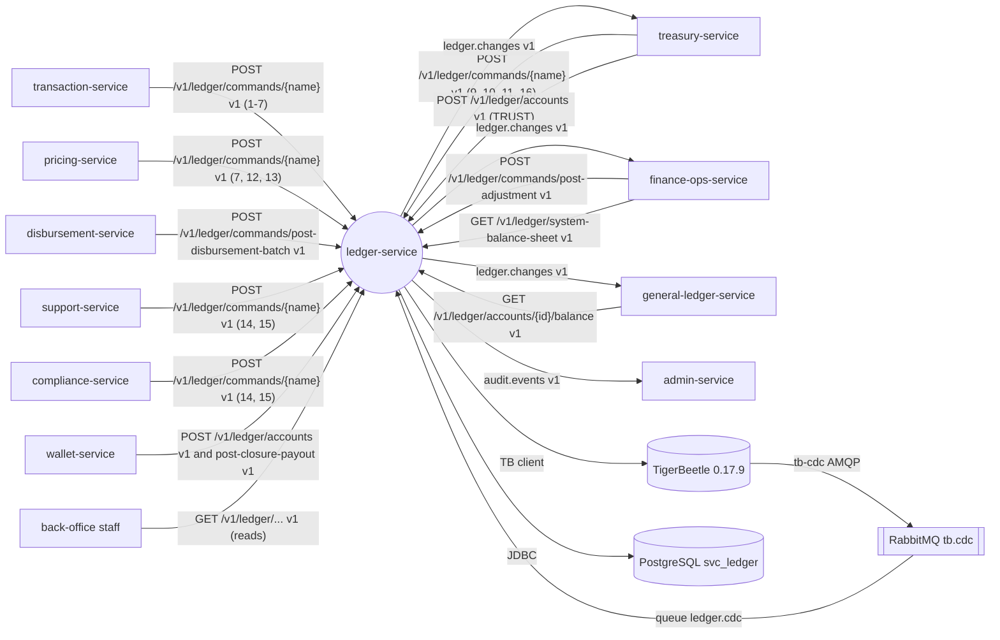

The diagram shows the main neighbours only; the full authorisation policy per operation is in §5.1.2 and in `x-actors`. The RabbitMQ transport is infrastructure, not a contract.

### 3.2 Component diagram

```mermaid
flowchart TB
  subgraph ctl["controller, config, exception"]
    CC[CommandController]
    AC[AccountController]
    QC[QueryController]
    IC[InternalController]
    AF[ActorContextFilter and RequiresActor]
    PM[ProblemMapper]
  end
  subgraph app["service - business logic, transactions, jobs, policies"]
    CS["CommandService - one handler per command type"]
    AS[AccountService]
    QS[QueryService]
    SB[SystemAccountBootstrap]
    IV[IntegrityVerifier job]
    BM[BoundsMonitor job]
    PJ[PartitionMaintenance job]
    CP[CallerPolicy]
    LT[LegTemplates]
    TI[TransferIds]
    RR[ResultResolver]
    GU[AccountTypeGuards]
    BF[BalanceFormulas]
    RH[RequestHasher]
  end
  subgraph cli["client"]
    TBG["TbGateway - only importer of com.tigerbeetle"]
    TBB[TbBatcher online and bulk lanes]
    RB[ReadBatcher]
    ATC[AccountTypeCache Caffeine]
  end
  subgraph repo["repository - Spring Data JPA"]
    JW[JournalWriter write-behind]
    DB[(JPA repositories)]
  end
  subgraph msg["messaging"]
    OB[Outbox writer audit.events]
    subgraph cdc["cdc-bridge role"]
      CB[CdcBridge RabbitMQ consumer]
      CPL[CdcPoller fallback]
      KP[Kafka idempotent producer ledger.changes]
      PRJ[TypeTotalsProjection]
    end
  end
  CC --> AF
  CC --> CS
  AC --> AS
  QC --> QS
  IC --> IV
  CS --> CP
  CS --> LT
  CS --> TI
  CS --> RR
  CS --> GU
  CS --> RH
  QS --> BF
  CS --> TBG
  CS --> DB
  CS --> OB
  AS --> TBG
  AS --> DB
  QS --> TBG
  QS --> DB
  TBG --> TBB
  TBG --> RB
  ATC --> RB
  JW --> DB
  CB --> KP
  CPL --> KP
  CB --> PRJ
  CPL --> PRJ
  PRJ --> DB
```

| Component | Package | Role |
|---|---|---|
| `CommandController`, `AccountController`, `QueryController`, `InternalController` | `controller` (+ `dto`, `exception` for the problem+json advice, `config` for `ActorContextFilter` / `@RequiresActor`) | REST, DTO validation (Jakarta), `ActorContext`, `@RequiresActor`, caller policy check |
| `CommandService` (one handler per command type) | `service` | Validate → caller rule → rejection check → guards → build legs → submit → resolve → journal/registry/audit |
| `CallerPolicy` | `service` | Allowed `X-Actor-Id` per operation (§5.1.2), from config `bitspay.ledger.callers` |
| `LegTemplates` | `service` | Command → `List<Leg>` (no TB types) |
| `TransferIds` | `service` | SHA-256 derivation, UUID ↔ u128 |
| `ResultResolver` | `service` | Per-leg TB results → command outcome (BR-01-14, §7.6) |
| `AccountTypeGuards`, `BalanceFormulas`, `RequestHasher` | `service` | Guard table, balance formulas, canonical request hash |
| `TbBatcher`, `ReadBatcher` | `client` | Collect chains / ids from concurrent requests and flush to TB |
| `TbGateway` | `client` | The **only** class importing `com.tigerbeetle.*` (ArchUnit) |
| `AccountTypeCache` | `client` | Caffeine cache accountId → code (immutable after creation) |
| `JournalWriter` | `repository` | Write-behind group commit of `command_journal` for hot-path OK results |
| `HoldRegistry`, `ReversalClaims`, `AccountRegistry`, `CommandRejections` | `repository` | Spring Data JPA repositories over small synchronous Postgres tables (§4); native queries where locking / upserts need them |
| `SystemAccountBootstrap` | `service` | Creates fixed system accounts idempotently at `api` start-up |
| `CdcBridge` / `CdcPoller` | `messaging` | RabbitMQ consumer (or TB `query_transfers` poller) → Kafka `ledger.changes` + type-totals projection |
| `IntegrityVerifier`, `BoundsMonitor`, `PartitionMaintenance` | `service` | Scheduled jobs guarded by Postgres advisory locks |

### 3.3 Runtime and deployment (Compose)

| Item | Value |
|---|---|
| Compose service | `ledger-service`, image `bitspay/ledger-service:local`, ports 8101 / 9101, Spring profiles `dev,api,cdc-bridge` (both roles in one container locally), `mem_limit` 448 MB |
| Run roles | `bitspay.ledger.role=api` (Spring profile `api`): stateless, scales horizontally. `cdc-bridge` (profile `cdc-bridge`, contract name `ledger-cdc-bridge`): **exactly one active instance** (RabbitMQ single-active-consumer, or Postgres advisory lock `hashtext('ledger-cdc')` in poll mode) |
| Schema | `svc_ledger`; datasource `jdbc:postgresql://postgres:5432/bitspay?currentSchema=svc_ledger`; Flyway `spring.flyway.schemas=svc_ledger`, `create-schemas=false` in the stack (Testcontainers: `true` with a superuser). The stack pre-creates the outbox; `V1` uses `CREATE TABLE IF NOT EXISTS` |
| TigerBeetle | 0.17.9 server and `tigerbeetle-java` 0.17.9 (catalog key `tigerbeetle`; Dev-1 owns every bump, server before clients). Stack: single replica `--development` at fixed `172.28.0.10:3001` |
| TB env | `BITSPAY_TB_ADDRESSES` → `bitspay.tb.addresses` (stack `172.28.0.10:3001`, hybrid `127.0.0.1:3001`); `BITSPAY_TB_CLUSTERID` → `bitspay.tb.cluster-id` (`0`) |
| CDC transport | Platform container `tb-cdc` runs `tigerbeetle amqp --addresses=172.28.0.10:3001 --cluster=0 --host=rabbitmq:5672 --vhost=/ --user=… --password=… --publish-exchange=tb.cdc` (flags verified in WP-2). Queue `ledger.cdc` bound to exchange `tb.cdc`, consumed only by the bridge |
| Other env | `LEDGER_JOURNAL_MAC_KEY` → `bitspay.ledger.journal.mac-key`; `BITSPAY_RABBITMQ_*` (Spring AMQP host/user/password); kernel K8.3 variables. `BITSPAY_FIELD_CIPHER_KEY` is set by the stack but unused (no PII) |
| Depends on (Compose) | postgres, kafka-init, tigerbeetle, rabbitmq. Readiness covers only own infra (TB health = `lookup_accounts([FEE_INCOME])` ≤ 500 ms, Postgres); never waits for another service |
| Redis | Not used |
| Kafka consumer groups | None (the ledger consumes no topic). Kafka producer: `ledger.changes` (bridge, direct) and Debezium outbox for `audit.events` |
| Threads | Tomcat on virtual threads; one platform thread `tb-batcher` per lane per TB client; `journal-writer` thread; small scheduler for jobs |
| Scheduled jobs | `PartitionMaintenance` (daily, creates today + 2 days of `command_journal`, drops partitions past retention), `IntegrityVerifier` (hourly sample), `BoundsMonitor` (every minute: BC/BO net = 0), outbox and `command_rejection` cleanup (daily). All behind Postgres advisory locks (one replica runs each) |
| Edge | `/ledger/` via the dev edge proxy; Swagger at `http://localhost:8000/ledger/swagger-ui.html` |
| Hybrid | `make hybrid svc=ledger-service` runs it from the IDE (profile `hybrid`: TB `127.0.0.1:3001`, Postgres `localhost:5432`, Kafka `localhost:19092`) |

### 3.4 Key flows

**F1 — P2P with max balance (Rahim → Karim, 500 Tk, fee 5, VAT 0.75, Karim's max 300,000 Tk)**

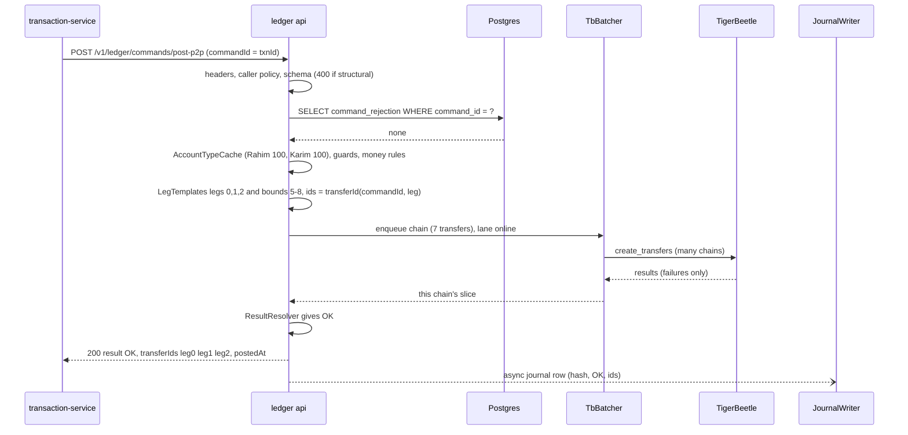

**F2 — Replay / crash recovery (same commandId again)**

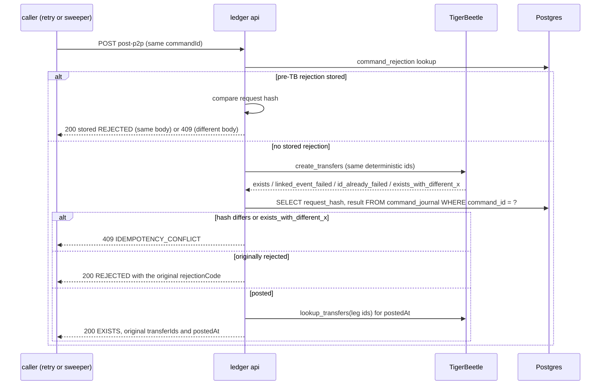

**F3 — Unknown outcome (TB timeout) and resolution by lookup**

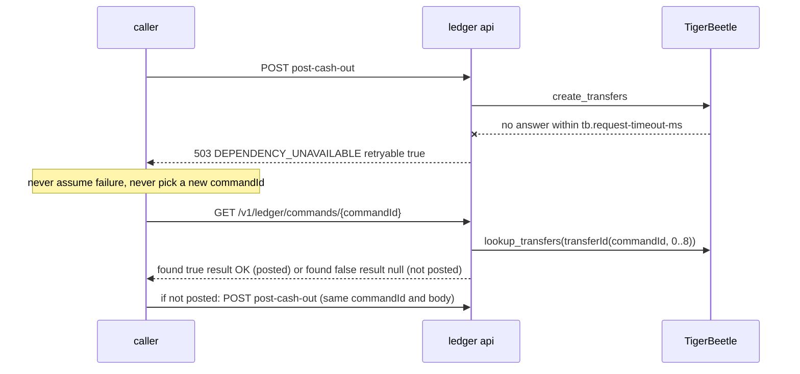

**F4 — Wrong-transfer reversal with hold release**

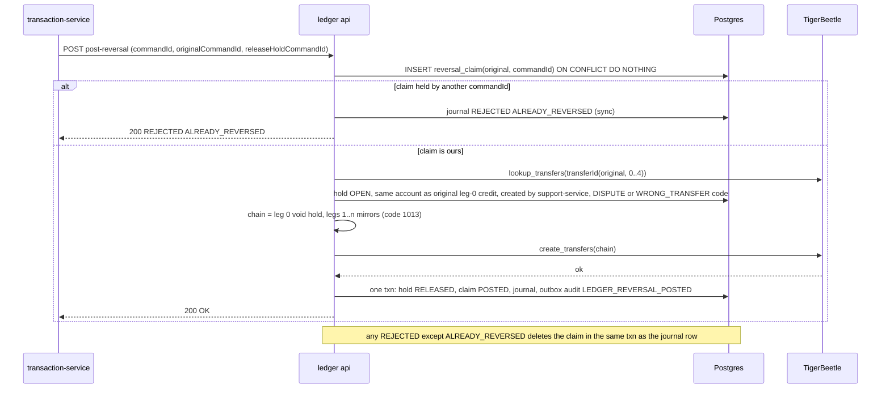

**F5 — CDC bridge (AMQP mode)**

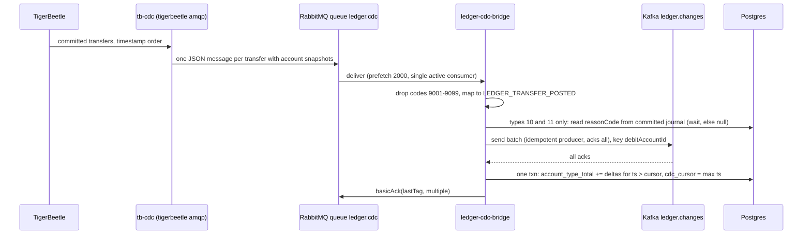

**F6 — Account close (wallet closure)**

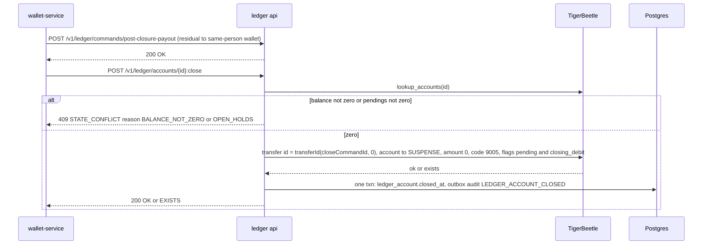

### 3.5 State machines

Hold (registry row `hold`; TB pending transfer code 1014):

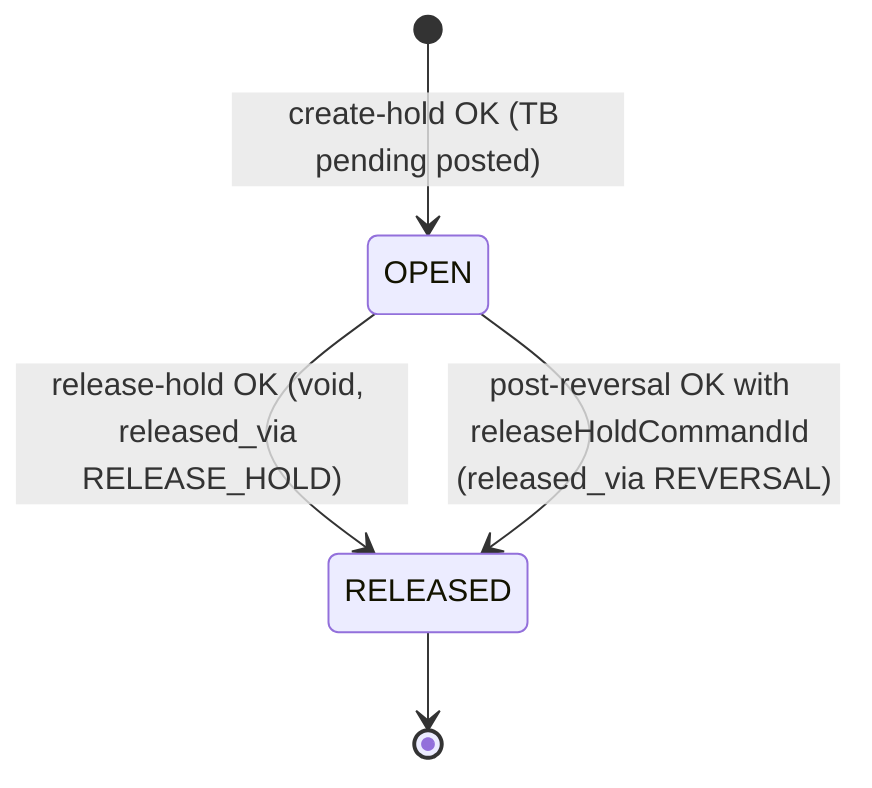

Reversal claim (`reversal_claim`, one row per original):

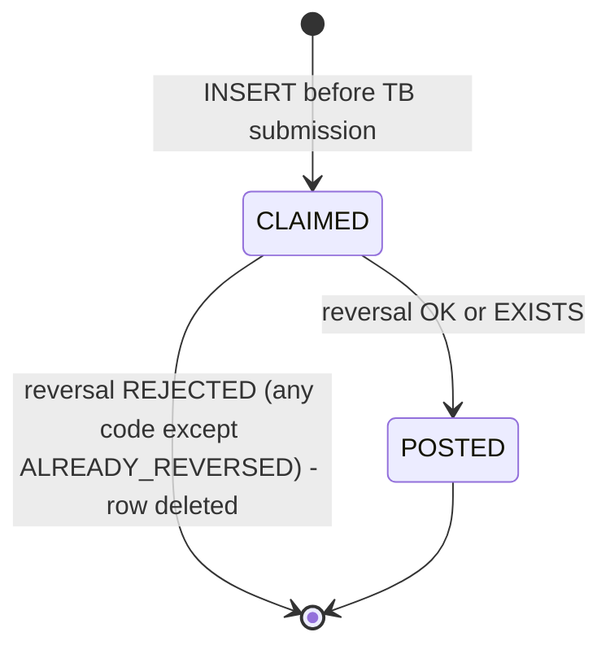

Ledger account (`ledger_account` + TB account):

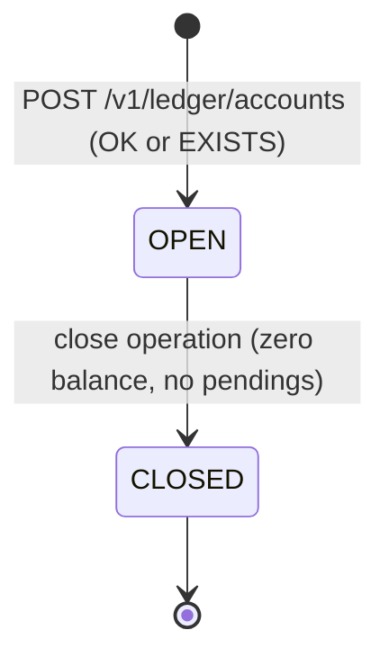

Command outcome per `commandId` (as seen by callers):

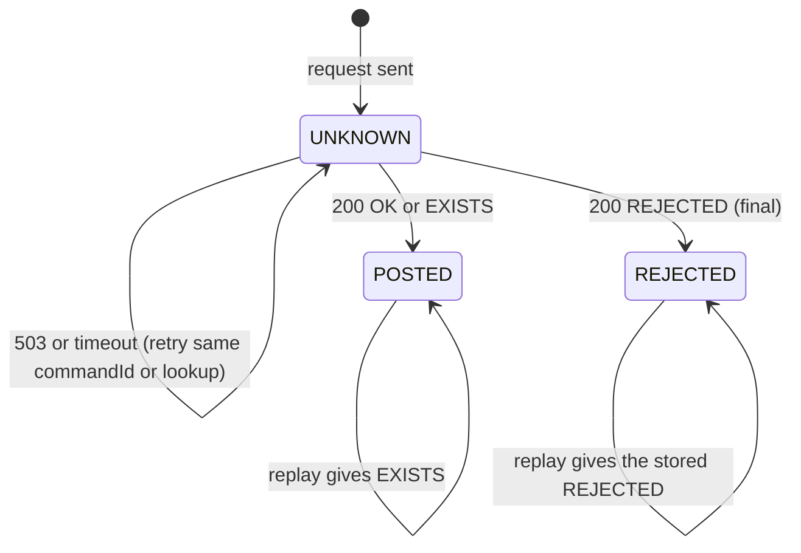

### 3.6 Architecture decisions

| ADR | Decision | Why | Consequence |
|---|---|---|---|
| ADR-01 (WP-1) | One Gradle project, one image, two run roles (`api`, `cdc-bridge`) | Shared mapping code and DB; standalone build rule | Locally both roles run in one container |
| ADR-02 (WP-3) | Journal is **write-behind** (group commit ≤ 5 ms) for `OK` results of the hot-path commands 1–6 and 12; the HTTP response does not wait. Every other journal row (all `REJECTED` decided before TB, all results of commands 7–11, 13–17) is written **synchronously** before responding, together with registry/audit rows | TB result is authoritative and must not get journal latency; pre-TB rejections must be final (TB never saw them); back-office commands audit in the same DB transaction | Replay asks the `command_rejection` table first, then TB; the journal is read only when TB reports `exists`/`id_already_failed`. Loss of a write-behind row is recoverable (TB `exists_with_different_*` still catches conflicts) |
| ADR-03 (WP-2) | Max balance via the TB **balance-bounds recipe** (legs 5–8 against BOUNDS_CONTROL/BOUNDS_OPERATOR) | Atomic, no race between check and post | The two-phase fallback exists behind `bounds.mode=two-phase` for the spike only; it changes visible ids and events and needs an accepted CR before use in any shared environment (OPEN D-16) |
| ADR-04 (WP-8) | `ledger.changes` from TB native AMQP CDC (`tigerbeetle amqp`) via RabbitMQ; fallback poller on `query_transfers` | Debezium cannot read TB | Mode switch is safe (shared cursor); consumers dedupe by `eventId` |
| ADR-05 (WP-5) | Double reversal prevented by a Postgres `reversal_claim` row inserted **before** TB submission | Reversal ids derive from the reversal's own `commandId`, so TB cannot enforce "one reversal per original" | Claim deleted on every `REJECTED` except `ALREADY_REVERSED` |
| ADR-06 (WP-5) | Hold registry in Postgres (reasonCode, status, creator), written synchronously after TB | TB has no field for reasonCode; listing holds by scanning TB is expensive | TB remains the truth for amounts |
| ADR-07 (WP-7) | System balance sheet: exact totals of system/trust accounts + identity for the wallets total; per-wallet-type totals from the CDC projection (eventually consistent, `projectionAsOf` reported) | TB has no group-by; tens of millions of accounts cannot be summed per request | `byWalletType` lag alert > 10 s (OPEN D-45) |
| ADR-08 (WP-2) | Transfer ids rendered as canonical UUID text of the big-endian u128; `ledger.changes` `eventId` = `transferId` | Consumers store ids in `uuid` columns and dedupe by `eventId` | Data contract `transfer-id-derivation` v1 |
| ADR-09 (WP-3) | Account-type guards per command via an immutable-entry Caffeine cache | Defence in depth at < 0.1 ms; account code never changes | Misses are batched `lookup_accounts` |
| ADR-10 (WP-4) | Two batcher lanes: `online` (commands 1–7, 9, 10, 11, 14, 15, 16, 17) and `bulk` (8, 12, 13); bulk has ≤ 1 in-flight TB request and yields while `online` has work | PER-010: bulk must not degrade online latency | Disbursement chains of one call stay in one TB request, in row order |
| ADR-11 (WP-3) | Pre-TB rejections are stored in a small synchronous table `command_rejection` and checked before every TB submission | A rejection that TB never saw must still be final for its `commandId` | One indexed Postgres read per command; Postgres down → commands return 503 (§9) |
| ADR-12 (WP-2) | Every non-technical account carries the TB `history` flag (wallets, trust and system accounts 200–240, 400–420) | `ledger.changes` `*BalanceAfter` always present; consumers need no delta accumulation | TB flags are immutable: must be in place before the first `create_accounts` in any shared environment (laptops: `make reset`) |

### 3.7 Latency / throughput budget

Service-side p99 ≤ 20 ms for commands 1–6 (single-replica local TB):

| Step | Budget |
|---|---|
| HTTP parse + validation + leg build | ≤ 1 ms |
| `command_rejection` point lookup | ≤ 1 ms |
| Account-type cache check (hit) | ≤ 0.1 ms (miss: one batched `lookup_accounts`, ≤ 3 ms) |
| Batcher wait | ≤ 1 ms (`max-wait-micros` 500) |
| TB request round trip | ≤ 10 ms |
| Result resolution + response | ≤ 1 ms |
| Journal write | off the response path for OK results of 1–6, 12 (ADR-02) |

Per-command p99 targets: 1–6 20 ms · 7 40 ms (two TB round trips) · 8 250 ms per 1,000 rows · 9, 10, 11, 16, 17 50 ms · 12, 13 50 ms · 14, 15 40 ms. Reads: balance p95 ≤ 10 ms, command lookup p99 ≤ 15 ms, system balance sheet p99 ≤ 30 ms.

Throughput: the system-wide design target is 5k TPS sustained (10k burst for 10 min). Every payment is one ledger command, so the ledger's share is the full 5k commands/s (avg ≈ 4 TB transfers each incl. bounds) plus disbursement rows at ≥ 1,000,000 rows/h on the bulk lane. Performance is never measured on a laptop.

## 4. Data model

Postgres holds **no balances**. It holds metadata, the command journal and rejections, the hold registry, reversal claims, the CDC cursor and projection, and the outbox. TigerBeetle is the source of truth for every amount.

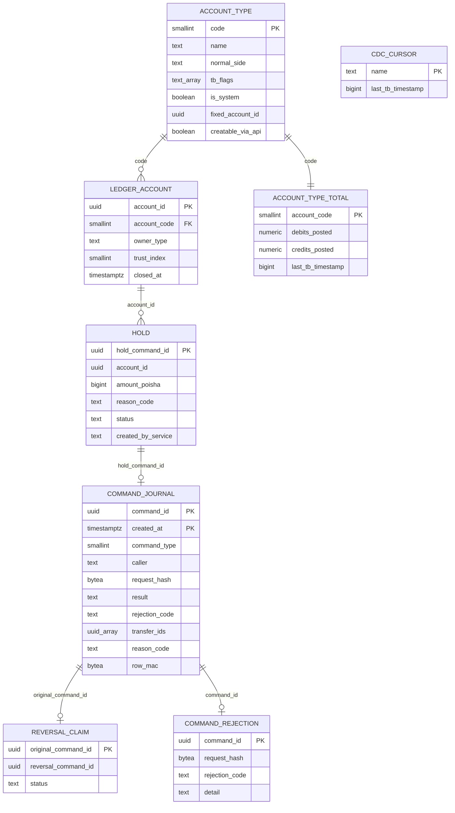

### 4.1 Tables (Flyway `V1__init.sql`, schema `svc_ledger`)

Unqualified DDL lands in `svc_ledger` via `search_path`. Never reference another schema; a test proves the `svc_ledger` role cannot read another schema.

```sql
-- V1__init.sql  (schema svc_ledger)

-- 4.1.1 Chart of accounts (config, seeded; codes per contracts/provided/codes.yaml accountType)
CREATE TABLE IF NOT EXISTS account_type (
  code              smallint PRIMARY KEY,
  name              text        NOT NULL UNIQUE,
  normal_side       text        NOT NULL CHECK (normal_side IN ('CREDIT','DEBIT','EITHER')),
  tb_flags          text[]      NOT NULL DEFAULT '{}',
  is_system         boolean     NOT NULL,
  fixed_account_id  uuid,                                -- null for wallets and trust instances
  creatable_via_api boolean     NOT NULL DEFAULT false,
  wallet_type_code  char(1),                             -- C/A/D/M/I for wallet types
  created_at        timestamptz NOT NULL DEFAULT now()
);

INSERT INTO account_type (code,name,normal_side,tb_flags,is_system,fixed_account_id,creatable_via_api,wallet_type_code) VALUES
 (100,'CUSTOMER_WALLET','CREDIT','{debits_must_not_exceed_credits,history}',false,NULL,true,'C'),
 (110,'AGENT_WALLET','CREDIT','{debits_must_not_exceed_credits,history}',false,NULL,true,'A'),
 (120,'DISTRIBUTOR_WALLET','CREDIT','{debits_must_not_exceed_credits,history}',false,NULL,true,'D'),
 (130,'MERCHANT_WALLET','CREDIT','{debits_must_not_exceed_credits,history}',false,NULL,true,'M'),
 (140,'INSTITUTION_WALLET','CREDIT','{debits_must_not_exceed_credits,history}',false,NULL,true,'I'),
 (200,'FEE_INCOME','CREDIT','{history}',true,'00000000-0000-0000-0000-000000000200',false,NULL),
 (210,'VAT_PAYABLE','CREDIT','{history}',true,'00000000-0000-0000-0000-000000000210',false,NULL),
 (220,'COMMISSION_PAYABLE','CREDIT','{history}',true,'00000000-0000-0000-0000-000000000220',false,NULL),
 (230,'AIT_PAYABLE','CREDIT','{history}',true,'00000000-0000-0000-0000-000000000230',false,NULL),
 (240,'CAMPAIGN_FUNDING','CREDIT','{debits_must_not_exceed_credits,history}',true,'00000000-0000-0000-0000-000000000240',false,NULL),
 (300,'TRUST_SETTLEMENT','DEBIT','{credits_must_not_exceed_debits,history}',true,NULL,true,NULL),
 (400,'SUSPENSE','EITHER','{history}',true,'00000000-0000-0000-0000-000000000400',false,NULL),
 (410,'ADJUSTMENT_CLEARING','EITHER','{history}',true,'00000000-0000-0000-0000-000000000410',false,NULL),
 (420,'HOLD_CONTROL','CREDIT','{history}',true,'00000000-0000-0000-0000-000000000420',false,NULL),
 -- technical, ledger-internal; net balance 0 after every chain; never reported
 (900,'BOUNDS_CONTROL','EITHER','{credits_must_not_exceed_debits}',true,'00000000-0000-0000-0000-000000000900',false,NULL),
 (910,'BOUNDS_OPERATOR','EITHER','{}',true,'00000000-0000-0000-0000-000000000910',false,NULL)
ON CONFLICT (code) DO NOTHING;
-- 310 NETWORK_SETTLEMENT is reserved: not seeded in this phase.

-- 4.1.2 Account registry (metadata only; TB is the truth)
CREATE TABLE IF NOT EXISTS ledger_account (
  account_id        uuid PRIMARY KEY,
  account_code      smallint    NOT NULL REFERENCES account_type(code),
  owner_type        text        NOT NULL CHECK (owner_type IN ('CUSTOMER','AGENT','DISTRIBUTOR','MERCHANT','INSTITUTION','SYSTEM')),
  owner_type_code   smallint    NOT NULL,             -- = TB account user_data_32 (1,2,3,4,5,9)
  trust_index       smallint    CHECK (trust_index BETWEEN 1 AND 99),
  created_by        text        NOT NULL,             -- caller X-Actor-Id
  created_at        timestamptz NOT NULL DEFAULT now(),
  closed_at         timestamptz,
  close_command_id  uuid,
  updated_at        timestamptz NOT NULL DEFAULT now(),
  version           bigint      NOT NULL DEFAULT 0
);
CREATE INDEX IF NOT EXISTS ledger_account_code ON ledger_account (account_code);
CREATE UNIQUE INDEX IF NOT EXISTS ledger_account_trust_idx ON ledger_account (trust_index) WHERE trust_index IS NOT NULL;

-- 4.1.3 Command journal (partitioned daily; retention 8 days). ADR-02: write-behind for OK of 1-6/12, synchronous otherwise.
CREATE TABLE IF NOT EXISTS command_journal (
  command_id          uuid        NOT NULL,
  command_type        smallint    NOT NULL,           -- codes.yaml commandType
  caller              text        NOT NULL,           -- X-Actor-Id (service name)
  txn_ref             text,
  request_hash        bytea       NOT NULL,           -- SHA-256 of canonical body without metadata (BR-01-12)
  result              text        NOT NULL CHECK (result IN ('OK','REJECTED')),
  rejection_code      text,
  detail              text,
  transfer_ids        uuid[]      NOT NULL DEFAULT '{}',
  original_command_id uuid,                           -- reversal original / release-hold target
  batch_id            uuid,                           -- disbursement rows
  reason_code         text,                           -- commands 10, 11 (read by the CDC bridge), 14
  created_at          timestamptz NOT NULL DEFAULT now(),
  row_mac             bytea       NOT NULL,           -- HMAC-SHA256 (BR-01-70)
  PRIMARY KEY (command_id, created_at)
) PARTITION BY RANGE (created_at);
CREATE INDEX IF NOT EXISTS command_journal_cmd ON command_journal (command_id);
-- partitions created by PartitionMaintenance (today + 2 days ahead), dropped after retention.

-- 4.1.4 Pre-TB rejections (ADR-11; synchronous; checked before every TB submission; retention 8 days)
CREATE TABLE IF NOT EXISTS command_rejection (
  command_id     uuid PRIMARY KEY,
  command_type   smallint    NOT NULL,
  caller         text        NOT NULL,
  request_hash   bytea       NOT NULL,
  rejection_code text        NOT NULL,
  detail         text,
  created_at     timestamptz NOT NULL DEFAULT now()
);
CREATE INDEX IF NOT EXISTS command_rejection_created ON command_rejection (created_at);

-- 4.1.5 Reversal claims (synchronous; prevents double reversal — ADR-05)
CREATE TABLE IF NOT EXISTS reversal_claim (
  original_command_id uuid PRIMARY KEY,
  reversal_command_id uuid        NOT NULL UNIQUE,
  status              text        NOT NULL CHECK (status IN ('CLAIMED','POSTED')),
  created_at          timestamptz NOT NULL DEFAULT now(),
  updated_at          timestamptz NOT NULL DEFAULT now(),
  version             bigint      NOT NULL DEFAULT 0
);

-- 4.1.6 Hold registry (ADR-06)
CREATE TABLE IF NOT EXISTS hold (
  hold_command_id    uuid PRIMARY KEY,
  account_id         uuid        NOT NULL,
  amount_poisha      bigint      NOT NULL CHECK (amount_poisha > 0),
  reason_code        text        NOT NULL,
  status             text        NOT NULL CHECK (status IN ('OPEN','RELEASED')),
  transfer_id        uuid        NOT NULL,            -- transferId(holdCommandId, 0)
  release_command_id uuid UNIQUE,
  released_via       text CHECK (released_via IN ('RELEASE_HOLD','REVERSAL')),
  created_by_service text        NOT NULL,            -- caller X-Actor-Id
  created_at         timestamptz NOT NULL DEFAULT now(),
  released_at        timestamptz,
  updated_at         timestamptz NOT NULL DEFAULT now(),
  version            bigint      NOT NULL DEFAULT 0
);
CREATE INDEX IF NOT EXISTS hold_open_by_account ON hold (account_id) WHERE status = 'OPEN';

-- 4.1.7 CDC bridge state
CREATE TABLE IF NOT EXISTS cdc_cursor (
  name              text PRIMARY KEY,                 -- 'amqp' | 'poll' (same semantics)
  last_tb_timestamp bigint      NOT NULL,             -- TB ns timestamp of the last applied transfer
  updated_at        timestamptz NOT NULL DEFAULT now()
);
CREATE TABLE IF NOT EXISTS account_type_total (       -- projection for the balance sheet per type (ADR-07)
  account_code      smallint PRIMARY KEY REFERENCES account_type(code),
  debits_posted     numeric(39,0) NOT NULL DEFAULT 0,
  credits_posted    numeric(39,0) NOT NULL DEFAULT 0,
  last_tb_timestamp bigint        NOT NULL DEFAULT 0,
  updated_at        timestamptz   NOT NULL DEFAULT now()
);
INSERT INTO account_type_total (account_code) SELECT code FROM account_type ON CONFLICT DO NOTHING;

-- 4.1.8 Outbox / inbox (kernel K8.2, verbatim). The ledger consumes no topic; processed_event kept for uniformity.
CREATE TABLE IF NOT EXISTS outbox (
  id             uuid PRIMARY KEY,
  aggregate_type text        NOT NULL,
  aggregate_id   text        NOT NULL,
  event_type     text        NOT NULL,
  payload        jsonb       NULL,
  created_at     timestamptz NOT NULL DEFAULT now(),
  published_at   timestamptz
);
CREATE INDEX IF NOT EXISTS outbox_unpublished ON outbox (created_at) WHERE published_at IS NULL;
CREATE TABLE IF NOT EXISTS processed_event (
  event_id     uuid PRIMARY KEY,
  topic        text NOT NULL,
  processed_at timestamptz NOT NULL DEFAULT now()
);
```

Notes:
- `ledger.changes` is **not** published through the outbox: its source is TB, not Postgres. The bridge produces to Kafka directly (idempotent producer). The outbox carries `audit.events` only, and never a null payload (the ledger declares no tombstones).
- Flyway migrations already merged are never edited; add `V<n>`.

### 4.2 Redis keys / caches

No Redis. In-process caches only: `AccountTypeCache` (Caffeine, accountId → code, immutable entries, max 2,000,000 entries ≈ 150 MB heap at production sizing; the Compose default is smaller, §8) and a small cache of commandId → reasonCode in the bridge (GL-03).

### 4.3 Retention and archival

| Data | Retention |
|---|---|
| `command_journal` | 8 days (config). Older replays still work via TB `exists`; payload-conflict detection then relies on TB `exists_with_different_*`, and a rejected command answers `REJECTED OTHER` `detail: "id_already_failed"` |
| `command_rejection` | 8 days (same as the journal) |
| `hold`, `reversal_claim`, `ledger_account`, `account_type_total`, `cdc_cursor` | Kept (small) |
| `outbox` / `processed_event` | 3 days / 14 days (kernel K8.2) |
| TigerBeetle | Forever (immutable) |

## 5. Provided contracts

Mirror of `contracts/provided/`. On any conflict the artefact wins (kernel precedence 3).

### 5.1 REST operations

| Operation | Audience | Actors & roles (`X-Actor-Id` for SERVICE) | Idempotency | Purpose |
|---|---|---|---|---|
| `POST /v1/ledger/commands/post-p2p` | service | SERVICE `transaction-service` | `commandId` | Command 1 |
| `POST /v1/ledger/commands/post-cash-in` | service | SERVICE `transaction-service` | `commandId` | Command 2 |
| `POST /v1/ledger/commands/post-cash-out` | service | SERVICE `transaction-service` | `commandId` | Command 3 |
| `POST /v1/ledger/commands/post-merchant-payment` | service | SERVICE `transaction-service` | `commandId` | Command 4 |
| `POST /v1/ledger/commands/post-merchant-refund` | service | SERVICE `transaction-service` | `commandId` | Command 5 |
| `POST /v1/ledger/commands/post-float-transfer` | service | SERVICE `transaction-service` | `commandId` | Command 6 |
| `POST /v1/ledger/commands/post-reversal` | service | SERVICE `transaction-service`, `pricing-service` (rule §5.1.2) | `commandId` | Command 7 |
| `POST /v1/ledger/commands/post-disbursement-batch` | service | SERVICE `disbursement-service` | row `commandId` | Command 8 |
| `POST /v1/ledger/commands/post-emoney-issue` | service | SERVICE `treasury-service` | `commandId` | Command 9 |
| `POST /v1/ledger/commands/post-emoney-redeem` | service | SERVICE `treasury-service` | `commandId` | Command 10 |
| `POST /v1/ledger/commands/post-adjustment` | service | SERVICE `treasury-service`, `finance-ops-service` | `commandId` | Command 11 |
| `POST /v1/ledger/commands/post-campaign-reward` | service | SERVICE `pricing-service` | `commandId` | Command 12 |
| `POST /v1/ledger/commands/post-commission-settlement` | service | SERVICE `pricing-service` | `commandId` | Command 13 |
| `POST /v1/ledger/commands/create-hold` | service | SERVICE `support-service`, `compliance-service` | `commandId` | Command 14 |
| `POST /v1/ledger/commands/release-hold` | service | SERVICE `support-service`, `compliance-service` | `commandId` | Command 15 |
| `POST /v1/ledger/commands/post-trust-rebalance` | service | SERVICE `treasury-service` | `commandId` | Command 16 |
| `POST /v1/ledger/commands/post-closure-payout` | service | SERVICE `wallet-service` | `commandId` | Command 17 |
| `POST /v1/ledger/accounts` | service | SERVICE `wallet-service` (wallet types), `treasury-service` (TRUST) | `accountId` | Create account |
| `POST /v1/ledger/accounts/{id}:close` | service | SERVICE `wallet-service` | deterministic close id | Close account |
| `GET /v1/ledger/accounts/{id}/balance` | service | SERVICE `wallet-service`, `support-service`, `compliance-service`, `treasury-service`, `disbursement-service`, `pricing-service`, `general-ledger-service`; SYSTEM `general-ledger-service`; STAFF (any role); wallet holders for their own wallet | read-only | Balance |
| `POST /v1/ledger/accounts/balances:batchGet` | service | SERVICE `finance-ops-service`, `treasury-service`, `wallet-service`, `general-ledger-service`; SYSTEM `general-ledger-service`; STAFF | read-only | Batch balances |
| `GET /v1/ledger/commands/{commandId}` | service | SERVICE: every command caller (`transaction-service`, `pricing-service`, `disbursement-service`, `treasury-service`, `finance-ops-service`, `support-service`, `compliance-service`, `wallet-service`); STAFF | read-only | Command lookup (never 404) |
| `GET /v1/ledger/accounts/{id}/transfers` | service | SERVICE `finance-ops-service`; STAFF | read-only, paged | Transfer history |
| `GET /v1/ledger/holds` | service | SERVICE `support-service`, `compliance-service`, `wallet-service`; STAFF | read-only, not paged | Open holds |
| `GET /v1/ledger/system-balance-sheet` | service | SERVICE `treasury-service`, `finance-ops-service`, `general-ledger-service`; SYSTEM `general-ledger-service`; STAFF | read-only | System balance sheet |
| `GET /v1/internal/ledger/chart-of-accounts` | internal | STAFF (any role); SERVICE (any) | read-only | `account_type` rows |
| `GET /v1/internal/ledger/accounts/{id}/raw` | internal | STAFF `ADMIN`, `AUDITOR` | read-only | Raw TB account |
| `POST /v1/internal/ledger/integrity:verify` | internal | STAFF `ADMIN`, `AUDITOR` | naturally idempotent | Integrity check on a window |
| `GET /v1/internal/ledger/cdc/status` | internal | STAFF (any role); SYSTEM (platform tools) | read-only | CDC bridge status |

Every command is modelled as **its own OpenAPI operation with a literal path** (`/v1/ledger/commands/post-p2p`, …), so a consumer can pin exactly the command it calls. All 17 share the response schema `CommandResponse` (except 8: `DisbursementBatchResponse`).

#### 5.1.1 Rules common to all commands

- **Headers (kernel K3.1).** `X-Actor-Type: SERVICE` required (`SYSTEM` accepted only in the `local` profile; anything else → `403`). `X-Actor-Id` = the calling service's bare name. `X-Channel` = the inbound channel of the business request, `SYSTEM` for jobs. `X-Correlation-Id` propagated.
- **Idempotency (kernel K3.3 rule 6 exception).** Ledger idempotency is keyed on **`commandId` only**. `Idempotency-Key` is **optional and ignored** for idempotency: it is logged; a missing header is tolerated (WARN log + `bitspay_ledger_missing_idempotency_key_total`) and never changes the outcome. Ledger commands are not subject to the kernel's Idempotency-Key retention rule. Recommended header value = `commandId` (disbursement sends `{batchId}-{chunkNo}-{chunkAttempt}`).
- **Comparison.** Same `commandId` + same body → `EXISTS` with the original result. Same `commandId` + different body → `409 IDEMPOTENCY_CONFLICT`. The comparison uses SHA-256 of the canonical JSON body (sorted keys, no whitespace) **without `metadata`** (BR-01-12).
- **Money fields** are `int64` poisha. Amounts `> 0` and `≤ 10^13`; pricing fields `≥ 0` and `≤ 10^13`.
- **`txnRef`**: opaque string 1..32 `[A-Z0-9-]`, journaled only, never parsed; required on every command except 8, 14 and 15.
- **Ids** are canonical lower-case UUID text. The technical accounts 900/910 are never accepted as a parameter (→ `ACCOUNT_NOT_FOUND`).
- `pricing` and `constraints` may be omitted where unused; unused pricing fields = 0 / null.
- **Unknown request fields** are ignored (tolerant), except the reserved names `feeBearer: SHARED` / `payerShareBps` (OPEN D-03) and command 13 `vatPoisha` (OPEN D-02), which are rejected with 400.
- **Lookup operation** for unknown outcomes (kernel K3.3 rule 4): `GET /v1/ledger/commands/{commandId}`.

#### 5.1.2 Allowed callers per command (the ledger's authorisation policy)

Caller identity is the `X-Actor-Id` value, checked against config `bitspay.ledger.callers` (seed = this table, `enforce` mode). A merged service always sends its bare name; where a command is restricted to one module of a merged service, the caller guarantees internally that only that module calls (kernel K3.2). A caller not listed → `403 ACTOR_NOT_ALLOWED`.

| Code | Command | Allowed `X-Actor-Id` | Extra caller rule (enforced by the ledger unless marked caller-guaranteed) | Pattern | `txnRef` | Lane |
|---|---|---|---|---|---|---|
| 1 | `post-p2p` | `transaction-service` | — | linked | Y | online |
| 2 | `post-cash-in` | `transaction-service` | — | linked | Y | online |
| 3 | `post-cash-out` | `transaction-service` | — | linked | Y | online |
| 4 | `post-merchant-payment` | `transaction-service` | — | linked | Y | online |
| 5 | `post-merchant-refund` | `transaction-service` | — | linked | Y | online |
| 6 | `post-float-transfer` | `transaction-service` | — | linked | Y | online |
| 7 | `post-reversal` | `transaction-service`, `pricing-service` | `pricing-service` (campaign module, caller-guaranteed): the original must be command type 12 and `reverseFee = reverseCommission = false` — a flag true → `400 VALIDATION_FAILED`; another original type → `REJECTED OTHER` `detail: "NOT_REVERSIBLE"` | linked (mirrors) | Y | online |
| 8 | `post-disbursement-batch` | `disbursement-service` | — | linked per row, batched | N | bulk |
| 9 | `post-emoney-issue` | `treasury-service` | — | single | Y | online |
| 10 | `post-emoney-redeem` | `treasury-service` | — | single | Y | online |
| 11 | `post-adjustment` | `treasury-service`, `finance-ops-service` | `finance-ops-service`: reconciliation module only (caller-guaranteed) | single | Y | online |
| 12 | `post-campaign-reward` | `pricing-service` | campaign module only (caller-guaranteed) | linked | Y | bulk |
| 13 | `post-commission-settlement` | `pricing-service` | pricing module (caller-guaranteed) | linked (commission + AIT) | Y | bulk |
| 14 | `create-hold` | `support-service`, `compliance-service` | — | pending | N | online |
| 15 | `release-hold` | `support-service`, `compliance-service` | — | void pending | N | online |
| 16 | `post-trust-rebalance` | `treasury-service` | — | single | Y | online |
| 17 | `post-closure-payout` | `wallet-service` | wallet module; source wallet in `PENDING_CLOSURE` and destination a same-person wallet (caller-checked) | single | Y | online |

Read operations: allowed callers as in the §5.1 summary table (same config, key per operation). `general-ledger-service` may call the balance, batch-balances and balance-sheet reads with `X-Actor-Type` `SERVICE` or `SYSTEM`. Wallet-holder actors (`CUSTOMER`, `AGENT`, `DISTRIBUTOR`, `MERCHANT`, `INSTITUTION`) may read `GET …/{id}/balance` only when `X-Actor-Wallet-Id = {id}`.

#### 5.1.3 Caller obligations (generic `commandId` input rule)

The ledger does not validate **how** a caller derives its `commandId`; it validates only the format (UUID) and the idempotency comparison. Each caller states its own derivation in its own pack. Every caller must:

1. Choose a `commandId` that is a **stable UUID per business intent** and per attempt, and persist it (with the attempt number) **before** the call.
2. Retry a `503`, timeout, connection error or other 5xx with the **same** `commandId` and the **same** body — never a new one. Alternatively resolve the outcome with `GET /v1/ledger/commands/{commandId}` (§5.1.23 interpretation rule).
3. Treat a `REJECTED` as **final** for that `commandId`. To try again after a definitive `REJECTED`, use a **new** `commandId` derived deterministically from an incremented attempt number (attempt n ≥ 2 = the attempt-1 derivation with name suffix `":" + n` is the recommended pattern). The attempt never increments after a timeout/503/5xx.
4. Use, in every downstream reference (event field, release, reversal, closure record), the `commandId` of the attempt that actually posted.
5. Never retry a `400` or `403` unchanged (caller bug / configuration error), and never retry a `409` (alert).
6. Treat `release-hold` → `REJECTED HOLD_NOT_FOUND` as "already released".

#### 5.1.4 HTTP 400 vs `REJECTED INVALID_AMOUNT` (OPEN D-16)

`400` = structural, nothing journaled, retrying unchanged is pointless. `REJECTED` = semantic, journaled synchronously, final for the `commandId`.

| → HTTP 400 `VALIDATION_FAILED` (not journaled) | → HTTP 200 `REJECTED INVALID_AMOUNT` (journaled, final) |
|---|---|
| missing or ill-typed field; non-UUID id; unknown enum value (`feeBearer`, `commissionSource`); `amountPoisha`/`grossPoisha` ≤ 0 or > 10^13; any pricing amount < 0 or > 10^13; `reasonCode` blank or > 40 chars; `txnRef` missing where required or not 1..32 `[A-Z0-9-]`; batch: `rows` empty or > 1,000, missing `batchId`/`payerAccountId`; reversal: partial `amountPoisha` with `reverseFee` or `reverseCommission` true, `amountPoisha` > original principal (checked after the TB lookup, still 400), `amountPoisha ≤ 0`, `pricing-service` caller with a flag true; `feeBearer: SHARED` (reserved); command 13 `vatPoisha` present (reserved) | `fromAccountId = toAccountId` (and debit = credit for 11, 16, 17); `aitPoisha > commissionPoisha`; commission > 0 with null `commissionBeneficiaryAccountId` (or null `commissionSource`); `feeBearer = OPERATOR` with fee or VAT > 0; command 13 `aitPoisha ≥ grossPoisha`; TigerBeetle `overflows_*`; batch: the same semantic errors **per row** (other rows proceed) |

#### 5.1.5 Account-type guards (OPEN D-16)

Ledger config (codes, not names; `bitspay.ledger.guards.*`). Mismatch → `REJECTED OTHER`, `detail: "ACCOUNT_TYPE_MISMATCH"`. Unknown account → `ACCOUNT_NOT_FOUND`; closed account → `ACCOUNT_CLOSED`.

| Type | Debit side (from) | Credit side (to) | Other |
|---|---|---|---|
| 1 | 100 | 100 | commission beneficiary (all of 1–6, when commission > 0) ∈ {110, 120} |
| 2 | 110 | 100 | |
| 3 | 100 | 110 | |
| 4 | 100 | 130 | |
| 5 | 130 | 100 | |
| 6 | {110, 120} | {110, 120} | |
| 7 | as the original legs | | original type ∈ {1–6, 8, 12} |
| 8 | payer ∈ `disbursement.payer-codes` (seed {140}) | 100 | |
| 9 | 300 | `emoney.issue-target-codes` {110, 120, 140, 240} | |
| 10 | `emoney.redeem-source-codes` {110, 120, 130, 140, 200, 210, 230, 240} | 300 | |
| 11 | any existing account except 900/910 | same | debit ≠ credit |
| 12 | 240 (fixed) | {100, 110, 130} | |
| 13 | 220 (fixed) | beneficiary {110, 120} | AIT leg → 230 |
| 14 | {100, 110, 120, 130, 140} | 420 (fixed) | |
| 16 | 300 | 300 | from ≠ to |
| 17 | {100, 110, 120, 130, 140} | {100, 110, 120, 130, 140} | from ≠ to |

#### 5.1.6 Command response (`CommandResponse`)

HTTP 200 for `OK`, `EXISTS` and `REJECTED` (types 1–7 and 9–17; for type 8 each row result has this shape).

| Field | Type | Req | Null | Constraints / enum | Notes |
|---|---|---|---|---|---|
| commandId | uuid | Y | N | echo | |
| result | enum{OK, EXISTS, REJECTED} | Y | N | `EXISTS` = already applied, same outcome | |
| rejectionCode | enum{INSUFFICIENT_FUNDS, ACCOUNT_NOT_FOUND, ACCOUNT_CLOSED, MAX_BALANCE_EXCEEDED, ORIGINAL_NOT_FOUND, ALREADY_REVERSED, HOLD_NOT_FOUND, INVALID_AMOUNT, OTHER} | Y | Y | non-null iff `REJECTED` | codes.yaml `rejectionCode` |
| detail | string | Y | Y | raw TB result (e.g. `leg 0: exceeds_credits`) or a ledger token: `NOT_REVERSIBLE`, `ACCOUNT_TYPE_MISMATCH`, `TRUST_ATTRIBUTION_EXCEEDED`, `id_already_failed`, `IDEMPOTENCY_CONFLICT` (batch rows only) | callers may branch **only** on the listed tokens (codes.yaml `rejectionDetailToken`) |
| transferIds | array<uuid> | Y | N | business legs actually created, in leg-index order; `[]` when `REJECTED` | technical legs never listed |
| postedAt | timestamp | Y | Y | null when `REJECTED`; for `EXISTS` = original posting time (leg 0) | |

```json
{ "commandId": "0192f3c1-7a2b-7c00-9a51-3f2c8e1d0a11", "result": "OK", "rejectionCode": null, "detail": null,
  "transferIds": ["fc214b7c-f80c-8143-4f0e-107e2518a302", "3c9f8cd0-5cc5-1049-aa02-80dfc5c61a13", "586bb84d-c6dc-fcd7-62fc-a264483349f4"],
  "postedAt": "2026-10-09T08:03:22.123Z" }
```
```json
{ "commandId": "0192f3c1-7a2b-7c00-9a51-3f2c8e1d0a11", "result": "REJECTED", "rejectionCode": "INSUFFICIENT_FUNDS",
  "detail": "leg 0: exceeds_credits", "transferIds": [], "postedAt": null }
```

**Errors (every command)** — problem bodies per kernel K3.6; the ledger adds no extension members and no `reason` values on commands.

| HTTP | code | reason | extensions | When | Caller handling |
|---|---|---|---|---|---|
| 200 | — | — | — | `OK` / `EXISTS` / `REJECTED` | `REJECTED` is final for the `commandId` |
| 400 | `VALIDATION_FAILED` | — | — | §5.1.4 400 column, bad headers | definitive caller bug; never retry unchanged |
| 403 | `ACTOR_NOT_ALLOWED` | — | — | `X-Actor-Type` ≠ SERVICE (outside `local`) or `X-Actor-Id` not allowed | definitive; configuration alert |
| 409 | `IDEMPOTENCY_CONFLICT` | — | — | same `commandId`, different body (batch: only if every row conflicts) | never retry; bug alert |
| 503 | `DEPENDENCY_UNAVAILABLE` | — | — | TB unreachable or no answer within `tb.request-timeout-ms`; ledger Postgres down | outcome unknown → retry same `commandId` and body, or resolve via the lookup |

#### 5.1.7 Payment commands 1–6 (one body shape, `PaymentCommandRequest`)

`POST /v1/ledger/commands/post-p2p` (1), `…/post-cash-in` (2), `…/post-cash-out` (3), `…/post-merchant-payment` (4), `…/post-merchant-refund` (5), `…/post-float-transfer` (6). Principal code = 1000 + type. Actors: SERVICE `transaction-service`. Leg templates §7.3.

| Field | Type | Req | Null | Constraints / enum | Notes |
|---|---|---|---|---|---|
| commandId | uuid | Y | N | stable across retries | |
| txnRef | string | Y | N | 1..32 `[A-Z0-9-]` | opaque |
| fromAccountId | uuid | Y | N | type per guard; ≠ `toAccountId` (else `REJECTED INVALID_AMOUNT`) | debit of leg 0 |
| toAccountId | uuid | Y | N | type per guard | credit of leg 0 |
| amountPoisha | int64 (poisha) | Y | N | 1..10^13 | principal |
| pricing | object | N | Y | omitted ⇒ all amounts 0, `feeBearer = PAYER` | |
| pricing.feePoisha | int64 (poisha) | Y\* | N | 0..10^13 | |
| pricing.vatPoisha | int64 (poisha) | Y\* | N | 0..10^13 | |
| pricing.feeBearer | enum{PAYER, PAYEE, OPERATOR} | Y\* | N | `OPERATOR` ⇒ fee = vat = 0; `SHARED` reserved → 400 (OPEN D-03) | |
| pricing.commissionPoisha | int64 (poisha) | Y\* | N | 0..10^13 | gross commission |
| pricing.commissionSource | enum{FEE_INCOME, COMMISSION_PAYABLE} | Y\* | Y | required when commission > 0 | |
| pricing.commissionBeneficiaryAccountId | uuid | Y\* | Y | required when commission > 0; type ∈ {110, 120} | |
| pricing.aitPoisha | int64 (poisha) | Y\* | N | 0 ≤ ait ≤ commission | |
| constraints | object | N | Y | omitted/null ⇒ no bound | |
| constraints.destinationMaxBalancePoisha | int64 (poisha) | N | Y | ≥ 0 | BR-01-26 |
| metadata | object | N | Y | excluded from the idempotency comparison | |
| metadata.channel | string | N | Y | kernel `X-Channel` value | |
| metadata.initiatorActorId | string | N | Y | ≤ 64 | |

(\* = required when `pricing` is present.) Reserved names, not accepted: `pricing.payerShareBps` (OPEN D-03), `vatOnCommissionPoisha` (OPEN D-02).

```json
{
  "commandId": "0192f3c1-7a2b-7c00-9a51-3f2c8e1d0a11",
  "txnRef": "PP26100900K3M9QX2A",
  "fromAccountId": "0192f2aa-0000-7000-8000-00000000a001",
  "toAccountId": "0192f2bb-0000-7000-8000-00000000b001",
  "amountPoisha": 50000,
  "pricing": { "feePoisha": 500, "vatPoisha": 75, "feeBearer": "PAYER", "commissionPoisha": 0,
               "commissionSource": "FEE_INCOME", "commissionBeneficiaryAccountId": null, "aitPoisha": 0 },
  "constraints": { "destinationMaxBalancePoisha": 30000000 },
  "metadata": { "channel": "APP", "initiatorActorId": "0192f1bb-0000-7000-8000-000000000001" }
}
```

Cash-out with commission (Karim → Salma):
```json
{ "commandId": "0192f3d0-0000-7000-8000-000000000001", "txnRef": "CO26100900H4W8P2ZN",
  "fromAccountId": "0192f2bb-0000-7000-8000-00000000b002", "toAccountId": "0192f2cc-0000-7000-8000-00000000c003", "amountPoisha": 50000,
  "pricing": { "feePoisha": 750, "vatPoisha": 112, "feeBearer": "PAYER", "commissionPoisha": 300, "commissionSource": "FEE_INCOME",
               "commissionBeneficiaryAccountId": "0192f2cc-0000-7000-8000-00000000c003", "aitPoisha": 30 },
  "constraints": { "destinationMaxBalancePoisha": 500000000 },
  "metadata": { "channel": "USSD", "initiatorActorId": "0192f1bb-0000-7000-8000-000000000001" } }
```
Response `OK`, `transferIds` = legs 0–4: `["c5b496e8-1aa9-093d-930a-e107848107c2", "aa8c5943-a9ea-25bf-1e15-2fbe19752f1f", "08f54db5-44b8-87b7-f16f-965f75f64b01", "127ae35f-10e2-5ac5-89f9-16c567ae0950", "dc466b2d-ca31-7df9-d5b5-01f5ec55fbe4"]`.

Rejections (1–6): `INSUFFICIENT_FUNDS`, `MAX_BALANCE_EXCEEDED`, `ACCOUNT_NOT_FOUND`, `ACCOUNT_CLOSED`, `INVALID_AMOUNT`, `OTHER` (`ACCOUNT_TYPE_MISMATCH`, raw TB result).

#### 5.1.8 `POST /v1/ledger/commands/post-reversal` (7)

Actors: SERVICE `transaction-service` (`commandId` = reversal `txnId`), `pricing-service` (campaign clawback of type-12 originals; never sends `amountPoisha` or `releaseHoldCommandId`).

| Field | Type | Req | Null | Constraints / enum | Notes |
|---|---|---|---|---|---|
| commandId | uuid | Y | N | stable per attempt | |
| txnRef | string | Y | N | 1..32 `[A-Z0-9-]` | |
| originalCommandId | uuid | Y | N | original type ∈ {1–6, 8 (row `commandId`), 12} | other type (incl. a reversal) → `REJECTED OTHER NOT_REVERSIBLE`; unknown → `REJECTED ORIGINAL_NOT_FOUND` |
| reverseFee | bool | Y | N | false when partial; false for `pricing-service` | mirrors original legs 1–2 |
| reverseCommission | bool | Y | N | false when partial; false for `pricing-service` | mirrors original legs 3–4 |
| releaseHoldCommandId | uuid | N | Y | hold must be OPEN, on the original leg-0 **credit** account, created by `support-service` with `reasonCode` ∈ {`DISPUTE_HOLD`, `WRONG_TRANSFER_HOLD`} (OPEN D-16) | else `REJECTED HOLD_NOT_FOUND` |
| amountPoisha | int64 (poisha) | N | Y | absent/null or = original principal ⇒ full; `0 < x <` principal ⇒ partial; `x` > principal or `x ≤ 0` ⇒ 400 | sent only for a partial reversal |

```json
{ "commandId": "0192f4a0-0000-7000-8000-000000000001", "txnRef": "RV26100900Q2D5M8XT",
  "originalCommandId": "0192f3c1-7a2b-7c00-9a51-3f2c8e1d0a11", "reverseFee": true, "reverseCommission": true,
  "releaseHoldCommandId": "0192f5aa-0000-7000-8000-000000000001", "amountPoisha": null }
```
Response `OK`: `transferIds` = leg 0 (hold void) `c6d74bfc-9f92-5091-7130-6843b971ba38`, legs 1–3 (mirrors of the P2P principal, fee, VAT) `a66ac277-0275-9166-f478-3d0c830b968b`, `b065c298-89d5-243b-c4ee-6cdce0f44029`, `8c5abd7a-5677-220e-a280-773632c60302`.

Partial (support-approved partial refund of a wrong transfer):
```json
{ "commandId": "0192f4a0-0000-7000-8000-000000000002", "txnRef": "RV26100900M7Q4X9KB",
  "originalCommandId": "0192f3c1-7a2b-7c00-9a51-3f2c8e1d0a11", "reverseFee": false, "reverseCommission": false,
  "amountPoisha": 20000 }
```
Rules: BR-01-40..47. Rejections: `ORIGINAL_NOT_FOUND`, `ALREADY_REVERSED`, `HOLD_NOT_FOUND`, `INSUFFICIENT_FUNDS`, `ACCOUNT_CLOSED`, `OTHER` (`NOT_REVERSIBLE`).

#### 5.1.9 `POST /v1/ledger/commands/post-disbursement-batch` (8)

Actors: SERVICE `disbursement-service`. Max **1,000 rows** per call (`disbursement.max-rows`); each row is its own linked chain; rows are applied in order, so a payer running out of funds rejects later rows with `INSUFFICIENT_FUNDS`. No `txnRef`.

| Field | Type | Req | Null | Constraints / enum | Notes |
|---|---|---|---|---|---|
| batchId | uuid | Y | N | | |
| payerAccountId | uuid | Y | N | type ∈ `disbursement.payer-codes` (seed {140}) | debit of every row |
| rows | array<object> | Y | N | 1..1,000; applied in array order | |
| rows[].commandId | uuid | Y | N | stable per row attempt (caller obligation §5.1.3) | `user_data_128` of the row's legs |
| rows[].toAccountId | uuid | Y | N | type 100 | |
| rows[].amountPoisha | int64 (poisha) | Y | N | 1..10^13 | |
| rows[].constraints | object | N | Y | omitted when no bound | |
| rows[].constraints.destinationMaxBalancePoisha | int64 (poisha) | N | Y | ≥ 0 | BR-01-26 |

```json
{ "batchId": "0192f400-1111-7000-8000-000000000001", "payerAccountId": "0192f2ee-0000-7000-8000-00000000e001",
  "rows": [
    { "commandId": "5b1f3c2e-9a7d-5e41-8c0b-2f6d1a9e4b70", "toAccountId": "0192f2aa-0000-7000-8000-00000000a001",
      "amountPoisha": 1500000, "constraints": { "destinationMaxBalancePoisha": 30000000 } },
    { "commandId": "6c2a4d3f-0b8e-5f52-9d1c-3a7e2b0f5c81", "toAccountId": "0192f2aa-0000-7000-8000-00000000a002",
      "amountPoisha": 1500000 } ] }
```

Response `DisbursementBatchResponse`:

| Field | Type | Req | Null | Notes |
|---|---|---|---|---|
| batchId | uuid | Y | N | echo |
| results | array<object> | Y | N | exactly one per request row, **request row order** |
| results[] | object | Y | N | the `CommandResponse` object, `commandId` = row `commandId` |

```json
{ "batchId": "0192f400-1111-7000-8000-000000000001",
  "results": [
    { "commandId": "5b1f3c2e-9a7d-5e41-8c0b-2f6d1a9e4b70", "result": "OK", "rejectionCode": null, "detail": null,
      "transferIds": ["cd88d35c-9eac-ed16-d7b3-da141b9bc743"], "postedAt": "2026-10-09T09:00:01.002Z" },
    { "commandId": "6c2a4d3f-0b8e-5f52-9d1c-3a7e2b0f5c81", "result": "REJECTED", "rejectionCode": "ACCOUNT_CLOSED",
      "detail": "leg 0: credit_account_already_closed", "transferIds": [], "postedAt": null } ] }
```
HTTP 409 only if **every** row conflicts; an individual row conflict → that row `REJECTED`, `rejectionCode: "OTHER"`, `detail: "IDEMPOTENCY_CONFLICT"`. Request-level structural errors → 400; row semantic errors → that row `REJECTED INVALID_AMOUNT`.

#### 5.1.10 `POST /v1/ledger/commands/post-emoney-issue` (9)

Actors: SERVICE `treasury-service` (`commandId` = issuanceId). Single transfer, code 1008: debit `trustAccountId`, credit `toAccountId`.

| Field | Type | Req | Null | Constraints / enum | Notes |
|---|---|---|---|---|---|
| commandId | uuid | Y | N | stable | |
| txnRef | string | Y | N | 1..32 | |
| trustAccountId | uuid | Y | N | type 300 (`…0300nn`) | debit |
| toAccountId | uuid | Y | N | type ∈ `emoney.issue-target-codes` {110, 120, 140, 240} | credit |
| amountPoisha | int64 (poisha) | Y | N | 1..10^13 | |

```json
{ "commandId": "0192f520-0000-7000-8000-000000000001", "txnRef": "EI261009K3M9QX2A7B",
  "trustAccountId": "00000000-0000-0000-0000-000000030001", "toAccountId": "0192f2dd-0000-7000-8000-00000000d001", "amountPoisha": 100000000 }
```
Rejections: `ACCOUNT_NOT_FOUND`, `ACCOUNT_CLOSED`, `OTHER` (`ACCOUNT_TYPE_MISMATCH`).

#### 5.1.11 `POST /v1/ledger/commands/post-emoney-redeem` (10)

Actors: SERVICE `treasury-service` (`commandId` = redemptionId). Single transfer, code 1009: debit `fromAccountId`, credit `trustAccountId`. Also used for the treasury closure redemption of a partner wallet in `PENDING_CLOSURE`; the body is unchanged.

| Field | Type | Req | Null | Constraints / enum | Notes |
|---|---|---|---|---|---|
| commandId | uuid | Y | N | stable | |
| txnRef | string | Y | N | 1..32 | |
| fromAccountId | uuid | Y | N | type ∈ `emoney.redeem-source-codes` {110, 120, 130, 140, 200, 210, 230, 240} | debit |
| trustAccountId | uuid | Y | N | type 300 | credit |
| amountPoisha | int64 (poisha) | Y | N | 1..10^13 | |
| reasonCode | string | N | Y | 1..40 chars; journaled, not validated | copied to `ledger.changes` `reasonCode` (CCR-GL-03) |

```json
{ "commandId": "0192f521-0000-7000-8000-000000000001", "txnRef": "ER261009H4W8P2ZN5C",
  "fromAccountId": "00000000-0000-0000-0000-000000000200", "trustAccountId": "00000000-0000-0000-0000-000000030001",
  "amountPoisha": 2500000, "reasonCode": "REVENUE_SWEEP" }
```
Trust attributed balance would go negative → `REJECTED INSUFFICIENT_FUNDS`, `detail: "TRUST_ATTRIBUTION_EXCEEDED"`. Other rejections: `INSUFFICIENT_FUNDS`, `ACCOUNT_NOT_FOUND`, `ACCOUNT_CLOSED`, `OTHER` (`ACCOUNT_TYPE_MISMATCH`).

#### 5.1.12 `POST /v1/ledger/commands/post-adjustment` (11)

Actors: SERVICE `treasury-service` (manual journals: system accounts only, no TRUST — caller policy) and `finance-ops-service` (reconciliation: one side ∈ {SUSPENSE, ADJUSTMENT_CLEARING} — caller policy). Single transfer, code 1010.

| Field | Type | Req | Null | Constraints / enum | Notes |
|---|---|---|---|---|---|
| commandId | uuid | Y | N | stable | |
| txnRef | string | Y | N | 1..32 | |
| debitAccountId | uuid | Y | N | existing account, never 900/910 | |
| creditAccountId | uuid | Y | N | existing account, never 900/910; ≠ debit (else `REJECTED INVALID_AMOUNT`) | |
| amountPoisha | int64 (poisha) | Y | N | 1..10^13 | |
| reasonCode | string | Y | N | 1..40 chars | caller-owned list; journaled, not validated; copied to `ledger.changes` `reasonCode` |

```json
{ "commandId": "0192f540-0000-7000-8000-000000000001", "txnRef": "RCA-20261010-K3M9QX2A",
  "debitAccountId": "00000000-0000-0000-0000-000000000400", "creditAccountId": "00000000-0000-0000-0000-000000030001",
  "amountPoisha": 10000, "reasonCode": "RECON_BANK_CHARGE" }
```
Rejections: `INSUFFICIENT_FUNDS` (debit of a flag-limited account), `ACCOUNT_NOT_FOUND`, `ACCOUNT_CLOSED`, `INVALID_AMOUNT`.

#### 5.1.13 `POST /v1/ledger/commands/post-campaign-reward` (12)

Actors: SERVICE `pricing-service` (campaign module). Debit CAMPAIGN_FUNDING (`…0240`, fixed), credit `toAccountId`, leg 0 code 1011; legs 5–8 technical when `constraints` set.

| Field | Type | Req | Null | Constraints / enum | Notes |
|---|---|---|---|---|---|
| commandId | uuid | Y | N | stable per attempt | |
| txnRef | string | Y | N | 1..32 | stable across attempts |
| toAccountId | uuid | Y | N | type ∈ {100, 110, 130} | |
| amountPoisha | int64 (poisha) | Y | N | 1..10^13 | |
| constraints | object | N | Y | (OPEN D-09) | |
| constraints.destinationMaxBalancePoisha | int64 (poisha) | N | Y | ≥ 0 | BR-01-26 |

```json
{ "commandId": "4e7b2a10-6c3d-5f8e-9a1b-2c3d4e5f6a70", "txnRef": "CR26100900P7K2M4QX",
  "toAccountId": "0192f2aa-0000-7000-8000-00000000a001", "amountPoisha": 5000,
  "constraints": { "destinationMaxBalancePoisha": 30000000 } }
```
Rejections: `INSUFFICIENT_FUNDS` (CAMPAIGN_FUNDING empty), `MAX_BALANCE_EXCEEDED`, `ACCOUNT_NOT_FOUND`, `ACCOUNT_CLOSED`, `OTHER` (`ACCOUNT_TYPE_MISMATCH`).

#### 5.1.14 `POST /v1/ledger/commands/post-commission-settlement` (13)

Actors: SERVICE `pricing-service` (pricing module; `commandId` = settlementId). Linked: leg 0 COMMISSION_PAYABLE → beneficiary `gross − ait`, code 1012; leg 1 COMMISSION_PAYABLE → AIT_PAYABLE `ait`, code 2004 (only if ait > 0).

| Field | Type | Req | Null | Constraints / enum | Notes |
|---|---|---|---|---|---|
| commandId | uuid | Y | N | stable | |
| txnRef | string | Y | N | 1..32 | |
| beneficiaryAccountId | uuid | Y | N | type ∈ {110, 120} | |
| grossPoisha | int64 (poisha) | Y | N | 1..10^13 (else 400) | |
| aitPoisha | int64 (poisha) | Y | N | 0 ≤ ait **<** gross; ait < 0 → 400; ait ≥ gross → `REJECTED INVALID_AMOUNT` | |
| vatPoisha | — | — | — | **reserved** (OPEN D-02); must be absent (present → 400) | |

```json
{ "commandId": "0192f560-0000-7000-8000-000000000001", "txnRef": "CMS-20261031-K3M9QX2A",
  "beneficiaryAccountId": "0192f2cc-0000-7000-8000-00000000c003", "grossPoisha": 120000, "aitPoisha": 12000 }
```
Rejections: `INVALID_AMOUNT`, `ACCOUNT_NOT_FOUND`, `ACCOUNT_CLOSED`, `OTHER` (`ACCOUNT_TYPE_MISMATCH`).

#### 5.1.15 `POST /v1/ledger/commands/create-hold` (14)

Actors: SERVICE `support-service`, `compliance-service`. Pending transfer `accountId` → HOLD_CONTROL (`…0420`), code 1014, `timeout = 0` (no auto-expiry). No `txnRef`. `transferIds = [transferId(commandId, 0)]`; the hold appears in `GET /v1/ledger/holds` and on `ledger.changes` with flags `["pending"]`.

| Field | Type | Req | Null | Constraints / enum | Notes |
|---|---|---|---|---|---|
| commandId | uuid | Y | N | = `holdCommandId`; stable per attempt | |
| accountId | uuid | Y | N | type ∈ {100, 110, 120, 130, 140} | |
| amountPoisha | int64 (poisha) | Y | N | 1..10^13; ≤ available | else `REJECTED INSUFFICIENT_FUNDS` (caller sizes `min(requested, available)`) |
| reasonCode | string | Y | N | 1..40; Hold codes `DISPUTE_HOLD`, `WRONG_TRANSFER_HOLD` (support), `AML_LIEN` (compliance); unknown accepted and logged | only support holds with the first two codes can be consumed by a reversal |

```json
{ "commandId": "5d0f2c6e-8f6a-5b2e-9a77-0c3e1d2f4a10", "accountId": "0192f2bb-4d5f-7c62-9b3e-6f1a4dac8b12",
  "amountPoisha": 14820000, "reasonCode": "AML_LIEN" }
```
Response `OK`, `transferIds: ["c0d62a83-e445-e31e-98ac-bd45d19b763f"]`. Rejections: `INSUFFICIENT_FUNDS`, `ACCOUNT_NOT_FOUND`, `ACCOUNT_CLOSED`, `OTHER` (`ACCOUNT_TYPE_MISMATCH`).

#### 5.1.16 `POST /v1/ledger/commands/release-hold` (15)

Actors: SERVICE `support-service`, `compliance-service`. Void of `transferId(holdCommandId, 0)`; the void leg copies debit, credit and code 1014 from the pending transfer, `user_data_64 = 15`; `transferIds = [transferId(commandId, 0)]`. No `txnRef`.

| Field | Type | Req | Null | Constraints / enum | Notes |
|---|---|---|---|---|---|
| commandId | uuid | Y | N | caller-chosen, stable per hold (the ledger only requires stability) | a release never needs a second attempt |
| holdCommandId | uuid | Y | N | the hold `commandId` that actually posted | |

```json
{ "commandId": "7a1e0c4b-3d2f-5a6b-8c9d-0e1f2a3b4c5d", "holdCommandId": "5d0f2c6e-8f6a-5b2e-9a77-0c3e1d2f4a10" }
```
Already voided by this same `commandId` → `EXISTS`. Hold unknown, voided by another command (including a reversal), or posted → `REJECTED HOLD_NOT_FOUND`.

#### 5.1.17 `POST /v1/ledger/commands/post-trust-rebalance` (16)

Actors: SERVICE `treasury-service` (`commandId` = rebalanceId). Money moves from bank account `from` to bank account `to`, so the ledger posts **debit `toTrustAccountId`, credit `fromTrustAccountId`**, code 1015 (total e-money unchanged).

| Field | Type | Req | Null | Constraints / enum | Notes |
|---|---|---|---|---|---|
| commandId | uuid | Y | N | stable | |
| txnRef | string | Y | N | 1..32 | |
| fromTrustAccountId | uuid | Y | N | type 300 | ledger **credits** it |
| toTrustAccountId | uuid | Y | N | type 300, ≠ from (else `REJECTED INVALID_AMOUNT`) | ledger **debits** it |
| amountPoisha | int64 (poisha) | Y | N | 1..10^13 | |

```json
{ "commandId": "0192f580-0000-7000-8000-000000000001", "txnRef": "TR261009Q2D5M8XT3A",
  "fromTrustAccountId": "00000000-0000-0000-0000-000000030001", "toTrustAccountId": "00000000-0000-0000-0000-000000030002", "amountPoisha": 50000000 }
```
`from` attribution would go below 0 → `REJECTED INSUFFICIENT_FUNDS`, `detail: "TRUST_ATTRIBUTION_EXCEEDED"`. Other: `ACCOUNT_NOT_FOUND`, `ACCOUNT_CLOSED`, `INVALID_AMOUNT`, `OTHER`.

#### 5.1.18 `POST /v1/ledger/commands/post-closure-payout` (17)

Actors: SERVICE `wallet-service` (wallet module). Single transfer, code 1016: debit `fromAccountId`, credit `toAccountId`; no pricing; optional `constraints` (bounds legs 5–8 when set). Audited (`LEDGER_CLOSURE_PAYOUT_POSTED`). The same-person and `PENDING_CLOSURE` rules are checked by the caller; after `OK`/`EXISTS` the caller closes the source account with `:close`.

| Field | Type | Req | Null | Constraints / enum | Notes |
|---|---|---|---|---|---|
| commandId | uuid | Y | N | stable per attempt | |
| txnRef | string | Y | N | 1..32 | |
| fromAccountId | uuid | Y | N | type ∈ {100–140} | |
| toAccountId | uuid | Y | N | type ∈ {100–140}, ≠ from (else `REJECTED INVALID_AMOUNT`) | |
| amountPoisha | int64 (poisha) | Y | N | 1..10^13 | the residual available balance |
| constraints.destinationMaxBalancePoisha | int64 (poisha) | N | Y | ≥ 0 | breach → `REJECTED MAX_BALANCE_EXCEEDED` |

```json
{ "commandId": "2f9c4e1a-7b3d-5c8e-9f0a-1b2c3d4e5f60", "txnRef": "WC26101300R4T8N2KD",
  "fromAccountId": "0192f2aa-0000-7000-8000-00000000a001", "toAccountId": "0192f2cc-0000-7000-8000-00000000c003", "amountPoisha": 149425 }
```
Rejections: `INSUFFICIENT_FUNDS`, `MAX_BALANCE_EXCEEDED`, `ACCOUNT_NOT_FOUND`, `ACCOUNT_CLOSED`, `INVALID_AMOUNT`, `OTHER` (`ACCOUNT_TYPE_MISMATCH`).

#### 5.1.19 `POST /v1/ledger/accounts`

Actors: SERVICE `wallet-service` (wallet types 100–140), `treasury-service` (TRUST_SETTLEMENT only). Idempotent on `accountId`; `Idempotency-Key` optional and ignored. Writes `ledger_account` + audit `LEDGER_ACCOUNT_CREATED` in one DB transaction after TB `ok`/`exists`.

| Request field | Type | Req | Null | Constraints / enum | Notes |
|---|---|---|---|---|---|
| accountId | uuid | Y | N | wallet: UUIDv7 (= walletId; version nibble 7, timestamp prefix ≠ 0); TRUST: `00000000-0000-0000-0000-0000000300nn`, nn 01..99 | |
| accountType | enum{CUSTOMER_WALLET, AGENT_WALLET, DISTRIBUTOR_WALLET, MERCHANT_WALLET, INSTITUTION_WALLET, TRUST_SETTLEMENT} | Y | N | other types are not creatable via API | |
| ownerType | enum{CUSTOMER, AGENT, DISTRIBUTOR, MERCHANT, INSTITUTION, SYSTEM} | Y | N | must match: CUSTOMER↔100, AGENT↔110, DISTRIBUTOR↔120, MERCHANT↔130, INSTITUTION↔140, SYSTEM↔300 | |

```json
{ "accountId": "0192f2bb-0000-7000-8000-00000000b001", "accountType": "CUSTOMER_WALLET", "ownerType": "CUSTOMER" }
```

| Response field (200, also for EXISTS; 201 never used) | Type | Req | Null | Constraints / enum |
|---|---|---|---|---|
| accountId | uuid | Y | N | |
| accountType | string | Y | N | codes.yaml `accountType` name |
| code | int32 | Y | N | codes.yaml `accountType` code |
| ownerType | string | Y | N | |
| result | enum{OK, EXISTS} | Y | N | |
| createdAt | timestamp | Y | N | original creation time |

```json
{ "accountId": "0192f2bb-0000-7000-8000-00000000b001", "accountType": "CUSTOMER_WALLET", "code": 100,
  "ownerType": "CUSTOMER", "result": "OK", "createdAt": "2026-10-09T08:00:00.000Z" }
```

| HTTP | code | reason | extensions | When |
|---|---|---|---|---|
| 400 | `VALIDATION_FAILED` | — | — | type not creatable; owner/type mismatch; bad id form (wallet id not UUIDv7, trust id not `…0300nn` or `ownerType` ≠ SYSTEM) |
| 403 | `ACTOR_NOT_ALLOWED` | — | — | caller not allowed, or treasury creating a wallet type / wallet-service creating TRUST |
| 409 | `IDEMPOTENCY_CONFLICT` | — | — | TB `exists_with_different_flags/code/ledger/user_data_*` (exists with another type or flags) |
| 503 | `DEPENDENCY_UNAVAILABLE` | — | — | TB or Postgres unavailable |

#### 5.1.20 `POST /v1/ledger/accounts/{id}:close`

Actors: SERVICE `wallet-service`. No body. Idempotent (deterministic `closeCommandId`, BR-01-08). Precondition: `debits_posted = credits_posted` and both pendings 0. Closing transfer code 9005 with flags **`pending | closing_debit` only** — it closes the account and never the counter-account (SUSPENSE stays open). Mechanics BR-01-35.

| Response field | Type | Req | Null | Constraints / enum |
|---|---|---|---|---|
| accountId | uuid | Y | N | |
| result | enum{OK, EXISTS} | Y | N | `EXISTS` = already closed |
| closedAt | timestamp | Y | N | |

```json
{ "accountId": "0192f2bb-0000-7000-8000-00000000b001", "result": "OK", "closedAt": "2026-10-09T10:00:00.000Z" }
```

| HTTP | code | reason | extensions | When |
|---|---|---|---|---|
| 403 | `ACTOR_NOT_ALLOWED` | — | — | caller not allowed |
| 404 | `NOT_FOUND` | — | — | unknown account (also 900/910) |
| 409 | `STATE_CONFLICT` | `BALANCE_NOT_ZERO` | — | `debits_posted ≠ credits_posted` |
| 409 | `STATE_CONFLICT` | `OPEN_HOLDS` | — | `debits_pending` or `credits_pending` ≠ 0 |
| 409 | `STATE_CONFLICT` | `SYSTEM_ACCOUNT` | — | a system or trust account |
| 503 | `DEPENDENCY_UNAVAILABLE` | — | — | TB or Postgres unavailable |

#### 5.1.21 `GET /v1/ledger/accounts/{id}/balance`

Actors: SERVICE `wallet-service`, `support-service`, `compliance-service`, `treasury-service`, `disbursement-service`, `pricing-service`, `general-ledger-service`; SYSTEM `general-ledger-service`; STAFF (any role); wallet holders only for `X-Actor-Wallet-Id = {id}`. Read from TigerBeetle, never cached. Formulas BR-01-30. p95 ≤ 10 ms.

| Response field | Type | Req | Null | Constraints / enum | Notes |
|---|---|---|---|---|---|
| accountId | uuid | Y | N | | |
| ledgerBalancePoisha | int64 (poisha) | Y | N | may be negative for 220, 400, 410 | |
| availableBalancePoisha | int64 (poisha) | Y | N | = ledger − held | |
| heldPoisha | int64 (poisha) | Y | N | ≥ 0 | |
| asOf | timestamp | Y | N | | |
| accountType | string | Y | N | codes.yaml `accountType` name | |
| closed | bool | Y | N | | |

```json
{ "accountId": "0192f2aa-0000-7000-8000-00000000a001", "ledgerBalancePoisha": 149425, "availableBalancePoisha": 149425, "heldPoisha": 0,
  "asOf": "2026-10-09T08:03:22.130Z", "accountType": "CUSTOMER_WALLET", "closed": false }
```
Errors: 403 `ACTOR_NOT_ALLOWED` · 404 `NOT_FOUND` (also for technical 900/910) · 503 `DEPENDENCY_UNAVAILABLE`.

#### 5.1.22 `POST /v1/ledger/accounts/balances:batchGet`

Actors: SERVICE `finance-ops-service`, `treasury-service`, `wallet-service`, `general-ledger-service`; SYSTEM `general-ledger-service`; STAFF. Read-only; no `Idempotency-Key`. One `lookup_accounts`.

| Field | In | Type | Req | Null | Notes |
|---|---|---|---|---|---|
| accountIds | req | array<uuid> | Y | N | 1..500 (else 400) |
| items | res | array<object> | Y | N | each = the §5.1.21 balance object |
| notFound | res | array<uuid> | Y | N | may be empty; includes 900/910 |

```json
{ "accountIds": ["00000000-0000-0000-0000-000000000200", "0192f2cc-0000-7000-8000-00000000c009"] }
```
```json
{ "items": [ { "accountId": "00000000-0000-0000-0000-000000000200", "ledgerBalancePoisha": 1000, "availableBalancePoisha": 1000,
               "heldPoisha": 0, "asOf": "2026-10-09T18:00:00.000Z", "accountType": "FEE_INCOME", "closed": false } ],
  "notFound": ["0192f2cc-0000-7000-8000-00000000c009"] }
```
Errors: 400 · 403 · 503.

#### 5.1.23 `GET /v1/ledger/commands/{commandId}` (never 404)

Actors: SERVICE every command caller (`transaction-service`, `pricing-service`, `disbursement-service`, `treasury-service`, `finance-ops-service`, `support-service`, `compliance-service`, `wallet-service`); STAFF. One `lookup_transfers` of `transferId(commandId, 0..8)` plus `command_rejection` / journal. p99 ≤ 15 ms. Journal retention 8 days.

| Response field | Type | Req | Null | Constraints / enum | Notes |
|---|---|---|---|---|---|
| commandId | uuid | Y | N | | |
| found | bool | Y | N | true ⇔ ≥ 1 business leg (code < 9000) exists with `user_data_128 = commandId` | |
| result | enum{OK, REJECTED} | Y | Y | `OK` when found; `REJECTED` for a journaled rejection (incl. pre-TB rejections); null when unknown | callers also accept `EXISTS` as posted |
| rejectionCode | enum (§5.1.6) | Y | Y | only with `REJECTED` | |
| transfers | array<object> | Y | N | business legs only, leg order | |
| transfers[].transferId | uuid | Y | N | | |
| transfers[].legIndex | int32 | Y | N | | |
| transfers[].code | int32 | Y | N | codes.yaml `transferCode` | |
| transfers[].commandType | int32 | Y | N | codes.yaml `commandType` | |
| transfers[].debitAccountId | uuid | Y | N | | |
| transfers[].creditAccountId | uuid | Y | N | | |
| transfers[].amountPoisha | int64 (poisha) | Y | N | | |
| transfers[].pendingId | uuid | Y | Y | set on void/post legs | |
| transfers[].flags | array<string> | Y | N | TB snake_case flag names | |
| transfers[].timestamp | int64 | Y | N | TB ns since epoch (JSON number) | |
| transfers[].postedAt | timestamp | Y | N | | |

```json
{ "commandId": "0192f3c1-7a2b-7c00-9a51-3f2c8e1d0a11", "found": true, "result": "OK", "rejectionCode": null,
  "transfers": [ { "transferId": "fc214b7c-f80c-8143-4f0e-107e2518a302", "legIndex": 0, "code": 1001, "commandType": 1,
                   "debitAccountId": "0192f2aa-0000-7000-8000-00000000a001", "creditAccountId": "0192f2bb-0000-7000-8000-00000000b001",
                   "amountPoisha": 50000, "pendingId": null, "flags": ["linked"], "timestamp": 1791533002123000000,
                   "postedAt": "2026-10-09T08:03:22.123Z" } ] }
```
Not posted: `{found:false, result:null, rejectionCode:null, transfers:[]}`; journaled rejection: `{found:false, result:"REJECTED", rejectionCode:"…", transfers:[]}`.

**Interpretation rule (binding for callers):** `result = REJECTED` → rejected (map `rejectionCode` as for a 200 `REJECTED`), whatever `found` says; `found = true` and `result` ∈ {`OK`, `EXISTS`} → posted; otherwise not posted (the caller may re-post with the same `commandId` and body). For a reversal, `found = true` also when only leg 0 (hold void) exists — it never does alone, because chains are atomic. Errors: 400 (bad UUID) · 403 · 503.

#### 5.1.24 `GET /v1/ledger/accounts/{id}/transfers?fromTs&toTs&limit&cursor`

Actors: SERVICE `finance-ops-service`; STAFF. TB `get_account_transfers` (debits and credits). Query: `fromTs`, `toTs` timestamp (optional; inclusive / exclusive); `limit` int32 1..200, default 50; `cursor` opaque (encodes the last TB timestamp; kernel K3.4 expiry, scope and `INVALID_CURSOR` rules apply). Items ascending by TB timestamp; technical codes 9xxx filtered out. `balanceAfterPoisha` from a parallel `get_account_balances` (joined by timestamp) for accounts with the `history` flag.

| Item field | Type | Req | Null | Constraints / enum | Notes |
|---|---|---|---|---|---|
| transferId | uuid | Y | N | | |
| commandId | uuid | Y | N | `user_data_128` | |
| commandType | int32 | Y | N | 1..17 | |
| legIndex | int32 | Y | N | 0..5 | |
| code | int32 | Y | N | business code | |
| direction | enum{DEBIT, CREDIT} | Y | N | relative to `{id}` | |
| debitAccountId | uuid | Y | N | | |
| creditAccountId | uuid | Y | N | | |
| amountPoisha | int64 (poisha) | Y | N | ≥ 0 | |
| pendingId | uuid | Y | Y | | |
| flags | array<string> | Y | N | | |
| timestamp | int64 | Y | N | TB ns | |
| postedAt | timestamp | Y | N | | |
| balanceAfterPoisha | int64 (poisha) | Y | Y | `{id}`'s ledger balance after this transfer (BR-01-30 formula); null only for accounts without the TB `history` flag | |

Envelope: `items` array (Y, N), `nextCursor` string (Y, Y; null on the last page).

```json
{ "items": [ { "transferId": "fc214b7c-f80c-8143-4f0e-107e2518a302", "commandId": "0192f3c1-7a2b-7c00-9a51-3f2c8e1d0a11", "commandType": 1, "legIndex": 0, "code": 1001,
               "direction": "DEBIT", "debitAccountId": "0192f2aa-0000-7000-8000-00000000a001", "creditAccountId": "0192f2bb-0000-7000-8000-00000000b001", "amountPoisha": 50000,
               "pendingId": null, "flags": ["linked"], "timestamp": 1791533002123000000,
               "postedAt": "2026-10-09T08:03:22.123Z", "balanceAfterPoisha": 150000 } ],
  "nextCursor": "MTc5MTUzMzAwMjEyMzAwMDAwMA" }
```

| HTTP | code | reason | When |
|---|---|---|---|
| 400 | `VALIDATION_FAILED` | — / `INVALID_CURSOR` | `limit` outside 1..200, bad timestamp / expired, tampered or foreign cursor |
| 403 | `ACTOR_NOT_ALLOWED` | — | |
| 404 | `NOT_FOUND` | — | unknown account (also 900/910) |
| 503 | `DEPENDENCY_UNAVAILABLE` | — | |

#### 5.1.25 `GET /v1/ledger/holds?accountId=`

Actors: SERVICE `support-service`, `compliance-service`, `wallet-service`; STAFF. `accountId` uuid required. Only OPEN holds from the registry. **Not paged**: bounded by the open holds of one account (no `limit`/`cursor`).

| Field | Type | Req | Null | Notes |
|---|---|---|---|---|
| items | array<object> | Y | N | |
| items[].holdCommandId | uuid | Y | N | |
| items[].accountId | uuid | Y | N | |
| items[].amountPoisha | int64 (poisha) | Y | N | |
| items[].reasonCode | string | Y | N | Hold reason code (codes.yaml `reasonCodes`) |
| items[].transferId | uuid | Y | N | `transferId(holdCommandId, 0)` |
| items[].createdBy | string | Y | N | caller `X-Actor-Id` |
| items[].createdAt | timestamp | Y | N | |
| totalHeldPoisha | int64 (poisha) | Y | N | Σ items |

```json
{ "items": [ { "holdCommandId": "0192f5aa-0000-7000-8000-000000000001", "accountId": "0192f2bb-0000-7000-8000-00000000b001", "amountPoisha": 50000,
               "reasonCode": "WRONG_TRANSFER_HOLD", "transferId": "4af8bc15-345c-e4d7-f5fd-ed8171026a0a", "createdBy": "support-service",
               "createdAt": "2026-10-09T09:10:00.000Z" } ],
  "totalHeldPoisha": 50000 }
```
Errors: 400 · 403 · 503.

#### 5.1.26 `GET /v1/ledger/system-balance-sheet`

Actors: SERVICE `treasury-service`, `finance-ops-service`, `general-ledger-service`; SYSTEM `general-ledger-service`; STAFF (back office). p99 ≤ 30 ms. Definitions BR-01-60..63.

| Field | Type | Req | Null | Constraints / enum | Notes |
|---|---|---|---|---|---|
| asOf | timestamp | Y | N | | exact part (TB read) |
| trustMirrorTotalPoisha | int64 (poisha) | Y | N | Σ trust (debits_posted − credits_posted) | exact |
| trustAccounts | array<object> | Y | N | one per TRUST_SETTLEMENT account | |
| trustAccounts[].accountId | uuid | Y | N | `…0000000300nn` | |
| trustAccounts[].trustIndex | int32 | Y | N | 1..99 | |
| trustAccounts[].mirrorBalancePoisha | int64 (poisha) | Y | N | debits_posted − credits_posted | |
| trustAccounts[].debitsPostedPoisha | int64 (poisha) | Y | N | | |
| trustAccounts[].creditsPostedPoisha | int64 (poisha) | Y | N | | |
| systemAccounts | array<object> | Y | N | 200, 210, 220, 230, 240, 400, 410, 420; 900/910 never listed | exact |
| systemAccounts[].accountType | string | Y | N | | |
| systemAccounts[].accountId | uuid | Y | N | | |
| systemAccounts[].balancePoisha | int64 (poisha) | Y | N | credits_posted − debits_posted (signed) | |
| systemAccounts[].pendingInPoisha | int64 (poisha) | N | N | present only for HOLD_CONTROL (420): credits_pending | |
| walletsTotalPoisha | int64 (poisha) | Y | N | **wallets only** = `trustMirrorTotalPoisha − Σ systemAccounts[].balancePoisha` | exact |
| eMoneyLiabilityPoisha | int64 (poisha) | Y | N | all wallets + e-money system accounts = `trustMirrorTotalPoisha` | exact |
| byWalletType | array<object> | Y | N | one per wallet type 100–140 | eventually consistent (CDC projection), OPEN D-45 |
| byWalletType[].accountType | string | Y | N | | |
| byWalletType[].balancePoisha | int64 (poisha) | Y | N | | |
| byWalletType[].source | enum{PROJECTION} | Y | N | | |
| projectionAsOf | timestamp | Y | N | last projected TB timestamp | |
| projectionLagMs | int64 | Y | N | ≥ 0 | alert > 10 s |
| identityHolds | bool | Y | N | `walletsTotalPoisha + Σ systemAccounts = trustMirrorTotalPoisha` holds by construction; `false` only if the projection total of wallets differs from `walletsTotalPoisha` by more than in-flight lag (reported, not fixed) | |

```json
{ "asOf": "2026-10-09T08:05:00.000Z", "trustMirrorTotalPoisha": 100000000,
  "trustAccounts": [ { "accountId": "00000000-0000-0000-0000-000000030001", "trustIndex": 1,
                       "mirrorBalancePoisha": 100000000, "debitsPostedPoisha": 100000000, "creditsPostedPoisha": 0 } ],
  "systemAccounts": [ { "accountType": "FEE_INCOME", "accountId": "00000000-0000-0000-0000-000000000200", "balancePoisha": 500 },
                      { "accountType": "VAT_PAYABLE", "accountId": "00000000-0000-0000-0000-000000000210", "balancePoisha": 75 },
                      { "accountType": "COMMISSION_PAYABLE", "accountId": "00000000-0000-0000-0000-000000000220", "balancePoisha": -400 },
                      { "accountType": "AIT_PAYABLE", "accountId": "00000000-0000-0000-0000-000000000230", "balancePoisha": 40 },
                      { "accountType": "CAMPAIGN_FUNDING", "accountId": "00000000-0000-0000-0000-000000000240", "balancePoisha": 0 },
                      { "accountType": "SUSPENSE", "accountId": "00000000-0000-0000-0000-000000000400", "balancePoisha": 0 },
                      { "accountType": "ADJUSTMENT_CLEARING", "accountId": "00000000-0000-0000-0000-000000000410", "balancePoisha": 0 },
                      { "accountType": "HOLD_CONTROL", "accountId": "00000000-0000-0000-0000-000000000420", "balancePoisha": 0, "pendingInPoisha": 50000 } ],
  "walletsTotalPoisha": 99999785, "eMoneyLiabilityPoisha": 100000000,
  "byWalletType": [ { "accountType": "CUSTOMER_WALLET", "balancePoisha": 99000000, "source": "PROJECTION" },
                    { "accountType": "AGENT_WALLET", "balancePoisha": 999785, "source": "PROJECTION" },
                    { "accountType": "DISTRIBUTOR_WALLET", "balancePoisha": 0, "source": "PROJECTION" },
                    { "accountType": "MERCHANT_WALLET", "balancePoisha": 0, "source": "PROJECTION" },
                    { "accountType": "INSTITUTION_WALLET", "balancePoisha": 0, "source": "PROJECTION" } ],
  "projectionAsOf": "2026-10-09T08:04:59.870Z", "projectionLagMs": 130, "identityHolds": true }
```
(The eight system balances sum to 215, so `walletsTotalPoisha` = 100,000,000 − 215 = 99,999,785.)

Name clash to keep in mind: `walletsTotalPoisha` is **wallets only**; the sum of wallets **and** e-money system accounts is `eMoneyLiabilityPoisha`. Errors: 403 · 503.

#### 5.1.27 Internal / ops operations (`x-audience: internal`)

| Operation | Actors | Request | Response |
|---|---|---|---|
| `GET /v1/internal/ledger/chart-of-accounts` | STAFF (any role); SERVICE (any) | — | `{items: [{code, name, normalSide, tbFlags[], isSystem, fixedAccountId, creatableViaApi, walletTypeCode}]}` (not paged, < 32 rows) |
| `GET /v1/internal/ledger/accounts/{id}/raw` | STAFF `ADMIN`, `AUDITOR` | — | `{accountId, code, ledger, flags[], userData128, userData64 (decimal strings), userData32, debitsPosted, creditsPosted, debitsPending, creditsPending (u128 decimal strings), timestamp}`; 404 if unknown |
| `POST /v1/internal/ledger/integrity:verify` | STAFF `ADMIN`, `AUDITOR` | `{from, to, sample (1..100000)}` | `{checkedRows, mismatches: [{commandId, kind ∈ {MAC_MISMATCH, TRANSFER_MISSING, USER_DATA_MISMATCH}, detail}]}`; each mismatch audited |
| `GET /v1/internal/ledger/cdc/status` | STAFF (any role); SYSTEM | — | `{mode ∈ {amqp, poll, off}, leader, cursorTbTimestamp, cursorAt, lagMs, lastError}` |

Field-level schemas and examples: `contracts/provided/openapi.yaml`. Errors: 400 · 403 · 404 (raw) · 503.

### 5.2 Events produced

| Topic | Key (= aggregateId) | Compacted / tombstones | Partitions dev/prod | Retention | Transport | eventTypes |
|---|---|---|---|---|---|---|
| `ledger.changes` | `debitAccountId` | no / no | 3 / 48 | 14 d | **direct** (role `ledger-cdc-bridge`, idempotent Kafka producer, `acks=all`; not the outbox) | `LEDGER_TRANSFER_POSTED` v1 |

`audit.events` is not a provided topic: it is an inbound topic owned by admin-service (§6.1).

#### 5.2.1 `LEDGER_TRANSFER_POSTED` v1

- **aggregateType** `LedgerTransfer`; **aggregateId** = `debitAccountId` (= Kafka key).
- **eventId = `transferId`** (canonical UUID text; the declared exception to the outbox-row rule). Consumers dedupe on `eventId`.
- **correlationId** = `commandId`; **occurredAt** = TB timestamp converted to ms (3 digits); **producer** = `ledger-service`.
- **When emitted:** one event per committed **business** TB transfer (codes 1001–1016 and 2001–2004), including pending creation (hold), void and post. Technical codes 9001–9099 are never published.
- **Ordering:** ascending TB timestamp within the bridge; partitions are independent, so consumers guard by `timestamp` per account. Re-publication is possible (at-least-once delivery, e.g. after a bridge crash or a mode switch); reordering is not.
- **Schema:** `contracts/provided/events/ledger.changes/LEDGER_TRANSFER_POSTED.v1.schema.json`.

| Field | Type | Req | Null | Constraints / enum | Notes |
|---|---|---|---|---|---|
| `transferId` | uuid | Y | N | canonical UUID text | = envelope `eventId` |
| `commandId` | uuid | Y | N | TB `user_data_128` | = envelope `correlationId`; disbursement: the row commandId |
| `commandType` | int32 | Y | N | 1..17 (codes.yaml `commandType`) | TB `user_data_64` |
| `legIndex` | int32 | Y | N | 0..5 for business legs | reversal: 0 = hold void, 1..5 = mirror legs (all business) |
| `code` | int32 | Y | N | business codes 1001–1016, 2001–2004 | technical codes never published |
| `debitAccountId` | uuid | Y | N | | = key / `aggregateId` |
| `creditAccountId` | uuid | Y | N | | |
| `amountPoisha` | int64 (poisha) | Y | N | ≥ 0 | void legs carry the pending amount |
| `pendingId` | uuid | Y | Y | | set on post/void legs, else null |
| `flags` | array<enum> | Y | N | `linked`, `pending`, `post_pending_transfer`, `void_pending_transfer`, `balancing_debit`, `balancing_credit`, `closing_debit`, `closing_credit` | `[]` when none |
| `timestamp` | int64 | Y | N | TB timestamp, ns, JSON number; unique and increasing cluster-wide | fits signed 64-bit until 2262 |
| `debitAccountBalanceAfter` | object | Y | Y | `{debitsPosted, creditsPosted, debitsPending, creditsPending}` all int64 (poisha) | cumulative TB counters of the debit account **immediately after this transfer** |
| `creditAccountBalanceAfter` | object | Y | Y | same | same, credit account |
| `reasonCode` | string | N | Y | 1..40 | commandType 10 or 11: the command body's `reasonCode` from the committed journal (null if absent); null for every other type; may be absent (additive, CCR-GL-03) |

Field rules:
- `*BalanceAfter` members are cumulative TB counters in poisha (the producer-declared exception to the `…Poisha` suffix rule). They are the snapshot after **that** transfer: in Rahim's P2P chain leg 0 shows `debitsPosted` 50,000, leg 1 50,500, leg 2 50,575.
- Every non-technical account carries the TB `history` flag, so `*BalanceAfter` is **present for every published transfer in every CDC mode**. The schema keeps `null` allowed for compatibility; a null is never emitted.
- Consumers computing a balance from these counters apply the debit-normal formula to trust accounts (`…0000000300nn`): `debitsPosted − creditsPosted`; the credit-normal formula gives the negated value.
- Consumers identify technical legs by `code` (never published here), never by `legIndex`.

```json
{
  "eventId": "fc214b7c-f80c-8143-4f0e-107e2518a302",
  "eventType": "LEDGER_TRANSFER_POSTED",
  "eventVersion": 1,
  "occurredAt": "2026-10-09T08:03:22.123Z",
  "producer": "ledger-service",
  "aggregateType": "LedgerTransfer",
  "aggregateId": "0192f2aa-0000-7000-8000-00000000a001",
  "correlationId": "0192f3c1-7a2b-7c00-9a51-3f2c8e1d0a11",
  "data": {
    "transferId": "fc214b7c-f80c-8143-4f0e-107e2518a302",
    "commandId": "0192f3c1-7a2b-7c00-9a51-3f2c8e1d0a11",
    "commandType": 1, "legIndex": 0, "code": 1001,
    "debitAccountId": "0192f2aa-0000-7000-8000-00000000a001",
    "creditAccountId": "0192f2bb-0000-7000-8000-00000000b001",
    "amountPoisha": 50000, "pendingId": null, "flags": ["linked"], "timestamp": 1791533002123000000,
    "debitAccountBalanceAfter":  { "debitsPosted": 50000, "creditsPosted": 200000, "debitsPending": 0, "creditsPending": 0 },
    "creditAccountBalanceAfter": { "debitsPosted": 0, "creditsPosted": 50000, "debitsPending": 0, "creditsPending": 0 },
    "reasonCode": null
  }
}
```

### 5.3 Owned codes (mirror of `contracts/provided/codes.yaml`)

**Account types** (`accountType`; TB `account.code`, `ledger = 1`, account `user_data_32` = owner type code):

| Code | Name | TB flags | Normal side | Fixed id | Creatable via API |
|---|---|---|---|---|---|
| 100 | CUSTOMER_WALLET | `debits_must_not_exceed_credits`, `history` | credit | — (= walletId) | yes (CUSTOMER) |
| 110 | AGENT_WALLET | same | credit | — | yes (AGENT) |
| 120 | DISTRIBUTOR_WALLET | same | credit | — | yes (DISTRIBUTOR) |
| 130 | MERCHANT_WALLET | same | credit | — | yes (MERCHANT) |
| 140 | INSTITUTION_WALLET | same | credit | — | yes (INSTITUTION) |
| 200 | FEE_INCOME | `history` | credit | `00000000-0000-0000-0000-000000000200` | no |
| 210 | VAT_PAYABLE | `history` | credit | `…000000000210` | no |
| 220 | COMMISSION_PAYABLE | `history` | credit (debit balance allowed) | `…000000000220` | no |
| 230 | AIT_PAYABLE | `history` | credit | `…000000000230` | no |
| 240 | CAMPAIGN_FUNDING | `debits_must_not_exceed_credits`, `history` | credit | `…000000000240` | no |
| 300 | TRUST_SETTLEMENT (one per trust bank account) | `credits_must_not_exceed_debits`, `history` | debit (mirror of real money) | `00000000-0000-0000-0000-0000000300nn`, nn 01..99 | yes (SYSTEM, treasury only) |
| 310 | NETWORK_SETTLEMENT | — | — | reserved, never created | no |
| 400 | SUSPENSE | `history` | either | `…000000000400` | no |
| 410 | ADJUSTMENT_CLEARING | `history` | either | `…000000000410` | no |
| 420 | HOLD_CONTROL | `history` | credit | `…000000000420` | no |
| 900 | BOUNDS_CONTROL (technical) | `credits_must_not_exceed_debits` | either (net 0) | `…000000000900` | no |
| 910 | BOUNDS_OPERATOR (technical) | — | either (net 0) | `…000000000910` | no |

Owner type codes (`ownerType`): 1 CUSTOMER, 2 AGENT, 3 DISTRIBUTOR, 4 MERCHANT, 5 INSTITUTION, 9 SYSTEM. Wallet ids are UUIDv7 (timestamp prefix ≠ 0), so they never collide with system ids. Codes are provisional until Finance confirms the chart of accounts (SRS Appendix B-08) — consumers treat them as config. No account type exists for unclaimed balances (OPEN D-35).

**Transfer codes** (`transferCode`): 1001 P2P_PRINCIPAL · 1002 CASH_IN_PRINCIPAL · 1003 CASH_OUT_PRINCIPAL · 1004 MERCHANT_PAYMENT_PRINCIPAL · 1005 MERCHANT_REFUND_PRINCIPAL · 1006 FLOAT_TRANSFER_PRINCIPAL · 1007 DISBURSEMENT_PRINCIPAL · 1008 EMONEY_ISSUE · 1009 EMONEY_REDEEM · 1010 ADJUSTMENT · 1011 CAMPAIGN_REWARD · 1012 COMMISSION_SETTLEMENT · 1013 REVERSAL (mirror of any leg) · 1014 LIEN (pending, and its void) · 1015 TRUST_REBALANCE · 1016 CLOSURE_PAYOUT · 2001 FEE · 2002 VAT · 2003 COMMISSION · 2004 AIT. Technical (range 9001–9099 reserved, net-zero, never published): 9001 BOUNDS_SET · 9002 BOUNDS_CHECK · 9003 BOUNDS_VOID · 9004 BOUNDS_RESET · 9005 ACCOUNT_CLOSE.

**Transfer user data:** `user_data_128` = `commandId` (row commandId for disbursement); `user_data_64` = command type code; `user_data_32` = leg index.

**Command types** (`commandType`): §5.1.2 table. **Command results** (`commandResult`): OK, EXISTS, REJECTED. **Rejection codes** (`rejectionCode`): §5.1.6. **Detail tokens** callers may branch on (`rejectionDetailToken`): `NOT_REVERSIBLE`, `ACCOUNT_TYPE_MISMATCH`, `TRUST_ATTRIBUTION_EXCEEDED`, `id_already_failed`, `IDEMPOTENCY_CONFLICT` (batch rows only). Other sets: `feeBearer`, `commissionSource`, `transferFlag`, `transferDirection`, `balanceSource`, `accountCreateResult`.

**Problem reasons** (`problemReasons`): `STATE_CONFLICT` / `BALANCE_NOT_ZERO`, `OPEN_HOLDS`, `SYSTEM_ACCOUNT` on `POST /v1/ledger/accounts/{id}:close`; kernel-reserved `INVALID_CURSOR` on `GET …/transfers`. **Problem extensions:** none.

**Reason codes** (`reasonCodes`, group **Hold**, field `create-hold.reasonCode`): `DISPUTE_HOLD`, `AML_LIEN`, `WRONG_TRANSFER_HOLD`. Each matches `^[A-Z_]{3,40}$`; admin-service seeds `REASON_CODE` refdata from this declaration. An unknown hold code is accepted and logged.

**Entity types, notification templates, txnRef prefixes, product codes:** none (no maker-checker, no notifications, the ledger mints no reference and owns no `FEATURE.*` switch).

**Metrics** (`metrics`): §9.

### 5.4 Data contracts

| Id | Version | File | Kind | Content |
|---|---|---|---|---|
| `transfer-id-derivation` | 1 | `contracts/provided/data/transfer-id-derivation.v1.md` | algorithm | `transferId(commandId, legIndex)`, text form, leg index conventions, UUID ↔ u128, close command id |
| `transfer-id-golden-vectors` | 1 | `contracts/provided/data/transfer-id-golden-vectors.v1.json` | golden vectors | the vectors below + u128 halves + close id example |

```
transferId(commandId, legIndex) = first 16 bytes of SHA-256( uuidBytes(commandId) || uint8(legIndex) )
  — unsigned 128-bit big-endian; if 0 or 2^128-1, legIndex += 128 and recompute
  — text form: canonical lower-case UUID of that value
```

| commandId | leg | transferId |
|---|---|---|
| `0192f3c1-7a2b-7c00-9a51-3f2c8e1d0a11` | 0 | `fc214b7c-f80c-8143-4f0e-107e2518a302` |
| same | 1 | `3c9f8cd0-5cc5-1049-aa02-80dfc5c61a13` |
| same | 2 | `586bb84d-c6dc-fcd7-62fc-a264483349f4` |
| same | 3 | `a8580d2b-a5d2-6b88-74e8-76a669797f26` |
| same | 4 | `7104de49-913d-6480-4d0d-893e4507b5c5` |
| same | 5 | `2e0fd399-c0aa-a23b-e82c-c11333517134` |
| same | 6 | `8a6a0a54-a6b7-a6b8-34c7-701106602198` |
| same | 7 | `fdd34b67-9b1b-9cc1-1c20-6a919f387865` |
| same | 8 | `f9e77e66-a4c9-6a6b-4ced-b45affd5acee` |
| `00000000-0000-0000-0000-000000000000` | 0 | `0a881118-5209-5cae-0453-40ea1f0b2799` |

(Leg-0 vector as u128 halves: hi `0xfc214b7cf80c8143`, lo `0x4f0e107e2518a302`.)

## 6. Consumed contracts

ledger-service calls **no other Bits Pay service** and consumes **no Kafka topic**. It reads no refdata (it emits no `businessDate` and owns no `FEATURE.*` product). Its only pinned dependency is the inbound topic it writes.

| Producer | Artefact | Pinned (major / contractVersion) | Fields used | Why |
|---|---|---|---|---|
| admin-service | inbound topic `audit.events` `AUDIT_RECORDED` | 1 / 1.0.0 | `*` (writer uses the whole schema) | kernel K6 audit trail |

### 6.1 Inbound topic written — `audit.events` (`AUDIT_RECORDED` v1)

- Pin: owner admin-service, `eventVersion` 1, contractVersion 1.0.0 (`consumes.inboundTopics`). Written through the outbox (`aggregate_type = audit.events`, key / `aggregateId` = `entityId`, `aggregateType` `Audit`) in the **same DB transaction** as the state change.
- Payload: the full admin-service schema — `auditId`, `service` (= `ledger-service`), `module` (absent; the ledger has no modules), `actorType` (= `X-Actor-Type`, `SERVICE`; `STAFF` for internal ops), `actorId` (caller service name, or staff uuid), `actorUserId` (null), `actorRoles` (`[]` for services; K7 roles for staff), `action`, `entityType`, `entityId`, `before`, `after`, `channel` (= `X-Channel`), `ip` (null), `deviceId` (null), `outcome` (`SUCCESS` | `FAILURE` | `DENIED`), `correlationId`, `occurredAt`.
- PII: none exists in the ledger (ids and amounts only).

| Action | entityType / entityId | When | `after` (summary) |
|---|---|---|---|
| `LEDGER_ACCOUNT_CREATED` | `LedgerAccount` / accountId | account create `OK` (not on `EXISTS`) | `{accountType, code, ownerType}` |
| `LEDGER_ACCOUNT_CLOSED` | `LedgerAccount` / accountId | close `OK` | `{closedAt}` |
| `LEDGER_HOLD_CREATED` | `LedgerHold` / holdCommandId | create-hold `OK` | `{accountId, amountPoisha, reasonCode, status: OPEN}` |
| `LEDGER_HOLD_RELEASED` | `LedgerHold` / holdCommandId | release-hold `OK` | `{status: RELEASED, releasedVia: RELEASE_HOLD, releaseCommandId}` |
| `LEDGER_REVERSAL_POSTED` | `LedgerCommand` / commandId | post-reversal `OK` (and `REJECTED`, outcome FAILURE) | `{originalCommandId, amountPoisha, reverseFee, reverseCommission, releaseHoldCommandId, transferIds}` |
| `LEDGER_ADJUSTMENT_POSTED` | `LedgerCommand` / commandId | post-adjustment | `{debitAccountId, creditAccountId, amountPoisha, reasonCode, txnRef}` |
| `LEDGER_EMONEY_ISSUED` | `LedgerCommand` / commandId | post-emoney-issue | `{trustAccountId, toAccountId, amountPoisha, txnRef}` |
| `LEDGER_EMONEY_REDEEMED` | `LedgerCommand` / commandId | post-emoney-redeem | `{fromAccountId, trustAccountId, amountPoisha, reasonCode, txnRef}` |
| `LEDGER_TRUST_REBALANCED` | `LedgerCommand` / commandId | post-trust-rebalance | `{fromTrustAccountId, toTrustAccountId, amountPoisha, txnRef}` |
| `LEDGER_COMMISSION_SETTLED` | `LedgerCommand` / commandId | post-commission-settlement | `{beneficiaryAccountId, grossPoisha, aitPoisha, txnRef}` |
| `LEDGER_DISBURSEMENT_BATCH_POSTED` | `LedgerDisbursementBatch` / batchId | post-disbursement-batch, one per call | `{payerAccountId, rows, okRows, rejectedRows, okAmountPoisha}` |
| `LEDGER_CLOSURE_PAYOUT_POSTED` | `LedgerCommand` / commandId | post-closure-payout | `{fromAccountId, toAccountId, amountPoisha, txnRef}` |
| `LEDGER_INTEGRITY_MISMATCH` | `LedgerJournalRow` / commandId | integrity verifier finds a mismatch | `{kind, detail}` |

Rejected back-office commands are audited with `outcome: "FAILURE"` (`after` = the rejection code and detail). An `EXISTS` replay writes no audit row.

**Declared exceptions to kernel K6:** commands 1–6 (payments) and 12 (campaign reward) write **no** audit row: they are high-volume, the calling service audits the business action, and every posting is on `ledger.changes`. Read operations and the internal status endpoints write none. `POST /v1/internal/ledger/integrity:verify` audits only the mismatches it finds.

### 6.2 Infrastructure dependencies (not contracts)

| Dependency | Interface | When | Timeout / CB | Failure behaviour | Test double |
|---|---|---|---|---|---|
| TigerBeetle cluster | TB Java client (`create_accounts`, `create_transfers`, `lookup_accounts`, `lookup_transfers`, `get_account_transfers`, `get_account_balances`, `query_transfers`) | every request | `tb.request-timeout-ms` 300 ms (online) / 2 s (reads, bulk); Resilience4j circuit breaker on the gateway (50 % failures over 100 calls → open 5 s) | `503 DEPENDENCY_UNAVAILABLE`; readiness DOWN | Testcontainers `ghcr.io/tigerbeetle/tigerbeetle:0.17.9` single replica `--development`; service unit tests mock `TbGateway` with Mockito |
| Postgres (own schema) | Spring Data JPA over JDBC (Hikari) | rejection check, journal, registries, outbox | 2 s | commands → 503 (rejection check unavailable); write-behind journal buffered up to 100k rows (metric), then 503 | Testcontainers Postgres 18 |
| RabbitMQ (bridge) | AMQP queue `ledger.cdc` fed by `tigerbeetle amqp` | continuous | heartbeat 10 s | reconnect with backoff; lag alert; optionally switch to poll mode | Testcontainers RabbitMQ + a fixture publisher of recorded CDC JSON (`src/test/resources/cdc/*.json`) |
| Kafka (bridge; Debezium for outbox) | producer `ledger.changes` | continuous | `delivery.timeout.ms` 30 s | stop acking RabbitMQ; resume when Kafka returns | Testcontainers Kafka |

CDC fixture files recorded in WP-2: `single_phase_p2p_leg0.json`, `two_phase_pending_hold.json`, `two_phase_voided_hold.json`, `bounds_leg6_pending.json` (must be dropped), `closing_transfer.json` (dropped).

Stubs and fixtures: the ledger consumes no API, so `stubs/` holds nothing it uses; `fixtures/events/` is generated by the contracts tool from this pack's examples. WireMock mappings of the ledger's **own** API (OK, EXISTS, INSUFFICIENT_FUNDS, MAX_BALANCE_EXCEEDED, 409, 503 per command; balance; command lookup) are generated from `contracts/provided/openapi.yaml` for callers.

### 6.3 Reference data read

None.

## 7. Business rules and calculations

### 7.1 Accounts

- **BR-01-01** Every TB account: `ledger = 1`, `code` = account type code, `flags` from `account_type.tb_flags`, `user_data_32` = owner type code (1 customer, 2 agent, 3 distributor, 4 merchant, 5 institution, 9 system), `user_data_128 = 0`, `user_data_64 = 0`, `timestamp = 0`.
- **BR-01-02** Wallet account id = wallet UUID (UUIDv7). Owner type ↔ account type must match (CUSTOMER↔100, AGENT↔110, DISTRIBUTOR↔120, MERCHANT↔130, INSTITUTION↔140, SYSTEM↔300); mismatch → 400. A trust account id must be `00000000-0000-0000-0000-0000000300nn` (nn 01..99, `trust_index` = nn).
- **BR-01-03** On every `api` start-up, `SystemAccountBootstrap` calls `create_accounts` for all rows with `fixed_account_id` (200–240, 400, 410, 420, 900, 910). `ok`/`exists` → fine; `exists_with_different_*` → fail start-up (mis-configured cluster, e.g. created before the `history` flag was added — ADR-12; laptops `make reset`). Trust accounts `…0300nn` are created only by treasury via the API.
- **BR-01-04** UUID ↔ TB u128: `hi = uuid.getMostSignificantBits()`, `lo = uuid.getLeastSignificantBits()`; pass `UInt128.asBytes(lo, hi)` to the Java client (TB byte arrays are little-endian — never pass the UUID bytes directly). Round trip `00000000-0000-0000-0000-000000000200` ↔ u128 `0x200`.
- **BR-01-09** The account-type guard (§5.1.5) uses `AccountTypeCache`; a cache miss is one batched `lookup_accounts`. An id that TB does not know → `REJECTED ACCOUNT_NOT_FOUND` (pre-TB rejection, journaled synchronously). Technical ids 900/910 always count as not found.

### 7.2 Transfers: field usage and id derivation

| TB transfer field | Value |
|---|---|
| `id` | `transferId(commandId, legIndex)` (BR-01-07) |
| `debit_account_id` / `credit_account_id` | per template |
| `amount` | poisha (u128 from `long`) |
| `pending_id` | 0, except post/void legs: `transferId(<pending's commandId>, <pending's leg>)` |
| `user_data_128` | `commandId` (disbursement: the **row** `commandId`) |
| `user_data_64` | command type code |
| `user_data_32` | leg index (0-based, fixed by position) |
| `timeout` | 0 (holds never auto-expire; the bounds pending leg is voided in-chain) |
| `ledger` | 1 |
| `code` | transfer code (business, or technical 9001–9005) |
| `flags` | per template (`linked` on every leg except the chain's last) |
| `timestamp` | 0 (TB assigns) |

- **BR-01-05** A command with > 1 transfer is one **linked chain**: every transfer except the last has `flags.linked`. Chains are never split across TB requests.
- **BR-01-06** Leg indexes are fixed by position. Payment templates: 0 principal, 1 fee, 2 VAT, 3 commission, 4 AIT, 5–8 balance bounds. Skipped legs (amount 0) are omitted but never shift other indexes.
- **BR-01-07** `transferId(commandId, legIndex)` per data contract `transfer-id-derivation` v1 (§5.4); golden vectors in `TransferIdsTest`.
- **BR-01-08** Ids the ledger derives itself: `closeCommandId = UUIDv5(LEDGER_NS, "close:" + accountId)` with `LEDGER_NS = 6f1c0e1a-0b1d-4c9e-9d0a-6c2b7e3f8a01` (example: account `0192f2bb-0000-7000-8000-00000000b001` → `9676d714-4bbe-5f5c-a7f9-57a98bfee5fe`).

### 7.3 Leg templates per command

Accounts: F = from, T = to, FEE = `…0200`, VAT = `…0210`, CP = `…0220`, AIT = `…0230`, CF = `…0240`, HC = `…0420`, SUS = `…0400`, BC = `…0900` (bounds control), BO = `…0910` (bounds operator). "bearer" = F if `feeBearer = PAYER`, T if `PAYEE`; `OPERATOR` requires fee = vat = 0. "src" = `commissionSource` (FEE or CP). "ben" = `commissionBeneficiaryAccountId`.

**Types 1–6 (payments)**

| Leg | Debit | Credit | Amount | Code | Flags | When |
|---|---|---|---|---|---|---|
| 0 | F | T | amount | 1001 / 1002 / 1003 / 1004 / 1005 / 1006 | linked\* | always |
| 1 | bearer | FEE | fee | 2001 | linked\* | fee > 0 |
| 2 | bearer | VAT | vat | 2002 | linked\* | vat > 0 |
| 3 | src | ben | commission − ait | 2003 | linked\* | commission > 0 and commission − ait > 0 |
| 4 | src | AIT | ait | 2004 | linked\* | ait > 0 |
| 5–8 | bounds legs (BR-01-27) | | | 9001–9004 | | `destinationMaxBalancePoisha` set |

\* `linked` on all but the last emitted leg.

- **BR-01-15** Validation order for every command: headers → caller policy (403) → schema/structural (400, §5.1.4) → `command_rejection` lookup (stored rejection → replay answer, BR-01-11) → caller-specific rules (pricing-service reversal flags → 400) → semantic money rules (`REJECTED INVALID_AMOUNT`) → account existence and type guards (`ACCOUNT_NOT_FOUND`, `ACCOUNT_TYPE_MISMATCH`) → TB submission. Every `REJECTED` decided before TB is written to `command_rejection` **and** the journal synchronously before responding (ADR-11, OPEN D-16).
- Payment semantic rules: `fromAccountId ≠ toAccountId`; `aitPoisha ≤ commissionPoisha`; commission > 0 ⇒ `commissionBeneficiaryAccountId` and `commissionSource` non-null; `feeBearer = OPERATOR` ⇒ fee = vat = 0. Any breach → `REJECTED INVALID_AMOUNT`.

Worked examples (Salma = agent, Nirob Store = merchant):
- **P2P** Rahim → Karim 500 Tk, fee 500, VAT 75 poisha, bearer PAYER: leg 0 Rahim → Karim 50,000 (1001); leg 1 Rahim → FEE 500; leg 2 Rahim → VAT 75. Rahim debited 50,575; from 200,000 he keeps 149,425 (1,494.25 Tk).
- **Cash-out** Karim → Salma 500 Tk, fee 750, VAT 112, commission 300 (source FEE_INCOME, beneficiary Salma), AIT 30: leg 0 Karim → Salma 50,000 (1003); leg 1 Karim → FEE 750; leg 2 Karim → VAT 112; leg 3 FEE → Salma 270; leg 4 FEE → AIT 30. Karim debited 50,862.
- **Cash-in** Salma → Rahim 1,000 Tk, fee 0, commission 400 from COMMISSION_PAYABLE, AIT 40: leg 0 Salma → Rahim 100,000 (1002); leg 3 CP → Salma 360; leg 4 CP → AIT 40. Legs 1, 2 skipped (indexes kept).
- **Merchant payment** Rahim → Nirob Store 350 Tk, MDR 525 + VAT 79, bearer PAYEE: leg 0 Rahim → Nirob 35,000 (1004); leg 1 Nirob → FEE 525; leg 2 Nirob → VAT 79. When a bound is set, it is checked after the fee legs (Nirob's net credit 34,396).

**Type 7 post-reversal** — BR-01-40..47.

**Type 8 post-disbursement-batch** — per row: leg 0 payer → row `toAccountId`, code 1007, `user_data_128` = row `commandId`, `user_data_64 = 8`; legs 5–8 if `row.constraints.destinationMaxBalancePoisha`. Each row is its own chain. All rows of one call go in the same TB request (≤ 1,000 × 5 = 5,000 transfers) in row order; rows are applied sequentially, so when the payer runs out, later rows get `INSUFFICIENT_FUNDS`. Row-level pre-TB rejections (semantic, guard, stored rejection, row conflict) are answered per row without blocking the others.

**Type 9 post-emoney-issue** — single transfer: debit `trustAccountId` (300), credit `toAccountId` (`emoney.issue-target-codes`), code 1008, no `linked` flag.

**Type 10 post-emoney-redeem** — single: debit `fromAccountId` (`emoney.redeem-source-codes`), credit `trustAccountId`, code 1009. TB `exceeds_debits` on the trust account → `INSUFFICIENT_FUNDS`, `detail: "TRUST_ATTRIBUTION_EXCEEDED"`. Optional `reasonCode` journaled.

**Type 11 post-adjustment** — single: debit `debitAccountId`, credit `creditAccountId`, code 1010. `reasonCode` required (1..40), journaled. Any two existing, different accounts except 900/910. Account policy is the caller's.

**Type 12 post-campaign-reward** — leg 0: CF → `toAccountId` (100/110/130), code 1011; legs 5–8 when `constraints` set (OPEN D-09).

**Type 13 post-commission-settlement** — leg 0: CP → beneficiary, `grossPoisha − aitPoisha`, code 1012 (linked if leg 1 present); leg 1: CP → AIT, `aitPoisha`, code 2004 (only if > 0). Semantic rule: `aitPoisha < grossPoisha` (else `REJECTED INVALID_AMOUNT`).

**Type 14 create-hold** — leg 0: debit `accountId`, credit HC, `amountPoisha`, code 1014, flags `pending`, timeout 0. The wallet flag `debits_must_not_exceed_credits` counts `debits_pending`, so a hold larger than available is `INSUFFICIENT_FUNDS`. After TB `ok`/`exists`: insert `hold` (OPEN, `created_by_service` = caller) + journal + audit in one synchronous DB transaction. `reasonCode` should be a Hold code; an unknown code is accepted, logged and counted (`bitspay_ledger_unknown_hold_reason_total`).

**Type 15 release-hold** — step 1: `lookup_transfers([transferId(holdCommandId, 0)])`; not found → `REJECTED HOLD_NOT_FOUND`. Step 2: leg 0 = `void_pending_transfer`, `pending_id` = hold transfer id, debit/credit/ledger/code copied from the pending transfer, amount = pending amount, `user_data_128` = release `commandId`, `user_data_64 = 15`. TB `pending_transfer_already_voided` → if `hold.release_command_id` = this `commandId` → `EXISTS`, else `REJECTED HOLD_NOT_FOUND`. `pending_transfer_already_posted`/`_expired` → `HOLD_NOT_FOUND`. On `OK`: `hold` → RELEASED (`released_via = RELEASE_HOLD`, `release_command_id`), journal, audit — one synchronous transaction.

**Type 16 post-trust-rebalance** — money moves from bank account `from` to bank account `to`, so the mirror of `to` grows: **debit `toTrustAccountId`, credit `fromTrustAccountId`**, code 1015. TB `exceeds_debits` on `from` → `INSUFFICIENT_FUNDS` (`TRUST_ATTRIBUTION_EXCEEDED`). Total e-money unchanged.

**Type 17 post-closure-payout** — leg 0: debit `fromAccountId`, credit `toAccountId`, code 1016, `user_data_64 = 17`; legs 5–8 when `constraints` set. Guard {100–140} → {100–140}, from ≠ to (`REJECTED INVALID_AMOUNT`). Audited (`LEDGER_CLOSURE_PAYOUT_POSTED`).

### 7.4 Max balance (balance-bounds recipe, ADR-03)

- **BR-01-26** Bound semantics: after the whole chain, `available(T) = credits_posted − debits_posted − debits_pending ≤ L`, where `L = destinationMaxBalancePoisha`. Incoming pending credits on T are ignored and held funds do **not** count toward the maximum. Breach → `REJECTED MAX_BALANCE_EXCEEDED`. Test doubles of the ledger (e.g. callers' WireMock stubs) implement exactly this formula (after fee legs, holds excluded).
- **BR-01-27** Technical legs appended as the **last four** legs of the chain (after all business legs, so fee legs where T is the bearer are already applied):

| Leg | Debit | Credit | Amount | Code | Flags |
|---|---|---|---|---|---|
| 5 | BC | BO | L | 9001 BOUNDS_SET | linked |
| 6 | T | BC | `AMOUNT_MAX` (TB clamps to T's available balance B) | 9002 BOUNDS_CHECK | linked, pending, balancing_debit |
| 7 | T (as leg 6) | BC | 0 = "whole pending amount" (or `AMOUNT_MAX`, whichever 0.17.9 requires for a void — fixed by the `balanceBounds_*` spike tests) | 9003 BOUNDS_VOID | linked, void_pending_transfer, `pending_id` = leg 6 id |
| 8 | BO | BC | L | 9004 BOUNDS_RESET | — (chain end) |

  Why it works: BC has `credits_must_not_exceed_debits`. Leg 5 raises BC's debits by L. Leg 6 credits BC (pending) by exactly B. TB rejects leg 6 with `exceeds_debits` iff B > L, failing the whole chain → `MAX_BALANCE_EXCEEDED`. Legs 7–8 return BC and BO to their previous net (0). T's posted balances are untouched by legs 6–7 (pending then voided).
- **BR-01-28** BC/BO are hot accounts; TB has no locks and chains are applied sequentially inside a batch, so concurrent chains never observe each other's partial bound state. The cumulative `debits_posted` of BC/BO grows by L per chain — always read them as u128 (never `long`). `BoundsMonitor` asserts BC/BO net = 0 every minute (`bitspay_ledger_bounds_net_nonzero_total`).
- **BR-01-29** Two-phase fallback (`bitspay.ledger.bounds.mode=two-phase`), for the WP-2 spike only: (1) submit all business legs as `pending` (timeout 30 s, linked); (2) `lookup_accounts(T)`; (3) if `credits_posted − debits_posted − debits_pending + credits_pending ≤ L` post all legs (`post_pending_transfer`, ids `transferId(commandId, leg + 16)`), else void them. It changes the visible transfer ids, `transferIds`, `ledger.changes` and reversal lookups, so it **must not be enabled in any shared environment without an accepted change request** (OPEN D-16). `off` is for tests only.

### 7.5 Idempotency and result resolution

- **BR-01-10** Same `commandId` + same body → same transfer ids → TB `exists` → `EXISTS` with the original `transferIds` and `postedAt` (leg 0's TB timestamp via `lookup_transfers`).
- **BR-01-11** Same `commandId` + different body → `409 IDEMPOTENCY_CONFLICT`, detected by (a) a stored pre-TB rejection whose `request_hash` differs, (b) any `exists_with_different_*` result, or (c) journal `request_hash` ≠ new hash. If a write-behind journal row is not yet written, wait up to 50 ms (poll 3×) before falling back to (b) only.
- **BR-01-12** `request_hash` = SHA-256 of canonical JSON (sorted keys, no whitespace) of the body **excluding** `metadata`. For disbursement rows: hash of `{batchId, payerAccountId, row}`.
- **BR-01-13** A `REJECTED` result is **final for its `commandId`** (OPEN D-16 for the pre-TB part). (i) Pre-TB rejections (`INVALID_AMOUNT`, `ACCOUNT_TYPE_MISMATCH`, `ACCOUNT_NOT_FOUND` from the cache check, `NOT_REVERSIBLE`, `ALREADY_REVERSED`, `ORIGINAL_NOT_FOUND`, `HOLD_NOT_FOUND` at the lookup step) are stored synchronously in `command_rejection` + journal before responding; a replay returns the stored `REJECTED` (same body) or 409 (different body) without calling TB. (ii) TB-level rejections: TB reserves the ids of transfers that failed with a transient error (`exceeds_credits`, `exceeds_debits`, `*_not_found`, `*_already_closed`, …) and answers `id_already_failed` on retry; the ledger answers with the journaled original `REJECTED` + `rejectionCode`, or `REJECTED OTHER`, `detail: "id_already_failed"` if the journal row is gone. 400 and 403 are not `REJECTED`; nothing is stored.
- **BR-01-14** Chain resolution (per command, from per-leg TB results; absent = `ok`):
  1. All legs `ok` → `OK`.
  2. Any leg `exists_with_different_*` → 409.
  3. Root cause = first leg whose result ∉ {`ok`, `exists`, `linked_event_failed`}. If present → map per §7.6 (`id_already_failed` → BR-01-13).
  4. Else (only `exists` and/or `linked_event_failed`) → `lookup_transfers` for the expected business legs; all present → `EXISTS`; otherwise → `REJECTED OTHER` + `bitspay_ledger_inconsistent_replay_total` alert (should never happen).
  5. `linked_event_chain_open`, `timestamp_must_be_zero`, `reserved_*`, `id_must_not_be_*` → HTTP 500 + alert (programming error).
- **BR-01-16** Concurrency: two simultaneous requests with the same `commandId` both reach TB; TB applies one and answers `exists` to the other, so exactly one `OK` and the rest `EXISTS`. Pre-TB rejection rows use `INSERT … ON CONFLICT DO NOTHING` and re-read.

### 7.6 TB result → rejectionCode mapping

| TB `CreateTransferResult` | Leg | rejectionCode (`detail`) |
|---|---|---|
| `exceeds_credits` | any | `INSUFFICIENT_FUNDS` (`leg n: exceeds_credits`) |
| `exceeds_debits` | 6 (bounds check) | `MAX_BALANCE_EXCEEDED` |
| `exceeds_debits` | the credited account is TRUST (redeem: `trustAccountId`; rebalance: `fromTrustAccountId`) | `INSUFFICIENT_FUNDS` (`TRUST_ATTRIBUTION_EXCEEDED`) |
| `exceeds_debits` | other | `OTHER` |
| `debit_account_not_found`, `credit_account_not_found` | any | `ACCOUNT_NOT_FOUND` |
| `debit_account_already_closed`, `credit_account_already_closed` | any | `ACCOUNT_CLOSED` |
| `pending_transfer_not_found`, `pending_transfer_already_voided`, `pending_transfer_already_posted`, `pending_transfer_expired` | void leg | `HOLD_NOT_FOUND` (except same-command void → `EXISTS`) |
| `accounts_must_be_different`, `amount_must_not_be_zero`, `overflows_*` | any | `INVALID_AMOUNT` (`overflows_*` also alerts) |
| `accounts_must_have_the_same_ledger`, `transfer_must_have_the_same_ledger_as_accounts` | any | `OTHER` + alert |
| `exists_with_different_*` | any | HTTP 409 `IDEMPOTENCY_CONFLICT` |
| `id_already_failed` | any | journaled original, else `OTHER` (`id_already_failed`) |
| any other | any | `OTHER` (`detail` = raw TB result name) |

`CreateAccountResult`: `exists` → `EXISTS`; `exists_with_different_*` → 409; `imported_*`, `reserved_*` → 500.

### 7.7 Reversal

- **BR-01-40** Allowed original command types: 1–6, 8 (row `commandId`), 12. Others (incl. 7) → `REJECTED OTHER` `detail: "NOT_REVERSIBLE"`. When `X-Actor-Id = pricing-service`: the original must be type 12 (else `NOT_REVERSIBLE`) and `reverseFee = reverseCommission = false` (else 400).
- **BR-01-41** Claim first: `INSERT INTO reversal_claim(original, reversal, 'CLAIMED') ON CONFLICT DO NOTHING`; if the existing row's `reversal_command_id ≠ commandId` → `REJECTED ALREADY_REVERSED`. Same `commandId` → continue (retry).
- **BR-01-42** `lookup_transfers` for `transferId(originalCommandId, 0..4)`. Leg 0 missing → `REJECTED ORIGINAL_NOT_FOUND`. With `releaseHoldCommandId`, the hold must be OPEN in the registry, `hold.account_id` = original leg-0 `creditAccountId`, `hold.created_by_service = support-service` and `hold.reason_code` ∈ {`DISPUTE_HOLD`, `WRONG_TRANSFER_HOLD`}; otherwise → `REJECTED HOLD_NOT_FOUND` (OPEN D-16). A partial `amountPoisha` > original principal → 400 (after the lookup).
- **BR-01-43** Chain: leg 0 (only with `releaseHoldCommandId`) = void of the hold (as type 15); leg `1 + i` = mirror of original leg `i`: debit = original credit, credit = original debit, same amount (principal: `amountPoisha` when partial), code 1013, `user_data_64 = 7`, `user_data_32 = 1 + i`. Original legs 1–2 only if `reverseFee`, legs 3–4 only if `reverseCommission`; principal always. All legs 0–5 are business legs.
- **BR-01-44** Funds: the mirrored principal debits the original receiver (Karim); if he has spent it, `exceeds_credits` → `REJECTED INSUFFICIENT_FUNDS`; the whole chain (incl. the hold void) is not applied.
- **BR-01-45** On **any** `REJECTED` except `ALREADY_REVERSED`, the claim is deleted in the same transaction that records the rejection, so a later reversal with a **new** `commandId` may succeed (OPEN D-16). On `OK`/`EXISTS`: claim → POSTED; hold → RELEASED (`released_via = REVERSAL`); journal; audit — one synchronous DB transaction.
- **BR-01-46** Reversal of a reversal is not allowed (type 7 is not reversible).
- **BR-01-47** Partial reversal: optional `amountPoisha` with `0 <` x `<` original principal → the principal mirror leg carries x; `reverseFee`/`reverseCommission` must be false (else 400); fee/VAT/commission/AIT are not reversed. A partial reversal is final for that original (the remainder can never be reversed; the claim stays POSTED).

### 7.8 Account close

- **BR-01-35** `lookup_accounts`; system/trust account → 409 `SYSTEM_ACCOUNT`; require `debits_posted == credits_posted` (else 409 `BALANCE_NOT_ZERO`) and both pendings 0 (else 409 `OPEN_HOLDS`). Submit one transfer: debit = account, credit = SUSPENSE, amount 0, code 9005 ACCOUNT_CLOSE, flags **`pending | closing_debit`** (never `closing_credit`, which would close SUSPENSE), timeout 0, id = `transferId(closeCommandId, 0)`. TB marks the account closed; later transfers fail with `*_already_closed` → `ACCOUNT_CLOSED`. Already closed → `EXISTS`. Re-opening (void of the closing transfer) is not exposed. Then `ledger_account.closed_at`, `close_command_id` and audit in one transaction.

### 7.9 Batching (TbBatcher)

- **BR-01-50** Each request contributes one or more whole chains to a lane queue. The batcher thread drains until `max-transfers` (8,189; re-verified against 0.17.9 in WP-2) would be exceeded or `max-wait-micros` (500 µs) elapsed since the first queued item, then calls `createTransfersAsync`. In-flight requests per client ≤ `max-inflight` (online 8).
- **BR-01-51** Result mapping: TB returns only failures as `(index, result)`; the batcher keeps `(offset, length)` per chain and completes each request's `CompletableFuture` with its slice. A TB exception/timeout completes **all** futures of that batch with `TbUnavailable` → 503.
- **BR-01-52** Lanes (ADR-10): `online` and `bulk`; bulk flushes only when the online queue is empty or bulk has waited ≥ 5 ms; bulk in-flight ≤ 1. Disbursement chains of one call stay in one TB request and in row order.
- **BR-01-53** Lookups (`lookup_accounts`, `lookup_transfers`) are batched by a separate light batcher (max 8,189 ids, 200 µs) used by the account-type cache, balance reads and replays.

### 7.10 Balances and the system balance sheet

- **BR-01-30** Credit-normal accounts (wallets, 200–240, 420) and EITHER accounts (400, 410; may be negative): `ledgerBalance = credits_posted − debits_posted`, `held = debits_pending`, `available = ledgerBalance − held`. Debit-normal TRUST (300): `ledgerBalance = debits_posted − credits_posted` (the mirror), `held = credits_pending`, `available = ledgerBalance − held`. Computed in `BigInteger`, narrowed to `long` with an overflow check.
- **BR-01-60** `trustMirrorTotal = Σ_trust (debits_posted − credits_posted)` — exact, from `lookup_accounts` of all registered trust ids (≤ 99).
- **BR-01-61** `systemNet = Σ_{fixed system accounts 200–240, 400–420} (credits_posted − debits_posted)` (BC/BO are 0 by construction and asserted, never listed).
- **BR-01-62** Double-entry identity: Σ over all accounts of `(credits_posted − debits_posted)` = 0 ⇒ `walletsTotal = trustMirrorTotal − systemNet`. `eMoneyLiability` (all wallets + e-money system accounts, EMY-004) = `trustMirrorTotal`. The endpoint never iterates wallets; reconciliation computes an independent full sum.
- **BR-01-63** `byWalletType` from `account_type_total` (CDC projection): balance = credits − debits per code; `projectionLagMs = now − projectionAsOf`. Pending amounts ignored. Lag alert > 10 s (OPEN D-45).

Reconciliation term mapping (informative, the shape above is authoritative): `walletsOnly` = `walletsTotalPoisha`; `systemEmoney` = Σ `systemAccounts[].balancePoisha`; recon "wallets total" = `eMoneyLiabilityPoisha`; `trustMirror` = `trustMirrorTotalPoisha`; per trust account = `trustAccounts[].mirrorBalancePoisha`.

### 7.11 CDC bridge

- **BR-01-20** AMQP mode: the platform runs `tigerbeetle amqp … --publish-exchange=tb.cdc` (flags verified in WP-2). The bridge consumes queue `ledger.cdc` (bound to the exchange), single active consumer, manual ack, prefetch 2,000.
- **BR-01-21** Mapping: CDC `transfer.*` → `data.*`; `debit_account`/`credit_account` balance fields → `*BalanceAfter`; `transfer.user_data_128` → `commandId` (UUID text), `user_data_64` → `commandType`, `user_data_32` → `legIndex`; u128 numbers may arrive as JSON strings — parse both. CDC type `two_phase_expired` (should not occur) → publish with flags as received + alert.
- **BR-01-22** Batch loop: up to 2,000 messages or 20 ms → Kafka `send` all (idempotent producer, `acks=all`, `linger.ms=5`) → wait for all acks → one Postgres transaction: apply deltas to `account_type_total` for messages with `timestamp > cdc_cursor`, set cursor = max timestamp → RabbitMQ `basicAck(lastTag, multiple=true)`. A crash anywhere → redelivery → duplicate Kafka events (consumers dedupe) but the projection is applied once (cursor guard).
- **BR-01-23** Poll mode (`bitspay.ledger.cdc.mode=poll`): every 50 ms `query_transfers(ledger=1, timestamp_min=cursor+1, limit=8189)` ascending; account codes via cache; balances via `get_account_balances` for every account (all non-technical accounts have `history`); same publish/commit loop; leader via `pg_try_advisory_lock(hashtext('ledger-cdc'))`.
- **BR-01-24** Mode switch (amqp ↔ poll) is safe: both use the same cursor semantics; switching may re-publish a window (dedupe downstream).
- **BR-01-25** Drop codes 9001–9099 (technical; net-zero after the chain). `account_type_total` ignores them too.
- **BR-01-19** `reasonCode` (CCR-GL-03): for `commandType ∈ {10, 11}` the bridge reads the **committed** journal row by `commandId` (commands 10 and 11 journal synchronously, so the row normally exists before the response; the bridge waits up to `cdc.reason-wait-ms` 2,000 ms, then sends `null`). It caches by `commandId`. For every other type `reasonCode` is null. No change to TB data, ids or ordering.

### 7.12 Integrity (LED-018)

- **BR-01-70** `row_mac = HMAC-SHA256(LEDGER_JOURNAL_MAC_KEY, command_id|command_type|request_hash|result|rejection_code|transfer_ids|created_at)`. `IntegrityVerifier` (hourly, sample 1,000 rows/hour, plus on demand): recompute the MAC; for `OK` rows check every `transfer_id` exists in TB with `user_data_128 = command_id`. Mismatch → `LEDGER_INTEGRITY_MISMATCH` audit + `bitspay_ledger_integrity_mismatch_total` (page).

## 8. Configuration

| Property | Default | Meaning | Provisional / OPEN |
|---|---|---|---|
| `bitspay.ledger.role` | `api` | `api` \| `cdc-bridge` (Compose runs both via profiles) | |
| `bitspay.tb.addresses` (env `BITSPAY_TB_ADDRESSES`) | `127.0.0.1:3001` | TB replica addresses | |
| `bitspay.tb.cluster-id` (env `BITSPAY_TB_CLUSTERID`) | `0` | TB cluster id | |
| `bitspay.ledger.tb.request-timeout-ms` | 300 (online) / 2000 (bulk, reads) | unknown → 503 | |
| `bitspay.ledger.batch.max-transfers` | 8189 | TB per-request limit (verify for 0.17.9) | provisional |
| `bitspay.ledger.batch.max-wait-micros` | 500 | batch window | tune in WP-4 |
| `bitspay.ledger.batch.max-inflight` | 8 (online) / 1 (bulk) | | |
| `bitspay.ledger.bounds.mode` | `recipe` | `recipe` \| `two-phase` (spike only, needs CR) \| `off` (tests only) | OPEN D-16 |
| `bitspay.ledger.journal.mode` | `full` | `full` \| `backoffice-and-rejections` (skip write-behind OK rows of 1–6, 12 if PG write load is a problem) | |
| `bitspay.ledger.journal.retention-days` | 8 | journal and `command_rejection` | |
| `bitspay.ledger.journal.flush-ms` / `.max-batch` | 5 / 2000 | write-behind group commit | |
| `bitspay.ledger.journal.buffer-max-rows` | 100000 | write-behind buffer before 503 | |
| `bitspay.ledger.journal.mac-key` | env `LEDGER_JOURNAL_MAC_KEY` | HMAC key | |
| `bitspay.ledger.validation.account-types` | `true` | guards (ADR-09) | OPEN D-16 |
| `bitspay.ledger.account-cache.max-entries` | 2,000,000 (Compose: 200,000) | ~150 MB heap at full size | |
| `bitspay.ledger.callers.enforce` | `true` | caller policy | |
| `bitspay.ledger.callers.<operation>` | §5.1.2 / §5.1 table | allowed `X-Actor-Id` per operation | |
| `bitspay.ledger.disbursement.max-rows` / `.payer-codes` | 1000 / `[140]` | | |
| `bitspay.ledger.emoney.issue-target-codes` | `[110,120,140,240]` | | |
| `bitspay.ledger.emoney.redeem-source-codes` | `[110,120,130,140,200,210,230,240]` | | |
| `bitspay.ledger.guards.*` | §5.1.5 table | account-type guards per command | OPEN D-16 |
| `bitspay.ledger.cdc.mode` | `amqp` | `amqp` \| `poll` \| `off` | |
| `bitspay.ledger.cdc.batch-size` / `.batch-ms` | 2000 / 20 | | |
| `bitspay.ledger.cdc.poll-interval-ms` | 50 | | |
| `bitspay.ledger.cdc.reason-wait-ms` | 2000 | GL-03 journal wait | |
| `bitspay.ledger.cdc.lag-alert-ms` | 10000 | | OPEN D-45 |
| `bitspay.ledger.integrity.sample-per-hour` | 1000 | | |
| `spring.rabbitmq.*` | stack values | AMQP connection (bridge) | |

## 9. Non-functional requirements

| Aspect | Target / behaviour |
|---|---|
| Throughput | System design target 5k TPS sustained (10k burst for 10 min): the ledger carries every payment, so ≥ 5,000 commands/s (P2P mix, ≈ 4 TB transfers each incl. bounds) with `api` scaled horizontally; ≥ 1,000,000 disbursement rows/h concurrently with online load, online p99 degrading ≤ 10 %. Never measured on a laptop; WP-4 records a local baseline only |
| Latency | Commands 1–6 p99 ≤ 20 ms, p50 ≤ 5 ms at the service; other commands per §3.7; balance p95 ≤ 10 ms; command lookup p99 ≤ 15 ms; balance sheet p99 ≤ 30 ms |
| Hot accounts | FEE_INCOME, VAT_PAYABLE, BC/BO and a busy merchant (Nirob Store) receiving thousands of transfers/s: no latency degradation vs cold accounts (PER-013 test) |
| Scaling | `api` stateless, horizontal; TB single cluster (6 replicas in production, 1 in Compose); CDC bridge single active instance (scale = batch size) |
| Availability | TB down → 503 on commands and reads, readiness DOWN (`tigerbeetle` health = `lookup_accounts([FEE_INCOME])` ≤ 500 ms). Postgres down → commands 503 (the `command_rejection` check and synchronous journal/registry writes need it); balance/batch/lookup-by-TB reads keep working; write-behind journal rows buffered up to 100k. Kafka/RabbitMQ down → API unaffected; the bridge lags (alert) |
| Correctness | No partial chains (REL-001); every retry with the same `commandId` is safe; no money moved on a 503 that is not later visible via the command lookup; zero-sum invariant; BC/BO net zero |
| Memory | `mem_limit` 448 MB in Compose (`-XX:MaxRAMPercentage=75`); account cache sized to fit (§8) |
| Security / PII | No PII exists in the ledger (ids and amounts only). Actor context only via `ActorContext`. Caller policy enforced (403). MAC key from env. Logs carry ids only |
| Logging | Kernel JSON log fields; `txnRef` and `commandId` included on command logs |

**Metrics** (names are contract, `codes.yaml → metrics`):

| Metric | Type | Labels |
|---|---|---|
| `bitspay_ledger_commands_total` | counter | `type`, `result`, `rejection_code` |
| `bitspay_ledger_command_seconds` | histogram | `type` |
| `bitspay_ledger_tb_batch_size` | histogram | `lane` |
| `bitspay_ledger_tb_request_seconds` | histogram | `operation` |
| `bitspay_ledger_batcher_queue_depth` | gauge | `lane` |
| `bitspay_ledger_journal_backlog` | gauge | — |
| `bitspay_ledger_idempotency_conflicts_total` | counter | `type` |
| `bitspay_ledger_missing_idempotency_key_total` | counter | `type` |
| `bitspay_ledger_unknown_hold_reason_total` | counter | `caller` |
| `bitspay_ledger_cdc_lag_ms` | gauge | `mode` |
| `bitspay_ledger_cdc_published_total` | counter | `mode` |
| `bitspay_ledger_integrity_mismatch_total` | counter | — |
| `bitspay_ledger_inconsistent_replay_total` | counter | `type` |
| `bitspay_ledger_bounds_net_nonzero_total` | counter | `account` |

Plus the kernel K8.4 HTTP and outbox metrics. **Alert conditions** (rules are not built in this phase; thresholds documented for later): TB p99 > 15 ms for 5 min; 503 rate > 0.1 %; CDC lag > 10 s; journal backlog > 50k; integrity mismatch > 0; inconsistent replay > 0; BC/BO net ≠ 0.

## 10. Work packages (build order for Claude Code)

Every WP ends with `./gradlew check` green, OpenAPI drift check green against `contracts/provided/openapi.yaml`, `docs/PROGRESS.md` updated and `make verify` green. No other Bits Pay service is ever needed: TB, Postgres, RabbitMQ and Kafka come from Testcontainers or the Compose stack. Branch `ledger-service/wp-<n>-<slug>`.

### WP-1 Skeleton & contracts
- Goal: the project builds, runs in Compose and serves every provided operation.
- Scope: standalone Gradle project from the build template (Java 25, Spring Boot 4.1, virtual threads, Actuator on 9101, JSON logs); `ActorContextFilter`, `@RequiresActor`, `CallerPolicy` (config seeded from §5.1.2), problem+json mapper (kernel codes, `reason`); controllers + DTOs for **all 29 operations** returning `501`, generated from/compared with `contracts/provided/openapi.yaml`; Flyway `V1__init.sql` (§4.1) incl. outbox/inbox; partition maintenance skeleton; Testcontainers base `TbPostgresIT` (TB 0.17.9 `--development`, Postgres 18); `ArchitectureTest` (ArchUnit): layer dependencies controller → service → repository / client / messaging, only `client` (`TbGateway` and its batchers) imports `com.tigerbeetle`, no `double`/`float` in money packages; provider contract tests (red).
- Acceptance: app starts in Compose; Swagger lists all operations; Flyway from an empty `svc_ledger` twice is idempotent; a test proves `svc_ledger` cannot read another schema; ArchUnit fails on a planted violation; 403 for an unlisted caller on every command.
- Depends on: —.

### WP-2 TigerBeetle spike, gateway, early ledger (critical path)
- Goal: prove TB 0.17.9 mechanics with executable tests, then let callers post real money.
- Scope: `TransferIds` + golden vectors (§5.4), UUID ↔ u128; `TbGateway` (create_accounts, create_transfers, lookup_accounts, lookup_transfers); **`TbBehaviourSpikeIT`** (kept forever as the TB upgrade gate; results recorded in `docs/TB-NOTES.md` and ADR-03):
  - `linkedChain_failureInLastLeg_rollsBackAll`
  - `linkedChain_replay_returnsExistsPattern` (exact per-leg results on replay)
  - `transientFailure_replay_returnsIdAlreadyFailed` (which legs of a failed chain are reserved)
  - `existsWithDifferentAmount_detected`
  - `balanceBounds_underLimit_ok`, `balanceBounds_overLimit_exceedsDebitsOnLeg6`, `balanceBounds_replay_exists`, `balanceBounds_zeroBalance_ok`, `balanceBounds_controlNetZeroAfter`
  - `pendingHold_thenVoid_restoresAvailable`, `voidTwice_alreadyVoided`
  - `closingTransfer_closesAccount_andRejectsLaterTransfers` **and `closingTransfer_creditAccountRemainsOpen`** (SUSPENSE stays open)
  - `historyFlag_systemAccounts_balancesAvailable`
  - `createResults_0179_resultShape` (0.17 result format incl. timestamps; maximum batch size)
  - `cdcAmqp_availableInPinnedVersion` (start `tigerbeetle amqp` against RabbitMQ; record message JSON into `src/test/resources/cdc/`)
- Then: decide bounds mode and CDC mode (ADR-03, ADR-04 draft, ADR-08, ADR-12); `SystemAccountBootstrap` with `history` flags (BR-01-03); implement `POST /v1/ledger/accounts`, `GET …/balance`, `post-p2p` (unbatched, journal stub), `post-emoney-issue`, `GET /v1/ledger/commands/{commandId}`.
- Acceptance: all spike tests green and documented; in Compose: create TRUST #01 and two customer wallets, issue 10,000 Tk, P2P returns `OK`, replay `EXISTS`, overdraft `REJECTED INSUFFICIENT_FUNDS`.
- Depends on: WP-1.

### WP-3 Payment commands, idempotency, journal, max balance
- Scope: `LegTemplates` for 1–6 with guards (§5.1.5) and bounds legs 5–8; semantic rules and the 400-vs-REJECTED split (§5.1.4); `ResultResolver` (BR-01-14) + mapping §7.6 (table-driven); `command_rejection` (ADR-11) + `JournalWriter` write-behind (ADR-02), `request_hash`, `row_mac`; replay path with the 50 ms journal wait; BR-01-13; final command-lookup semantics; jqwik properties.
- Acceptance: §11 groups A and B green; contract tests for every command 1–6 request/response against `openapi.yaml`.
- Depends on: WP-2.

### WP-4 Batcher and local performance baseline
- Scope: `TbBatcher` with lanes (BR-01-50..52), `ReadBatcher` (BR-01-53), `CompletableFuture` slicing; concurrency test 200 threads × 500 P2P across 1,000 wallets (zero-sum, replays all `EXISTS`); hot-account scenario (all to Nirob Store); disbursement concurrently; record a local baseline in `docs/PERF.md` and tune `max-wait-micros`.
- Acceptance: batch-size histogram shows batching under load; online p99 unchanged (± 10 %) while a 100k-row disbursement runs; no laptop number is reported as a performance result.
- Depends on: WP-3.

### WP-5 Holds, reversal, account close, closure payout
- Scope: create-hold / release-hold (14, 15) + `hold` registry + audit; post-reversal (BR-01-40..47) incl. hold release in the same chain, claim rules, partial reversal; `POST …/{id}:close` (BR-01-35); `GET /v1/ledger/holds`; `post-closure-payout` (17).
- Acceptance: P2P Rahim → Karim, hold on Karim 500 Tk (`WRONG_TRANSFER_HOLD` by support-service), reversal with `releaseHoldCommandId` → Rahim restored (incl. fee if `reverseFee`); second reversal with a new `commandId` → `ALREADY_REVERSED`; a reversal rejected `HOLD_NOT_FOUND` releases the claim and a new `commandId` then succeeds; an `AML_LIEN` hold cannot be voided by a reversal; 50 concurrent reversals of one original with 50 `commandId`s → exactly one `OK`; closure payout then `:close` → later transfer `ACCOUNT_CLOSED`, SUSPENSE still open.
- Depends on: WP-3.

### WP-6 Back-office and bulk commands
- Scope: commands 8, 9, 10, 11, 12, 13, 16 with templates §7.3 and caller policy (incl. the pricing-service reversal rule); `audit.events` via the outbox for back-office commands (Debezium + polling relay).
- Acceptance: issue 1,000,000 Tk to a distributor; a 5,000-row batch with 8 rows to closed/unknown accounts → 4,992 OK, 8 REJECTED; re-run the same batch → 4,992 EXISTS + 8 REJECTED; redeem more than the trust attribution → `INSUFFICIENT_FUNDS TRUST_ATTRIBUTION_EXCEEDED`; rebalance keeps the trust total constant; audit rows present for each back-office command.
- Depends on: WP-4, WP-5.

### WP-7 Read APIs and system balance sheet
- Scope: `balances:batchGet`, `…/transfers` (with `balanceAfterPoisha`, cursor per kernel K3.4), system balance sheet (BR-01-60..63; projection fields present, may be 0 until WP-8); internal operations (chart of accounts, raw account); `BoundsMonitor`.
- Acceptance: identity test after 10k random commands: `walletsTotalPoisha` equals the brute-force sum of wallet balances; history paging returns every transfer exactly once; tampered cursor → `400 INVALID_CURSOR`.
- Depends on: WP-6.

### WP-8 CDC bridge
- Scope: `cdc-bridge` role, RabbitMQ consumer, mapping (BR-01-21), Kafka producer, projection + cursor (BR-01-22), filtering (BR-01-25), `reasonCode` for 10/11 (BR-01-19); poll fallback (BR-01-23) with advisory-lock leadership; `GET /v1/internal/ledger/cdc/status`; ADR-04 final.
- Acceptance: IT with TB + RabbitMQ + Kafka + Postgres: 1,000 commands → exactly the expected business transfers on `ledger.changes` (none with code ≥ 9000), every envelope validates against `LEDGER_TRANSFER_POSTED.v1.schema.json` and the kernel envelope, `*BalanceAfter` non-null for every account incl. system accounts; kill the bridge mid-batch → restart → no event missing, projection totals equal brute-force sums; same in poll mode.
- Depends on: WP-7.

### WP-9 Integration on the Compose stack
- Scope: run in the full stack with both roles; callers switch from WireMock to the real ledger; walk the milestone scenarios by hand (P2P, cash-in/out, merchant payment, wrong-transfer reversal, disbursement, e-money issue/redeem) through Swagger/curl; watch `ledger.changes` and `audit.events` in Kafka UI.
- Acceptance: scenarios pass on the stack; Swagger reachable through the edge proxy; healthy within 448 MB.
- Depends on: WP-8.

### WP-10 Hardening
- Scope: chaos on the Compose stack (kill `api` during load — callers retry, no duplicates; stop Postgres — commands 503 and recover; stop RabbitMQ — lag then catch-up; stop TB — 503 and readiness DOWN); `IntegrityVerifier` job + endpoint; log-scan test (no PII); `docs/TRACEABILITY.md`.
- Acceptance: chaos runs show zero-sum and no duplicate or partial chains (check with `ledger.changes` and the balance sheet); all DoD items.
- Depends on: WP-9.

## 11. Test plan

Unit (`service` package ≥ 90 % line coverage), service unit tests with Mockito (mocked `TbGateway` and repositories), integration (Testcontainers TB/Postgres/RabbitMQ/Kafka), provider contract, concurrency (≥ 100 threads), property (jqwik).

**A. Templates & ids (unit)**
- `transferId_goldenVectors_match` (from `transfer-id-golden-vectors.v1.json`)
- `transferId_zeroOrMax_retriesWithLegPlus128`
- `uuidToUInt128_littleEndianClientConversion_roundTrips`
- `closeCommandId_uuidV5_matchesVector`
- `p2p_legs_principalFeeVat_withFixedIndexes`
- `cashIn_feeSkipped_commissionLegsKeepIndexes3and4`
- `cashOut_commissionFromFeeIncome_netOfAit`
- `merchantPayment_payeeBearer_feeDebitedFromMerchant`
- `operatorBearer_nonZeroFee_rejectedInvalidAmount`
- `aitGreaterThanCommission_rejectedInvalidAmount`
- `sameFromTo_rejectedInvalidAmount`, `sharedFeeBearer_400`, `commissionSettlementVatPoisha_400`
- `guardTable_everyCommand_mismatchRejectedAccountTypeMismatch`
- `boundsLegs_appendedLast_withCorrectFlags`
- `reversal_mirrorsOnlyPrincipal_whenFlagsFalse`, `reversal_partial_principalOnly`
- `property_everyChain_sumDebitsEqualsSumCredits`
- `property_bearerDebit_equalsAmountPlusFeePlusVat`

**B. Result resolution (unit, table-driven)**
- `resolve_allOk_returnsOk`
- `resolve_existsChain_returnsExists`
- `resolve_existsWithDifferentAmount_returns409`
- `resolve_exceedsCreditsLeg0_insufficientFunds`
- `resolve_exceedsDebitsLeg6_maxBalanceExceeded`
- `resolve_exceedsDebitsOnTrust_insufficientFundsTrustAttribution`
- `resolve_idAlreadyFailed_usesJournaledRejection`
- `resolve_chainOpen_throwsProgrammingError`

**C. Integration with TB (Testcontainers)**
- `p2p_ok_balancesMoveExactly` (Rahim 2,000 → 1,494.25 Tk; Karim +500; FEE +5; VAT +0.75)
- `p2p_duplicateCommandId_returnsExistsSameTransferIds`
- `p2p_sameCommandIdDifferentAmount_returns409`
- `p2p_sameCommandIdDifferentTxnRef_returns409ViaJournal`
- `p2p_metadataDifferent_sameResult` (metadata excluded from the hash)
- `p2p_insufficientFunds_noLegApplied`
- `p2p_rejectedThenReplayed_returnsOriginalRejection`
- `p2p_preTbRejection_thenConditionChanges_replayStillRejected` (ACCOUNT_TYPE_MISMATCH / ACCOUNT_NOT_FOUND then account fixed)
- `p2p_maxBalanceExceeded_noLegApplied_controlAccountsNetZero`
- `p2p_maxBalanceExactlyAtLimit_ok`
- `merchantPayment_payeeBearerBoundsCheckedAfterFee`
- `createHold_exceedsAvailable_insufficientFunds`
- `releaseHold_twiceSameCommand_exists_differentCommand_holdNotFound`
- `reversal_withHoldRelease_atomic`
- `reversal_holdOfOtherAccountOrAmlLien_holdNotFound_claimReleased`
- `reversal_recipientSpentFunds_insufficientFunds_claimReleased`
- `reversal_secondCommandId_alreadyReversed`
- `reversal_pricingService_nonCampaignOriginal_notReversible`
- `closeAccount_nonZeroBalance_409_thenZero_closed_thenTransferAccountClosed`
- `closeAccount_suspenseStaysOpen`
- `closurePayout_ok_thenClose`
- `disbursementBatch_rowResultsInOrder_payerRunsOut`
- `disbursementBatch_rerun_okRowsExist_rejectedRowsStayRejected`
- `disbursementBatch_oneRowConflict_rowRejectedIdempotencyConflict`
- `emoneyRedeem_exceedsTrustAttribution_rejected`
- `trustRebalance_totalMirrorUnchanged`
- `commandLookup_notFound_thenRejectedViaJournal`
- `systemBalanceSheet_identity_matchesBruteForce`
- `transfersHistory_paginationComplete_balanceAfterPresentForAllAccounts`
- `bootstrap_restart_idempotent`

**D. Provider contract**
- Every operation in `contracts/provided/openapi.yaml`: request examples accepted, responses validate (incl. problem bodies and `reason` values).
- `ledgerChanges_envelopeAndData_validateAgainstSchema`, using the provided example and live bridge output.
- `auditEvent_matchesAdminServiceSchema` (from the `audit.events` snapshot under `contracts/consumed/admin-service/`).
- Every `x-actors` entry: allowed caller passes, every other service name gets 403.

**E. Concurrency (≥ 100 threads)**
- `concurrent_200Threads_sameCommandId_exactlyOneOk_restExists`
- `concurrent_p2pStorm_zeroSumInvariantHolds`
- `concurrent_reversalsSameOriginal_exactlyOneSucceeds`
- `concurrent_maxBalance_neverOvershoots` (100 parallel credits to Karim near the limit)

**F. CDC**
- `cdc_amqp_publishesBusinessLegsOnly`
- `cdc_redelivery_projectionAppliedOnce`
- `cdc_poll_mode_equivalentToAmqp`
- `cdc_kafkaDown_noAck_thenCatchUp`
- `cdc_reasonCode_setForTypes10And11_nullOtherwise`

**G. Resilience**
- `tbDown_commandReturns503_andNoJournalOk`
- `postgresDown_commandsReturn503_readsFromTbStillWork`
- `batcher_tbTimeout_failsWholeBatchWith503`

**Manual Compose scenarios:** WP-9 list. Event idempotency "deliver twice" does not apply (the ledger consumes no topic); duplicate publication on `ledger.changes` is covered by F.

## 12. Definition of done (additions to kernel K10)

- [ ] `TbBehaviourSpikeIT` green against TB 0.17.9; version recorded in `gradle/libs.versions.toml` and `docs/TB-NOTES.md`.
- [ ] Golden transfer-id vectors pass from `contracts/provided/data/transfer-id-golden-vectors.v1.json`.
- [ ] System accounts created with the `history` flag; `*BalanceAfter` never null on `ledger.changes`.
- [ ] Bounds mode (ADR-03) = recipe and CDC mode (ADR-04) recorded and approved by the architect.
- [ ] Every caller in §5.1.2 gets 2xx; every other gets 403 (contract test).
- [ ] Zero-sum + BC/BO net-zero monitor running; integrity verifier scheduled.
- [ ] Chaos runs on Compose show no duplicate or partial chains.
- [ ] Human review of the `service` and `entity` packages recorded in the MR.

## 13. Open decisions, deferred items, assumptions

| Tag | Topic | Provisional value used | Where used |
|---|---|---|---|
| OPEN D-02 | VAT withheld at source on commission (SRS COM-005) | AIT only; `vatOnCommissionPoisha`, command 13 `vatPoisha` reserved (400 if sent) | §5.1.7, §5.1.14, codes.yaml, openapi |
| OPEN D-03 | `SHARED` fee bearer (SRS FEE-002) | Reserved name; `feeBearer: SHARED` / `payerShareBps` → 400 | §5.1.4, §5.1.7, codes.yaml `feeBearer` |
| OPEN D-09 | Max balance on campaign rewards | Command 12 accepts `constraints` (bounds legs) | §5.1.13, §7.3 |
| OPEN D-16 | Ratify ledger rules (400 vs REJECTED, guards, post-reversal hold rule, claim release on any REJECTED, pre-TB rejection finality, two-phase needs CR) | Implemented as specified | §5.1.4, §5.1.5, §5.1.8, BR-01-13, BR-01-15, BR-01-29, BR-01-42, BR-01-45, §8 |
| OPEN D-34 | Provisional dispute credit (SRS SUP-004) | No command | §1.3 |
| OPEN D-35 | Unclaimed-balance account (SRS LED-017, B-08) | No account type | §1.3, §2, §5.3 |
| OPEN D-36 | Reversal path for disbursement rows | Type-8 originals reversible in the ledger; no caller authorised | §1.3, BR-01-40 |
| OPEN D-45 | "Real-time" per-segment e-money (SRS LED-019) | `byWalletType` from the projection, lag exposed, alert > 10 s | §5.1.26, BR-01-63, §8 |

The kernel's retention tag OPEN D-01 (Idempotency-Key ≥ 7 days) does not apply: ledger commands are keyed on `commandId` (kernel K3.3 rule 6).

**Deferred:** interop settlement (code 310); posting a hold (two-phase external holds); multi-currency; Helm/CI/E2E/k6/dashboards/archiver (phase scope).

**Assumptions:**
1. TB 0.17.9 provides `id_already_failed`, zero-amount transfers, `closing_*` flags, `query_transfers`, `get_account_balances` and AMQP CDC; the WP-2 spike suite is the upgrade gate. Anything contract-visible found there becomes a change request.
2. Chart-of-accounts codes and system ids are provisional (SRS B-08); they are data in `account_type`, not code branches.
3. Max-balance values come from the caller per command; the ledger stores no limits.
4. Journal retention 8 days covers caller retries (callers never reuse an id beyond 72 h and resolve via the lookup after 24 h); older replays rely on TB `exists`/`exists_with_different_*`.
5. `amountPoisha ≤ 10^13` keeps every business account's cumulative counters within signed 64-bit for the platform's life; BC/BO are handled as u128 and never published.
6. Caller identity = `X-Actor-Id` (trusted headers); mTLS/JWT later without contract change.
7. `post-emoney-redeem` carries an optional `reasonCode` so that `ledger.changes.reasonCode` (CCR-GL-03) can be filled for command 10; a caller that omits it gets `null`.
8. Read-operation caller lists (§5.1) are the ledger's enforced policy; a new reader is added by a change request to this pack.

**Provenance (sources consolidated):**
- SVC-01 ledger-service spec v1.2 + v5.0 overlay (Gradle, `svc_ledger`, 5k TPS, Compose-only scope, TB 0.17.9).
- Contract Catalogue v1.4 §2 (2.1–2.8), §7.2 `ledger.changes` row, §7.3 `ledger.changes` payload, §8.4 Hold reason group; §7.3 `audit.events` (inbound topic).
- Contract audit C-ids applied: C-008, C-012, C-018, C-030, C-049, C-070, C-074, C-078, C-104, C-105, C-106, C-122, C-126, C-133 (plus catalogue items C-002, C-010, C-020, C-053, C-055, C-060, C-068, C-113, C-125, C-129, C-131, C-132, C-134 as already in v1.4).
- GL CCRs applied: CCR-GL-01 (general-ledger-service as caller of the balance read), CCR-GL-02 (`history` flag on system accounts; GL as caller of batch balances and the balance sheet), CCR-GL-03 (`reasonCode` on `LEDGER_TRANSFER_POSTED`).
- Local stack (Compose service, ports, profiles, `mem_limit`, TB/RabbitMQ/tb-cdc settings, topic sizing).

## 14. Changelog

| contractVersion | Date | CR | Change |
|---|---|---|---|
| 1.0.0 | 2026-10-13 | — | v6 baseline consolidated from SVC-01 v1.2 + v5.0 overlay + catalogue v1.4 + contract audit + GL CCRs (GL-01, GL-02, GL-03) |
