# SVC-05 — limits-risk-service — Service Specification (v6)

| Field | Value |
|---|---|
| Service | `limits-risk-service` (`spring.application.name`) |
| Number / owner | SVC-05 · Dev-5 (single module) |
| Layer / release | Core, payment hot path · R1 (LIM-009 self-limits and FRD-009 simulation = R2, behind flags) |
| contractVersion | 1.0.0 (see `contracts/contract.yaml`) |
| Kernel | 1.0 (`../../../docs/global/GLOBAL-CONVENTIONS.md`) |
| Ports | HTTP 8105 · management 9105 |
| Schema / role | `svc_limits_risk` (login role `svc_limits_risk`), outbox `svc_limits_risk.outbox` |
| Depends on (pins) | transaction-service@1 (`txn.events`) · wallet-service@1 (`wallet.events`, `customer.events`, `partner.events`) · disbursement-service@1 (`disbursement.events`) · admin-service@1 (inbound topics `approval.events`, `audit.events`). No synchronous outbound calls. No refdata. |
| Open decisions | OPEN D-01, OPEN D-04, OPEN D-09, OPEN D-14, OPEN D-15, OPEN D-17, OPEN D-29, OPEN D-30, OPEN D-32 |

## 1. Mission and boundaries

### 1.1 Mission

limits-risk-service answers one question for every payment, in ≤ 50 ms at p95: **"may this money move, and if so, reserve the usage?"**

Worked example. Rahim (customer, KYC Tier 2) sends 500 Tk to Karim (customer, Tier 1) from the app.

1. transaction-service calls `POST /v1/risk/evaluate` with `txnId`, `txnType = P2P`, `amountPoisha = 50000`, the `from` party (Rahim's wallet snapshot) and the `to` party (Karim's).
2. This service checks emergency controls and the blacklist in memory, then checks per-transaction minimum and maximum in memory.
3. In **one** atomic Redis Lua call it checks and increments Rahim's *send* counters (day, week, month) and Karim's *receive* counters. In parallel it reads and updates Rahim's rolling fraud aggregates.
4. It scores the payment against the configured fraud rules (score 12, below every threshold) and returns `ALLOW` with `reservationId = txnId`, `receiverMaxBalancePoisha = 10000000` (Karim's Tier 1 maximum balance of 100,000 Tk; the ledger enforces it) and `usage.senderMonthlyCountForTxnType = 7` (pricing uses it for free allowances).
5. When the ledger posts the payment, `TRANSACTION_COMPLETED` arrives on `txn.events` and the reservation is committed. If the ledger refuses, `TRANSACTION_FAILED` arrives and both parties' counters are released exactly once.

The same service evaluates bulk credits for disbursement-service (salary from an institution to Karim) and for the campaign module of pricing-service (cashback rewards), without fraud rules. It also answers whether a value is blacklisted (wallet-service asks before onboarding Salma's agent shop "Salma Telecom" or a customer's NID), and it publishes every blacklist change on `blacklist.events` and every fraud alert on `risk.alerts`.

It owns the limit and tier configuration, emergency controls, fraud rules and their versions, risk settings, and the black/white lists, all behind local maker-checker.

### 1.2 In scope

- **Limits engine:**
  - user categories derived from wallet type and category code;
  - tier definitions (user category × KYC tier × risk grade);
  - limit rules per scope (txnType, scope group or `ALL`) × direction × dimension;
  - precedence regulatory cap → tier → product/channel → individual override, plus customer self-limits (R2);
  - emergency controls (freeze, reduce);
  - calendar counters in Asia/Dhaka;
  - reservation, release, commit, guarded expiry and re-apply;
  - usage / headroom API;
  - batch evaluate for bulk credits.
- **Fraud engine:**
  - JSON condition DSL compiled in memory;
  - seeded rule library (20 templates);
  - rolling aggregates in Redis;
  - rule-weighted score and decision thresholds;
  - rule versioning with maker-checker, shadow mode;
  - simulation / back-testing on a 90-day local history (R2).
- **Lists:** blacklist and whitelist (hashed values, expiry, maker-checker), blacklist check API, blacklist proposals from compliance-service, `blacklist.events` (compacted).
- `risk.alerts`, `audit.events` and `approval.events` via the outbox; local maker-checker (kernel K5).

### 1.3 Out of scope / deferred

| Deferred item | Replacement now |
|---|---|
| ML scoring, champion/challenger (FRD-006, R3) | Rule-weighted score. The DSL can accept a model score attribute later; not built |
| Edge-layer signals (geo, SIM change, failed auth, IP, app integrity) | The optional `context` object is parsed and validated now; `transaction-service` sends `context: null` until the edge layer exists. Rules on `ctx.*` evaluate as UNKNOWN (do not fire); the seeded GEO/AUTH/SIM-001 rules run in SHADOW |
| Case management, AML monitoring, screening | Not here. Alerts are published on `risk.alerts` |
| Max-balance enforcement | The ledger enforces it atomically. This service only returns `receiverMaxBalancePoisha` |
| Product feature switches (`FEATURE.<PRODUCT>`) | Owned by the product owners. This service implements emergency freezes only and owns no product code |
| Wallet freeze on fraud (`FRAUD_FREEZE` status change on wallet-service) | Reserved, not called in R1. No synchronous outbound call exists |
| Resumable HOLD / STEP_UP (analyst releases a held payment) | HOLD and STEP_UP are terminal declines in R1: decline + alert (OPEN D-04) |
| Performance runs (k6), Grafana dashboards, alert rules, SIEM forwarding, Helm, CI | Not built in this phase. Metrics are exposed; security log lines carry `siem=true` |

### 1.4 This service must NEVER

1. Call ledger-service, touch TigerBeetle, read another service's schema, or make any synchronous call to another service (it has **no** synchronous outbound dependencies).
2. Return `ALLOW` or `ALLOW_AND_ALERT` without a successful reservation. When the counter store (Redis critical) is unavailable or times out it returns `503 DEPENDENCY_UNAVAILABLE`; it never guesses.
3. Check or increment a limit counter anywhere except inside `limit_reserve.lua`, or decrement one anywhere except `limit_release.lua` (and the reversal restore of BR-05-36).
4. Release a reservation twice, or release one whose transaction completed.
5. Store or log a clear NID, a clear bank account number or a full MSISDN. Blacklist values are kept as kernel K2 HMAC hashes plus a masked display form.
6. Accept a clear NID or bank account number in a URL (`valueHash` is mandatory for those types).
7. Hard-code a fraud rule in Java. Rules are data (DSL), compiled at activation.
8. Apply a configuration, rule, list or emergency change without maker-checker (except the documented `EMERGENCY_SINGLE` path with post-facto review, and customer self-limit lowering) and without an `audit.events` row in the same DB transaction.

### 1.5 Modules

Single module. Package root `com.bracits.bitspay.limitsrisk`. `approval.events` and `audit.events` carry no `module`.

## 2. SRS traceability

| SRS ID | Requirement (short) | Covered by (BR / WP / API / event) |
|---|---|---|
| LIM-001 | Tiers per KYC level and risk category for each user category | `user_category_map`, `tier_definition`, BR-05-02, BR-05-03 (customer grade from `customer.events`, partner grade from `partner.events`), WP-2, WP-6 |
| LIM-002 | Limits per txn type and dimension (per-txn min/max, D/W/M count and amount, max balance) | `limit_rule.dimension`, scope groups, BR-05-05..11, `limit_reserve.lua`, WP-2, WP-3 |
| LIM-003 | Precedence cap → tier → product/channel → override (≤ cap) | BR-05-07, BR-05-21 (completed money always counts), WP-2 |
| LIM-004 | Individual overrides with expiry, maker-checker, reason | `limit_rule` layer OVERRIDE, `POST /v1/limits/overrides`, BR-05-40, WP-2 |
| LIM-005 | Emergency freeze / temporary reduction; maker-checker or emergency single approval + post-facto review | `emergency_control`, BR-05-12, WP-5 |
| LIM-006 | Real-time check ≤ 10 ms p95; calendar resets | `limit_reserve.lua`, BR-05-09, BR-05-19 (guarded expiry), BR-05-21 (re-apply), WP-3, WP-4 |
| LIM-007 | Visible limits and remaining headroom | `GET /v1/limits/wallets/{walletId}/usage`, BR-05-25, WP-4 |
| LIM-008 | Limit config changes logged with before/after | `limit_rule_history`, `audit.events`, WP-2 |
| LIM-009 | Customer self-set lower limits (R2) | layer SELF, `PUT /v1/limits/wallets/{walletId}/self-limits`, BR-05-13, WP-5 |
| FRD-001 | In-line screening with 5 outcomes | `POST /v1/risk/evaluate` decisions, BR-05-31, WP-8 |
| FRD-002 | Configurable rule engine (no code change) | Fraud DSL §7.6, WP-7 |
| FRD-003 | Out-of-the-box rule library | 20 seeded templates §7.8 (geo/SIM/auth ones in SHADOW until the edge layer fills `context`), WP-8 |
| FRD-004 | Rolling aggregates, ≤ 50 ms p95 | `agg_touch.lua`, bucketed hashes, WP-8 |
| FRD-005 | Dynamic black/whitelists with expiry | `list_entry`, ListBook, expiry job, WP-6 |
| FRD-006 | Rule-weighted score (R1); ML (R3) | BR-05-30; ML deferred |
| FRD-007 | SIM-swap detection | FR-SIM-001 on `ctx.simChangedHoursAgo` (SHADOW until the edge layer sends `context`) |
| FRD-009 | Simulation / back-testing; versioning + maker-checker (R2) | `fraud_rule_version`, `txn_history`, `/v1/risk/simulations`, WP-7, WP-9 |
| FRD-011 | Fraud events / decisions auditable | `risk_decision`, `risk.alerts`, `audit.events`, WP-8 |
| PON-008 | Blacklist management with maker-checker; blocks onboarding and transacting | Blacklist APIs, check API, BR-05-28 (evaluate and batch BLOCK incl. NID/MSISDN/PARTNER), WP-6 |
| CIC-010 | CICO anti-fraud: velocity, structuring, self-dealing, unusual pairs | Rules FR-CICO-001..004, WP-8 |
| BOM-004/005 | Maker-checker on limit and blacklist changes; checker ≠ maker; multi-level | `approval_request`, §7.10, WP-2 |
| PER-003 | P2P / cash-out / merchant p99 ≤ 300 ms (risk budget 50 ms) | §3.7, §9 |
| DEV-009 | SIM change alerts | FR-SIM-001 (SHADOW until `context` is filled) |
| AGT-006 | Agent geo-fencing (R2) | DSL-ready (`ctx.geo.*`); deferred |

## 3. Architecture

### 3.1 Context diagram

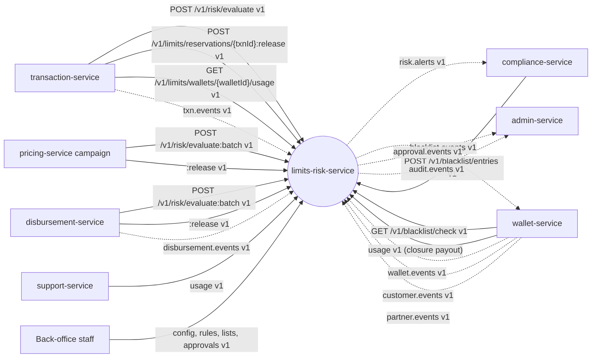

Solid edges are synchronous calls into this service; dotted edges are Kafka topics. The diagram shows neighbours only; the provided artefacts themselves never name their consumers.

### 3.2 Component diagram

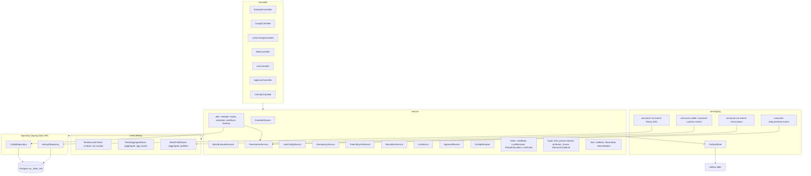

### 3.3 Runtime and deployment (Compose)

| Item | Value |
|---|---|
| Compose service | `limits-risk-service`, ports 8105 / 9105, `mem_limit` 384 MB |
| Spring profiles in Compose | `dev,api,worker` (both roles in one container locally) |
| Roles | `api`: `/v1/*` endpoints. `worker`: Kafka consumers, sweeper, expiry and activation jobs, history writer, simulations. Production runs one Deployment per role; leader-only jobs use `pg_try_advisory_lock` |
| Infra `depends_on` | postgres, kafka-init, redis-critical |
| Database | `bitspay`, schema `svc_limits_risk`, role `svc_limits_risk`; Flyway `spring.flyway.schemas=svc_limits_risk`, `create-schemas=false` in the stack (Testcontainers: `true` with a superuser) |
| Redis | **critical** connection (`BITSPAY_REDIS_CRITICAL_URL`): limit counters, reservations, index, pending sets, watermark, pub/sub channel `risk:config`. **aggregate** logical connection (`bitspay.risk.redis.aggregate.url`, env `BITSPAY_RISK_REDIS_AGGREGATE_URL`): fraud aggregates and wallet profiles; defaults to the critical URL. This service does not use the cache cluster |
| Other env vars beyond kernel K8.3 | `BITSPAY_RISK_REDIS_AGGREGATE_URL` (optional) · `BITSPAY_RISK_LIMITS_REDIS_MODE` (`SINGLE_SLOT`) · `BITSPAY_PLATFORM_HMAC_KEY` (kernel K2, never in Git) |
| Readiness | `api`: config books loaded + Redis critical reachable (Postgres deliberately excluded so the ALLOW path survives a Postgres outage). `worker`: Postgres + Kafka + Redis. Never waits for another service |

Consumer groups (all in the `worker` role):

| Group id | Topic | eventTypes handled |
|---|---|---|
| `limits-risk-service.reservations` | `txn.events` | COMPLETED, FAILED (REVERSED / REFUNDED only with `restore-on-reversal`); every record advances the watermark |
| `limits-risk-service.history` (R2, `bitspay.risk.history.enabled`) | `txn.events` | all four |
| `limits-risk-service.wallet-events` | `wallet.events` | WALLET_UPSERTED |
| `limits-risk-service.customer-events` | `customer.events` | CUSTOMER_REGISTERED, KYC_APPROVED, RISK_GRADE_CHANGED, CUSTOMER_PROFILE_UPDATED |
| `limits-risk-service.partner-events` | `partner.events` | PARTNER_UPSERTED (OPEN D-29) |
| `limits-risk-service.disbursement-events` | `disbursement.events` | BATCH_ROW_FAILED |

Group ids follow kernel K4.3 (OPEN D-30).

Scheduled jobs (worker; leader-only unless stated):

| Job | Interval | Effect |
|---|---|---|
| Reservation sweeper | 30 s | Guarded expiry of single-transaction reservations (BR-05-19) |
| List expiry | 1 min | ACTIVE list entries past `expires_at` → EXPIRED; BLACK entries publish `active: false` |
| Override / rule expiry | 1 min | `limit_rule` rows past `effective_to` → EXPIRED; bump `config_version` |
| Emergency controls | 1 min | ACTIVE past `effective_to` → EXPIRED; overdue post-facto review → PENDING_REVIEW + alert log |
| Rule activation | 1 min | SCHEDULED rule versions whose `effective_from` is reached → ACTIVE |
| Approval expiry | 5 min | PENDING approvals past `expires_at` → EXPIRED + `APPROVAL_EXPIRED` |
| Partition maintenance | daily | `risk_decision` monthly partitions 3 months ahead; `txn_history` daily partitions, drop > 90 days (R2) |
| Outbox / inbox cleanup | hourly | Kernel K8.2 (outbox > 3 days, `processed_event` > 14 days) |
| Config poll | 1 s, every pod | Reload books when `config_version` changed (fallback to pub/sub) |

### 3.4 Key flows

**F1 — Evaluate, ALLOW path (SINGLE_SLOT mode)**

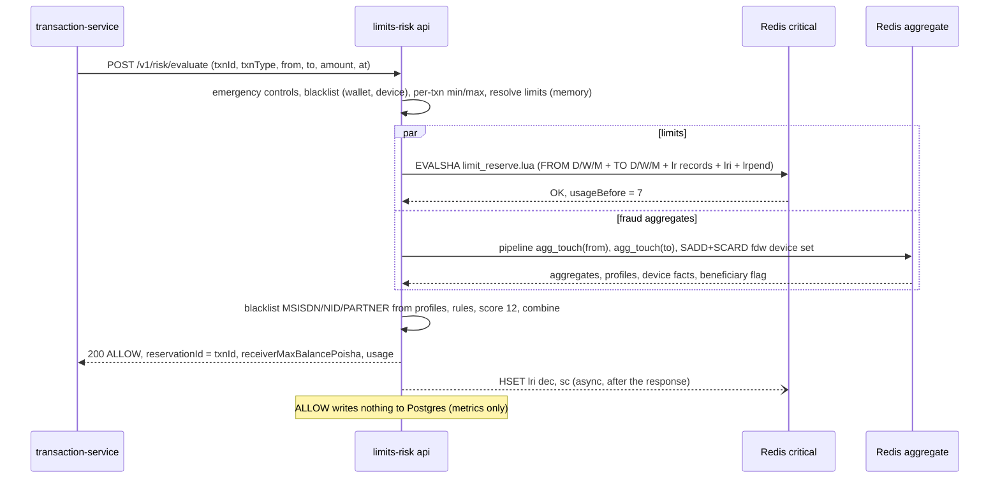

**F2 — Evaluate, fraud HOLD (compensation and alert)**

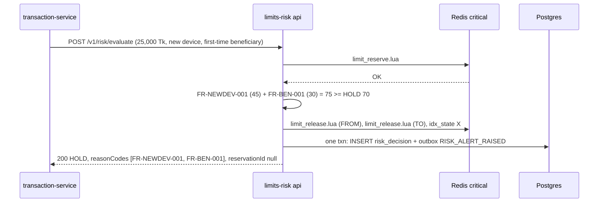

**F3 — Evaluate, unknown outcome / dependency failure**

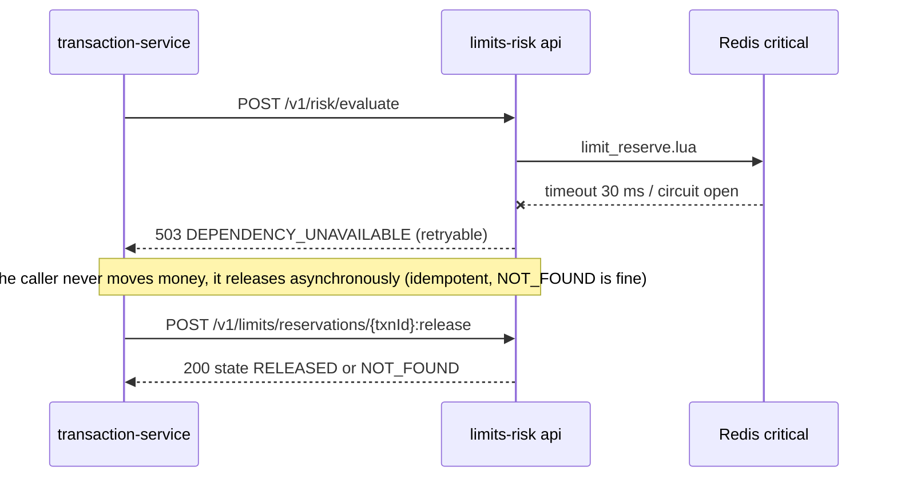

**F4 — Release on failure, commit on completion, re-apply after expiry**

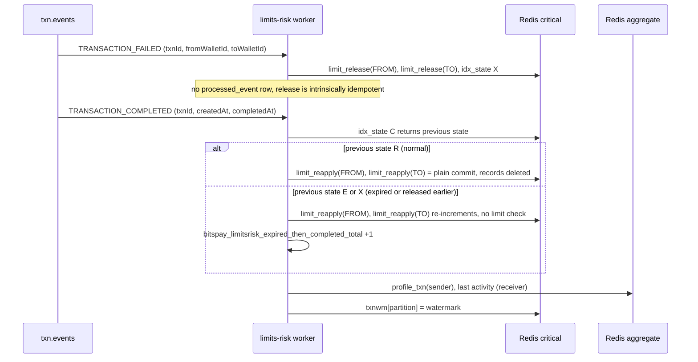

**F5 — Orphan sweeper (guarded expiry)**

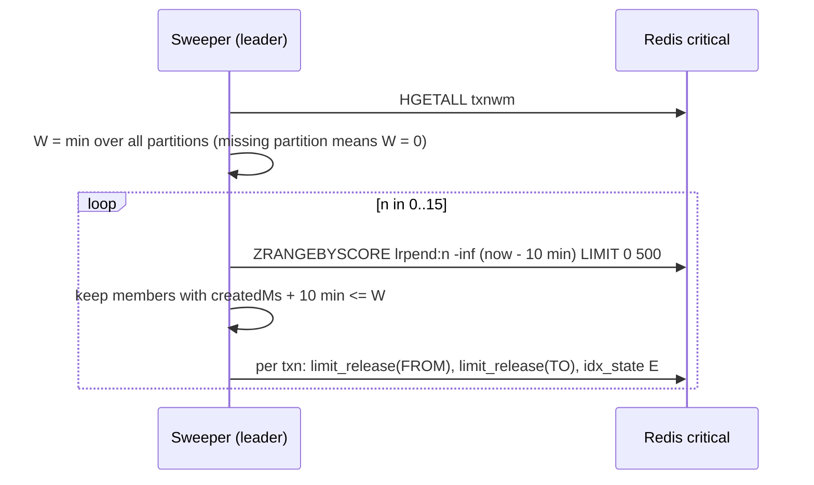

**F6 — Batch evaluate and event-driven release**

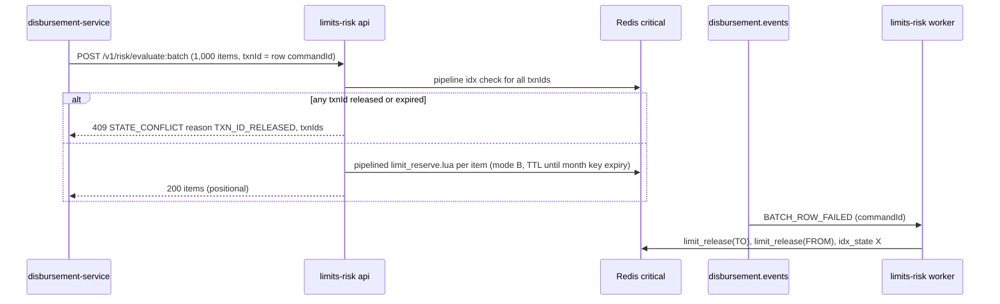

**F7 — Blacklist proposal and approval**

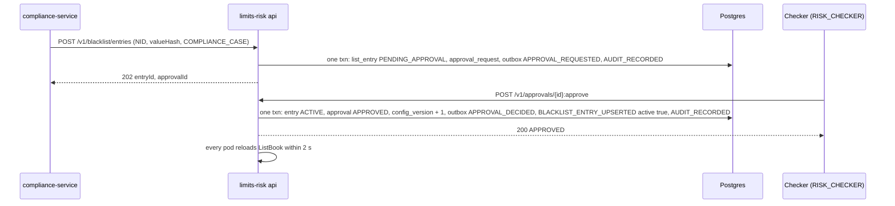

### 3.5 State machines

**Reservation (per `txnId`, Redis `lri.s`)**

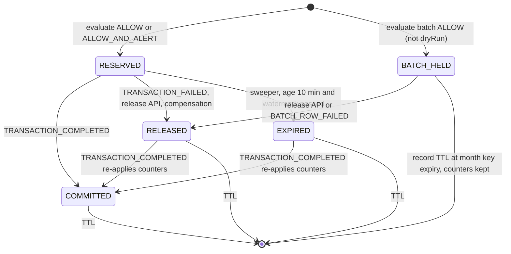

Index codes: `R` RESERVED, `B` BATCH_HELD, `C` COMMITTED, `X` RELEASED, `E` EXPIRED. `C` is final.

**Emergency control**

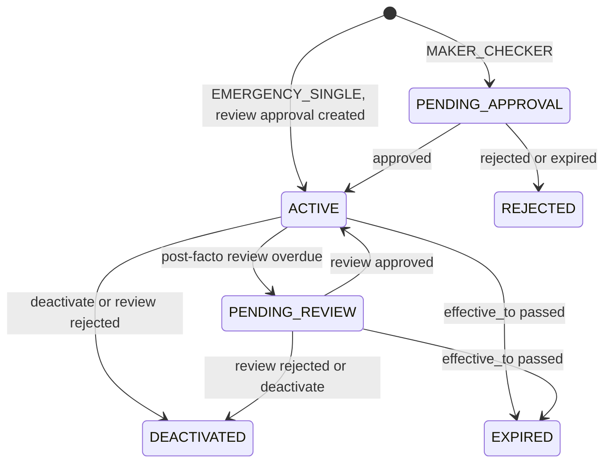

**List entry (black and white)**

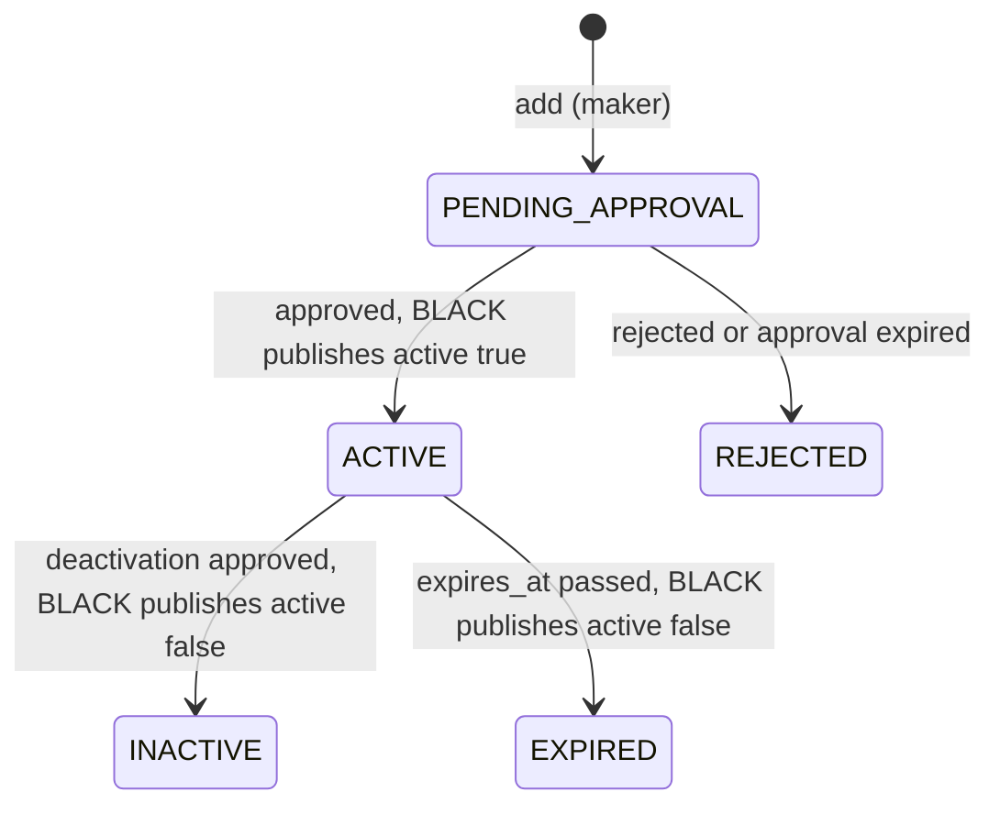

**Fraud rule version**

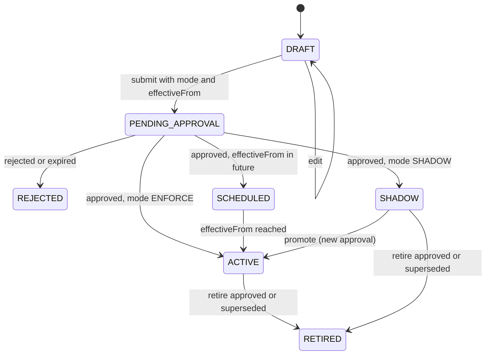

**Approval request (kernel K5)**

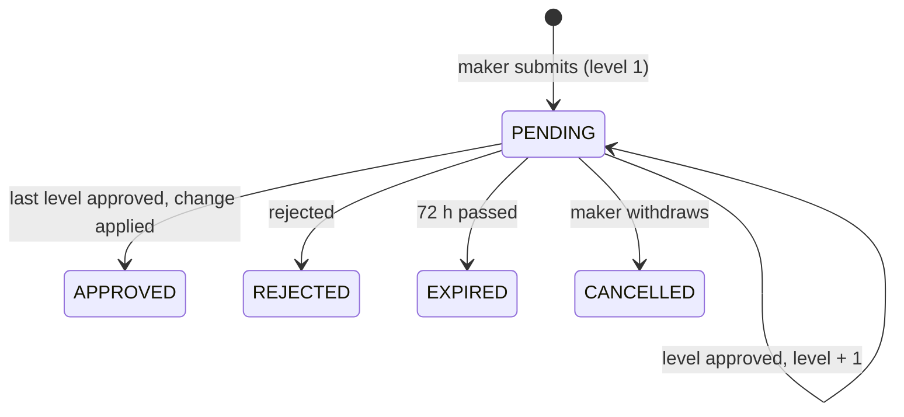

### 3.6 Architecture decisions

| ADR | Decision | Why | Consequence |
|---|---|---|---|
| ADR-01 Two Redis topologies, one script | `bitspay.risk.limits.redis-mode`: `SINGLE_SLOT` (default; one primary with replicas and Sentinel, not a cluster) runs one `limit_reserve.lua` for both parties + index + pending set, fully atomic, one round trip. `PER_PARTY` (Redis Cluster) runs the same script once per party (keys hash-tagged `{walletId}`), pipelined, plus `idx_open.lua`; if one party rejects, the other party's reservation is released immediately | Atomic check-and-increment on one primary, with a scale-out path that needs config only | Overshoot is impossible in both modes (each party's check-and-increment is atomic). In PER_PARTY a concurrent transaction may be rejected conservatively for under a millisecond. Start-up fails fast if `SINGLE_SLOT` is configured against a cluster. Both modes run in the concurrency suite |
| ADR-02 Counters always maintained | For each party, D/W/M count and amount are incremented for the txnType and `ALL` (plus referenced scope groups and ANY scopes) whether or not a rule exists | Usage, `senderMonthlyCountForTxnType` (free allowances) and new rules work immediately | A new scope group starts counting from activation (shown in the rule UI) |
| ADR-03 Reservation lifecycle via events, guarded expiry, re-apply | Single-transaction reservations are committed by `TRANSACTION_COMPLETED`, released by `TRANSACTION_FAILED` or the release API. Orphans expire after 10 min **only if** the `txn.events` watermark has passed `createdAt + 10 min`. A COMPLETED for an expired or released reservation re-applies its counters (OPEN D-15). Batch reservations never auto-expire; their records live until the monthly counter key expires (OPEN D-14) | A Kafka or consumer outage can never release counters of completed transactions; a ledger outage > 10 min cannot make completed money disappear from limits and caps | Released records are kept (marked) until TTL so they can be re-applied |
| ADR-04 Fraud aggregates count attempts | `agg_touch.lua` reads-then-increments velocity buckets at evaluate time for every evaluated transaction (attempt velocity, incl. later-declined ones). Facts that must reflect completed activity (beneficiary set, EWMA amount, last activity) come from `TRANSACTION_COMPLETED` | Velocity rules must see bursts of attempts | Completed-only analytics belong to the alert consumer |
| ADR-05 Trust the request's party snapshot | `walletType`, `kycTier`, `categoryCode`, `flags` come from the caller's authoritative wallet-status read. Risk grade is resolved locally (RiskGradeBook) | No synchronous wallet call on the hot path | Profile facts lag `wallet.events` by seconds |
| ADR-06 Decision log only for non-ALLOW | ALLOW decisions produce metrics only (they are visible in `txn.events.riskDecision`); every other decision is persisted synchronously before responding | Hot-path budget; FRD-011 needs every non-ALLOW decision | `GET /v1/risk/decisions` lists non-ALLOW only |
| ADR-07 Intrinsic idempotency on `txn.events` reservations | The `limits-risk-service.reservations` consumer writes **no** `processed_event` rows for COMPLETED / FAILED: release marks its record released, commit deletes, re-apply deletes, SADD, max-of timestamps, EWMA guarded by last-applied `txnId` (kernel K4.3 allows a stated intrinsic effect). REVERSED / REFUNDED (only with restore) and every other consumer use `processed_event`. The R2 history writer uses `INSERT … ON CONFLICT DO NOTHING` on `(occurred_at, txn_id, event_type)` | 5k TPS of `txn.events` without inbox writes | Each effect must stay idempotent; tested by double delivery |
| ADR-08 Config as compiled books | All configuration lives in Postgres and is compiled into immutable in-memory snapshots swapped atomically. Every state change bumps `config_version` in the same DB transaction and publishes Redis pub/sub `risk:config`; pods reload on the message or on a 1 s poll | Evaluate reads no DB | Change effective on all pods ≤ 2 s (emergency controls included) |

### 3.7 Latency and throughput budget (`POST /v1/risk/evaluate`, p95)

| Step | Budget |
|---|---|
| Deserialize, validate, ActorContext | 1 ms |
| Emergency controls, blacklist WALLET and DEVICE (memory), per-txn min/max, limit resolution (memory) | 1 ms |
| **Parallel**: (a) `limit_reserve.lua` on Redis critical (1 round trip) ‖ (b) fraud pipeline: `agg_touch.lua` ×2 + `SADD/SCARD` device set (1 round trip) | 5 ms (limits part ≤ 10 ms p95 incl. resolution) |
| Rule evaluation (≤ 100 compiled ENFORCE + 50 SHADOW rules), score, combine | 1 ms |
| Non-ALLOW only: compensating release (1 round trip) + synchronous insert `risk_decision` + `outbox` (1 Postgres transaction) | ≤ 15 ms (rare path) |
| Serialize | < 1 ms |
| **Total ALLOW path** | ≈ 8 ms typical, ≤ 50 ms p95 SLO, p99 ≤ 80 ms |

Virtual threads; Lettuce async API with `CompletableFuture.allOf` for the parallel step; Redis command timeout 30 ms (critical and aggregate). The caller's read timeout is 150 ms with no retry.

## 4. Data model

### 4.1 Tables

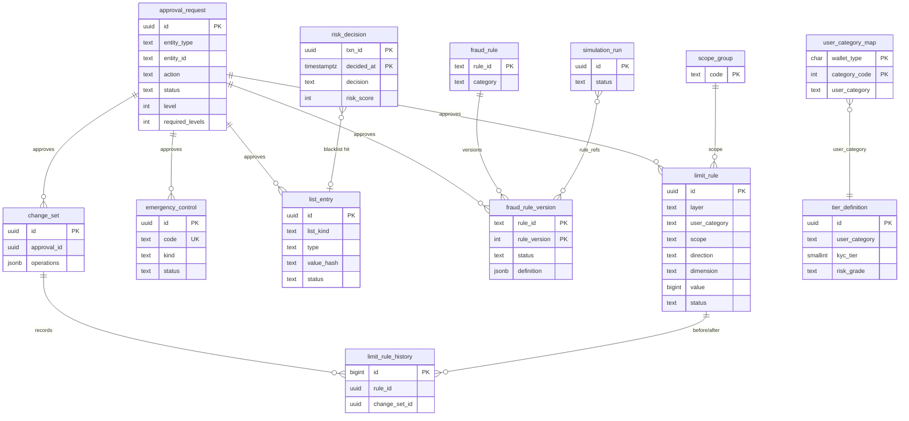

Flyway `V1__init.sql` (lands in `svc_limits_risk` via `search_path`):

```sql
-- ===== kernel K8.2: outbox / inbox =====
CREATE TABLE IF NOT EXISTS outbox (
  id             uuid PRIMARY KEY,                    -- = envelope eventId (UUIDv7)
  aggregate_type text        NOT NULL,                -- = Kafka topic
  aggregate_id   text        NOT NULL,                -- = Kafka key = envelope aggregateId
  event_type     text        NOT NULL,
  payload        jsonb       NULL,                    -- full envelope; never NULL on this service's topics
  created_at     timestamptz NOT NULL DEFAULT now(),
  published_at   timestamptz
);
CREATE INDEX IF NOT EXISTS outbox_unpublished ON outbox (created_at) WHERE published_at IS NULL;

CREATE TABLE IF NOT EXISTS processed_event (
  event_id     uuid PRIMARY KEY,
  topic        text NOT NULL,
  processed_at timestamptz NOT NULL DEFAULT now()
);

-- ===== optional Idempotency-Key store (kernel K3.3; retention >= 7 days, OPEN D-01) =====
CREATE TABLE idempotency_record (
  actor_id        text        NOT NULL,
  idem_key        text        NOT NULL,
  operation       text        NOT NULL,              -- e.g. POST /v1/blacklist/entries
  request_sha256  text        NOT NULL,
  response_status int         NOT NULL,
  response_body   jsonb       NOT NULL,
  created_at      timestamptz NOT NULL DEFAULT now(),
  PRIMARY KEY (actor_id, idem_key));
CREATE INDEX idempotency_record_age ON idempotency_record (created_at);

-- ===== maker-checker (kernel K5) =====
CREATE TABLE approval_request (
  id               uuid PRIMARY KEY,
  entity_type      text NOT NULL CHECK (entity_type IN ('LimitChangeSet','EmergencyControl','FraudRuleVersion','RiskSettings','ListEntry','SelfLimit')),
  entity_id        text NOT NULL,
  action           text NOT NULL CHECK (action IN ('APPLY','ACTIVATE','DEACTIVATE','RETIRE','ADD','REMOVE','POST_FACTO_REVIEW')),
  payload          jsonb NOT NULL,                    -- proposed change; hashes and masked values only
  maker_id         text NOT NULL,                     -- STAFF uuid or service name (compliance-service)
  maker_user_id    text,
  status           text NOT NULL CHECK (status IN ('PENDING','APPROVED','REJECTED','EXPIRED','CANCELLED')),
  level            int  NOT NULL DEFAULT 1,
  required_levels  int  NOT NULL DEFAULT 1,
  checker_roles    text[] NOT NULL,                   -- roles of the CURRENT level (approval.events checkerRoles)
  amount_poisha    bigint,                            -- always NULL here (no money-bearing approvals)
  summary          text NOT NULL CHECK (length(summary) <= 200),
  created_at       timestamptz NOT NULL DEFAULT now(),
  updated_at       timestamptz NOT NULL DEFAULT now(),
  expires_at       timestamptz NOT NULL,              -- created_at + 72 h
  decided_by       text[] NOT NULL DEFAULT '{}',
  decided_at       timestamptz,
  decision_comment text,
  version          bigint NOT NULL DEFAULT 0);
CREATE INDEX approval_pending ON approval_request (status, created_at) WHERE status = 'PENDING';

-- ===== config versioning =====
CREATE TABLE config_version (id int PRIMARY KEY CHECK (id = 1), version bigint NOT NULL, updated_at timestamptz NOT NULL DEFAULT now());
INSERT INTO config_version VALUES (1, 1, now());

-- ===== limits =====
CREATE TABLE user_category_map (               -- (walletType, categoryCode) -> user category (LIM-001)
  wallet_type   char(1) NOT NULL CHECK (wallet_type IN ('C','A','D','M','I')),
  category_code int     NOT NULL CHECK (category_code >= -1),  -- -1 = any; merchant hundred groups 3100..3400
  user_category text    NOT NULL,
  created_at timestamptz NOT NULL DEFAULT now(), updated_at timestamptz NOT NULL DEFAULT now(), version bigint NOT NULL DEFAULT 0,
  PRIMARY KEY (wallet_type, category_code));

CREATE TABLE tier_definition (
  id            uuid PRIMARY KEY,
  user_category text NOT NULL,
  kyc_tier      smallint CHECK (kyc_tier BETWEEN 0 AND 2),          -- null = any
  risk_grade    text CHECK (risk_grade IN ('LOW','MEDIUM','HIGH')), -- null = any
  name_en       text NOT NULL, name_bn text,
  description   text,
  provisional   boolean NOT NULL DEFAULT true,
  created_at timestamptz NOT NULL DEFAULT now(), updated_at timestamptz NOT NULL DEFAULT now(), version bigint NOT NULL DEFAULT 0,
  UNIQUE NULLS NOT DISTINCT (user_category, kyc_tier, risk_grade));

CREATE TABLE scope_group (
  code       text PRIMARY KEY,                    -- e.g. CICO
  txn_types  text[] NOT NULL,
  created_at timestamptz NOT NULL DEFAULT now(), updated_at timestamptz NOT NULL DEFAULT now(), version bigint NOT NULL DEFAULT 0);

CREATE TABLE change_set (
  id          uuid PRIMARY KEY,
  approval_id uuid NOT NULL REFERENCES approval_request(id),
  summary     text NOT NULL,
  operations  jsonb NOT NULL,
  diff        jsonb NOT NULL,
  maker_id    text NOT NULL,
  created_at  timestamptz NOT NULL DEFAULT now());

CREATE TABLE limit_rule (
  id             uuid PRIMARY KEY,
  layer          text NOT NULL CHECK (layer IN ('REGULATORY_CAP','TIER','PRODUCT_CHANNEL','OVERRIDE','SELF')),
  user_category  text,                        -- null only for OVERRIDE / SELF
  kyc_tier       smallint,
  risk_grade     text,
  channel        text,                        -- null = any channel
  wallet_id      uuid,                        -- OVERRIDE / SELF only
  scope          text NOT NULL,               -- txnType | scope group code | 'ALL'
  direction      text NOT NULL CHECK (direction IN ('SEND','RECEIVE','ANY')),
  dimension      text NOT NULL CHECK (dimension IN ('TXN_ALLOWED','PER_TXN_MIN','PER_TXN_MAX','DAILY_COUNT','DAILY_AMOUNT',
                                                    'WEEKLY_COUNT','WEEKLY_AMOUNT','MONTHLY_COUNT','MONTHLY_AMOUNT','MAX_BALANCE')),
  value          bigint NOT NULL CHECK (value >= 0 AND value <= 10000000000000), -- poisha for amounts / per-txn / MAX_BALANCE, count otherwise, 0/1 for TXN_ALLOWED
  status         text NOT NULL CHECK (status IN ('ACTIVE','INACTIVE','EXPIRED')),
  effective_from timestamptz NOT NULL,
  effective_to   timestamptz,                 -- overrides must have one (LIM-004)
  reason         text,
  approval_id    uuid REFERENCES approval_request(id),
  provisional    boolean NOT NULL DEFAULT false,
  created_by     text NOT NULL,
  created_at timestamptz NOT NULL DEFAULT now(), updated_at timestamptz NOT NULL DEFAULT now(), version bigint NOT NULL DEFAULT 0,
  CHECK (layer NOT IN ('OVERRIDE','SELF') OR wallet_id IS NOT NULL),
  CHECK (layer <> 'OVERRIDE' OR effective_to IS NOT NULL));
CREATE INDEX limit_rule_active ON limit_rule (layer, user_category, scope) WHERE status = 'ACTIVE';
CREATE INDEX limit_rule_wallet ON limit_rule (wallet_id) WHERE wallet_id IS NOT NULL AND status = 'ACTIVE';
CREATE UNIQUE INDEX limit_rule_uniq ON limit_rule
  (layer, coalesce(user_category,''), coalesce(kyc_tier,-1), coalesce(risk_grade,''), coalesce(channel,''),
   coalesce(wallet_id,'00000000-0000-0000-0000-000000000000'), scope, direction, dimension, effective_from) WHERE status = 'ACTIVE';

CREATE TABLE limit_rule_history (               -- LIM-008 before/after
  id bigserial PRIMARY KEY, rule_id uuid NOT NULL, change_set_id uuid NOT NULL,
  before jsonb, after jsonb, maker_id text NOT NULL, checker_id text, changed_at timestamptz NOT NULL DEFAULT now());

CREATE TABLE emergency_control (
  id             uuid PRIMARY KEY,
  code           text NOT NULL UNIQUE,         -- EC-000123
  kind           text NOT NULL CHECK (kind IN ('FREEZE','REDUCE')),
  txn_type       text, channel text, wallet_type char(1), user_category text, kyc_tier smallint,  -- null = any
  direction      text CHECK (direction IN ('SEND','RECEIVE','ANY')),
  reduce_bps     int CHECK (reduce_bps BETWEEN 0 AND 10000),   -- REDUCE: effective = floor(limit * reduce_bps / 10000)
  approval_mode  text NOT NULL CHECK (approval_mode IN ('MAKER_CHECKER','EMERGENCY_SINGLE')),
  status         text NOT NULL CHECK (status IN ('PENDING_APPROVAL','ACTIVE','PENDING_REVIEW','EXPIRED','DEACTIVATED','REJECTED')),
  effective_from timestamptz NOT NULL, effective_to timestamptz,
  reason         text NOT NULL,
  created_by     text NOT NULL, approved_by text, review_due_at timestamptz, approval_id uuid,
  created_at timestamptz NOT NULL DEFAULT now(), updated_at timestamptz NOT NULL DEFAULT now(), version bigint NOT NULL DEFAULT 0,
  CHECK (kind <> 'REDUCE' OR reduce_bps IS NOT NULL));
CREATE SEQUENCE emergency_control_code_seq;

CREATE TABLE wallet_risk_grade (                -- only grades != default; fed by customer.events / partner.events
  wallet_id   uuid PRIMARY KEY,
  owner_id    uuid,                             -- customerId or partnerId
  risk_grade  text NOT NULL CHECK (risk_grade IN ('LOW','MEDIUM','HIGH')),
  source      text NOT NULL CHECK (source IN ('CUSTOMER_EVENTS','PARTNER_EVENTS')),
  updated_at  timestamptz NOT NULL DEFAULT now());

CREATE TABLE partner_version (                  -- version guard for partner.events (also when walletId is null)
  partner_id  uuid PRIMARY KEY,
  version     bigint NOT NULL,
  wallet_id   uuid,
  updated_at  timestamptz NOT NULL DEFAULT now());

CREATE TABLE reversal_restore (                 -- restore-on-reversal bookkeeping (BR-05-36), default off
  txn_id                 uuid PRIMARY KEY,      -- the original transaction
  restored_amount_poisha bigint NOT NULL DEFAULT 0,
  count_restored         boolean NOT NULL DEFAULT false,
  updated_at             timestamptz NOT NULL DEFAULT now());

-- ===== fraud rules =====
CREATE TABLE fraud_rule (
  rule_id    text PRIMARY KEY CHECK (rule_id ~ '^FR-[A-Z]{2,6}-[0-9]{3}$'),
  name       text NOT NULL,
  category   text NOT NULL CHECK (category IN ('VELOCITY','PROFILE','DEVICE','BENEFICIARY','STRUCTURING','PASS_THROUGH',
                                               'DORMANT','MERCHANT','AGENT','GEO','AUTH','SIM','LIST')),
  template   boolean NOT NULL DEFAULT false,
  created_at timestamptz NOT NULL DEFAULT now(), updated_at timestamptz NOT NULL DEFAULT now(), version bigint NOT NULL DEFAULT 0);

CREATE TABLE fraud_rule_version (
  rule_id      text NOT NULL REFERENCES fraud_rule(rule_id),
  rule_version int  NOT NULL,
  status       text NOT NULL CHECK (status IN ('DRAFT','PENDING_APPROVAL','SCHEDULED','ACTIVE','SHADOW','RETIRED','REJECTED')),
  mode         text NOT NULL CHECK (mode IN ('ENFORCE','SHADOW')),
  definition   jsonb NOT NULL,                   -- full rule document (§7.6)
  definition_sha256 text NOT NULL,
  weight       int NOT NULL CHECK (weight BETWEEN 0 AND 1000),
  action       text CHECK (action IN ('ALERT','STEP_UP','HOLD','BLOCK')),
  effective_from timestamptz, effective_to timestamptz,
  created_by text NOT NULL, approved_by text, approval_id uuid, simulation_id uuid,
  created_at timestamptz NOT NULL DEFAULT now(), updated_at timestamptz NOT NULL DEFAULT now(), version bigint NOT NULL DEFAULT 0,
  PRIMARY KEY (rule_id, rule_version));
CREATE UNIQUE INDEX one_live_version ON fraud_rule_version (rule_id) WHERE status IN ('ACTIVE','SHADOW');

CREATE TABLE risk_settings (                     -- score thresholds etc., versioned
  settings_version int PRIMARY KEY,
  status text NOT NULL CHECK (status IN ('PENDING_APPROVAL','ACTIVE','SUPERSEDED','REJECTED')),
  body jsonb NOT NULL, created_by text NOT NULL, approved_by text, approval_id uuid,
  created_at timestamptz NOT NULL DEFAULT now(), updated_at timestamptz NOT NULL DEFAULT now(), version bigint NOT NULL DEFAULT 0);
CREATE UNIQUE INDEX one_active_settings ON risk_settings ((true)) WHERE status = 'ACTIVE';

-- ===== black / white lists =====
CREATE TABLE list_entry (
  id           uuid PRIMARY KEY,
  list_kind    text NOT NULL CHECK (list_kind IN ('BLACK','WHITE')),
  type         text NOT NULL CHECK (type IN ('NID','MSISDN','DEVICE','WALLET','BANK_ACCOUNT','IP','PARTNER')),
  value_hash   text NOT NULL CHECK (value_hash ~ '^[0-9a-f]{64}$'),  -- kernel K2 HMAC over the normalised value
  value_masked text,                              -- e.g. 8801711****00, ******1234; NULL when added by hash without a mask
  reason_code  text NOT NULL,                     -- BLACK: Blacklist entry group (OPEN D-32); WHITE: free ^[A-Z_]{3,40}$
  comment      text,
  status       text NOT NULL CHECK (status IN ('PENDING_APPROVAL','ACTIVE','INACTIVE','EXPIRED','REJECTED')),
  expires_at   timestamptz,
  source       text NOT NULL DEFAULT 'MANUAL' CHECK (source IN ('MANUAL','COMPLIANCE_CASE','BULK')),
  reference    text CHECK (length(reference) <= 64),
  bulk_id      uuid,
  created_by text NOT NULL, approved_by text, approval_id uuid,
  created_at timestamptz NOT NULL DEFAULT now(), updated_at timestamptz NOT NULL DEFAULT now(), version bigint NOT NULL DEFAULT 0,
  CHECK (list_kind <> 'WHITE' OR (type IN ('WALLET','DEVICE','MSISDN') AND expires_at IS NOT NULL)));
CREATE UNIQUE INDEX list_entry_live ON list_entry (list_kind, type, value_hash) WHERE status IN ('ACTIVE','PENDING_APPROVAL');
CREATE INDEX list_entry_expiry ON list_entry (expires_at) WHERE status = 'ACTIVE' AND expires_at IS NOT NULL;

-- ===== decisions (non-ALLOW only), monthly partitions =====
CREATE TABLE risk_decision (
  txn_id         uuid NOT NULL,
  decided_at     timestamptz NOT NULL,
  txn_type       text NOT NULL, channel text NOT NULL, amount_poisha bigint NOT NULL,
  from_wallet_id uuid NOT NULL, to_wallet_id uuid, device_id text,
  batch          boolean NOT NULL DEFAULT false,
  decision       text NOT NULL, risk_score int NOT NULL,
  reason_codes   text[] NOT NULL,
  matched_rules  jsonb NOT NULL,          -- [{ruleId, ruleVersion, weight, action, mode}] incl. SHADOW hits
  blacklist_hits jsonb NOT NULL DEFAULT '[]',   -- [{type, party, entryId}]
  violated_limit jsonb,
  alert_id       uuid,
  config_version bigint NOT NULL,
  PRIMARY KEY (decided_at, txn_id)) PARTITION BY RANGE (decided_at);
CREATE INDEX risk_decision_wallet ON risk_decision (from_wallet_id, decided_at DESC);
CREATE INDEX risk_decision_txn ON risk_decision (txn_id);
-- partitions created by the daily maintenance job 3 months ahead; 24 months online

-- ===== R2: history for back-testing (90 days, daily partitions) =====
CREATE TABLE txn_history (
  txn_id uuid NOT NULL, event_type text NOT NULL, occurred_at timestamptz NOT NULL,
  txn_type text NOT NULL, channel text, status text NOT NULL,
  from_wallet_id uuid NOT NULL, from_wallet_type char(1), to_wallet_id uuid, to_wallet_type char(1),
  amount_poisha bigint NOT NULL, device_id text, risk_decision text, risk_score int,
  PRIMARY KEY (occurred_at, txn_id, event_type)) PARTITION BY RANGE (occurred_at);

CREATE TABLE simulation_run (
  id uuid PRIMARY KEY, requested_by text NOT NULL,
  rule_refs jsonb NOT NULL,              -- [{ruleId, ruleVersion}] or inline drafts
  from_ts timestamptz NOT NULL, to_ts timestamptz NOT NULL,
  status text NOT NULL CHECK (status IN ('QUEUED','RUNNING','COMPLETED','FAILED')),
  result jsonb, started_at timestamptz, finished_at timestamptz,
  created_at timestamptz NOT NULL DEFAULT now(), updated_at timestamptz NOT NULL DEFAULT now(), version bigint NOT NULL DEFAULT 0);
CREATE UNIQUE INDEX one_running_simulation ON simulation_run (requested_by) WHERE status IN ('QUEUED','RUNNING');
```

`V2__seed_provisional.sql` loads the §7.11 seeds (all rows `provisional = true`): the user-category map, tier definitions, limit rules, scope group `CICO = {CASH_IN, CASH_OUT}`, risk settings v1 (ACTIVE) and the 20 rule templates (§7.8) as v1 (ACTIVE, or SHADOW for FR-GEO-001, FR-AUTH-001, FR-SIM-001).

### 4.2 Redis keys

All amounts are integers (poisha). `{…}` = Redis Cluster hash tag. Period ids are computed in Java in **Asia/Dhaka**.

| Store | Key | Type | Content | TTL / expiry |
|---|---|---|---|---|
| critical | `lc:{<walletId>}:D:<yyyyMMdd>` | hash | fields `<scope>:<dir>:c` (count) and `<scope>:<dir>:a` (amount); `scope` = txnType \| group \| `*`; `dir` = `S` send \| `R` receive \| `X` any | EXPIREAT end of day + 2 d |
| critical | `lc:{<walletId>}:W:<yyyyMMdd of week start>` | hash | same fields | EXPIREAT end of week + 2 d |
| critical | `lc:{<walletId>}:M:<yyyyMM>` | hash | same fields | EXPIREAT end of month + 2 d |
| critical | `lr:{<walletId>}:<txnId>` | hash | reservation record per party: `txn, w, amt, d, wk, m, f` (comma list of fields), `c` (created ms), `mode` (`S` single \| `B` batch), `rel` (`1` once released or expired; record kept for re-apply) | single: 48 h; batch: EXPIREAT of the party's monthly counter key (end of month + 2 d) (OPEN D-14) |
| critical | `lri:<txnId>` | hash | index: `f` fromWalletId, `t` toWalletId, `s` state (`R`, `B`, `C`, `X`, `E`), `c` created ms, `dec` first decision (`A` ALLOW \| `W` ALLOW_AND_ALERT), `sc` first risk score | single: 48 h; batch: EXPIREAT end of month + 2 d of the evaluation month |
| critical | `lrpend:<n>` (n = murmur3(txnId) mod 16) | zset | member txnId, score created ms (single-transaction reservations awaiting an outcome) | none (members removed) |
| critical | `txnwm` | hash | field `<partition>` → ms watermark of processed `txn.events` | none |
| critical | channel `risk:config` | pub/sub | config version bump | — |
| aggregate | `fa:{<walletId>}` | hash | velocity buckets `<res>:<bucket>:<dir>:<c\|a>[:<txnType>]`, res ∈ `m1` (1 min), `m5`, `h1`, `d1`; `_lp` last full prune minute | 31 d sliding |
| aggregate | `fwd:{<walletId>}` | hash | `dev:<deviceId>` → first seen ms; `last` → deviceId; `lastChg` → ms; `glat`, `glon` (micro-degrees, int) and `gts` (ms) of the last `context.geo` | 180 d sliding |
| aggregate | `fpr:{<walletId>}:<otherWalletId>` | hash | pair facts `<txnType>:<dir>:at` (ms), `<txnType>:<dir>:amt`, `n:<yyyyMMdd>` count | 7 d sliding |
| aggregate | `fb:{<walletId>}` | set | known beneficiaries (walletIds completed-paid by this wallet) | 180 d sliding; SCARD cap 5,000 (overflow → treated as known) |
| aggregate | `fp:{<walletId>}` | hash | profile: `v` (wallet.events version), `wt, kt, cat, st, own` (ownerType), `mh` (MSISDN hash), `nh` (nidHash), `ph` (PARTNER hash = HMAC(partnerId)), `rg` (risk grade), `cr` (created ms), `ra` (reactivated ms), `la` (last completed activity ms), `ew` (EWMA send amount poisha), `sc` (completed send count), `lt` (last applied txnId) | none (rebuildable from the compacted topics) |
| aggregate | `fdw:{<deviceHash>}` | set | walletIds seen on the device (deviceHash = HMAC of deviceId, type DEVICE) | 30 d sliding |

`aggregate` is the logical connection `bitspay.risk.redis.aggregate.*`; it defaults to the critical server and can point to a separate cluster for scale. Losing it degrades fraud only (BR-05-35).

### 4.3 Retention and archival

| Data | Retention |
|---|---|
| `risk_decision` | 24 months online (SRS AML/fraud records); archival deferred |
| `txn_history` (R2) | 90 days (drop daily partitions) |
| `outbox` / `processed_event` | 3 days / 14 days (kernel K8.2) |
| `idempotency_record` | 7 days (kernel K3.3) |
| `approval_request`, `limit_rule_history`, `list_entry`, `emergency_control`, `fraud_rule_version` | 5 years (never deleted in this phase) |
| Redis reservation records | 48 h (single) / until the monthly counter key expires (batch) |

## 5. Provided contracts

This section mirrors `contracts/provided/`. The artefacts win on any conflict.

Common rules (service deltas to kernel K3):
- Headers per kernel K3.1 through `ActorContext`; authorisation via `@RequiresActor`. Missing or ill-formed header → `400 VALIDATION_FAILED`; actor, role or caller not allowed → `403 ACTOR_NOT_ALLOWED`.
- **No operation moves money.** `Idempotency-Key` is never required.
  - Evaluate and release are idempotent per `txnId`; batch per item `txnId`.
  - Staff POSTs that create proposals accept an **optional** `Idempotency-Key` (kernel K3.3 semantics, retained 7 days, OPEN D-01) where the operation says so.
- Every state-changing operation writes `audit.events` in the same DB transaction (kernel K6). Evaluate, evaluate:batch and the event-driven releases are **not** audited per call: their trail is `risk_decision` + `risk.alerts` for non-ALLOW decisions. STAFF releases are audited.
- Pagination per kernel K3.4 (`limit` 1..200, default 50; `INVALID_CURSOR`).
- Unknown request fields are ignored on evaluate and evaluate:batch (forward compatibility); every other operation also ignores them.

### 5.1 REST operations

| Operation | Audience | Actors & roles | Idempotency | Purpose |
|---|---|---|---|---|
| `POST /v1/risk/evaluate` | service | SERVICE `transaction-service` | per `txnId` | Decision + reservation for one payment |
| `POST /v1/risk/evaluate:batch` | service | SERVICE `disbursement-service`, `pricing-service` (campaign module); STAFF `RISK_ANALYST`, `OPS_MAKER`, `OPS_CHECKER` | per item `txnId` | Bulk credits, limits + blacklist only |
| `POST /v1/limits/reservations/{txnId}:release` | service | SERVICE `transaction-service`, `disbursement-service`, `pricing-service`; SYSTEM; STAFF `OPS_MAKER`, `OPS_CHECKER`, `RISK_ANALYST` | intrinsic | Release a reservation |
| `GET /v1/limits/wallets/{walletId}/usage` | customer | wallet holder (CUSTOMER, AGENT, MERCHANT, DISTRIBUTOR, INSTITUTION) for own wallet; STAFF any role; SERVICE `transaction-service`, `support-service`, `wallet-service` | read-only | Headroom per txnType |
| `GET /v1/blacklist/check` | service | SERVICE `wallet-service`; STAFF any role | read-only | Is a value listed |
| `POST /v1/blacklist/entries` | staff | SERVICE `compliance-service`; STAFF `RISK_ANALYST`, `COMPLIANCE_OFFICER`, `PARTNER_OPS_MAKER` | optional key | Propose a blacklist entry |
| `POST /v1/blacklist/entries:bulk` | staff | STAFF `RISK_ANALYST`, `COMPLIANCE_OFFICER`, `PARTNER_OPS_MAKER` | optional key | CSV bulk proposal |
| `GET /v1/blacklist/entries` | staff | STAFF any | read-only | List (masked) |
| `POST /v1/blacklist/entries/{id}:deactivate` | staff | STAFF `RISK_ANALYST`, `COMPLIANCE_OFFICER`, `PARTNER_OPS_MAKER` | state-guarded | Deactivate → approval |
| `POST /v1/whitelist/entries` | staff | STAFF `RISK_ANALYST` | optional key | Whitelist proposal |
| `GET /v1/whitelist/entries` | staff | STAFF any | read-only | List |
| `POST /v1/whitelist/entries/{id}:deactivate` | staff | STAFF `RISK_ANALYST` | state-guarded | Deactivate → approval |
| `GET /v1/limits/categories` | staff | STAFF any | read-only | User-category map |
| `GET /v1/limits/tiers` | staff | STAFF any | read-only | Tier definitions |
| `GET /v1/limits/rules` | staff | STAFF any | read-only | Limit rules |
| `POST /v1/limits/change-sets` | staff | STAFF `RISK_ANALYST`, `COMPLIANCE_OFFICER` | optional key | Atomic config change → approval |
| `GET /v1/limits/change-sets/{id}` | staff | STAFF any | read-only | Change set + diff |
| `GET /v1/limits/effective` | staff | STAFF any | read-only | Explain effective limits |
| `POST /v1/limits/overrides` | staff | STAFF `RISK_ANALYST`, `COMPLIANCE_OFFICER`, `OPS_MAKER` | optional key | Individual override → approval |
| `GET /v1/limits/overrides` | staff | STAFF any | read-only | Overrides |
| `POST /v1/limits/overrides/{id}:deactivate` | staff | STAFF `RISK_ANALYST`, `COMPLIANCE_OFFICER`, `OPS_MAKER` | state-guarded | Deactivate → approval |
| `POST /v1/limits/emergency-controls` | staff | STAFF `RISK_ANALYST`, `OPS_MAKER` (MAKER_CHECKER); `RISK_CHECKER`, `CAMLCO`, `ADMIN` (EMERGENCY_SINGLE) | optional key | Freeze / reduce |
| `GET /v1/limits/emergency-controls` | staff | STAFF any | read-only | Controls |
| `POST /v1/limits/emergency-controls/{id}:deactivate` | staff | STAFF `RISK_CHECKER`, `CAMLCO`, `ADMIN` | state-guarded | Immediate lift |
| `PUT /v1/limits/wallets/{walletId}/self-limits` | customer | CUSTOMER own wallet (R2 flag) | idempotent PUT | Self-set lower caps |
| `GET /v1/limits/wallets/{walletId}/self-limits` | customer | CUSTOMER own wallet; STAFF any | read-only | Self-limits |
| `GET /v1/risk/rules` | staff | STAFF any | read-only | Rules + live version |
| `GET /v1/risk/rules/{ruleId}/versions` | staff | STAFF any | read-only | Version history |
| `GET /v1/risk/rules/{ruleId}/versions/{v}` | staff | STAFF any | read-only | One version |
| `POST /v1/risk/rules` | staff | STAFF `RISK_ANALYST` | ruleId unique | New rule / from template |
| `POST /v1/risk/rules/{ruleId}/versions` | staff | STAFF `RISK_ANALYST` | none | New DRAFT |
| `PUT /v1/risk/rules/{ruleId}/versions/{v}` | staff | STAFF `RISK_ANALYST` | `If-Match` | Edit DRAFT |
| `POST /v1/risk/rules:validate` | staff | STAFF `RISK_ANALYST`, `RISK_CHECKER` | read-only | Compile DSL |
| `POST /v1/risk/rules/{ruleId}/versions/{v}:submit` | staff | STAFF `RISK_ANALYST` | state-guarded | Submit → approval |
| `POST /v1/risk/rules/{ruleId}:retire` | staff | STAFF `RISK_ANALYST` | state-guarded | Retire → approval |
| `GET /v1/risk/settings` | staff | STAFF any | read-only | Active settings |
| `POST /v1/risk/settings` | staff | STAFF `RISK_ANALYST` | optional key | New settings → approval |
| `POST /v1/risk/simulations` | staff | STAFF `RISK_ANALYST` (R2) | none | Back-test |
| `GET /v1/risk/simulations/{id}` | staff | STAFF `RISK_ANALYST`, `RISK_CHECKER` | read-only | Result |
| `GET /v1/risk/decisions` | staff | STAFF `RISK_ANALYST`, `RISK_CHECKER`, `COMPLIANCE_OFFICER`, `CAMLCO`, `AUDITOR` | read-only | Non-ALLOW log |
| `GET /v1/risk/decisions/{txnId}` | staff | same | read-only | One decision |
| `GET /v1/approvals` | staff | STAFF any | read-only | Approval inbox (kernel K5) |
| `POST /v1/approvals/{id}:approve` | staff | STAFF in the current level's `checkerRoles` (`RISK_CHECKER`, `CAMLCO`, `OPS_CHECKER`, `ADMIN`) | state-guarded | Approve |
| `POST /v1/approvals/{id}:reject` | staff | same | state-guarded | Reject |
| `POST /v1/internal/config:reload` | internal | SYSTEM; STAFF `ADMIN` | idempotent | Force reload |
| `GET /v1/internal/reservations/{txnId}` | internal | STAFF `RISK_ANALYST`, `OPS_MAKER`, `OPS_CHECKER` | read-only | Reservation view |

#### 5.1.1 `POST /v1/risk/evaluate`

- **Actors:** SERVICE `transaction-service` (`X-Actor-Id: transaction-service`, original `X-Channel`, propagated `X-Correlation-Id`). The device travels only in the body (`deviceId`). Not exposed through any gateway.
- **Idempotency:** per `txnId`. Re-evaluating a `txnId` whose reservation is still held returns the same decision, `reservationId` and score, and counts nothing twice (BR-05-16).
- **Latency:** p95 ≤ 50 ms (limits ≤ 10 ms). Caller read timeout 150 ms, no retry.
- **Outcome:** HTTP 200 for every decision; the caller maps decisions to its own 422 codes.

Request (`EvaluateRequest`):

| Field | Type | Req | Null | Constraints / enum | Notes |
|---|---|---|---|---|---|
| txnId | uuid | Y | N | UUIDv7 | = reservation id = ledger `commandId`; never re-used |
| txnType | enum | Y | N | `P2P`, `CASH_IN`, `CASH_OUT`, `MERCHANT_PAYMENT`, `MERCHANT_REFUND`, `FLOAT_TRANSFER`, `REVERSAL` | `REVERSAL` is a no-counter type, reserved, never sent in R1 |
| channel | enum | Y | N | `APP`, `USSD`, `PARTNER_APP`, `PORTAL`, `BACKOFFICE`, `API`, `SYSTEM` | = caller's `X-Channel` |
| deviceId | string | N | Y | ≤ 128 | initiator device |
| amountPoisha | int64 (poisha) | Y | N | 1..10^13 | |
| from | object Party | Y | N | | direction SEND |
| to | object Party | Y | N | | direction RECEIVE |
| at | timestamp | N | Y | | default now; = transaction `createdAt` (UUIDv7 time of `txnId`). If \|at − now\| > 5 min the server time is used and `bitspay_limitsrisk_clock_skew_total` increments |
| context | object Context | N | Y | | edge signals; `null` until the edge layer exists |
| Party.walletId | uuid | Y | N | | |
| Party.walletType | enum | Y | N | `C`, `A`, `D`, `M`, `I` (names accepted) | `S` → `400 VALIDATION_FAILED`, reason `SYSTEM_PARTY_NOT_ALLOWED` |
| Party.kycTier | int32 | Y | N | 0..2 | |
| Party.categoryCode | int32 | Y | N | 0..99999 | 0 customers; 101–104 agents; 201–203 distributors; `3000 + d×100 + g` merchants; 401–404 institutions |
| Party.flags | int32 | Y | N | 0..31 | bitmask: 1 AML_WATCH, 2 PIN_RESET_COOLING, 4 PRE_REGISTERED, 8 HAS_OPEN_LIEN, 16 NEW_DEVICE_COOLING |
| Context.ipHash | string | N | Y | 64 lower-case hex (kernel K2, type IP) | |
| Context.geo | object {lat number, lon number, accuracyM int32} | N | Y | lat/lon degrees, ≤ 6 decimals; accuracyM ≥ 0 | the only non-money decimal; never used in money arithmetic |
| Context.simSerialHash | string | N | Y | 64 lower-case hex | |
| Context.simChangedAt | timestamp | N | Y | | |
| Context.authFailedCount15m | int32 | N | Y | ≥ 0 | |
| Context.appIntegrityOk | bool | N | Y | | |

```json
{ "txnId": "0192f3c1-7a2b-7c00-9a51-3f2c8e1d0a11", "txnType": "P2P", "channel": "APP", "deviceId": "d-123",
  "amountPoisha": 50000,
  "from": { "walletId": "0192f2aa-0000-7000-8000-00000000a001", "walletType": "C", "kycTier": 2, "categoryCode": 0, "flags": 0 },
  "to":   { "walletId": "0192f2bb-0000-7000-8000-00000000b002", "walletType": "C", "kycTier": 1, "categoryCode": 0, "flags": 0 },
  "at": "2026-10-09T08:03:22.000Z", "context": null }
```

Response 200 (`EvaluateResponse`):

| Field | Type | Req | Null | Constraints / enum | Notes |
|---|---|---|---|---|---|
| decision | enum | Y | N | `ALLOW`, `ALLOW_AND_ALERT`, `STEP_UP`, `HOLD`, `BLOCK`, `LIMIT_EXCEEDED`, `SERVICE_DISABLED` | precedence SERVICE_DISABLED > BLOCK > LIMIT_EXCEEDED > HOLD > STEP_UP > ALLOW_AND_ALERT > ALLOW |
| reasonCodes | array<string> | Y | N | vocabulary §5.3; ordered by precedence, rules by weight desc | `[]` for a plain ALLOW |
| riskScore | int32 | Y | N | 0..100 | |
| reservationId | uuid | Y | Y | = `txnId` for ALLOW / ALLOW_AND_ALERT, else null | ALLOW / ALLOW_AND_ALERT are never returned without a reservation |
| receiverMaxBalancePoisha | int64 (poisha) | Y | Y | effective MAX_BALANCE of `to`; null = none | callers pass it to the ledger as `constraints.destinationMaxBalancePoisha` |
| usage | object | Y | N | always present, never null | |
| usage.senderMonthlyCountForTxnType | int32 | Y | Y | ≥ 0 | sender's monthly count for this `txnType` **before** this transaction (excludes it, includes other outstanding reservations); null when no counter was read |
| violatedLimit | object ViolatedLimit | Y | Y | non-null iff `LIMIT_EXCEEDED` | |

`ViolatedLimit` (owned object, `codes.yaml → sharedObjects`):

| Field | Type | Req | Null | Constraints / enum | Notes |
|---|---|---|---|---|---|
| limitCode | string | Y | N | `<SCOPE>_<SEND\|RECEIVE\|ANY>_<DIMENSION>` | e.g. `P2P_RECEIVE_DAILY_AMOUNT`, `P2P_SEND_TXN_ALLOWED` |
| party | enum | Y | N | `FROM`, `TO` | |
| walletId | uuid | Y | N | | wallet of `party` |
| scope | string | Y | N | a txnType, a scope-group code (e.g. `CICO`) or `ALL` | |
| direction | enum | Y | N | `SEND`, `RECEIVE`, `ANY` | |
| dimension | enum | Y | N | `TXN_ALLOWED`, `PER_TXN_MIN`, `PER_TXN_MAX`, `DAILY_COUNT`, `DAILY_AMOUNT`, `WEEKLY_COUNT`, `WEEKLY_AMOUNT`, `MONTHLY_COUNT`, `MONTHLY_AMOUNT`, `MAX_BALANCE` | `MAX_BALANCE` is reserved (the ledger enforces max balance) |
| layer | enum | Y | N | `REGULATORY_CAP`, `TIER`, `PRODUCT_CHANNEL`, `OVERRIDE`, `SELF` | winning layer of the violated value |
| limitValue | int64 | Y | N | ≥ 0 | poisha for amount / per-txn / MAX_BALANCE, count for `*_COUNT`, `0` for `TXN_ALLOWED` |
| currentValue | int64 | Y | Y | ≥ 0 | same unit; null for per-txn / `TXN_ALLOWED` |
| attemptedValue | int64 | Y | N | ≥ 1 | amount (poisha) for amount and per-txn dimensions; `1` for count dimensions and `TXN_ALLOWED` |
| remainingValue | int64 | Y | Y | ≥ 0 | max(0, limit − current); null for per-txn / `TXN_ALLOWED` |
| resetsAt | timestamp | Y | Y | | next period start (Asia/Dhaka boundary, in UTC); null for per-txn / `TXN_ALLOWED` / MAX_BALANCE |

`*Value` fields are the documented exception to the `…Poisha` naming rule; their unit follows `dimension`.

```json
{ "decision": "ALLOW", "reasonCodes": [], "riskScore": 12, "reservationId": "0192f3c1-7a2b-7c00-9a51-3f2c8e1d0a11",
  "receiverMaxBalancePoisha": 10000000, "usage": { "senderMonthlyCountForTxnType": 7 }, "violatedLimit": null }
```

LIMIT_EXCEEDED (Karim, Tier 1, would exceed his daily P2P receive amount):

```json
{ "decision": "LIMIT_EXCEEDED", "reasonCodes": ["LIMIT:P2P_RECEIVE_DAILY_AMOUNT"], "riskScore": 0, "reservationId": null,
  "receiverMaxBalancePoisha": 10000000, "usage": { "senderMonthlyCountForTxnType": 7 },
  "violatedLimit": { "limitCode": "P2P_RECEIVE_DAILY_AMOUNT", "party": "TO", "walletId": "0192f2bb-0000-7000-8000-00000000b002",
    "scope": "P2P", "direction": "RECEIVE", "dimension": "DAILY_AMOUNT", "layer": "TIER",
    "limitValue": 5000000, "currentValue": 4980000, "attemptedValue": 50000, "remainingValue": 20000,
    "resetsAt": "2026-10-09T18:00:00.000Z" } }
```

BLOCK (blacklisted device): `{"decision":"BLOCK","reasonCodes":["BLACKLIST:DEVICE:FROM"],"riskScore":100,"reservationId":null,"receiverMaxBalancePoisha":null,"usage":{"senderMonthlyCountForTxnType":null},"violatedLimit":null}`. Fraud HOLD: `"reasonCodes": ["FR-NEWDEV-001","FR-BEN-001"], "riskScore": 75`. Emergency freeze: `"decision": "SERVICE_DISABLED", "reasonCodes": ["EMERGENCY:EC-000017"]`. The OpenAPI carries these as `x-additional-examples`.

Errors:

| HTTP | code | reason | extensions | when |
|---|---|---|---|---|
| 400 | `VALIDATION_FAILED` | — / `SYSTEM_PARTY_NOT_ALLOWED` | `errors[]` | schema, range, header; walletType `S` |
| 403 | `ACTOR_NOT_ALLOWED` | — | — | caller is not `transaction-service` |
| 409 | `STATE_CONFLICT` | `TXN_ID_RELEASED` | — | `txnId` already released or expired (a `txnId` is never re-used) |
| 503 | `DEPENDENCY_UNAVAILABLE` | — | `retryable: true` | counter store unavailable or timed out; aggregate store unavailable with `fraud.on-aggregate-unavailable = REFUSE`; config books not loaded |

#### 5.1.2 `POST /v1/risk/evaluate:batch`

- **Actors:** SERVICE `disbursement-service`, `pricing-service` (its campaign module); STAFF `RISK_ANALYST`, `OPS_MAKER`, `OPS_CHECKER`.
- **Checks:** emergency controls, blacklist (WALLET, DEVICE, MSISDN, NID and PARTNER of both parties, OPEN D-29) and limits. No fraud rules.
- **Reservations:** reserves unless `dryRun`. Batch reservations never auto-expire and are not touched by `txn.events` (OPEN D-14).
- **Size and latency:** ≤ 1,000 items; p95 ≤ 300 ms for 1,000.

Request (`BatchRequest`):

| Field | Type | Req | Null | Constraints / enum | Notes |
|---|---|---|---|---|---|
| dryRun | bool | N | N | default false | true = same evaluation, **nothing reserved and no record created**, every `reservationId` null; a dryRun item's `txnId` may later be used for the real reservation |
| items | array<BatchItem> | Y | N | 1..1000; unique `txnId` | |
| BatchItem | object | | | = `EvaluateRequest` fields (§5.1.1) | `txnType` additionally `DISBURSEMENT`, `CAMPAIGN_REWARD`; `txnId` **must** be the ledger `commandId` of the row / reward (stable across re-runs; a new attempt with a new `commandId` is a new `txnId`) |

- For `CAMPAIGN_REWARD` the `from` party is `{ "walletId": "00000000-0000-0000-0000-000000000240", "walletType": "S", "kycTier": 0, "categoryCode": 0, "flags": 0 }`. `S` is valid only there. No sender-side checks or counters apply, only receiver-side limits and blacklist; `usage.senderMonthlyCountForTxnType` is `null`.
- The receiver's and sender's MSISDN, NID and PARTNER checks use the wallet profile held locally (from `wallet.events`, `customer.events`, `partner.events`). When no profile exists the check is skipped and counted (`bitspay_limitsrisk_profile_missing_total{check}`).

```json
{ "dryRun": false,
  "items": [ { "txnId": "0192f4d0-0000-7000-8000-000000000001", "txnType": "DISBURSEMENT", "channel": "API", "amountPoisha": 1500000,
    "from": { "walletId": "0192f2ff-0000-7000-8000-0000000000f1", "walletType": "I", "kycTier": 2, "categoryCode": 401, "flags": 0 },
    "to":   { "walletId": "0192f2bb-0000-7000-8000-00000000b002", "walletType": "C", "kycTier": 1, "categoryCode": 0, "flags": 0 },
    "at": "2026-10-09T09:00:00.000Z" } ] }
```

Response 200 (`BatchResponse`), positional (same order as the request):

| Field | Type | Req | Null | Constraints / enum | Notes |
|---|---|---|---|---|---|
| items | array<BatchResultItem> | Y | N | same length and order | |
| BatchResultItem.txnId | uuid | Y | N | | |
| BatchResultItem.decision | enum | Y | N | `ALLOW`, `BLOCK`, `LIMIT_EXCEEDED`, `SERVICE_DISABLED` | |
| BatchResultItem.* | | | | every §5.1.1 response field with the same types and null rules | `reservationId` null when `dryRun` |

```json
{ "items": [ { "txnId": "0192f4d0-0000-7000-8000-000000000001", "decision": "ALLOW", "reasonCodes": [], "riskScore": 0,
    "reservationId": "0192f4d0-0000-7000-8000-000000000001", "receiverMaxBalancePoisha": 10000000,
    "usage": { "senderMonthlyCountForTxnType": 0 }, "violatedLimit": null } ] }
```

Idempotency and re-runs (OPEN D-14):
- Re-evaluating an item whose batch reservation is still held returns the same decision and `reservationId`; nothing is counted twice.
- If **any** item's `txnId` was already released or expired, the **whole batch** is refused with `409 STATE_CONFLICT`, reason `TXN_ID_RELEASED`, extension `txnIds`. Nothing is reserved (PER_PARTY partial reservations are compensated before replying). The caller assigns new attempt `commandId`s to the listed rows and resubmits.

Errors:

| HTTP | code | reason | extensions | when |
|---|---|---|---|---|
| 400 | `VALIDATION_FAILED` | — / `DUPLICATE_TXN_ID` / `SYSTEM_PARTY_NOT_ALLOWED` | `errors[]` | > 1,000 items, duplicate `txnId`, misuse of `S`, schema |
| 403 | `ACTOR_NOT_ALLOWED` | — | — | |
| 409 | `STATE_CONFLICT` | `TXN_ID_RELEASED` | `txnIds` (array<uuid>, ≥ 1) | any item released or expired |
| 503 | `DEPENDENCY_UNAVAILABLE` | — | `retryable` | whole batch refused, nothing reserved |

#### 5.1.3 `POST /v1/limits/reservations/{txnId}:release`

- **Actors:** SERVICE `transaction-service`, `disbursement-service`, `pricing-service`; SYSTEM; STAFF `OPS_MAKER`, `OPS_CHECKER`, `RISK_ANALYST` (audited).
- **Idempotency:** intrinsic; always 200 for a well-formed call. p95 ≤ 20 ms.
- **Callers:** retry from a persisted job until a final `state`. A metric alone is not enough.

Request (optional body, `ReleaseRequest`):

| Field | Type | Req | Null | Constraints / enum | Notes |
|---|---|---|---|---|---|
| path `txnId` | uuid | Y | N | | |
| reasonCode | string | N | Y | `^[A-Z0-9_]{1,64}$` | informational only (audit / metric); suggested `NO_INTENT`, `ROW_FAILED`, `REWARD_FAILED`, `MANUAL` |

```json
{ "reasonCode": "ROW_FAILED" }
```

Response 200 (`ReleaseResponse`):

| Field | Type | Req | Null | Constraints / enum | Notes |
|---|---|---|---|---|---|
| txnId | uuid | Y | N | | |
| released | bool | Y | N | `true` ⇔ `state ∈ {RELEASED, EXPIRED}` | |
| state | enum | Y | N | `RELEASED`, `COMMITTED`, `EXPIRED`, `NOT_FOUND` | all four are final: `RELEASED` (now or earlier); `COMMITTED` (transaction completed, nothing released); `EXPIRED` (released earlier by the sweeper); `NOT_FOUND` (no reservation) |

```json
{ "txnId": "0192f4d0-0000-7000-8000-000000000001", "released": true, "state": "RELEASED" }
```

Errors: `400 VALIDATION_FAILED` (bad uuid, bad `reasonCode`); `403 ACTOR_NOT_ALLOWED`; `503 DEPENDENCY_UNAVAILABLE` (counter store unavailable; the caller retries).

#### 5.1.4 `GET /v1/limits/wallets/{walletId}/usage`

- **Actors:**
  - the wallet holder for their own wallet (`X-Actor-Wallet-Id = walletId`); another holder's wallet → 403;
  - STAFF any role;
  - SERVICE `transaction-service` (quote: reads `monthlyCountUsed`, OPEN D-17), `support-service`, `wallet-service` (closure payout reads `maxBalancePoisha`).
- **Latency:** p95 ≤ 30 ms. Read-only.
- **Query** (all optional):
  - `txnType`: the evaluate enum + `DISBURSEMENT`.
  - `walletType`, `kycTier`, `categoryCode`: used only when no profile is held for the wallet.
- **Item selection:**
  - Without `txnType`: one item per (`txnType`, `direction`) that has ≥ 1 effective limit, txnTypes in the order P2P, CASH_IN, CASH_OUT, MERCHANT_PAYMENT, MERCHANT_REFUND, FLOAT_TRANSFER, REVERSAL, DISBURSEMENT, SEND before RECEIVE.
  - With `txnType`: its SEND **and** RECEIVE items, even when unlimited.
- **Values:** "used" includes outstanding reservations. Limits are the effective values after precedence, emergency REDUCE and self-limits.

Response 200 (`UsageResponse`):

| Field | Type | Req | Null | Constraints / enum | Notes |
|---|---|---|---|---|---|
| walletId | uuid | Y | N | | |
| asOf | timestamp | Y | N | | |
| userCategory | string | Y | N | `CUSTOMER`, `RETAIL_AGENT`, `SUPER_AGENT`, `MERCHANT_AGENT`, `BANK_AGENT`, `MICRO_MERCHANT`, `SMALL_MERCHANT`, `ENTERPRISE_MERCHANT`, `ONLINE_MERCHANT`, `DISTRIBUTOR`, `MASTER_DISTRIBUTOR`, `SUB_DISTRIBUTOR`, `INSTITUTION` | derived from `walletType` + `categoryCode` (BR-05-02) |
| kycTier | int32 | Y | N | 0..2 | |
| riskGrade | enum | Y | N | `LOW`, `MEDIUM`, `HIGH` | |
| maxBalancePoisha | int64 (poisha) | Y | Y | | null = no max |
| items | array<UsageItem> | Y | N | selection rule above | |
| UsageItem.txnType | enum | Y | N | | |
| UsageItem.direction | enum | Y | N | `SEND`, `RECEIVE` | |
| UsageItem.allowed | bool | Y | N | | false ⇔ effective `TXN_ALLOWED = 0` or an active FREEZE matches |
| UsageItem.perTxnMinPoisha | int64 (poisha) | Y | Y | | null = no minimum |
| UsageItem.perTxnMaxPoisha | int64 (poisha) | Y | Y | | null = no maximum |
| UsageItem.monthlyCountUsed | int32 | Y | N | ≥ 0 | this (txnType, direction) count in the current calendar month, incl. outstanding reservations; always present, even when `monthly` is null (OPEN D-17) |
| UsageItem.daily / weekly / monthly | object Period | Y | Y | | null ⇔ no count limit and no amount limit for that period |
| Period.countLimit | int32 | Y | Y | | null ⇔ no count limit |
| Period.countUsed | int32 | Y | N | | always present |
| Period.countRemaining | int32 | Y | Y | | null ⇔ no count limit |
| Period.amountLimitPoisha | int64 (poisha) | Y | Y | | null ⇔ no amount limit |
| Period.amountUsedPoisha | int64 (poisha) | Y | N | | always present |
| Period.amountRemainingPoisha | int64 (poisha) | Y | Y | | null ⇔ no amount limit |
| Period.resetsAt | timestamp | Y | N | | next period start (Asia/Dhaka) in UTC |

```json
{ "walletId": "0192f2aa-0000-7000-8000-00000000a001", "asOf": "2026-10-09T08:05:00.000Z",
  "userCategory": "CUSTOMER", "kycTier": 2, "riskGrade": "LOW", "maxBalancePoisha": 50000000,
  "items": [ { "txnType": "P2P", "direction": "SEND", "allowed": true, "perTxnMinPoisha": 1000, "perTxnMaxPoisha": 2500000,
      "monthlyCountUsed": 7,
      "daily":   { "countLimit": 50, "countUsed": 3, "countRemaining": 47, "amountLimitPoisha": 5000000, "amountUsedPoisha": 350000, "amountRemainingPoisha": 4650000, "resetsAt": "2026-10-09T18:00:00.000Z" },
      "weekly":  null,
      "monthly": { "countLimit": 300, "countUsed": 7, "countRemaining": 293, "amountLimitPoisha": 30000000, "amountUsedPoisha": 900000, "amountRemainingPoisha": 29100000, "resetsAt": "2026-10-31T18:00:00.000Z" } } ] }
```

Errors: `400 VALIDATION_FAILED`; `403 ACTOR_NOT_ALLOWED` (another holder's wallet); `404 NOT_FOUND` (wallet profile unknown and no override query given); `503 DEPENDENCY_UNAVAILABLE`.

#### 5.1.5 `GET /v1/blacklist/check`

- **Actors:** SERVICE `wallet-service` (both its modules); STAFF any role.
- **Latency:** p95 ≤ 20 ms. Read-only. The query string is masked in access logs.
- **Query:** `type` (required) ∈ `NID`, `MSISDN`, `DEVICE`, `WALLET`, `BANK_ACCOUNT`, `IP`, `PARTNER`, plus **exactly one** of:
  - `value`: clear value, normalised and hashed server-side (kernel K2). Allowed only for `MSISDN`, `DEVICE`, `WALLET`, `PARTNER`, `IP`.
  - `valueHash`: 64-char lower-case hex (kernel K2). **Mandatory** for `NID` and `BANK_ACCOUNT`: `value` with those types → `400 VALIDATION_FAILED`, reason `CLEAR_VALUE_NOT_ALLOWED`.

Response 200 (`BlacklistCheckResponse`):

| Field | Type | Req | Null | Constraints / enum | Notes |
|---|---|---|---|---|---|
| listed | bool | Y | N | | |
| entries | array<Entry> | Y | N | `[]` when not listed | ACTIVE, unexpired BLACK entries only |
| Entry.entryId | uuid | Y | N | | |
| Entry.type | enum | Y | N | as `type` | |
| Entry.reasonCode | enum | Y | N | Blacklist entry group (§5.3) | |
| Entry.valueMasked | string | Y | Y | masked form | null when the entry was added by hash without a mask |
| Entry.expiresAt | timestamp | Y | Y | | null = no expiry |
| Entry.createdAt | timestamp | Y | N | | |

```json
{ "listed": true,
  "entries": [ { "entryId": "0192f5aa-0000-7000-8000-0000000000e1", "type": "NID", "reasonCode": "FRAUD_CONFIRMED",
                 "valueMasked": "******1234", "expiresAt": null, "createdAt": "2026-09-01T10:00:00.000Z" } ] }
```

Errors: `400 VALIDATION_FAILED` (both or neither of `value` / `valueHash`, invalid normalisation, reason `CLEAR_VALUE_NOT_ALLOWED`); `403`; `503`.

#### 5.1.6 `POST /v1/blacklist/entries`

- **Actors:** SERVICE `compliance-service` (`source: COMPLIANCE_CASE`, `valueHash`, `reasonCode` ∈ `FRAUD_CONFIRMED` | `AML_SUSPICION` | `SANCTIONS`); STAFF `RISK_ANALYST`, `COMPLIANCE_OFFICER`, `PARTNER_OPS_MAKER`.
- **Approval:** always maker-checked. SERVICE requests are never auto-approved; checker `RISK_CHECKER` / `CAMLCO`.
- **Idempotency:** optional `Idempotency-Key`.
- **Publication:** approved entries are published on `blacklist.events`.

Request (`BlacklistEntryProposal`):

| Field | Type | Req | Null | Constraints / enum | Notes |
|---|---|---|---|---|---|
| type | enum | Y | N | `NID`, `MSISDN`, `DEVICE`, `WALLET`, `BANK_ACCOUNT`, `IP`, `PARTNER` | |
| value | string | one of | N | clear; normalised per kernel K2; ≤ 128 | not allowed for NID / BANK_ACCOUNT |
| valueHash | string | one of | N | 64 lower-case hex | compliance-service always uses this |
| valueMasked | string | N | Y | masked display form only, never a clear value; ≤ 64 | meaningful only with `valueHash`; stored for display |
| reasonCode | enum | Y | N | `FRAUD_CONFIRMED`, `MULE_ACCOUNT`, `IDENTITY_FRAUD`, `AML_SUSPICION`, `REGULATORY_INSTRUCTION`, `SANCTIONS`, `OTHER` | OPEN D-32 |
| expiresAt | timestamp | N | Y | in the future | null = no expiry |
| comment | string | Y | N | 1..500 | |
| source | enum | N | N | `MANUAL` (default), `COMPLIANCE_CASE` | |
| reference | string | N | Y | ≤ 64 | compliance: case number |

```json
{ "type": "NID", "valueHash": "9f2c0e7a1b3d5f7091a2b3c4d5e6f708192a3b4c5d6e7f8091a2b3c4d5e6f708", "valueMasked": null,
  "reasonCode": "FRAUD_CONFIRMED", "expiresAt": null, "comment": "Confirmed identity fraud",
  "source": "COMPLIANCE_CASE", "reference": "CASE-2026-000123" }
```

Response 202 (`ListEntryAccepted`):

| Field | Type | Req | Null | Constraints / enum | Notes |
|---|---|---|---|---|---|
| entryId | uuid | Y | N | | |
| status | enum | Y | N | `PENDING_APPROVAL` | |
| approvalId | uuid | Y | N | | |
| valueMasked | string | Y | Y | | computed from `value`, or the supplied `valueMasked`, else null |

```json
{ "entryId": "0192f5aa-0000-7000-8000-0000000000e2", "status": "PENDING_APPROVAL", "approvalId": "0192f5ab-0000-7000-8000-000000000001", "valueMasked": null }
```

Errors:

| HTTP | code | reason | extensions | when |
|---|---|---|---|---|
| 400 | `VALIDATION_FAILED` | — / `CLEAR_VALUE_NOT_ALLOWED` | `errors[]` | both or neither of value/valueHash, NID/BANK_ACCOUNT with value, `expiresAt` in the past, schema |
| 403 | `ACTOR_NOT_ALLOWED` | — | — | |
| 409 | `STATE_CONFLICT` | `DUPLICATE_ENTRY` | `entryId` (uuid) | an ACTIVE or PENDING_APPROVAL BLACK entry exists for (type, hash) |
| 409 | `IDEMPOTENCY_CONFLICT` | — | — | same key, different payload |
| 503 | `DEPENDENCY_UNAVAILABLE` | — | `retryable` | Postgres unavailable |

#### 5.1.7 Lists (staff)

| Operation | Request | Response | Errors |
|---|---|---|---|
| `POST /v1/blacklist/entries:bulk` | `text/csv` (≤ 10,000 rows; header `type,value,valueHash,valueMasked,reasonCode,expiresAt,comment`); optional `Idempotency-Key` | 202 `BulkUploadAccepted` | 400 (`CLEAR_VALUE_NOT_ALLOWED`, > 10,000 rows, bad header), 403, 409 `IDEMPOTENCY_CONFLICT` |
| `GET /v1/blacklist/entries?type=&status=&limit=&cursor=` | — | 200 page of `ListEntry` (masked values only), newest first | 400 `INVALID_CURSOR`, 403 |
| `POST /v1/blacklist/entries/{id}:deactivate` | `DeactivateRequest` | 202 `PendingApproval` (entityType `ListEntry`, action `DEACTIVATE`) | 400, 403, 404, 409 `INVALID_TRANSITION` (not ACTIVE) |
| `POST /v1/whitelist/entries` | `WhitelistEntryRequest`; optional `Idempotency-Key` | 202 `ListEntryAccepted` | 400, 403, 409 `DUPLICATE_ENTRY` |
| `GET /v1/whitelist/entries?type=&status=&limit=&cursor=` | — | 200 page of `ListEntry` | 400 `INVALID_CURSOR`, 403 |
| `POST /v1/whitelist/entries/{id}:deactivate` | `DeactivateRequest` | 202 `PendingApproval` | 400, 403, 404, 409 `INVALID_TRANSITION` |

Bulk rows that fail parsing or normalisation are returned in `rejectedRows` and are not part of the approval. One approval (entityType `ListEntry`, action `ADD`, `entityId` = `bulkId`) covers the accepted rows.

`ListEntry`:

| Field | Type | Req | Null | Constraints / enum | Notes |
|---|---|---|---|---|---|
| entryId | uuid | Y | N | | |
| listKind | enum | Y | N | `BLACK`, `WHITE` | |
| type | enum | Y | N | blacklist types; whitelist only `WALLET`, `DEVICE`, `MSISDN` | |
| valueMasked | string | Y | Y | | never a clear value |
| reasonCode | string | Y | N | BLACK: Blacklist entry group; WHITE: `^[A-Z_]{3,40}$` | |
| comment | string | Y | Y | ≤ 500 | |
| status | enum | Y | N | `PENDING_APPROVAL`, `ACTIVE`, `INACTIVE`, `EXPIRED`, `REJECTED` | |
| source | enum | Y | N | `MANUAL`, `COMPLIANCE_CASE`, `BULK` | |
| reference | string | Y | Y | ≤ 64 | |
| expiresAt | timestamp | Y | Y | | |
| createdBy / approvedBy | string | Y | N / Y | ≤ 64 | STAFF uuid or service name |
| approvalId | uuid | Y | Y | | |
| createdAt / updatedAt | timestamp | Y | N | | |

`BulkUploadAccepted`: `bulkId` uuid · `approvalId` uuid · `rows` int32 1..10000 · `rejectedRows` array<{rowNo int32, message string}> · `status` `PENDING_APPROVAL` (all Req, non-null).
`WhitelistEntryRequest`: `type` enum{WALLET, DEVICE, MSISDN} (Y) · `value` string 1..128 (Y, clear, hashed server-side) · `reasonCode` `^[A-Z_]{3,40}$` (Y) · `expiresAt` timestamp, future, mandatory (Y) · `comment` 1..500 (Y).
`DeactivateRequest`: `reason` string 1..500 (Y).
`PendingApproval`: `id` string ≤ 128 (entity id) · `status` `PENDING_APPROVAL` · `approvalId` uuid (all Req, non-null).

```json
{ "type": "WALLET", "value": "0192f2aa-0000-7000-8000-00000000a001", "reasonCode": "VERIFIED_HIGH_VALUE", "expiresAt": "2027-01-01T00:00:00.000Z", "comment": "Verified business owner" }
```

#### 5.1.8 Limits configuration (staff)

| Operation | Request | Response | Errors |
|---|---|---|---|
| `GET /v1/limits/categories` | — | 200 `{items: UserCategoryMapping[]}` (not paged, < 200 rows) | 403 |
| `GET /v1/limits/tiers` | — | 200 `{items: TierDefinition[]}` (not paged, < 200 rows) | 403 |
| `GET /v1/limits/rules?layer=&userCategory=&kycTier=&scope=&walletId=&status=&limit=&cursor=` | — | 200 page of `LimitRule` | 400 `INVALID_CURSOR`, 403 |
| `POST /v1/limits/change-sets` | `ChangeSetRequest`; optional `Idempotency-Key` | 202 `ChangeSetAccepted` (entityType `LimitChangeSet`, action `APPLY`) | 400 (`EXCEEDS_REGULATORY_CAP`, amount not a multiple of 100 poisha, MIN > MAX, schema), 403, 409 `IDEMPOTENCY_CONFLICT` |
| `GET /v1/limits/change-sets/{id}` | — | 200 `ChangeSet` | 403, 404 |
| `GET /v1/limits/effective?walletId=&walletType=&kycTier=&categoryCode=&riskGrade=&txnType=&channel=` | — | 200 `EffectiveLimits` (`txnType` required; profile from `walletId` or the explicit attributes) | 400, 403, 404 (walletId without profile and no attributes) |
| `POST /v1/limits/overrides` | `OverrideRequest`; optional `Idempotency-Key` | 202 `PendingApproval` (entityType `LimitChangeSet`, action `APPLY`) | 400 `EXCEEDS_REGULATORY_CAP`, 403, 409 |
| `GET /v1/limits/overrides?walletId=&status=&limit=&cursor=` | — | 200 page of `LimitRule` (layer OVERRIDE) | 400, 403 |
| `POST /v1/limits/overrides/{id}:deactivate` | `DeactivateRequest` | 202 `PendingApproval` (action `DEACTIVATE`) | 400, 403, 404, 409 `INVALID_TRANSITION` |
| `POST /v1/limits/emergency-controls` | `EmergencyControlRequest`; optional `Idempotency-Key` | 201 `EmergencyControl` (`ACTIVE` + `reviewDueAt` + `approvalId` of the post-facto review for EMERGENCY_SINGLE; `PENDING_APPROVAL` + `approvalId` for MAKER_CHECKER) | 400, 403 (EMERGENCY_SINGLE by a role other than RISK_CHECKER/CAMLCO/ADMIN), 409 |
| `GET /v1/limits/emergency-controls?status=&limit=&cursor=` | — | 200 page of `EmergencyControl` | 400, 403 |
| `POST /v1/limits/emergency-controls/{id}:deactivate` | `DeactivateRequest` | 200 `EmergencyControl` (status `DEACTIVATED`, effective on all pods ≤ 2 s, audited) | 400, 403, 404, 409 `INVALID_TRANSITION` |
| `PUT /v1/limits/wallets/{walletId}/self-limits` (R2) | `SelfLimitsRequest` | 200 `SelfLimitsResponse` | 400 (value above the current effective limit), 403 (not own wallet), 422 `SERVICE_DISABLED` (`bitspay.features.self-limits.enabled = false`) |
| `GET /v1/limits/wallets/{walletId}/self-limits` | — | 200 `SelfLimitsResponse` | 403, 404 |

`UserCategoryMapping`: `walletType` enum{C, A, D, M, I} · `categoryCode` int32 −1..99999 (−1 = any; merchant hundred groups 3100..3400) · `userCategory` enum (§5.1.4 list) · `updatedAt` timestamp.

`TierDefinition`: `id` uuid · `userCategory` · `kycTier` int32 0..2 (null = any) · `riskGrade` enum (null = any) · `nameEn` string · `nameBn` string? · `description` string? · `provisional` bool.

`LimitRule`:

| Field | Type | Req | Null | Constraints / enum | Notes |
|---|---|---|---|---|---|
| id | uuid | Y | N | | |
| layer | enum | Y | N | `REGULATORY_CAP`, `TIER`, `PRODUCT_CHANNEL`, `OVERRIDE`, `SELF` | |
| userCategory | enum | Y | Y | | null only for OVERRIDE / SELF |
| kycTier | int32 | Y | Y | 0..2 | null = any |
| riskGrade | enum | Y | Y | `LOW`, `MEDIUM`, `HIGH` | null = any |
| channel | enum | Y | Y | X-Channel values | null = any |
| walletId | uuid | Y | Y | | OVERRIDE / SELF only |
| scope | string | Y | N | `^[A-Z][A-Z0-9_]*$` | txnType, scope group or `ALL` |
| direction | enum | Y | N | `SEND`, `RECEIVE`, `ANY` | |
| dimension | enum | Y | N | limit dimensions | |
| value | int64 | Y | N | 0..10^13 | poisha for amounts / per-txn / MAX_BALANCE, count otherwise, 0/1 for TXN_ALLOWED |
| status | enum | Y | N | `ACTIVE`, `INACTIVE`, `EXPIRED` | |
| effectiveFrom / effectiveTo | timestamp | Y | N / Y | | |
| reason | string | Y | Y | ≤ 500 | |
| approvalId | uuid | Y | Y | | |
| provisional | bool | Y | N | | seed values |
| createdBy | string | Y | N | | |
| updatedAt | timestamp | Y | N | | |

`ChangeSetRequest`: `summary` 1..200 (Y) · `operations` array<ChangeSetOperation> 1..500 (Y).
`ChangeSetOperation`: `op` enum{`UPSERT_RULE`, `DEACTIVATE_RULE`, `UPSERT_TIER`, `UPSERT_SCOPE_GROUP`, `UPSERT_CATEGORY_MAP`, `DELETE_CATEGORY_MAP`} (Y), and exactly the member matching `op`: `rule` (RuleDraft: layer ∈ REGULATORY_CAP | TIER | PRODUCT_CHANNEL, userCategory, kycTier?, riskGrade?, channel?, scope, direction, dimension, value, effectiveFrom, effectiveTo?, reason?), `ruleId` (uuid), `tier` (userCategory, kycTier?, riskGrade?, nameEn, nameBn?, description?), `scopeGroup` (code `^[A-Z][A-Z0-9_]{1,30}$`, txnTypes[] ≥ 1), `categoryMap` (walletType, categoryCode, userCategory).
`ChangeSetAccepted`: `changeSetId` uuid · `approvalId` uuid · `status` `PENDING` · `requiredLevels` 1..2 · `diff` array<{key string, before int64?, after int64?}> (key = `LAYER|userCategory|kycTier|riskGrade|channel|scope|direction|dimension`, `*` = any).
`ChangeSet`: `changeSetId`, `approvalId`, `summary`, `status` enum{PENDING, APPROVED, REJECTED, EXPIRED, CANCELLED}, `makerId`, `createdAt`, `operations[]`, `diff[]`.
`EffectiveLimits`: `userCategory`, `kycTier`, `riskGrade`, `txnType`, `channel?`, `limits` array<{scope, direction, dimension, value int64? (null = unlimited; TXN_ALLOWED null = allowed), winningLayer?, candidates[{layer, ruleId, value}], reducedByEmergency string? (controlCode)}>.
`OverrideRequest`: `walletId` uuid (Y) · `scope` (Y) · `direction` (Y) · `dimension` (Y) · `value` int64 0..10^13 (Y) · `effectiveFrom` timestamp? (default now) · `effectiveTo` timestamp (Y, mandatory) · `reason` 1..500 (Y).
`EmergencyControlRequest`: `kind` enum{FREEZE, REDUCE} (Y) · `txnType`? · `channel`? · `walletType`? · `userCategory`? · `kycTier`? · `direction`? (each null = any) · `reduceBps` int32 0..10000 (REDUCE only) · `approvalMode` enum{MAKER_CHECKER, EMERGENCY_SINGLE} (Y) · `effectiveFrom` (Y) · `effectiveTo`? · `reason` 1..500 (Y).
`EmergencyControl`: request fields + `id` uuid · `code` `^EC-[0-9]{6}$` · `status` enum{PENDING_APPROVAL, ACTIVE, PENDING_REVIEW, EXPIRED, DEACTIVATED, REJECTED} · `createdBy` · `approvedBy`? · `reviewDueAt`? · `approvalId`?.
`SelfLimitsRequest`: `limits` array 1..50 of {`scope`, `dimension` enum{DAILY_AMOUNT, MONTHLY_AMOUNT, PER_TXN_MAX}, `valuePoisha` int64? (null = remove)}. `SelfLimitsResponse`: `walletId`, `limits[]` {scope, dimension, valuePoisha, status enum{ACTIVE, PENDING_COOLING}, effectiveFrom}.

```json
{ "summary": "Raise Tier 2 P2P daily send to 60,000 Tk",
  "operations": [
    { "op": "UPSERT_RULE", "rule": { "layer": "TIER", "userCategory": "CUSTOMER", "kycTier": 2, "riskGrade": null, "channel": null,
        "scope": "P2P", "direction": "SEND", "dimension": "DAILY_AMOUNT", "value": 6000000,
        "effectiveFrom": "2026-10-10T18:00:00.000Z", "effectiveTo": null, "reason": "BB circular ref 12/2026" } },
    { "op": "DEACTIVATE_RULE", "ruleId": "0192f3aa-0000-7000-8000-000000000777" } ] }
```
→ `202 { "changeSetId": "0192f3ab-0000-7000-8000-000000000101", "approvalId": "0192f5ab-0000-7000-8000-000000000001", "status": "PENDING", "requiredLevels": 1, "diff": [ { "key": "TIER|CUSTOMER|2|*|*|P2P|SEND|DAILY_AMOUNT", "before": 5000000, "after": 6000000 } ] }`.

```json
{ "kind": "FREEZE", "txnType": "CASH_OUT", "channel": "USSD", "walletType": "C", "userCategory": null, "kycTier": 0,
  "direction": "SEND", "reduceBps": null, "approvalMode": "EMERGENCY_SINGLE",
  "effectiveFrom": "2026-10-09T08:10:00.000Z", "effectiveTo": "2026-10-09T20:00:00.000Z", "reason": "USSD cash-out fraud wave, incident INC-221" }
```
→ `201` with `"code": "EC-000017", "status": "ACTIVE", "reviewDueAt": "2026-10-10T08:10:00.000Z"`.

#### 5.1.9 Fraud rules, settings, simulations, decisions (staff)

| Operation | Request | Response | Errors |
|---|---|---|---|
| `GET /v1/risk/rules?category=&status=&limit=&cursor=` | — | 200 page of `RuleSummary` | 400, 403 |
| `GET /v1/risk/rules/{ruleId}/versions` | — | 200 `{items: RuleVersion[]}` (not paged, newest first) | 403, 404 |
| `GET /v1/risk/rules/{ruleId}/versions/{v}` | — | 200 `RuleVersion` | 403, 404 |
| `POST /v1/risk/rules` | `CreateRuleRequest` (exactly one of `definition` / `fromTemplate`) | 201 `RuleVersion` (DRAFT v1) | 400 `DSL_INVALID`, 403, 409 (ruleId exists) |
| `POST /v1/risk/rules/{ruleId}/versions` | — | 201 `RuleVersion` (DRAFT, copy of live) | 403, 404 |
| `PUT /v1/risk/rules/{ruleId}/versions/{v}` | `RuleDefinition`, header `If-Match: <version>` | 200 `RuleVersion` | 400 `DSL_INVALID`, 403, 404, 409 `INVALID_TRANSITION` (not DRAFT) / `STALE_VERSION` |
| `POST /v1/risk/rules:validate` | `RuleDefinition` | 200 `ValidateResponse` | 403 |
| `POST /v1/risk/rules/{ruleId}/versions/{v}:submit` | `SubmitRequest` | 202 `PendingApproval` (entityType `FraudRuleVersion`, action `ACTIVATE`, entityId `<ruleId>:<v>`) | 400 `DSL_INVALID`, 403, 404, 409 `INVALID_TRANSITION` |
| `POST /v1/risk/rules/{ruleId}:retire` | `DeactivateRequest` | 202 `PendingApproval` (action `RETIRE`) | 400, 403, 404, 409 `INVALID_TRANSITION` |
| `GET /v1/risk/settings` | — | 200 `RiskSettings` (ACTIVE version) | 403 |
| `POST /v1/risk/settings` | `RiskSettingsBody`; optional `Idempotency-Key` | 202 `PendingApproval` (entityType `RiskSettings`, action `APPLY`) | 400 (thresholds not ascending or > maxScore), 403, 409 |
| `POST /v1/risk/simulations` (R2) | `SimulationRequest` | 202 `SimulationAccepted` | 400 (window > 90 days, `DSL_INVALID`), 403, 409 `SIMULATION_RUNNING` |
| `GET /v1/risk/simulations/{id}` (R2) | — | 200 `Simulation` | 403, 404 |
| `GET /v1/risk/decisions?walletId=&decision=&fromTs=&toTs=&limit=&cursor=` | — | 200 page of `RiskDecision`, newest first | 400, 403 |
| `GET /v1/risk/decisions/{txnId}` | — | 200 `RiskDecision` | 403, 404 |

`RuleDefinition` (the DSL document, §7.6): `ruleId` `^FR-[A-Z]{2,6}-[0-9]{3}$` (Y) · `name` 1..120 (Y) · `category` (Y, rule categories §5.3) · `description`? · `appliesTo`? {txnTypes[], channels[], fromWalletTypes[], toWalletTypes[]} (absent/null = any) · `condition` object (Y) · `weight` 0..1000 (Y) · `action` enum{ALERT, STEP_UP, HOLD, BLOCK}? · `mode` enum{ENFORCE, SHADOW} (Y) · `suppressibleByWhitelist` bool (Y).
`RuleVersion`: `ruleId`, `ruleVersion` ≥ 1, `status` enum{DRAFT, PENDING_APPROVAL, SCHEDULED, ACTIVE, SHADOW, RETIRED, REJECTED}, `mode`, `definition`, `definitionSha256` (64 hex), `weight`, `action`?, `effectiveFrom`?, `effectiveTo`?, `createdBy`, `approvedBy`?, `approvalId`?, `version` int64 (for `If-Match`).
`RuleSummary`: `ruleId`, `name`, `category`, `template` bool, `liveVersion`?, `liveStatus` enum{ACTIVE, SHADOW, SCHEDULED}?, `weight`?, `action`?.
`ValidateResponse`: `valid` bool · `errors` array<{pointer (JSON pointer), message}> · `requiredAggregates` array<string>.
`SubmitRequest`: `mode` (Y) · `effectiveFrom`? (future ⇒ SCHEDULED) · `simulationId`? (R2).
`RiskSettingsBody`: `thresholds` {ALLOW_AND_ALERT, STEP_UP, HOLD, BLOCK: int32 0..100} · `maxScore` 1..100 · `stepUpUnsupportedChannels` [channel] · `stepUpFallback` enum{HOLD, BLOCK} · `bypassTxnTypes` [txnType] · `alertOnLimitExceeded` bool (all Y). `RiskSettings`: `settingsVersion`, `status` enum{PENDING_APPROVAL, ACTIVE, SUPERSEDED, REJECTED}, `body`, `createdBy`, `approvedBy`?, `updatedAt`.
`SimulationRequest`: `rules` 1..20 of {ruleId?, ruleVersion?, definition?} · `fromTs` · `toTs` (≤ fromTs + 90 days). `SimulationAccepted`: `simulationId`, `status` `QUEUED`. `Simulation`: `simulationId`, `status` enum{QUEUED, RUNNING, COMPLETED, FAILED}, `requestedBy`, `fromTs`, `toTs`, `startedAt`?, `finishedAt`?, `result`? (§7.9).
`RiskDecision`: `txnId`, `decidedAt`, `txnType`, `channel`, `amountPoisha`, `fromWalletId`, `toWalletId`?, `deviceId`?, `decision`, `riskScore`, `reasonCodes[]`, `matchedRules[]` {ruleId, ruleVersion, weight, action?, mode}, `violatedLimit`? (ViolatedLimit), `alertId`?, `configVersion`.

Validate response example: `{ "valid": false, "errors": [ { "pointer": "/condition/all/1/left", "message": "unknown attribute agg.from.sendCount.2h (windows: 10m,1h,24h,7d,30d)" } ], "requiredAggregates": ["m5:S:c"] }`.

#### 5.1.10 Approvals (kernel K5)

| Operation | Request | Response | Errors |
|---|---|---|---|
| `GET /v1/approvals?status=&entityType=&limit=&cursor=` | — | 200 page of `Approval` | 400 `INVALID_CURSOR`, 403 |
| `POST /v1/approvals/{id}:approve` | `{comment?: 1..500}` | 200 `ApprovalDecision` | 400, 403 (role not in the current level's `checkerRoles`), 404, 409 `APPROVAL_NOT_PENDING` / `APPROVAL_EXPIRED` / `REVALIDATION_FAILED`, 422 `MAKER_CHECKER_VIOLATION` |
| `POST /v1/approvals/{id}:reject` | `{comment: 1..500, reasonCode?: ^[A-Z_]{3,40}$}` | 200 `ApprovalDecision` | 400, 403, 404, 409 `APPROVAL_NOT_PENDING` / `APPROVAL_EXPIRED`, 422 `MAKER_CHECKER_VIOLATION` |

`Approval`: `id` uuid · `entityType` enum (§5.3) · `entityId` ≤ 128 · `action` enum (§5.3) · `makerId` · `status` enum{PENDING, APPROVED, REJECTED, EXPIRED, CANCELLED} · `level` ≥ 1 · `requiredLevels` ≥ 1 · `checkerRoles` [role] ≥ 1 · `summary` ≤ 200 · `payload` object (masked values only) · `createdAt` · `expiresAt` · `decidedBy[]` · `decidedAt`?.
`ApprovalDecision`: `id`, `status` enum{PENDING (next level), APPROVED, REJECTED}, `level`, `requiredLevels`.

```json
{ "comment": "OK per circular" }
```
→ `200 { "id": "0192f5ab-0000-7000-8000-000000000001", "status": "APPROVED", "level": 1, "requiredLevels": 1 }`.

#### 5.1.11 Internal

| Operation | Actors | Response | Errors |
|---|---|---|---|
| `POST /v1/internal/config:reload` | SYSTEM; STAFF `ADMIN` | 200 `{configVersion int64, reloadedAt timestamp}` | 403, 503 |
| `GET /v1/internal/reservations/{txnId}` | STAFF `RISK_ANALYST`, `OPS_MAKER`, `OPS_CHECKER` | 200 `ReservationView`: `txnId`, `state` enum{RESERVED, BATCH_HELD, COMMITTED, RELEASED, EXPIRED, NOT_FOUND}, `fromWalletId`?, `toWalletId`?, `createdAt`?, `from`? / `to`? {walletId, amountPoisha, dayKey, weekKey, monthKey, fields[], createdAt, mode `S`\|`B`} | 403, 503 |

### 5.2 Events produced

Published through the outbox `svc_limits_risk.outbox`. Envelope per kernel K4.1 with `producer = "limits-risk-service"`, `eventVersion = 1`, and `eventId` = outbox `id` (UUIDv7). A payload is never null on these topics.

| Topic | Key (= aggregateId) | Compacted / tombstones | Partitions dev / prod | eventTypes |
|---|---|---|---|---|
| `risk.alerts` | sender (`from`) walletId | no / no | 3 / 12 | `RISK_ALERT_RAISED` (aggregateType `RiskAlert`) |
| `blacklist.events` | `entryId` | **yes** / no (an inactive entry stays as `active: false`) | 1 / 3 | `BLACKLIST_ENTRY_UPSERTED` (aggregateType `BlacklistEntry`) |

Inbound topics written into admin-service (`approval.events`, `audit.events`) are listed in §6.8.

#### 5.2.1 `risk.alerts` · `RISK_ALERT_RAISED` v1

- **Emitted when:** the final decision is `ALLOW_AND_ALERT`, `STEP_UP`, `HOLD` or `BLOCK` caused by ENFORCE rules or the blacklist (single or batch evaluate), or `LIMIT_EXCEEDED` when the risk setting `alertOnLimitExceeded = true`.
- **Transaction:** written in the same DB transaction as the `risk_decision` row, before the HTTP response.
- **Not emitted for:** SHADOW rule hits, plain `ALLOW`, emergency `SERVICE_DISABLED`.
- **Ordering:** per sender wallet only.
- Schema `contracts/provided/events/risk.alerts/RISK_ALERT_RAISED.v1.schema.json`.

| Field | Type | Req | Null | Constraints / enum | Notes |
|---|---|---|---|---|---|
| `alertId` | uuid | Y | N | | consumer dedupe key |
| `txnId` | uuid | Y | N | | evaluate `txnId` (batch: the row's commandId) |
| `txnRef` | string | Y | Y | | **always null** (unknown at evaluate time; correlate by `txnId`) |
| `walletId` | uuid | Y | N | | sender walletId (= key) |
| `decision` | enum | Y | N | `ALLOW_AND_ALERT`, `STEP_UP`, `HOLD`, `BLOCK`, `LIMIT_EXCEEDED` | |
| `ruleIds` | array<string> | Y | N | matched ENFORCE ruleIds, weight desc | `[]` for blacklist-only / limit-only |
| `riskScore` | int32 | Y | N | 0..100 | |
| `details` | object | Y | N | below | |
| `details.txnType` | enum | Y | N | evaluate txnTypes + `DISBURSEMENT`, `CAMPAIGN_REWARD` | |
| `details.channel` | enum | Y | N | X-Channel values | |
| `details.amountPoisha` | int64 (poisha) | Y | N | > 0 | |
| `details.deviceId` | string | Y | Y | ≤ 128 | |
| `details.counterpartyWalletId` | uuid | Y | N | | `to` walletId |
| `details.matchedRules` | array<object> | Y | N | ENFORCE rules only | |
| `details.matchedRules[].ruleId` | string | Y | N | | |
| `details.matchedRules[].ruleVersion` | int32 | Y | N | ≥ 1 | |
| `details.matchedRules[].weight` | int32 | Y | N | 0..1000 | |
| `details.matchedRules[].action` | enum | Y | Y | `ALERT`, `STEP_UP`, `HOLD`, `BLOCK` | null = score-only rule |
| `details.matchedRules[].category` | enum | Y | N | rule categories (§5.3) | |
| `details.blacklistHits` | array<object> | Y | N | `[]` when none | |
| `details.blacklistHits[].type` | enum | Y | N | `NID`, `MSISDN`, `DEVICE`, `WALLET`, `BANK_ACCOUNT`, `IP`, `PARTNER` | |
| `details.blacklistHits[].party` | enum | Y | N | `FROM`, `TO` | `TO` lets a consumer pick the counterparty as subject |
| `details.blacklistHits[].entryId` | uuid | Y | N | | |
| `details.reasonCodes` | array<string> | Y | N | evaluate `reasonCodes` vocabulary | |
| `details.violatedLimit` | object ViolatedLimit | Y | Y | | non-null only for `LIMIT_EXCEEDED` |
| `details.configVersion` | int64 | Y | N | ≥ 1 | |
| `details.evaluatedAt` | timestamp | Y | N | | effective evaluate `at` |

```json
{ "eventId": "0192f3c2-0000-7000-8000-0000000000aa", "eventType": "RISK_ALERT_RAISED", "eventVersion": 1,
  "occurredAt": "2026-10-09T08:03:22.130Z", "producer": "limits-risk-service", "aggregateType": "RiskAlert",
  "aggregateId": "0192f2aa-0000-7000-8000-00000000a001", "correlationId": "c-0f3e9a",
  "data": { "alertId": "0192f3c2-0000-7000-8000-0000000000ab", "txnId": "0192f3c1-7a2b-7c00-9a51-3f2c8e1d0a11", "txnRef": null,
    "walletId": "0192f2aa-0000-7000-8000-00000000a001", "decision": "HOLD", "ruleIds": ["FR-NEWDEV-001", "FR-BEN-001"], "riskScore": 75,
    "details": { "txnType": "P2P", "channel": "APP", "amountPoisha": 2500000, "deviceId": "d-999",
      "counterpartyWalletId": "0192f2bb-0000-7000-8000-00000000b002",
      "matchedRules": [ { "ruleId": "FR-NEWDEV-001", "ruleVersion": 2, "weight": 45, "action": null, "category": "DEVICE" },
                        { "ruleId": "FR-BEN-001", "ruleVersion": 1, "weight": 30, "action": null, "category": "BENEFICIARY" } ],
      "blacklistHits": [], "reasonCodes": ["FR-NEWDEV-001", "FR-BEN-001"], "violatedLimit": null,
      "configVersion": 412, "evaluatedAt": "2026-10-09T08:03:22.000Z" } } }
```

#### 5.2.2 `blacklist.events` · `BLACKLIST_ENTRY_UPSERTED` v1

- **Emitted when** a BLACK entry:
  - becomes ACTIVE (approval);
  - becomes INACTIVE (deactivation approved);
  - becomes EXPIRED (expiry job, ≤ 1 min after `expires_at`).
- **Never emitted for** PENDING_APPROVAL or REJECTED entries, or for whitelist entries.
- **Compaction:** compacted topic, latest state per `entryId`, no tombstones.
- Schema `contracts/provided/events/blacklist.events/BLACKLIST_ENTRY_UPSERTED.v1.schema.json`.

| Field | Type | Req | Null | Constraints / enum | Notes |
|---|---|---|---|---|---|
| `entryId` | uuid | Y | N | | = key |
| `type` | enum | Y | N | `NID`, `MSISDN`, `DEVICE`, `WALLET`, `BANK_ACCOUNT`, `IP`, `PARTNER` | as the check API |
| `valueHash` | string | Y | N | 64 lower-case hex; kernel K2 HMAC over the normalised value | `WALLET` / `PARTNER`: over the lower-case UUID |
| `active` | bool | Y | N | | `false` for INACTIVE / EXPIRED |
| `expiresAt` | timestamp | Y | Y | | null = no expiry |
| `reasonCode` | enum | Y | N | `FRAUD_CONFIRMED`, `MULE_ACCOUNT`, `IDENTITY_FRAUD`, `AML_SUSPICION`, `REGULATORY_INSTRUCTION`, `SANCTIONS`, `OTHER` | OPEN D-32 |

```json
{ "eventId": "0192f5ab-0000-7000-8000-0000000000e2", "eventType": "BLACKLIST_ENTRY_UPSERTED", "eventVersion": 1,
  "occurredAt": "2026-10-09T11:20:00.000Z", "producer": "limits-risk-service", "aggregateType": "BlacklistEntry",
  "aggregateId": "0192f5aa-0000-7000-8000-0000000000e1", "correlationId": "c-bl-77a1",
  "data": { "entryId": "0192f5aa-0000-7000-8000-0000000000e1", "type": "NID",
    "valueHash": "9f2c0e7a1b3d5f7091a2b3c4d5e6f708192a3b4c5d6e7f8091a2b3c4d5e6f708",
    "active": true, "expiresAt": null, "reasonCode": "FRAUD_CONFIRMED" } }
```

### 5.3 Owned codes

Mirror of `contracts/provided/codes.yaml`.

**Code sets:**

| Set | Values |
|---|---|
| `riskDecision` | `ALLOW`, `ALLOW_AND_ALERT`, `STEP_UP`, `HOLD`, `LIMIT_EXCEEDED`, `BLOCK`, `SERVICE_DISABLED` (precedence SERVICE_DISABLED > BLOCK > LIMIT_EXCEEDED > HOLD > STEP_UP > ALLOW_AND_ALERT > ALLOW) |
| `alertDecision` | `ALLOW_AND_ALERT`, `STEP_UP`, `HOLD`, `BLOCK`, `LIMIT_EXCEEDED` |
| `evaluateTxnType` | `P2P`, `CASH_IN`, `CASH_OUT`, `MERCHANT_PAYMENT`, `MERCHANT_REFUND`, `FLOAT_TRANSFER`, `REVERSAL` (reserved), `DISBURSEMENT` (batch), `CAMPAIGN_REWARD` (batch) |
| `partyWalletType` | `C`, `A`, `D`, `M`, `I`, `S` (batch CAMPAIGN_REWARD `from` only) |
| `limitCode` (grammar) | `<SCOPE>_<SEND\|RECEIVE\|ANY>_<DIMENSION>`; SCOPE = txnType, scope-group code or `ALL` |
| `limitDimension` | `TXN_ALLOWED`, `PER_TXN_MIN`, `PER_TXN_MAX`, `DAILY_COUNT`, `DAILY_AMOUNT`, `WEEKLY_COUNT`, `WEEKLY_AMOUNT`, `MONTHLY_COUNT`, `MONTHLY_AMOUNT`, `MAX_BALANCE` |
| `limitDirection` | `SEND`, `RECEIVE`, `ANY` |
| `limitLayer` | `REGULATORY_CAP`, `TIER`, `PRODUCT_CHANNEL`, `OVERRIDE`, `SELF` |
| `limitParty` | `FROM`, `TO` |
| `evaluateReasonCode` | `LIMIT:<limitCode>`, `BLACKLIST:<type>:<FROM\|TO>`, `EMERGENCY:<controlCode>`, `<ruleId>` (`FR-…`), `STEP_UP_UNSUPPORTED_CHANNEL` (producer-local, not REASON_CODE refdata) |
| `blacklistType` | `NID`, `MSISDN`, `DEVICE`, `WALLET`, `BANK_ACCOUNT`, `IP`, `PARTNER` |
| `whitelistType` | `WALLET`, `DEVICE`, `MSISDN` |
| `blacklistEntrySource` | `MANUAL`, `COMPLIANCE_CASE`, `BULK` |
| `listEntryStatus` | `PENDING_APPROVAL`, `ACTIVE`, `INACTIVE`, `EXPIRED`, `REJECTED` |
| `releaseState` | `RELEASED`, `COMMITTED`, `EXPIRED`, `NOT_FOUND` |
| `releaseReasonCode` (suggested) | `NO_INTENT`, `ROW_FAILED`, `REWARD_FAILED`, `MANUAL` |
| `riskGrade` | `LOW`, `MEDIUM`, `HIGH` |
| `userCategory` | `CUSTOMER`, `RETAIL_AGENT`, `SUPER_AGENT`, `MERCHANT_AGENT`, `BANK_AGENT`, `MICRO_MERCHANT`, `SMALL_MERCHANT`, `ENTERPRISE_MERCHANT`, `ONLINE_MERCHANT`, `DISTRIBUTOR`, `MASTER_DISTRIBUTOR`, `SUB_DISTRIBUTOR`, `INSTITUTION` |
| `fraudRuleCategory` | `VELOCITY`, `PROFILE`, `DEVICE`, `BENEFICIARY`, `STRUCTURING`, `PASS_THROUGH`, `DORMANT`, `MERCHANT`, `AGENT`, `GEO`, `AUTH`, `SIM`, `LIST` |
| `fraudRuleAction` | `ALERT`, `STEP_UP`, `HOLD`, `BLOCK` |
| `approvalAction` | `APPLY`, `ACTIVATE`, `DEACTIVATE`, `RETIRE`, `ADD`, `REMOVE` (reserved), `POST_FACTO_REVIEW` |

**Shared object:** `ViolatedLimit` (§5.1.1), used in evaluate, evaluate:batch and `risk.alerts details.violatedLimit`.

**Problem reasons** (provider-owned; `INVALID_CURSOR` is kernel-reserved):

| code | reason | Operations | Extensions |
|---|---|---|---|
| `VALIDATION_FAILED` | `INVALID_CURSOR` | every paged list | — |
| `VALIDATION_FAILED` | `CLEAR_VALUE_NOT_ALLOWED` | blacklist check, blacklist proposal (incl. bulk) | — |
| `VALIDATION_FAILED` | `SYSTEM_PARTY_NOT_ALLOWED` | evaluate, evaluate:batch | — |
| `VALIDATION_FAILED` | `DUPLICATE_TXN_ID` | evaluate:batch | — |
| `VALIDATION_FAILED` | `EXCEEDS_REGULATORY_CAP` | change-sets, overrides | — |
| `VALIDATION_FAILED` | `DSL_INVALID` | rule create / edit / submit, simulations | — |
| `STATE_CONFLICT` | `TXN_ID_RELEASED` | evaluate, evaluate:batch | `txnIds` (batch) |
| `STATE_CONFLICT` | `DUPLICATE_ENTRY` | blacklist / whitelist proposal | `entryId` (blacklist) |
| `STATE_CONFLICT` | `INVALID_TRANSITION` | deactivations, rule submit / retire / edit | — |
| `STATE_CONFLICT` | `STALE_VERSION` | rule draft edit | — |
| `STATE_CONFLICT` | `SIMULATION_RUNNING` | simulations | — |
| `STATE_CONFLICT` | `APPROVAL_NOT_PENDING`, `APPROVAL_EXPIRED`, `REVALIDATION_FAILED` | approve / reject | — |

**Problem extensions:** `txnIds` (array<uuid>, ≥ 1) with `409 STATE_CONFLICT` reason `TXN_ID_RELEASED` from `evaluate:batch`; `entryId` (uuid) with `409 STATE_CONFLICT` reason `DUPLICATE_ENTRY` from `POST /v1/blacklist/entries`.

**Maker-checker entityTypes:** `LimitChangeSet`, `EmergencyControl`, `FraudRuleVersion`, `RiskSettings`, `ListEntry`, `SelfLimit` (`SelfLimit` is registered but creates no approval in R1, see BR-05-13).

**Reason codes (governance REASON_CODE seed):** group "Blacklist entry": `FRAUD_CONFIRMED`, `MULE_ACCOUNT`, `IDENTITY_FRAUD`, `AML_SUSPICION`, `REGULATORY_INSTRUCTION`, `SANCTIONS`, `OTHER` (OPEN D-32).

**Notification templates:** none (this service sends no notifications). **txnRef prefixes:** none. **Product codes:** none.

**Metrics** (part of the contract): `bitspay_risk_decisions_total{decision}` (**mandatory**) plus the `bitspay_limitsrisk_*` set listed in §9.

### 5.4 Data contracts

None. Redis keys (§4.2) are private to this service and read by no other service.

## 6. Consumed contracts

Mirror of `contract.yaml → consumes`. All pins: `major: 1` / `version: 1`, `pinnedContractVersion: 1.0.0`.

| Producer | Artefact | Pinned | Fields used | Why |
|---|---|---|---|---|
| transaction-service | `txn.events` `TRANSACTION_COMPLETED` (groups `.reservations`, `.history`) | v1 / 1.0.0 | txnId, txnType, fromWalletId, toWalletId, amountPoisha, createdAt, completedAt (+ history set) | commit / re-apply, profiles, history |
| transaction-service | `txn.events` `TRANSACTION_FAILED` | v1 / 1.0.0 | txnId, fromWalletId, toWalletId (+ history set) | release |
| transaction-service | `txn.events` `TRANSACTION_REVERSED` | v1 / 1.0.0 | txnId, txnType, fromWalletId, toWalletId, createdAt, reversedAmountPoisha (+ history set) | optional restore; watermark |
| transaction-service | `txn.events` `TRANSACTION_REFUNDED` | v1 / 1.0.0 | txnId, txnType, fromWalletId, toWalletId, createdAt, refundedTotalPoisha (+ history set) | optional restore; watermark |
| wallet-service | `wallet.events` `WALLET_UPSERTED` | v1 / 1.0.0 | walletId, version, ownerType, walletType, msisdn, status, previousStatus, statusReasonCode, kycTier, categoryCode, createdAt, updatedAt | wallet profile |
| wallet-service | `customer.events` REGISTERED, KYC_APPROVED, RISK_GRADE_CHANGED, PROFILE_UPDATED | v1 / 1.0.0 | customerId, walletIds, riskGrade, nidHash | risk grade, NID blacklist |
| wallet-service | `partner.events` `PARTNER_UPSERTED` | v1 / 1.0.0 | partnerId, walletId, riskGrade, version | partner risk grade, PARTNER blacklist (OPEN D-29) |
| disbursement-service | `disbursement.events` `BATCH_ROW_FAILED` | v1 / 1.0.0 | batchId, walletId, commandId | release batch reservation (OPEN D-14) |
| admin-service | inbound `approval.events`, `audit.events` | v1 / 1.0.0 | `*` (writer) | maker-checker and audit |

No synchronous API is consumed. The reserved `FRAUD_FREEZE` caller row of wallet-service's `POST /v1/wallets/{walletId}/status-changes` is **not** called in R1 and is not pinned.

Common consumer rules (kernel K4.3 deltas):
- Unknown eventTypes and filtered eventTypes are ignored and counted with `bitspay_consumer_events_ignored_total{topic,group,event_type,reason}` (`UNKNOWN_TYPE` / `FILTERED`).
- Retries: 5 with exponential backoff, then `<topic>.dlq`. Non-retryable failures go to the DLQ immediately.
- Delivery is at least once. No cross-topic ordering is assumed.

### 6.1 transaction-service — `txn.events` (group `limits-risk-service.reservations`)

- **Pin:** `txn.events` v1, contractVersion 1.0.0. Key = sender (`from`) walletId (REVERSED / REFUNDED: the original's from walletId). Ordering is per sender wallet only.
- **Idempotency:** COMPLETED and FAILED use intrinsic idempotency (ADR-07), no `processed_event` row. REVERSED and REFUNDED use `processed_event`.
- **Watermark:** every record (any eventType, incl. ignored ones) advances the partition watermark `txnwm[p]`. The value is `now` when the consumer lag on `p` is 0, else the envelope `occurredAt` of the last processed record. It is written at least every 5 s.
- **Filters:**
  - `txnType = REVERSAL` rows are ignored for counters and profiles (FILTERED). They are no-counter rows; REVERSAL is never evaluated in R1.
  - Batch reservations (`lri.s = B`) are never touched by this topic.

| eventType | Effect |
|---|---|
| `TRANSACTION_FAILED` | release both parties (BR-05-17), `lri → X` |
| `TRANSACTION_COMPLETED` | commit (BR-05-18); if the reservation was expired or released, re-apply its counters (BR-05-21, OPEN D-15); sender profile (EWMA, completed count, beneficiary set, last activity) and receiver last activity (§7.7) |
| `TRANSACTION_REVERSED`, `TRANSACTION_REFUNDED` | only with `bitspay.risk.limits.restore-on-reversal = true`: restore the original's counters (BR-05-36); otherwise FILTERED |

Payload subset used (types copied from the producer contract):

| Field | Type | Req | Null | Constraints / enum | Used for |
|---|---|---|---|---|---|
| `txnId` | uuid | Y | N | REVERSED / REFUNDED: the original's | reservation id |
| `txnType` | enum | Y | N | `P2P`, `CASH_IN`, `CASH_OUT`, `MERCHANT_PAYMENT`, `MERCHANT_REFUND`, `FLOAT_TRANSFER`, `REVERSAL` | REVERSAL filter, counter fields for restore |
| `fromWalletId` / `toWalletId` | uuid | Y | N | | party records `lr:{w}:txnId`, profiles |
| `amountPoisha` | int64 (poisha) | Y | N | > 0 | EWMA, beneficiary |
| `createdAt` | timestamp | Y | N | = risk-evaluate `at` | period keys of re-apply and restore |
| `completedAt` | timestamp | Y | N | | last activity (`la`) |
| `reversedAmountPoisha` | int64 (poisha) | Y | Y | non-null only on REVERSED | restore amount |
| `refundedTotalPoisha` | int64 (poisha) | Y | Y | non-null only on REFUNDED; cumulative | restore delta |

- Stub / fixture files: `fixtures/events/txn.events.TRANSACTION_COMPLETED.jsonl`, `…TRANSACTION_FAILED.jsonl`, `…TRANSACTION_REVERSED.jsonl`, `…TRANSACTION_REFUNDED.jsonl` (generated).

### 6.2 transaction-service — `txn.events` (group `limits-risk-service.history`, R2)

Enabled by `bitspay.risk.history.enabled` (default `false`). All four eventTypes are appended to `txn_history` with `INSERT … ON CONFLICT DO NOTHING` on `(occurred_at = envelope occurredAt, txn_id, event_type)`.

| Field | Type | Req | Null | Notes |
|---|---|---|---|---|
| `txnId` | uuid | Y | N | |
| `txnType` | enum | Y | N | |
| `status` | enum | Y | N | `COMPLETED`, `FAILED`, `REVERSED`, `PARTIALLY_REFUNDED`, `REFUNDED` |
| `channel` | enum | Y | N | |
| `fromWalletId` / `toWalletId` | uuid | Y | N | |
| `fromWalletType` / `toWalletType` | enum | Y | N | `C`, `A`, `D`, `M`, `I` |
| `amountPoisha` | int64 (poisha) | Y | N | |
| `deviceId` | string | Y | Y | ≤ 128 |
| `riskDecision` | enum | Y | Y | evaluate decisions; null when no risk call was made |
| `riskScore` | int32 | Y | Y | 0..100 |

### 6.3 wallet-service — `wallet.events` `WALLET_UPSERTED` (group `limits-risk-service.wallet-events`)

- **Topic:** compacted; latest state per wallet.
- **Apply rule:** apply only when `version` > the stored `fp.v`, using a Lua compare-and-set (`profile_upsert.lua`). This is the intrinsic idempotency; no `processed_event` row.
- **Effect:** upsert `fp:{walletId}` with:
  - `wt`, `kt`, `cat`, `st`, `own`, `cr`;
  - `mh` = HMAC(MSISDN, normalised; kernel K2). The clear MSISDN is never stored.
  - `ra` = `updatedAt`, set **only** on a reactivation: `previousStatus = D` ∧ `status = A` ∧ `statusReasonCode ∈ {REACTIVATION, CUSTOMER_REQUEST, DORMANCY}`. `D → A` with `KYC_APPROVED` is a first activation, not a reactivation.

| Field | Type | Req | Null | Constraints / enum |
|---|---|---|---|---|
| `walletId` | uuid | Y | N | = key |
| `version` | int64 | Y | N | strictly +1 per emitted change |
| `ownerType` | enum | Y | N | `CUSTOMER`, `AGENT`, `MERCHANT`, `DISTRIBUTOR`, `INSTITUTION` |
| `walletType` | enum | Y | N | `C`, `A`, `D`, `M`, `I` |
| `msisdn` | string | Y | N | canonical 13 digits `8801…` |
| `status` | enum | Y | N | `P`, `A`, `D`, `X`, `C`, `F`, `Q`, `Z` |
| `previousStatus` | enum | Y | Y | same codes; null only on the first event |
| `statusReasonCode` | string | Y | N | wallet status reasons (`REACTIVATION`, `CUSTOMER_REQUEST`, `DORMANCY`, `KYC_APPROVED`, …) |
| `kycTier` | int32 | Y | N | 0..2 |
| `categoryCode` | int32 | Y | N | `0` for C |
| `createdAt` | timestamp | Y | N | |
| `updatedAt` | timestamp | Y | N | |

### 6.4 wallet-service — `customer.events` (group `limits-risk-service.customer-events`)

- **eventTypes:** `CUSTOMER_REGISTERED`, `KYC_APPROVED`, `RISK_GRADE_CHANGED`, `CUSTOMER_PROFILE_UPDATED`. Other types are FILTERED. The consumer is on by default and is part of the R1 contract.
- **Idempotency:** `processed_event`. The topic is not compacted and has no `version`; order per customer by offset.
- **Effect** for each `walletIds[]`:
  - set `fp.rg`; set `fp.nh` when `nidHash` is non-null;
  - upsert `wallet_risk_grade` (source `CUSTOMER_EVENTS`) when `riskGrade` ≠ the default grade; delete the row when the grade equals the default;
  - a null `riskGrade` leaves the stored grade unchanged;
  - bump `config_version` so RiskGradeBook reloads.

| Field | Type | Req | Null | Constraints / enum |
|---|---|---|---|---|
| `customerId` | uuid | Y | N | = key |
| `walletIds` | array<uuid> | Y | N | READY wallets of the customer (may be `[]`) |
| `riskGrade` | enum | Y | Y | `LOW`, `MEDIUM`, `HIGH` |
| `nidHash` | string | Y | Y | 64 lower-case hex (kernel K2); null before NID capture |

### 6.5 wallet-service — `partner.events` `PARTNER_UPSERTED` (group `limits-risk-service.partner-events`, OPEN D-29)

- **Topic:** compacted.
- **Apply rule:** apply only when `version` > `partner_version.version` (or = for an initial load), plus `processed_event`.
- **When `walletId` is non-null:**
  - upsert `wallet_risk_grade` (source `PARTNER_EVENTS`) for a non-default `riskGrade`, or delete the row for the default;
  - set `fp:{walletId}.rg` and `fp:{walletId}.ph = HMAC(PARTNER, lower-case partnerId)`.
- **When `walletId` is null:** skip the wallet-keyed effect but still record the `version`.

| Field | Type | Req | Null | Constraints / enum |
|---|---|---|---|---|
| `partnerId` | uuid | Y | N | = key |
| `walletId` | uuid | Y | Y | null until ACTIVE |
| `riskGrade` | enum | Y | N | `LOW`, `MEDIUM`, `HIGH` |
| `version` | int64 | Y | N | ≥ 1, strictly increasing per partner |

### 6.6 disbursement-service — `disbursement.events` `BATCH_ROW_FAILED` (group `limits-risk-service.disbursement-events`)

- **Filter:** other disbursement eventTypes are FILTERED.
- **Effect:** with a non-null `commandId`, release reservation `commandId` (the current attempt's id). This uses the same code path as `:release`, so it is idempotent; no `processed_event` row is needed (release is intrinsic). A null `commandId` is ignored.
- **Mismatch check:** if the reservation's `to` wallet ≠ `walletId`, release anyway and count `bitspay_limitsrisk_batch_release_mismatch_total`.
- `batchId` goes into logs only (OPEN D-14).

| Field | Type | Req | Null | Constraints / enum |
|---|---|---|---|---|
| `batchId` | uuid | Y | N | |
| `walletId` | uuid | Y | N | receiving wallet of the row |
| `commandId` | uuid | Y | **Y** | the current attempt's commandId if that attempt was sent to limits-risk (reserving) or to the ledger; else null |

### 6.7 Resilience of consumers

| Situation | Behaviour |
|---|---|
| Kafka down / consumer lag | Releases and commits are delayed. The watermark stalls, so the sweeper expires nothing; counters may stay high (conservative), never overshoot. Alert on lag |
| Redis critical down during a release / commit | Retry (5×, backoff) then DLQ; the DLQ replay is safe (intrinsic idempotency) |
| Poison record | DLQ immediately (kernel K4.3) |

### 6.8 Inbound topics written

Owner admin-service, pinned 1.0.0. `fieldsUsed: ["*"]` (writer). No `module` member (single-module service).

| Topic | eventTypes | When |
|---|---|---|
| `approval.events` | `APPROVAL_REQUESTED`, `APPROVAL_DECIDED` (one per level), `APPROVAL_EXPIRED` | every maker-checker transition; `service = "limits-risk-service"`, `entityType` ∈ codes.yaml entityTypes, `action` ∈ `approvalAction`, `checkerRoles` = roles of the current level (§7.10), `amountPoisha = null`, `deepLink = /v1/approvals/{approvalId}`, `expiresAt = requestedAt + 72 h`, `makerId` = STAFF uuid or `compliance-service` |
| `audit.events` | `AUDIT_RECORDED` | every state-changing API and job (§7.12); key `entityId`, aggregateType `Audit`; `before` / `after` carry hashes and masked values only, free text ≤ 140 chars |

Notification templates sent: none (`notification.requests` is not written).

### 6.9 Reference data

None. limits-risk-service reads no refdata in R1: calendar periods are fixed Asia/Dhaka plus the local `week-start`, product switches belong to the product owners, and blacklist reason codes are validated against the local enum.

## 7. Business rules and calculations

### 7.1 Limits resolution

- **BR-05-01 Money.** All values are `long` poisha. Lua numbers are IEEE doubles, exact up to 2^53 ≈ 9.0e15 poisha. The service rejects config values > 10^13 and amounts > 10^13, so counter sums stay exact. No `double`/`float` in `service.limits` (ArchUnit).
- **BR-05-02 User category.** Lookup in `user_category_map`, first hit wins:
  1. exact `(walletType, categoryCode)`;
  2. hundred group `(walletType, floor(categoryCode / 100) × 100)` (merchant size classes 3100, 3200, 3300, 3400);
  3. wildcard `(walletType, -1)`;
  4. default by wallet type: `C → CUSTOMER`, `A → RETAIL_AGENT`, `D → DISTRIBUTOR`, `M → MICRO_MERCHANT`, `I → INSTITUTION`, and count `bitspay_limitsrisk_unknown_category_total{walletType}`.
- **BR-05-03 Risk grade.** First match wins:
  1. `HIGH` if `flags & 1` (AML_WATCH);
  2. the RiskGradeBook entry for the wallet: customer wallets get it from `customer.events`, partner wallets (`A`, `D`, `M`, `I`) from `partner.events` (OPEN D-29);
  3. `bitspay.risk.limits.default-risk-grade` (`LOW`).

  RiskGradeBook holds only non-default grades (`wallet_risk_grade`).
- **BR-05-04 Roles.** The `from` party has direction `SEND` and the `to` party `RECEIVE`, for every txnType. For `CASH_IN` the agent sends and the customer receives; for `CASH_OUT` the customer sends and the agent receives. For `CAMPAIGN_REWARD` (batch) only the `to` party is evaluated.
- **BR-05-05 Applicable limits for a party.** Every ACTIVE rule effective now that matches on all of:
  - `scope` ∈ {txnType, `ALL`, every scope group containing the txnType};
  - `direction` ∈ {party direction, `ANY`};
  - match fields (`userCategory`, `kycTier`, `riskGrade`, `channel`) null or equal.

  Plus the OVERRIDE and SELF rows of the party's walletId.
- **BR-05-06 Most specific wins within a layer.** For each key `(scope, direction, dimension)` and layer, pick the row with the most non-null match fields among (`kycTier`, `riskGrade`, `channel`). Tie → latest `effective_from`; tie → smallest id.
- **BR-05-07 Precedence (LIM-003).** Per key, with `cap`, `tier`, `prod`, `ovr`, `self` = the selected values (absent = null):
  ```
  upper dimensions (PER_TXN_MAX, *_COUNT, *_AMOUNT, MAX_BALANCE, TXN_ALLOWED):
     base = min_nonnull(tier, prod)
     v    = (ovr != null) ? ovr : base               -- an override may raise or lower the tier/product value …
     v    = min_nonnull(v, cap)                      -- … but never exceeds the regulatory cap
     v    = (REDUCE controls match && dimension != MAX_BALANCE && dimension != TXN_ALLOWED)
              ? floor(v * min(reduceBps) / 10000) : v
     v    = (direction == SEND && self != null) ? min(v, self) : v
  PER_TXN_MIN:
     v    = max_nonnull(cap, (ovr != null) ? ovr : max_nonnull(tier, prod))
  null result = unlimited (no check); TXN_ALLOWED null = allowed.
  ```
  The winning layer is reported in `violatedLimit.layer` and `GET /v1/limits/effective`.

  Worked example: Rahim (Tier 2) P2P SEND DAILY_AMOUNT: tier 5,000,000, product/channel none, override none, cap none → 5,000,000. A USSD fraud wave adds `REDUCE 5000 bps` → floor(5,000,000 × 5000 / 10000) = 2,500,000. Rahim's self-limit of 1,000,000 (R2) → 1,000,000.
- **BR-05-08 In-memory checks first.** Each failure gives `LIMIT_EXCEEDED`:
  - effective `TXN_ALLOWED = 0` → code `<SCOPE>_<DIR>_TXN_ALLOWED`, `limitValue 0`, `attemptedValue 1`;
  - `amount < PER_TXN_MIN` → `<SCOPE>_<DIR>_PER_TXN_MIN`;
  - `amount > PER_TXN_MAX` → `<SCOPE>_<DIR>_PER_TXN_MAX`.

  `currentValue`, `remainingValue` and `resetsAt` are null for these. No Redis reservation is attempted if any of them fails. Fraud still runs, for precedence and alerting.
- **BR-05-09 Periods (LIM-006).** Calendar day / week / month in **Asia/Dhaka** (UTC+6, no DST) of the evaluation instant `at`.
  - The week starts on `bitspay.risk.limits.week-start` (`SATURDAY`, provisional).
  - Key ids: `D:yyyyMMdd`, `W:yyyyMMdd` (week-start date), `M:yyyyMM`.
  - Counters reset by key rollover. `EXPIREAT` = period end + 2 days, so usage still shows yesterday for support and memory is then freed.
  - `resetsAt` = next period start, in UTC (Dhaka midnight = `18:00:00.000Z` of the previous UTC day).
- **BR-05-10 Counter field set.** For a party with direction `d ∈ {S, R}` in a transaction of type `T`, always increment:
  - `T:d:c`, `T:d:a`, `*:d:c`, `*:d:a`;
  - additionally `g:d:c` / `g:d:a` for every group `g ∋ T` referenced by any ACTIVE rule;
  - and `s:X:c` / `s:X:a` for every scope `s` (T, a group or `*`) with an ACTIVE `ANY`-direction rule.

  Increment = 1 for `:c` and `amountPoisha` for `:a`, in all three period hashes.
- **BR-05-11 Check order and limit codes.**
  - Party FROM before TO.
  - Within a party, by dimension: DAILY_COUNT, DAILY_AMOUNT, WEEKLY_COUNT, WEEKLY_AMOUNT, MONTHLY_COUNT, MONTHLY_AMOUNT.
  - Within a dimension, by scope: the txnType, then groups (alphabetical), then `ALL`.
  - The first violation (`current + increment > limit`) is returned.
  - `limitCode = <SCOPE>_<SEND|RECEIVE|ANY>_<DIMENSION>` (e.g. `P2P_SEND_DAILY_AMOUNT`, `CICO_ANY_DAILY_AMOUNT`, `ALL_RECEIVE_MONTHLY_AMOUNT`).
- **BR-05-12 Emergency controls (LIM-005).**
  - **Match:** a control matches a party when every non-null field (`txnType`, `channel`, `walletType`, `userCategory`, `kycTier`, `direction` vs the party direction) matches and `effective_from ≤ now < effective_to`.
  - **FREEZE:** any matching ACTIVE or PENDING_REVIEW `FREEZE` → `SERVICE_DISABLED`, reason `EMERGENCY:<code>`, no Redis calls, `risk_decision` row, no alert. `REDUCE` applies per BR-05-07.
  - **Approval modes:**
    - `MAKER_CHECKER`: the control stays `PENDING_APPROVAL` until approved.
    - `EMERGENCY_SINGLE` (only `RISK_CHECKER`, `CAMLCO`, `ADMIN`): ACTIVE immediately. It creates a `POST_FACTO_REVIEW` approval due after `emergency.review-window` (24 h) that **another** person must approve. Reject ⇒ `DEACTIVATED`. Overdue ⇒ stays effective as `PENDING_REVIEW`, logged as `EmergencyControlReviewOverdue` (`siem=true`).
  - **Lift:** `:deactivate` lifts immediately (single approval, audited).
  - **Propagation:** effective on all pods ≤ 2 s.
- **BR-05-13 Self-limits (LIM-009, R2, `bitspay.features.self-limits.enabled`).**
  - A customer may set SEND caps for `DAILY_AMOUNT`, `MONTHLY_AMOUNT` or `PER_TXN_MAX` per scope or `ALL`. Each must be ≤ the current effective value.
  - Lowering is immediate: a layer-SELF row, audited, no maker-checker.
  - Raising or removing takes effect after `self-limit.raise-cooling` (24 h): a new SELF row with `effective_from = now + 24 h`; the old row stays until then.
  - No approval request is created (entityType `SelfLimit` is reserved).
- **BR-05-14 Max balance.** `receiverMaxBalancePoisha` = effective `MAX_BALANCE` of the `to` party for scope `ALL` and direction `RECEIVE` / `ANY` (null if none). It is returned on every decision where computed; callers pass it to the ledger.
- **BR-05-15 No-counter types.** `limits.no-counter-txn-types` (`[REVERSAL]`): no checks, no counters. The decision comes from emergency controls and blacklist only (fraud bypassed per settings). `reservationId = txnId` with nothing reserved (a release returns `NOT_FOUND`). REVERSAL is reserved and never sent in R1.

### 7.2 Evaluate algorithm and reservation lifecycle

- **BR-05-37 Evaluate steps** (single evaluate):
  1. **Validate.** Body, headers, actor = `transaction-service`. walletType `S` → 400. If |at − now| > 5 min, use server time.
  2. **Resolve (memory).** For both parties: user category (BR-05-02), risk grade (BR-05-03), applicable limits (BR-05-05..07), emergency controls.
  3. **Freeze.** A FREEZE match → `SERVICE_DISABLED` (stop; persist `risk_decision`).
  4. **Blacklist from memory.** WALLET (both parties) and DEVICE (`deviceId`) → `BLOCK`, `riskScore = maxScore` (stop; persist + alert; no Redis).
  5. **Per-transaction checks** (BR-05-08). A failure marks `LIMIT_EXCEEDED` and skips the reservation.
  6. **Parallel step.**
     - (a) `limit_reserve.lua`, unless step 5 failed or the type is a no-counter type.
     - (b) Fraud fetch: `agg_touch.lua` for from and to, the `fdw` device set, `geo_touch.lua` when `context.geo` is present.
  7. **Blacklist from profiles.** MSISDN (`fp.mh`), NID (`fp.nh`), PARTNER (`fp.ph`) of both parties → `BLOCK` (BR-05-28).
  8. **Fraud rules.**
     - Skipped for `bypassTxnTypes`.
     - Whitelist suppression per BR-05-27.
     - Compiled rules over the attribute map → score and fraud outcome (BR-05-30).
  9. **Combine** (BR-05-31). Apply the STEP_UP fallback (BR-05-32).
  10. **Compensate.** If a reservation was made and the final decision is not ALLOW / ALLOW_AND_ALERT, release both parties synchronously (`lri → X`) before responding (BR-05-23).
  11. **Persist.** Every decision other than ALLOW goes to `risk_decision`, plus `RISK_ALERT_RAISED` when BR-05-34 applies, in one DB transaction, before the response.
      - If Postgres is unavailable, the decision is still returned. The write is retried from a bounded in-memory queue (10,000 entries, 5 min) and failures are counted (`bitspay_limitsrisk_decision_write_failures_total`).
  12. **Remember the first decision.** For ALLOW / ALLOW_AND_ALERT, `HSET lri:<txnId> dec <A|W> sc <score>` asynchronously after the response.
  13. **Metrics.** `bitspay_risk_decisions_total{decision}` and the service metrics.
- **BR-05-16 Idempotent evaluate.** If every party's `lr` record already exists, `limit_reserve.lua` returns `DUP` with the stored `dec` and `sc` from the index.
  - The response repeats that decision (`ALLOW` or `ALLOW_AND_ALERT`), score and `reservationId`. The fraud outcome of the repeated call is discarded: no compensation, no second alert.
  - If `dec` is absent (the asynchronous write was lost), the response is `ALLOW` with the re-scored `riskScore`.
  - Aggregates are touched again; this is tolerated.
- **BR-05-17 Release** (`TRANSACTION_FAILED`, release API, `BATCH_ROW_FAILED`, compensation, sweeper):
  1. For each of from / to: `HMGET lr:{w}:txn d wk m` → `limit_release.lua`. This decrements exactly the recorded fields and amount in the recorded period keys (period keys that no longer exist are skipped) and marks the record `rel = 1`; the record is kept until its TTL for a possible re-apply.
  2. `idx_state.lua` → `X` (sweeper: `E`).
  3. Never decrement below 0: clamp and count `bitspay_limitsrisk_counter_clamped_total`, which must stay 0.
  4. Count `bitspay_limitsrisk_reservations_released_total{source=EVENT|API|COMPENSATION|SWEEPER}`.
- **BR-05-18 Commit** (`TRANSACTION_COMPLETED`): `idx_state.lua` → `C` returns the previous state; then `limit_reapply.lua` for from and to.
  - For a normal reservation (`rel` absent) it only deletes the record, so the counters keep the usage.
  - `C` is final.
  - An index in state `B` is never committed by `txn.events`.
- **BR-05-19 Guarded expiry** (sweeper, leader, every 30 s):
  - **Candidates:** members of `lrpend:*` with `created ≤ now − 10 min`.
  - **Expire only** those with `created + 10 min ≤ W`, where `W = min over all txn.events partitions of txnwm[p]`. A missing partition entry ⇒ `W = 0` ⇒ no expiry.
  - **Expire** = release (BR-05-17) + state `E`, counted with `bitspay_limitsrisk_reservations_expired_total`.
- **BR-05-20 Batch reservations** (`evaluate:batch`, OPEN D-14):
  - State `B`. Never in `lrpend`, never auto-expired, never touched by `txn.events`.
  - The `lr` / `lri` records expire at the expiry of the monthly counter key (end of month + 2 d), so release and duplicate detection work for the counters' whole lifetime.
  - Released only by the release API or `BATCH_ROW_FAILED`. Callers release every row or reward that will not be paid, incl. SKIPPED rows and rows evaluated but never posted.
- **BR-05-21 Expired-then-completed re-apply** (OPEN D-15): when `TRANSACTION_COMPLETED` arrives for a reservation whose index is `E` or `X`:
  1. `limit_reapply.lua` re-increments the recorded fields of each party in the recorded period keys (derived from `createdAt` = evaluate `at`).
  2. There is no limit check. A period key that has already expired is skipped.
  3. The reservation becomes `COMMITTED` and `bitspay_limitsrisk_expired_then_completed_total` is counted (alert > 0).
  4. If the records are already gone (TTL), log WARN and still count the metric.

  This covers a ledger outage longer than 10 min, so completed money always counts against limits and caps (LIM-003/006).
- **BR-05-22 Re-use after release.** Evaluate with a `txnId` whose `lri.s ∈ {X, E}` → `409 STATE_CONFLICT`, reason `TXN_ID_RELEASED`.
  - In PER_PARTY mode this is detected by the `idx_open.lua` result; anything reserved in that call is released before replying.
  - In batch the whole batch is refused with `txnIds`.
- **BR-05-23 Compensation.** If the combined decision is not ALLOW / ALLOW_AND_ALERT after a successful reservation (fraud BLOCK / HOLD / STEP_UP, profile blacklist hit, or a PER_PARTY partial rejection), release synchronously before responding.
- **BR-05-24 Usage value on evaluate.** `usage.senderMonthlyCountForTxnType` = the monthly `T:S:c` of the sender **before** this transaction: it includes other outstanding reservations and excludes this one. It is `null` when no counter was read (FREEZE, memory blacklist, per-txn failure, CAMPAIGN_REWARD). The `usage` object itself is never null.
- **BR-05-25 Usage API.**
  1. **Profile:** `fp:{walletId}` (`wt`, `kt`, `cat`) or the query overrides; else 404. Risk grade per BR-05-03.
  2. **Items:** effective limits per (txnType, direction) per BR-05-07, selected per §5.1.4.
  3. **Counters:** one pipelined `HMGET` of the D / W / M hashes for the `T:d:c|a` fields.
  4. **Output:**
     - `monthlyCountUsed` = monthly `T:d:c`;
     - `remaining = max(0, limit − used)`;
     - `allowed = false` when effective `TXN_ALLOWED = 0` or a FREEZE matches.
- **BR-05-39 Batch algorithm.**
  1. **Validate:** ≤ 1,000 items, unique `txnId`, `S` only for CAMPAIGN_REWARD `from`.
  2. **Memory checks per item:** emergency controls, WALLET / DEVICE blacklist, per-txn checks.
  3. **One pipeline:** `HMGET fp:{w} mh nh ph` for every party (MSISDN / NID / PARTNER blacklist; missing profile ⇒ skipped + metric) and `HMGET lri:<txnId> s` for every item. Any `X` / `E` → 409 with `txnIds`, nothing reserved.
  4. **Reserve:** pipelined `limit_reserve.lua` per remaining item: mode `B`, P = 2, or P = 1 for CAMPAIGN_REWARD (TO only); `dryRun` passes the dry-run flag.
  5. **Persist:** non-ALLOW items are persisted to `risk_decision` (`batch = true`) in one DB transaction, with `RISK_ALERT_RAISED` for blacklist BLOCKs (and LIMIT_EXCEEDED when `alertOnLimitExceeded`).
  6. **503:** on a Redis failure mid-batch, reservations already made in this call are released, then 503. If that compensation also fails, the caller's retry of the same chunk with the same `txnId`s finds them as `DUP`, so nothing is double-counted.
- **BR-05-40 Overrides (LIM-004).**
  - Layer OVERRIDE with mandatory `effectiveTo` and reason, maker-checked.
  - Validation: the resulting effective value must not exceed an applicable REGULATORY_CAP (400 `EXCEEDS_REGULATORY_CAP`); amounts must be multiples of 100 poisha; MIN ≤ MAX.
  - The expiry job moves rows past `effective_to` to EXPIRED.

### 7.3 Lua scripts (`src/main/resources/redis/`, loaded with `SCRIPT LOAD`, called with `EVALSHA`; `NOSCRIPT` → reload and retry once)

**`limit_reserve.lua`**: atomic check-and-reserve for 1 (PER_PARTY, or CAMPAIGN_REWARD) or 2 (SINGLE_SLOT) parties.

```lua
-- KEYS per party p (1-based): [(p-1)*4+1]=D hash, +2=W hash, +3=M hash, +4=RES (lr:{w}:txn)
--   if ARGV[5]=='1': KEYS[P*4+1]=IDX (lri:txn), KEYS[P*4+2]=PEND (lrpend:n)
-- ARGV: [1]=txnId [2]=nowMs [3]=resTtlSec [4]=P [5]=writeIndex(0|1) [6]=idxTtlSec [7]=mode('S'|'B')
--       [8]=dryRun('0'|'1') [9]=index fromWalletId [10]=index toWalletId
--   then per party: role('F'|'T'), walletId, amount, expAtD, expAtW, expAtM, usageField('' if none),
--                   nInc, nInc x field, nChk, nChk x (periodIdx(1..3), field, limit, limitCode)
-- Returns: {'OK', usageBefore} | {'DUP', usageBefore, dec, score}
--        | {'REJ', partyIdx, limitCode, limit, current, usageBefore} | {'GONE', state}
local P = tonumber(ARGV[4])
if ARGV[5] == '1' then
  local st = redis.call('HGET', KEYS[P*4+1], 's')
  if st == 'X' or st == 'E' then return {'GONE', st} end
end
local a, parties = 11, {}
for p = 1, P do
  local pt = { role = ARGV[a], wallet = ARGV[a+1], amount = tonumber(ARGV[a+2]),
               exp = { tonumber(ARGV[a+3]), tonumber(ARGV[a+4]), tonumber(ARGV[a+5]) },
               usageField = ARGV[a+6], k = (p-1)*4, inc = {}, chk = {} }
  local nInc = tonumber(ARGV[a+7]); a = a + 8
  for i = 1, nInc do pt.inc[i] = ARGV[a]; a = a + 1 end
  local nChk = tonumber(ARGV[a]); a = a + 1
  for i = 1, nChk do
    pt.chk[i] = { tonumber(ARGV[a]), ARGV[a+1], tonumber(ARGV[a+2]), ARGV[a+3] }; a = a + 4
  end
  parties[p] = pt
end
local function incOf(field, amount)
  if string.sub(field, -2) == ':a' then return amount end
  return 1
end
local usage, allDup = -1, true
for p = 1, P do                                   -- phase 1: read & check, no writes
  local pt = parties[p]
  pt.dup = (redis.call('EXISTS', KEYS[pt.k+4]) == 1)
  if not pt.dup then allDup = false end
  if pt.role == 'F' and pt.usageField ~= '' then
    usage = tonumber(redis.call('HGET', KEYS[pt.k+3], pt.usageField) or '0')
    if pt.dup then usage = usage - 1 end
  end
  if not pt.dup then
    for i = 1, #pt.chk do
      local c = pt.chk[i]
      local cur = tonumber(redis.call('HGET', KEYS[pt.k + c[1]], c[2]) or '0')
      if cur + incOf(c[2], pt.amount) > c[3] then
        return {'REJ', p, c[4], c[3], cur, usage}
      end
    end
  end
end
if allDup and ARGV[5] == '1' then
  local d = redis.call('HMGET', KEYS[P*4+1], 'dec', 'sc')
  return {'DUP', usage, d[1] or '', d[2] or ''}
end
if ARGV[8] == '1' then return {'OK', usage} end   -- dryRun: nothing written
for p = 1, P do                                   -- phase 2: apply
  local pt = parties[p]
  if not pt.dup then
    for h = 1, 3 do
      local key = KEYS[pt.k + h]
      for i = 1, #pt.inc do redis.call('HINCRBY', key, pt.inc[i], incOf(pt.inc[i], pt.amount)) end
      redis.call('EXPIREAT', key, pt.exp[h])
    end
    redis.call('HSET', KEYS[pt.k+4], 'txn', ARGV[1], 'w', pt.wallet, 'amt', pt.amount,
               'd', KEYS[pt.k+1], 'wk', KEYS[pt.k+2], 'm', KEYS[pt.k+3],
               'f', table.concat(pt.inc, ','), 'c', ARGV[2], 'mode', ARGV[7])
    redis.call('EXPIRE', KEYS[pt.k+4], tonumber(ARGV[3]))
  end
end
if ARGV[5] == '1' and redis.call('EXISTS', KEYS[P*4+1]) == 0 then
  local st = 'R'
  if ARGV[7] == 'B' then st = 'B' end
  redis.call('HSET', KEYS[P*4+1], 'f', ARGV[9], 't', ARGV[10], 's', st, 'c', ARGV[2])
  redis.call('EXPIRE', KEYS[P*4+1], tonumber(ARGV[6]))
  if st == 'R' then redis.call('ZADD', KEYS[P*4+2], tonumber(ARGV[2]), ARGV[1]) end
end
return {'OK', usage}
```

`resTtlSec` / `idxTtlSec` = 48 h for mode `S`; for mode `B` the seconds until the monthly counter key's `EXPIREAT` (end of month + 2 d). A `usageBefore` of −1 maps to `null`.

**`limit_release.lua`**: undo one party's reservation exactly once; keep the record for a later re-apply.

```lua
-- KEYS: [1]=RES lr:{w}:txn  [2]=D  [3]=W  [4]=M   (D/W/M read from RES by the caller, verified here)
-- ARGV: [1]=txnId
-- Returns 0 = nothing to release (missing or already released), 1 = released,
--         2 = released with clamp anomaly, -1 = record mismatch
if redis.call('EXISTS', KEYS[1]) == 0 then return 0 end
local r = redis.call('HMGET', KEYS[1], 'txn', 'amt', 'd', 'wk', 'm', 'f', 'rel')
if r[1] ~= ARGV[1] or r[3] ~= KEYS[2] or r[4] ~= KEYS[3] or r[5] ~= KEYS[4] then return -1 end
if r[7] == '1' then return 0 end
local amt, anomaly = tonumber(r[2]), 0
for f in string.gmatch(r[6], '[^,]+') do
  local dec = 1
  if string.sub(f, -2) == ':a' then dec = amt end
  for h = 2, 4 do
    if redis.call('EXISTS', KEYS[h]) == 1 then
      local v = redis.call('HINCRBY', KEYS[h], f, -dec)
      if v < 0 then redis.call('HSET', KEYS[h], f, 0); anomaly = 1 end
    end
  end
end
redis.call('HSET', KEYS[1], 'rel', '1')            -- TTL unchanged
return 1 + anomaly
```

**`limit_reapply.lua`**: commit one party's record. A released record is re-applied (no limit check); a held record is just deleted.

```lua
-- KEYS: [1]=RES lr:{w}:txn  [2]=D  [3]=W  [4]=M ; ARGV: [1]=txnId
-- Returns 0 = plain commit or nothing to do, 1 = re-applied, -1 = record mismatch
if redis.call('EXISTS', KEYS[1]) == 0 then return 0 end
local r = redis.call('HMGET', KEYS[1], 'txn', 'amt', 'd', 'wk', 'm', 'f', 'rel')
if r[1] ~= ARGV[1] or r[3] ~= KEYS[2] or r[4] ~= KEYS[3] or r[5] ~= KEYS[4] then return -1 end
if r[7] ~= '1' then redis.call('DEL', KEYS[1]); return 0 end
local amt = tonumber(r[2])
for f in string.gmatch(r[6], '[^,]+') do
  local inc = 1
  if string.sub(f, -2) == ':a' then inc = amt end
  for h = 2, 4 do
    if redis.call('EXISTS', KEYS[h]) == 1 then redis.call('HINCRBY', KEYS[h], f, inc) end   -- expired period key skipped
  end
end
redis.call('DEL', KEYS[1])
return 1
```

**`idx_state.lua`**: set the index state if the index exists. It never creates a key without TTL.

```lua
-- KEYS: [1]=lri:txn [2]=lrpend:n ; ARGV: [1]=newState ('C'|'X'|'E') [2]=txnId
-- Returns previous state or false
local prev = redis.call('HGET', KEYS[1], 's')
if not prev then return false end
if prev == 'C' and ARGV[1] ~= 'C' then return prev end      -- committed is final
if prev == 'B' and ARGV[1] == 'C' then return prev end      -- batch never committed by txn.events
redis.call('HSET', KEYS[1], 's', ARGV[1])
redis.call('ZREM', KEYS[2], ARGV[2])
return prev
```

**`idx_open.lua`** (PER_PARTY only; pipelined **before** the per-party reserves; mirrors the index part of `limit_reserve.lua`).

```lua
-- KEYS: [1]=lri:txn [2]=lrpend:n
-- ARGV: [1]=txnId [2]=nowMs [3]=from [4]=to [5]=mode('S'|'B') [6]=idxTtlSec [7]=dryRun('0'|'1')
-- Returns {state, dec, score}: existing state ('R','B','C','X','E') or 'NEW' / 'NONE' (dryRun, no index)
local r = redis.call('HMGET', KEYS[1], 's', 'dec', 'sc')
if r[1] then return {r[1], r[2] or '', r[3] or ''} end
if ARGV[7] == '1' then return {'NONE', '', ''} end
local s = 'R'
if ARGV[5] == 'B' then s = 'B' end
redis.call('HSET', KEYS[1], 'f', ARGV[3], 't', ARGV[4], 's', s, 'c', ARGV[2])
redis.call('EXPIRE', KEYS[1], tonumber(ARGV[6]))
if s == 'R' then redis.call('ZADD', KEYS[2], tonumber(ARGV[2]), ARGV[1]) end
return {'NEW', '', ''}
```

PER_PARTY rejection path: release the accepted party (`limit_release.lua`), then `DEL lri:txn` + `ZREM` (pipeline). A crash in between is healed by the sweeper (release is a no-op for missing or released records).

**`agg_touch.lua`**: fraud aggregates, read-then-increment for one party (aggregate store).

```lua
-- KEYS: [1]=fa:{w} [2]=fwd:{w} [3]=fpr:{w}:<other> [4]=fb:{w} [5]=fp:{w}
-- ARGV: [1]=nowMs [2]=dir('S'|'R') [3]=txnType [4]=amount [5]=deviceId('' = none) [6]=otherWalletId
--       [7]=checkBeneficiary('1'|'0') [8]=dhakaDay(yyyyMMdd) [9]=bm1 [10]=bm5 [11]=bh1 [12]=bd1
--       [13]=ttlFa [14]=ttlDev [15]=ttlPair [16]=nRead, then nRead field names
-- Returns {reads[], {devFirstSeen, devLast, devLastChg}, pairFlat[], beneficiaryKnown, profileFlat[]}
local now, dir, tt, amt = tonumber(ARGV[1]), ARGV[2], ARGV[3], tonumber(ARGV[4])
local nRead, reads = tonumber(ARGV[16]), {}
if nRead > 0 then
  local f = {}
  for i = 1, nRead do f[i] = ARGV[16 + i] end
  reads = redis.call('HMGET', KEYS[1], unpack(f))
end
local buckets = { m1 = ARGV[9], m5 = ARGV[10], h1 = ARGV[11], d1 = ARGV[12] }
for res, b in pairs(buckets) do
  local p = res .. ':' .. b .. ':' .. dir
  redis.call('HINCRBY', KEYS[1], p .. ':c', 1)
  redis.call('HINCRBY', KEYS[1], p .. ':a', amt)
  redis.call('HINCRBY', KEYS[1], p .. ':c:' .. tt, 1)
  redis.call('HINCRBY', KEYS[1], p .. ':a:' .. tt, amt)
end
local nowMin = math.floor(now / 60000)
local lp = tonumber(redis.call('HGET', KEYS[1], '_lp') or '0')
if nowMin - lp >= 30 then                          -- lazy full prune, at most every 30 min
  local keep = { m1 = tonumber(ARGV[9]) - 10, m5 = tonumber(ARGV[10]) - 12,
                 h1 = tonumber(ARGV[11]) - 24, d1 = tonumber(ARGV[12]) - 30 }
  for _, k in ipairs(redis.call('HKEYS', KEYS[1])) do
    local res, b = string.match(k, '^(%a%d):(%d+):')
    if res and keep[res] and tonumber(b) <= keep[res] then redis.call('HDEL', KEYS[1], k) end
  end
  redis.call('HSET', KEYS[1], '_lp', nowMin)
end
redis.call('EXPIRE', KEYS[1], tonumber(ARGV[13]))
local dev = { '', '', '' }
if ARGV[5] ~= '' then
  local df = 'dev:' .. ARGV[5]
  local r = redis.call('HMGET', KEYS[2], df, 'last', 'lastChg')
  dev = { r[1] or '', r[2] or '', r[3] or '' }
  if not r[1] then redis.call('HSET', KEYS[2], df, now) end
  if r[2] ~= ARGV[5] then redis.call('HSET', KEYS[2], 'last', ARGV[5], 'lastChg', now) end
  redis.call('EXPIRE', KEYS[2], tonumber(ARGV[14]))
end
local pair = redis.call('HGETALL', KEYS[3])
redis.call('HSET', KEYS[3], tt .. ':' .. dir .. ':at', now, tt .. ':' .. dir .. ':amt', amt)
redis.call('HINCRBY', KEYS[3], 'n:' .. ARGV[8], 1)
redis.call('EXPIRE', KEYS[3], tonumber(ARGV[15]))
local ben = -1
if ARGV[7] == '1' then ben = redis.call('SISMEMBER', KEYS[4], ARGV[6]) end
local prof = redis.call('HGETALL', KEYS[5])
return { reads, dev, pair, ben, prof }
```

- **Bucket ids:** `m1 = floor(ms/60000)`, `m5 = floor(ms/300000)`, `h1 = floor(ms/3600000)`, `d1 = floor(ms/86400000)` (UTC epoch; rolling windows are timezone-free).
- **Window sums** (current partial bucket included): 10m = m1 × 10, 1h = m5 × 12, 24h = h1 × 24, 7d = d1 × 7, 30d = d1 × 30. The error is ≤ one bucket (documented).
- `deviceId` is passed only for the `from` party (initiator).

**`geo_touch.lua`** (only when `context.geo` is present; from party): `KEYS[1]=fwd:{w}; ARGV[1]=latMicro [2]=lonMicro [3]=nowMs [4]=ttl`.
- Behaviour: `local r = HMGET glat glon gts; HSET glat lonMicro…; EXPIRE; return r`.
- Java computes `ctx.geo.kmhSinceLast = floor(haversineKm(prev, now) / max(hours, 1/60))` outside `service.limits`.

**`profile_upsert.lua`** (`wallet.events` → `fp:{w}`, version CAS): `KEYS[1]=fp:{w}; ARGV[1]=version, then field/value pairs`.

```lua
if tonumber(redis.call('HGET', KEYS[1], 'v') or '-1') >= tonumber(ARGV[1]) then return 0 end
redis.call('HSET', KEYS[1], 'v', ARGV[1], unpack(ARGV, 2))
return 1
```

`customer.events` and `partner.events` write `rg`, `nh` and `ph` with a plain `HSET` (they carry no wallet version; ordering per producer key).

**`profile_txn.lua`** (`TRANSACTION_COMPLETED`, sender): `KEYS[1]=fp:{from} KEYS[2]=fb:{from}; ARGV[1]=txnId [2]=amount [3]=completedMs [4]=toWalletId [5]=fbCap [6]=fbTtl`.
1. If `HGET lt == txnId`, return 0.
2. `ew = (ew == nil) and amount or ew + floor((amount − ew) / 8)`.
3. `sc += 1`; `la = max(la, completedMs)`; `lt = txnId`.
4. If `SCARD fb < fbCap` then `SADD fb toWalletId`; `EXPIRE fb fbTtl`.

The receiver gets `la = max(la, completedMs)` only.

### 7.4 Hashing, blacklist and whitelist

- **BR-05-26 Hash normalisation** (kernel K2). `valueHash = lowercase hex(HMAC-SHA256(BITSPAY_PLATFORM_HMAC_KEY, UTF-8(normalize(type, value))))`.
  - `MSISDN`: digits only, `01XXXXXXXXX` → `8801XXXXXXXXX`, must be 13 digits.
  - `NID`: digits only (10/13/17).
  - `DEVICE`: trimmed, as given.
  - `WALLET` / `PARTNER`: lower-case UUID.
  - `BANK_ACCOUNT`: `<bankCode>:<digits>`.
  - `IP`: canonical text.

  Display masks: MSISDN `8801711****00`, NID `******` + last 4, others first 4 + `****`. `valueMasked` is computed only from a clear value; with `valueHash` the supplied mask is stored, else null.
- **BR-05-27 Whitelist.**
  - If the from-wallet, its device or its MSISDN is whitelisted (ACTIVE, unexpired), rules with `suppressibleByWhitelist = true` are skipped. Limits and the blacklist are unaffected; a whitelist never overrides a blacklist.
  - Whitelist entries are WALLET, DEVICE or MSISDN only, expiry mandatory, never published.
- **BR-05-28 Blacklist on evaluate and batch.** `BLOCK` if an ACTIVE, unexpired BLACK entry exists for any of:
  - from/to `WALLET` (`HMAC(walletId)`);
  - `DEVICE` (`deviceId`);
  - `MSISDN` (`fp.mh` of either party);
  - `NID` (`fp.nh`);
  - `PARTNER` (`fp.ph`, OPEN D-29).

  Each hit adds `BLACKLIST:<TYPE>:<FROM|TO>` and a `blacklistHits` element, and sets `riskScore = maxScore`. A missing profile skips the profile-based checks and counts `bitspay_limitsrisk_profile_missing_total{check}`.
- **BR-05-29 ListBook.** `Set<(type, valueHash)>` of ACTIVE BLACK and WHITE entries, with the expiry checked at read. Rebuilt on every config bump.
  - The check API answers from ListBook and loads `entries[]` details from Postgres only when listed.
  - Duplicate proposals: ACTIVE or PENDING_APPROVAL of the same (list, type, hash) → 409 `DUPLICATE_ENTRY`, plus `entryId` for blacklist.
  - Approval of an entry publishes `BLACKLIST_ENTRY_UPSERTED active=true`; deactivation approval or expiry publishes `active=false`, in the same DB transaction.

### 7.5 Scoring and decision

- **BR-05-30 Score.** `riskScore = min(maxScore, Σ weight of matched ENFORCE rules)`.
  - Fraud outcome = the most severe of each matched ENFORCE rule's `action` and threshold(score).
  - Thresholds (settings seed): `ALLOW_AND_ALERT ≥ 30`, `STEP_UP ≥ 50`, `HOLD ≥ 70`, `BLOCK ≥ 90`; `maxScore 100`.
  - `action: ALERT` ≡ ALLOW_AND_ALERT.
- **BR-05-31 Final decision precedence:** `SERVICE_DISABLED > BLOCK (blacklist or rule) > LIMIT_EXCEEDED > HOLD > STEP_UP > ALLOW_AND_ALERT > ALLOW`. `reasonCodes` lists every contributing code ordered by that precedence (rules by weight desc).
- **BR-05-32 STEP_UP fallback.** If the decision is STEP_UP and the channel ∈ `stepUpUnsupportedChannels` (seed `["SYSTEM","API"]`), the decision becomes `stepUpFallback` (`HOLD`) and `STEP_UP_UNSUPPORTED_CHANNEL` is added. HOLD and STEP_UP are terminal declines in R1 (OPEN D-04).
- **BR-05-33 Bypass.** `bypassTxnTypes` (seed `["REVERSAL"]`) skip fraud rules; the blacklist and emergency controls still apply.
- **BR-05-34 Alerts.**
  - One `RISK_ALERT_RAISED` per evaluate (or batch item) whose final decision ∈ {ALLOW_AND_ALERT, STEP_UP, HOLD, BLOCK} is caused by ENFORCE rules or the blacklist. It is written with `risk_decision` in one DB transaction before responding.
  - `LIMIT_EXCEEDED` is only logged in `risk_decision`, unless `alertOnLimitExceeded` (then an alert with `decision = LIMIT_EXCEEDED` and `details.violatedLimit`).
  - SHADOW rule hits → `bitspay_limitsrisk_rule_hits_total{rule,mode="SHADOW"}` and, on non-ALLOW decisions, `risk_decision.matched_rules` with `mode: SHADOW`. They never reach `risk.alerts`.
- **BR-05-35 Aggregate store unavailable.** Set by `fraud.on-aggregate-unavailable`:
  - `REFUSE` (seed): 503.
  - `DEGRADE`: evaluate without `agg` / `device` / `pair` / `profile` / `beneficiary` attributes (UNKNOWN) and without the profile-based blacklist checks; metric and alert log.

### 7.6 Fraud rule DSL (FRD-002)

Rule document:

```json
{
  "ruleId": "FR-NEWDEV-001", "name": "New device + high value", "category": "DEVICE",
  "description": "Device first seen on this wallet < 24h and amount >= 10,000 Tk",
  "appliesTo": { "txnTypes": ["P2P","CASH_OUT","MERCHANT_PAYMENT"], "channels": null, "fromWalletTypes": ["C"], "toWalletTypes": null },
  "condition": { "all": [
      { "op": "lt",  "left": "device.firstSeenMinutesAgo", "right": 1440 },
      { "op": "gte", "left": "txn.amountPoisha",           "right": 1000000 } ] },
  "weight": 45, "action": null, "mode": "ENFORCE", "suppressibleByWhitelist": true
}
```

Grammar:

```
Rule       := { ruleId:/^FR-[A-Z]{2,6}-\d{3}$/, name, category, description?, appliesTo?, condition: Cond,
                weight: 0..1000, action?: ALERT|STEP_UP|HOLD|BLOCK, mode: ENFORCE|SHADOW, suppressibleByWhitelist: bool }
AppliesTo  := { txnTypes?: [TxnType], channels?: [Channel], fromWalletTypes?: [C|A|D|M|I], toWalletTypes?: [...] }  -- null/absent = any
Cond       := { "all": [Cond]1..20 } | { "any": [Cond]1..20 } | { "not": Cond } | Pred
Pred       := { "op": Op, "left": Operand, "right"?: Operand | [Operand, Operand] }
Op         := eq | ne | gt | gte | lt | lte          -- numbers, strings (eq/ne), booleans (eq/ne)
            | in | notIn                            -- right = array literal
            | between                               -- right = [lo, hi]  =>  lo <= x < hi
            | exists | missing                      -- no right
            | isTrue | isFalse                      -- no right
            | hasFlag                               -- (left & right) == right, right int
            | divisibleBy                           -- left % right == 0, right int > 0
Operand    := Path | Literal | { "attr": Path } | { "const": Literal }
            | { "mulBps": [Operand, Int] }          -- floor(x * bps / 10000)
            | { "add": [Operand, Operand] } | { "sub": [Operand, Operand] }
Path       := attribute from the catalogue below (validated at compile time)
```

- **Limits:** depth ≤ 6, ≤ 50 nodes, ≤ 100 ENFORCE + 50 SHADOW live rules.
- **Three-valued logic:**
  - a predicate over a missing attribute is UNKNOWN;
  - `all` = FALSE if any FALSE, else UNKNOWN if any UNKNOWN, else TRUE;
  - `any` = TRUE if any TRUE, else UNKNOWN if any UNKNOWN, else FALSE;
  - `not UNKNOWN = UNKNOWN`;
  - a rule fires only on TRUE (`missing` / `exists` never return UNKNOWN).
- **Arithmetic:** integer only (`long`); no floats in the DSL.
- **Compilation** produces an immutable predicate tree and the set of aggregate fields to read (`requiredAggregates`).

Attribute catalogue:

| Path | Type | Source |
|---|---|---|
| `txn.type`, `txn.channel`, `txn.amountPoisha`, `txn.hasDevice` | enum / long / bool | request |
| `time.hourDhaka` (0–23), `time.dayOfWeekDhaka` (1 = Mon..7), `time.isNight` (22:00–06:00) | int / bool | `at` |
| `from.\|to.` + `walletType`, `kycTier`, `categoryCode`, `flags`, `userCategory`, `riskGrade` | | request + BR-05-02/03 |
| `from.\|to.profile.` `ageDays`, `lastActivityDaysAgo`, `reactivatedDaysAgo`, `ewmaSendAmountPoisha`, `completedSendCount`, `msisdnHash`, `nidHash`, `partnerHash`, `ownerType`, `status` | | `fp:{w}` |
| `agg.<from\|to>.<sendCount\|sendAmount\|recvCount\|recvAmount>.<10m\|1h\|24h\|7d\|30d>[.<TXN_TYPE>]` | long (before this txn) | `fa:{w}` |
| `device.isNewForWallet`, `device.firstSeenMinutesAgo`, `device.changedMinutesAgo`, `device.walletCount` | bool / long | `fwd`, `fdw` (from party) |
| `beneficiary.isFirstTime` | bool | `fb:{from}` ∌ to |
| `pair.<from\|to>.<TXN_TYPE>.<S\|R>.minutesAgo`, `…lastAmountPoisha`, `pair.<from\|to>.countToday` | long | `fpr:{party}:<other>` (the party's own history with the counterparty) |
| `ctx.ipHash`, `ctx.appIntegrityOk`, `ctx.authFailedCount15m` | string / bool / long | request `context` |
| `ctx.simChangedHoursAgo` | long | `now − context.simChangedAt` |
| `ctx.geo.kmhSinceLast` | long | `context.geo` vs `fwd` last geo (`geo_touch.lua`) |
| `ctx.geo.distanceKmFromHome` | long | no home location exists in R1: always UNKNOWN |

### 7.7 Profile updates and reversal restore

- **Profile updates** (worker, from `txn.events` COMPLETED; REVERSAL rows ignored):
  - sender: `profile_txn.lua` (EWMA, completed count, last activity, beneficiary set);
  - receiver: last activity.

  `fp.ra` comes from `wallet.events` (reactivation rule §6.3); `fp.rg`, `fp.nh`, `fp.ph` from customer / partner events.
- **BR-05-36 Restore on reversal** (`bitspay.risk.limits.restore-on-reversal`, default `false`). Applies to `TRANSACTION_REVERSED` / `TRANSACTION_REFUNDED` of an original whose `createdAt` period keys still exist.
  - Rebuild the original's counter field set (BR-05-10) for both parties.
  - Decrement the amount fields by the delta: `reversedAmountPoisha`, or `refundedTotalPoisha − reversal_restore.restored_amount_poisha`.
  - Decrement the count fields by 1 only for a full reversal (`reversedAmountPoisha = amountPoisha`, `count_restored = false`).
  - Clamp at 0. Record in `reversal_restore` and `processed_event` in one DB transaction.
  - Never increases headroom beyond the original's contribution.

### 7.8 Rule library (FRD-003, CIC-010): seeded templates, all values provisional

| Rule | Category | appliesTo | Condition (DSL) | Weight / action | Mode |
|---|---|---|---|---|---|
| FR-VEL-001 Count velocity 10m | VELOCITY | C senders, all types | `{"op":"gte","left":"agg.from.sendCount.10m","right":5}` | 30 | ENFORCE |
| FR-VEL-002 Amount velocity 24h | VELOCITY | C senders | `{"op":"gte","left":{"add":["agg.from.sendAmount.24h","txn.amountPoisha"]},"right":10000000}` | 25 | ENFORCE |
| FR-PRF-001 Amount vs profile | PROFILE | P2P, CASH_OUT, MERCHANT_PAYMENT | `{"all":[{"op":"gte","left":"from.profile.completedSendCount","right":5},{"op":"gte","left":"txn.amountPoisha","right":{"mulBps":["from.profile.ewmaSendAmountPoisha",50000]}},{"op":"gte","left":"txn.amountPoisha","right":500000}]}` | 35 | ENFORCE |
| FR-NEWDEV-001 New device + high value | DEVICE | P2P, CASH_OUT, MERCHANT_PAYMENT; C senders | see §7.6 example | 45 | ENFORCE |
| FR-DEV-001 Device change | DEVICE | C senders | `{"all":[{"op":"lte","left":"device.changedMinutesAgo","right":60},{"op":"gte","left":"from.profile.ageDays","right":1}]}` | 15 | ENFORCE |
| FR-DEV-002 Device shared by many wallets | DEVICE | all | `{"op":"gte","left":"device.walletCount","right":4}` | 40 | ENFORCE |
| FR-GEO-001 Impossible travel | GEO | all | `{"op":"gte","left":"ctx.geo.kmhSinceLast","right":500}` | 50 | SHADOW |
| FR-AUTH-001 Repeated failed auth | AUTH | all | `{"op":"gte","left":"ctx.authFailedCount15m","right":3}` | action STEP_UP | SHADOW |
| FR-SIM-001 Recent SIM change + value | SIM | C senders | `{"all":[{"op":"lte","left":"ctx.simChangedHoursAgo","right":72},{"op":"gte","left":"txn.amountPoisha","right":500000}]}` | action HOLD | SHADOW |
| FR-SIM-002 PIN-reset cooling + value | SIM | C senders | `{"all":[{"op":"hasFlag","left":"from.flags","right":2},{"op":"gte","left":"txn.amountPoisha","right":500000}]}` | action STEP_UP | ENFORCE |
| FR-BEN-001 First-time beneficiary high value | BENEFICIARY | P2P | `{"all":[{"op":"isTrue","left":"beneficiary.isFirstTime"},{"op":"gte","left":"txn.amountPoisha","right":1000000}]}` | 30 | ENFORCE |
| FR-STR-001 Round-amount structuring | STRUCTURING | P2P, CASH_OUT | `{"all":[{"op":"divisibleBy","left":"txn.amountPoisha","right":100000},{"op":"gte","left":"txn.amountPoisha","right":500000},{"op":"gte","left":"agg.from.sendCount.1h","right":3}]}` | 25 | ENFORCE |
| FR-PT-001 Rapid in-out (pass-through) | PASS_THROUGH | P2P, CASH_OUT | `{"all":[{"op":"gte","left":"agg.from.recvAmount.1h","right":1000000},{"op":"gte","left":"txn.amountPoisha","right":{"mulBps":["agg.from.recvAmount.1h",8000]}}]}` | 40 | ENFORCE |
| FR-DOR-001 Dormant / reactivated sudden activity | DORMANT | C senders | `{"all":[{"op":"gte","left":"txn.amountPoisha","right":500000},{"any":[{"op":"lte","left":"from.profile.reactivatedDaysAgo","right":7},{"op":"gte","left":"from.profile.lastActivityDaysAgo","right":180}]}]}` | 35 | ENFORCE |
| FR-MER-001 Refund abuse | MERCHANT | MERCHANT_REFUND | `{"op":"gte","left":"agg.from.sendCount.24h.MERCHANT_REFUND","right":10}` | 40 | ENFORCE |
| FR-CICO-001 Agent self-dealing (same MSISDN) | AGENT | CASH_IN, CASH_OUT | `{"op":"eq","left":"from.profile.msisdnHash","right":{"attr":"to.profile.msisdnHash"}}` | action BLOCK | ENFORCE |
| FR-CICO-002 Cash-in then cash-out round trip (commission farming) | AGENT | CASH_OUT | `{"op":"lte","left":"pair.to.CASH_IN.S.minutesAgo","right":30}` | 50 | ENFORCE |
| FR-CICO-003 Split cash-out | STRUCTURING | CASH_OUT | `{"op":"gte","left":"agg.from.sendCount.1h.CASH_OUT","right":3}` | 35 | ENFORCE |
| FR-CICO-004 Unusual agent–customer pair frequency | AGENT | CASH_IN, CASH_OUT | `{"op":"gte","left":"pair.from.countToday","right":5}` | 30 | ENFORCE |
| FR-MUL-001 Mule fan-in | VELOCITY | to walletType C | `{"op":"gte","left":"agg.to.recvCount.24h","right":30}` | 30 | ENFORCE |

Worked example: Rahim → Karim 25,000 Tk from a phone first seen 2 h ago; Karim was never paid before.
- FR-NEWDEV-001 (45) + FR-BEN-001 (30) = 75 ≥ HOLD 70 → `HOLD`.
- Reasons `["FR-NEWDEV-001","FR-BEN-001"]`; the reservation is released and the alert raised.

Worked example (CICO): Salma Telecom (agent) cashes in 2,000 Tk to Nirob Store's owner and 20 minutes later the same customer cashes out at Salma. FR-CICO-002 fires on the cash-out (`pair.to.CASH_IN.S.minutesAgo = 20 ≤ 30`) with weight 50 ≥ STEP_UP 50 → STEP_UP. The channel is `PARTNER_APP` (supported), so the decision stays STEP_UP (a terminal decline in R1).

### 7.9 Simulation / back-testing (FRD-009, R2)

- **Replay:**
  - Replays `txn_history` rows for `[fromTs, toTs)` ordered by `occurred_at`, with a warm-up of 30 days before `fromTs` when available.
  - Uses an in-memory `SimAggregateStore` with the same bucket semantics. Profile facts are rebuilt from replayed COMPLETED rows.
  - `ctx.*` and the blacklist are absent (UNKNOWN).
- **Result per candidate rule version:**
  - hits and hit rate per 10k transactions;
  - would-be decision distribution;
  - amount affected;
  - overlap with live decisions (`txn_history.risk_decision`);
  - top 20 wallets and 100 sample `txnId`s.
- **Bounds:** max window 90 days; max 1 concurrent run per user (409 `SIMULATION_RUNNING`); runs in the worker with `simulation.max-rows` 50M.
- **Isolation:** never touches Redis.
- **Approval link:** the approval screen of a rule version links its latest simulation (`simulationId` optional in submit).

### 7.10 Maker-checker matrix (kernel K5)

| entityType | Action(s) | Maker roles | Checker roles (`checkerRoles`) | Levels |
|---|---|---|---|---|
| `LimitChangeSet` (change set) | `APPLY` | `RISK_ANALYST`, `COMPLIANCE_OFFICER` | level 1 `RISK_CHECKER`, `CAMLCO`; level 2 `CAMLCO` | 1; **2** if the set touches REGULATORY_CAP or raises any value by > 50 % |
| `LimitChangeSet` (override / override deactivation) | `APPLY`, `DEACTIVATE` | `RISK_ANALYST`, `COMPLIANCE_OFFICER`, `OPS_MAKER` | `RISK_CHECKER`, `CAMLCO`, `OPS_CHECKER` | 1 |
| `EmergencyControl` | `ACTIVATE` (MAKER_CHECKER), `POST_FACTO_REVIEW` (EMERGENCY_SINGLE) | `RISK_ANALYST`, `OPS_MAKER` (MAKER_CHECKER); `RISK_CHECKER`, `CAMLCO`, `ADMIN` (EMERGENCY_SINGLE) | `RISK_CHECKER`, `CAMLCO`, `ADMIN` | 1 (review ≠ creator) |
| `FraudRuleVersion` | `ACTIVATE`, `RETIRE` | `RISK_ANALYST` | `RISK_CHECKER` | 1 |
| `RiskSettings` | `APPLY` | `RISK_ANALYST` | `RISK_CHECKER` | 1 |
| `ListEntry` (black: add, bulk add, deactivate) | `ADD`, `DEACTIVATE` | `RISK_ANALYST`, `COMPLIANCE_OFFICER`, `PARTNER_OPS_MAKER`, SERVICE `compliance-service` | `RISK_CHECKER`, `CAMLCO` | 1 |
| `ListEntry` (white) | `ADD`, `DEACTIVATE` | `RISK_ANALYST` | `RISK_CHECKER` | 1 |
| `SelfLimit` | — | — | — | none in R1 (BR-05-13) |

Rules:
- The checker must differ from the maker (and, when both carry `X-Actor-User-Id`, those must differ), and a level-2+ checker must differ from every earlier-level checker. Otherwise → 422 `MAKER_CHECKER_VIOLATION`.
- A role not in the current level's `checkerRoles` → 403.
- Not PENDING → 409 `APPROVAL_NOT_PENDING`; expired → 409 `APPROVAL_EXPIRED`.
- Final approval re-validates the change (cap, duplicates, state). On failure → 409 `REVALIDATION_FAILED`; the approval stays PENDING until cancelled or expired.
- Approving the last level applies the change, bumps `config_version`, writes `limit_rule_history` (limits) and publishes `APPROVAL_DECIDED`, `AUDIT_RECORDED` and, for black-list changes, `BLACKLIST_ENTRY_UPSERTED`, all in one DB transaction.
- Requests expire after 72 h (`APPROVAL_EXPIRED`); the maker may cancel (`CANCELLED`).

### 7.11 Provisional seed values (SRS Appendix D, pending Compliance sign-off)

All amounts below are in Tk; they are stored ×100 as poisha. `—` = no rule seeded. D = daily, M = monthly, (n) = count.

**User-category map** (`user_category_map`):

| walletType | categoryCode | userCategory |
|---|---|---|
| C | -1 | CUSTOMER |
| A | 101 / 102 / 103 / 104 | RETAIL_AGENT / SUPER_AGENT / MERCHANT_AGENT / BANK_AGENT |
| D | 201 / 202 / 203 | MASTER_DISTRIBUTOR / DISTRIBUTOR / SUB_DISTRIBUTOR |
| M | 3100 / 3200 / 3300 / 3400 (hundred groups) | MICRO_MERCHANT / SMALL_MERCHANT / ENTERPRISE_MERCHANT / ONLINE_MERCHANT |
| I | -1 | INSTITUTION |

**Customers** (layer TIER, userCategory CUSTOMER):

| Dimension | Tier 0 | Tier 1 | Tier 2 |
|---|---|---|---|
| MAX_BALANCE | 10,000 | 100,000 | 500,000 |
| CASH_IN RECEIVE D / M | 5,000 (3) / 20,000 (15) | 30,000 (5) / 150,000 (25) | 50,000 (10) / 300,000 (50) |
| CASH_OUT SEND per-txn min / max | 50 / 2,000 | 50 / 25,000 | 50 / 25,000 |
| CASH_OUT SEND D / M | 2,000 (2) / 10,000 (10) | 25,000 (5) / 150,000 (20) | 30,000 (10) / 200,000 (50) |
| P2P SEND | not permitted (TXN_ALLOWED 0) | per-txn 10–25,000; D 25,000 (50); M 200,000 (200) | per-txn 10–25,000; D 50,000 (50); M 300,000 (300) |
| P2P RECEIVE D / M | 10,000 / 30,000 | 50,000 / 200,000 | 100,000 / 500,000 |
| MERCHANT_PAYMENT SEND D / M | 2,000 / 10,000 | 50,000 / 200,000 | 100,000 / 500,000 |
| DISBURSEMENT RECEIVE D | 10,000 | 100,000 | 500,000 |
| Risk grade HIGH (any tier) | — | D send ALL 20,000 | D send ALL 30,000 |

**Regulatory caps** (layer REGULATORY_CAP): CUSTOMER MAX_BALANCE 500,000; CUSTOMER CASH_OUT SEND DAILY_AMOUNT 50,000; CUSTOMER P2P SEND PER_TXN_MAX 50,000.

**Partners** (layer TIER):

| userCategory | MAX_BALANCE | Daily CICO value (`CICO` ANY D amount) | Daily count (ALL ANY) | FLOAT_TRANSFER D |
|---|---|---|---|---|
| RETAIL_AGENT | 1,000,000 | 2,000,000 | 500 | RECEIVE 2,000,000 |
| SUPER_AGENT | 10,000,000 | 10,000,000 | 2,000 | RECEIVE 20,000,000 |
| MERCHANT_AGENT | 1,000,000 | 1,000,000 | 300 | RECEIVE 1,000,000 |
| BANK_AGENT | 5,000,000 | 5,000,000 | 1,000 | RECEIVE 10,000,000 |
| MICRO_MERCHANT | 500,000 | — | 1,000 | — |
| SMALL_MERCHANT | 2,000,000 | — | 5,000 | — |
| ENTERPRISE_MERCHANT | 100,000,000 | — | — | — |
| ONLINE_MERCHANT | — | — | — | — |
| DISTRIBUTOR | 50,000,000 | — | 5,000 | SEND 50,000,000 |
| MASTER_DISTRIBUTOR | 200,000,000 | — | 10,000 | SEND 200,000,000 |
| SUB_DISTRIBUTOR | — | — | — | — |
| INSTITUTION | 1,000,000,000 | — | — | — |

Scope group seed: `CICO = {CASH_IN, CASH_OUT}`.

Story check: Rahim (T2) → Karim (T1) 500 Tk P2P.
- Rahim SEND D 50,000: OK.
- Karim RECEIVE D 50,000: OK.
- `receiverMaxBalancePoisha = 10000000`.

Risk settings v1: `{"thresholds":{"ALLOW_AND_ALERT":30,"STEP_UP":50,"HOLD":70,"BLOCK":90},"maxScore":100,"stepUpUnsupportedChannels":["SYSTEM","API"],"stepUpFallback":"HOLD","bypassTxnTypes":["REVERSAL"],"alertOnLimitExceeded":false}`.

### 7.12 Audit actions (`audit.events` `AUDIT_RECORDED`, kernel K6)

| action | entityType | When |
|---|---|---|
| `LIMIT_CHANGESET_SUBMITTED` / `LIMIT_CHANGESET_APPLIED` | `LimitChangeSet` | change-set submit / final approval (before/after per rule) |
| `LIMIT_OVERRIDE_REQUESTED` / `LIMIT_OVERRIDE_DEACTIVATION_REQUESTED` / `LIMIT_RULE_EXPIRED` | `LimitRule` | override APIs, expiry job |
| `EMERGENCY_CONTROL_CREATED` / `_ACTIVATED` / `_DEACTIVATED` / `_EXPIRED` / `_REVIEW_OVERDUE` | `EmergencyControl` | |
| `SELF_LIMIT_SET` | `SelfLimit` | customer PUT |
| `FRAUD_RULE_CREATED` / `FRAUD_RULE_VERSION_EDITED` / `_SUBMITTED` / `_ACTIVATED` / `FRAUD_RULE_RETIRED` | `FraudRuleVersion` | |
| `RISK_SETTINGS_PROPOSED` / `RISK_SETTINGS_ACTIVATED` | `RiskSettings` | |
| `LIST_ENTRY_PROPOSED` / `LIST_BULK_PROPOSED` / `LIST_ENTRY_ACTIVATED` / `LIST_ENTRY_DEACTIVATED` / `LIST_ENTRY_EXPIRED` / `LIST_ENTRY_REJECTED` | `ListEntry` | hashes and masks only |
| `APPROVAL_APPROVED` / `APPROVAL_REJECTED` / `APPROVAL_EXPIRED` / `APPROVAL_CANCELLED` | `ApprovalRequest` | `outcome DENIED` for refused decisions (403 / 422) |
| `RESERVATION_RELEASED_BY_STAFF` | `Reservation` | STAFF release |
| `SIMULATION_RUN` | `Simulation` | |
| `CONFIG_RELOAD_FORCED` | `Config` | internal reload |

## 8. Configuration

`application.yml`, env-overridable. Values marked *provisional* are seeds pending Compliance / Risk sign-off.

| Property | Default | Meaning | Provisional / OPEN |
|---|---|---|---|
| `bitspay.risk.limits.redis-mode` | `SINGLE_SLOT` | ADR-01 (`PER_PARTY` for Redis Cluster) | |
| `bitspay.risk.limits.reservation-ttl` | `48h` | single-transaction `lr` / `lri` TTL | |
| `bitspay.risk.limits.batch-reservation-ttl` | `until-month-key-expiry` | batch `lr` / `lri` EXPIREAT = monthly counter key expiry | OPEN D-14 |
| `bitspay.risk.limits.orphan-expiry` | `10m` | guarded expiry age (contract value; do not change) | |
| `bitspay.risk.limits.sweeper-interval` | `30s` | BR-05-19 | |
| `bitspay.risk.limits.reapply-on-late-completion` | `true` | BR-05-21 | OPEN D-15 |
| `bitspay.risk.limits.week-start` | `SATURDAY` | BR-05-09 | provisional |
| `bitspay.risk.limits.default-risk-grade` | `LOW` | BR-05-03 | |
| `bitspay.risk.limits.no-counter-txn-types` | `[REVERSAL]` | BR-05-15 | |
| `bitspay.risk.limits.restore-on-reversal` | `false` | BR-05-36 | |
| `bitspay.risk.limits.clock-skew-max` | `5m` | `at` tolerance | |
| `bitspay.risk.emergency.review-window` | `24h` | BR-05-12 | |
| `bitspay.risk.self-limit.raise-cooling` | `24h` | BR-05-13 | |
| `bitspay.features.self-limits.enabled` | `false` | R2 self-limits | |
| `bitspay.risk.fraud.on-aggregate-unavailable` | `REFUSE` | BR-05-35 (`REFUSE` \| `DEGRADE`) | |
| `bitspay.risk.fraud.agg-ttl` / `device-ttl` / `pair-ttl` / `beneficiary-ttl` / `device-wallets-ttl` | `31d` / `180d` / `7d` / `180d` / `30d` | §4.2 | |
| `bitspay.risk.fraud.beneficiary-cap` | `5000` | `fb` set cap | |
| `bitspay.risk.redis.critical.command-timeout` / `aggregate.command-timeout` | `30ms` / `30ms` | | |
| `bitspay.risk.redis.aggregate.url` | = critical URL | separate aggregate cluster | |
| `bitspay.risk.config.poll-interval` | `1s` | reload fallback (ADR-08) | |
| `bitspay.risk.consumers.customer-events.enabled` | `true` | opt-out only (part of R1 contract) | |
| `bitspay.risk.consumers.partner-events.enabled` | `true` | | OPEN D-29 |
| `bitspay.risk.decision-write.queue-size` / `.max-age` | `10000` / `5m` | BR-05-37 step 11 | |
| `bitspay.risk.history.enabled` / `.retention` | `false` / `90d` | R2 history writer | |
| `bitspay.risk.simulation.max-rows` / `.max-window` | `50000000` / `90d` | §7.9 | |
| `bitspay.approval.expiry` | `72h` | kernel K5 | |
| `bitspay.idempotency.retention` | `7d` | kernel K3.3 | OPEN D-01 |
| `BITSPAY_PLATFORM_HMAC_KEY` (env) | — | kernel K2; never in Git | |

Risk settings (thresholds, `maxScore`, step-up channels / fallback, bypass types, `alertOnLimitExceeded`) live in the DB (`risk_settings`, maker-checked), seed in §7.11.

## 9. Non-functional requirements

| Item | Target |
|---|---|
| Throughput | Design target 5k TPS sustained system-wide (10k burst for 10 min). This service evaluates every payment: ≈ 5k evaluate/s sustained, scaled horizontally (≥ 4k/s per 4-vCPU pod). Never measured on a laptop |
| `POST /v1/risk/evaluate` | p95 ≤ 50 ms, p99 ≤ 80 ms at the service; limits part p95 ≤ 10 ms |
| `evaluate:batch` (1,000 items) | p95 ≤ 300 ms |
| Release p95 / usage p95 / blacklist check p95 | 20 ms / 30 ms / 20 ms |
| Release / commit latency (event → Redis) | p95 ≤ 2 s after `txn.events` publish |
| Config propagation (incl. emergency controls) | ≤ 2 s to all pods |
| Availability | 99.95 % (hot path); multi-pod |
| Memory | `mem_limit` 384 MB locally (both roles) |
| Redis sizing | `fp:{w}` ≈ 150 B per wallet; `fa:{w}` only for wallets active in 31 days. Redis critical: one primary handles the reservation load at 5k TPS (`SINGLE_SLOT`); beyond that switch to `PER_PARTY` (config only) |

**Resilience per dependency:**

| Failure | Behaviour |
|---|---|
| Redis critical down / timeout (30 ms) / circuit open | `503 DEPENDENCY_UNAVAILABLE` for evaluate, batch, release, usage. Never ALLOW without a reservation |
| Aggregate store down | `REFUSE` → 503 (seed) or `DEGRADE` → UNKNOWN aggregates + metric + alert log |
| Postgres down | Evaluate ALLOW path unaffected (books in memory). Non-ALLOW decisions still returned; their writes are retried from the bounded queue. Config, list, approval APIs → 503 |
| Kafka down / consumer lag | Releases and commits delayed; watermark stalls ⇒ no expiry (conservative); outbox backlog grows |
| Config never loaded at start | Readiness DOWN, evaluate → 503 |
| Lua `NOSCRIPT` (failover) | Reload the script and retry once |

**Metrics** (kernel K8.4 generic ones plus):

| Metric | Type | Labels |
|---|---|---|
| `bitspay_risk_decisions_total` | counter | `decision` — **mandatory** |
| `bitspay_limitsrisk_evaluate_seconds` | histogram | `decision`, `txnType` |
| `bitspay_limitsrisk_limits_seconds` / `bitspay_limitsrisk_fraud_seconds` | histogram | — |
| `bitspay_limitsrisk_decisions_total` | counter | `decision`, `txnType`, `channel` |
| `bitspay_limitsrisk_limit_exceeded_total` | counter | `limitCode` |
| `bitspay_limitsrisk_rule_hits_total` | counter | `rule`, `mode` |
| `bitspay_limitsrisk_reservations_total` | counter | `result` = OK \| REJ \| DUP \| GONE |
| `bitspay_limitsrisk_reservations_released_total` | counter | `source` = EVENT \| API \| COMPENSATION \| SWEEPER |
| `bitspay_limitsrisk_reservations_expired_total` | counter | — |
| `bitspay_limitsrisk_expired_then_completed_total` | counter | — (alert > 0) |
| `bitspay_limitsrisk_counter_clamped_total` | counter | — (must stay 0) |
| `bitspay_limitsrisk_pending_reservations` | gauge | — |
| `bitspay_limitsrisk_txn_watermark_lag_seconds` | gauge | — |
| `bitspay_limitsrisk_config_version` | gauge | — (per pod) |
| `bitspay_limitsrisk_clock_skew_total` | counter | — |
| `bitspay_limitsrisk_unknown_category_total` | counter | `walletType` |
| `bitspay_limitsrisk_profile_missing_total` | counter | `check` = MSISDN \| NID \| PARTNER |
| `bitspay_limitsrisk_decision_write_failures_total` | counter | — |
| `bitspay_limitsrisk_batch_release_mismatch_total` | counter | — |

Ignored / filtered events use the kernel `bitspay_consumer_events_ignored_total`. Alert conditions to wire later (not built now): evaluate p95 > 50 ms (5 min); 503 rate > 0.1 %; clamped > 0; expired > 0.5 % of reservations/h; expired-then-completed > 0; watermark lag > 5 min; config version skew > 10 s; review overdue; decision write failures > 0.

**Logging / PII / security:** JSON logs per kernel K9, no PII. No clear NID / MSISDN / bank account stored or logged (hash + mask). The `value` query parameter of the blacklist check is masked in access logs (`LogMaskingFilter`, log-scan test). Customers may read / modify only their own wallet's usage and self-limits. Security-relevant log lines (blacklist hit, emergency control change, review overdue) carry `siem=true`.

## 10. Work packages (build order for Claude Code)

Each WP ends with `./gradlew check` green, the OpenAPI drift check green and `docs/PROGRESS.md` updated. None needs another service running.

### WP-1 Skeleton and contracts
- Goal: a running empty service that serves the provided contracts.
- Scope: Gradle project from the build template; profiles `api`, `worker`, `local`, `dev`, `hybrid`; `ActorContextFilter`, `@RequiresActor`, problem+json mapper (kernel codes + this service's reasons/extensions), `LogMaskingFilter`; Flyway V1 (§4.1) with outbox, `processed_event`, `approval_request`, `idempotency_record`; polling outbox relay; every §5 operation as a stub returning the OpenAPI example; fixtures from `fixtures/events/` wired into consumer tests; `ArchitectureTest` (ArchUnit: layer dependencies controller → service → repository / client / messaging; no `double`/`float` in `service.limits`).
- Acceptance: provider contract test validates every operation's example against `contracts/provided/openapi.yaml`; event envelope tests for both produced eventTypes; ArchUnit green; role cannot read another schema.

### WP-2 Limit configuration and resolution engine
- Scope: tables + `V2__seed_provisional.sql` (§7.11); `LimitResolver` (`service.limits`) (BR-05-02..08, 14); `LimitBook` compile + atomic swap; `ConfigReloader` (pub/sub + 1 s poll); change-set, override, categories, tiers, rules and `effective` APIs; maker-checker (§7.10) incl. two levels; `limit_rule_history`; audit + approval events; override expiry job.
- Acceptance: jqwik `resolver_overrideNeverExceedsCap`; `effective` for Tier 2 / P2P / SEND returns the seeds; `category_hundredGroupMatchesMerchant3101`; approving a change set bumps `config_version` and a second context sees it ≤ 2 s; checker = maker → 422; regulatory-cap change requires 2 levels.
- SRS: LIM-001, 002, 003, 004, 008, BOM-004, BOM-005.

### WP-3 Redis counters and limits-only evaluate
- Scope: `PeriodCalculator` (Asia/Dhaka, week start), field set (BR-05-10), check list (BR-05-11); Lua `limit_reserve`, `limit_release`, `limit_reapply`, `idx_state`, `idx_open` with a `ScriptRegistry`; `RedisCounterStore` for `SINGLE_SLOT` and `PER_PARTY`; evaluate without fraud (no-op scorer); per-txn checks; `violatedLimit`; `usage`; idempotent DUP (BR-05-16); 409 `TXN_ID_RELEASED`; 503 on Redis failure.
- Acceptance: `concurrency_200Threads_sameSender_noOvershoot` and `concurrency_manySenders_oneReceiver_noOvershoot` in both modes; `periods_dhakaMidnightBoundary`; `evaluate_sameTxnIdTwice_sameDecisionNoDoubleCount`.
- SRS: LIM-002, LIM-006.

### WP-4 Reservation lifecycle and usage
- Scope: `txn.events` reservations consumer (FAILED → release, COMPLETED → commit / re-apply), watermark writer, sweeper (leader via `pg_try_advisory_lock`), release API, internal reservation view; usage API (BR-05-25); `wallet.events` consumer (`profile_upsert.lua`, `mh`, reactivation rule).
- Acceptance: `release_onTransactionFailed_restoresHeadroom`, `release_twice_isNoop`, `commit_thenFailedEvent_doesNotRelease`, `sweeper_doesNotExpireWhenWatermarkBehind`, `sweeper_expiresOrphanAfter10Minutes`, `expiredThenCompleted_reappliesCounters`, `releasedThenCompleted_reappliesCounters`; usage matches counters after 10 mixed transactions.
- SRS: LIM-006, LIM-007.

### WP-5 Emergency controls, self-limits, batch
- Scope: emergency control APIs and states (BR-05-12) incl. post-facto review and jobs; REDUCE in the resolver; FREEZE short-circuit; self-limits (BR-05-13) behind the flag; `evaluate:batch` (BR-05-39) incl. `dryRun`, CAMPAIGN_REWARD single party, whole-batch 409 `txnIds`, batch TTL until month key expiry; `disbursement.events` consumer (BATCH_ROW_FAILED release).
- Acceptance: `emergencyFreeze_cashOutUssd_returnsServiceDisabledWithin2s`; `emergencySingle_requiresPostFactoReviewByOtherUser`; `reduce50pct_halvesDailyLimit`; `batch_1000Items_p95Under300ms` (Testcontainers smoke); `batch_reservation_notExpiredBySweeper`; `batch_releasedTxnId_whole409WithTxnIds`; `batch_dryRun_reservesNothing`; `batchRowFailed_releasesCommandId`, `batchRowFailed_nullCommandId_ignored`.
- SRS: LIM-005, LIM-009.

### WP-6 Black / whitelist
- Scope: `list_entry` APIs incl. bulk CSV, normalisation + HMAC (BR-05-26), maker-checker, expiry job, `ListBook`, check API (value / valueHash rules), proposal API with duplicate 409 + `entryId`, optional Idempotency-Key, `BLACKLIST_ENTRY_UPSERTED`; evaluate and batch blacklist checks (BR-05-28); `customer.events` consumer (`rg`, `nh`, `wallet_risk_grade`, RiskGradeBook); `partner.events` consumer (`ph`, partner grade, version guard).
- Acceptance: `blacklist_msisdnNormalization_01And8801Equivalent`; `check_nidWithClearValue_400`; `blacklist_expiredEntry_notListed_andEventActiveFalse`; `evaluate_blacklistedDevice_blocksWithoutReservation`; `evaluate_partnerBlacklisted_blocksTo`; `batch_receiverNidBlacklisted_blocks`; `propose_duplicatePending_409WithEntryId`; `checkApi_valueMaskedInAccessLog`.
- SRS: FRD-005, PON-008, LIM-001.

### WP-7 Fraud DSL and rule lifecycle
- Scope: parser / validator (JSON-pointer errors), compiler, three-valued logic, attribute registry incl. `ctx.*` from `context`, `requiredAggregates`; rule and version APIs, states, approvals, settings, scheduled activation job; `RuleBook` reload.
- Acceptance: `dsl_unknownAttribute_rejectedWithPointer`; `dsl_missingAttribute_isUnknown_ruleDoesNotFire`; `dsl_notOfUnknown_isUnknown`; `dsl_mulBps_integerFloor`; golden file `dsl-golden.json` (≥ 40 cases); promote SHADOW → ACTIVE leaves exactly one live version.
- SRS: FRD-002, FRD-009 (versioning).

### WP-8 Fraud aggregates, scoring, decisions, alerts
- Scope: `agg_touch.lua`, `geo_touch.lua`, `profile_txn.lua`; parallel limits ‖ fraud; attribute resolution; scoring and combiner (BR-05-27, 30..35); compensation release; `risk_decision` + `RISK_ALERT_RAISED`; decision write queue; seeded library (§7.8).
- Acceptance: one test per seeded rule (`rule_FR_XXX_fires` / `_doesNotFire`); `decision_precedence_matrix`; `hold_releasesReservation`; `allowAndAlert_keepsReservation_andRaisesAlert`; `stepUp_onApiChannel_fallsBackToHold`; `limitExceeded_alertOnlyWhenSettingOn`; full evaluate p95 ≤ 50 ms in the Testcontainers smoke.
- SRS: FRD-001, 003, 004, 006, 007 (partial), 011, CIC-010.

### WP-9 Simulation and history (R2)
- Scope: `txn_history` writer (group `.history`, partitions, 90-day drop), `SimAggregateStore`, simulation runner + APIs (§7.9).
- Acceptance: `simulation_replaysKnownSequence_reportsExpectedHits` (1,000-event fixture); `simulation_doesNotTouchRedis`.
- SRS: FRD-009.

### WP-10 Integration on the Compose stack
- Scope: run in the Compose stack against real `txn.events`, `wallet.events`, `customer.events`, `partner.events`, `disbursement.events`; walk by hand the scenarios limit breach, fraud BLOCK, reservation released after a ledger failure, blacklist propagation to wallet-service, disbursement row failure release.
- Acceptance: all scenarios pass by hand on the stack (milestone checklist); stubs switched to real services; healthy within 384 MB.

### WP-11 Hardening
- Scope: soak in Testcontainers (1 h, 5 % random ledger failures, both Redis modes); Redis primary failover test (only 503s, no ALLOW without reservation); Kafka down 10 min (no expiry, no overshoot); Postgres down (ALLOW path unaffected); `docs/TRACEABILITY.md`; log PII scan.
- Acceptance: zero overshoot, zero clamped counters; failover yields only 503s.
- SRS: LIM-006, FRD-004, PER-003 (functional part).

## 11. Test plan

| Layer | Must-have tests |
|---|---|
| Service unit | `resolver_mostSpecificRuleWins`, `resolver_productChannelLowersTier`, `resolver_overrideRaisesAboveTierButBelowCap`, `resolver_overrideNeverExceedsCap` (jqwik), `resolver_perTxnMin_takesMax`, `resolver_reduceBps_floor`, `resolver_selfLimitOnlyLowers`, `category_unknownFallsBackToWalletTypeDefault`, `category_hundredGroupMatchesMerchant3101`, `riskGrade_amlWatchFlag_mapsHigh`, `riskGrade_partnerFromPartnerEvents`, `periods_dhakaMidnightBoundary` (17:59:59Z vs 18:00:00Z), `periods_weekStartSaturday`, `periods_monthRollover_31Oct`, `fieldSet_includesGroupAndAnyFields`, `limitCode_format` (incl. `_TXN_ALLOWED`), `dsl_*` golden cases, `scorer_capsAtMaxScore`, `combiner_precedenceMatrix`, `normalizer_msisdn_nid_bank`, `hmac_matchesReferenceVector` |
| Lua (Testcontainers Redis) | `reserve_withinLimits_incrementsAllPeriods`, `reserve_exceedsDaily_rejectsWithoutWrites`, `reserve_duplicateTxnId_returnsDupWithStoredDecision`, `reserve_dryRun_writesNothing`, `reserve_afterRelease_returnsGone`, `release_restoresExactValues_andMarksRel`, `release_twice_returnsZero`, `release_mismatchedKeys_returnsMinusOne`, `release_expiredPeriodKey_skipped_noTtlLessKey`, `reapply_releasedRecord_reincrements`, `reapply_heldRecord_plainCommit`, `idxState_committedIsFinal`, `idxState_batchNotCommitted`, `aggTouch_returnsBeforeValues_thenIncrements`, `aggTouch_prunesOldBuckets`, `profileUpsert_olderVersionIgnored`, `profileTxn_duplicateTxnIdIgnored` |
| Concurrency (≥ 100 threads, both modes) | `concurrency_200Threads_sameSender_noOvershoot` (P2P SEND daily amount 50,000 Tk, count 1,000; 200 threads × 500 Tk ⇒ exactly 100 ALLOW, 100 LIMIT_EXCEEDED, counter `P2P:S:a` = 5,000,000), `concurrency_manySenders_oneReceiver_noOvershoot`, `concurrency_mixedReserveAndRelease_countersConsistent` (30 % failures ⇒ final counter = Σ committed), `concurrency_duplicateTxnIdStorm_singleReservation`, `concurrency_perParty_partialRejectCompensates`, `concurrency_releaseAndCompleteRace_countersConsistent` |
| Integration (Postgres, Redis, Kafka) | `evaluate_p2pRahimToKarim_allowsAndReservesBothParties`, `evaluate_limitExceeded_returnsViolatedLimit`, `evaluate_redisDown_returns503`, `evaluate_aggStoreDown_refuseMode_503`, `release_onTransactionFailed_restoresHeadroom`, `commit_thenFailedEvent_doesNotRelease`, `expiredThenCompleted_reappliesCounters`, `sweeper_doesNotExpireWhenWatermarkBehind`, `sweeper_expiresOrphanAfter10Minutes`, `approval_checkerEqualsMaker_rejected`, `changeSet_twoLevelsForRegulatoryCap`, `configReload_propagatesWithin2s`, `blacklist_expiryJob_publishesInactive`, `walletEvents_reactivation_setsReactivatedAt`, `walletEvents_kycApprovedDtoA_notReactivation` |
| Provider contract | Every operation's request / response examples (incl. `x-additional-examples`) and every error example validate against `contracts/provided/openapi.yaml`; produced events validate against their schemas; `limitCode` pattern; `usage` never null |
| Consumer contract | Each consumed eventType parsed from `contracts/consumed/*` snapshots and `fixtures/events/*.jsonl`, using only the `fieldsUsed` fields; unknown fields and unknown eventTypes tolerated |
| Event idempotency | `txnFailed_deliveredTwice_releasedOnce`, `txnCompleted_deliveredTwice_committedOnce`, `walletUpserted_deliveredTwice_idempotent`, `customerEvents_deliveredTwice`, `partnerUpserted_olderVersionIgnored`, `batchRowFailed_deliveredTwice`, `customerEvents_flagOff_ignored` (opt-out) |
| Property (jqwik) | `counters_reserveReleaseReapplySequences_neverNegative_andEqualCommittedSum`, `resolver_overrideNeverExceedsCap` |
| Security | `log_noClearMsisdnOrNid` (log scan), `usage_otherCustomersWallet_forbidden`, `evaluate_nonTransactionServiceCaller_403` |
| Manual Compose scenarios | WP-10 list |

## 12. Definition of done (additions to kernel K10)

- [ ] Concurrency suite green in **both** `SINGLE_SLOT` and `PER_PARTY` modes, ≥ 200 threads, zero overshoot, zero clamped counters.
- [ ] Re-apply after expiry demonstrated by a test with a delayed `TRANSACTION_COMPLETED`; sweeper watermark guard demonstrated with a paused consumer.
- [ ] All 20 seeded rules have firing and non-firing tests; `dsl-golden.json` ≥ 40 cases.
- [ ] Seeds flagged `provisional = true` and listed in `docs/PROVISIONAL-SEEDS.md` for Compliance sign-off.
- [ ] `bitspay_risk_decisions_total{decision}` exposed and tested.
- [ ] No clear NID / MSISDN / bank account anywhere in logs, DB or audit payloads (scan test).

## 13. Open decisions, deferred items, assumptions

| Tag | Topic | Provisional value used | Where used |
|---|---|---|---|
| OPEN D-01 | Idempotency-Key retention | 7 days | optional `Idempotency-Key` on proposal POSTs, `idempotency_record`, §8 |
| OPEN D-04 | HOLD / STEP_UP semantics | terminal decline + alert (no resumable hold) | §1.3, BR-05-32, `riskDecision` |
| OPEN D-09 | Limits and max balance on campaign rewards | campaign evaluates every reward in batch; `receiverMaxBalancePoisha` returned for CAMPAIGN_REWARD items | §5.1.2 |
| OPEN D-14 | Batch-reservation lifetime and re-use | records kept until the monthly key expires; never auto-expired; `BATCH_ROW_FAILED` auto-release; released/expired txnId → whole-batch 409 + `txnIds` | §5.1.2, BR-05-20, BR-05-39, §6.6, §8 |
| OPEN D-15 | Re-apply counters for an expired/released reservation that completes | re-apply for `lri.s ∈ {E, X}`, no limit check | BR-05-21, `limit_reapply.lua`, §6.1 |
| OPEN D-17 | Quote reads `monthlyCountUsed` from usage | field always present; transaction-service is an allowed caller | §5.1.4 |
| OPEN D-29 | limits-risk scope extension | `partner.events` consumed (partner risk grade, PARTNER fingerprint); batch checks MSISDN/NID/PARTNER | BR-05-03, BR-05-28, §6.5, §5.1.2 |
| OPEN D-30 | Consumer group ids | `limits-risk-service.<purpose>` | §3.3, `contract.yaml` |
| OPEN D-32 | Blacklist entry reason codes | `FRAUD_CONFIRMED`, `MULE_ACCOUNT`, `IDENTITY_FRAUD`, `AML_SUSPICION`, `REGULATORY_INSTRUCTION`, `SANCTIONS`, `OTHER` | §5.1.6, §5.2.2, `codes.yaml` |

**Deferred (interim behaviour):**
- Edge-layer `context` signals: parsed now, `null` in R1; GEO / AUTH / SIM-001 rules in SHADOW.
- Wallet `FRAUD_FREEZE` call: reserved, not called.
- ML scoring (R3), SIEM forwarding, dashboards, alert rules, perf runs, archival of `risk_decision`: not built.
- `ctx.geo.distanceKmFromHome`: no home location source; always UNKNOWN.

**Assumptions:**
1. Every tier / limit value, the category map, the scope group and the week start are provisional seeds (data, changeable by change set). Fraud weights and thresholds are tuning starting points.
2. transaction-service evaluates once per `txnId` and never re-evaluates a failed transaction.
3. Disbursement and campaign set batch item `txnId` = ledger `commandId` and release every row / reward that will not be paid.
4. Redis critical runs with AOF `everysec` + replicas; a failover may lose ≤ 1 s of counter increments (accepted risk); the sweeper is unaffected.
5. `at` from transaction-service is trusted within ±5 min.
6. Fraud aggregates count attempts (ADR-04).
7. The OpenAPI path parameter of rule versions is `{v}` (version number), and staff entity paths use `{id}`.
8. `GET /v1/limits/effective` is STAFF-only; no service caller is registered for it.

**Provenance:** consolidated from SVC-05 limits-risk-service v1.2 (with the v5.0 overlay: Gradle, schema `svc_limits_risk`, 5k TPS, Compose-only scope); Contract Catalogue v1.4 §5 (limits & risk), §1.4 / §1.4.1 (limit extensions, `txnIds`, `entryId`), §4.1 / §4.1.1 (category codes, flags), §7.2 topic registry, §7.3 `risk.alerts`, `blacklist.events`, `txn.events`, `wallet.events`, `customer.events`, `partner.events`, `disbursement.events` `BATCH_ROW_FAILED`, `approval.events`, `audit.events`, §8.1 entityTypes, §8.4 Blacklist-entry group, §12.1 group ids and metrics; contract audit §4.4 edits C-005, C-011, C-016, C-021, C-022, C-032, C-033, C-047, C-057, C-059, C-060, C-062, C-068, C-077, C-082, C-090, C-095, C-101, C-123 (decisions D-04, D-14, D-15, D-17, D-29, D-30, D-32); local stack (ports 8105/9105, 384 MB, redis-critical). No GL CCR applies to this service.

## 14. Changelog

| contractVersion | Date | CR | Change |
|---|---|---|---|
| 1.0.0 | 2026-10-13 | — | v6 baseline consolidated from SVC-05 v1.2 + v5.0 overlay + catalogue v1.4 + contract audit (no GL CCR applies) |
