# SVC-06 — pricing-service — Service Specification (v6)

| Field | Value |
|---|---|
| Service | `pricing-service` (`spring.application.name`) |
| Number / owner | SVC-06 · Dev-6 (service lead) — modules: `pricing` → Dev-6 (lead), `campaign` → Dev-4 |
| Layer / release | Core — **MVP**: module pricing (plans incl. `BILL_PAY` / `RECHARGE`, fees, VAT, MDR, quote, `fee.rules`, in-line commission records, clawback records) · R1: commission settlement · R2: hierarchical sharing and incentives · Back office / async consumer (campaign — R1+, out of MVP; `bitspay.modules.campaign.enabled=false` in the MVP) |
| contractVersion | 1.1.0 (see `contracts/contract.yaml`; CR-PRICING-1) |
| Kernel | 1.0 (`../../../docs/global/GLOBAL-CONVENTIONS.md`) |
| Ports | HTTP 8106 · management 9106 |
| Schema / role | `svc_pricing` (one schema for both modules; campaign tables prefixed `campaign_`) |
| Depends on (pins) | ledger-service@1 (1.0.0) · transaction-service@1 (1.0.0) · wallet-service@1 (1.0.0) · limits-risk-service@1 (1.0.0) · admin-service@1 (1.0.0) |
| Open decisions | OPEN D-01, D-02, D-03, D-07, D-09, D-10, D-13, D-14, D-25, D-27, D-30, D-31, D-43, D-44, D-45; SRS B-26 (§13) |

## 1. Mission and boundaries

### 1.1 Mission

pricing-service owns **every rule that turns a transaction into a charge or a reward**. It has two modules in one Spring Boot application:

- **`pricing`** decides what a transaction costs and who earns what from it: fees, VAT, MDR, in-line agent commission and AIT, hierarchical distributor shares, incentive bonuses, commission statements and scheduled commission settlement.
- **`campaign`** runs promotions: campaigns, segments, cashback / bonus / referral / lucky-draw / points / educational campaigns, budgets and caps, rewards paid from the `CAMPAIGN_FUNDING` ledger account, and clawback.

The payment hot path does **not** call this service. transaction-service evaluates fees in its own process from the plans this service publishes on the compacted topic `fee.rules`, using the shared algorithm `pricing-algorithm` v1 (`contracts/provided/data/pricing-algorithm.v1.md`) that both services implement identically and prove with the same golden vectors.

**Worked example (the Bits Pay cast).**

1. *Fee and commission.* Karim cashes out 500 Tk at Salma's shop (agent RETAIL, category 101). The active plan `PLN-CASHOUT-STD` (PERCENT 150 bps, VAT 1500 bps, commission PERCENT_OF_FEE 4000 bps from FEE_INCOME to the payee agent, AIT 1000 bps) gives fee 750 poisha, VAT 112 (112.5 rounds half-even to 112), Salma's in-line commission 300 and AIT 30. transaction-service charged exactly these numbers in the payment's linked ledger chain.
2. *Hierarchical share.* This service reads the `TRANSACTION_COMPLETED` event, records Salma's in-line commission as an `INLINE` accrual (statement only — the money already moved), then applies share rule `CSR-CASHOUT-STD`: pool = 20 % of the fee = 150 poisha, split 50/30/20 to her sub-distributor Rupa Telecom (75, AIT 8), distributor Dhaka North (45, AIT 4) and master distributor Bengal (30, AIT 3). These `SHARE` accruals are settled weekly or monthly to the distributors' wallets through ledger `post-commission-settlement`, with AIT withheld at source.
3. *Clawback.* If Karim's cash-out is later reversed with `reverseCommission = true`, every accrual of that transaction gets a negative `CLAWBACK` accrual that is netted in the next settlement. A partner wallet is never debited.
4. *Campaign.* Rahim pays Nirob Store 350 Tk by QR for the first time. Campaign `QR10-NOV26` ("10 % cashback, max 50 Tk, first QR payment") sees the completed payment, checks that Rahim is in the segment, has not been rewarded under the same NID or device, and that the payment was risk-`ALLOW`ed, reserves 35 Tk of budget, checks Rahim's receive limits and maximum balance with limits-risk, and credits him 35 Tk from `CAMPAIGN_FUNDING` with a deterministic `commandId`. If the payment is reversed, the reward is clawed back with a ledger reversal.

### 1.2 In scope

**MVP vs R1+ (SRS v1.2, CR-PRICING-1).** The MVP ships module `pricing` only: plan lifecycle with maker-checker, `fee.rules`, quote, golden vectors, fees / VAT / MDR for P2P, CASH_IN, CASH_OUT, MERCHANT_PAYMENT, MERCHANT_REFUND, FLOAT_TRANSFER, `BILL_PAY` and `RECHARGE` (seed plans `PLN-BILL-STD`, `PLN-RECHARGE-NONE`, §8.3), in-line agent commission records and their clawbacks, statements and AIT data. R1+: scheduled commission settlement (WP-P7), hierarchical sharing and incentives (R2), biller commission (R1), and the whole module `campaign` (deployed with `bitspay.modules.campaign.enabled=false` in the MVP). §10 tags every WP `[MVP]` or `[R1+]`.

**Module `pricing`**
- Pricing plans (fee, fee bearer, VAT, MDR, free monthly allowance, in-line commission with min/max clamp, AIT): create, version, validate, schedule, maker-checker activation, expiry, retirement.
- Publication of the plan set on compacted topic `fee.rules` (key `planId`), tombstones on retirement, a paged bootstrap snapshot API and a republish endpoint.
- The authoritative evaluator behind `POST /v1/pricing/quote` and ownership of the data contracts `pricing-algorithm` v1 and `pricing-golden-vectors` v1 (served at `GET /v1/pricing/golden-vectors`).
- Commission ledger (`commission_accrual`): in-line agent commission records, hierarchical share accruals (R2), clawbacks, manual adjustments, disputes, incentive bonuses (R2).
- Scheduled commission settlement per beneficiary via ledger `post-commission-settlement` (gross from COMMISSION_PAYABLE, AIT to AIT_PAYABLE); `COMMISSION_SETTLED` events.
- Commission statements, dashboard aggregates and AIT certificate data.
- Local projection of `partner.events` with the effective-dated hierarchy.

**Module `campaign`**
- Campaign definition (objective, period, channels, segment, trigger, reward, budget and caps, abuse rules, clawback policy, control group), maker-checker with levels by budget, scheduling, pause / resume / end / cancel, budget increases.
- Segments: attribute rules over local projections (customer, wallet, partner, activity) and uploaded lists (MSISDN or walletId CSV).
- Triggers on `txn.events` (first-ever, first-in-campaign, every, Nth count, volume threshold; txn types; amount bounds; time windows; channels; payee category / MCC / partner) and on `customer.events` (`KYC_APPROVED`, `CUSTOMER_REGISTERED`).
- Rewards: cashback (fixed, or percent with cap, on amount or on fee + VAT), fixed bonus, referral (referrer + referee), lucky-draw prizes, points (feature flag, non-monetary).
- Budget caps per campaign, per user (amount and count) and per day; atomic reservation; auto-stop; real-time utilisation.
- Abuse prevention: one reward per NID hash and per device per campaign, risk-decision filter, wallet status and flag filter, receiver limits and maximum balance via limits-risk, clawback on reversal / refund, manual fraud clawback with maker-checker.
- Analytics: participants, rewards, clawbacks, incremental transactions against a control group, CPA, ROI.
- Educational (non-monetary) campaigns sent via `notification.requests`.

**Both modules**
- One maker-checker engine (`/v1/approvals`), one outbox, `approval.events` and `audit.events`, staff notifications on `notification.requests`, consumption of `refdata.events` (`FEATURE.CAMPAIGN`, `CUTOFF.EOD`).

### 1.3 Out of scope / deferred

| Deferred item | Replacement now |
|---|---|
| Fee bearer `SHARED` (SRS FEE-002 "shared") | Reserved in the enum, rejected by plan validation (OPEN D-03). `PAYER`, `PAYEE`, `OPERATOR` only |
| VAT withheld at source on commission (SRS COM-005, A-18) | AIT only. `commission.vatBps`, `vatOnCommissionPoisha` and the settlement `vatPoisha` are reserved and never emitted (OPEN D-02) |
| Commission territory (location) and volume-tier criteria in plans (SRS COM-001) | Not supported in plans; volume targets via incentive rules (OPEN D-27) |
| Commission settlement to a bank account (SRS COM-004 bank option, MER-006 bank settlement) | Settlement mode `WALLET` only; `BANK` rejected with `422 SERVICE_DISABLED` |
| Biller commission (SRS FEE-006 biller part, R1) | Biller **fees** are MVP: plans for `BILL_PAY` / `RECHARGE` (BR-PRC-64). Biller commission (operator share paid by a biller) is deferred to R1; `BILL_PAY` / `RECHARGE` plans must have `commission.type = NONE` |
| Commission simulation on historical transactions (SRS COM-009, R3) | — |
| Real-time posting of hierarchical shares | They accrue and settle periodically by design |
| Single-total commission split (SRS COM-002 "percent split of total commission") | Shares come from a separate operator-funded pool; `poolBasis = AGENT_COMMISSION` emulates the split numerically (OPEN D-07) |
| Segment-targeted fee waiver at transaction time (SRS CMP-002) | Fee waivers are pricing plans; a campaign "discount" is a post-hoc `FEE_AND_VAT` cashback (OPEN D-43) |
| Zero-lag fee-version switch | A version is published when it becomes ACTIVE; boundary lag ≤ 30 s accepted and alerted (OPEN D-44) |
| Bill-payment / recharge campaign triggers | `BILL_PAY` and `RECHARGE` are MVP products, but module `campaign` is R1+ (disabled in the MVP); `triggerSpec.txnTypes` is unchanged and gains them with the campaign release |
| Per-biller fee plans | MVP prices every biller with one plan per txnType (resolved category = payer's, BR-PRC-11); plans cannot match a specific biller or biller category (OPEN D-45) |
| Module `campaign` in the MVP | Not deployed: `bitspay.modules.campaign.enabled=false` (R1+) |
| Push / SMS delivery | `notification.requests` only; delivery by admin-service |
| Points redemption / conversion to e-money | Points are a local, non-monetary counter (`points.enabled = false`) |
| Physical prize fulfilment | Recorded as a non-monetary prize; fulfilment offline |
| AML monitoring of rewards by compliance | Not part of this contract (OPEN D-25); `REWARD_GRANTED` carries everything needed |

### 1.4 This service must NEVER

1. Talk to TigerBeetle or read another service's schema.
2. Post a ledger command other than: `post-commission-settlement` (module `pricing` only), `post-campaign-reward` and `post-reversal` of its own type-12 rewards with `reverseFee = reverseCommission = false` (module `campaign` only). The campaign commands live only in the campaign module's own ledger client (`campaign.client.HttpCampaignLedgerClient`).
3. Debit a partner wallet. Commission clawbacks are negative accruals netted in later settlements; residual recovery is a treasury manual journal.
4. Call any service other than ledger-service (both modules), wallet-service (`status:batchGet`, campaign), limits-risk-service (`evaluate:batch`, `:release`, campaign) and admin-service (`GET /v1/refdata/{type}` bootstrap).
5. Use `double`/`float` for money or rates, or round with anything but `HALF_EVEN`.
6. Publish a plan on `fee.rules` that a checker other than the maker has not approved, or publish a future version before its `effectiveFrom`.
7. Post a reward without a committed reward row (intent, stored `commandId` and `txnRef`) and a budget reservation; re-use a `commandId` after a definitive `REJECTED`; or change a `commandId` after a timeout / 503.
8. Store customer names, clear NID, full MSISDN or device ids (HMAC hashes only, kernel K2).
9. Retry a definitive ledger `REJECTED` with the same `commandId`.

### 1.5 Modules

| Module | Responsibility | Package root | Owner | Tables | Inbox | Consumer groups |
|---|---|---|---|---|---|---|
| `pricing` (lead) | Plans, `fee.rules`, quote, golden vectors, commission accruals, sharing, incentives, settlement, AIT, statements | `com.bracits.bitspay.pricing.pricing` | Dev-6 | unprefixed (`pricing_plan`, `commission_accrual`, …) | `processed_event` | `pricing-service.txn`, `pricing-service.partner` |
| `campaign` (R2) | Campaigns, segments, triggers, rewards, budgets, clawback, referrals, draws, points, educational sends, analytics | `com.bracits.bitspay.pricing.campaign` | Dev-4 | prefix `campaign_` | `campaign_processed_event` (+ `campaign_consumer_offset` for `txn.events`) | `pricing-service.campaign-txn`, `-campaign-wallet`, `-campaign-customer`, `-campaign-partner` |
| `common` (shared kernel, private to this service) | ActorContext, problem model, outbox writer + polling relay, inbox helpers, idempotency, maker-checker engine, ShedLock, HMAC hasher, refdata cache (`FEATURE.CAMPAIGN`, `CUTOFF.EOD`) | `com.bracits.bitspay.pricing.common` | Dev-6 (reviewed by both) | `approval_request`, `idempotency_record`, `outbox`, `shedlock`, `refdata_item` | — | `pricing-service.refdata` (both modules) |

Rules:
- Modules talk only through their public facade `<module>.service.<Module>Facade` (`PricingFacade`, `CampaignFacade`) and its `<module>.dto` records; neither module touches the other's tables. No Spring Modulith; `ArchitectureTest` (ArchUnit) and review enforce it (kernel K9).
- In this version neither module calls the other. A campaign that needs a fee waiver at transaction time is configured as a pricing plan through the pricing maker-checker flow.
- Flyway: one location and one history table per area — `db/migration/common` (`flyway_history_common`), `db/migration/pricing` (`flyway_history_pricing`), `db/migration/campaign` (`flyway_history_campaign`), all into `svc_pricing`, run in that order.
- One outbox `svc_pricing.outbox` written by both modules; `approval.events` and `audit.events` rows carry `data.module = pricing | campaign`.
- The campaign module can be switched off per deployment with `bitspay.modules.campaign.enabled=false` (no consumers, jobs or controllers registered; the MVP and R1 go live with the pricing module only — MVP deployments set it to `false`, CR-PRICING-1) and is governed at runtime by `FEATURE.CAMPAIGN` (§7.13).
- Outbound calls always carry `X-Actor-Id: pricing-service` (never `pricing-service/campaign`).

## 2. SRS traceability

Baseline: **SRS v1.2 (14 Oct 2026)**. Column `MVP?` says whether the MVP release delivers the row (`MVP`) or a later release does (`R1+`). No withdrawn SRS v1.2 ID (GLD-031, INT-01, B-18) was traced here.

| SRS ID | Requirement (short) | Covered by | Status | MVP? |
|---|---|---|---|---|
| FEE-001 | Configurable fee plans per txn type, channel, user category/tier, merchant category, slab; fixed/%/slab; min/max; free allowance | `pricing_plan_version`, PlanJson, BR-PRC-10..18, `POST /v1/pricing/plans` | Build | MVP |
| FEE-002 | Fee bearer payer, payee, shared, operator | `feeBearer` PAYER/PAYEE/OPERATOR; SHARED reserved | Partial (OPEN D-03) | MVP |
| FEE-003 | VAT on fees at configured rate, posted to VAT payable | `vatBps` → `vatPoisha`; posted by the payment orchestrator | Build | MVP |
| FEE-004 | Fee display before confirmation; fee reversal rules | `POST /v1/pricing/quote` (what-if); fee reversal is decided by the reversal's `reverseFee` — pricing records nothing for fees | Build (quote) / N/A | MVP |
| FEE-005 | Effective-dated plans, scheduling, versioning, maker-checker | Version state machine §3.5, activation scheduler, approvals | Build | MVP |
| FEE-006 | MDR and biller fee/commission | MERCHANT_PAYMENT plans with `feeBearer = PAYEE`, `match.categoryCode` per merchant category; biller fees via `BILL_PAY` / `RECHARGE` plans (`PLN-BILL-STD`, `PLN-RECHARGE-NONE`, BR-PRC-64) | Build (MDR) / Build (biller fee config, MVP) / Deferred (biller commission, R1) | MVP (MDR, biller fees) / R1+ (biller commission) |
| BIL-011 | Internal biller catalogue and simulated biller settlement (MVP) | Plan txnType `BILL_PAY`, payee wallet type `B` (BILLER), seed `PLN-BILL-STD` (FIXED 500 poisha, PAYER, VAT 1500 bps, commission NONE), BR-PRC-64 | Build | MVP |
| BIL-012 | Mobile recharge via the operator catalogue (MVP) | Plan txnType `RECHARGE`, payee wallet type `B` (MNO biller), seed `PLN-RECHARGE-NONE` (NONE, OPERATOR, commission NONE), BR-PRC-64 | Build | MVP |
| MER-006 | Merchant settlement to wallet (instant) or bank, net of MDR | MDR borne by the payee in-line = instant wallet settlement net of MDR | Partial (bank deferred) | MVP (wallet) |
| COM-001 | Commission plans by txn type, slab, volume tier, location, agent category, period; fixed/%/slab with min/max | Plan `commission` block incl. `minPoisha`/`maxPoisha` clamp; agent category via `match.categoryCode`; period via effective dates; volume via incentive rules | Partial (OPEN D-27) | MVP (in-line) |
| COM-002 | Hierarchical sharing distributor / sub-distributor / agent, effective-dated | `commission_share_rule`, hierarchy projection, BR-PRC-30..38 | Partial (OPEN D-07) | R1+ |
| COM-003 | Real-time accrual per txn with commission ledger entries | INLINE + SHARE accruals within seconds of `TRANSACTION_COMPLETED` | Build | MVP (INLINE) / R1+ (SHARE) |
| COM-004 | Scheduled settlement daily/weekly/monthly per partner | `settlement_profile`, settlement job, ledger `post-commission-settlement` | Build (wallet only) | R1+ |
| COM-005 | AIT/VAT deduction at source, certificates | `aitBps` per plan/split, AIT certificate API | Partial (AIT only, OPEN D-02) | MVP (in-line AIT) |
| COM-006 | Adjustments, clawbacks, disputes with maker-checker | Clawback on `TRANSACTION_REVERSED`; adjustments and disputes with approvals | Build | MVP |
| COM-007 | Dashboards and statements for operator and partners | `GET /v1/commissions/statements/{walletId}`, `/summary`, `/accruals` | Build (data APIs) | MVP |
| COM-008 | Incentive / target bonuses | `incentive_rule`, month-end evaluation → BONUS accruals | Build (txn-based metrics) | R1+ |
| COM-009 | Commission simulation | — | Deferred (R3) | R1+ |
| LED-015 | BDT, 2-decimal, banker's rounding for fees/commissions | poisha `long`, integer HALF_EVEN, golden vectors | Build | MVP |
| LED-007 | Human-readable reference for every money movement | `CMS-` on settlements, `CR`/`CC` on rewards and clawbacks, carried on the events | Build | R1+ |
| BOM-004/005 | Maker-checker on fee/commission changes and adjustments; checker ≠ maker; multi-level | Local `approval_request` (kernel K5) | Build | MVP |
| ADM-004 | Rules administration without code change | All plans/rules/campaigns are data | Build | MVP |
| AUD-002 | Audit record per state change | `audit.events` in the same DB transaction | Build | MVP |
| PRT-005 | Partner commission data for portal | Statement APIs (partner actor sees own wallet) | Build (data) | MVP (data) |
| CMP-001 | Campaign with name, objective, period, segment, channel, reward type, budget, maker-checker | `campaign`, `/v1/campaigns/**`, `:submit` → approval (2 levels above threshold) | Build | R1+ |
| CMP-002 | Reward types: cashback fixed/% with cap, fee waiver/discount, bonus, referral, lucky draw, points | CASHBACK_FIXED/PERCENT, BONUS, REFERRAL, DRAW_PRIZE, POINTS; discount = `FEE_AND_VAT` cashback | Partial (segment-targeted at-transaction waiver: OPEN D-43) | R1+ |
| CMP-003 | Segmentation by attributes and uploaded lists | RULE/LIST segments, rule DSL incl. gender and geography codes | Build | R1+ |
| CMP-004 | Triggers: first txn, count/volume thresholds, txn types, time windows, merchant/category | Trigger engine BR-CMP-20..29 | Build | R1+ |
| CMP-005 | Budget caps per campaign/user/day, auto stop, real-time utilisation | `campaign_budget`, `campaign_budget_day`, `campaign_participant`, BR-CMP-35..39 | Build | R1+ |
| CMP-006 | Automated reward distribution from campaign funding ledger | Reward executor → `post-campaign-reward`; `REWARD_GRANTED` with `commandId` and `txnRef` | Build | R1+ |
| CMP-007 | Educational campaigns via notification channels | Type EDUCATIONAL → segment snapshot → `notification.requests` (throttled) | Build | R1+ |
| CMP-008 | Analytics: participants, rewards, incremental txns, CPA, ROI | `campaign_metric_daily`, control group, `GET …/analytics` | Build | R1+ |
| CMP-009 | One reward per NID/device, fraud checks, clawback | `campaign_abuse_claim`, risk filter, ledger clawback | Build | R1+ |
| LIM-002/003 | Max balance and receive limits apply to every credit | Rewards evaluated by limits-risk batch; ledger `constraints.destinationMaxBalancePoisha` | Build (OPEN D-09) | R1+ |
| LED-011/012 | Accounting completeness (consumer side) | Every grant / clawback / settlement emits an event with its ledger `commandId` | Build | R1+ |

## 3. Architecture

### 3.1 Context diagram

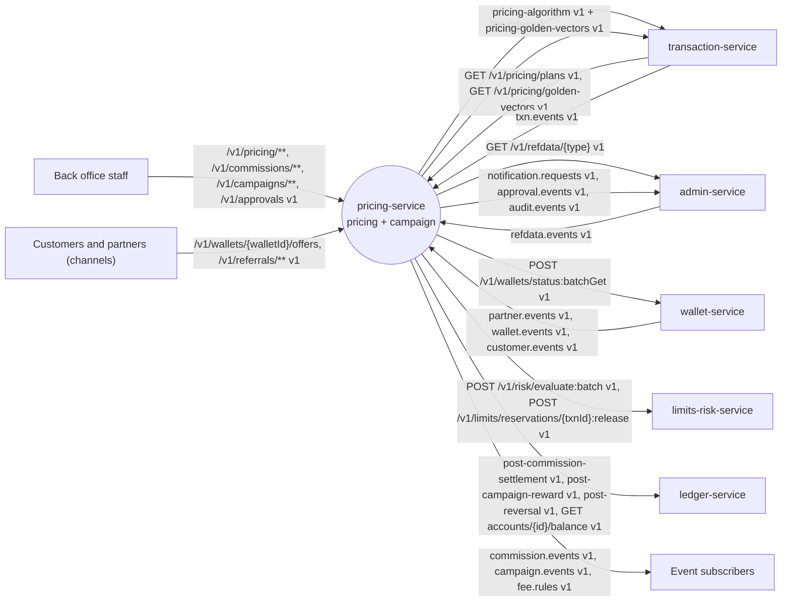

### 3.2 Component diagram

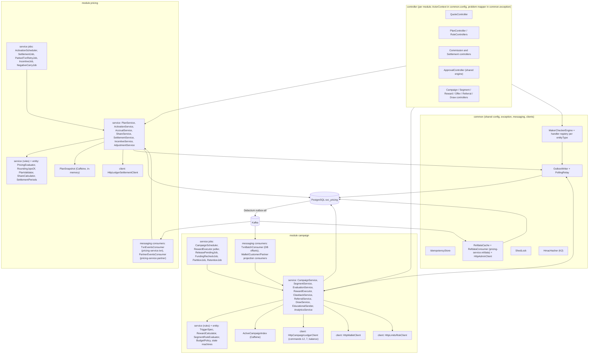

### 3.3 Runtime and deployment (Compose)

| Item | Value |
|---|---|
| Compose service | `pricing-service`, ports 8106 / 9106, `mem_limit` 384 MB, depends on `postgres`, `kafka-init` |
| Profiles / roles | `api` (REST of both modules) and `worker` (consumers and jobs of both modules); locally and in the stack one process with `dev,api,worker` |
| Database | `bitspay`, schema and login role `svc_pricing`; datasource `jdbc:postgresql://postgres:5432/bitspay?currentSchema=svc_pricing`; Flyway `spring.flyway.schemas=svc_pricing`, `create-schemas=false` in the stack (Testcontainers: `true`) |
| Outbox | `svc_pricing.outbox`, standard kernel K8.2 DDL (`payload jsonb NULL`); tombstones for `fee.rules` written with `payload = NULL` |
| Redis / TigerBeetle / ClickHouse | none |
| Caches | Caffeine: `PlanSnapshot` (all non-terminal plan versions, quote path), `ActiveCampaignIndex` (txnType → active campaigns, refreshed on change and every 30 s), refdata cache |
| Env beyond K8.3 | `BITSPAY_CLIENTS_LEDGER_BASEURL`, `BITSPAY_CLIENTS_WALLET_BASEURL`, `BITSPAY_CLIENTS_LIMITS_RISK_BASEURL`, `BITSPAY_CLIENTS_ADMIN_BASEURL`; `BITSPAY_PLATFORM_HMAC_KEY` (campaign hashing); `BITSPAY_MODULES_CAMPAIGN_ENABLED` |
| Consumer groups | `pricing-service.txn` (`txn.events`), `pricing-service.partner` (`partner.events`, from earliest), `pricing-service.refdata` (`refdata.events`, both modules), `pricing-service.campaign-txn` (`txn.events`, offsets stored in DB), `pricing-service.campaign-wallet` (`wallet.events`), `pricing-service.campaign-customer` (`customer.events`), `pricing-service.campaign-partner` (`partner.events`) |
| Scheduled jobs (ShedLock) | `pricing-activation` every 10 s; `pricing-approval-expiry` every 5 min (both modules); `pricing-settlement` daily 03:10 Asia/Dhaka; `pricing-parked-retry` every 1 min; `pricing-incentive` 1st of month 03:30; `pricing-negative-carry` daily 04:00; `campaign-scheduler` every 10 s; `campaign-executor` poll every 500 ms; `campaign-release-pending` every 1 min; `campaign-funding-recheck` every 15 min; `campaign-partitions` daily; `campaign-metric-rollup` in-transaction (no job); `campaign-budget-invariant` nightly 02:00; retention jobs daily (outbox 3 d, inboxes 14 d, `idempotency_record` 7 d, `campaign_evaluation_log` 30 d, activity partitions 120 d) |
| Readiness | own infrastructure only (DB, Kafka); never waits for another service |

### 3.4 Key flows

**F1 — Plan version approval, activation and publication**

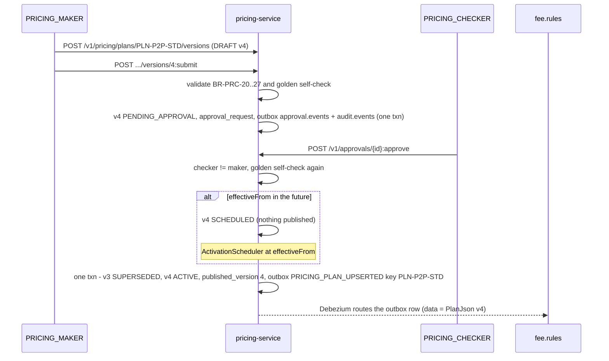

**F2 — Plan retirement (tombstone)**

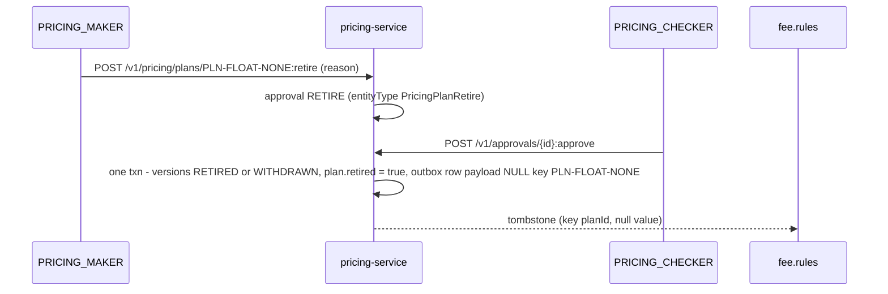

**F3 — Hierarchical accrual for a cash-out (R2)**

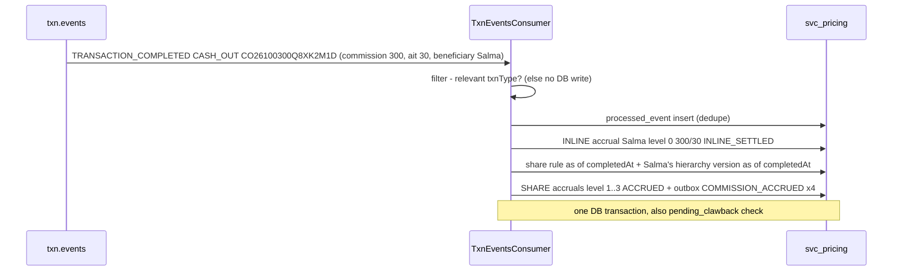

**F4 — Commission settlement (including unknown outcome)**

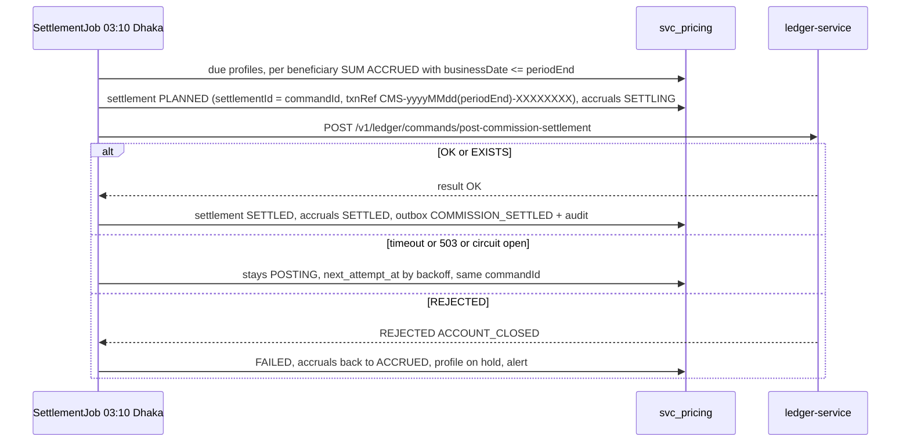

**F5 — Reward qualification, limits check and grant (S15: Rahim's first QR payment)**

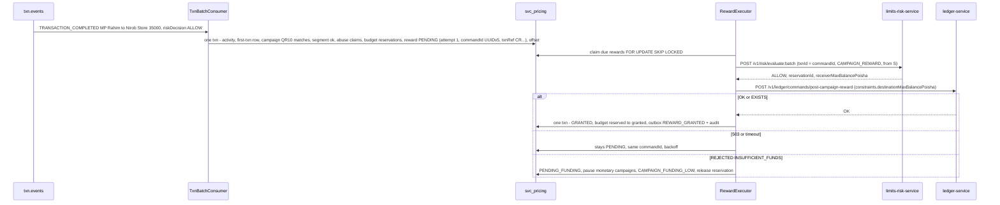

**F6 — Reward clawback on reversal (ledger mode, default)**

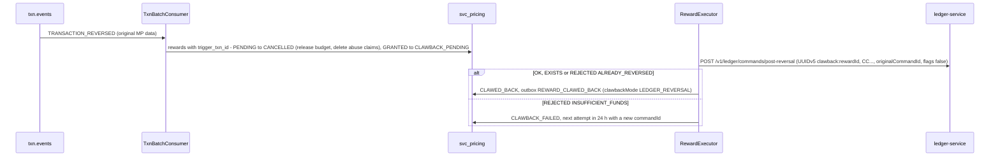

**F7 — Referral**

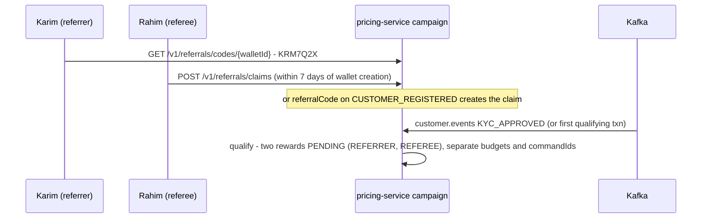

### 3.5 State machines

**Plan / share-rule / incentive-rule version**

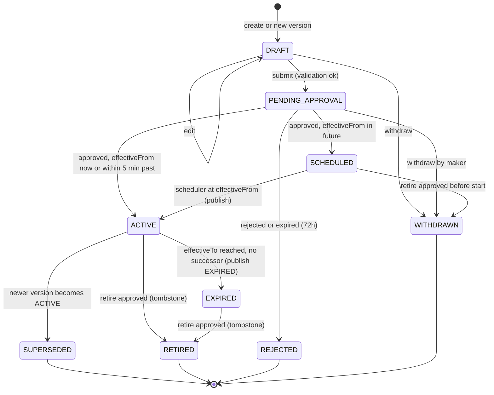

**Commission accrual**

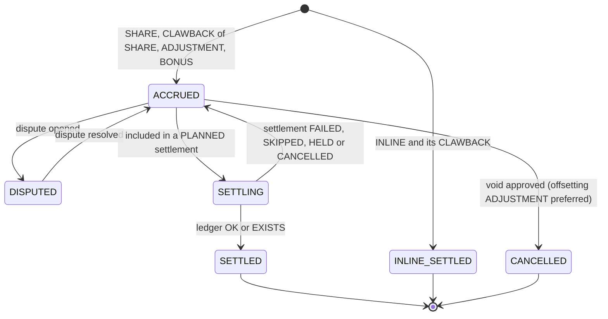

**Commission settlement**

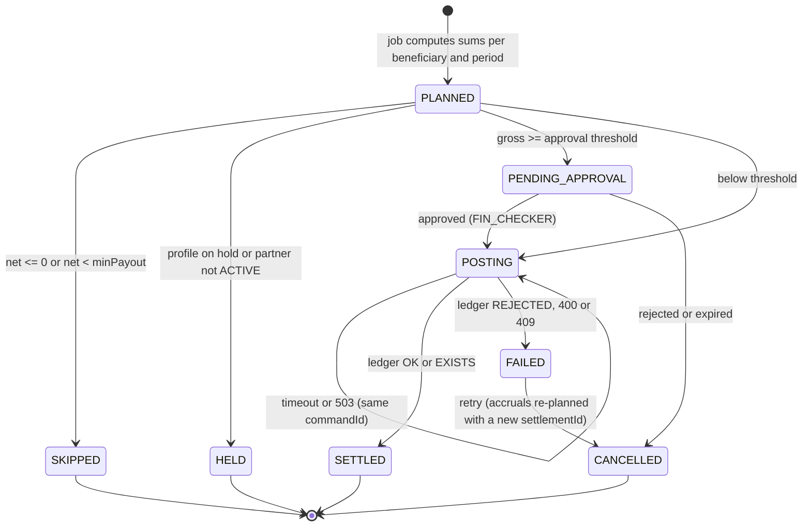

**Campaign**

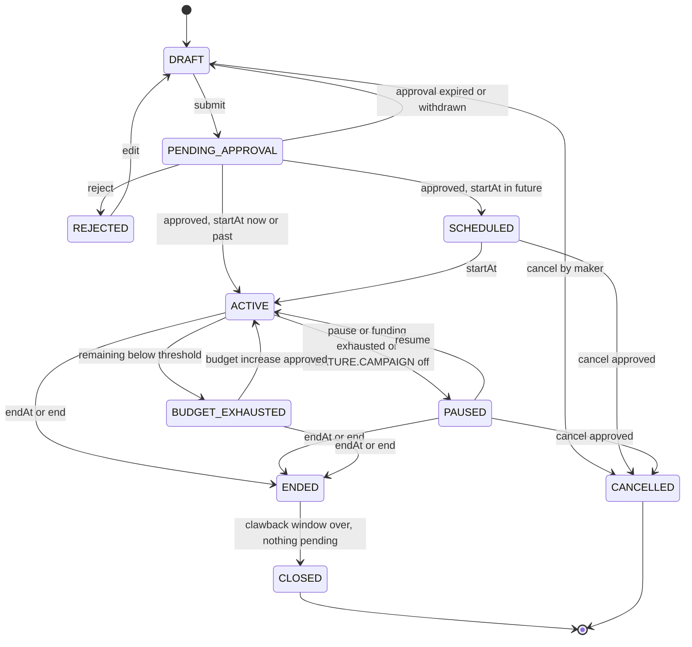

**Reward**

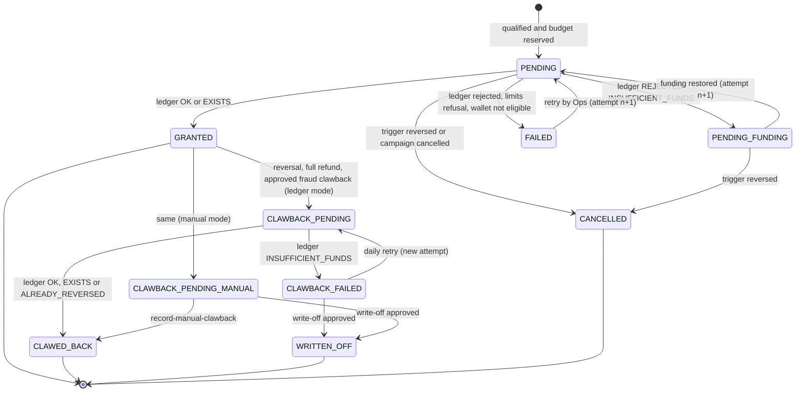

**Referral**

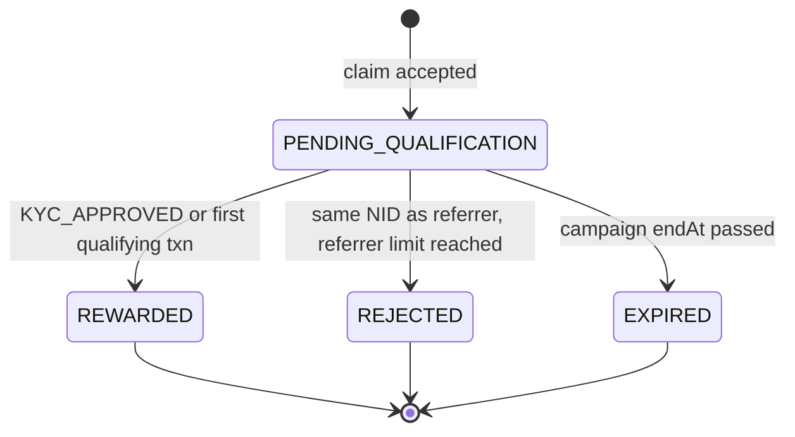

**Lucky draw**

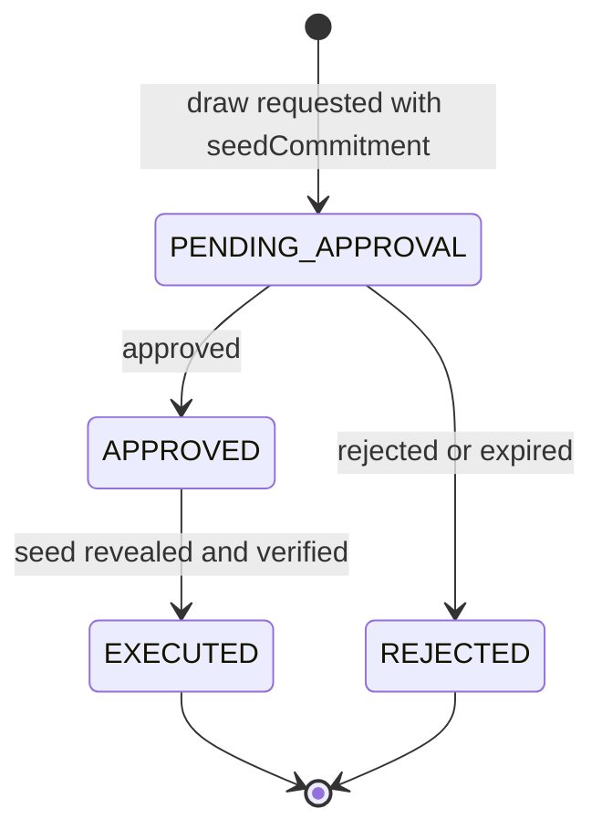

### 3.6 Architecture decisions

| ADR | Decision | Why | Consequence |
|---|---|---|---|
| ADR-01 | Two modules in one service with a private `common` package; neither module calls the other | Both are rule engines reading `txn.events`/`partner.events`, running maker-checker and posting to the ledger; one deployable is cheaper | One outbox, one approvals engine, one refdata cache; module rules enforced by `ArchitectureTest` |
| ADR-02 | The evaluator is a pure (side-effect-free) function in `pricing.service` with integer HALF_EVEN (`bpsOf`), cross-checked against `BigDecimal` by property test | Determinism, speed, no floating point; identical to the transaction-service copy via the golden vectors | `pricing-algorithm` v1 is the normative text; changing it is a breaking data-contract change |
| ADR-03 | A version is published on `fee.rules` **when it becomes ACTIVE** (at `effectiveFrom`), not when approved; the previous value is replaced under the same key | The compacted topic holds one value per `planId`; publishing early would remove the current version from consumers | Boundary lag ≤ 30 s accepted and alerted; posted values are authoritative (OPEN D-44) |
| ADR-04 | Retirement emits a tombstone through the standard outbox (`payload = NULL`, router `route.tombstone.on.empty.payload=true`) | Kernel K4.2 allows tombstones only on topics that declare them; `fee.rules` declares `tombstones: true` | No deviation from the kernel outbox DDL (OPEN D-31) |
| ADR-05 | Hierarchical shares come from a **separate operator-funded pool** (`poolBasis × poolBps` per txn), accrued and settled from COMMISSION_PAYABLE | The in-line commission is already posted in the payment chain and cannot be split later without debiting the agent | `AGENT_COMMISSION` basis emulates a single-total split numerically (OPEN D-07) |
| ADR-06 | Pool split by **largest-remainder allocation**; pool and AIT use HALF_EVEN | Shares must sum exactly to the distributable pool and never be negative | Property test Σ shares + retained = pool |
| ADR-07 | AIT computed per accrual; settlement AIT = Σ accrual AIT | Statements and certificates reconcile line by line | — |
| ADR-08 | Clawback = negative accrual netted in the next settlement; a negative period net is carried forward; never debit a partner wallet | The service may only post `post-commission-settlement`, whose amounts are positive | Negative-carry alert to Finance (`COMMISSION_NEGATIVE_BALANCE`) |
| ADR-09 | Settlement `commandId` = `settlementId` (UUIDv7) persisted before the ledger call; timeouts retry the same id; a definitive `REJECTED` closes the settlement and a re-plan creates a new settlement with a new id | Exactly-once settlement; `REJECTED` is final for its `commandId` | — |
| ADR-10 | Every scheduled job uses ShedLock on Postgres | Several replicas, one runner | Replaces advisory locks in the campaign module |
| ADR-11 | The pricing `txn.events` consumer filters irrelevant events **before** any DB write (no `processed_event` row for ignored events) | 5k TPS design target; only commission-bearing and rule-relevant events cost a write | Ignored events counted with `reason=FILTERED` |
| ADR-12 | Campaign: intent first — reward row (PENDING, attempt, `commandId`, `txnRef`) and budget reservation committed before any ledger call; executor retries 503/timeouts forever with the same body | Exactly-once credit via ledger `EXISTS` | Executor never marks FAILED on an unknown outcome |
| ADR-13 | Campaign `commandId` = `UUIDv5(namespace = campaignId, name)` for attempt 1, `UUIDv5(campaignId, name + ":" + n)` for attempt n ≥ 2; the attempt increments only after a definitive `REJECTED` | Deterministic and collision-free; a `REJECTED` is final for its `commandId` | `REWARD_GRANTED.commandId` / `REWARD_CLAWED_BACK.clawbackCommandId` = the attempt that posted; every attempt is recorded in `campaign_reward_attempt` |
| ADR-14 | Campaign `txn.events` consumed by a batch listener with **DB-stored offsets** (`campaign_consumer_offset` updated in the same transaction, seek on assignment) instead of one inbox row per event (allowed by kernel K4.3 "intrinsic idempotent effect") | At 5k TPS an inbox row per event costs ~430 M rows/day | Other campaign topics use `campaign_processed_event` or version compare |
| ADR-15 | Budget counters are conditional `UPDATE … WHERE used + :x <= total`; `campaign_budget` has `slice_no` so a hot campaign can be split into N slices | Atomic without Redis; contention escape hatch | — |
| ADR-16 | Clawback strategy with two implementations: `LedgerReversalClawback` (default, `clawback.ledger-enabled = true`) and `ManualClawback` (fallback queue for Finance) | Ledger allows `pricing-service` to reverse its own type-12 rewards | `REWARD_CLAWED_BACK.clawbackMode` tells consumers which one ran |
| ADR-17 | Segment rules evaluated in memory (one wallet, trigger time) and translated to SQL (snapshots, counts); a property test proves both agree | Same semantics for real-time and bulk | — |
| ADR-18 | Control group: `murmur3_x86_32(campaignId bytes ‖ walletId bytes) mod 10000 < controlGroupBps` | Deterministic, stateless, unbiased | — |
| ADR-19 | Lucky draw is commit-reveal: maker submits `SHA-256(seed)`; after approval the seed is revealed and verified; winner order = entries sorted by `HMAC-SHA256(seed, entryId)` | Reproducible, auditable, nobody can pick winners | — |
| ADR-20 | Campaign projections keep only fields needed for segmentation; MSISDN, NID and device are stored as K2 HMAC hashes | PII minimisation | — |
| ADR-21 | Rewards are limits-checked by default (`limitsCheck.enabled = true`) and the receiver maximum balance is passed to ledger command 12 | SRS LIM-002/003 apply to every credit | Every unpaid attempt's reservation must be released by a durable job (OPEN D-09, D-14) |

### 3.7 Latency and throughput budget

| Path | Budget |
|---|---|
| `POST /v1/pricing/quote` | p99 ≤ 20 ms at 500 rps per pod; no DB on the path (in-memory snapshot) |
| `GET /v1/pricing/plans?status=ACTIVE` | p99 ≤ 200 ms per page of 200 |
| `txn.events` (pricing) | consumer lag < 5 s at 5k TPS sustained / 10k burst; relevant events (cash-in/out ≈ 30 %) one DB transaction each, batched listener up to 500 |
| `txn.events` (campaign) | lag p95 ≤ 5 s; one DB transaction per poll batch (≤ 500) |
| Reward latency | `TRANSACTION_COMPLETED` → `REWARD_GRANTED` p95 ≤ 5 s, p99 ≤ 30 s with a healthy ledger |
| Settlement run | 100k beneficiaries ≤ 30 min (ledger parallelism 32) |
| Activation lag | ≤ 30 s from `effectiveFrom` to outbox commit |
| Campaign reads | p99 ≤ 100 ms (`/offers` ≤ 150 ms); writes p99 ≤ 300 ms |

## 4. Data model

### 4.0 Entity overview

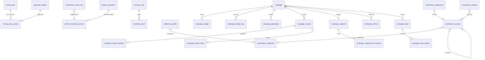

### 4.1 Tables

All money columns are `bigint` poisha; rates are `int` basis points. Every mutable row has `created_at`, `updated_at` and a version column (`row_version` or `version`). Unqualified DDL lands in `svc_pricing` via `search_path`.

**`db/migration/common/V1__common.sql`** (shared kernel)

```sql
-- outbox / pricing inbox (kernel K8.2, unchanged; payload NULL = tombstone, allowed only for topic fee.rules)
CREATE TABLE IF NOT EXISTS outbox (
  id             uuid PRIMARY KEY,
  aggregate_type text        NOT NULL,
  aggregate_id   text        NOT NULL,
  event_type     text        NOT NULL,
  payload        jsonb       NULL,
  created_at     timestamptz NOT NULL DEFAULT now(),
  published_at   timestamptz
);
CREATE INDEX IF NOT EXISTS outbox_unpublished ON outbox (created_at) WHERE published_at IS NULL;
ALTER TABLE outbox ADD CONSTRAINT outbox_null_payload_only_fee_rules
  CHECK (payload IS NOT NULL OR aggregate_type = 'fee.rules');

CREATE TABLE IF NOT EXISTS processed_event (           -- pricing module inbox
  event_id     uuid PRIMARY KEY,
  topic        text NOT NULL,
  processed_at timestamptz NOT NULL DEFAULT now()
);

-- one maker-checker engine for both modules (kernel K5)
CREATE TABLE approval_request (
  id                      uuid PRIMARY KEY,
  module                  text NOT NULL CHECK (module IN ('pricing','campaign')),
  entity_type             text NOT NULL CHECK (entity_type IN (
                            'PricingPlanVersion','PricingPlanRetire','CommissionShareRule','IncentiveRule',
                            'CommissionAdjustment','CommissionSettlement','SettlementProfile',
                            'Campaign','CampaignCancel','CampaignBudgetIncrease','RewardClawback','RewardWriteOff','LuckyDraw')),
  entity_id               text NOT NULL,          -- e.g. PLN-P2P-STD:4, a uuid
  action                  text NOT NULL CHECK (action ~ '^[A-Z][A-Z_]{1,39}$'),
  payload                 jsonb NOT NULL,
  maker_id                text NOT NULL,
  maker_user_id           text,                   -- X-Actor-User-Id of the maker, if any
  status                  text NOT NULL CHECK (status IN ('PENDING','APPROVED','REJECTED','EXPIRED','CANCELLED')),
  level                   int  NOT NULL DEFAULT 1, -- 1-based level awaiting decision / last decided
  required_levels         int  NOT NULL DEFAULT 1 CHECK (required_levels BETWEEN 1 AND 2),
  checker_roles_by_level  jsonb NOT NULL,          -- {"1":["OPS_CHECKER"],"2":["FIN_CHECKER"]}
  amount_poisha           bigint,
  summary                 text NOT NULL CHECK (length(summary) <= 200),
  created_at              timestamptz NOT NULL DEFAULT now(),
  expires_at              timestamptz NOT NULL,
  decided_by              text[] NOT NULL DEFAULT '{}',
  decided_at              timestamptz,
  decision_comment        text,
  reject_reason_code      text,
  updated_at              timestamptz NOT NULL DEFAULT now(),
  row_version             bigint NOT NULL DEFAULT 0
);
CREATE INDEX approval_request_pending ON approval_request (status, expires_at) WHERE status = 'PENDING';
CREATE INDEX approval_request_entity  ON approval_request (entity_type, entity_id);

CREATE TABLE idempotency_record (                       -- kernel K3.3, retention ≥ 7 days
  actor_id        text NOT NULL,
  idem_key        text NOT NULL,
  operation       text NOT NULL,
  request_sha256  char(64) NOT NULL,
  response_status int NOT NULL,
  response_body   jsonb NOT NULL,
  created_at      timestamptz NOT NULL DEFAULT now(),
  PRIMARY KEY (actor_id, idem_key)
);

CREATE TABLE refdata_item (                             -- FEATURE.CAMPAIGN, CUTOFF.EOD (latest version wins)
  type        text NOT NULL,
  code        text NOT NULL,
  attributes  jsonb NOT NULL,
  version     bigint NOT NULL,
  active      boolean NOT NULL,
  received_at timestamptz NOT NULL DEFAULT now(),
  PRIMARY KEY (type, code)
);

CREATE TABLE shedlock (name varchar(64) PRIMARY KEY, lock_until timestamptz NOT NULL,
                       locked_at timestamptz NOT NULL, locked_by varchar(255) NOT NULL);
```

**`db/migration/pricing/V1__pricing.sql`** (module `pricing`)

```sql
-- ===== Pricing plans =====
CREATE TABLE pricing_plan (
  plan_id            text PRIMARY KEY CHECK (plan_id ~ '^PLN-[A-Z0-9-]{2,60}$'),
  txn_type           text NOT NULL CHECK (txn_type IN ('P2P','CASH_IN','CASH_OUT','MERCHANT_PAYMENT','MERCHANT_REFUND','FLOAT_TRANSFER','BILL_PAY','RECHARGE','REVERSAL')),
  description        text,
  published_version  int,                 -- version whose JSON is the current fee.rules value (null = nothing / tombstoned)
  retired            boolean NOT NULL DEFAULT false,
  created_by         text NOT NULL,
  created_at         timestamptz NOT NULL DEFAULT now(),
  updated_at         timestamptz NOT NULL DEFAULT now(),
  row_version        bigint NOT NULL DEFAULT 0
);

CREATE TABLE pricing_plan_version (
  plan_id                 text NOT NULL REFERENCES pricing_plan(plan_id),
  plan_version            int  NOT NULL CHECK (plan_version >= 1),
  status                  text NOT NULL CHECK (status IN ('DRAFT','PENDING_APPROVAL','SCHEDULED','ACTIVE','SUPERSEDED','EXPIRED','REJECTED','WITHDRAWN','RETIRED')),
  txn_type                text NOT NULL,
  match_channel           text,
  match_payer_wallet_type char(1) CHECK (match_payer_wallet_type IN ('C','A','D','M','I','B')),
  match_payee_wallet_type char(1) CHECK (match_payee_wallet_type IN ('C','A','D','M','I','B')),
  match_payer_kyc_tier    smallint CHECK (match_payer_kyc_tier BETWEEN 0 AND 9),
  match_category_code     int CHECK (match_category_code BETWEEN 0 AND 99999),
  priority                int NOT NULL CHECK (priority BETWEEN 0 AND 100000),
  effective_from          timestamptz NOT NULL,
  effective_to            timestamptz,
  definition              jsonb NOT NULL,   -- complete PlanJson of this version (status rewritten on publish)
  definition_sha256       char(64) NOT NULL,
  approval_id             uuid,
  maker_id                text NOT NULL,
  checker_id              text,
  activated_at            timestamptz,
  ended_at                timestamptz,
  created_at              timestamptz NOT NULL DEFAULT now(),
  updated_at              timestamptz NOT NULL DEFAULT now(),
  row_version             bigint NOT NULL DEFAULT 0,
  PRIMARY KEY (plan_id, plan_version),
  CHECK (effective_to IS NULL OR effective_to > effective_from)
);
CREATE UNIQUE INDEX ppv_one_active   ON pricing_plan_version(plan_id) WHERE status = 'ACTIVE';
CREATE UNIQUE INDEX ppv_one_inflight ON pricing_plan_version(plan_id) WHERE status IN ('DRAFT','PENDING_APPROVAL','SCHEDULED');
CREATE INDEX ppv_eval   ON pricing_plan_version(txn_type, status, effective_from);
CREATE INDEX ppv_sched  ON pricing_plan_version(effective_from) WHERE status = 'SCHEDULED';
CREATE INDEX ppv_expiry ON pricing_plan_version(effective_to) WHERE status = 'ACTIVE' AND effective_to IS NOT NULL;

-- ===== Partner projection (partner.events, compacted, read from earliest) =====
CREATE TABLE partner_projection (
  partner_id     uuid PRIMARY KEY,
  wallet_id      uuid UNIQUE,                -- null until the partner is ACTIVE
  partner_type   text NOT NULL,              -- AGENT | MERCHANT | DISTRIBUTOR | INSTITUTION
  sub_type       text NOT NULL,
  category_code  int  NOT NULL,
  status         text NOT NULL,
  display_name   text,
  tin_present    boolean,                    -- null = not yet known
  event_version  bigint NOT NULL,
  updated_at     timestamptz NOT NULL DEFAULT now()
);
CREATE TABLE partner_hierarchy_version (
  partner_id           uuid NOT NULL,
  event_version        bigint NOT NULL,
  effective_from       timestamptz NOT NULL,
  parent_partner_id    uuid,
  ancestor_partner_ids uuid[] NOT NULL,       -- nearest first, excludes Operator and self
  ancestor_wallet_ids  uuid[] NOT NULL,
  received_at          timestamptz NOT NULL DEFAULT now(),
  PRIMARY KEY (partner_id, event_version)
);
CREATE INDEX phv_asof ON partner_hierarchy_version(partner_id, effective_from DESC, event_version DESC);

-- ===== Commission sharing (R2) =====
CREATE TABLE commission_share_rule (
  rule_id              text NOT NULL CHECK (rule_id ~ '^CSR-[A-Z0-9-]{2,60}$'),
  rule_version         int  NOT NULL CHECK (rule_version >= 1),
  status               text NOT NULL CHECK (status IN ('DRAFT','PENDING_APPROVAL','SCHEDULED','ACTIVE','SUPERSEDED','EXPIRED','REJECTED','WITHDRAWN','RETIRED')),
  txn_type             text NOT NULL CHECK (txn_type IN ('CASH_IN','CASH_OUT')),
  match_agent_sub_type text,                  -- null = any agent subtype
  pool_basis           text NOT NULL CHECK (pool_basis IN ('FEE','AMOUNT','AGENT_COMMISSION')),
  pool_bps             int  NOT NULL CHECK (pool_bps BETWEEN 0 AND 10000),
  unassigned_mode      text NOT NULL DEFAULT 'RETAIN_OPERATOR' CHECK (unassigned_mode IN ('RETAIN_OPERATOR','NEAREST_PRESENT_ANCESTOR')),
  splits               jsonb NOT NULL,        -- [{"ancestorRole":"DISTRIBUTOR:SUB","shareBps":5000,"aitBps":1000}, …] Σ shareBps = 10000
  priority             int NOT NULL DEFAULT 100,
  effective_from       timestamptz NOT NULL,
  effective_to         timestamptz,
  approval_id          uuid,
  maker_id             text NOT NULL,
  checker_id           text,
  created_at           timestamptz NOT NULL DEFAULT now(),
  updated_at           timestamptz NOT NULL DEFAULT now(),
  row_version          bigint NOT NULL DEFAULT 0,
  PRIMARY KEY (rule_id, rule_version)
);
CREATE UNIQUE INDEX csr_one_active   ON commission_share_rule(rule_id) WHERE status = 'ACTIVE';
CREATE UNIQUE INDEX csr_one_inflight ON commission_share_rule(rule_id) WHERE status IN ('DRAFT','PENDING_APPROVAL','SCHEDULED');

-- ===== Commission ledger =====
CREATE TABLE commission_accrual (
  accrual_id             uuid PRIMARY KEY,                     -- UUIDv7
  kind                   text NOT NULL CHECK (kind IN ('INLINE','SHARE','CLAWBACK','ADJUSTMENT','BONUS')),
  txn_id                 uuid,
  txn_ref                text,
  txn_type               text,
  beneficiary_wallet_id  uuid NOT NULL,
  beneficiary_partner_id uuid,
  level                  smallint NOT NULL CHECK (level IN (0,1,2,3,4,5,8,9)),
  gross_poisha           bigint NOT NULL,                      -- negative for CLAWBACK / negative ADJUSTMENT
  ait_poisha             bigint NOT NULL,
  basis_poisha           bigint,                               -- pool or base used
  rule_id                text, rule_version int, share_bps int, ait_bps int,
  business_date          date NOT NULL,                        -- §7.1 BR-PRC-03
  status                 text NOT NULL CHECK (status IN ('INLINE_SETTLED','ACCRUED','DISPUTED','SETTLING','SETTLED','CANCELLED')),
  settlement_id          uuid,
  reverses_accrual_id    uuid REFERENCES commission_accrual(accrual_id),
  adjustment_id          uuid,
  occurred_at            timestamptz NOT NULL,
  created_at             timestamptz NOT NULL DEFAULT now(),
  updated_at             timestamptz NOT NULL DEFAULT now(),
  row_version            bigint NOT NULL DEFAULT 0,
  CHECK (abs(ait_poisha) <= abs(gross_poisha)),
  CHECK (gross_poisha = 0 OR ait_poisha = 0 OR sign(gross_poisha) = sign(ait_poisha)),
  CHECK ((kind = 'CLAWBACK') = (reverses_accrual_id IS NOT NULL))
);
CREATE UNIQUE INDEX ca_idem    ON commission_accrual(txn_id, beneficiary_wallet_id, kind) WHERE txn_id IS NOT NULL;
CREATE UNIQUE INDEX ca_one_clawback ON commission_accrual(reverses_accrual_id) WHERE reverses_accrual_id IS NOT NULL;
CREATE INDEX ca_settle ON commission_accrual(beneficiary_wallet_id, business_date) WHERE status = 'ACCRUED';
CREATE INDEX ca_stmt   ON commission_accrual(beneficiary_wallet_id, occurred_at);
CREATE INDEX ca_txn    ON commission_accrual(txn_id);

CREATE TABLE pending_clawback (            -- TRANSACTION_REVERSED seen before TRANSACTION_COMPLETED
  txn_id             uuid PRIMARY KEY,
  reverse_commission boolean NOT NULL,
  occurred_at        timestamptz NOT NULL, -- envelope occurredAt of the REVERSED event
  received_at        timestamptz NOT NULL DEFAULT now()
);

CREATE TABLE parked_txn_event (            -- hierarchy / partner data not yet available
  txn_id          uuid PRIMARY KEY,
  payload         jsonb NOT NULL,          -- full txn.events envelope
  reason          text NOT NULL CHECK (reason IN ('UNKNOWN_AGENT','NO_HIERARCHY_ASOF','INLINE_UNRESOLVED')),
  status          text NOT NULL DEFAULT 'PARKED' CHECK (status IN ('PARKED','FAILED')),
  attempts        int NOT NULL DEFAULT 0,
  next_attempt_at timestamptz NOT NULL,
  created_at      timestamptz NOT NULL DEFAULT now()
);
CREATE INDEX pte_due ON parked_txn_event(next_attempt_at) WHERE status = 'PARKED';

CREATE TABLE settlement_profile (
  wallet_id          uuid PRIMARY KEY,
  partner_id         uuid NOT NULL,
  frequency          text NOT NULL CHECK (frequency IN ('DAILY','WEEKLY','MONTHLY')),
  anchor_day         smallint CHECK (anchor_day BETWEEN 1 AND 7),  -- WEEKLY: ISO day-of-week of period start (6 = Saturday)
  mode               text NOT NULL DEFAULT 'WALLET' CHECK (mode IN ('WALLET','BANK')),
  min_payout_poisha  bigint NOT NULL DEFAULT 0 CHECK (min_payout_poisha >= 0),
  on_hold            boolean NOT NULL DEFAULT false,
  hold_reason        text,
  source             text NOT NULL DEFAULT 'DEFAULT' CHECK (source IN ('DEFAULT','EXPLICIT')),
  created_at timestamptz NOT NULL DEFAULT now(), updated_at timestamptz NOT NULL DEFAULT now(), row_version bigint NOT NULL DEFAULT 0
);

CREATE TABLE commission_settlement (
  settlement_id         uuid PRIMARY KEY,        -- = ledger commandId
  txn_ref               text NOT NULL UNIQUE CHECK (txn_ref ~ '^CMS-[0-9]{8}-[0-9A-HJKMNP-TV-Z]{8}$'),
  beneficiary_wallet_id uuid NOT NULL,
  partner_id            uuid,
  period_start          date NOT NULL,
  period_end            date NOT NULL,           -- inclusive
  gross_poisha          bigint NOT NULL,
  ait_poisha            bigint NOT NULL,
  net_poisha            bigint NOT NULL,
  accrual_count         int NOT NULL,
  status                text NOT NULL CHECK (status IN ('PLANNED','PENDING_APPROVAL','POSTING','SETTLED','FAILED','SKIPPED','HELD','CANCELLED')),
  skip_reason           text CHECK (skip_reason IN ('NON_POSITIVE','BELOW_MIN_PAYOUT')),
  approval_id           uuid,
  ledger_result         text, rejection_code text, ledger_detail text,
  attempts              int NOT NULL DEFAULT 0,
  next_attempt_at       timestamptz,
  posted_at             timestamptz,
  run_id                uuid,
  created_at timestamptz NOT NULL DEFAULT now(), updated_at timestamptz NOT NULL DEFAULT now(), row_version bigint NOT NULL DEFAULT 0,
  CHECK (net_poisha = gross_poisha - ait_poisha)
);
CREATE UNIQUE INDEX cs_one_live ON commission_settlement(beneficiary_wallet_id, period_start, period_end)
  WHERE status NOT IN ('FAILED','CANCELLED');
CREATE INDEX cs_retry ON commission_settlement(next_attempt_at) WHERE status = 'POSTING';

CREATE TABLE commission_adjustment (
  adjustment_id         uuid PRIMARY KEY,
  beneficiary_wallet_id uuid NOT NULL,
  gross_poisha          bigint NOT NULL CHECK (gross_poisha <> 0),
  ait_poisha            bigint NOT NULL,
  reason_code           text NOT NULL CHECK (reason_code IN ('MISSED_ACCRUAL','WRONG_RATE','DISPUTE_UPHELD','CLAWBACK_RECOVERY_WAIVED','FRAUD_RECOVERY','OTHER')),
  reference             text,
  related_txn_ref       text,
  dispute_id            uuid,
  status                text NOT NULL CHECK (status IN ('PENDING_APPROVAL','APPROVED','REJECTED','EXPIRED')),
  approval_id           uuid,
  accrual_id            uuid,
  maker_id              text NOT NULL,
  created_at timestamptz NOT NULL DEFAULT now(), updated_at timestamptz NOT NULL DEFAULT now(), row_version bigint NOT NULL DEFAULT 0
);

CREATE TABLE commission_dispute (
  dispute_id               uuid PRIMARY KEY,
  beneficiary_wallet_id    uuid NOT NULL,
  accrual_ids              uuid[] NOT NULL,
  description              text NOT NULL,
  status                   text NOT NULL CHECK (status IN ('OPEN','RESOLVED_UPHELD','RESOLVED_REJECTED')),
  resolution_adjustment_id uuid,
  opened_by                text NOT NULL,
  resolved_by              text,
  created_at timestamptz NOT NULL DEFAULT now(), updated_at timestamptz NOT NULL DEFAULT now(), row_version bigint NOT NULL DEFAULT 0
);

-- ===== Incentives (R2) =====
CREATE TABLE incentive_rule (
  rule_id        text NOT NULL CHECK (rule_id ~ '^INC-[A-Z0-9-]{2,60}$'),
  rule_version   int NOT NULL,
  status         text NOT NULL CHECK (status IN ('DRAFT','PENDING_APPROVAL','SCHEDULED','ACTIVE','SUPERSEDED','EXPIRED','REJECTED','WITHDRAWN','RETIRED')),
  partner_type   text NOT NULL CHECK (partner_type IN ('AGENT','DISTRIBUTOR')),
  sub_type       text,
  metric         text NOT NULL CHECK (metric IN ('TXN_COUNT','TXN_VOLUME')),
  txn_types      text[] NOT NULL,
  period         text NOT NULL CHECK (period IN ('MONTHLY')),
  tiers          jsonb NOT NULL,             -- [{"thresholdFrom":1000,"bonusPoisha":50000}, …] ascending
  ait_bps        int NOT NULL CHECK (ait_bps BETWEEN 0 AND 10000),
  effective_from timestamptz NOT NULL, effective_to timestamptz,
  approval_id uuid, maker_id text NOT NULL, checker_id text,
  created_at timestamptz NOT NULL DEFAULT now(), updated_at timestamptz NOT NULL DEFAULT now(), row_version bigint NOT NULL DEFAULT 0,
  PRIMARY KEY (rule_id, rule_version)
);
CREATE UNIQUE INDEX ir_one_active ON incentive_rule(rule_id) WHERE status = 'ACTIVE';
CREATE TABLE incentive_counter (
  wallet_id     uuid NOT NULL,
  period_key    text NOT NULL,               -- yyyy-MM of the business date
  txn_type      text NOT NULL,
  txn_count     bigint NOT NULL DEFAULT 0,
  volume_poisha bigint NOT NULL DEFAULT 0,
  PRIMARY KEY (wallet_id, period_key, txn_type)
);
CREATE TABLE incentive_result (
  rule_id text NOT NULL, rule_version int NOT NULL, wallet_id uuid NOT NULL, period_key text NOT NULL,
  metric_value bigint NOT NULL, tier_index int, bonus_poisha bigint NOT NULL, accrual_id uuid,
  created_at timestamptz NOT NULL DEFAULT now(),
  PRIMARY KEY (rule_id, wallet_id, period_key)
);
```

**`db/migration/campaign/V1__campaign.sql`** (module `campaign`; every table prefixed `campaign_`)

```sql
-- ---------- projections ----------
CREATE TABLE campaign_wallet_projection (
  wallet_id uuid PRIMARY KEY, version bigint NOT NULL, owner_type text NOT NULL, owner_id uuid NOT NULL,
  wallet_type char(1) NOT NULL, msisdn_hash char(64) NOT NULL,      -- K2 hash; MSISDN never stored
  status char(1) NOT NULL, kyc_tier smallint NOT NULL, category_code int NOT NULL, flags int NOT NULL,
  language text, wallet_created_at timestamptz NOT NULL, updated_at timestamptz NOT NULL
);
CREATE INDEX campaign_wallet_projection_msisdn ON campaign_wallet_projection (msisdn_hash);
CREATE INDEX campaign_wallet_projection_owner  ON campaign_wallet_projection (owner_id);

CREATE TABLE campaign_customer_projection (
  customer_id uuid PRIMARY KEY, wallet_ids uuid[] NOT NULL, nid_hash char(64), birth_year smallint,
  gender text CHECK (gender IN ('MALE','FEMALE','THIRD_GENDER')),
  district text, upazila text,                                      -- refdata GEO codes, never names
  kyc_tier smallint NOT NULL, risk_grade text, language text,
  registered_at timestamptz, kyc_approved_at timestamptz, last_event_at timestamptz NOT NULL
);
CREATE INDEX campaign_customer_projection_nid ON campaign_customer_projection (nid_hash);

CREATE TABLE campaign_partner_projection (
  partner_id uuid PRIMARY KEY, wallet_id uuid UNIQUE, partner_type text NOT NULL, sub_type text NOT NULL,
  category_code int NOT NULL, mcc char(4), district text, status text NOT NULL,
  ancestor_partner_ids uuid[] NOT NULL, version bigint NOT NULL
);

CREATE TABLE campaign_wallet_activity_daily (           -- partitioned monthly, retention 120 days
  wallet_id uuid NOT NULL, business_date date NOT NULL, txn_type text NOT NULL,
  direction char(1) NOT NULL CHECK (direction IN ('S','R')),
  txn_count int NOT NULL, amount_poisha bigint NOT NULL,
  PRIMARY KEY (wallet_id, business_date, txn_type, direction)
) PARTITION BY RANGE (business_date);
-- partitions campaign_wallet_activity_daily_yYYYYmMM created by the partition job 2 months ahead

CREATE TABLE campaign_wallet_first_txn (
  wallet_id uuid NOT NULL, txn_type text NOT NULL, first_txn_id uuid NOT NULL, first_txn_at timestamptz NOT NULL,
  source text NOT NULL DEFAULT 'STREAM' CHECK (source IN ('STREAM','IMPORT')),
  PRIMARY KEY (wallet_id, txn_type)
);

CREATE TABLE campaign_consumer_offset (                  -- ADR-14: DB-stored offsets for txn.events
  topic text NOT NULL, partition_no int NOT NULL, next_offset bigint NOT NULL,
  updated_at timestamptz NOT NULL DEFAULT now(), PRIMARY KEY (topic, partition_no)
);

CREATE TABLE campaign_processed_event (                  -- inbox of the other campaign consumers
  event_id uuid PRIMARY KEY, topic text NOT NULL, processed_at timestamptz NOT NULL DEFAULT now()
);

-- ---------- segments ----------
CREATE TABLE campaign_segment (
  id uuid PRIMARY KEY, code text NOT NULL UNIQUE CHECK (code ~ '^[A-Z0-9-]{3,32}$'), name text NOT NULL,
  kind text NOT NULL CHECK (kind IN ('RULE','LIST')), rule jsonb,
  list_key_type text CHECK (list_key_type IN ('MSISDN','WALLET_ID')),
  status text NOT NULL CHECK (status IN ('DRAFT','ACTIVE','ARCHIVED')),
  created_by text NOT NULL, created_at timestamptz NOT NULL DEFAULT now(), updated_at timestamptz NOT NULL DEFAULT now(),
  version bigint NOT NULL DEFAULT 0,
  CHECK ((kind = 'RULE') = (rule IS NOT NULL))
);
CREATE TABLE campaign_segment_upload (
  id uuid PRIMARY KEY, segment_id uuid NOT NULL REFERENCES campaign_segment(id), file_sha256 char(64) NOT NULL,
  rows_total int NOT NULL, rows_matched int NOT NULL, rows_unmatched int NOT NULL,
  status text NOT NULL CHECK (status IN ('PROCESSING','DONE','FAILED')), uploaded_by text NOT NULL,
  created_at timestamptz NOT NULL DEFAULT now(), UNIQUE (segment_id, file_sha256)
);
CREATE TABLE campaign_segment_list_member (
  segment_id uuid NOT NULL REFERENCES campaign_segment(id), wallet_id uuid, msisdn_hash char(64) NOT NULL,
  upload_id uuid NOT NULL, PRIMARY KEY (segment_id, msisdn_hash)
);
CREATE INDEX campaign_segment_list_member_wallet ON campaign_segment_list_member (segment_id, wallet_id);

-- ---------- campaigns ----------
CREATE TABLE campaign (
  id uuid PRIMARY KEY, code text NOT NULL UNIQUE CHECK (code ~ '^[A-Z0-9-]{3,32}$'), name text NOT NULL, description text,
  objective text NOT NULL CHECK (objective IN ('ACQUISITION','ACTIVATION','ENGAGEMENT','RETENTION','MERCHANT_ADOPTION','EDUCATION')),
  campaign_type text NOT NULL CHECK (campaign_type IN ('CASHBACK','BONUS','REFERRAL','LUCKY_DRAW','POINTS','EDUCATIONAL')),
  status text NOT NULL CHECK (status IN ('DRAFT','PENDING_APPROVAL','REJECTED','SCHEDULED','ACTIVE','PAUSED','BUDGET_EXHAUSTED','ENDED','CLOSED','CANCELLED')),
  channels text[] NOT NULL DEFAULT '{}',
  start_at timestamptz NOT NULL, end_at timestamptz NOT NULL,
  segment_id uuid REFERENCES campaign_segment(id),
  trigger_spec jsonb, reward_spec jsonb, referral_spec jsonb, draw_spec jsonb, points_spec jsonb, notification_spec jsonb,
  abuse_spec jsonb NOT NULL, clawback_spec jsonb NOT NULL,
  control_group_bps int NOT NULL DEFAULT 0 CHECK (control_group_bps BETWEEN 0 AND 5000),
  budget_total_poisha bigint NOT NULL DEFAULT 0 CHECK (budget_total_poisha >= 0),
  per_user_max_poisha bigint, per_user_max_count int, per_day_max_poisha bigint, budget_slices smallint NOT NULL DEFAULT 1,
  status_reason text, approval_id uuid, created_by text NOT NULL, approved_by text[] NOT NULL DEFAULT '{}',
  activated_at timestamptz, ended_at timestamptz,
  created_at timestamptz NOT NULL DEFAULT now(), updated_at timestamptz NOT NULL DEFAULT now(), version bigint NOT NULL DEFAULT 0,
  CHECK (end_at > start_at)
);
CREATE INDEX campaign_status ON campaign (status, start_at);

CREATE TABLE campaign_budget (
  campaign_id uuid NOT NULL REFERENCES campaign(id), slice_no smallint NOT NULL DEFAULT 0,
  total_poisha bigint NOT NULL, reserved_poisha bigint NOT NULL DEFAULT 0, granted_poisha bigint NOT NULL DEFAULT 0,
  clawed_back_poisha bigint NOT NULL DEFAULT 0, version bigint NOT NULL DEFAULT 0,
  PRIMARY KEY (campaign_id, slice_no),
  CHECK (reserved_poisha >= 0 AND granted_poisha >= 0 AND reserved_poisha + granted_poisha <= total_poisha)
);
CREATE TABLE campaign_budget_day (
  campaign_id uuid NOT NULL REFERENCES campaign(id), business_date date NOT NULL, used_poisha bigint NOT NULL DEFAULT 0,
  PRIMARY KEY (campaign_id, business_date)
);

CREATE TABLE campaign_participant (
  campaign_id uuid NOT NULL REFERENCES campaign(id), wallet_id uuid NOT NULL, is_control boolean NOT NULL,
  enrolled_at timestamptz NOT NULL, qualifying_count int NOT NULL DEFAULT 0, qualifying_amount_poisha bigint NOT NULL DEFAULT 0,
  reward_count int NOT NULL DEFAULT 0, reward_poisha bigint NOT NULL DEFAULT 0, thresholds_reached int NOT NULL DEFAULT 0,
  first_ever_in_campaign boolean NOT NULL DEFAULT false, last_qualifying_at timestamptz, version bigint NOT NULL DEFAULT 0,
  PRIMARY KEY (campaign_id, wallet_id)
);

CREATE TABLE campaign_reward (
  id uuid PRIMARY KEY, campaign_id uuid NOT NULL REFERENCES campaign(id), wallet_id uuid NOT NULL,
  wallet_type char(1) NOT NULL CHECK (wallet_type IN ('C','A','M')),
  beneficiary_role text NOT NULL CHECK (beneficiary_role IN ('SELF','REFERRER','REFEREE','WINNER')),
  trigger_kind text NOT NULL CHECK (trigger_kind IN ('TXN','CUSTOMER_EVENT','REFERRAL','DRAW','LIST')),
  trigger_key text NOT NULL,                              -- UUIDv5 name of attempt 1 (BR-CMP-40)
  trigger_txn_id uuid, trigger_txn_ref text,
  reward_type text NOT NULL CHECK (reward_type IN ('CASHBACK','BONUS','REFERRAL','DRAW_PRIZE')),
  amount_poisha bigint NOT NULL CHECK (amount_poisha > 0 AND amount_poisha <= 10000000000000),
  budget_slice smallint NOT NULL DEFAULT 0, business_date date NOT NULL,
  attempt int NOT NULL DEFAULT 1 CHECK (attempt >= 1),
  command_id uuid NOT NULL UNIQUE,                        -- current attempt's commandId
  txn_ref text NOT NULL UNIQUE CHECK (txn_ref ~ '^CR[0-9]{6}00[0-9A-HJKMNP-TV-Z]{8}$'),
  status text NOT NULL CHECK (status IN ('PENDING','PENDING_FUNDING','GRANTED','FAILED','CANCELLED','CLAWBACK_PENDING',
                                          'CLAWBACK_PENDING_MANUAL','CLAWED_BACK','CLAWBACK_FAILED','WRITTEN_OFF')),
  failure_code text, retries int NOT NULL DEFAULT 0, next_attempt_at timestamptz NOT NULL DEFAULT now(),
  limits_reservation_id uuid, receiver_max_balance_poisha bigint,
  ledger_transfer_ids uuid[], granted_at timestamptz, granted_command_id uuid,
  clawback_reason text CHECK (clawback_reason IN ('TRANSACTION_REVERSED','TRANSACTION_REFUNDED','FRAUD_CONFIRMED')),
  clawback_mode text CHECK (clawback_mode IN ('LEDGER_REVERSAL','MANUAL')),
  clawback_attempt int NOT NULL DEFAULT 0, clawback_command_id uuid UNIQUE, clawback_txn_ref text UNIQUE,
  clawback_retries int NOT NULL DEFAULT 0, clawed_back_at timestamptz,
  created_at timestamptz NOT NULL DEFAULT now(), updated_at timestamptz NOT NULL DEFAULT now(), version bigint NOT NULL DEFAULT 0,
  UNIQUE (campaign_id, trigger_key)
);
CREATE INDEX campaign_reward_due     ON campaign_reward (next_attempt_at) WHERE status IN ('PENDING','PENDING_FUNDING','CLAWBACK_PENDING','CLAWBACK_FAILED');
CREATE INDEX campaign_reward_trigger ON campaign_reward (trigger_txn_id) WHERE trigger_txn_id IS NOT NULL;
CREATE INDEX campaign_reward_wallet  ON campaign_reward (wallet_id, created_at DESC);

CREATE TABLE campaign_reward_attempt (                   -- every commandId ever sent (C-002)
  reward_id uuid NOT NULL REFERENCES campaign_reward(id), kind text NOT NULL CHECK (kind IN ('REWARD','CLAWBACK')),
  attempt int NOT NULL, command_id uuid NOT NULL UNIQUE, limits_txn_id uuid,
  result text CHECK (result IN ('OK','EXISTS','REJECTED','UNKNOWN')), rejection_code text, detail text,
  created_at timestamptz NOT NULL DEFAULT now(), decided_at timestamptz,
  PRIMARY KEY (reward_id, kind, attempt)
);

CREATE TABLE campaign_limits_release_pending (           -- durable :release obligations (C-011)
  txn_id uuid PRIMARY KEY, reward_id uuid NOT NULL, reason_code text NOT NULL DEFAULT 'REWARD_FAILED',
  attempts int NOT NULL DEFAULT 0, next_attempt_at timestamptz NOT NULL DEFAULT now(),
  final_state text CHECK (final_state IN ('RELEASED','COMMITTED','EXPIRED','NOT_FOUND')),
  created_at timestamptz NOT NULL DEFAULT now(), done_at timestamptz
);
CREATE INDEX campaign_lrp_due ON campaign_limits_release_pending (next_attempt_at) WHERE final_state IS NULL;

CREATE TABLE campaign_abuse_claim (
  campaign_id uuid NOT NULL, claim_type text NOT NULL CHECK (claim_type IN ('NID','DEVICE')), claim_hash char(64) NOT NULL,
  reward_id uuid NOT NULL, created_at timestamptz NOT NULL DEFAULT now(),
  PRIMARY KEY (campaign_id, claim_type, claim_hash)
);

CREATE TABLE campaign_evaluation_log (                   -- retention 30 days; NOT_ELIGIBLE sampled
  id uuid PRIMARY KEY, campaign_id uuid NOT NULL, wallet_id uuid NOT NULL, trigger_txn_id uuid,
  outcome text NOT NULL CHECK (outcome IN ('REWARDED','CONTROL','NOT_ELIGIBLE','BUDGET_EXHAUSTED','CAP_REACHED','ABUSE_BLOCKED')),
  reason text, occurred_at timestamptz NOT NULL DEFAULT now()
);
CREATE INDEX campaign_evaluation_log_campaign ON campaign_evaluation_log (campaign_id, occurred_at);

-- ---------- referral, draw, points, education ----------
CREATE TABLE campaign_referral_code (wallet_id uuid PRIMARY KEY, code text NOT NULL UNIQUE, created_at timestamptz NOT NULL DEFAULT now());
CREATE TABLE campaign_referral (
  id uuid PRIMARY KEY, campaign_id uuid NOT NULL REFERENCES campaign(id), referrer_wallet_id uuid NOT NULL,
  referee_wallet_id uuid NOT NULL, code text NOT NULL, claimed_at timestamptz NOT NULL,
  source text NOT NULL DEFAULT 'API' CHECK (source IN ('API','REGISTRATION')),
  status text NOT NULL CHECK (status IN ('PENDING_QUALIFICATION','REWARDED','REJECTED','EXPIRED')),
  reject_reason text, qualified_at timestamptz, version bigint NOT NULL DEFAULT 0,
  UNIQUE (campaign_id, referee_wallet_id)
);
CREATE INDEX campaign_referral_referrer ON campaign_referral (campaign_id, referrer_wallet_id);

CREATE TABLE campaign_draw_entry (
  id uuid PRIMARY KEY, campaign_id uuid NOT NULL REFERENCES campaign(id), wallet_id uuid NOT NULL,
  trigger_txn_id uuid NOT NULL, trigger_txn_ref text, entry_no smallint NOT NULL DEFAULT 1,
  created_at timestamptz NOT NULL DEFAULT now(), UNIQUE (campaign_id, trigger_txn_id, entry_no)
);
CREATE TABLE campaign_draw (
  id uuid PRIMARY KEY, campaign_id uuid NOT NULL REFERENCES campaign(id), entry_cutoff_at timestamptz NOT NULL,
  winners int NOT NULL CHECK (winners > 0), prize_poisha bigint CHECK (prize_poisha IS NULL OR prize_poisha > 0),
  prize_description text, seed_commitment char(64) NOT NULL, seed_revealed text,
  status text NOT NULL CHECK (status IN ('PENDING_APPROVAL','APPROVED','EXECUTED','REJECTED')), approval_id uuid NOT NULL,
  executed_at timestamptz, entries_count int, created_by text NOT NULL, created_at timestamptz NOT NULL DEFAULT now()
);
CREATE TABLE campaign_draw_winner (draw_id uuid NOT NULL REFERENCES campaign_draw(id), rank int NOT NULL, wallet_id uuid NOT NULL,
  entry_id uuid NOT NULL, reward_id uuid, PRIMARY KEY (draw_id, rank), UNIQUE (draw_id, wallet_id));

CREATE TABLE campaign_points_ledger (id uuid PRIMARY KEY, campaign_id uuid NOT NULL, wallet_id uuid NOT NULL, points int NOT NULL,
  reason text NOT NULL, trigger_txn_id uuid, created_at timestamptz NOT NULL DEFAULT now(), UNIQUE (campaign_id, trigger_txn_id));

CREATE TABLE campaign_educational_send (
  campaign_id uuid NOT NULL REFERENCES campaign(id), wallet_id uuid NOT NULL,
  status text NOT NULL CHECK (status IN ('QUEUED','SENT','SKIPPED')), request_id uuid NOT NULL UNIQUE,
  skip_reason text, sent_at timestamptz, PRIMARY KEY (campaign_id, wallet_id)
);

-- ---------- analytics ----------
CREATE TABLE campaign_metric_daily (
  campaign_id uuid NOT NULL, business_date date NOT NULL,
  participants int NOT NULL DEFAULT 0, control_participants int NOT NULL DEFAULT 0,
  qualifying_txns int NOT NULL DEFAULT 0, control_qualifying_txns int NOT NULL DEFAULT 0,
  qualifying_amount_poisha bigint NOT NULL DEFAULT 0, qualifying_fee_poisha bigint NOT NULL DEFAULT 0,
  control_qualifying_fee_poisha bigint NOT NULL DEFAULT 0,
  rewards_count int NOT NULL DEFAULT 0, rewards_poisha bigint NOT NULL DEFAULT 0,
  clawbacks_count int NOT NULL DEFAULT 0, clawbacks_poisha bigint NOT NULL DEFAULT 0, new_customers int NOT NULL DEFAULT 0,
  PRIMARY KEY (campaign_id, business_date)
);

-- ---------- config ----------
CREATE TABLE campaign_config_param (key text PRIMARY KEY, value jsonb NOT NULL, description text, updated_by text,
  created_at timestamptz NOT NULL DEFAULT now(), updated_at timestamptz NOT NULL DEFAULT now(), version bigint NOT NULL DEFAULT 0);
```

Seed migrations (profiles `local`, `dev` only, all values provisional): `db/migration/pricing/R__seed_plans.sql` (§8.3 seed plans as ACTIVE v1, maker and checker `SEED`; share rules R2) and `db/migration/campaign/V2__seed_config.sql` (§8.2 campaign parameters).

### 4.2 Redis keys / caches

No Redis. In-process Caffeine caches only (§3.3): `PlanSnapshot` (rebuilt after every commit that changes a version and every 60 s; quote served from it), `ActiveCampaignIndex`, refdata cache (`FEATURE.CAMPAIGN`, `CUTOFF.EOD`).

### 4.3 Retention and archival

| Data | Retention |
|---|---|
| Plan versions, share / incentive rules, accruals, settlements, adjustments, disputes, campaigns, rewards, reward attempts, referrals, draws | permanent (financial records; archival per `RETENTION.*` later) |
| `outbox` | 3 days after publication (kernel K8.2) |
| `processed_event`, `campaign_processed_event` | 14 days |
| `idempotency_record` | 7 days (kernel K3.3, OPEN D-01) |
| `parked_txn_event` | deleted on success; FAILED rows kept 90 days |
| `incentive_counter` | 24 months |
| `campaign_wallet_activity_daily` | 120 days (drop partitions) |
| `campaign_evaluation_log` | 30 days |
| `campaign_limits_release_pending` | 30 days after `final_state` |
| `approval_request` | permanent |

## 5. Provided contracts

This section mirrors `contracts/provided/`. On any difference, the files under `contracts/provided/` win and this text is the bug.

Common to every operation: kernel K3.1 headers (`X-Correlation-Id`, `X-Actor-Type`, `X-Actor-Id`, `X-Channel` required; `X-Actor-Roles` for STAFF; `X-Actor-Wallet-Id` for wallet holders), K3.3 idempotency, K3.4 pagination (`limit` 1..200 default 50, opaque `cursor`, `{items, nextCursor}`) and K3.6 problem bodies. Authorisation: `@RequiresActor`; a STAFF caller needs one of the listed roles (`*` = any K7 role); partner and holder actors may only read their own wallet (`walletId = X-Actor-Wallet-Id`, otherwise `403 ACTOR_NOT_ALLOWED`). Every state-changing operation writes `audit.events` in the same DB transaction. The pricing service defines no problem+json extension members; every provider-owned `reason` is listed per operation (`x-problem-reasons`) and in `codes.yaml → problemReasons`.

### 5.1 REST operations

| # | Operation | Audience | Actors & roles | Idempotency | Purpose |
|---|---|---|---|---|---|
| P1 | `POST /v1/pricing/quote` | service | any actor type; any SERVICE caller | none (read-only) | What-if evaluation of the pricing algorithm |
| P2 | `GET /v1/pricing/plans` | service | SERVICE / SYSTEM (status=ACTIVE only); STAFF any role (all statuses) | none | Bootstrap snapshot of published plans; staff listings |
| P3 | `GET /v1/pricing/golden-vectors` | service | any actor type | none | Golden vector file, `ETag` = SHA-256 |
| P4 | `POST /v1/pricing/plans` | staff | PRICING_MAKER | none (409 on duplicate planId) | Create plan + DRAFT v1 |
| P5 | `GET /v1/pricing/plans/{planId}` | staff | any staff | none | Plan header + version summaries |
| P6 | `POST /v1/pricing/plans/{planId}/versions` | staff | PRICING_MAKER | none (one in-flight version) | New DRAFT version |
| P7 | `GET /v1/pricing/plans/{planId}/versions/{version}` | staff | any staff | none | Version detail |
| P8 | `PUT /v1/pricing/plans/{planId}/versions/{version}` | staff | PRICING_MAKER | `If-Match: rowVersion` | Edit DRAFT |
| P9 | `POST /v1/pricing/plans/{planId}/versions/{version}:submit` | staff | PRICING_MAKER | state-guarded | Validate + approval ACTIVATE |
| P10 | `POST /v1/pricing/plans/{planId}/versions/{version}:withdraw` | staff | PRICING_MAKER (the version's maker) | state-guarded | Withdraw |
| P11 | `POST /v1/pricing/plans/{planId}:retire` | staff | PRICING_MAKER | state-guarded | Approval RETIRE → tombstone |
| P12 | `POST /v1/pricing/plans:validate` | staff | PRICING_MAKER, PRICING_CHECKER | none (no side effects) | Dry-run validation + sample quotes |
| P13 | `POST /v1/internal/pricing/fee-rules:republish` | internal | STAFF ADMIN; SYSTEM | `Idempotency-Key` required | Heal `fee.rules` |
| R1–R7 | `/v1/commissions/share-rules` lifecycle: `POST` (create), `GET` (list), `POST /{ruleId}/versions`, `PUT /{ruleId}/versions/{version}`, `POST …/{version}:submit`, `POST …/{version}:withdraw`, `POST /{ruleId}:retire` | staff | PRICING_MAKER (write), any staff (read) | as P4–P11 | Hierarchical share rules (R2) |
| R8–R14 | `/v1/commissions/incentive-rules` — same seven operations | staff | as R1–R7 | as P4–P11 | Incentive / bonus rules (R2) |
| C1 | `GET /v1/commissions/accruals` | staff | any staff; AGENT / DISTRIBUTOR / MERCHANT own wallet | none | Accrual lines |
| C2 | `GET /v1/commissions/statements/{walletId}` | staff | as C1 | none | Statement |
| C3 | `GET /v1/commissions/summary` | staff | any staff | none | Dashboard aggregates |
| C4 | `GET /v1/commissions/ait-certificates/{walletId}` | staff | FIN_MAKER, FIN_CHECKER, AUDITOR; partner own wallet | none | AIT certificate data |
| S1 | `GET /v1/commissions/settlement-profiles/{walletId}` | staff | as C1 | none | Effective profile |
| S2 | `PUT /v1/commissions/settlement-profiles/{walletId}` | staff | FIN_MAKER | state-guarded (one pending change) | Approval UPDATE_PROFILE |
| S3 | `POST /v1/commissions/settlement-profiles/{walletId}:hold` | staff | FIN_MAKER | state-guarded | Immediate hold |
| S4 | `POST /v1/commissions/settlement-profiles/{walletId}:unhold` | staff | FIN_MAKER | state-guarded | Approval UNHOLD |
| S5 | `GET /v1/commissions/settlements` | staff | as C1 | none | List |
| S6 | `GET /v1/commissions/settlements/{settlementId}` | staff | as C1 | none | Detail |
| S7 | `POST /v1/commissions/settlements:run` | staff | FIN_MAKER; SYSTEM | `Idempotency-Key` required | Run due settlements now |
| S8 | `POST /v1/commissions/settlements/{settlementId}:retry` | staff | FIN_MAKER | state-guarded | Re-plan a FAILED settlement |
| A1 | `POST /v1/commissions/adjustments` | staff | FIN_MAKER | `Idempotency-Key` required | Approval APPROVE_ADJUSTMENT |
| A2 | `GET /v1/commissions/adjustments` | staff | any staff | none | List |
| A3 | `POST /v1/commissions/disputes` | staff | FIN_MAKER, OPS_MAKER; partner own wallet | none (accrual state guards) | Open dispute |
| A4 | `GET /v1/commissions/disputes` | staff | any staff; partner own wallet | none | List |
| A5 | `POST /v1/commissions/disputes/{disputeId}:resolve` | staff | FIN_MAKER | state-guarded | Resolve |
| M1 | `GET /v1/approvals` | staff | any staff | none | Approval inbox (both modules) |
| M2 | `POST /v1/approvals/{id}:approve` | staff | the current level's `checkerRoles` (PRICING_CHECKER, FIN_CHECKER, OPS_CHECKER, RISK_CHECKER) | state-guarded | Approve |
| M3 | `POST /v1/approvals/{id}:reject` | staff | as M2 | state-guarded | Reject |
| K1 | `POST /v1/campaigns` | staff | OPS_MAKER | none (409 on duplicate code) | Create DRAFT |
| K2 | `GET /v1/campaigns` | staff | any staff | none | List |
| K3 | `GET /v1/campaigns/{campaignId}` | staff | any staff | none | Detail |
| K4 | `PATCH /v1/campaigns/{campaignId}` | staff | OPS_MAKER | `If-Match` | Edit DRAFT / REJECTED |
| K5 | `POST /v1/campaigns/{campaignId}:submit` | staff | OPS_MAKER | state-guarded | Approval ACTIVATE |
| K6 | `POST /v1/campaigns/{campaignId}:pause` | staff | OPS_MAKER, OPS_CHECKER, RISK_ANALYST | state-guarded | Pause |
| K7 | `POST /v1/campaigns/{campaignId}:resume` | staff | OPS_CHECKER | state-guarded | Resume |
| K8 | `POST /v1/campaigns/{campaignId}:end` | staff | OPS_CHECKER | state-guarded | End early |
| K9 | `POST /v1/campaigns/{campaignId}:cancel` | staff | OPS_MAKER | state-guarded | Cancel (DRAFT now; SCHEDULED / PAUSED via approval CANCEL) |
| K10 | `POST /v1/campaigns/{campaignId}/budget-increases` | staff | OPS_MAKER | state-guarded | Approval BUDGET_INCREASE |
| K11 | `GET /v1/campaigns/{campaignId}/budget` | staff | any staff | none | Real-time utilisation |
| K12 | `GET /v1/campaigns/{campaignId}/analytics` | staff | any staff | none | Analytics |
| K13 | `POST /v1/campaigns/{campaignId}:test-evaluate` | staff | OPS_MAKER, OPS_CHECKER | none (no writes) | Decision trace |
| G1 | `POST /v1/segments` | staff | OPS_MAKER | none (409 on duplicate code) | Create segment |
| G2 | `GET /v1/segments` | staff | any staff | none | List |
| G3 | `GET /v1/segments/{segmentId}` | staff | any staff | none | Detail |
| G4 | `PATCH /v1/segments/{segmentId}` | staff | OPS_MAKER | `If-Match` | Edit / activate / archive |
| G5 | `POST /v1/segments/{segmentId}/uploads` | staff | OPS_MAKER | file SHA-256 (409 on duplicate file) | LIST upload |
| G6 | `GET /v1/segments/{segmentId}/count` | staff | any staff | none | Size preview |
| G7 | `POST /v1/segments/{segmentId}/membership:check` | staff | any staff | none (read-only) | Debug membership |
| W1 | `GET /v1/rewards` | staff | any staff | none | List rewards |
| W2 | `GET /v1/rewards/{rewardId}` | staff | any staff | none | Detail |
| W3 | `POST /v1/rewards/{rewardId}:clawback` | staff | RISK_ANALYST, OPS_MAKER | `Idempotency-Key` required | Approval CLAWBACK (fraud) |
| W4 | `POST /v1/rewards/{rewardId}:retry` | staff | OPS_CHECKER | `Idempotency-Key` required | Next attempt now |
| W5 | `POST /v1/rewards/{rewardId}:record-manual-clawback` | staff | FIN_CHECKER | `Idempotency-Key` required | Complete a manual clawback |
| W6 | `POST /v1/rewards/{rewardId}:write-off` | staff | FIN_MAKER | `Idempotency-Key` required | Approval WRITE_OFF |
| H1 | `GET /v1/wallets/{walletId}/offers` | customer | CUSTOMER, AGENT, MERCHANT own wallet; any staff | none | Offers + progress |
| H2 | `GET /v1/wallets/{walletId}/rewards` | customer | as H1 | none | Reward history |
| H3 | `GET /v1/wallets/{walletId}/points` | customer | as H1 | none | Points |
| F1 | `GET /v1/referrals/codes/{walletId}` | customer | CUSTOMER own wallet; any staff | none (get-or-create, deterministic) | Referral code |
| F2 | `POST /v1/referrals/claims` | customer | CUSTOMER (referee, own wallet); STAFF SUP_AGENT, OPS_MAKER | optional `Idempotency-Key`; unique per (campaign, referee) | Claim |
| D1 | `POST /v1/campaigns/{campaignId}/draws` | staff | OPS_MAKER | `Idempotency-Key` required | Request draw (approval EXECUTE_DRAW) |
| D2 | `POST /v1/campaigns/{campaignId}/draws/{drawId}:reveal` | staff | OPS_MAKER | `Idempotency-Key` required | Reveal seed, execute |
| D3 | `GET /v1/campaigns/{campaignId}/draws/{drawId}` | staff | any staff | none | Draw detail |
| D4 | `GET /v1/campaigns/{campaignId}/draw-entries` | staff | any staff; holder own wallet | none | Entries |
| I1 | `POST /v1/internal/projections/first-txn:import` | internal | STAFF ADMIN | `Idempotency-Key` required | Bootstrap FIRST_EVER history |

The paths under `/v1/wallets/{walletId}/…` and `/v1/referrals/…` are served by pricing-service (campaign module); the edge proxy routes them here.

#### 5.1.1 `POST /v1/pricing/quote`

- Actors: any actor type; SERVICE callers with any `X-Actor-Id`. No `Idempotency-Key`. p99 ≤ 20 ms; no DB on the path (in-memory plan snapshot). This is the attribute-based back-office / what-if evaluator; it is not a channel payment quote.
- Request `PricingQuoteRequest`:

| Field | Type | Req | Null | Constraints / enum | Notes |
|---|---|---|---|---|---|
| txnType | enum | Y | N | `P2P`, `CASH_IN`, `CASH_OUT`, `MERCHANT_PAYMENT`, `MERCHANT_REFUND`, `FLOAT_TRANSFER`, `BILL_PAY`, `RECHARGE`, `REVERSAL` | `BILL_PAY`, `RECHARGE` since 1.1.0 |
| channel | enum | N | Y | `X-Channel` values | default null; null matches only plans with `match.channel = null` |
| amountPoisha | int64 (poisha) | Y | N | 1..10^13 | |
| payer | object | Y | N | | |
| payer.walletType | enum{C, A, D, M, I, B} | Y | N | names also accepted | `B` (BILLER) since 1.1.0 — the payee of `BILL_PAY` / `RECHARGE` |
| payer.kycTier | int32 | Y | N | 0..9 | |
| payer.categoryCode | int32 | Y | N | ≥ 0 (0 for customers; partner category vocabulary otherwise) | |
| payee | object | Y | N | same three fields as payer | |
| usage | object | N | Y | | default `{senderMonthlyCountForTxnType: 0}` |
| usage.senderMonthlyCountForTxnType | int32 | N | N | ≥ 0, default 0 | count **before** this transaction |
| at | timestamp | N | Y | | default = server now |

```json
{ "txnType": "CASH_OUT", "channel": "USSD", "amountPoisha": 50000,
  "payer": { "walletType": "C", "kycTier": 1, "categoryCode": 0 },
  "payee": { "walletType": "A", "kycTier": 2, "categoryCode": 101 },
  "usage": { "senderMonthlyCountForTxnType": 0 }, "at": "2026-10-09T08:03:22.000Z" }
```

- Response 200 `PricingQuoteResult` (pricing-algorithm v1 step 8):

| Field | Type | Req | Null | Constraints / enum | Notes |
|---|---|---|---|---|---|
| planId | string | Y | Y | `^PLN-[A-Z0-9-]{2,60}$` | null = no plan matched |
| planVersion | int32 | Y | Y | ≥ 1 | null iff planId null |
| feePoisha | int64 (poisha) | Y | N | ≥ 0 | 0 for OPERATOR |
| vatPoisha | int64 (poisha) | Y | N | ≥ 0 | |
| feeBearer | enum{PAYER, PAYEE, OPERATOR} | Y | Y | `SHARED` reserved (OPEN D-03) | null iff no plan |
| commissionPoisha | int64 (poisha) | Y | N | ≥ 0 | gross after the commission clamp |
| aitPoisha | int64 (poisha) | Y | N | 0..commissionPoisha | |
| commissionSource | enum{FEE_INCOME, COMMISSION_PAYABLE} | Y | Y | | echoed from the plan |
| commissionBeneficiary | enum{PAYER, PAYEE} | Y | Y | | echoed from the plan |

```json
{ "planId": "PLN-CASHOUT-STD", "planVersion": 2, "feePoisha": 750, "vatPoisha": 112, "feeBearer": "PAYER",
  "commissionPoisha": 300, "aitPoisha": 30, "commissionSource": "FEE_INCOME", "commissionBeneficiary": "PAYEE" }
```
No plan: `{"planId":null,"planVersion":null,"feePoisha":0,"vatPoisha":0,"feeBearer":null,"commissionPoisha":0,"aitPoisha":0,"commissionSource":null,"commissionBeneficiary":null}`. Reserved, not emitted: `vatOnCommissionPoisha` (OPEN D-02).

- Errors:

| HTTP | code | reason | extensions | when |
|---|---|---|---|---|
| 400 | VALIDATION_FAILED | — | `errors[]` | range, unknown enum, missing payer/payee field |
| 403 | ACTOR_NOT_ALLOWED | — | — | missing or invalid actor headers |
| 503 | DEPENDENCY_UNAVAILABLE | `PLAN_SNAPSHOT_STALE` | — | snapshot older than 5 min while the DB is unavailable |

#### 5.1.2 `GET /v1/pricing/plans`

- Actors: SERVICE (any `X-Actor-Id`) and SYSTEM may only ask `status=ACTIVE`; STAFF (any role) may ask any status. Read-only. Callers must follow `nextCursor` until null.
- Query:

| Param | Type | Req | Null | Constraints / enum | Notes |
|---|---|---|---|---|---|
| status | enum{ACTIVE, DRAFT, PENDING_APPROVAL, SCHEDULED, SUPERSEDED, EXPIRED, RETIRED} | Y | N | non-ACTIVE: STAFF only (else 403) | `ACTIVE` = every planId whose currently published `fee.rules` value has status ACTIVE |
| limit | int32 | N | — | 1..200, default **200** (provider-declared default, K3.4) | |
| cursor | string | N | Y | opaque | |

- Response 200 (header `X-Snapshot-Outbox-Position: <timestamp>` = max outbox `created_at` included):

| Field | Type | Req | Null | Constraints / enum | Notes |
|---|---|---|---|---|---|
| items | array<PlanJson> | Y | N | ordered by `planId` ascending | for ACTIVE: byte-for-byte the `data` last written to `fee.rules` |
| nextCursor | string | Y | Y | | null on the last page |

PlanJson is defined in §5.2.1. Example item = the `PLN-P2P-STD` v3 body of §5.2.1.

- Errors: 400 `VALIDATION_FAILED` (bad status / limit / cursor; reason `INVALID_CURSOR`) · 403 `ACTOR_NOT_ALLOWED` (CUSTOMER or partner actors; non-STAFF asking a non-ACTIVE status) · 503 `DEPENDENCY_UNAVAILABLE` (DB down).

#### 5.1.3 `GET /v1/pricing/golden-vectors`

- Actors: any. Response 200 `application/json` = `contracts/provided/data/pricing-golden-vectors.v1.json` byte-for-byte; header `ETag` = lower-case hex SHA-256 of the body. Format and vectors: §5.4.

| Field | Type | Req | Null | Notes |
|---|---|---|---|---|
| schemaVersion | int32 | Y | N | 1 |
| catalogueVersion | string | Y | N | "1.4" |
| rounding | string | Y | N | "HALF_EVEN" |
| outputFields | array<string> | Y | N | the nine result names |
| vectors | array<Vector> | Y | N | CATALOGUE tier: G1–G12, X1, X2, X6–X9 |
| extensionVectors | array<Vector> | Y | N | EXTENSION tier: X3–X5 |

- Errors: 403 only.

#### 5.1.4 Plan management (P4–P13)

| Op | Request | 2xx response | Errors (code · reason) |
|---|---|---|---|
| P4 `POST /v1/pricing/plans` | `PlanDefinition` | 201 `PlanVersion` (v1 DRAFT) | 400 VALIDATION_FAILED (`RESERVED_VALUE` for `feeBearer SHARED` or `commission.vatBps`) · 403 · 409 STATE_CONFLICT `PLAN_EXISTS`, `PLAN_ID_RETIRED` |
| P5 `GET …/{planId}` | — | 200 `PlanHeader` | 400 · 403 · 404 |
| P6 `POST …/{planId}/versions` | `PlanDefinition` (`planId` must equal the path) | 201 `PlanVersion` (next number, DRAFT) | 400 · 403 · 404 · 409 `INFLIGHT_VERSION_EXISTS`, `PLAN_RETIRED` |
| P7 `GET …/versions/{version}` | — | 200 `PlanVersion` | 400 · 403 · 404 |
| P8 `PUT …/versions/{version}` | `PlanDefinition`; header `If-Match: <rowVersion>` | 200 `PlanVersion` | 400 · 403 · 404 · 409 `NOT_DRAFT`, `ROW_VERSION_MISMATCH` |
| P9 `POST …/versions/{version}:submit` | — | 200 `PlanSubmitResponse` | 400 `PLAN_VALIDATION_FAILED` (`errors[]` = validation errors) · 403 · 404 · 409 `NOT_DRAFT`, `GOLDEN_SELF_CHECK_FAILED` |
| P10 `POST …/versions/{version}:withdraw` | — | 200 `{planId, version, status: WITHDRAWN}` | 403 (not the maker) · 404 · 409 `NOT_WITHDRAWABLE` |
| P11 `POST …/{planId}:retire` | `RetireRequest` | 202 `ApprovalAccepted` | 400 · 403 · 404 · 409 `PLAN_RETIRED`, `RETIRE_PENDING` |
| P12 `POST /v1/pricing/plans:validate` | `PlanValidateRequest` | 200 `PlanValidateResponse` | 400 · 403 |
| P13 `POST /v1/internal/pricing/fee-rules:republish` | — (`Idempotency-Key`) | 202 `RepublishResponse` | 400 · 403 · 409 IDEMPOTENCY_CONFLICT |

`PlanDefinition` = PlanJson (§5.2.1) **without** `version` and `status`, plus:

| Field | Type | Req | Null | Constraints | Notes |
|---|---|---|---|---|---|
| description | string | N | Y | ≤ 500 | stored on the plan header |

`PlanHeader`:

| Field | Type | Req | Null | Notes |
|---|---|---|---|---|
| planId | string | Y | N | |
| txnType | enum | Y | N | |
| description | string | Y | Y | |
| publishedVersion | int32 | Y | Y | version whose JSON is the current `fee.rules` value |
| retired | bool | Y | N | |
| createdBy | string | Y | N | staff uuid |
| createdAt | timestamp | Y | N | |
| versions | array<VersionSummary> | Y | N | `{version, status, effectiveFrom, effectiveTo, makerId, checkerId, approvalId, activatedAt, endedAt}` |

`PlanVersion`:

| Field | Type | Req | Null | Notes |
|---|---|---|---|---|
| planId | string | Y | N | |
| version | int32 | Y | N | |
| status | enum (version status) | Y | N | DRAFT … RETIRED |
| definition | PlanJson | Y | N | full JSON of this version |
| definitionSha256 | string | Y | N | 64 hex |
| approvalId | uuid | Y | Y | |
| makerId / checkerId | string | Y | N / Y | staff uuids |
| rowVersion | int64 | Y | N | send as `If-Match` |
| createdAt, updatedAt | timestamp | Y | N | |
| activatedAt, endedAt | timestamp | N | Y | |

`PlanSubmitResponse` / `ValidationReport` / other bodies:

| Body | Fields |
|---|---|
| `PlanSubmitResponse` | `planId` string · `version` int32 · `status` = PENDING_APPROVAL · `approvalId` uuid · `validation` ValidationReport |
| `ValidationReport` | `ok` bool · `errors` array<{field, message}> · `warnings` array<string> · `goldenSelfCheck` enum{PASSED, FAILED, NOT_RUN} |
| `RetireRequest` | `reason` string 1..500 (Req) · `effectiveAt` timestamp (N, Null; default now) |
| `ApprovalAccepted` | `approvalId` uuid · `status` = PENDING · `requiredLevels` int32 1..2 |
| `PlanValidateRequest` | `plan` PlanDefinition (Req) · `samples` array<PricingQuoteRequest> ≤ 50 (N) |
| `PlanValidateResponse` | `validation` ValidationReport · `quotes` array<PricingQuoteResult> (one per sample, the plan evaluated alone) |
| `RepublishResponse` | `republished` int32 · `tombstones` int32 · `at` timestamp |

Example — submit response:
```json
{ "planId": "PLN-P2P-STD", "version": 4, "status": "PENDING_APPROVAL",
  "approvalId": "0192f3d0-1b2c-7a00-8e11-4c5d6e7f8a9b",
  "validation": { "ok": true, "errors": [], "warnings": ["commission.type NONE"], "goldenSelfCheck": "PASSED" } }
```

#### 5.1.5 Share rules and incentive rules (R1–R14, R2 release)

Same lifecycle and error table as P4–P11 (reasons `RULE_EXISTS`, `INFLIGHT_VERSION_EXISTS`, `RULE_RETIRED`, `NOT_DRAFT`, `ROW_VERSION_MISMATCH`, `NOT_WITHDRAWABLE`, `RETIRE_PENDING`, 400 `RULE_VALIDATION_FAILED`), no Kafka publication. List: `GET …?status=&limit=&cursor=`. Submit returns `RuleSubmitResponse {ruleId, version, status: PENDING_APPROVAL, approvalId, validation}`; withdraw returns `{ruleId, version, status: WITHDRAWN}`.

`ShareRuleDefinition` (response `ShareRule` adds `version`, `status`, `approvalId`, `makerId`, `checkerId`, `rowVersion`, `createdAt`, `updatedAt`):

| Field | Type | Req | Null | Constraints / enum | Notes |
|---|---|---|---|---|---|
| ruleId | string | Y | N | `^CSR-[A-Z0-9-]{2,60}$` | |
| txnType | enum{CASH_IN, CASH_OUT} | Y | N | | |
| matchAgentSubType | enum{RETAIL, SUPER_AGENT, MERCHANT_AGENT, BANK_AGENT} | Y | Y | | null = any |
| poolBasis | enum{FEE, AMOUNT, AGENT_COMMISSION} | Y | N | | |
| poolBps | int32 | Y | N | 0..10000 | |
| unassignedMode | enum{RETAIN_OPERATOR, NEAREST_PRESENT_ANCESTOR} | Y | N | | |
| priority | int32 | Y | N | 0..100000 | |
| splits | array<{ancestorRole, shareBps, aitBps}> | Y | N | 1..5 items, Σ shareBps = 10000; `ancestorRole` = `partnerType:subType` | |
| effectiveFrom | timestamp | Y | N | | |
| effectiveTo | timestamp | Y | Y | | exclusive |

```json
{ "ruleId": "CSR-CASHOUT-STD", "txnType": "CASH_OUT", "matchAgentSubType": null,
  "poolBasis": "FEE", "poolBps": 2000, "unassignedMode": "RETAIN_OPERATOR", "priority": 100,
  "splits": [ {"ancestorRole": "DISTRIBUTOR:SUB", "shareBps": 5000, "aitBps": 1000},
              {"ancestorRole": "DISTRIBUTOR:DISTRIBUTOR", "shareBps": 3000, "aitBps": 1000},
              {"ancestorRole": "DISTRIBUTOR:MASTER", "shareBps": 2000, "aitBps": 1000} ],
  "effectiveFrom": "2026-11-01T00:00:00.000Z", "effectiveTo": null }
```

`IncentiveRuleDefinition` (response `IncentiveRule` adds the same metadata):

| Field | Type | Req | Null | Constraints / enum |
|---|---|---|---|---|
| ruleId | string | Y | N | `^INC-[A-Z0-9-]{2,60}$` |
| partnerType | enum{AGENT, DISTRIBUTOR} | Y | N | |
| subType | string | Y | Y | null = any |
| metric | enum{TXN_COUNT, TXN_VOLUME} | Y | N | |
| txnTypes | array<enum> | Y | N | ≥ 1 of P2P, CASH_IN, CASH_OUT, MERCHANT_PAYMENT, FLOAT_TRANSFER |
| period | enum{MONTHLY} | Y | N | |
| tiers | array<{thresholdFrom int64 ≥ 1, bonusPoisha int64 ≥ 1}> | Y | N | ascending; highest reached tier pays |
| aitBps | int32 | Y | N | 0..10000 |
| effectiveFrom / effectiveTo | timestamp | Y | N / Y | |

#### 5.1.6 Accruals, statements, summary, AIT certificates (C1–C4)

| Op | Query / path | 200 body | Errors |
|---|---|---|---|
| C1 | `walletId` (required for partner actors), `fromDate`, `toDate`, `kind`, `status`, `txnRef`, `limit`, `cursor` | `{items: Accrual[], nextCursor}` | 400 (`INVALID_CURSOR`) · 403 |
| C2 | path `walletId`; `fromDate`, `toDate` (Req) | `CommissionStatement` | 400 · 403 · 404 |
| C3 | `fromDate`, `toDate`, `groupBy` ∈ {txnType, level, partnerType, businessDate} (all Req) | `CommissionSummary` | 400 · 403 |
| C4 | path `walletId`; `fiscalYear` `YYYY-YY` (Req; July–June) | `AitCertificate` | 400 · 403 · 404 |

`Accrual`:

| Field | Type | Req | Null | Constraints / enum |
|---|---|---|---|---|
| accrualId | uuid | Y | N | |
| kind | enum{INLINE, SHARE, CLAWBACK, ADJUSTMENT, BONUS} | Y | N | |
| level | int32 | Y | N | 0, 1..5, 8, 9 |
| txnRef | string | Y | Y | |
| txnType | enum | Y | Y | |
| beneficiaryWalletId | uuid | Y | N | |
| grossPoisha, aitPoisha, netPoisha | int64 (poisha) | Y | N | signed; net = gross − ait |
| status | enum{INLINE_SETTLED, ACCRUED, DISPUTED, SETTLING, SETTLED, CANCELLED} | Y | N | |
| settlementId | uuid | Y | Y | |
| reversesAccrualId | uuid | Y | Y | |
| businessDate | date | Y | N | |
| occurredAt | timestamp | Y | N | |

`CommissionStatement`: `walletId`, `fromDate`, `toDate`, `openingUnsettledPoisha` (Σ ACCRUED/DISPUTED/SETTLING before `fromDate`), `lines[]` (`accrualId, occurredAt, kind, level, txnRef, txnType, grossPoisha, aitPoisha, netPoisha, status, settlementId`), `settlements[]` (`settlementId, txnRef, period, grossPoisha, aitPoisha, netPoisha, status, postedAt`), `totals {grossPoisha, aitPoisha, netPoisha, inlineGrossPoisha}`, `closingUnsettledPoisha`.

```json
{ "walletId": "0192f4a1-0d03-7c00-8a00-00000000d003", "fromDate": "2026-10-01", "toDate": "2026-10-07",
  "openingUnsettledPoisha": 0,
  "lines": [ { "accrualId": "0192f3e1-2a3b-7c4d-8e5f-6a7b8c9d0e1f", "occurredAt": "2026-10-03T05:12:09.411Z", "kind": "SHARE", "level": 1,
               "txnRef": "CO26100300Q8XK2M1D", "txnType": "CASH_OUT", "grossPoisha": 75, "aitPoisha": 8, "netPoisha": 67,
               "status": "SETTLED", "settlementId": "0192f400-6c1d-7e22-8a10-5b6c7d8e9f00" } ],
  "settlements": [ { "settlementId": "0192f400-6c1d-7e22-8a10-5b6c7d8e9f00", "txnRef": "CMS-20261007-K3M9QX2A", "period": "2026-10-01/2026-10-07",
                     "grossPoisha": 75, "aitPoisha": 8, "netPoisha": 67, "status": "SETTLED", "postedAt": "2026-10-08T21:10:03.120Z" } ],
  "totals": { "grossPoisha": 75, "aitPoisha": 8, "netPoisha": 67, "inlineGrossPoisha": 0 },
  "closingUnsettledPoisha": 0 }
```

`CommissionSummary`: `fromDate`, `toDate`, `groupBy`, `rows[] {key, count, grossPoisha, aitPoisha, netPoisha}`.

`AitCertificate`: `walletId`, `partnerId` (Null), `fiscalYear`, `months[] {month YYYY-MM, grossPoisha, aitPoisha, netPoisha}`, `totals {grossPoisha, aitPoisha, netPoisha}`, `withholdingAgent` ("Bits Pay (operator)"), `generatedAt`. Includes INLINE and SETTLED accruals (incl. clawbacks of them); excludes ACCRUED / DISPUTED.

#### 5.1.7 Settlement profiles and settlements (S1–S8)

| Op | Request | 2xx | Errors |
|---|---|---|---|
| S1 | — | 200 `SettlementProfile` | 400 · 403 · 404 (unknown partner wallet) |
| S2 | `SettlementProfileUpdate` | 202 `ApprovalAccepted` (UPDATE_PROFILE) | 400 · 403 · 404 · 409 `PROFILE_CHANGE_PENDING` · 422 SERVICE_DISABLED `BANK_SETTLEMENT_NOT_SUPPORTED` |
| S3 | `{reason}` | 200 `SettlementProfile` (onHold true) | 400 · 403 · 404 · 409 `ALREADY_ON_HOLD` |
| S4 | `{reason}` | 202 `ApprovalAccepted` (UNHOLD) | 400 · 403 · 404 · 409 `NOT_ON_HOLD` |
| S5 | `walletId`, `status`, `periodEnd`, `limit`, `cursor` | 200 `{items: Settlement[], nextCursor}` | 400 · 403 |
| S6 | — | 200 `Settlement` | 400 · 403 · 404 |
| S7 | `SettlementRunRequest` + `Idempotency-Key` | 202 `SettlementRunResponse` | 400 · 403 · 409 `RUN_IN_PROGRESS` / IDEMPOTENCY_CONFLICT |
| S8 | — | 200 `Settlement` (FAILED → CANCELLED, accruals released) | 403 · 404 · 409 `NOT_FAILED` |

| Body | Fields (Req unless noted) |
|---|---|
| `SettlementProfile` | `walletId` uuid · `partnerId` uuid · `frequency` enum{DAILY, WEEKLY, MONTHLY} · `anchorDay` int32 1..7 (Null; WEEKLY ISO day of period start, 6 = Saturday) · `mode` enum{WALLET, BANK} · `minPayoutPoisha` int64 ≥ 0 · `onHold` bool · `holdReason` string (Null) · `source` enum{DEFAULT, EXPLICIT} |
| `SettlementProfileUpdate` | `frequency`, `anchorDay` (Null), `minPayoutPoisha`, `mode` |
| `Settlement` | `settlementId` uuid (= ledger commandId) · `txnRef` `CMS-yyyyMMdd-XXXXXXXX` · `beneficiaryWalletId` · `partnerId` (Null) · `period` `YYYY-MM-DD/YYYY-MM-DD` · `grossPoisha`, `aitPoisha`, `netPoisha` · `accrualCount` · `status` (settlement status) · `skipReason` enum{NON_POSITIVE, BELOW_MIN_PAYOUT} (Null) · `approvalId` (Null) · `ledgerResult` enum{OK, EXISTS, REJECTED} (Null) · `rejectionCode` (Null) · `attempts` int32 · `postedAt` (Null) |
| `SettlementRunRequest` | `asOfBusinessDate` date · `walletIds` array<uuid> ≤ 1000 (N, Null = all due) |
| `SettlementRunResponse` | `runId` uuid · `planned` · `skipped` · `held` · `pendingApproval` (int32) |

```json
{ "settlementId": "0192f400-6c1d-7e22-8a10-5b6c7d8e9f00", "txnRef": "CMS-20261007-K3M9QX2A",
  "beneficiaryWalletId": "0192f4a1-0d03-7c00-8a00-00000000d003", "partnerId": "0192f4a0-0d03-7c00-8a00-00000000d003",
  "period": "2026-10-01/2026-10-07", "grossPoisha": 4520, "aitPoisha": 452, "netPoisha": 4068, "accrualCount": 37,
  "status": "SETTLED", "skipReason": null, "approvalId": null, "ledgerResult": "OK", "rejectionCode": null, "attempts": 1,
  "postedAt": "2026-10-08T21:10:03.120Z" }
```

#### 5.1.8 Adjustments and disputes (A1–A5)

| Op | Request | 2xx | Errors |
|---|---|---|---|
| A1 | `AdjustmentRequest` + `Idempotency-Key` | 201 `Adjustment` (PENDING_APPROVAL; approval APPROVE_ADJUSTMENT, levels by `abs(grossPoisha)`) | 400 · 403 · 404 (unknown beneficiary) · 409 IDEMPOTENCY_CONFLICT |
| A2 | `status`, `walletId`, `limit`, `cursor` | 200 `{items: Adjustment[], nextCursor}` | 400 · 403 |
| A3 | `DisputeRequest` | 201 `Dispute` (OPEN; listed ACCRUED accruals → DISPUTED) | 400 · 403 · 404 · 409 `ACCRUAL_NOT_DISPUTABLE` |
| A4 | `status`, `walletId`, `limit`, `cursor` | 200 `{items: Dispute[], nextCursor}` | 400 · 403 |
| A5 | `DisputeResolveRequest` | 200 `Dispute` | 400 · 403 · 404 · 409 `DISPUTE_NOT_OPEN` |

| Body | Fields |
|---|---|
| `AdjustmentRequest` | `beneficiaryWalletId` uuid (Req) · `grossPoisha` int64 signed, ≠ 0, \|x\| ≤ 10^13 (Req) · `aitBps` int32 0..10000 (N, Null → `bitspay.pricing.ait.default-bps`, or `no-tin-bps` when the partner has no TIN) · `reasonCode` enum Commission adjustment group (Req) · `reference` string ≤ 140 (N) · `relatedTxnRef` string (N) |
| `Adjustment` | `adjustmentId`, `beneficiaryWalletId`, `grossPoisha`, `aitPoisha` (= sign × bpsOf(\|gross\|, aitBps)), `reasonCode`, `reference`, `relatedTxnRef`, `status` enum{PENDING_APPROVAL, APPROVED, REJECTED, EXPIRED}, `approvalId`, `makerId`, `accrualId` (Null until APPROVED), `createdAt` |
| `DisputeRequest` | `beneficiaryWalletId` · `accrualIds` array<uuid> 1..500 · `description` 1..1000 |
| `Dispute` | `disputeId`, `beneficiaryWalletId`, `accrualIds`, `description`, `status` enum{OPEN, RESOLVED_UPHELD, RESOLVED_REJECTED}, `resolutionAdjustmentId` (Null), `openedBy`, `resolvedBy` (Null), `createdAt`, `updatedAt` |
| `DisputeResolveRequest` | `outcome` enum{UPHELD, REJECTED} · `adjustmentGrossPoisha` int64 (N, UPHELD only; creates an adjustment needing approval) · `comment` 1..500 |

```json
{ "beneficiaryWalletId": "0192f4a1-0a01-7c00-8a00-00000000a001", "grossPoisha": 12000, "aitBps": 1000,
  "reasonCode": "MISSED_ACCRUAL", "reference": "Ticket 0192f9aa", "relatedTxnRef": "CO26100300Q8XK2M1D" }
```

#### 5.1.9 Approvals (M1–M3, kernel K5; one engine for both modules)

- `GET /v1/approvals?status=&entityType=&limit=&cursor=` → `{items: Approval[], nextCursor}`.
- `POST /v1/approvals/{id}:approve` body `{comment?}` (1..500) → 200 `Approval`.
- `POST /v1/approvals/{id}:reject` body `{comment (1..500), reasonCode? ^[A-Z_]{3,40}$}` → 200 `Approval`.

`Approval` (same shape as the `approval.events` data this service publishes):

| Field | Type | Req | Null | Constraints / enum |
|---|---|---|---|---|
| approvalId | uuid | Y | N | |
| service | string | Y | N | `pricing-service` |
| module | enum{pricing, campaign} | Y | N | |
| entityType | enum | Y | N | `codes.yaml → entityTypes` |
| entityId | string | Y | N | ≤ 128, e.g. `PLN-P2P-STD:4` |
| action | string | Y | N | `^[A-Z][A-Z_]{1,39}$` (§7.12 table) |
| makerId | string | Y | N | staff uuid |
| checkerId | string | Y | Y | decider of the reported level |
| level | int32 | Y | N | 1-based |
| requiredLevels | int32 | Y | N | 1..2 |
| checkerRoles | array<K7 role> | Y | N | roles of the current level, non-empty |
| amountPoisha | int64 (poisha) | Y | Y | settlement gross / adjustment / campaign budget / reward amount |
| status | enum{PENDING, APPROVED, REJECTED, EXPIRED, CANCELLED} | Y | N | |
| summary | string | Y | N | ≤ 200, no PII |
| deepLink | string | Y | N | `/v1/approvals/{approvalId}` |
| requestedAt | timestamp | Y | N | |
| decidedAt | timestamp | Y | Y | |
| expiresAt | timestamp | Y | N | requestedAt + 72 h |

Errors:

| HTTP | code | reason | when |
|---|---|---|---|
| 403 | ACTOR_NOT_ALLOWED | — | role not in the current level's `checkerRoles` |
| 404 | NOT_FOUND | — | unknown id |
| 409 | STATE_CONFLICT | `NOT_PENDING`, `APPROVAL_EXPIRED` | not PENDING / expired |
| 409 | STATE_CONFLICT | `BACKDATING_NOT_ALLOWED`, `GOLDEN_SELF_CHECK_FAILED`, `REVALIDATION_FAILED` | approve only: handler revalidation failed (BR-PRC-06, BR-PRC-27, campaign/settlement revalidation) |
| 422 | MAKER_CHECKER_VIOLATION | `CHECKER_IS_MAKER`, `CHECKER_ALREADY_DECIDED` | checker = maker (also compared on `X-Actor-User-Id`), or the same checker on two levels |
| 422 | INSUFFICIENT_FUNDS | `CAMPAIGN_FUNDING_INSUFFICIENT` | approve of Campaign / CampaignBudgetIncrease with `fundingCheck.mode = BLOCK` |

#### 5.1.10 Campaigns (K1–K13)

| Op | Request | 2xx | Errors |
|---|---|---|---|
| K1 `POST /v1/campaigns` | `CampaignCreateRequest` | 201 `Campaign` (DRAFT) | 400 · 403 · 409 `CAMPAIGN_CODE_EXISTS` · 422 SERVICE_DISABLED `CAMPAIGN_DISABLED` |
| K2 `GET /v1/campaigns` | `status`, `type`, `activeAt`, `limit`, `cursor` | 200 `{items: Campaign[], nextCursor}` | 400 · 403 |
| K3 `GET …/{campaignId}` | — | 200 `Campaign` | 400 · 403 · 404 |
| K4 `PATCH …/{campaignId}` | `CampaignPatchRequest` + `If-Match` | 200 `Campaign` | 400 · 403 · 404 · 409 `NOT_EDITABLE`, `ROW_VERSION_MISMATCH` |
| K5 `…:submit` | — | 200 `CampaignSubmitResponse` | 400 `CAMPAIGN_VALIDATION_FAILED` · 403 · 404 · 409 `NOT_DRAFT`, `MAX_ACTIVE_CAMPAIGNS`, `START_IN_PAST` · 422 `CAMPAIGN_DISABLED` |
| K6 `…:pause` | `{reason}` | 200 `CampaignStatusResponse` | 400 · 403 · 404 · 409 `INVALID_CAMPAIGN_STATE` |
| K7 `…:resume` | — | 200 `CampaignStatusResponse` | 403 · 404 · 409 `INVALID_CAMPAIGN_STATE` · 422 `CAMPAIGN_DISABLED` |
| K8 `…:end` | `{reason}` | 200 `CampaignStatusResponse` | 400 · 403 · 404 · 409 `INVALID_CAMPAIGN_STATE` |
| K9 `…:cancel` | `{reason}` | 200 `CampaignStatusResponse` (DRAFT) or 202 `ApprovalAccepted` (SCHEDULED / PAUSED, approval CANCEL) | 400 · 403 · 404 · 409 `INVALID_CAMPAIGN_STATE` |
| K10 `…/budget-increases` | `BudgetIncreaseRequest` | 202 `ApprovalAccepted` | 400 · 403 · 404 · 409 `INVALID_CAMPAIGN_STATE`, `MAX_DURATION_EXCEEDED` |
| K11 `…/budget` | — | 200 `CampaignBudget` | 400 · 403 · 404 |
| K12 `…/analytics` | `from`, `to` dates (Req) | 200 `CampaignAnalytics` | 400 · 403 · 404 |
| K13 `…:test-evaluate` | `TestEvaluateRequest` | 200 `TestEvaluateResponse` | 400 · 403 · 404 |

`CampaignCreateRequest` (the `Campaign` response adds `id`, `status`, `statusReason`, `approvalId`, `approvedBy[]`, `createdBy`, `activatedAt`, `endedAt`, `createdAt`, `updatedAt`, `version`):

| Field | Type | Req | Null | Constraints / enum |
|---|---|---|---|---|
| code | string | Y | N | `^[A-Z0-9-]{3,32}$`, unique |
| name | string | Y | N | 1..120 |
| description | string | N | Y | ≤ 1000 |
| objective | enum{ACQUISITION, ACTIVATION, ENGAGEMENT, RETENTION, MERCHANT_ADOPTION, EDUCATION} | Y | N | |
| campaignType | enum{CASHBACK, BONUS, REFERRAL, LUCKY_DRAW, POINTS, EDUCATIONAL} | Y | N | |
| channels | array<X-Channel> | Y | N | `[]` = all |
| startAt, endAt | timestamp | Y | N | endAt > startAt, ≤ 180 days |
| segmentId | uuid | N | Y | null = everyone eligible |
| triggerSpec | TriggerSpec | N | Y | required except EDUCATIONAL / REFERRAL |
| rewardSpec | RewardSpec | N | Y | CASHBACK, BONUS |
| referralSpec | ReferralSpec | N | Y | REFERRAL |
| drawSpec | DrawSpec | N | Y | LUCKY_DRAW |
| pointsSpec | PointsSpec | N | Y | POINTS |
| notificationSpec | NotificationSpec | N | Y | EDUCATIONAL |
| budget | {totalPoisha ≥ 0, perUserMaxPoisha?, perUserMaxCount?, perDayMaxPoisha?, slices? 1..8} | Y | N | |
| abuseSpec | AbuseSpec | N | N | default §8.2 |
| clawbackSpec | ClawbackSpec | N | N | default §8.2 |
| controlGroupBps | int32 | N | N | 0..5000, default 0 |

| Sub-object | Fields |
|---|---|
| `TriggerSpec` | `kind` enum{TXN, CUSTOMER_EVENT} · `txnTypes` array (TXN: ≥ 1 of P2P, CASH_IN, CASH_OUT, MERCHANT_PAYMENT, FLOAT_TRANSFER) · `eventTypes` array{KYC_APPROVED, CUSTOMER_REGISTERED} (CUSTOMER_EVENT) · `beneficiary` enum{PAYER, PAYEE} · `occurrence` enum{EVERY, FIRST_IN_CAMPAIGN, FIRST_EVER, NTH_COUNT, VOLUME_THRESHOLD} · `minAmountPoisha`, `maxAmountPoisha` (Null) · `count` (NTH_COUNT) · `volumePoisha` (VOLUME_THRESHOLD) · `repeat` bool · `payeeCategoryCodes` int32[] · `payeeMccs` string[4] · `payeePartnerIds` uuid[] · `channelsIn` X-Channel[] · `window {daysOfWeek[MON..SUN], fromTime HH:mm, toTime HH:mm}` (Asia/Dhaka; toTime < fromTime crosses midnight) |
| `RewardSpec` | `type` enum{CASHBACK_FIXED, CASHBACK_PERCENT, BONUS_FIXED} · `base` enum{AMOUNT, FEE_AND_VAT} · `percentBps` 0..10000 · `fixedPoisha` · `capPoisha` (> 0 for percent) · `partialIfBudgetShort` bool |
| `ReferralSpec` | `referrerPoisha` · `refereePoisha` · `qualification` enum{KYC_APPROVED, FIRST_TXN} · `claimWindowDays` 1..90 · `maxReferralsPerReferrer` |
| `DrawSpec` | `entriesPerTxn` 1..100 |
| `PointsSpec` | `pointsPerTxn` or `pointsPer100Tk` |
| `NotificationSpec` | `templateCode` `^EDU_[A-Z0-9_]{1,60}$` · `channels` {IN_APP, SMS, PUSH} · `sendAt` timestamp · `variables` object (declared template variables) |
| `AbuseSpec` | `onePerNid` bool · `onePerDevice` bool · `allowedRiskDecisions` {ALLOW, ALLOW_AND_ALERT} · `allowedWalletStatuses` wallet status letters · `excludedFlagsMask` 0..31 · `minKycTier` 0..2 |
| `ClawbackSpec` | `onReversal` bool · `onFullRefund` bool · `onPartialRefund` enum{BELOW_MIN_ONLY, NEVER} · `windowDays` 0..180 |

Example (S15 "QR10"):
```json
{ "code": "QR10-NOV26", "name": "First QR payment — 10% cashback", "description": "Pay any Bits Pay merchant by QR and get 10% back",
  "objective": "MERCHANT_ADOPTION", "campaignType": "CASHBACK", "channels": ["APP"],
  "startAt": "2026-10-31T18:00:00.000Z", "endAt": "2026-11-30T17:59:59.000Z",
  "segmentId": "0192f6b0-0001-7c00-8a00-000000005e01",
  "triggerSpec": { "kind": "TXN", "txnTypes": ["MERCHANT_PAYMENT"], "eventTypes": [], "beneficiary": "PAYER", "occurrence": "FIRST_EVER",
                   "minAmountPoisha": 10000, "maxAmountPoisha": null, "count": null, "volumePoisha": null, "repeat": false,
                   "payeeCategoryCodes": [], "payeeMccs": [], "payeePartnerIds": [], "channelsIn": [],
                   "window": { "daysOfWeek": [], "fromTime": null, "toTime": null } },
  "rewardSpec": { "type": "CASHBACK_PERCENT", "base": "AMOUNT", "percentBps": 1000, "fixedPoisha": 0, "capPoisha": 5000, "partialIfBudgetShort": false },
  "referralSpec": null, "drawSpec": null, "pointsSpec": null, "notificationSpec": null,
  "budget": { "totalPoisha": 50000000, "perUserMaxPoisha": 5000, "perUserMaxCount": 1, "perDayMaxPoisha": 5000000, "slices": 1 },
  "abuseSpec": { "onePerNid": true, "onePerDevice": true, "allowedRiskDecisions": ["ALLOW"], "allowedWalletStatuses": ["A"], "excludedFlagsMask": 1, "minKycTier": 1 },
  "clawbackSpec": { "onReversal": true, "onFullRefund": true, "onPartialRefund": "BELOW_MIN_ONLY", "windowDays": 30 },
  "controlGroupBps": 500 }
```

| Body | Fields |
|---|---|
| `CampaignSubmitResponse` | `campaignId`, `status` = PENDING_APPROVAL, `approvalId`, `requiredLevels` 1..2, `fundingCheck` (Null when mode OFF) `{mode WARN\|BLOCK, campaignFundingAvailablePoisha (Null = balance unavailable), committedBudgetsPoisha, sufficient bool (Null)}` |
| `CampaignStatusResponse` | `campaignId`, `status`, `statusReason` (Null), `version` |
| `BudgetIncreaseRequest` | `additionalPoisha` 1..10^13 (Req), `newEndAt` (N, Null) |
| `CampaignBudget` | `campaignId`, `status`, `totalPoisha`, `reservedPoisha`, `grantedPoisha`, `clawedBackPoisha`, `remainingPoisha` (= total − reserved − granted), `utilisationBps` (= (reserved + granted) × 10000 / total, integer division), `today {businessDate, usedPoisha, perDayMaxPoisha (Null)}`, `asOf` |
| `CampaignAnalytics` | `campaignId`, `from`, `to`, `participants`, `controlParticipants`, `rewardedWallets`, `qualifyingTxns`, `controlQualifyingTxns`, `incrementalTxns`, `rewardsCount`, `rewardsPoisha`, `clawbacksPoisha`, `netCostPoisha`, `newCustomers`, `cpaPoisha`, `incrementalFeeRevenuePoisha`, `roiBps` (formulas §7.12b) |
| `TestEvaluateRequest` | `eventType` enum{TRANSACTION_COMPLETED, KYC_APPROVED, CUSTOMER_REGISTERED} · `data` object (producer-shaped event data) |
| `TestEvaluateResponse` | `campaignId`, `outcome` enum{REWARDED, CONTROL, NOT_ELIGIBLE, BUDGET_EXHAUSTED, CAP_REACHED, ABUSE_BLOCKED}, `reason` (Null), `rewardPoisha` (Null), `steps[] {step, passed, detail}` |

```json
{ "campaignId": "0192f6c0-2a10-7b31-9c40-5a6b7c8d9e01", "status": "ACTIVE",
  "totalPoisha": 50000000, "reservedPoisha": 3500, "grantedPoisha": 12450000, "clawedBackPoisha": 3500,
  "remainingPoisha": 37546500, "utilisationBps": 2490,
  "today": { "businessDate": "2026-11-05", "usedPoisha": 830000, "perDayMaxPoisha": 5000000 }, "asOf": "2026-11-05T09:12:00.000Z" }
```

#### 5.1.11 Segments (G1–G7)

| Op | Request | 2xx | Errors |
|---|---|---|---|
| G1 | `SegmentRequest` | 201 `Segment` | 400 · 403 · 409 `SEGMENT_CODE_EXISTS` |
| G2 | `status`, `limit`, `cursor` | 200 `{items: Segment[], nextCursor}` | 400 · 403 |
| G3 | — | 200 `Segment` | 400 · 403 · 404 |
| G4 | `SegmentPatchRequest {name?, rule?, status?}` + `If-Match` | 200 `Segment` | 400 · 403 · 404 · 409 `SEGMENT_IN_USE` (archive while used by a non-terminal campaign), `ROW_VERSION_MISMATCH` |
| G5 | multipart `file` (CSV header `msisdn` or `walletId`, ≤ 1,000,000 rows) | 201 `SegmentUpload {uploadId, segmentId, fileSha256, rowsTotal, rowsMatched, rowsUnmatched, status}` | 400 · 403 · 404 · 409 `DUPLICATE_UPLOAD`, `NOT_LIST_SEGMENT` |
| G6 | — | 200 `{segmentId, count, asOf}` | 400 · 403 · 404 |
| G7 | `{walletId}` | 200 `{segmentId, walletId, member, clauses[] {field, op, result}}` | 400 · 403 · 404 |

`SegmentRequest`: `code` `^[A-Z0-9-]{3,32}$` · `name` 1..120 · `kind` enum{RULE, LIST} · `rule` SegmentRule (RULE only) · `listKeyType` enum{MSISDN, WALLET_ID} (LIST only). `Segment` adds `id`, `status` enum{DRAFT, ACTIVE, ARCHIVED}, `warnings[]`, `createdBy`, `createdAt`, `updatedAt`, `version`. `SegmentRule = {allOf[], anyOf[], noneOf[]}` of clauses `{field, op, value?, values?, txnType?, days?}` — DSL in §7.12a.

#### 5.1.12 Rewards and wallet views (W1–W6, H1–H3)

| Op | Request | 2xx | Errors |
|---|---|---|---|
| W1 | `campaignId`, `walletId`, `status`, `limit`, `cursor` | 200 `{items: Reward[], nextCursor}` | 400 · 403 |
| W2 | — | 200 `Reward` | 400 · 403 · 404 |
| W3 | `{reasonCode: FRAUD_CONFIRMED, comment}` + `Idempotency-Key` | 202 `ApprovalAccepted` (CLAWBACK, RISK_CHECKER) | 400 · 403 · 404 · 409 `REWARD_NOT_GRANTED` |
| W4 | — + `Idempotency-Key` | 200 `Reward` (PENDING, attempt n+1, or CLAWBACK_PENDING) | 403 · 404 · 409 `REWARD_NOT_RETRYABLE` |
| W5 | `{ledgerCommandId, comment}` + `Idempotency-Key` | 200 `Reward` (CLAWED_BACK, mode MANUAL) | 400 · 403 · 404 · 409 `NOT_PENDING_MANUAL` |
| W6 | `{comment}` + `Idempotency-Key` | 202 `ApprovalAccepted` (WRITE_OFF, FIN_CHECKER) | 400 · 403 · 404 · 409 `NOT_WRITE_OFFABLE` |
| H1 | path `walletId`, `limit`, `cursor` | 200 `{items: Offer[], nextCursor}` | 400 · 403 · 422 `CAMPAIGN_DISABLED` |
| H2 | path `walletId`, `limit`, `cursor` | 200 `{items: Reward[], nextCursor}` | 400 · 403 |
| H3 | path `walletId` | 200 `Points {walletId, totalPoints, campaigns[] {campaignId, points}}` | 400 · 403 · 422 `POINTS_DISABLED` |

`Reward`:

| Field | Type | Req | Null | Notes |
|---|---|---|---|---|
| id | uuid | Y | N | rewardId |
| campaignId, walletId | uuid | Y | N | |
| beneficiaryRole | enum{SELF, REFERRER, REFEREE, WINNER} | Y | N | |
| triggerKind | enum{TXN, CUSTOMER_EVENT, REFERRAL, DRAW, LIST} | Y | N | |
| triggerTxnRef | string | Y | Y | |
| rewardType | enum{CASHBACK, BONUS, REFERRAL, DRAW_PRIZE} | Y | N | |
| amountPoisha | int64 (poisha) | Y | N | ≥ 1 |
| businessDate | date | Y | N | |
| commandId | uuid | Y | N | current attempt |
| attempt | int32 | Y | N | ≥ 1 |
| txnRef | string | Y | N | `CR…` 18 |
| status | enum (reward status) | Y | N | |
| failureCode | string | Y | Y | `rewardFailureCode` set |
| grantedAt | timestamp | Y | Y | |
| clawbackReason | enum{TRANSACTION_REVERSED, TRANSACTION_REFUNDED, FRAUD_CONFIRMED} | Y | Y | |
| clawbackMode | enum{LEDGER_REVERSAL, MANUAL} | Y | Y | |
| clawbackCommandId | uuid | Y | Y | |
| clawbackTxnRef | string | Y | Y | `CC…` |
| clawedBackAt | timestamp | Y | Y | |
| createdAt | timestamp | Y | N | |

`Offer`: `campaignId`, `name`, `campaignType`, `endAt`, `eligible`, `progress {qualifyingCount, targetCount (Null), qualifyingAmountPoisha, targetAmountPoisha (Null)}`, `rewardSummary {percentBps?, fixedPoisha?, capPoisha?}`. Control-group members see no offer for that campaign; segment membership is evaluated live.

```json
{ "items": [ { "campaignId": "0192f6c0-2a10-7b31-9c40-5a6b7c8d9e01", "name": "First QR payment — 10% cashback",
  "campaignType": "CASHBACK", "endAt": "2026-11-30T17:59:59.000Z", "eligible": true,
  "progress": { "qualifyingCount": 0, "targetCount": null, "qualifyingAmountPoisha": 0, "targetAmountPoisha": null },
  "rewardSummary": { "percentBps": 1000, "fixedPoisha": null, "capPoisha": 5000 } } ], "nextCursor": null }
```

#### 5.1.13 Referrals (F1–F2)

| Op | Request | 2xx | Errors |
|---|---|---|---|
| F1 | path `walletId` | 200 `ReferralCode {walletId, code (7–8 Crockford chars), createdAt}` | 400 · 403 · 422 `CAMPAIGN_DISABLED` |
| F2 | `{refereeWalletId, referralCode (1..16)}` | 201 `Referral {referralId, campaignId, status, qualification}` | 400 · 403 (wallet ≠ actor wallet) · 404 (unknown code) · 409 `REFERRAL_ALREADY_CLAIMED`, `CLAIM_WINDOW_PASSED`, `SELF_REFERRAL`, `NO_ACTIVE_REFERRAL_CAMPAIGN`, `REFERRER_LIMIT_REACHED` · 422 `CAMPAIGN_DISABLED` |

```json
{ "refereeWalletId": "0192f2aa-1111-7c00-8a00-00000000c001", "referralCode": "KRM7Q2X" }
```
→ `201 { "referralId": "0192f7a0-0000-7000-8000-000000000001", "campaignId": "0192f6c0-2a10-7b31-9c40-5a6b7c8d9e02", "status": "PENDING_QUALIFICATION", "qualification": "KYC_APPROVED" }`

#### 5.1.14 Lucky draws (D1–D4) and internal import (I1)

| Op | Request | 2xx | Errors |
|---|---|---|---|
| D1 | `{entryCutoffAt, winners 1..10000, prizePoisha?, prizeDescription?, seedCommitment (64 hex)}` + `Idempotency-Key` | 202 `{drawId, approvalId}` | 400 · 403 · 404 · 409 `NOT_LUCKY_DRAW`, `INVALID_CAMPAIGN_STATE` |
| D2 | `{seed}` + `Idempotency-Key` | 200 `DrawResult {drawId, entriesCount, winners[] {rank, walletIdMasked (first 4 + ****), rewardId (Null)}}` | 400 VALIDATION_FAILED `SEED_COMMITMENT_MISMATCH` · 403 · 404 · 409 `DRAW_NOT_APPROVED`, `DRAW_ALREADY_EXECUTED` · 503 (wallet re-check unavailable) |
| D3 | — | 200 `Draw` | 400 · 403 · 404 |
| D4 | `walletId` (required for holder actors), `limit`, `cursor` | 200 `{items: DrawEntry[], nextCursor}` | 400 · 403 · 404 |
| I1 | multipart CSV `walletId,txnType,firstTxnId,firstTxnAt` + `Idempotency-Key` | 200 `{rowsTotal, rowsImported, rowsSkipped}` | 400 · 403 · 409 IDEMPOTENCY_CONFLICT |

`Draw`: `drawId`, `campaignId`, `entryCutoffAt`, `winners`, `prizePoisha` (Null), `prizeDescription` (Null), `seedCommitment`, `seedRevealed` (Null), `status` enum{PENDING_APPROVAL, APPROVED, EXECUTED, REJECTED}, `approvalId`, `executedAt` (Null), `entriesCount` (Null), `createdBy`, `createdAt`. `DrawEntry`: `id`, `campaignId`, `walletId`, `triggerTxnRef` (Null), `createdAt`.

### 5.2 Events produced

All events are written to `svc_pricing.outbox` in the same DB transaction as the state change; envelope kernel K4.1 with `producer = "pricing-service"`.

| Topic | Key (= aggregateId) | Compacted / tombstones | Partitions dev/prod | eventTypes | Module |
|---|---|---|---|---|---|
| `fee.rules` | `planId` | yes / **yes** (OPEN D-31) | 1 / 1 | `PRICING_PLAN_UPSERTED` (+ tombstone) | pricing |
| `commission.events` | `beneficiaryWalletId` | no / no | 3 / 12 | `COMMISSION_ACCRUED`, `COMMISSION_SETTLED` | pricing |
| `campaign.events` | `walletId` (beneficiary) | no / no | 3 / 12 | `REWARD_GRANTED`, `REWARD_CLAWED_BACK` | campaign |

#### 5.2.1 `fee.rules` · `PRICING_PLAN_UPSERTED` (aggregateType `PricingPlan`)

- **When:** a version becomes ACTIVE (at its `effectiveFrom`, by the activation scheduler or immediately on approval when `effectiveFrom ≤ now`); an ACTIVE version expires with no successor (same JSON with `status: "EXPIRED"`); republish. Superseded versions are not re-emitted (the successor replaces them under the same key).
- **Tombstone:** when a plan is retired, a record with key `planId` and a **null value** (no envelope) — outbox row with `payload = NULL`. Consumers remove the plan.
- **Ordering:** single partition; per key the latest record wins. Consumers apply a value only when `data.version ≥` the version they hold.
- **`data` = PlanJson:**

| Field | Type | Req | Null | Constraints / enum | Notes |
|---|---|---|---|---|---|
| planId | string | Y | N | `^PLN-[A-Z0-9-]{2,60}$`; never reused | Kafka key |
| version | int32 | Y | N | ≥ 1 | |
| status | enum{ACTIVE, EXPIRED} | Y | N | | consumers keep only ACTIVE |
| txnType | enum | Y | N | P2P, CASH_IN, CASH_OUT, MERCHANT_PAYMENT, MERCHANT_REFUND, FLOAT_TRANSFER, BILL_PAY, RECHARGE, REVERSAL | `BILL_PAY`, `RECHARGE` since 1.1.0 |
| match | object | Y | N | | all five keys always present |
| match.channel | enum | Y | Y | `X-Channel` values | null = any |
| match.payerWalletType | enum{C, A, D, M, I, B} | Y | Y | | null = any |
| match.payeeWalletType | enum{C, A, D, M, I, B} | Y | Y | | null = any; `B` (BILLER) since 1.1.0 |
| match.payerKycTier | int32 | Y | Y | 0..9 | null = any |
| match.categoryCode | int32 | Y | Y | partner category vocabulary | compared with the resolved category |
| priority | int32 | Y | N | 0..100000 | higher wins |
| effectiveFrom | timestamp | Y | N | | inclusive |
| effectiveTo | timestamp | Y | Y | > effectiveFrom | exclusive; null = open |
| fee | object | Y | N | | |
| fee.type | enum{FIXED, PERCENT, SLAB, NONE} | Y | N | NONE ⇒ min = max = 0 | |
| fee.fixedPoisha | int64 (poisha) | Y | N | ≥ 0 | |
| fee.percentBps | int32 | Y | N | 0..10000 | |
| fee.slabs | array<object> | Y | N | SLAB: contiguous from 1, last `toPoisha` null; else `[]` | |
| fee.slabs[].fromPoisha | int64 (poisha) | Y | N | ≥ 1 | inclusive |
| fee.slabs[].toPoisha | int64 (poisha) | Y | Y | ≥ fromPoisha | inclusive; null = no bound |
| fee.slabs[].fixedPoisha | int64 (poisha) | Y | N | ≥ 0 | |
| fee.slabs[].percentBps | int32 | Y | N | 0..10000 | |
| fee.minPoisha | int64 (poisha) | Y | N | ≥ 0 | not applied for NONE / allowance-zeroed fee |
| fee.maxPoisha | int64 (poisha) | Y | N | 0 = no cap, else ≥ min | |
| feeBearer | enum{PAYER, PAYEE, OPERATOR} | Y | N | OPERATOR ⇒ fee.type NONE (validation); `SHARED` reserved (OPEN D-03) — consumers must accept it | |
| vatBps | int32 | Y | N | 0..10000 | VAT on fee |
| freeMonthlyCount | int32 | Y | N | ≥ 0 | |
| commission | object | Y | N | | |
| commission.type | enum{NONE, FIXED, PERCENT_OF_AMOUNT, PERCENT_OF_FEE} | Y | N | | |
| commission.valueBps | int32 | Y | N | 0..10000 | |
| commission.fixedPoisha | int64 (poisha) | Y | N | ≥ 0 | |
| commission.source | enum{FEE_INCOME, COMMISSION_PAYABLE} | Y | Y | null iff type NONE | |
| commission.beneficiary | enum{PAYER, PAYEE} | Y | Y | null iff type NONE | |
| commission.aitBps | int32 | Y | N | 0..10000 | |
| commission.minPoisha | int64 (poisha) | N | N | ≥ 0; absent = 0 | always emitted by this producer (OPEN D-27) |
| commission.maxPoisha | int64 (poisha) | N | N | ≥ 0; 0 = no cap; absent = 0 | always emitted by this producer (OPEN D-27) |

Reserved (never emitted; plan validation rejects): `feeBearer: "SHARED"` + top-level `payerShareBps` (OPEN D-03); `commission.vatBps` (OPEN D-02).

```json
{ "eventId": "0192f3d2-0000-7000-8000-000000000001", "eventType": "PRICING_PLAN_UPSERTED", "eventVersion": 1,
  "occurredAt": "2026-10-01T00:00:00.412Z", "producer": "pricing-service", "aggregateType": "PricingPlan",
  "aggregateId": "PLN-P2P-STD", "correlationId": "c-act-PLN-P2P-STD-3",
  "data": { "planId": "PLN-P2P-STD", "version": 3, "status": "ACTIVE", "txnType": "P2P",
    "match": { "channel": null, "payerWalletType": "C", "payeeWalletType": null, "payerKycTier": null, "categoryCode": null },
    "priority": 100, "effectiveFrom": "2026-10-01T00:00:00.000Z", "effectiveTo": null,
    "fee": { "type": "SLAB", "fixedPoisha": 0, "percentBps": 0,
             "slabs": [ {"fromPoisha": 1, "toPoisha": 100000, "fixedPoisha": 500, "percentBps": 0},
                        {"fromPoisha": 100001, "toPoisha": null, "fixedPoisha": 0, "percentBps": 50} ],
             "minPoisha": 0, "maxPoisha": 2500 },
    "feeBearer": "PAYER", "vatBps": 1500, "freeMonthlyCount": 0,
    "commission": { "type": "NONE", "valueBps": 0, "fixedPoisha": 0, "source": null, "beneficiary": null, "aitBps": 0, "minPoisha": 0, "maxPoisha": 0 } } }
```

#### 5.2.2 `commission.events` · `COMMISSION_ACCRUED` (aggregateType `CommissionAccrual`)

- **When:** one event per accrual row (INLINE, SHARE, CLAWBACK, ADJUSTMENT, BONUS), same DB transaction. Ordered per beneficiary wallet.
- **Semantics:** INLINE accruals are statement records of commission **already paid** inside the payment's ledger chain; earnings are the sum of accruals of all kinds (clawbacks negative), never accruals plus the transaction's own commission.

| Field | Type | Req | Null | Constraints / enum | Notes |
|---|---|---|---|---|---|
| accrualId | uuid | Y | N | UUIDv7 | |
| txnRef | string | Y | Y | triggering transaction's txnRef | null for ADJUSTMENT without a related txn and BONUS |
| beneficiaryWalletId | uuid | Y | N | | = key |
| level | int32 | Y | N | 0 in-line agent, 1..5 ancestor distance, 8 adjustment, 9 bonus | |
| grossPoisha | int64 (poisha) | Y | N | negative for CLAWBACK / negative ADJUSTMENT | |
| aitPoisha | int64 (poisha) | Y | N | same sign as gross; \|ait\| ≤ \|gross\| | |
| kind | enum{INLINE, SHARE, CLAWBACK, ADJUSTMENT, BONUS} | Y | N | | |
| txnType | enum | Y | Y | | null for ADJUSTMENT / BONUS |
| businessDate | date | Y | N | business date of txn `completedAt` / reversal `occurredAt` / approval time | |
| reversesAccrualId | uuid | Y | Y | | non-null iff kind CLAWBACK |

Reserved, not emitted: `vatOnCommissionPoisha` (OPEN D-02). Hierarchical shares (level 1..5) are an operator-funded pool (OPEN D-07).

```json
{ "eventId": "0192f3e1-2a3b-7c4d-8e5f-6a7b8c9d0e20", "eventType": "COMMISSION_ACCRUED", "eventVersion": 1,
  "occurredAt": "2026-10-03T05:12:09.411Z", "producer": "pricing-service", "aggregateType": "CommissionAccrual",
  "aggregateId": "0192f2c3-aaaa-7b10-9c00-0000000000a1", "correlationId": "c-5e1a07",
  "data": { "accrualId": "0192f3e1-2a3b-7c4d-8e5f-6a7b8c9d0e1f", "txnRef": "CO26100300Q8XK2M1D",
    "beneficiaryWalletId": "0192f2c3-aaaa-7b10-9c00-0000000000a1", "level": 1, "grossPoisha": 75, "aitPoisha": 8,
    "kind": "SHARE", "txnType": "CASH_OUT", "businessDate": "2026-10-03", "reversesAccrualId": null } }
```

#### 5.2.3 `commission.events` · `COMMISSION_SETTLED` (aggregateType `CommissionSettlement`)

- **When:** ledger `post-commission-settlement` returned OK / EXISTS; same DB transaction as SETTLED. A cash movement of already-accrued commission, not additional earnings.

| Field | Type | Req | Null | Constraints / enum | Notes |
|---|---|---|---|---|---|
| settlementId | uuid | Y | N | | = ledgerCommandId |
| beneficiaryWalletId | uuid | Y | N | | = key |
| period | string | Y | N | `YYYY-MM-DD/YYYY-MM-DD` inclusive business dates | |
| grossPoisha | int64 (poisha) | Y | N | > 0 | |
| aitPoisha | int64 (poisha) | Y | N | 0 ≤ ait < gross | |
| netPoisha | int64 (poisha) | Y | N | = gross − ait, > 0 | |
| ledgerCommandId | uuid | Y | N | `post-commission-settlement` commandId | |
| txnRef | string | Y | N | `CMS-yyyyMMdd-XXXXXXXX` (date = periodEnd); opaque 1..32 for readers | OPEN D-13 |
| accrualCount | int32 | Y | N | ≥ 1 | OPEN D-13 |

```json
{ "eventId": "0192f400-6c1d-7e22-8a10-5b6c7d8e9f10", "eventType": "COMMISSION_SETTLED", "eventVersion": 1,
  "occurredAt": "2026-10-08T21:10:03.140Z", "producer": "pricing-service", "aggregateType": "CommissionSettlement",
  "aggregateId": "0192f2c3-aaaa-7b10-9c00-0000000000a1", "correlationId": "job-settlement-2026-10-08",
  "data": { "settlementId": "0192f400-6c1d-7e22-8a10-5b6c7d8e9f00", "beneficiaryWalletId": "0192f2c3-aaaa-7b10-9c00-0000000000a1",
    "period": "2026-10-01/2026-10-07", "grossPoisha": 4520, "aitPoisha": 452, "netPoisha": 4068,
    "ledgerCommandId": "0192f400-6c1d-7e22-8a10-5b6c7d8e9f00", "txnRef": "CMS-20261007-K3M9QX2A", "accrualCount": 37 } }
```

#### 5.2.4 `campaign.events` · `REWARD_GRANTED` (aggregateType `Reward`)

- **When:** ledger `post-campaign-reward` returned OK / EXISTS; same DB transaction as GRANTED. All nine fields always emitted.

| Field | Type | Req | Null | Constraints / enum | Notes |
|---|---|---|---|---|---|
| campaignId | uuid | Y | N | | |
| walletId | uuid | Y | N | beneficiary; wallet type C, A or M | = key |
| rewardPoisha | int64 (poisha) | Y | N | 1..10^13 | |
| triggerTxnRef | string | Y | Y | qualifying txn | null for referral-by-KYC, draws, list bonuses, customer-event triggers |
| commandId | uuid | Y | N | `post-campaign-reward` commandId of the **successful attempt** | |
| rewardId | uuid | Y | N | | |
| rewardType | enum{CASHBACK, BONUS, REFERRAL, DRAW_PRIZE} | Y | N | | |
| beneficiaryRole | enum{SELF, REFERRER, REFEREE, WINNER} | Y | N | | |
| txnRef | string | Y | N | `CR{yyMMdd}00{8 Crockford}` (18) | |

```json
{ "eventId": "0192f6e0-0001-7c00-8a00-000000000001", "eventType": "REWARD_GRANTED", "eventVersion": 1,
  "occurredAt": "2026-11-05T09:12:00.140Z", "producer": "pricing-service", "aggregateType": "Reward",
  "aggregateId": "0192f2aa-1111-7c00-8a00-00000000c001", "correlationId": "c-91ab02",
  "data": { "campaignId": "0192f6c0-2a10-7b31-9c40-5a6b7c8d9e01", "walletId": "0192f2aa-1111-7c00-8a00-00000000c001",
    "rewardPoisha": 3500, "triggerTxnRef": "MP26110500K3M9QX2A", "commandId": "8dd991f0-a010-55ea-94f9-1e4f9c634f58",
    "rewardId": "0192f6d0-0001-7c00-8a00-000000000001", "rewardType": "CASHBACK", "beneficiaryRole": "SELF", "txnRef": "CR26110500J4Q8W2ZM" } }
```

#### 5.2.5 `campaign.events` · `REWARD_CLAWED_BACK` (aggregateType `Reward`)

- **When:** clawback confirmed — ledger `post-reversal` OK / EXISTS / `REJECTED ALREADY_REVERSED` (mode LEDGER_REVERSAL, default) or a recorded manual recovery (mode MANUAL).

| Field | Type | Req | Null | Constraints / enum | Notes |
|---|---|---|---|---|---|
| campaignId | uuid | Y | N | | |
| walletId | uuid | Y | N | | = key |
| rewardPoisha | int64 (poisha) | Y | N | full reward (no partial clawback) | |
| triggerTxnRef | string | Y | Y | | |
| commandId | uuid | Y | N | the original reward's successful commandId | |
| clawbackCommandId | uuid | Y | N | LEDGER_REVERSAL: the successful `post-reversal` attempt; MANUAL: the recorded manual ledger commandId | |
| reasonCode | enum{TRANSACTION_REVERSED, TRANSACTION_REFUNDED, FRAUD_CONFIRMED} | Y | N | closed | |
| clawbackMode | enum{LEDGER_REVERSAL, MANUAL} | Y | N | | |
| clawbackTxnRef | string | Y | Y | `CC…` (18) in LEDGER_REVERSAL; null in MANUAL | |

```json
{ "eventId": "0192f8a0-0001-7c00-8a00-000000000002", "eventType": "REWARD_CLAWED_BACK", "eventVersion": 1,
  "occurredAt": "2026-11-12T03:40:10.512Z", "producer": "pricing-service", "aggregateType": "Reward",
  "aggregateId": "0192f2aa-1111-7c00-8a00-00000000c001", "correlationId": "c-7a10fe",
  "data": { "campaignId": "0192f6c0-2a10-7b31-9c40-5a6b7c8d9e01", "walletId": "0192f2aa-1111-7c00-8a00-00000000c001",
    "rewardPoisha": 3500, "triggerTxnRef": "MP26110500K3M9QX2A", "commandId": "8dd991f0-a010-55ea-94f9-1e4f9c634f58",
    "clawbackCommandId": "ea1271e7-d0be-589d-b65e-d32e6adeed45", "reasonCode": "TRANSACTION_REVERSED",
    "clawbackMode": "LEDGER_REVERSAL", "clawbackTxnRef": "CC26111200P2M7X4QA" } }
```

### 5.3 Owned codes (mirror of `codes.yaml`)

| Kind | Content |
|---|---|
| Code sets | `planTxnType`, `planWalletType`, `planStatus` (ACTIVE, EXPIRED), `planVersionStatus`, `feeType`, `feeBearer` (PAYER, PAYEE, OPERATOR, SHARED reserved), `commissionType`, `commissionSource`, `commissionBeneficiary`, `accrualKind`, `accrualLevel`, `settlementStatus`, `rewardType`, `beneficiaryRole`, `clawbackMode`, `campaignStatus`, `rewardStatus`, `rewardFailureCode` |
| Problem reasons | listed per operation in §5.1 and in `codes.yaml → problemReasons`; kernel-reserved `INVALID_CURSOR` also used |
| Problem extensions | none |
| entityTypes | pricing: `PricingPlanVersion`, `PricingPlanRetire`, `CommissionShareRule`, `IncentiveRule`, `CommissionAdjustment`, `CommissionSettlement`, `SettlementProfile`; campaign: `Campaign`, `CampaignCancel`, `CampaignBudgetIncrease`, `RewardClawback`, `RewardWriteOff`, `LuckyDraw` |
| Notification templates | `COMMISSION_NEGATIVE_BALANCE` (pricing), `CAMPAIGN_FUNDING_LOW`, `CAMPAIGN_BUDGET_EXHAUSTED`, `REWARD_CLAWBACK_MANUAL_REQUIRED`, `EDU_<CODE>` (campaign) — variables in §6.8 |
| Reason codes (producer-local, not governance REASON_CODE items) | Commission adjustment: `MISSED_ACCRUAL`, `WRONG_RATE`, `DISPUTE_UPHELD`, `CLAWBACK_RECOVERY_WAIVED`, `FRAUD_RECOVERY`, `OTHER`. Reward clawback: `TRANSACTION_REVERSED`, `TRANSACTION_REFUNDED`, `FRAUD_CONFIRMED` |
| txnRef prefixes (OPEN D-10) | `CR` `CR{yyMMdd}00{8 Crockford}` (18, reward, command 12) · `CC` same layout (clawback, command 7) · `CMS-` `CMS-{yyyyMMdd(periodEnd)}-{8 Crockford}` (21, settlement, command 13). Crockford alphabet `0-9A-HJKMNP-TV-Z`; dates Asia/Dhaka; generated once and stored; never served by the transaction lookup |
| Product codes | `CAMPAIGN` (`FEATURE.CAMPAIGN`, §7.13) |
| Metrics | §9 |

### 5.4 Data contracts

| Id / version | File | Content |
|---|---|---|
| `pricing-algorithm` v1 | `contracts/provided/data/pricing-algorithm.v1.md` | Normative fee / VAT / commission evaluation: inputs, nine outputs, `bpsOf` HALF_EVEN primitive, step 0–8 pseudo-code, traps table, vector file format |
| `pricing-golden-vectors` v1 | `contracts/provided/data/pricing-golden-vectors.v1.json` | 18 CATALOGUE vectors (G1–G12, X1, X2, X6–X9; mandatory for every implementation) + 3 EXTENSION vectors (X3–X5); every plan is a complete PlanJson with ms timestamps |

Rules: the evaluator in this service and every other implementation must pass every CATALOGUE vector unchanged; pricing-service also passes the EXTENSION vectors. Changing a CATALOGUE vector or the algorithm is a breaking change (v2, dual publication). The file is served at `GET /v1/pricing/golden-vectors`; its SHA-256 is recorded in `docs/PROGRESS.md`.

## 6. Consumed contracts

Mirror of `contract.yaml → consumes`. Every pin: `major 1`, `pinnedContractVersion 1.0.0`. Outbound headers on every call (kernel K3.2): `X-Actor-Type: SERVICE`, `X-Actor-Id: pricing-service`, `X-Channel: SYSTEM` (jobs and consumers; for a staff-initiated call the inbound channel), `X-Correlation-Id` propagated (jobs generate one; reward calls use the reward id). Each dependency is called through one concrete `client.Http…Client` (base URL `bitspay.clients.<svc>.base-url`; tests and profile `local` point it at WireMock), with a Resilience4j circuit breaker (50 % failures over 20 calls, open 30 s) and the timeouts below.

| Producer | Artefact | Pinned | Fields used (summary) | Why |
|---|---|---|---|---|
| ledger-service | `POST /v1/ledger/commands/post-commission-settlement` | 1 / 1.0.0 | commandId, txnRef, beneficiaryAccountId, grossPoisha, aitPoisha → result, rejectionCode, detail, transferIds, postedAt | commission settlement (pricing) |
| ledger-service | `POST /v1/ledger/commands/post-campaign-reward` | 1 / 1.0.0 | commandId, txnRef, toAccountId, amountPoisha, constraints.destinationMaxBalancePoisha → result fields | reward credit (campaign) |
| ledger-service | `POST /v1/ledger/commands/post-reversal` | 1 / 1.0.0 | commandId, txnRef, originalCommandId, reverseFee, reverseCommission → result fields | reward clawback (campaign) |
| ledger-service | `GET /v1/ledger/accounts/{id}/balance` | 1 / 1.0.0 | path id → availableBalancePoisha, asOf | CAMPAIGN_FUNDING check (campaign) |
| wallet-service | `POST /v1/wallets/status:batchGet` | 1 / 1.0.0 | walletIds → items[] status object, notFound | projection miss, bulk re-check (campaign) |
| limits-risk-service | `POST /v1/risk/evaluate:batch` | 1 / 1.0.0 | items[] → decision, reservationId, receiverMaxBalancePoisha, violatedLimit.limitCode; problem.txnIds | reward limits (campaign) |
| limits-risk-service | `POST /v1/limits/reservations/{txnId}:release` | 1 / 1.0.0 | txnId, reasonCode → released, state | release unpaid attempts (campaign) |
| admin-service | `GET /v1/refdata/{type}` | 1 / 1.0.0 | type, cursor, limit → items[] type, code, attributes, version, active; nextCursor | refdata bootstrap (both) |
| transaction-service | `txn.events` COMPLETED, REVERSED | 1 / 1.0.0 | §6.4 | accruals, clawbacks, incentives (pricing) |
| transaction-service | `txn.events` COMPLETED, REVERSED, REFUNDED | 1 / 1.0.0 | §6.4 | triggers, rewards, clawbacks (campaign) |
| wallet-service | `partner.events` PARTNER_UPSERTED | 1 / 1.0.0 | §6.5 | hierarchy (pricing); payee filters (campaign) |
| wallet-service | `wallet.events` WALLET_UPSERTED | 1 / 1.0.0 | §6.5 | wallet projection (campaign) |
| wallet-service | `customer.events` 5 types | 1 / 1.0.0 | §6.5 | customer projection, triggers, referrals (campaign) |
| admin-service | `refdata.events` REFDATA_UPSERTED | 1 / 1.0.0 | type, code, attributes, version, active | FEATURE.CAMPAIGN, CUTOFF.EOD (both) |
| admin-service | inbound `notification.requests`, `approval.events`, `audit.events` | 1 / 1.0.0 | `*` (writer) | §6.8 |

### 6.1 ledger-service — commands

**Common command response** (fields used, all three commands):

| Field | Type | Req | Null | Constraints / enum | Use |
|---|---|---|---|---|---|
| commandId | uuid | Y | N | echo | match to the stored attempt |
| result | enum{OK, EXISTS, REJECTED} | Y | N | `REJECTED` is final for that `commandId` | outcome |
| rejectionCode | enum{INSUFFICIENT_FUNDS, ACCOUNT_NOT_FOUND, ACCOUNT_CLOSED, MAX_BALANCE_EXCEEDED, ORIGINAL_NOT_FOUND, ALREADY_REVERSED, HOLD_NOT_FOUND, INVALID_AMOUNT, OTHER} | Y | Y | non-null iff REJECTED | mapping below |
| detail | string | Y | Y | branch only on `NOT_REVERSIBLE`, `ACCOUNT_TYPE_MISMATCH`, `id_already_failed` | stored as `ledger_detail` |
| transferIds | array<uuid> | Y | N | canonical UUID text, leg order; `[]` when REJECTED | stored |
| postedAt | timestamp | Y | Y | null when REJECTED | stored |

HTTP handling (all commands): 200 → by `result`; 400 → caller bug, nothing journaled: the item goes to FAILED + critical alert, never retried unchanged; 403 → configuration alert, item stays retryable after the fix; 409 `IDEMPOTENCY_CONFLICT` → FAILED + critical alert (bug); 503 / timeout / circuit open → outcome unknown: retry with the **same** `commandId` and body. Ledger idempotency is keyed on `commandId` (the `Idempotency-Key` header is optional; this service sends the `commandId` value).

**6.1.1 `POST /v1/ledger/commands/post-commission-settlement`** (module pricing; command 13; caller check `X-Actor-Id = pricing-service`)

| Field (request) | Type | Req | Null | Constraints | Source |
|---|---|---|---|---|---|
| commandId | uuid | Y | N | = `settlementId` (UUIDv7) persisted in PLANNED before the call | a re-plan after a definitive REJECTED is a new settlement with a new id |
| txnRef | string | Y | N | 1..32 `[A-Z0-9-]` | `CMS-{yyyyMMdd(periodEnd)}-{8 Crockford}` |
| beneficiaryAccountId | uuid | Y | N | account type 110 (agent) or 120 (distributor) | beneficiary wallet id |
| grossPoisha | int64 (poisha) | Y | N | 1..10^13 | Σ gross of the settled accruals |
| aitPoisha | int64 (poisha) | Y | N | 0 ≤ ait < gross (ait ≥ gross → `REJECTED INVALID_AMOUNT`) | Σ AIT |

`vatPoisha` is reserved by the ledger and must be absent (OPEN D-02).

```json
{ "commandId": "0192f400-6c1d-7e22-8a10-5b6c7d8e9f00", "txnRef": "CMS-20261007-K3M9QX2A",
  "beneficiaryAccountId": "0192f4a1-0d03-7c00-8a00-00000000d003", "grossPoisha": 4520, "aitPoisha": 452 }
```

- Outcomes: OK / EXISTS → SETTLED + `COMMISSION_SETTLED`. REJECTED (`INVALID_AMOUNT`, `ACCOUNT_NOT_FOUND`, `ACCOUNT_CLOSED`, `OTHER` with `ACCOUNT_TYPE_MISMATCH`) → FAILED, accruals back to ACCRUED, profile held, alert `PricingSettlementFailed`.
- Resilience: connect 300 ms / read 2 s; no inline retry; the settlement job retries POSTING rows after 1, 2, 5, 10, 30 min, then every 30 min, always with the same `commandId`.
- Stubs: `stubs/ledger-service/post-commission-settlement-ok.json`, `…-exists.json`, `…-rejected-account-closed.json`, `…-503.json` (generated from `contracts/consumed/ledger-service/`; transfer ids canonical UUID text, `detail: null`).

**6.1.2 `POST /v1/ledger/commands/post-campaign-reward`** (module campaign only; command 12)

| Field (request) | Type | Req | Null | Constraints | Source |
|---|---|---|---|---|---|
| commandId | uuid | Y | N | attempt 1 `UUIDv5(campaignId, name)`; attempt n ≥ 2 `UUIDv5(campaignId, name + ":" + n)` | `name` per BR-CMP-40; stored before the call |
| txnRef | string | Y | N | `CR{yyMMdd}00{8 Crockford}` | stable across attempts |
| toAccountId | uuid | Y | N | account type 100 (C), 110 (A) or 130 (M) | beneficiary wallet; other types are refused before reserving (`WALLET_TYPE_NOT_ALLOWED`) |
| amountPoisha | int64 (poisha) | Y | N | 1..10^13 | reward amount |
| constraints | object | N | Y | omitted when no bound | |
| constraints.destinationMaxBalancePoisha | int64 (poisha) | N | Y | ≥ 0 | = `receiverMaxBalancePoisha` from the batch evaluate (OPEN D-09) |

```json
{ "commandId": "8dd991f0-a010-55ea-94f9-1e4f9c634f58", "txnRef": "CR26110500J4Q8W2ZM",
  "toAccountId": "0192f2aa-1111-7c00-8a00-00000000c001", "amountPoisha": 3500,
  "constraints": { "destinationMaxBalancePoisha": 30000000 } }
```

- Outcomes: OK / EXISTS → GRANTED + `REWARD_GRANTED` (with this attempt's `commandId`). `REJECTED INSUFFICIENT_FUNDS` → PENDING_FUNDING; every monetary campaign auto-paused (`status_reason = FUNDING_EXHAUSTED`); `CAMPAIGN_FUNDING_LOW`; the attempt's limits reservation released; the next try is attempt n+1 after funding returns. `MAX_BALANCE_EXCEEDED`, `ACCOUNT_NOT_FOUND`, `ACCOUNT_CLOSED`, `OTHER` → FAILED, budget and limits reservation released.
- Resilience: connect 300 ms / read 1 s; executor backoff `min(2^retries s, 300 s)`, unlimited, same `commandId` and body; alert after 30 min PENDING.
- Stubs: `stubs/ledger-service/post-campaign-reward-ok.json`, `…-exists.json`, `…-rejected-insufficient.json`, `…-rejected-max-balance.json`, `…-503.json`.

**6.1.3 `POST /v1/ledger/commands/post-reversal`** (module campaign only; command 7; the ledger accepts `pricing-service` only for originals of type 12 with both flags false)

| Field (request) | Type | Req | Null | Constraints | Source |
|---|---|---|---|---|---|
| commandId | uuid | Y | N | attempt 1 `UUIDv5(campaignId, "clawback:" + rewardId)`; attempt n ≥ 2 `UUIDv5(campaignId, "clawback:" + rewardId + ":" + n)` | stored before the call |
| txnRef | string | Y | N | `CC{yyMMdd}00{8 Crockford}` | stable across attempts |
| originalCommandId | uuid | Y | N | the reward's **successful** command-12 `commandId` | `granted_command_id` |
| reverseFee | bool | Y | N | always `false` (true → 400) | |
| reverseCommission | bool | Y | N | always `false` (true → 400) | |

`amountPoisha` and `releaseHoldCommandId` are never sent (full reversal only).

```json
{ "commandId": "ea1271e7-d0be-589d-b65e-d32e6adeed45", "txnRef": "CC26111200P2M7X4QA",
  "originalCommandId": "8dd991f0-a010-55ea-94f9-1e4f9c634f58", "reverseFee": false, "reverseCommission": false }
```

- Outcomes: OK / EXISTS / `REJECTED ALREADY_REVERSED` → CLAWED_BACK + `REWARD_CLAWED_BACK` (mode LEDGER_REVERSAL). `REJECTED INSUFFICIENT_FUNDS` (beneficiary spent the reward) → CLAWBACK_FAILED; the next attempt (new `commandId`) runs every `clawback.retryHours` (24) up to `clawback.maxRetries` (30), then stays CLAWBACK_FAILED for write-off. Any other `REJECTED` (`ORIGINAL_NOT_FOUND`, `ACCOUNT_CLOSED`, `OTHER NOT_REVERSIBLE`) → CLAWBACK_FAILED + alert (the ledger released its claim on the original, so a later attempt with a new id may succeed).
- Resilience: connect 300 ms / read 1 s; 503 / timeout → stays CLAWBACK_PENDING, same `commandId`.
- Stubs: `stubs/ledger-service/post-reversal-ok.json`, `…-already-reversed.json`, `…-rejected-insufficient.json`.

**6.1.4 `GET /v1/ledger/accounts/{id}/balance`** (module campaign)

| Field used | Type | Req | Null | Use |
|---|---|---|---|---|
| path `id` | uuid | Y | N | always `00000000-0000-0000-0000-000000000240` (CAMPAIGN_FUNDING) |
| availableBalancePoisha | int64 (poisha) | Y | N | funding check |
| asOf | timestamp | Y | N | shown in the approval summary |

- When: `:submit` and budget-increase requests when `fundingCheck.mode ≠ OFF`; approval of Campaign / CampaignBudgetIncrease when mode = BLOCK; PENDING_FUNDING recheck every 15 min.
- Resilience: connect 300 ms / read 1 s. Failure: WARN → `sufficient: null` (never blocks); BLOCK → `503 DEPENDENCY_UNAVAILABLE` on approve; recheck job simply tries again.
- Stub: `stubs/ledger-service/balance-campaign-funding.json`.

### 6.2 wallet-service — `POST /v1/wallets/status:batchGet` (module campaign)

| Field used | Type | Req | Null | Constraints / enum |
|---|---|---|---|---|
| req.walletIds | array<uuid> | Y | N | 1..1000, duplicates ignored |
| res.items[].walletId | uuid | Y | N | |
| res.items[].version | int64 | Y | N | ≥ 1 |
| res.items[].status | enum{P, A, D, X, C, F, Q, Z} | Y | N | |
| res.items[].kycTier | int32 | Y | N | 0..2 |
| res.items[].walletType | enum{C, A, D, M, I} | Y | N | |
| res.items[].categoryCode | int32 | Y | N | |
| res.items[].flags | int32 | Y | N | 0..31 |
| res.notFound | array<uuid> | Y | N | may be empty; includes not-yet-READY wallets |

- When: (a) a beneficiary wallet is missing from `campaign_wallet_projection` at evaluation (batched per poll); (b) before creating DRAW / LIST rewards in bulk. The result upserts the projection only when `version` is newer.
- `notFound` ids → NOT_ELIGIBLE `WALLET_UNKNOWN` immediately, no retry within the call.
- Resilience: connect 300 ms / read 2 s; 503 → batch retried 3 times, then NOT_ELIGIBLE `WALLET_UNKNOWN`; draw execution → 503. 400 (0 or > 1000 ids) = bug.
- Stub: `stubs/wallet-service/status-batch-get.json` (with a non-empty `notFound`).

### 6.3 limits-risk-service (module campaign; `limitsCheck.enabled = true` by default, OPEN D-09)

**6.3.1 `POST /v1/risk/evaluate:batch`**

| Field used (request) | Type | Req | Null | Value |
|---|---|---|---|---|
| dryRun | bool | N | N | `false` |
| items[] | array | Y | N | 1..1000 per call, unique `txnId` |
| items[].txnId | uuid | Y | N | = the reward attempt's `commandId` (new attempt ⇒ new txnId) |
| items[].txnType | enum | Y | N | `CAMPAIGN_REWARD` |
| items[].channel | enum | Y | N | `SYSTEM` |
| items[].amountPoisha | int64 (poisha) | Y | N | reward amount |
| items[].from | object Party | Y | N | `{walletId: "00000000-0000-0000-0000-000000000240", walletType: "S", kycTier: 0, categoryCode: 0, flags: 0}` |
| items[].to | object Party | Y | N | `{walletId, walletType, kycTier, categoryCode, flags}` from the wallet projection |
| items[].at | timestamp | N | Y | now |

| Field used (response, positional `items[]`) | Type | Req | Null | Use |
|---|---|---|---|---|
| txnId | uuid | Y | N | correlation |
| decision | enum{ALLOW, BLOCK, LIMIT_EXCEEDED, SERVICE_DISABLED} | Y | N | ALLOW → post; anything else → FAILED `LIMIT_EXCEEDED` (unknown value treated the same) |
| reservationId | uuid | Y | Y | stored; release obligation when the attempt will not be paid |
| receiverMaxBalancePoisha | int64 (poisha) | Y | Y | → command 12 `constraints.destinationMaxBalancePoisha` (null = omit) |
| violatedLimit.limitCode | string | Y | Y | stored as failure detail |
| problem.txnIds | array<uuid> | — | — | on `409 STATE_CONFLICT`: listed attempt ids were already released / expired; nothing reserved; those rewards move to attempt n+1 and the chunk is resubmitted (OPEN D-14) |

- Resilience: connect 300 ms / read 2 s; 503 / timeout → rewards stay PENDING (nothing reserved); 400 = bug alert.
- Stubs: `stubs/limits-risk-service/evaluate-batch-allow.json`, `…-limit-exceeded.json`, `…-409-txnids.json`.

**6.3.2 `POST /v1/limits/reservations/{txnId}:release`**

| Field used | Type | Req | Null | Value / use |
|---|---|---|---|---|
| path txnId | uuid | Y | N | the attempt's `commandId` |
| req.reasonCode | string | N | Y | `REWARD_FAILED` |
| res.txnId | uuid | Y | N | |
| res.released | bool | Y | N | informational |
| res.state | enum{RELEASED, COMMITTED, EXPIRED, NOT_FOUND} | Y | N | all four are final → row done |

- Every attempt that reserved and will not be paid (FAILED, CANCELLED, PENDING_FUNDING, superseded attempt) inserts a `campaign_limits_release_pending` row in the same transaction; the release job calls until a final `state` (backoff 1 min doubling to 1 h, no give-up); alert when a row is older than 1 h. Batch reservations never auto-expire.
- Stub: `stubs/limits-risk-service/release-ok.json`.

### 6.4 transaction-service — `txn.events` (`txn.events`, key = original sender walletId)

Field subset used (types from the producer contract; every field below is Req = Y):

| Field | Type | Null | pricing (COMPLETED / REVERSED) | campaign (COMPLETED / REVERSED / REFUNDED) |
|---|---|---|---|---|
| txnId | uuid | N | ✔ / ✔ | ✔ / ✔ / ✔ |
| txnRef | string (18) | N | ✔ / ✔ | ✔ / ✔ / ✔ |
| txnType | enum{P2P, CASH_IN, CASH_OUT, MERCHANT_PAYMENT, MERCHANT_REFUND, FLOAT_TRANSFER, REVERSAL} | N | ✔ / ✔ | ✔ / – / – |
| status | enum{COMPLETED, FAILED, REVERSED, PARTIALLY_REFUNDED, REFUNDED} | N | – | ✔ / – / ✔ |
| channel | enum X-Channel | N | – | ✔ |
| fromWalletId, toWalletId | uuid | N | ✔ / ✔ | ✔ |
| fromWalletType, toWalletType | enum{C, A, D, M, I} | N | – | ✔ |
| amountPoisha | int64 (poisha) | N | ✔ / ✔ | ✔ / ✔ / ✔ |
| feePoisha, vatPoisha | int64 (poisha) | N | fee ✔ | ✔ |
| feeBearer | enum{PAYER, PAYEE, OPERATOR} (SHARED accepted) | N | – | ✔ |
| commissionPoisha, aitPoisha | int64 (poisha) | N | ✔ | – |
| commissionBeneficiaryWalletId | uuid | Y | ✔ / ✔ | – |
| riskDecision | enum{ALLOW, ALLOW_AND_ALERT, STEP_UP, HOLD, BLOCK, LIMIT_EXCEEDED, SERVICE_DISABLED} | Y | – | ✔ |
| deviceId | string ≤ 128 | Y | – | ✔ (hashed on read) |
| completedAt | timestamp | N | ✔ / ✔ | ✔ |
| reverseCommission | bool | Y | – / ✔ | – |
| reversedAmountPoisha | int64 (poisha) | Y | – / ✔ | – / ✔ / – |
| refundedTotalPoisha | int64 (poisha) | Y | – | – / – / ✔ |

Notes the consumers rely on: REVERSED / REFUNDED events carry the **original** transaction's data (original `txnId`, `txnRef`) and are correlated by `txnId`, never by `originalTxnRef`; a REVERSAL row's own COMPLETED (`txnType = REVERSAL`) is ignored by both modules; a partial reversal has `reverseCommission = false`; `feeBearer` is never null. The REVERSAL's COMPLETED and the original's REVERSED may arrive in either order (different keys).

| Consumer | Group | Filter | Idempotency | Ordering assumption | DLQ |
|---|---|---|---|---|---|
| pricing | `pricing-service.txn` | COMPLETED with `txnType ≠ REVERSAL` and (commission > 0, or an ACTIVE share rule or incentive rule for the txnType); REVERSED with any accrual, pending clawback or counter; everything else ignored before any DB write (`reason=FILTERED`) | `processed_event` + unique `(txn_id, beneficiary_wallet_id, kind)` | none across keys; reversal before completion → `pending_clawback` | 5 retries, then `txn.events.dlq` |
| campaign | `pricing-service.campaign-txn` (batch ≤ 500, offsets stored in `campaign_consumer_offset`) | COMPLETED with `txnType ≠ REVERSAL`; REVERSED / REFUNDED with a reward, draw entry or points row for `txnId`; FAILED ignored | DB-stored offsets in the batch transaction + `campaign_reward (campaign_id, trigger_key)` unique | none across keys | failing record isolated by re-processing the batch record by record; 5 retries, then DLQ |

Fixtures: `fixtures/events/txn.events.TRANSACTION_COMPLETED.jsonl` (cash-out at Salma, cash-in by Salma, P2P, Rahim's first QR merchant payment, a REVERSAL row, risk ALLOW_AND_ALERT), `…TRANSACTION_REVERSED.jsonl` (full and partial reversal of the cash-out; reversal of the QR payment), `…TRANSACTION_REFUNDED.jsonl` (partial and full refund).

### 6.5 wallet-service — `partner.events`, `wallet.events`, `customer.events`

**`partner.events` · `PARTNER_UPSERTED`** (compacted, key partnerId; apply only if `version` > stored, or = stored on initial load)

| Field | Type | Null | pricing (`pricing-service.partner`, from earliest) | campaign (`pricing-service.campaign-partner`) |
|---|---|---|---|---|
| partnerId | uuid | N | ✔ | ✔ |
| partnerType | enum{AGENT, MERCHANT, DISTRIBUTOR, INSTITUTION} | N | ✔ | ✔ |
| subType | enum | N | ✔ | ✔ |
| categoryCode | int32 | N | ✔ | ✔ |
| mcc | string `^[0-9]{4}$` | Y | – | ✔ |
| walletId | uuid | Y (null until ACTIVE) | ✔ | ✔ |
| ancestorPartnerIds | array<uuid> | N (0..3, nearest first) | ✔ | ✔ |
| ancestorWalletIds | array<uuid> | N | ✔ | – |
| territory.district | string (GEO code, 4 digits) | N | – | ✔ |
| status | enum{PENDING_SCREENING, PENDING_APPROVAL, ACTIVE, SUSPENDED, PENDING_TERMINATION, TERMINATED, REJECTED} | N | ✔ | ✔ |
| displayName | string | N | ✔ (statements, notifications) | – |
| version | int64 | N | ✔ | ✔ |
| effectiveFrom | timestamp | N | ✔ | – |
| tinPresent | bool (additive, may be absent) | N | ✔ (AIT rate) | – |

pricing effect: upsert `partner_projection` if newer; insert a `partner_hierarchy_version` row `(partnerId, version, effectiveFrom, ancestors)` if absent; create a DEFAULT `settlement_profile` for AGENT / DISTRIBUTOR wallets; retry parked transactions of that wallet. An event with `walletId = null` records the version but skips wallet-keyed effects. Idempotency: version guard + primary keys. Fixtures: `fixtures/events/partner.events.PARTNER_UPSERTED.jsonl` (Salma RETAIL 101, Rupa SUB 203, Dhaka North DISTRIBUTOR 202, Bengal MASTER 201, Nirob Store MICRO grocery 3101).

**`wallet.events` · `WALLET_UPSERTED`** (group `pricing-service.campaign-wallet`; apply only if `version` > stored)

| Field used | Type | Null | Use |
|---|---|---|---|
| walletId | uuid | N | key |
| version | int64 | N | guard |
| ownerType | enum{CUSTOMER, AGENT, MERCHANT, DISTRIBUTOR, INSTITUTION} | N | segment `walletType` |
| ownerId | uuid | N | customer link |
| walletType | enum{C, A, D, M, I} | N | beneficiary type check |
| msisdn | string (13 digits) | N | hashed on read (K2 `MSISDN`), never stored; resolves LIST members |
| status | enum{P, A, D, X, C, F, Q, Z} | N | eligibility |
| kycTier | int32 | N | eligibility, segment |
| categoryCode | int32 | N | segment |
| flags | int32 | N | `excludedFlagsMask` |
| language | enum{bn, en} | N | segment |
| createdAt | timestamp | N | wallet age, FIRST_EVER history, referral window |

**`customer.events`** (group `pricing-service.campaign-customer`; inbox `campaign_processed_event`; ordered per customer by offset)

| Field used | Type | Null | Types consumed |
|---|---|---|---|
| customerId | uuid | N | all five |
| walletIds | array<uuid> | N | all five |
| nidHash | string (64 hex) | Y | REGISTERED, KYC_APPROVED, PROFILE_UPDATED |
| dob | date | Y | → `birth_year` (REGISTERED, KYC_APPROVED, PROFILE_UPDATED) |
| gender | enum{MALE, FEMALE, THIRD_GENDER} | Y | same; unknown = clause no match |
| district, upazila | string (GEO codes) | Y | same |
| kycTier | int32 | N | REGISTERED, KYC_APPROVED, KYC_TIER_CHANGED |
| riskGrade | enum{LOW, MEDIUM, HIGH} | Y | REGISTERED, KYC_APPROVED, RISK_GRADE_CHANGED |
| language | enum{bn, en} | N | REGISTERED, KYC_APPROVED, PROFILE_UPDATED |
| registeredAt | timestamp | N | REGISTERED |
| referralCode | string ≤ 16 | Y | REGISTERED only → referral claim (BR-CMP-49) |

Consumed types: `CUSTOMER_REGISTERED`, `KYC_APPROVED`, `KYC_TIER_CHANGED`, `RISK_GRADE_CHANGED`, `CUSTOMER_PROFILE_UPDATED`; `KYC_SUBMITTED` / `KYC_REJECTED` ignored (`FILTERED`). `KYC_APPROVED` and `CUSTOMER_REGISTERED` also feed CUSTOMER_EVENT triggers and referral qualification. Fixtures: `fixtures/events/wallet.events.WALLET_UPSERTED.jsonl`, `fixtures/events/customer.events.CUSTOMER_REGISTERED.jsonl`, `…KYC_APPROVED.jsonl`.

### 6.6 admin-service — `refdata.events` and `GET /v1/refdata/{type}`

| Field used | Type | Null | Use |
|---|---|---|---|
| type | enum (`SYSTEM_PARAM` only is read) | N | filter |
| code | string | N | `FEATURE.CAMPAIGN`, `CUTOFF.EOD`; others ignored (`FILTERED`) |
| attributes | object | N | FEATURE: `{valueType: FEATURE, enabled, channels, licenceRef}`; CUTOFF.EOD: `{valueType: TIME, value: "HH:mm"}` |
| version | int64 | N | latest wins; dedupe `(type, code, version)` |
| active | bool | N | inactive item = treated as not received |

- Group `pricing-service.refdata` (one group, one in-process cache for both modules; rows in `refdata_item`). Idempotent by version compare (no inbox row).
- Bootstrap at start-up: `GET /v1/refdata/SYSTEM_PARAM?limit=200` following `nextCursor` (fields `items[].type, code, attributes, version, active`, `nextCursor`); failure → config fallback (feature allowed per config; cutoff `00:00`) and keep consuming. Timeout 300 ms / 1 s.
- Stub: `stubs/admin-service/refdata-system-param.json`; fixture `fixtures/events/refdata.events.REFDATA_UPSERTED.jsonl`.

### 6.7 commandId and reference derivations (this service's own rules)

| Command | commandId | txnRef | Stored as "the one that posted" |
|---|---|---|---|
| 13 settlement | `settlementId` (UUIDv7) of the settlement row; a new settlement row (new id) after a definitive REJECTED | `CMS-{yyyyMMdd(periodEnd)}-{8 Crockford}` | `commission_settlement.settlement_id` |
| 12 reward | attempt 1 `UUIDv5(campaignId, name)`, attempt n `UUIDv5(campaignId, name + ":" + n)` | `CR{yyMMdd(created)}00{8}` once per reward | `campaign_reward.granted_command_id`; `REWARD_GRANTED.commandId` |
| 7 clawback | attempt 1 `UUIDv5(campaignId, "clawback:" + rewardId)`, attempt n `… + ":" + n` | `CC{yyMMdd(created)}00{8}` once per clawback | `campaign_reward.clawback_command_id`; `REWARD_CLAWED_BACK.clawbackCommandId` |

Names (`name`) per trigger: TXN SELF `"{triggerTxnId}"`; REFERRAL `"ref:{refereeWalletId}:{REFERRER|REFEREE}"`; CUSTOMER_EVENT `"evt:{walletId}:{eventType}"`; DRAW `"draw:{drawId}:{rank}"`; LIST `"list:{walletId}"`. Vector: campaign `0192f6c0-2a10-7b31-9c40-5a6b7c8d9e01`, txn `0192f3c1-7a2b-7c00-9a51-3f2c8e1d0a11` → `8dd991f0-a010-55ea-94f9-1e4f9c634f58`. The attempt only increments after a definitive `REJECTED` (or a limits `409` listing the id), never after a timeout / 503.

### 6.8 Inbound topics written (admin-service schemas)

**`approval.events`** (`APPROVAL_REQUESTED`, `APPROVAL_DECIDED`, `APPROVAL_EXPIRED`; key approvalId; `fieldsUsed: *`). One event per lifecycle transition and one `APPROVAL_DECIDED` per level; `service = "pricing-service"`, `module = pricing | campaign`, `checkerRoles` = roles of the current level (mandatory), `level` 1-based, maker withdrawal / campaign cancel of a pending request → `APPROVAL_DECIDED` with `status CANCELLED`. entityTypes and actions: §7.12.

```json
{ "approvalId": "0192f4a0-1b2c-7d00-8e11-2a3b4c5d6e7f", "service": "pricing-service", "module": "pricing",
  "entityType": "PricingPlanVersion", "entityId": "PLN-P2P-STD:4", "action": "ACTIVATE",
  "makerId": "0192f001-0000-7000-8000-000000000001", "checkerId": null, "level": 1, "requiredLevels": 1,
  "checkerRoles": ["PRICING_CHECKER"], "amountPoisha": null, "status": "PENDING",
  "summary": "Activate PLN-P2P-STD v4", "deepLink": "/v1/approvals/0192f4a0-1b2c-7d00-8e11-2a3b4c5d6e7f",
  "requestedAt": "2026-10-09T04:00:00.000Z", "decidedAt": null, "expiresAt": "2026-10-12T04:00:00.000Z" }
```

**`audit.events`** (`AUDIT_RECORDED`; key entityId; `fieldsUsed: *`). One row per state change in the same DB transaction: plans, versions, rules, adjustments, disputes, settlements (every status change), profiles, campaigns, segments, rewards (every status change), draws, referrals, approvals. `service = "pricing-service"`, `module` set. Audit actions (producer list): `PLAN_CREATED`, `PLAN_VERSION_CREATED`, `PLAN_VERSION_EDITED`, `PLAN_VERSION_SUBMITTED`, `PLAN_VERSION_WITHDRAWN`, `PLAN_VERSION_ACTIVATED`, `PLAN_VERSION_SUPERSEDED`, `PLAN_VERSION_EXPIRED`, `PLAN_RETIRED`, `FEE_RULES_REPUBLISHED`, `SHARE_RULE_*`, `INCENTIVE_RULE_*` (same verbs), `ADJUSTMENT_REQUESTED`, `ADJUSTMENT_APPROVED`, `ADJUSTMENT_REJECTED`, `DISPUTE_OPENED`, `DISPUTE_RESOLVED`, `SETTLEMENT_PLANNED`, `SETTLEMENT_POSTED`, `SETTLEMENT_FAILED`, `SETTLEMENT_SKIPPED`, `SETTLEMENT_HELD`, `SETTLEMENT_RETRIED`, `SETTLEMENT_PROFILE_CHANGED`, `SETTLEMENT_PROFILE_HELD`, `SETTLEMENT_PROFILE_UNHELD`, `APPROVAL_REQUESTED`, `APPROVAL_DECIDED`, `APPROVAL_EXPIRED`, `CAMPAIGN_CREATED`, `CAMPAIGN_EDITED`, `CAMPAIGN_SUBMITTED`, `CAMPAIGN_STATUS_CHANGED`, `CAMPAIGN_BUDGET_INCREASED`, `SEGMENT_CREATED`, `SEGMENT_EDITED`, `SEGMENT_LIST_UPLOADED`, `REWARD_STATUS_CHANGED`, `REWARD_CLAWBACK_REQUESTED`, `REWARD_MANUAL_CLAWBACK_RECORDED`, `REWARD_WRITE_OFF_REQUESTED`, `DRAW_REQUESTED`, `DRAW_EXECUTED`, `REFERRAL_CLAIMED`, `FIRST_TXN_IMPORTED`. `before`/`after` follow kernel K6 (no NID, MSISDN only masked, free text ≤ 140 chars).

```json
{ "auditId": "0192f4a2-0000-7000-8000-000000000003", "service": "pricing-service", "module": "pricing", "actorType": "STAFF",
  "actorId": "0192f001-0000-7000-8000-000000000002", "actorUserId": null, "actorRoles": ["PRICING_CHECKER"],
  "action": "PLAN_VERSION_ACTIVATED", "entityType": "PricingPlanVersion", "entityId": "PLN-P2P-STD:4",
  "before": { "status": "SCHEDULED" }, "after": { "status": "ACTIVE", "approvalId": "0192f4a0-1b2c-7d00-8e11-2a3b4c5d6e7f" },
  "channel": "SYSTEM", "ip": null, "deviceId": null, "outcome": "SUCCESS", "correlationId": "c-act-PLN-P2P-STD-4",
  "occurredAt": "2026-11-01T00:00:00.412Z" }
```

**`notification.requests`** (`NOTIFICATION_REQUESTED`; key = first non-null of recipient walletId → staffUserId → msisdn → role; `fieldsUsed: *`). `priority` always `null` (template category is authoritative); `reminder` always null; one request per role; never `variables.role`. Templates (group C6; variable types: TEXT string, MONEY int64 poisha, DATE `YYYY-MM-DD`, DATETIME ISO-8601 UTC ms, INT int64; never pre-formatted or pre-masked):

| templateCode [category] | Module | Recipient | dedupeKey | Variables (name: type, Req) |
|---|---|---|---|---|
| `COMMISSION_NEGATIVE_BALANCE` [INTERNAL] | pricing | `recipient.role = FIN_MAKER` | `CNB:{walletId}:{businessDate}` | walletId: TEXT Y · partnerId: TEXT N · partnerName: TEXT N · carriedNegativePoisha: MONEY Y (positive magnitude) · oldestAccrualDate: DATE Y · thresholdPoisha: MONEY Y |
| `CAMPAIGN_FUNDING_LOW` [INTERNAL] | campaign | `recipient.role = FIN_MAKER` | `CFL:{businessDate}` | availablePoisha: MONEY N · pendingFundingCount: INT Y · pendingFundingPoisha: MONEY Y · pausedCampaignCount: INT Y · detectedAt: DATETIME Y |
| `CAMPAIGN_BUDGET_EXHAUSTED` [INTERNAL] | campaign | `recipient.staffUserId` = campaign maker, plus one request to `recipient.role = OPS_MAKER` | `CBE:{campaignId}` | campaignId: TEXT Y · campaignCode: TEXT Y · campaignName: TEXT Y · totalPoisha: MONEY Y · grantedPoisha: MONEY Y · reservedPoisha: MONEY Y · remainingPoisha: MONEY Y · exhaustedAt: DATETIME Y |
| `REWARD_CLAWBACK_MANUAL_REQUIRED` [INTERNAL] | campaign | `recipient.role = FIN_MAKER` | `RCM:{rewardId}` | rewardId: TEXT Y · campaignId: TEXT Y · campaignCode: TEXT Y · walletId: TEXT Y · rewardPoisha: MONEY Y · rewardTxnRef: TEXT Y · rewardCommandId: TEXT Y · reasonCode: TEXT Y |
| `EDU_<CODE>` [MARKETING] | campaign | `recipient.walletId` | null (`requestId = UUIDv5(campaignId, walletId)`) | campaignName: TEXT Y · plus the variables declared on the template (template must be ACTIVE before `sendAt`, else sends SKIPPED + alert) |

`requestId` = UUIDv5 of the business event (`UUIDv5(NS_PRICING, templateCode + ":" + dedupeKey)`; EDU: `UUIDv5(campaignId, walletId)`).

```json
{ "requestId": "5f0c2a91-7d3e-5b44-9a10-3c2e1f0d9b77", "templateCode": "COMMISSION_NEGATIVE_BALANCE",
  "recipient": { "walletId": null, "staffUserId": null, "msisdn": null, "email": null, "role": "FIN_MAKER" },
  "channels": [], "priority": null, "language": null,
  "variables": { "walletId": "0192f4a1-0d03-7c00-8a00-00000000d003", "partnerId": "0192f4a0-0d03-7c00-8a00-00000000d003",
                 "partnerName": "RUPA TELECOM", "carriedNegativePoisha": 125000, "oldestAccrualDate": "2026-08-02", "thresholdPoisha": 100000 },
  "dedupeKey": "CNB:0192f4a1-0d03-7c00-8a00-00000000d003:2026-11-02", "reminder": null }
```
```json
{ "requestId": "1b7e9d20-4c5a-5f61-8e02-7a9b0c1d2e3f", "templateCode": "CAMPAIGN_FUNDING_LOW",
  "recipient": { "walletId": null, "staffUserId": null, "msisdn": null, "email": null, "role": "FIN_MAKER" },
  "channels": [], "priority": null, "language": null,
  "variables": { "availablePoisha": 1200, "pendingFundingCount": 214, "pendingFundingPoisha": 749000, "pausedCampaignCount": 3,
                 "detectedAt": "2026-11-05T09:30:00.000Z" },
  "dedupeKey": "CFL:2026-11-05", "reminder": null }
```
```json
{ "requestId": "3c1f8e44-2a6b-5d70-9b13-4e5f6a7b8c90", "templateCode": "CAMPAIGN_BUDGET_EXHAUSTED",
  "recipient": { "walletId": null, "staffUserId": "0192f001-0000-7000-8000-000000000001", "msisdn": null, "email": null, "role": null },
  "channels": [], "priority": null, "language": null,
  "variables": { "campaignId": "0192f6c0-2a10-7b31-9c40-5a6b7c8d9e01", "campaignCode": "QR10-NOV26", "campaignName": "First QR payment — 10% cashback",
                 "totalPoisha": 50000000, "grantedPoisha": 49990000, "reservedPoisha": 0, "remainingPoisha": 10000,
                 "exhaustedAt": "2026-11-27T11:02:13.000Z" },
  "dedupeKey": "CBE:0192f6c0-2a10-7b31-9c40-5a6b7c8d9e01", "reminder": null }
```
```json
{ "requestId": "9a2d4c6e-8f10-5a3b-9c4d-5e6f7a8b9c0d", "templateCode": "REWARD_CLAWBACK_MANUAL_REQUIRED",
  "recipient": { "walletId": null, "staffUserId": null, "msisdn": null, "email": null, "role": "FIN_MAKER" },
  "channels": [], "priority": null, "language": null,
  "variables": { "rewardId": "0192f6d0-0001-7c00-8a00-000000000001", "campaignId": "0192f6c0-2a10-7b31-9c40-5a6b7c8d9e01",
                 "campaignCode": "QR10-NOV26", "walletId": "0192f2aa-1111-7c00-8a00-00000000c001", "rewardPoisha": 3500,
                 "rewardTxnRef": "CR26110500J4Q8W2ZM", "rewardCommandId": "8dd991f0-a010-55ea-94f9-1e4f9c634f58",
                 "reasonCode": "TRANSACTION_REVERSED" },
  "dedupeKey": "RCM:0192f6d0-0001-7c00-8a00-000000000001", "reminder": null }
```
```json
{ "requestId": "5e6f0a1b-2c3d-5e4f-8a9b-0c1d2e3f4a5b", "templateCode": "EDU_SAFE_PIN_BN",
  "recipient": { "walletId": "0192f2aa-2222-7c00-8a00-00000000c002", "staffUserId": null, "msisdn": null, "email": null, "role": null },
  "channels": ["IN_APP"], "priority": null, "language": null, "variables": { "campaignName": "PIN Safety Week" },
  "dedupeKey": null, "reminder": null }
```

### 6.9 Reference data read

| Type / code | Attributes used | Fallback until received | Effect |
|---|---|---|---|
| `SYSTEM_PARAM FEATURE.CAMPAIGN` | `enabled`, `channels` | allowed per `bitspay.features.campaign.enabled` | §7.13 |
| `SYSTEM_PARAM CUTOFF.EOD` | `value` (`HH:mm`, Asia/Dhaka) | `00:00` | every business date this service computes (§7.1) |

## 7. Business rules and calculations

### 7.1 Money primitives and business date (both modules)

- **BR-PRC-01** All amounts are `long` poisha; rates are `int` basis points 0..10000 (VAT, percent fee, commission, AIT, pool, share, cashback).
- **BR-PRC-02** `bpsOf(base, bps)` = HALF_EVEN of `base × bps / 10000`, exact integer implementation (callers handle sign: `bpsOf(−x, b) = −bpsOf(x, b)`):
  ```java
  static long bpsOf(long base, int bps) {          // base ≥ 0
    long n = Math.multiplyExact(base, (long) bps); // ≤ 10^13 × 10^4 = 10^17 < 2^63
    long q = n / 10_000, r = n % 10_000;
    if (r > 5_000 || (r == 5_000 && (q & 1) == 1)) q++;
    return q;
  }
  ```
  Property test: equals `BigDecimal.valueOf(base).multiply(valueOf(bps)).divide(valueOf(10000), 0, HALF_EVEN)` for all generated inputs. The campaign module uses the same primitive (its own copy inside `campaign.service`).
- **BR-PRC-03** Business date of an instant `ts`: `businessDate = localDate(ts @ Asia/Dhaka − CUTOFF.EOD)`, where `CUTOFF.EOD` comes from `refdata.events` (default `00:00` until received). Used for accrual business dates, settlement periods, incentive period keys, campaign budget days, activity rows and metric roll-ups (BR-CMP-38). A change of `CUTOFF.EOD` applies to instants processed after it is received; stored dates are never recomputed.

### 7.2 Plan version lifecycle (module pricing; state machine §3.5)

- **BR-PRC-04** At most one ACTIVE and one in-flight (DRAFT, PENDING_APPROVAL, SCHEDULED) version per `planId` (unique indexes).
- **BR-PRC-05** Activation of vN, in **one** DB transaction: the previous ACTIVE version → SUPERSEDED with `effective_to = vN.effective_from` (DB only; its published copy is not re-emitted), vN → ACTIVE, `pricing_plan.published_version = N`, outbox `fee.rules` row (`PRICING_PLAN_UPSERTED`, `data` = vN PlanJson with `status: "ACTIVE"`), `audit.events`.
- **BR-PRC-06** Approval of a version whose `effectiveFrom < now − 5 min` is refused (`409 STATE_CONFLICT`, reason `BACKDATING_NOT_ALLOWED`); `effectiveFrom` within the last 5 minutes activates immediately; a future `effectiveFrom` → SCHEDULED.
- **BR-PRC-07** Expiry: an ACTIVE version with `effective_to ≤ now` and no SCHEDULED successor whose `effectiveFrom = effective_to` → EXPIRED, and its JSON is published with `"status": "EXPIRED"` (consumers drop it).
- **BR-PRC-08** Retire (approval RETIRE): all non-terminal versions → RETIRED (ACTIVE / EXPIRED) or WITHDRAWN (DRAFT / PENDING_APPROVAL / SCHEDULED), `pricing_plan.retired = true`, `published_version = null`, and one outbox row with `aggregate_type = 'fee.rules'`, `aggregate_id = planId`, `payload = NULL` (tombstone) — all in one transaction. A retired `planId` can never be reused (`409 PLAN_ID_RETIRED`). `effectiveAt` in the future → the approval is applied by the activation scheduler at that instant.
- **BR-PRC-09** `ActivationScheduler` runs every 10 s (ShedLock `pricing-activation`, lockAtMostFor 60 s): SCHEDULED → ACTIVE, ACTIVE → EXPIRED, deferred retirements. `bitspay_pricing_activation_lag_seconds` = now − effectiveFrom at activation; alert when > 30 s (OPEN D-44).
- **BR-PRC-09a** Republish (`POST /v1/internal/pricing/fee-rules:republish`): for every plan, the current published value is written again (ACTIVE or EXPIRED JSON) and every retired plan gets a tombstone; nothing else changes.
- **BR-PRC-09b** `PlanSnapshot` (quote path): rebuilt after each committed version change (after-commit hook) and every 60 s; quotes are served from it only; if the DB has been unreachable and the snapshot is older than 5 min, quote returns `503 DEPENDENCY_UNAVAILABLE` (`PLAN_SNAPSHOT_STALE`).

### 7.3 Evaluation (module pricing; normative text = `pricing-algorithm` v1)

- **BR-PRC-10** Candidates: `status = ACTIVE`, same `txnType`, `effectiveFrom ≤ at < effectiveTo` (or ∞), every non-null `match` field equal to the transaction value — `channel`, `payerWalletType` ↔ `payer.walletType`, `payeeWalletType` ↔ `payee.walletType`, `payerKycTier` ↔ `payer.kycTier`, `categoryCode` ↔ the resolved category (BR-PRC-11).
- **BR-PRC-11** Resolved `categoryCode` = `payee.categoryCode` when the payee wallet type ∈ {A, D, M, I}, else `payer.categoryCode`. CASH_OUT → agent (payee); MERCHANT_PAYMENT, FLOAT_TRANSFER → payee; CASH_IN → agent (payer); MERCHANT_REFUND → merchant (payer); P2P → 0; BILL_PAY, RECHARGE (payee wallet type B) → payer (customer, 0). Category codes: AGENT 101 RETAIL / 102 SUPER_AGENT / 103 MERCHANT_AGENT / 104 BANK_AGENT; DISTRIBUTOR 201 MASTER / 202 DISTRIBUTOR / 203 SUB; MERCHANT `3000 + size×100 + MCC group` (e.g. MICRO grocery 3101); INSTITUTION 401–404; customers 0.
- **BR-PRC-12** Selection: highest `priority`; tie → most non-null `match` fields; tie → highest `version`; tie → lexicographically smallest `planId`. None → the zero result with nulls.
- **BR-PRC-13** Free allowance: `freeMonthlyCount > 0 && usage.senderMonthlyCountForTxnType < freeMonthlyCount` → fee 0 (hence VAT 0 and PERCENT_OF_FEE commission 0); FIXED / PERCENT_OF_AMOUNT commission still computed.
- **BR-PRC-14** Fee: FIXED → `fixedPoisha`; PERCENT → `bpsOf(amount, percentBps)`; SLAB → slab with `fromPoisha ≤ amount ≤ toPoisha` (null = ∞) → `slab.fixedPoisha + bpsOf(amount, slab.percentBps)`; NONE → 0. Then, for FIXED / PERCENT / SLAB only, clamp to `[minPoisha, maxPoisha]` (`maxPoisha = 0` = no cap). The clamp is **not** applied when the free allowance zeroed the fee or the type is NONE.
- **BR-PRC-15** VAT = `bpsOf(fee, vatBps)`.
- **BR-PRC-16** Commission gross: NONE → 0; FIXED → `fixedPoisha`; PERCENT_OF_AMOUNT → `bpsOf(amount, valueBps)`; PERCENT_OF_FEE → `bpsOf(fee, valueBps)`. For type ≠ NONE clamp gross to `[commission.minPoisha, commission.maxPoisha]` (0 max = no cap; absent = 0) **before** AIT (OPEN D-27). AIT = `bpsOf(gross, aitBps)`. Net = gross − AIT.
- **BR-PRC-17** `feeBearer = OPERATOR` ⇒ output fee = VAT = 0 regardless of the computed fee; when the computed fee was > 0 count `bitspay_pricing_operator_fee_forced_total`.
- **BR-PRC-18** Output echoes `feeBearer`, `commission.source`, `commission.beneficiary` from the plan (null when the plan has null). The evaluator never throws for a schema-valid plan; invalid input → 400.

### 7.4 Plan validation (on create / edit / submit / validate)

- **BR-PRC-20** `planId` matches `^PLN-[A-Z0-9-]{2,60}$`; `txnType` from the plan txnType set; `priority` 0..100000; `effectiveTo` null or > `effectiveFrom`.
- **BR-PRC-21** `fee.type = SLAB` → slabs non-empty, sorted, first `fromPoisha = 1`, contiguous (`next.from = prev.to + 1`), only the last has `toPoisha = null`; other types → `slabs = []`.
- **BR-PRC-22** `0 ≤ minPoisha`; `maxPoisha = 0 or maxPoisha ≥ minPoisha`; `fee.type = NONE` ⇒ `minPoisha = maxPoisha = 0` (error).
- **BR-PRC-23** `feeBearer = OPERATOR` ⇒ `fee.type = NONE` (error; the ledger refuses fee/VAT > 0 for OPERATOR). `feeBearer = SHARED` (and `payerShareBps`) is reserved and rejected with 400 `RESERVED_VALUE` until OPEN D-03 is decided; `commission.vatBps` likewise (OPEN D-02).
- **BR-PRC-24** `commission.type = NONE` ⇒ `source = null, beneficiary = null, valueBps = 0, fixedPoisha = 0, aitBps = 0, minPoisha = 0, maxPoisha = 0`; otherwise `source ∈ {FEE_INCOME, COMMISSION_PAYABLE}`, `beneficiary ∈ {PAYER, PAYEE}` and the beneficiary must be the agent side of the txnType (CASH_IN → PAYER, CASH_OUT → PAYEE); commission on other txnTypes → warning.
- **BR-PRC-25** `source = FEE_INCOME` with PERCENT_OF_FEE ⇒ `valueBps ≤ 10000` (error); FIXED with FEE_INCOME → warning "may exceed fee". `commission.maxPoisha = 0 or ≥ commission.minPoisha` (error). `commission.minPoisha > 0` together with PERCENT_OF_FEE and `freeMonthlyCount > 0` → error (undecided case, OPEN D-27).
- **BR-PRC-26** Regulatory caps (provisional config `bitspay.pricing.caps.<txnType>.maxFeeBps` / `maxFeePoisha`): the sample amounts {100, 1 000, 10 000, 100 000, 1 000 000, 2 500 000} Tk must not breach a cap → error.
- **BR-PRC-64** (CR-PRICING-1, MVP) A plan with `txnType ∈ {BILL_PAY, RECHARGE}` must have `commission.type = NONE` (biller commission is deferred to R1; error `400 VALIDATION_FAILED` on `commission.type`); `match.payeeWalletType` null or `B`; any fee type and bearer otherwise allowed under BR-PRC-21..23 (OPERATOR ⇒ fee NONE). Evaluation is unchanged (BR-PRC-10..18): one plan per txnType for every biller in the MVP, resolved category = payer's (BR-PRC-11).
- **BR-PRC-27** Golden self-check: at submit and again at approval the deployed evaluator re-runs every vector of `pricing-golden-vectors.v1.json`; any failure blocks (`409 GOLDEN_SELF_CHECK_FAILED`, metric `bitspay_pricing_golden_selfcheck_failures_total`, alert). A 500 is never returned to the checker.

### 7.5 In-line commission recording (R1)

- **BR-PRC-28** For `TRANSACTION_COMPLETED` (`txnType ≠ REVERSAL`) with `commissionPoisha > 0`: INLINE accrual — beneficiary `commissionBeneficiaryWalletId`, level 0, gross = `commissionPoisha`, AIT = `aitPoisha`, status INLINE_SETTLED (the money already moved in the payment chain; it is never settled again), business date of `completedAt`, outbox `COMMISSION_ACCRUED`.
- **BR-PRC-29** If `commissionBeneficiaryWalletId` is null while `commissionPoisha > 0`: beneficiary derived by txnType (CASH_IN → `fromWalletId`, CASH_OUT → `toWalletId`); otherwise park (`INLINE_UNRESOLVED`) and count `bitspay_pricing_inline_unresolved_total`.

### 7.6 Hierarchical sharing (R2, SRS COM-002)

Input: the `TRANSACTION_COMPLETED` event `e`; `at = e.completedAt`.

1. **BR-PRC-30** Rule: select the share rule for `e.txnType` with the plan-selection style: ACTIVE, `effectiveFrom ≤ at < effectiveTo`, `matchAgentSubType` null or equal to the agent's subtype; highest priority, then non-null match, then highest version, then smallest ruleId. None → no SHARE accruals.
2. **BR-PRC-31** Agent: wallet = `commissionBeneficiaryWalletId` ?? (CASH_IN → `fromWalletId`, CASH_OUT → `toWalletId`). Look up `partner_projection` by wallet; unknown → park `UNKNOWN_AGENT`.
3. **BR-PRC-32** Hierarchy as of `at`: the agent's `partner_hierarchy_version` row with max `effective_from ≤ at` (tie → max `event_version`). None → park `NO_HIERARCHY_ASOF`. Ancestors = `ancestor_partner_ids` (nearest first) with roles `partnerType:subType` from `partner_projection`; ancestors whose status ≠ ACTIVE still accrue (settlement may hold them, BR-PRC-52).
4. **BR-PRC-33** Pool: basis FEE → `e.feePoisha`; AMOUNT → `e.amountPoisha`; AGENT_COMMISSION → `e.commissionPoisha`. `pool = bpsOf(basis, poolBps)`; pool 0 → nothing.
5. **BR-PRC-34** Assignment: each split goes to the nearest ancestor whose role equals `ancestorRole`. A split with no present ancestor: `RETAIN_OPERATOR` → share not accrued (`bitspay_pricing_share_retained_poisha_total`); `NEAREST_PRESENT_ANCESTOR` → its bps added to the nearest present assigned ancestor. No split assignable → nothing.
6. **BR-PRC-35** Split (largest remainder). Assigned splits with effective bps `b_i`, `B = Σ b_i`; distributable `P = bpsOf(pool, B)`; retained = pool − P.
   ```
   exact_i = pool × b_i                    // integer, scale 1/10000
   share_i = floor(exact_i / 10000)
   rem_i   = exact_i mod 10000
   R       = P − Σ share_i                 // 0 ≤ R ≤ |A|
   give +1 poisha to the R splits with the largest rem_i (tie → nearer ancestor first)
   ```
   Invariant: Σ share_i = P (= pool when B = 10000); every share ≥ 0.
7. **BR-PRC-36** AIT: `ait_i = bpsOf(share_i, aitBps_i)`; when the ancestor's `tin_present = false`, `aitBps_i = max(aitBps_i, bitspay.pricing.ait.no-tin-bps)` (1500, provisional). `tin_present` null (not yet known) → the split's `aitBps`.
8. **BR-PRC-37** Persist one SHARE accrual per `share_i > 0` (level = ancestor distance 1..5, status ACCRUED, business date of `at`) + `COMMISSION_ACCRUED` outbox rows, in the same DB transaction as the INLINE accrual and `processed_event`.
9. **BR-PRC-38** Re-processing the same event is a no-op (unique index). A parked event is retried with backoff (1 min doubling to 1 h) for 7 days, then `parked_txn_event.status = FAILED` with alert `PricingParkedTxnStale`; a `PARTNER_UPSERTED` for the wallet retries its parked events at once.

**Worked example — Salma's chain.** Hierarchy: Salma (AGENT:RETAIL, 101) → Rupa Telecom (DISTRIBUTOR:SUB, 203) → Dhaka North Distribution (DISTRIBUTOR:DISTRIBUTOR, 202) → Bengal Master Distribution (DISTRIBUTOR:MASTER, 201); `ancestorPartnerIds = [Rupa, DhakaNorth, Bengal]`.

(a) Karim cashes out 500 Tk at Salma (plan = G2): fee 750, VAT 112, Salma in-line 300 / AIT 30. Rule `CSR-CASHOUT-STD`: basis FEE, poolBps 2000, splits SUB 5000 / DISTRIBUTOR 3000 / MASTER 2000, aitBps 1000.

| Step | Value |
|---|---|
| pool = bpsOf(750, 2000) | 150 |
| exact shares 150 × bps / 10000 | 75.0 / 45.0 / 30.0 → 75 / 45 / 30, R = 0 |
| AIT = bpsOf(share, 1000) | 7.5 → **8** / 4.5 → **4** / 3.0 → 3 |
| Net | 67 / 41 / 27 |

Accruals: level 0 Salma 300/30 INLINE_SETTLED; level 1 Rupa 75/8; level 2 Dhaka North 45/4; level 3 Bengal 30/3 (ACCRUED). Settlement cost from COMMISSION_PAYABLE = 150; AIT_PAYABLE + 15.

(b) Salma cashes in 1,000 Tk to Rahim (plan = G3): Salma in-line 400/40 from COMMISSION_PAYABLE. Rule `CSR-CASHIN-STD`: basis AMOUNT, poolBps 10 → pool = bpsOf(100000, 10) = 100 → 50 / 30 / 20; AIT 5 / 3 / 2.

(c) Remainder case: pool 101 with 5000/3000/2000 → exact 50.5 / 30.3 / 20.2 → floors 50/30/20, R = 1 → largest remainder (Rupa) → 51 / 30 / 20 (Σ 101).

(d) Missing level: Rupa moved directly under Bengal (new `PARTNER_UPSERTED` effective 2026-11-01): cash-outs after that date find no DISTRIBUTOR ancestor; with RETAIN_OPERATOR the 3000 bps share (45) is not accrued; cash-outs completed before 2026-11-01 but processed later still use the old hierarchy.

### 7.7 Commission clawback (SRS COM-006)

- **BR-PRC-40** On `TRANSACTION_REVERSED` (data = the original) with `reverseCommission = true`: for each INLINE or SHARE accrual of `txnId` without a clawback, insert a CLAWBACK accrual — same beneficiary and level, gross = −original gross, AIT = −original AIT, `reverses_accrual_id`, business date of the event `occurredAt`, status ACCRUED for SHARE or INLINE_SETTLED for INLINE (the ledger reversal already mirrored the in-line legs) — plus `COMMISSION_ACCRUED`.
- **BR-PRC-41** `reverseCommission = false` (including every partial reversal): no INLINE clawback; SHARE accruals are clawed back only if `bitspay.pricing.clawback.shares-on-fee-only-reversal = true` (default false → nothing). Only for an event that lacks the field (should not happen) does `bitspay.pricing.clawback.assume-reverse-commission` (default false) decide.
- **BR-PRC-42** Original SHARE still ACCRUED → original and clawback both go into the next settlement and net to 0. Original DISPUTED → clawback ACCRUED and the dispute is annotated.
- **BR-PRC-43** Original already SETTLED → the negative clawback reduces the next settlement; a period net ≤ 0 → settlement SKIPPED (`NON_POSITIVE`), accruals stay ACCRUED and carry forward. Carried negative net > `bitspay.pricing.clawback.alert-threshold-poisha` (100 000) or older than 90 days → `notification.requests` `COMMISSION_NEGATIVE_BALANCE` to role FIN_MAKER (daily job, dedupe per wallet and business date); Finance recovers through a treasury manual journal and then waives the residue with an ADJUSTMENT `CLAWBACK_RECOVERY_WAIVED`.
- **BR-PRC-44** Reversal before completion (out of order) → `pending_clawback`; when `TRANSACTION_COMPLETED` arrives, accrue then immediately claw back in the same DB transaction (incentive counters are not incremented).
- **BR-PRC-45** `TRANSACTION_REFUNDED` is ignored by the pricing module (`bitspay.pricing.clawback.on-refund = false`); merchant refunds carry no agent commission.

### 7.8 Settlement and AIT (SRS COM-004/005)

- **BR-PRC-50** Periods in business dates: DAILY = [D, D]; WEEKLY = 7 days from `anchor_day` (default Saturday); MONTHLY = calendar month. A period is due when `periodEnd < today(business date)`; the job runs at `bitspay.pricing.settlement.run-at` (03:10 Asia/Dhaka, after EOD).
- **BR-PRC-51** Per beneficiary: accruals `status = ACCRUED AND business_date ≤ periodEnd` (includes carried-forward older ones); `gross = Σ gross`, `ait = Σ ait`, `net = gross − ait`. One live settlement per `(beneficiary, periodStart, periodEnd)` — rerunning the job is safe.
- **BR-PRC-52** HELD when the profile is on hold or the partner status ∈ {SUSPENDED, PENDING_TERMINATION, TERMINATED} (any status other than ACTIVE); held accruals roll to the next period after unhold.
- **BR-PRC-53** Approval (entityType `CommissionSettlement`, action `RELEASE_SETTLEMENT`, FIN_CHECKER) when `gross ≥ bitspay.pricing.settlement.approval-threshold-poisha` (10 000 000 = 1 lakh Tk); two levels when ≥ `two-level-threshold-poisha` (100 000 000).
- **BR-PRC-54** Posting: `settlementId` (UUIDv7) and `txnRef = "CMS-" + yyyyMMdd(periodEnd) + "-" + 8 Crockford` are persisted in PLANNED **before** the call; body §6.1.1. OK / EXISTS → in one transaction: settlement SETTLED, accruals SETTLED with `settlement_id`, `COMMISSION_SETTLED`, audit. A settlement never posts net ≤ 0 or `ait ≥ gross` (SKIPPED instead).
- **BR-PRC-55** Before running, the job checks the lag of group `pricing-service.txn` ≤ `bitspay.pricing.settlement.max-consumer-lag` (1 000); otherwise it delays 10 min (max 6 times, then runs and logs a warning). Late accruals for a settled period go into the next period.
- **BR-PRC-56** Default profiles (created from `partner.events`, provisional): AGENT → WEEKLY Saturday; DISTRIBUTOR (all subtypes) → MONTHLY; `minPayoutPoisha` 0; mode WALLET. MERCHANT and INSTITUTION get no profile (they earn no commission).
- **BR-PRC-57** `:retry` of a FAILED settlement: FAILED → CANCELLED, accruals back to ACCRUED, automatic hold cleared; the next run plans a new settlement (new `settlementId`, new `txnRef`).
- **BR-PRC-58** Profile change (`PUT`) and unhold need approval (`SettlementProfile`, actions `UPDATE_PROFILE` / `UNHOLD`, FIN_CHECKER); hold is immediate. `mode = BANK` → `422 SERVICE_DISABLED` (`BANK_SETTLEMENT_NOT_SUPPORTED`).
- **BR-PRC-59** AIT certificate: per fiscal year July–June, months of INLINE (AIT withheld in the payment chain) and SETTLED accruals including their clawbacks; ACCRUED / DISPUTED excluded; totals = Σ months.

### 7.9 Adjustments, disputes, incentives

- **BR-PRC-60** Incentive counters: for each COMPLETED txn whose txnType is in any ACTIVE incentive rule, `incentive_counter += (1, amount)` for the agent wallet (BR-PRC-31) in `period_key` = month of the business date; a REVERSED event decrements the counter of the original's period.
- **BR-PRC-61** On the 1st of each month at 03:30 Dhaka, for the previous month: metric per wallet → highest tier with `thresholdFrom ≤ value` → BONUS accrual (level 9, gross = `bonusPoisha`, AIT = `bpsOf(bonus, aitBps)`, ACCRUED), idempotent via `incentive_result` PK.
- **BR-PRC-62** Adjustment: `aitPoisha = sign(gross) × bpsOf(|gross|, aitBps)`; approval levels: 1 level (FIN_CHECKER) below `bitspay.pricing.adjustment.two-level-threshold-poisha` (10 000 000), else 2. On approval: ADJUSTMENT accrual (level 8, ACCRUED, business date of the approval) + `COMMISSION_ACCRUED`.
- **BR-PRC-63** Dispute: only ACCRUED accruals of the beneficiary can be disputed (→ DISPUTED, excluded from settlement). Resolve: UPHELD with an amount creates an adjustment (`DISPUTE_UPHELD`, needs approval); either outcome returns the DISPUTED accruals to ACCRUED.

### 7.10 Campaign definition and trigger evaluation (module campaign)

1. **BR-CMP-01** `code` unique `^[A-Z0-9-]{3,32}$`; `endAt > startAt`; `endAt − startAt ≤ campaign.maxDurationDays` (180); `startAt ≥` submit time (else 409 `START_IN_PAST`).
2. **BR-CMP-02** Type ↔ spec: CASHBACK needs `rewardSpec.type ∈ {CASHBACK_FIXED, CASHBACK_PERCENT}`; BONUS → `BONUS_FIXED`; REFERRAL → `referralSpec`; LUCKY_DRAW → trigger + `drawSpec`; POINTS → `pointsSpec` (flag `points.enabled`); EDUCATIONAL → no reward, `notificationSpec` required, budget 0.
3. **BR-CMP-03** `percentBps` 1..10000; `capPoisha > 0` for percent; amounts 1..10^13.
4. **BR-CMP-04** Budget: `totalPoisha > 0` for monetary types; `perUserMaxPoisha ≤ totalPoisha`; `perDayMaxPoisha ≤ totalPoisha`.
5. **BR-CMP-05** `triggerSpec.txnTypes` ⊆ {P2P, CASH_IN, CASH_OUT, MERCHANT_PAYMENT, FLOAT_TRANSFER} (+ configurable list); REVERSAL and MERCHANT_REFUND never. The beneficiary side must be able to be a wallet of type C, A or M (e.g. FLOAT_TRANSFER with beneficiary PAYER = distributor is rejected at validation).
6. **BR-CMP-06** Submit → approval `Campaign` / `ACTIVATE`: 1 level (OPS_CHECKER) when `budget.totalPoisha < approval.level2ThresholdPoisha` (100 000 000 = 10 lakh Tk), else 2 (OPS_CHECKER then FIN_CHECKER); checker ≠ maker, level-2 decider ≠ level-1 decider. Expiry 72 h → campaign back to DRAFT.
7. **BR-CMP-07** Approved → SCHEDULED (or ACTIVE if `startAt ≤ now`); creates `campaign_budget` slices (`budget.slices`, default 1; total split evenly, remainder to slice 0).
8. **BR-CMP-08** After approval only budget increases (amount and `endAt` extension within the maximum duration) are possible, via approval `CampaignBudgetIncrease` with levels computed on the **new** total.
9. **BR-CMP-09** At most `campaign.maxActive` (50) SCHEDULED + ACTIVE + PAUSED campaigns (submit refused with 409 `MAX_ACTIVE_CAMPAIGNS`).
10. **BR-CMP-10** Funding check (`fundingCheck.mode`): `available(CAMPAIGN_FUNDING) ≥ Σ remaining budgets of SCHEDULED / ACTIVE / PAUSED campaigns + this budget`. WARN → shown in the submit response and approval summary; BLOCK → approve refused `422 INSUFFICIENT_FUNDS` (`CAMPAIGN_FUNDING_INSUFFICIENT`); OFF → no ledger read.
11. **BR-CMP-11** Pause stops evaluation immediately (index refresh within 1 s on the same pod, ≤ 30 s across pods); rewards already PENDING are still posted.
12. **BR-CMP-12** Scheduler: SCHEDULED → ACTIVE at `startAt`; ACTIVE / PAUSED / BUDGET_EXHAUSTED → ENDED at `endAt`; ENDED → CLOSED at `endAt + clawbackSpec.windowDays` when no reward is PENDING / PENDING_FUNDING / CLAWBACK_*.

Evaluation on `TRANSACTION_COMPLETED` runs per active campaign whose `txnTypes` contains the txnType (in-memory index), in this order; the first failing step stops (recorded in `campaign_evaluation_log`, NOT_ELIGIBLE sampled at `evaluationLog.sampleBps`):

20. **BR-CMP-20** Time: `startAt ≤ completedAt < endAt`; `window.daysOfWeek` / `fromTime`–`toTime` in Asia/Dhaka on `completedAt` (`toTime < fromTime` crosses midnight).
21. **BR-CMP-21** Filters: `minAmountPoisha ≤ amountPoisha ≤ maxAmountPoisha`; `channelsIn`; payee filters via `campaign_partner_projection` of `toWalletId` (`categoryCode ∈ payeeCategoryCodes`, `mcc ∈ payeeMccs`, `partnerId ∈ payeePartnerIds`; empty list = no filter; payee partner must be ACTIVE).
22. **BR-CMP-22** Beneficiary = `fromWalletId` (PAYER) or `toWalletId` (PAYEE). Its projection: wallet type ∈ {C, A, M} (else NOT_ELIGIBLE `WALLET_TYPE_NOT_ALLOWED`), status ∈ `allowedWalletStatuses` (default `A`), `flags & excludedFlagsMask = 0` (default excludes AML_WATCH = 1), `kycTier ≥ minKycTier`. Missing projection → `status:batchGet` fallback (§6.2).
23. **BR-CMP-23** Segment membership (§7.12a) of the beneficiary; channel ∈ campaign `channels` (empty = all).
24. **BR-CMP-24** `riskDecision ∈ allowedRiskDecisions` (default `["ALLOW"]`; ALLOW_AND_ALERT excluded by default).
25. **BR-CMP-25** Participant row upserted (`FOR UPDATE`); control-group membership (ADR-18) fixed at enrolment; control members get progress and metrics, **no reward**, outcome CONTROL.
26. **BR-CMP-26** Occurrence: EVERY → each txn; FIRST_IN_CAMPAIGN → `qualifying_count` was 0; FIRST_EVER → this txn inserted the `campaign_wallet_first_txn(wallet, txnType)` row **and** (wallet `createdAt ≥ projection.activityStartAt` or the history was IMPORTed for that wallet), else NOT_ELIGIBLE `HISTORY_UNKNOWN`; NTH_COUNT → `qualifying_count` after increment = `count` (or a multiple when `repeat`); VOLUME_THRESHOLD → cumulative amount crosses `volumePoisha` (or each multiple when `repeat`).
27. **BR-CMP-27** Abuse: `onePerNid` → the beneficiary customer's `nid_hash` required (null → NOT_ELIGIBLE `NO_NID`), insert `campaign_abuse_claim(NID)`; `onePerDevice` → device hash `HMAC(deviceId)` claim when `deviceId` present (null device skips the claim unless `abuse.requireDevice = true`); conflict → ABUSE_BLOCKED. Claims are inserted in the same transaction as the reward.
28. **BR-CMP-28** Reward computation (§7.11); 0 → NOT_ELIGIBLE `ZERO_REWARD`.
29. **BR-CMP-29** Budget reservation (§7.11); success → reward PENDING (attempt 1) + metrics; failure → CAP_REACHED / BUDGET_EXHAUSTED.

CUSTOMER_EVENT triggers (`kind = CUSTOMER_EVENT`, `eventTypes` ⊆ {KYC_APPROVED, CUSTOMER_REGISTERED}): beneficiary = each `walletIds[]` entry of type C; steps 22–29 apply (no txn filters, risk step skipped); trigger key `evt:{walletId}:{eventType}`. LUCKY_DRAW: steps 20–27 then `drawSpec.entriesPerTxn` draw entries (no budget at entry time). POINTS: steps 20–26 then a `campaign_points_ledger` row.

### 7.11 Reward calculation and budgets

- **BR-CMP-30** `base = amountPoisha` (AMOUNT) or `feePoisha + vatPoisha` (FEE_AND_VAT, only when `feeBearer = PAYER` and beneficiary = PAYER, else 0). CASHBACK_FIXED / BONUS_FIXED → `fixedPoisha`; CASHBACK_PERCENT → `min(capPoisha, bpsOf(base, percentBps))`. Then `reward = min(reward, perUserMaxPoisha − participant.reward_poisha)` when `perUserMaxPoisha` is set (never negative; 0 → CAP_REACHED). Examples: Rahim 35000 × 1000 bps = **3500** (cap 5000); 60000 → 6000 → capped **5000**; 125 bps on 1000 → **12**; 175 bps on 1000 → **18**.
- **BR-CMP-31** Property: `0 ≤ reward ≤ min(cap, base, perUserRemaining)` for percent ≤ 10000 bps; budgets never negative.

Reservation, in the evaluation transaction and in this order (any 0-row update → the reward part is rolled back, outcome recorded):
```sql
UPDATE campaign_participant SET reward_poisha = reward_poisha + :x, reward_count = reward_count + 1
 WHERE campaign_id = :c AND wallet_id = :w
   AND (:perUserMax IS NULL OR reward_poisha + :x <= :perUserMax)
   AND (:perUserCount IS NULL OR reward_count + 1 <= :perUserCount);
INSERT INTO campaign_budget_day (campaign_id, business_date, used_poisha) VALUES (:c, :d, 0) ON CONFLICT DO NOTHING;
UPDATE campaign_budget_day SET used_poisha = used_poisha + :x
 WHERE campaign_id = :c AND business_date = :d AND (:perDayMax IS NULL OR used_poisha + :x <= :perDayMax);
UPDATE campaign_budget SET reserved_poisha = reserved_poisha + :x, version = version + 1
 WHERE campaign_id = :c AND slice_no = :s AND reserved_poisha + granted_poisha + :x <= total_poisha;
```
- **BR-CMP-35** Ledger OK → `reserved −x, granted +x`; FAILED / CANCELLED → `reserved −x` and day / participant decremented (budget released). CLAWED_BACK → `clawed_back +x`; granted stays (clawed-back money is not re-spendable; a budget increase is needed).
- **BR-CMP-36** Slice: `murmur3(walletId) mod slices`; if that slice is short, try the others in order (all short = exhausted).
- **BR-CMP-37** Remaining < computed reward: `partialIfBudgetShort = true` → reward = remaining (≥ `budget.minRewardPoisha` 100); else the campaign → BUDGET_EXHAUSTED when `remaining < budget.exhaustThresholdPoisha` (100) and `CAMPAIGN_BUDGET_EXHAUSTED` is sent (maker + OPS_MAKER).
- **BR-CMP-38** Business date = business date of `completedAt` (BR-PRC-03), not of processing.
- **BR-CMP-39** Invariant (property test + nightly self-check, metric `bitspay_campaign_budget_invariant_violations` = 0): `Σ amount(PENDING, PENDING_FUNDING) = Σ reserved`; `Σ amount(GRANTED, CLAWBACK_*, CLAWED_BACK, WRITTEN_OFF) = Σ granted` per campaign.

### 7.12 Reward execution, clawback, referral, draw, education, analytics

- **BR-CMP-40** `commandId` attempt 1 = `UUIDv5(namespace = campaignId, name)`, attempt n ≥ 2 = `UUIDv5(campaignId, name + ":" + n)`; names in §6.7. `trigger_key` = the attempt-1 name (unique per campaign). Each attempt (reward and clawback) is recorded in `campaign_reward_attempt` before the call; `command_id` / `clawback_command_id` hold the current attempt.
- **BR-CMP-41** `txnRef` (`CR…` / `CC…`) generated once at reward / clawback creation and never regenerated across attempts.
- **BR-CMP-42** The executor claims ≤ `executor.batchSize` (100) due rows with `FOR UPDATE SKIP LOCKED`, posts each on virtual threads (concurrency `executor.parallelism` 32, own bounded executor so a reward burst never starves settlement posting) and records each outcome in its own short transaction.
- **BR-CMP-43** Before posting: campaign not CANCELLED (CANCELLED → reward CANCELLED, release); wallet projection status still allowed (else FAILED `WALLET_NOT_ELIGIBLE`, release).
- **BR-CMP-44** `limitsCheck.enabled` (default true, OPEN D-09): batch evaluate per claimed chunk (§6.3.1) with `txnId` = the attempt's `commandId`; ALLOW → post with `constraints.destinationMaxBalancePoisha` = `receiverMaxBalancePoisha`; any other decision → FAILED `LIMIT_EXCEEDED` + release row; `409 STATE_CONFLICT` with `txnIds` → those rewards move to attempt n+1 and the chunk is resubmitted.
- **BR-CMP-45** 503 / timeout / circuit open (limits or ledger) → `retries + 1`, `next_attempt_at = now + min(2^retries s, 300 s)`, same `commandId`; unlimited (alert after 30 min PENDING).
- **BR-CMP-46** `REJECTED` mapping: `INSUFFICIENT_FUNDS` → PENDING_FUNDING; **all** monetary campaigns auto-PAUSED (`status_reason = FUNDING_EXHAUSTED`); `CAMPAIGN_FUNDING_LOW`; the funding recheck job (every 15 min, balance read) makes PENDING_FUNDING rewards due again as attempt n+1 once `available ≥` their sum (campaigns stay paused until Ops resumes). `MAX_BALANCE_EXCEEDED`, `ACCOUNT_NOT_FOUND`, `ACCOUNT_CLOSED` → FAILED (release). Others → FAILED + alert. Every non-paid attempt that reserved limits gets a release row (§6.3.2).
- **BR-CMP-47** OK / EXISTS → in one transaction: GRANTED, `ledger_transfer_ids`, `granted_at`, `granted_command_id`, budget move (BR-CMP-35), `REWARD_GRANTED` (nine fields), metrics, audit.
- **BR-CMP-48** Referral: both rewards created in one transaction; each is checked against budget independently; if the referrer reward fails its caps, the referee reward still proceeds.
- **BR-CMP-49** Referral rules: claim within `claimWindowDays` (7) of the referee wallet `createdAt`; referrer ≠ referee; referrer and referee NID hashes differ; referrer wallet ACTIVE; ≤ `maxReferralsPerReferrer` (20) REWARDED per campaign; qualification KYC_APPROVED (from `customer.events`) or FIRST_TXN (first COMPLETED P2P / MERCHANT_PAYMENT / CASH_IN of the referee); not qualified by `endAt` → EXPIRED. Referral code = 7 Crockford chars from `HMAC(platformKey, walletId)` (deterministic; collision → one more char). A `CUSTOMER_REGISTERED` with non-null `referralCode` creates a claim for each C wallet of the customer exactly like `POST /v1/referrals/claims` (`source = REGISTRATION`); an unknown code is ignored and counted.
- **BR-CMP-50** `TRANSACTION_REVERSED` of a trigger txn (`data.txnId = reward.trigger_txn_id`, full or partial) and `clawbackSpec.onReversal`: PENDING / PENDING_FUNDING → CANCELLED (release budget and limits, delete abuse claims); GRANTED → CLAWBACK_PENDING (reason TRANSACTION_REVERSED); draw entries and points of that txn deleted (if the draw has not executed).
- **BR-CMP-51** `TRANSACTION_REFUNDED`: `refundedTotalPoisha = amountPoisha` and `onFullRefund` → as BR-CMP-50 with reason TRANSACTION_REFUNDED; partial with `onPartialRefund = BELOW_MIN_ONLY` → clawback only when `amountPoisha − refundedTotalPoisha < minAmountPoisha`; NEVER → nothing. (Partial clawback is impossible — the reversal mirrors the full reward.)
- **BR-CMP-52** Automatic clawbacks only within `clawbackSpec.windowDays` after `granted_at`; manual fraud clawback (W3, approval `RewardClawback` / `CLAWBACK`, RISK_CHECKER) any time.
- **BR-CMP-53** Clawback execution: ledger mode (default `clawback.ledger-enabled = true`) → `post-reversal` (§6.1.3); OK / EXISTS / `ALREADY_REVERSED` → CLAWED_BACK + `REWARD_CLAWED_BACK` (LEDGER_REVERSAL, `clawbackTxnRef`); `INSUFFICIENT_FUNDS` → CLAWBACK_FAILED, next attempt every `clawback.retryHours` (24) up to `clawback.maxRetries` (30), then stays for write-off (W6). Manual mode (`ManualClawback`, `clawback.ledger-enabled = false`, fallback) → CLAWBACK_PENDING_MANUAL + `REWARD_CLAWBACK_MANUAL_REQUIRED`; W5 records the recovery's ledger `commandId` → CLAWED_BACK + event (MANUAL, `clawbackTxnRef` null).
- **BR-CMP-54** Lucky draw: entries with `created_at ≤ entryCutoffAt` whose txn is not reversed; each wallet wins at most once per draw; winners per ADR-19; with `prizePoisha` set, WINNER rewards (trigger key `draw:{drawId}:{rank}`) are subject to the campaign total budget only. Approval `LuckyDraw` / `EXECUTE_DRAW` (OPS_CHECKER, + FIN_CHECKER when `winners × prizePoisha ≥ approval.level2ThresholdPoisha`). Wrong seed → 400 `SEED_COMMITMENT_MISMATCH`.
- **BR-CMP-55** Educational: at `notificationSpec.sendAt` snapshot the segment (SQL evaluator) into `campaign_educational_send` (QUEUED); publish at `educational.ratePerSecond` (200) with `requestId = UUIDv5(campaignId, walletId)`; wallets not ACTIVE → SKIPPED; respects PAUSE; template missing / inactive in notification → the request is rejected there, so the sender marks the batch SKIPPED (`TEMPLATE_UNAVAILABLE`) when the campaign's first test send fails and alerts.

**Approval entityTypes, actions and checkers** (both modules):

| module | entityType | action(s) | Levels / checkerRoles |
|---|---|---|---|
| pricing | `PricingPlanVersion` | `ACTIVATE` | 1 / PRICING_CHECKER |
| pricing | `PricingPlanRetire` | `RETIRE` | 1 / PRICING_CHECKER |
| pricing | `CommissionShareRule`, `IncentiveRule` | `ACTIVATE`, `RETIRE` | 1 / PRICING_CHECKER |
| pricing | `CommissionAdjustment` | `APPROVE_ADJUSTMENT` | 1–2 by amount / FIN_CHECKER |
| pricing | `CommissionSettlement` | `RELEASE_SETTLEMENT` | 1 (≥ 1 lakh Tk), 2 (≥ 10 lakh Tk) / FIN_CHECKER |
| pricing | `SettlementProfile` | `UPDATE_PROFILE`, `UNHOLD` | 1 / FIN_CHECKER |
| campaign | `Campaign` | `ACTIVATE` | 1 OPS_CHECKER; 2 when budget ≥ 10 lakh Tk (OPS_CHECKER → FIN_CHECKER) |
| campaign | `CampaignCancel` | `CANCEL` | 1 / OPS_CHECKER |
| campaign | `CampaignBudgetIncrease` | `BUDGET_INCREASE` | levels by new total, as `Campaign` |
| campaign | `RewardClawback` | `CLAWBACK` | 1 / RISK_CHECKER |
| campaign | `RewardWriteOff` | `WRITE_OFF` | 1 / FIN_CHECKER |
| campaign | `LuckyDraw` | `EXECUTE_DRAW` | OPS_CHECKER (+ FIN_CHECKER if winners × prize ≥ threshold) |

Engine rules (kernel K5): checker ≠ maker (also on `X-Actor-User-Id`); a level-2 decider ≠ the level-1 decider; expiry 72 h (`approval.expiry`) by the expiry job → `APPROVAL_EXPIRED` and the entity's own expiry transition; the entity handler re-validates on final approval inside the same transaction (failure → 409 and the approval stays PENDING); every transition publishes `approval.events` + `audit.events`.

#### 7.12a Segment rule DSL

```json
{ "allOf": [
    { "field": "kycTier", "op": "GTE", "value": 1 },
    { "field": "district", "op": "IN", "values": ["3026", "3033"] },
    { "field": "ageBand", "op": "IN", "values": ["18-24", "25-34"] },
    { "field": "activityLevel", "op": "IN", "values": ["NEW", "LAPSED"] },
    { "field": "usedTxnType", "op": "NOT_USED_IN_DAYS", "txnType": "MERCHANT_PAYMENT", "days": 90 } ],
  "anyOf": [], "noneOf": [ { "field": "inSegment", "op": "EQ", "value": "0192f6b0-0002-7c00-8a00-000000005e02" } ] }
```
- **BR-CMP-32** Fields: `kycTier`, `riskGrade`, `walletType`, `language`, `district`, `upazila` (GEO codes), `ageBand` (from `birth_year` and the business date: `18-24, 25-34, 35-44, 45-54, 55+`; unknown = no match), `gender` (MALE / FEMALE / THIRD_GENDER; unknown = no match), `walletAgeDays`, `activityLevel` (NEW: wallet age ≤ 30 d; ACTIVE: ≥ 1 send in 30 d; LAPSED: none in 30 d but some in 31–90 d; DORMANT: none in 90 d), `usedTxnType` (`USED_IN_DAYS` / `NOT_USED_IN_DAYS`, days ≤ 120), `txnCountInDays` / `txnAmountInDays` (GTE / LTE), `merchantCategoryCode`, `partnerType`, `underPartner` (partner's ancestors contain the id), `inSegment` (LIST segment). Ops: EQ, NE, IN, NOT_IN, GTE, LTE, BETWEEN.
- **BR-CMP-33** Semantics: all of `allOf` AND (any of `anyOf`, or true if empty) AND none of `noneOf`; depth 1; ≤ 20 clauses.
- **BR-CMP-34** LIST upload: CSV header `msisdn` (`8801XXXXXXXXX`) or `walletId`; rows hashed while streaming (raw MSISDN never stored, file not persisted); same file SHA-256 → 409; unmatched MSISDNs kept as hashes and resolved when a later `WALLET_UPSERTED` carries the same hash.

#### 7.12b Analytics

- **BR-CMP-60** `incrementalTxns = qualifyingTxns − roundHalfEven(controlQualifyingTxns × participants / max(controlParticipants, 1))`.
- **BR-CMP-61** `netCost = rewardsPoisha − clawbacksPoisha`; `cpaPoisha = roundHalfEven(netCost / max(newCustomers, 1))` (new customers = participants whose FIRST_EVER qualifying txn happened in the campaign + rewarded referees); `incrementalFeeRevenuePoisha = qualifyingFeePoisha − roundHalfEven(controlQualifyingFeePoisha × participants / max(controlParticipants, 1))` (fee counted regardless of bearer).
- **BR-CMP-62** `roiBps = (incrementalFeeRevenue − netCost) × 10000 / netCost` (integer division; 0 if netCost = 0). Metrics roll up into `campaign_metric_daily` inside the evaluation / execution transactions. Example: 9120 − round(301 × 4210 / 221) = 3386; 12 446 500 / 1040 → 11968; ROI −10000 bps.

### 7.13 Product switch `CAMPAIGN` (kernel K3.7)

- Campaign allowed ⇔ `bitspay.features.campaign.enabled` **and** (no `FEATURE.CAMPAIGN` received **or** `enabled = true`) **and** (`channels` empty **or** request `X-Channel ∈ channels`).
- Not allowed → campaign write APIs (K1, K5, K7) and holder APIs (H1, F1, F2) return `422 SERVICE_DISABLED` (`CAMPAIGN_DISABLED`) before any side effect; the `txn.events` consumer stores offsets and activity but evaluates no campaign; no new rewards are created; rewards already PENDING and clawbacks are still executed (money owed); staff reads keep working.
- `bitspay.modules.campaign.enabled = false` removes the module entirely (no beans, consumers or jobs).

### 7.14 Idempotency and concurrency summary

| Path | Mechanism |
|---|---|
| Staff POSTs with `Idempotency-Key` (P13, S7, A1, W3–W6, D1, D2, I1, optional F2) | `idempotency_record (actor, key)` 7 days; same payload → replay; different → 409 IDEMPOTENCY_CONFLICT |
| State-guarded actions | row `row_version` / `version` optimistic lock; invalid state → 409 |
| pricing `txn.events` | `processed_event` + accrual unique indexes |
| campaign `txn.events` | DB-stored offsets + `campaign_reward (campaign_id, trigger_key)` + draw / points unique keys |
| `partner.events`, `wallet.events` | version compare (+ PKs) |
| `customer.events` | `campaign_processed_event` |
| `refdata.events` | version compare |
| Settlement | live-unique `(beneficiary, period)`; `commandId` persisted first |
| Rewards | intent row + attempt row before the call; `SKIP LOCKED` executor |
| Budgets | conditional UPDATEs only (never read-modify-write) |
| Jobs | ShedLock |

## 8. Configuration

### 8.1 Module pricing (`application.yml`, provisional values marked ⚑ — SRS Appendix B-09)

| Property | Default | Meaning | Provisional / OPEN |
|---|---|---|---|
| `bitspay.pricing.activation.poll-interval` | `10s` | ActivationScheduler period | |
| `bitspay.pricing.approval.expiry` | `72h` | approval expiry (both modules) | |
| `bitspay.pricing.backdating-tolerance` | `5m` | BR-PRC-06 | |
| `bitspay.pricing.snapshot.refresh` / `stale-after` | `60s` / `5m` | PlanSnapshot (BR-PRC-09b) | |
| `bitspay.pricing.caps.CASH_OUT.maxFeeBps` | `185` | regulatory cap check | ⚑ |
| `bitspay.pricing.caps.P2P.maxFeePoisha` | `2500` | regulatory cap check | ⚑ |
| `bitspay.pricing.settlement.run-at` | `03:10` | Asia/Dhaka | |
| `bitspay.pricing.settlement.approval-threshold-poisha` | `10000000` | 1 lakh Tk | ⚑ |
| `bitspay.pricing.settlement.two-level-threshold-poisha` | `100000000` | 10 lakh Tk | ⚑ |
| `bitspay.pricing.settlement.max-consumer-lag` | `1000` | BR-PRC-55 | |
| `bitspay.pricing.settlement.default-frequency` | `{AGENT: WEEKLY, DISTRIBUTOR: MONTHLY}` | BR-PRC-56 | ⚑ |
| `bitspay.pricing.settlement.weekly-anchor-day` | `6` | Saturday | |
| `bitspay.pricing.settlement.parallelism` | `32` | concurrent ledger calls | |
| `bitspay.pricing.adjustment.two-level-threshold-poisha` | `10000000` | BR-PRC-62 | ⚑ |
| `bitspay.pricing.clawback.assume-reverse-commission` | `false` | only for events lacking `reverseCommission` | |
| `bitspay.pricing.clawback.shares-on-fee-only-reversal` | `false` | BR-PRC-41 | |
| `bitspay.pricing.clawback.on-refund` | `false` | BR-PRC-45 | |
| `bitspay.pricing.clawback.alert-threshold-poisha` | `100000` | BR-PRC-43 | ⚑ |
| `bitspay.pricing.clawback.alert-age-days` | `90` | BR-PRC-43 | |
| `bitspay.pricing.ait.default-bps` | `1000` | 10 % | ⚑ |
| `bitspay.pricing.ait.no-tin-bps` | `1500` | partner without TIN | ⚑ |
| `bitspay.pricing.parked.max-age` | `7d` | BR-PRC-38 | |

### 8.2 Module campaign (`campaign_config_param`, seeded by `V2__seed_config.sql`; Marketing / Finance to confirm ⚑)

| Key | Default | Meaning |
|---|---|---|
| `approval.level2ThresholdPoisha` | `100000000` ⚑ | 10 lakh Tk; second level FIN_CHECKER |
| `approval.expiryHours` | `72` | |
| `campaign.maxActive` / `campaign.maxDurationDays` | `50` / `180` | BR-CMP-09 / 01 |
| `fundingCheck.mode` | `WARN` | OFF / WARN / BLOCK |
| `budget.minRewardPoisha` / `budget.exhaustThresholdPoisha` | `100` / `100` | BR-CMP-37 |
| `budget.slices` | `1` | default for new campaigns |
| `executor.batchSize` / `executor.parallelism` / `executor.pollMs` | `100` / `32` / `500` | BR-CMP-42 |
| `clawback.ledger-enabled` | `true` | ledger mode; `false` = manual mode (`ManualClawback`) |
| `clawback.retryHours` / `clawback.maxRetries` | `24` / `30` | BR-CMP-53 |
| `limitsCheck.enabled` | `true` | OPEN D-09 |
| `limitsRelease.maxBackoff` / `limitsRelease.alertAfter` | `1h` / `1h` | §6.3.2 |
| `projection.activityStartAt` | service go-live instant | FIRST_EVER history start |
| `projection.activityRetentionDays` | `120` | |
| `evaluationLog.sampleBps` / `evaluationLog.retentionDays` | `1000` / `30` | 10 % of NOT_ELIGIBLE |
| `educational.ratePerSecond` | `200` | |
| `referral.claimWindowDays` / `referral.maxReferralsPerReferrer` | `7` / `20` | defaults for new referral specs |
| `abuse.requireDevice` | `false` | |
| `points.enabled` | `false` | |
| `funding.recheckMinutes` | `15` | BR-CMP-46 |

Defaults for new campaign specs: `allowedRiskDecisions ["ALLOW"]`, `allowedWalletStatuses ["A"]`, `excludedFlagsMask 1`, `minKycTier 1`, `controlGroupBps 0`, `clawbackSpec {onReversal: true, onFullRefund: true, onPartialRefund: "BELOW_MIN_ONLY", windowDays: 30}`.

Service-level properties: `bitspay.modules.campaign.enabled` (`true`; **`false` in the MVP deployment** — module campaign is R1+, CR-PRICING-1), `bitspay.features.campaign.enabled` (`true`), `bitspay.clients.{ledger,wallet,limits-risk,admin}.base-url`, `bitspay.outbox.relay` (`debezium` | `polling`).

### 8.3 Seed data (profiles `local`, `dev` only; ⚑ all values provisional)

Seed plans (`R__seed_plans.sql`, ACTIVE v1, maker / checker `SEED`; category codes per BR-PRC-11):

| planId | txnType | match | fee | bearer | vat | free | commission |
|---|---|---|---|---|---|---|---|
| `PLN-P2P-STD` | P2P | payer C | SLAB 1..100000 → 500; ≥ 100001 → 50 bps; max 2500 | PAYER | 1500 | 0 | NONE |
| `PLN-CASHOUT-STD` | CASH_OUT | — | PERCENT 150 bps | PAYER | 1500 | 0 | PERCENT_OF_FEE 4000, FEE_INCOME, PAYEE, AIT 1000 |
| `PLN-CASHIN-STD` | CASH_IN | — | NONE | PAYER | 0 | 0 | PERCENT_OF_AMOUNT 40, COMMISSION_PAYABLE, PAYER, AIT 1000 |
| `PLN-MERCHANT-MDR-STD` | MERCHANT_PAYMENT | — | PERCENT 150 bps | PAYEE | 1500 | 0 | NONE |
| `PLN-MERCHANT-MDR-GROCERY` | MERCHANT_PAYMENT | `categoryCode 3101` | PERCENT 100 bps | PAYEE | 1500 | 0 | NONE |
| `PLN-REFUND-NONE` | MERCHANT_REFUND | — | NONE | OPERATOR | 0 | 0 | NONE |
| `PLN-FLOAT-NONE` | FLOAT_TRANSFER | — | NONE | OPERATOR | 0 | 0 | NONE |
| `PLN-BILL-STD` | BILL_PAY | — | FIXED 500 | PAYER | 1500 | 0 | NONE |
| `PLN-RECHARGE-NONE` | RECHARGE | — | NONE | OPERATOR | 0 | 0 | NONE |

Story values: Rahim → Karim 500 Tk: fee 500, VAT 75; Karim cash-out 500 Tk at Salma: fee 750, VAT 112, Salma 300 / AIT 30; Salma cash-in 1,000 Tk: commission 400 / AIT 40; Rahim → Nirob Store (MICRO grocery 3101) 350 Tk: MDR 350, VAT 52 (the generic plan would give 525 / 79); Rahim pays a DESCO bill of 1,200 Tk: fee 500, VAT 75 (payer bears 575 on top); Rahim recharges 100 Tk on a GP number: fee 0, VAT 0. `PLN-BILL-STD` and `PLN-RECHARGE-NONE` are added by CR-PRICING-1 (MVP; values open under SRS B-26).

Seed share rules (R2): `CSR-CASHOUT-STD` (FEE, 2000 bps) and `CSR-CASHIN-STD` (AMOUNT, 10 bps), splits SUB 5000 / DISTRIBUTOR 3000 / MASTER 2000, AIT 1000.

## 9. Non-functional requirements

| Area | Target / behaviour |
|---|---|
| Throughput | System design target 5k TPS sustained, 10k burst for 10 min. This service: `txn.events` at that rate (pricing filters ~70 % before any write; campaign batches of 500 per transaction); quote 500 rps per pod |
| Latency | §3.7 |
| Availability | Ledger down → settlements stay POSTING, rewards stay PENDING, nothing lost or duplicated; Kafka down → outbox accumulates, consumers pause; DB down → readiness DOWN, quote served from cache ≤ 5 min then 503; wallet / limits down → only campaign evaluation misses and reward posting wait. A pricing-service outage never blocks payments (transaction-service evaluates in-process) |
| Memory | `mem_limit` 384 MB in Compose (`-XX:MaxRAMPercentage=75`); Caffeine snapshot sized for ≤ 5 000 plan versions |
| Security | STAFF role checks per operation; partner and holder actors see only their own wallet; maker-checker on every sensitive change; no PII stored beyond partner display names (MSISDN, NID, device stored only as K2 hashes); CSV uploads hashed in a stream and never persisted |
| Logging | JSON logs (kernel K9) with `module`; wallet UUIDs allowed; never MSISDN, NID, deviceId, seeds of draws before reveal |
| Audit | every state change → `audit.events` in the same transaction |

Metrics (`codes.yaml → metrics`; HTTP metrics carry tag `module`):

| Metric | Type | Labels | Alert |
|---|---|---|---|
| `bitspay_pricing_quote_seconds` | histogram | — | p99 > 20 ms |
| `bitspay_pricing_plans_active` | gauge | — | |
| `bitspay_pricing_activation_lag_seconds` | histogram | — | `PricingActivationLag` > 30 s |
| `bitspay_pricing_operator_fee_forced_total` | counter | plan_id | > 0 (plan bypassed validation) |
| `bitspay_pricing_plan_snapshot_age_seconds` | gauge | — | > 300 |
| `bitspay_pricing_accruals_total` / `bitspay_pricing_accrued_poisha_total` | counter | kind | |
| `bitspay_pricing_settlements_total` | counter | status | `PricingSettlementFailed` any FAILED |
| `bitspay_pricing_settlement_posting_age_seconds` | gauge | — | `PricingSettlementStuck` POSTING > 1 h |
| `bitspay_pricing_parked_txn` | gauge | reason | `PricingParkedTxnStale` > 24 h |
| `bitspay_pricing_inline_unresolved_total` | counter | — | > 0 |
| `bitspay_pricing_share_retained_poisha_total` | counter | txn_type | |
| `bitspay_pricing_negative_carry_poisha` | gauge | — | |
| `bitspay_pricing_golden_selfcheck_failures_total` | counter | — | `PricingGoldenSelfCheckFailed` > 0 |
| `bitspay_campaign_evaluations_total` | counter | campaign, outcome | |
| `bitspay_campaign_rewards_total` | counter | campaign, status | |
| `bitspay_campaign_reward_poisha_total` | counter | campaign | |
| `bitspay_campaign_budget_remaining_poisha` | gauge | campaign | `CampaignBudget90Percent` (info) |
| `bitspay_campaign_reward_pending` | gauge | — | `CampaignRewardPendingTooLong` > 30 min |
| `bitspay_campaign_reward_latency_seconds` | histogram | — | |
| `bitspay_campaign_clawbacks_total` | counter | mode, status | `CampaignClawbackManualBacklog` > 0 for 24 h |
| `bitspay_campaign_ledger_calls_total` | counter | command, result | `CampaignLedgerIdempotencyConflict` > 0 (critical); `CampaignFundingExhausted` any PENDING_FUNDING |
| `bitspay_campaign_limits_release_pending` | gauge | — | backlog older than 1 h |
| `bitspay_campaign_txn_consumer_batch_seconds` | histogram | — | |
| `bitspay_campaign_budget_invariant_violations` | gauge | — | > 0 |

Kernel metrics also exposed: `bitspay_outbox_unpublished_rows` (alert > 1 000 for 1 min), `bitspay_consumer_event_age_seconds{topic,group}` (alert > 60 s), `bitspay_consumer_dlq_published_total`, `bitspay_consumer_events_ignored_total{topic,group,event_type,reason}`. Dashboards and alert rules are not built in this phase; the metrics are.

## 10. Work packages (build order)

Branches: `pricing-service/pricing/wp-<n>-<slug>` (Dev-6), `pricing-service/campaign/wp-<n>-<slug>` (Dev-4), `pricing-service/wp-<n>-<slug>` for shared work. Each WP depends only on earlier WPs of this pack and on the stubs / fixtures.

Scope tags: `[MVP]` = delivered in the MVP release (SRS v1.2); `[R1+]` = later release. In the MVP the campaign module is disabled (`bitspay.modules.campaign.enabled=false`), so the WP-1 start-up test with the flag off is the MVP deployment shape.

### [MVP] WP-1 Skeleton, shared kernel and contracts (service lead) — SRS: —
- Standalone Gradle project; packages `pricing`, `campaign`, `common` (layered per kernel K9) with `<module>.service.<Module>Facade` facades and `ArchitectureTest`; `docs/MODULES.md`.
- `ActorContext`, `@RequiresActor`, problem mapper (kernel codes + `reason`), JSON logs with `module`.
- Flyway locations `common` → `pricing` → `campaign` with their history tables; all §4 DDL; outbox writer (nullable payload only for `fee.rules`) + polling relay; inbox helpers; ShedLock; `idempotency_record`; maker-checker engine with handler registry (no handlers yet); refdata consumer + cache + bootstrap client.
- `contracts/provided/openapi.yaml` served; every operation a 501 stub; drift check; WireMock stubs in `stubs/` and fixtures in `fixtures/events/` wired; `bitspay.modules.campaign.enabled=false` start-up test.
- Acceptance: `./gradlew check` green; boots on an empty `svc_pricing`; a test proves the role cannot read another schema; provider contract tests for `POST /v1/pricing/quote` and `GET /v1/pricing/plans` shapes red → green as later WPs land; envelope / example tests for every `contracts/provided/events/*` example pass.

### Module pricing (Dev-6)


**[MVP] WP-P2 Evaluator and golden vectors** — FEE-001, FEE-003, FEE-006, LED-015
- `Rounding.bpsOf`, `PricingEvaluator` (BR-PRC-10..18, `pricing-algorithm` v1), `GoldenVectorsTest` over `pricing-golden-vectors.v1.json` (classpath copy = the contract file), jqwik properties (§11).
- Acceptance: all 18 CATALOGUE + 3 EXTENSION vectors pass; `bpsOf` equals BigDecimal HALF_EVEN for 10^6 random inputs; service package coverage ≥ 95 %.

**[MVP] WP-P3 Plan lifecycle and maker-checker** — FEE-005, BOM-004/005, ADM-004
- P4–P12, validation BR-PRC-20..27, approval handlers `PricingPlanVersion` / `PricingPlanRetire`, approvals M1–M3, expiry job, `approval.events` + `audit.events`.
- Acceptance: `plan_submitByMaker_approveBySameUser_422MakerCheckerViolation`; DRAFT → PENDING → ACTIVE persisted; slab gaps rejected with field errors; NONE with min > 0 rejected; SHARED → 400 RESERVED_VALUE; expiry after 72 h (clock-controlled) → REJECTED + `APPROVAL_EXPIRED`.

**[MVP] WP-P4 Activation, `fee.rules`, snapshot, quote** — FEE-004, FEE-005
- ActivationScheduler (BR-PRC-04..09), publish / expire / tombstone / deferred retire, republish P13, `PlanSnapshot`, `GET /v1/pricing/plans`, `POST /v1/pricing/quote`, `GET /v1/pricing/golden-vectors`.
- Acceptance (Testcontainers Kafka + Debezium or polling relay): a future version publishes nothing until `effectiveFrom`, then exactly one record; retire produces a null-value record on key planId; snapshot API equals the compacted topic content and pages correctly with > 200 plans; golden self-check failure blocks activation; quote: no DB query on the path (datasource proxy counter), catalogue example → expected numbers.

**[MVP] WP-P5 Partner projection and in-line accruals; statements** — COM-003, COM-007, PRT-005
- `partner.events` consumer (version guard, hierarchy versions, default profiles, `tinPresent`), `txn.events` consumer (filter, INLINE accruals, `COMMISSION_ACCRUED`), C1–C3.
- Acceptance: cash-out fixture delivered twice → one INLINE accrual 300/30 and one event; partner actor reading another wallet → 403; out-of-order partner versions keep the newest projection and all hierarchy versions; REVERSAL rows and FAILED events cause no DB write.

**[R1+] WP-P6 Hierarchical sharing (R2)** — COM-002
- Share-rule lifecycle R1–R7 + handler, `ShareCalculator` (BR-PRC-30..38), parking and retry job.
- Acceptance: Salma examples (a)–(d) reproduced exactly; txn before partner event is parked then accrued; property Σ shares + retained = pool.

**[R1+] WP-P7 Settlement and AIT** — COM-004, COM-005
- Profiles S1–S4, SettlementJob (BR-PRC-50..58), ledger client (§6.1.1), settlement approvals, S5–S8, `COMMISSION_SETTLED`, C4.
- Acceptance: WireMock OK → SETTLED, request body = exactly the five fields; 503 then OK → one SETTLED with the same commandId sent twice; REJECTED → FAILED + profile hold; `:retry` → new settlementId next run; two concurrent runs → one settlement per beneficiary-period; AIT certificate totals = Σ settled + inline.

**[MVP] WP-P8 Clawback, adjustments, disputes** — COM-006
- BR-PRC-40..45, adjustments A1–A2 with levels, disputes A3–A5, negative-carry job + `COMMISSION_NEGATIVE_BALANCE`.
- Acceptance: reversal (reverseCommission true) of an unsettled cash-out → next settlement excludes it; of a settled one → next period reduced, negative period SKIPPED and carried; partial reversal → no clawback; reversal before completion handled; adjustment approved by its maker → 422; negative carry over threshold → exactly one notification per day with the C6 variables.

**[R1+] WP-P9 Incentives (R2)** — COM-008
- R8–R14, counters, month-end job.
- Acceptance: agent with 1,000 cash-outs in October and tier threshold 1,000 gets one BONUS accrual on 1 November; rerun creates none; reversal decrements the counter.

### Module campaign (Dev-4, R1+ — not deployed in the MVP)

**[R1+] WP-C2 Projections and activity** — CMP-003, CMP-004 (data)
- Consumers `wallet.events`, `customer.events`, `partner.events`, `txn.events` batch consumer (activity, first-txn, DB offsets), list-member resolution, first-txn import I1, partition and retention jobs.
- Acceptance: `walletEvent_olderVersion_ignored`; `txnBatch_redeliveredAfterCrash_activityCountedOnce`; `firstTxn_secondEvent_notFirst`; `listMember_resolvedOnLaterWalletEvent`; MSISDN never stored (hash only).

**[R1+] WP-C3 Campaign and segment management with maker-checker** — CMP-001, CMP-003
- K1–K11, G1–G7, handlers `Campaign`, `CampaignCancel`, `CampaignBudgetIncrease`, funding check (§6.1.4), scheduler transitions, `ActiveCampaignIndex`, segment DSL in-memory + SQL, CSV upload streaming, `FEATURE.CAMPAIGN` gate.
- Acceptance: `submit_budgetAboveThreshold_requiresFinChecker`; `approve_sameUserBothLevels_422`; `scheduler_startsAndEndsCampaign`; property `segmentRule_inMemoryEqualsSql`; `listUpload_duplicateFile_409`; `genderClause_unknownGender_noMatch`; `featureCampaignOff_writes422_pendingRewardsStillPosted`.

**[R1+] WP-C4 Trigger engine, eligibility and budget reservation** — CMP-002, CMP-004, CMP-005, CMP-009
- BR-CMP-20..39, control group, abuse claims, reward calculator, reservations with slices, BUDGET_EXHAUSTED + notification, evaluation log, CUSTOMER_EVENT triggers, K13.
- Acceptance: `rahimFirstQrPayment_350Tk_createsPendingReward3500`; `secondQrPayment_firstEver_notEligible`; `riskAllowAndAlert_notEligible`; `sameNidSecondWallet_abuseBlocked`; `distributorBeneficiary_walletTypeNotAllowed`; `controlGroupMember_noReward_progressTracked`; `nthCount_rewardAtFifthTxn`; `timeWindow_crossesMidnight`; `parallel200Txns_budgetNeverExceeded` (200 threads, budget for 50 → exactly 50); jqwik `rewardWithinBounds`.

**[R1+] WP-C5 Reward executor, limits and ledger posting** — CMP-006, LIM-002/003
- Executor (BR-CMP-40..47), attempt-derived commandIds and attempt rows, limits batch client call + release job, ledger client (§6.1.2), PENDING_FUNDING + auto-pause + recheck + `CAMPAIGN_FUNDING_LOW`, `REWARD_GRANTED`, W1, W2, W4, H1, H2.
- Acceptance: `executor_ledgerOk_grantedAndEventOnce`; `executor_ledger503_retriesSameCommandIdAndBody`; `executor_ledgerExists_treatedAsGranted`; `executor_insufficientFunds_pausesCampaigns_nextAttemptNewCommandId` (attempt 2 = `UUIDv5(campaignId, name + ":2")`); `limitsDecisionLimitExceeded_failedAndReleaseQueued`; `limits409_txnIds_nextAttempt`; `maxBalanceRejected_failedAndReleased`; `rewardGranted_nineFields_commandIdOfPostingAttempt`; `twoExecutors_noDoublePost`.

**[R1+] WP-C6 Clawback and fraud controls** — CMP-009, CMP-006
- BR-CMP-50..53, ledger reversal clawback (default) and manual clawback, W3, W5, W6, handlers `RewardClawback` / `RewardWriteOff`, `REWARD_CLAWED_BACK`, `REWARD_CLAWBACK_MANUAL_REQUIRED`.
- Acceptance: `reversalBeforePost_cancelsAndReleases`; `reversalAfterGrant_ledgerMode_clawedBackEventOnce` (`clawbackMode LEDGER_REVERSAL`, `clawbackTxnRef CC…`); `alreadyReversed_treatedAsClawedBack`; `manualClawback_pendingManual_notified_recordedWithMode MANUAL`; `partialRefund_aboveMin_noClawback`; `clawbackInsufficientFunds_dailyNewAttempt_thenWriteOff`; `fraudClawback_requiresRiskChecker`.

**[R1+] WP-C7 Referral, lucky draw, points, educational** — CMP-002, CMP-007
- F1, F2 + `referralCode` from `CUSTOMER_REGISTERED`, qualification (KYC_APPROVED / FIRST_TXN), dual rewards; D1–D4 commit-reveal with WINNER rewards and handler `LuckyDraw`; points ledger + H3 (flag); educational sender.
- Acceptance: `referral_selfReferral_409`; `referral_kycApproved_rewardsBoth`; `referral_sameNid_rejected`; `referral_codeOnRegistration_createsClaim`; `draw_wrongSeed_400`; `draw_sameSeed_sameWinners`; `educational_1000Recipients_requestIdsDeterministic_pauseStops`.

**[R1+] WP-C8 Analytics** — CMP-008, CMP-005
- Roll-ups in the evaluation / execution transactions; K12; budget gauges; nightly invariant job.
- Acceptance: hand-computed analytics fixture → exact incrementalTxns / CPA / ROI; `analytics_noControlGroup_incrementalEqualsQualifying`; invariant job reports 0.

### [MVP] WP-10 Integration on the Compose stack (both owners)
- Switch clients to the real services; consume real topics; confirm transaction-service consumes `fee.rules` and passes the golden vectors from this file (SHA-256 equal); walk the Compose scenarios of §11 by hand.
- Acceptance: scenarios S4–S6, S14, S15 pass on the stack (MVP: S4–S6 plus the CR-PRICING-1 bill-payment and recharge scenario; S14 and S15 run with the R1+ WPs); zero DLQ records during the run; OpenAPI drift clean.

### [MVP] WP-CR-1 BILL_PAY and RECHARGE plans (CR-PRICING-1, contractVersion 1.1.0) — SRS: FEE-006, BIL-011, BIL-012
- Plan txnType set + `BILL_PAY`, `RECHARGE` (codes `planTxnType`, OpenAPI PlanJson / plan request / PlanHeader / `PricingQuoteRequest` / `Accrual` / `StatementLine`, `PRICING_PLAN_UPSERTED` and `COMMISSION_ACCRUED` schemas, `pricing_plan.txn_type` CHECK); wallet type `B` (BILLER) in `planWalletType`, quote parties and `match.*WalletType` (+ DDL CHECKs); BR-PRC-64; seed plans `PLN-BILL-STD` and `PLN-RECHARGE-NONE` in `R__seed_plans.sql`; MVP deployment profile with `bitspay.modules.campaign.enabled=false`.
- Acceptance: `quote_billPay_1200Tk_fee500_vat75_payer` (payee walletType B); `quote_recharge_10000_zero_operator`; `planValidation_billPayWithCommission_rejected`; `planValidation_rechargeOperatorWithFee_rejected`; `feeRules_seedBillAndRechargePlansPublished`; `codes_planTxnType_matchesOpenApiAndSchemas`; all existing golden vectors still green (algorithm steps unchanged); `campaignModuleDisabled_mvpProfile_noCampaignBeans`.

### [MVP] WP-11 Hardening
- PII log-scan test, `docs/TRACEABILITY.md`, chaos tests (kill worker mid-batch, ledger down 10 min, Kafka down), budget hot-row test with slices, local load smoke (no laptop performance claims).
- Acceptance: no duplicate ledger commands after chaos; budget invariant holds; DoD §12 complete.

## 11. Test plan

| Layer | Must-have tests |
|---|---|
| Service unit (pricing) | `bpsOf_halfEven_tieToEven` (12.5→12, 17.5→18, 7.5→8, 4.5→4); `evaluator_goldenVectors_allPass`; `evaluator_noCandidate_zeroWithNulls`; `evaluator_effectiveToExclusive`; `evaluator_freeAllowance_skipsMinClamp`; `evaluator_noneFee_neverClamped` (X6); `evaluator_operatorBearer_feeVatZero` (X7); `evaluator_commissionClamp_beforeAit` (X8, X9); `evaluator_slabBoundary_100000_firstSlab`; `evaluator_tieBreak_versionThenPlanId`; `shareCalculator_salmaCashOut_75_45_30_ait_8_4_3`; `shareCalculator_salmaCashIn_50_30_20`; `shareCalculator_remainder_101_gives_51_30_20`; `shareCalculator_missingDistributor_retainOperator` / `_nearestPresentAncestor`; `shareCalculator_noTin_aitRaised`; `planValidation_slabGap_rejected`; `planValidation_operatorWithFee_rejected`; `planValidation_shared_reserved`; `planValidation_billPayWithCommission_rejected` (BR-PRC-64); `evaluator_billPay_payeeB_categoryFromPayer`; `settlementPeriod_weeklySaturdayAnchor`; `businessDate_cutoffEod_shift` |
| Service unit (campaign) | `cashbackPercent_halfEven_12_5_to_12`; `cashbackPercent_cappedAt5000`; `perUserRemaining_limitsReward`; `occurrence_volumeThreshold_crossesOnce`; `window_dhakaTimezone`; `controlGroup_hashDeterministic`; `uuidv5_campaignTxn_matchesVector` (`8dd991f0-a010-55ea-94f9-1e4f9c634f58`); `uuidv5_attempt2_suffix`; `txnRef_format_CR_18chars`; `stateMachine_closedIsTerminal` |
| Property (jqwik) | `bpsOf_equalsBigDecimalHalfEven`; `fee_withinMinMax_whenNotFree`; `vat_neverExceedsFee`; `commission_ait_leGross`; `evaluator_deterministic_underPlanListPermutation`; `shares_sumEqualsAssignedPool_neverNegative`; `clawback_netsToZero_perTxn`; `settlement_net_equals_gross_minus_ait`; `rewardWithinBounds`; `budgetNeverNegativeOrOverTotal`; `segmentRule_inMemoryEqualsSql`; `referralCode_deterministic` |
| Service (Mockito) | `activate_supersedesPrevious_inOneTxn`; `retire_writesTombstone`; `approval_checkerEqualsMaker_rejected`; `approval_twoLevels_sameCheckerTwice_rejected`; `approval_withdraw_emitsCancelled`; `settlement_heldPartner_rollsForward`; `settlement_belowMinPayout_skipped`; `submit_fundingWarn_inApprovalSummary`; `budgetIncrease_fromExhausted_reactivates`; `cancelScheduled_requiresChecker` |
| Integration (Testcontainers PG + Kafka, WireMock) | `feeRules_publishedOnlyAtEffectiveFrom`; `feeRules_tombstoneOnRetire_nullValue`; `plansSnapshot_equalsCompactedTopic_paged`; `txnEvents_duplicateDelivery_singleAccrual`; `txnEvents_reversedBeforeCompleted_pendingClawbackApplied`; `partnerEvents_effectiveDatedHierarchy_usedAtCompletedAt`; `settlement_ledger503ThenOk_sameCommandId`; `settlement_ledgerRejected_failedAndHeld`; `endToEnd_S15_firstQrCashback_granted`; `endToEnd_budgetExhausted_campaignStops`; `endToEnd_reversal_clawback`; `batchConsumer_crashMidBatch_noDoubleEffect`; `refdata_featureCampaignOff_thenOn`; `refdata_cutoffEod_appliedToBusinessDate` |
| Provider contract | every operation in `contracts/provided/openapi.yaml` validated (request / response / problem bodies, `x-problem-reasons`); every produced event validated against `contracts/provided/events/*`; `goldenVectors_endpoint_bytesEqualContractFile_etag` |
| Consumer contract | from `contracts/consumed/*`: ledger commands 12 / 13 / 7 and balance (request bodies exactly the fields of §6.1), `status:batchGet` with `notFound`, `evaluate:batch` incl. 409 `txnIds`, `:release`, `GET /v1/refdata/{type}`; every consumed fixture parsed |
| Event idempotency | each consumed fixture delivered twice → one effect (`txnCompleted_deliveredTwice_singleReward`, `…_singleAccrual`, `walletUpserted_outOfOrder_keepsNewest`, `customerKycApproved_triggersBonusOnce`, `unknownEventType_ignoredAndCounted`, `nullValueOnTxnEvents_ignored`) |
| Concurrency (≥ 100 threads) | `settlementJob_parallelRuns_noDoubleSettlement`; `accrual_parallelSameEvent_single`; `activation_parallelSchedulers_singlePublish`; `parallel200Txns_budgetNeverExceeded`; `twoExecutors_noDoublePost`; `parallelReferralClaims_oneWins`; `perUserCount1_parallelTxnsSameWallet_oneReward` |
| Security / PII | `logs_containNoMsisdnNidDevice`; `projection_storesNoRawMsisdnOrNid`; `partnerReadsOtherWallet_403`; `walletsOffers_otherWallet_403` |
| Golden vectors | `pricing-golden-vectors.v1.json` passes in CI on every build; its SHA-256 recorded |
| MVP products (CR-PRICING-1) | `quote_billPay_1200Tk_fee500_vat75_payer`; `quote_recharge_10000_zero_operator`; `planValidation_rechargeOperatorWithFee_rejected`; `feeRules_seedBillAndRechargePlansPublished`; `codes_planTxnType_matchesOpenApiAndSchemas`; `campaignModuleDisabled_mvpProfile_noCampaignBeans`; Compose: Rahim pays DESCO 1,200 Tk → fee 500 / VAT 75 on `TRANSACTION_COMPLETED`, recharge 100 Tk → fee 0 |
| Manual Compose scenarios | S4 Salma cash-in commission 400/40; S5 P2P fee 500 / VAT 75; S6 cash-out fee 750 / VAT 112 / commission 300 and MDR at Nirob Store; S14 hierarchical shares accrue and settle with AIT (COMMISSION_PAYABLE / AIT_PAYABLE move by the expected totals); S15 first-QR cashback, cap reached, clawback on reversal (ledger mode) |

## 12. Definition of done (additions to kernel K10)

- [ ] `pricing-golden-vectors.v1.json` served unchanged by `GET /v1/pricing/golden-vectors`; SHA-256 in `docs/PROGRESS.md`; every CATALOGUE and EXTENSION vector green.
- [ ] Every activation path proven to publish exactly once; tombstone verified as a null-value record on the compacted topic.
- [ ] `ArchitectureTest` (module and layer rules) green; `docs/MODULES.md` current; `bitspay.modules.campaign.enabled=false` start-up test green.
- [ ] Budget invariant BR-CMP-39 verified by property test and the nightly job (metric = 0).
- [ ] Every ledger command uses a stored `commandId`; attempt-derived ids after a definitive REJECTED; chaos test shows zero duplicate postings.
- [ ] `REWARD_GRANTED` always carries the nine fields; `REWARD_CLAWED_BACK` always carries `clawbackMode`.
- [ ] Every unpaid reward attempt that reserved limits reaches a final release state.
- [ ] Human review of `service` and `entity` packages of both modules signed off.
- [ ] Manual Compose scenarios S4–S6, S14, S15 walked and recorded.

## 13. Open decisions, deferred items, assumptions

| Tag | Topic | Provisional value used | Where used |
|---|---|---|---|
| OPEN D-01 | Idempotency-Key retention | 7 days | §4.3, §7.14 |
| OPEN D-02 | VAT withheld on commission | AIT only; `commission.vatBps`, `vatOnCommissionPoisha`, command-13 `vatPoisha` reserved, never emitted | §1.3, §5.1.1, §5.2.1–5.2.2, §6.1.1, BR-PRC-23, pricing-algorithm §2 |
| OPEN D-03 | Fee bearer `SHARED` | reserved in enums, rejected by validation (400 `RESERVED_VALUE`) | §1.3, §5.1.1, §5.2.1, BR-PRC-23, codes `feeBearer` |
| OPEN D-07 | Hierarchical commission as % split of one total | separate operator-funded pool; `AGENT_COMMISSION` basis emulates the split | §1.3, ADR-05, §5.2.2, BR-PRC-33 |
| OPEN D-09 | Limits and max balance on rewards | `limitsCheck.enabled = true`; `constraints.destinationMaxBalancePoisha` sent | ADR-21, §6.1.2, §6.3, BR-CMP-44, §8.2 |
| OPEN D-10 | Reference layout of non-transaction refs | `CR`/`CC` 18 chars with `00`; `CMS-` 21 chars with periodEnd date | §5.3, §6.7, `codes.yaml → txnRefPrefixes` |
| OPEN D-13 | `COMMISSION_SETTLED.txnRef` / `accrualCount` | emitted, non-null | §5.2.3 |
| OPEN D-14 | Batch-reservation lifetime / re-use | reservations never expire; release until final state; 409 `txnIds` → next attempt | §6.3, BR-CMP-44, BR-CMP-46 |
| OPEN D-25 | Compliance AML use of `REWARD_GRANTED` | not part of this contract | §1.3 |
| OPEN D-27 | Commission expressiveness | `commission.minPoisha` / `maxPoisha` clamp before AIT (vectors X8, X9); PERCENT_OF_FEE + min > 0 + free allowance rejected; territory / volume tier / bank deferred | §1.3, §2, §5.2.1, BR-PRC-16, BR-PRC-25, pricing-algorithm §4–§5 |
| OPEN D-30 | Consumer group naming | `pricing-service.<purpose>`, campaign `pricing-service.campaign-<purpose>` | §3.3, §6.4–6.6, `contract.yaml` |
| OPEN D-31 | Nullable outbox payload / tombstones | `fee.rules` declares `tombstones: true`; outbox `payload NULL` only for `fee.rules` | ADR-04, §4.1, §5.2.1, BR-PRC-08 |
| OPEN D-43 | Segment-targeted fee waiver | post-hoc `FEE_AND_VAT` cashback | §1.3, §2 |
| OPEN D-44 | Fee-version switch lag | publish at `effectiveFrom`; lag ≤ 30 s alerted | ADR-03, BR-PRC-09 |
| OPEN D-45 | Per-biller fee / bearer (biller profile `feeBearer = BILLER`) and biller commission | MVP: one plan per txnType (`PLN-BILL-STD` PAYER, `PLN-RECHARGE-NONE` OPERATOR) for every biller; plans cannot match a biller; commission NONE (BR-PRC-64); per-biller matching and biller commission R1. MVP value confirmed (MVP decisions 2026-10-14); stays OPEN for R1 | §1.3, §2 FEE-006, BR-PRC-64, §8.3 |
| SRS B-26 | MVP fee values | `PLN-BILL-STD` FIXED 500 poisha + VAT 15 % payer-borne; `PLN-RECHARGE-NONE` free (OPERATOR) ⚑ | §8.3 |
| MVP scope | Module `campaign`, commission settlement, sharing, incentives | not deployed / not run in the MVP (`bitspay.modules.campaign.enabled=false`); R1+ WPs in §10 | §1.2, §1.5, §8.2, §10 |
| Golden vectors for BILL_PAY / RECHARGE | none added in 1.1.0 (the algorithm steps are unchanged; the file and its SHA-256 stay as baselined); covered by WP-CR-1 quote tests | §5.4, §10 WP-CR-1 |

**Deferred items** (interim behaviour in §1.3): SHARED bearer, VAT on commission, commission territory / volume tier, bank settlement, biller commission and per-biller plans (R1), commission simulation, at-transaction campaign waivers, points redemption, physical prize fulfilment.

**Assumptions**
1. ⚑ All fee, commission, AIT, share and campaign values are provisional seeds pending SRS Appendix B-09 and Finance / Marketing policy.
2. COMMISSION_PAYABLE runs a debit balance as shares and in-line cash-in commissions are paid; its funding (operator transfer from FEE_INCOME) is a treasury manual journal, not this service.
3. `CAMPAIGN_FUNDING` (`00000000-0000-0000-0000-000000000240`) is funded by treasury e-money issuance; campaign budgets are logical sub-allocations tracked only here.
4. Settlement runs after EOD (03:10 Dhaka); periods use business dates (`CUTOFF.EOD`).
5. Fiscal year for AIT certificates = 1 July – 30 June.
6. Partner statuses other than ACTIVE are treated as not active for settlement holds; unknown statuses likewise.
7. History before go-live is unknown: FIRST_EVER campaigns reward only wallets created after `projection.activityStartAt` unless a first-txn CSV export is imported (I1).
8. Open product questions kept from the campaign design: clawed-back amounts do not return to the budget; unrecoverable clawbacks are written off with maker-checker; PAYEE (agent / merchant) campaigns use the same KYC rules; ALLOW_AND_ALERT transactions are not eligible.
9. The campaign wallet-view paths (`/v1/wallets/{walletId}/offers|rewards|points`) are routed to this service by the edge proxy although the `/v1/wallets` prefix is otherwise wallet-service's.

**Provenance** (sources consolidated into this baseline)
- Old spec: SVC-06 pricing-service v1.2 consolidated (Part 0, Part A pricing — former SVC-06 v1.1, Part B campaign — former SVC-10 v1.1) with the v5.0 overlay (Gradle, `svc_pricing`, 5k TPS, Compose only, no Spring Modulith, one outbox).
- Contract catalogue v1.4: §1.5 product switches; §2.3–§2.7 (ledger commands 7, 12, 13, balance); §3.1 references; §4.1.1 category codes; §4.3.6 `status:batchGet`; §5.1–§5.2 evaluate / batch / release; §6.1–§6.4 (PlanJson, algorithm, golden vectors, quote, plans); §7.1–§7.3 (envelope, topic registry, `txn.events`, `wallet.events`, `customer.events`, `partner.events`, `fee.rules`, `commission.events`, `campaign.events`, inbound topics, `refdata.events`); §8.1–§8.6.1 (entityTypes, audit, roles, reason codes, refdata, templates C6); §11.4; §12.1 group ids.
- Contract audit §4.5 edits applied: C-001, C-002, C-004, C-005, C-008, C-009, C-011, C-013, C-019, C-027, C-035, C-048, C-058, C-060, C-061, C-066, C-074, C-078, C-085, C-087, C-096, C-102, C-103, C-122, C-128.
- GL change requests: none affect pricing-service (CCR-GL-01..08 leave this service unchanged).

## 14. Changelog

| contractVersion | Date | CR | Change |
|---|---|---|---|
| 1.0.0 | 2026-10-13 | — | v6 baseline consolidated from SVC-06 v1.2 (Parts 0/A/B) + v5.0 overlay + catalogue v1.4 + contract audit §4.5 + GL CCRs (no impact) |
| 1.1.0 | 2026-10-14 | [CR-PRICING-1](changes/CR-PRICING-1.md) | MVP (SRS v1.2): plan txnType + `BILL_PAY`, `RECHARGE`; wallet type `B` (BILLER) in plan match and quote parties; BR-PRC-64 (no biller commission, R1); seed plans `PLN-BILL-STD`, `PLN-RECHARGE-NONE`; FEE-006 biller fees Build (MVP); §2 traced to SRS v1.2 with `MVP?` column; §10 `[MVP]`/`[R1+]` tags + WP-CR-1; module campaign R1+ (`bitspay.modules.campaign.enabled=false` in the MVP) |
| 1.1.0 | 2026-10-14 | — | Kind A (documentation only, MVP decisions 2026-10-14): OPEN D-45 MVP value confirmed (one plan per txnType, `PLN-BILL-STD` payer-borne, `PLN-RECHARGE-NONE` free) |
