# SVC-09 — support-service — Service Specification (v6)

| Field | Value |
|---|---|
| Service | `support-service` (`spring.application.name`) |
| Number / owner | SVC-09 · Dev-3 (Track B) · single module (no `data.module`) |
| Layer / release | Back office · R1 (SUP-010 CRM integration and SUP-011 BB dataset format: R2) |
| contractVersion | 1.0.0 (see `contracts/contract.yaml`) |
| Kernel | 1.0 (`../../../docs/global/GLOBAL-CONVENTIONS.md`) |
| Ports | HTTP 8109 · management 9109 |
| Schema / role | `svc_support` (login role `svc_support`) |
| Depends on (pins) | transaction-service@1 (1.0.0) · ledger-service@1 (1.0.0) · wallet-service@1 (1.0.0) · limits-risk-service@1 (1.0.0) · finance-ops-service@1 (1.0.0) · admin-service@1 (1.0.0, incl. inbound topics `notification.requests`, `approval.events`, `audit.events` and `refdata.events`) · compliance-service@1 (1.0.0) |
| Open decisions | OPEN D-01 · D-10 · D-12 · D-13 · D-16 · D-20 · D-24 · D-33 · D-34 · D-36 · D-51 (§13) |

## 1. Mission and boundaries

### 1.1 Mission

support-service is the built-in contact-centre back office of Bits Pay. It owns complaints (tickets), disputes on transactions, ledger holds placed for disputes, reversal requests with maker-checker, service actions done for a customer, the customer-360 view, transaction enquiry, the support dashboards and the Bangladesh Bank complaint dataset.

**Worked example.** Rahim (wallet `0192f2aa-…7a01`, MSISDN 8801812000001) meant to send 500 Tk to Karim (8801711000000) but typed 8801711000009, a stranger's wallet `0192f2ee-…5a6b`. The P2P `PP26100900W7RT2X9B` completed at 13:41 Dhaka time.

1. Rahim calls the contact centre. Agent Ayesha (`SUP_MAKER`) finds Rahim in the **customer 360**, and opens ticket `T261009000123` (category `WRONG_TRANSFER`, priority P2). Rahim gets an SMS "Complaint T261009000123 received" (`TICKET_UPDATE`).
2. Ayesha opens a **wrong-transfer dispute** on `PP26100900W7RT2X9B`. support-service re-reads the transaction from transaction-service (COMPLETED, 50 000 poisha principal, 500 poisha fee), reads the recipient's balance from the ledger (available 80 000 poisha), and places a **hold** of `min(50 000, 80 000) = 50 000` poisha on the recipient through ledger `create-hold` (`WRONG_TRANSFER_HOLD`). It sets wallet flag 8 and tells the recipient by SMS that funds are held (`FUNDS_HELD_NOTICE`).
3. The recipient agrees on a recorded call to return the money. Ayesha records the **consent** and resolves the dispute **UPHELD**, which creates a **reversal request** (maker Ayesha, 1 approval level because 50 000 ≤ 2 500 000 poisha).
4. Team lead Tanvir (`SUP_CHECKER`, ≠ maker) **approves**. The reversal executor calls transaction-service `POST /v1/internal/reversals` with `Idempotency-Key: rev-0192f803-…-0007-1`, the approval id and the hold to consume. transaction-service posts `RV26100900H2D5N8QA`; the ledger voids the hold inside the reversal chain.
5. support-service clears flag 8, marks the reversal COMPLETED, the dispute RESOLVED_UPHELD and the ticket RESOLVED (`REVERSED`). Rahim gets `TICKET_UPDATE` (dispute resolved, upheld); the money notifications come from the reversal transaction itself.

The same service handles Salma's complaint that agent cash-out money was not received (`CASH_OUT_NOT_RECEIVED`), a Nirob Store merchant dispute raised from the partner portal (PRT-008), SLA timers on a business calendar, escalation, dashboards and the Bangladesh Bank complaint dataset.

### 1.2 In scope

- **Tickets / complaints** from every channel: numbering, categories, priority, SLA timers on a business calendar, assignment, escalation matrix, comments (internal / customer-visible), encrypted attachments, customer-visible status, auto-close, reopen, first-contact-resolution flag. IVR and chatbot adaptors call as `SYSTEM` with the origin in body `source`.
- **Customer notifications** for tickets and disputes, sent by support-service itself on `notification.requests` (`TICKET_UPDATE`), never for internal tickets (OPEN D-12).
- **Disputes** linked to a `txnRef`: evidence, investigation workflow, provisional **holds** (ledger `create-hold` / `release-hold`) by policy, recipient consent / regulatory instruction capture, resolution.
- **Wrong-transfer handling** (SUP-005) and **reversal requests** (SUP-006) with local maker-checker, multi-level by amount, full or **partial** principal, executed through transaction-service `POST /v1/internal/reversals`.
- **Compliance reversal recommendations**: `case.events REVERSAL_RECOMMENDED` opens an internal review ticket; any reversal still goes through support's own maker-checker.
- **Service actions** (SUP-008): block / unblock wallet and contact update (forwarded to wallet-service with the staff identity; wallet-service runs its maker-checker; completion from `approval.events`), resend receipt, PIN reset / device unbind **recorded only**.
- **Customer 360** (SUP-001) and **transaction enquiry** (SUP-007): aggregation with per-call timeouts, partial results and role-based masking; history older than 30 days from finance-ops-service.
- **Dashboards** (SUP-009) and the **Bangladesh Bank complaint dataset** (SUP-011, RR-05 system of record).

### 1.3 Out of scope / deferred

| Deferred item | Replacement now |
|---|---|
| CRM / contact-centre integration (SUP-010, R2) | `client.ExternalTicketingProvider` interface with a `none` implementation (kept as an interface because CRM vendors are selected by config in R2); built-in ticketing is the system of record (`ticket.external_ref` reserved) |
| PIN reset, device unbind (needs the future auth layer) | Recorded as service actions with state `RECORDED_PENDING_AUTH`; no API for the auth layer yet (OPEN D-34) |
| Provisional **credit** for disputes (SUP-004 "hold/credit") | Holds only. No ledger command exists for a provisional credit (OPEN D-34) |
| "Disputed" state on the transaction itself (LED-009) | The dispute state is held here and shown beside the transaction status in the 360 and enquiry APIs (`disputeState`) (OPEN D-34) |
| Reversal of disbursement rows (SUP-006) | Not possible in R1: no caller is authorised for that ledger reversal (OPEN D-36). Disbursement `rowRef`s are not transaction-service references, so a reversal request on them is refused (`TXN_TYPE_NOT_ALLOWED`) |
| Back-office UI, chatbot, IVR | APIs only; adaptors call `POST /v1/support/tickets` as `SYSTEM` |
| Purge / anonymisation of complaint records (archival) | R2. Retention metadata from `RETENTION.COMPLAINT` is kept now; the purge job (R2) checks legal holds first |
| Partitioning of `ticket` by year | R2 archival decision |
| Helm, CI, E2E suites, k6 / perf runs, dashboards / alert rules | Not in this phase. Metrics are exposed; scenarios are walked by hand on the Compose stack |

### 1.4 This service must NEVER

1. Move money itself or call TigerBeetle. Money effects happen only through ledger `create-hold` / `release-hold` and transaction-service `POST /v1/internal/reversals`.
2. Call `POST /v1/internal/reversals` without an APPROVED local `approval_request` whose checker ≠ maker (and ≠ every earlier-level checker). Only the reversal executor makes that call.
3. Reuse an `Idempotency-Key` or ledger `commandId` after a **definitive** answer (any 4xx/422 or `REJECTED`), or use a **new** one while the outcome is unknown (503, timeout, 5xx, connection error).
4. Change a wallet status or a customer profile itself. It forwards to wallet-service with the staff member's own identity; wallet-service owns those maker-checkers.
5. Auto-execute a compliance `REVERSAL_RECOMMENDED`, or send any customer message about an internal ticket (category `REVERSAL_RECOMMENDATION`, tipping-off).
6. Read another service's database or schema; log NID, full MSISDN or attachment bytes; store attachments unencrypted.
7. Send pre-formatted money, local-time strings or pre-masked MSISDNs in notification variables.
8. Treat a `txnRef` as anything but an opaque string of 1..32 `[A-Z0-9-]` (no parsing, no routing on its contents beyond the documented "is this a transaction-service prefix" check for the history fallback).

### 1.5 Modules

Single module. Package root `com.bracits.bitspay.support`.

## 2. SRS traceability

| SRS ID | Requirement (short) | Covered by (BR / WP / API / event) |
|---|---|---|
| SUP-001 | 360° customer view, masked per role | `GET /v1/support/customer-360` (BR-S-50..53); WP-6 |
| SUP-002 | Complaint registration from all channels, ticket number communicated | `POST /v1/support/tickets` (`X-Channel` APP / USSD / PARTNER_APP / PORTAL / BACKOFFICE / API; IVR and chatbot adaptors as `SYSTEM` with `source` IVR / CHATBOT); `TICKET_CREATED`; `TICKET_UPDATE` (event CREATED) (BR-S-01..03, BR-S-08); WP-2 |
| SUP-003 | Category, priority, SLA, assignment, escalation, customer-visible status | CATEGORIES / SLA_POLICY / ESCALATION config; `sla-evaluator`; `GET /v1/support/my/tickets`; BR-S-04..07, BR-S-10..13; WP-2, WP-3 |
| SUP-004 | Dispute: initiation, evidence, workflow, provisional hold (credit deferred), resolution, notification | Disputes API, ledger holds, `DISPUTE_*` events, `TICKET_UPDATE` (event DISPUTE_RESOLVED); BR-S-20..26; WP-4 (credit: OPEN D-34) |
| SUP-005 | Wrong transfer: hold, reversal with consent / regulatory instruction, maker-checker | `WRONG_TRANSFER` dispute + consent + reversal request; BR-S-21..26, BR-S-30..35; WP-4, WP-5 |
| SUP-006 | Reversal with maker-checker, reason code, notification, fee/commission per rule | `reversal_request` + REVERSAL_POLICY + `POST /v1/internal/reversals`; BR-S-30..36; WP-5 |
| SUP-007 | Transaction enquiry by ID, mobile, date, amount, partner | `GET /v1/support/transactions/{txnRef}`, `GET /v1/support/transactions` (30-day hot window + history); BR-S-53; WP-6 |
| SUP-008 | Block / unblock, PIN reset, unbind device, resend receipt, contact update — audited | Service actions (BR-S-40..44); PIN / device recorded only (OPEN D-34); WP-6 |
| SUP-009 | Dashboards: open / closed, ageing, SLA breaches, categories, FCR | `GET /v1/support/dashboards/summary` (BR-S-60); WP-3 |
| SUP-010 | CRM integration | `client.ExternalTicketingProvider` (`none`) — deferred R2 |
| SUP-011 | BB complaint reporting data | `GET /v1/support/reports/bb-complaints` (BR-S-61, format provisional B-07); `TICKET_STATUS_CHANGED` carries the RR-05 fields; WP-3 |
| LED-009 | "Disputed" state visible | `disputeState` beside the transaction status in 360 / enquiry; partial (OPEN D-34) |
| LED-011 | Reversals as compensating postings | Only via transaction-service `POST /v1/internal/reversals` (ledger `post-reversal`); WP-5 |
| PRT-008 | Partner dispute initiation / tracking | `POST /v1/support/disputes` and `GET /v1/support/disputes` for MERCHANT / AGENT actors (own); WP-4 |
| BOM-004 / 005 | Maker-checker on reversals; checker ≠ maker; multi-level | Local `approval_request` (kernel K5); BR-S-32; WP-5 |
| BOM-008 | Data views audited | `CUSTOMER_360_VIEWED`, `ATTACHMENT_DOWNLOADED` on `audit.events` (BR-S-52); WP-6 |
| UC-11 | Dispute and wrong-transfer resolution | Flows F2, F4 (§3.4); WP-4, WP-5 |
| PER-008 | Back-office search ≤ 3 s | Ticket search indexes; enquiry via transaction-service (30 d) and history (≤ 3 s SLA, 3.5 s client timeout); WP-3, WP-6 |
| SRS §8.3 | Complaints retention 12 months online / 5 years after closure | `RETENTION.COMPLAINT` (§4.3); purge R2 with legal-hold check |

## 3. Architecture

### 3.1 Context diagram

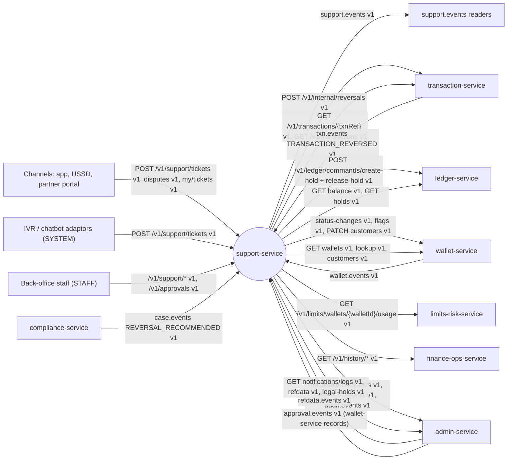

### 3.2 Component diagram

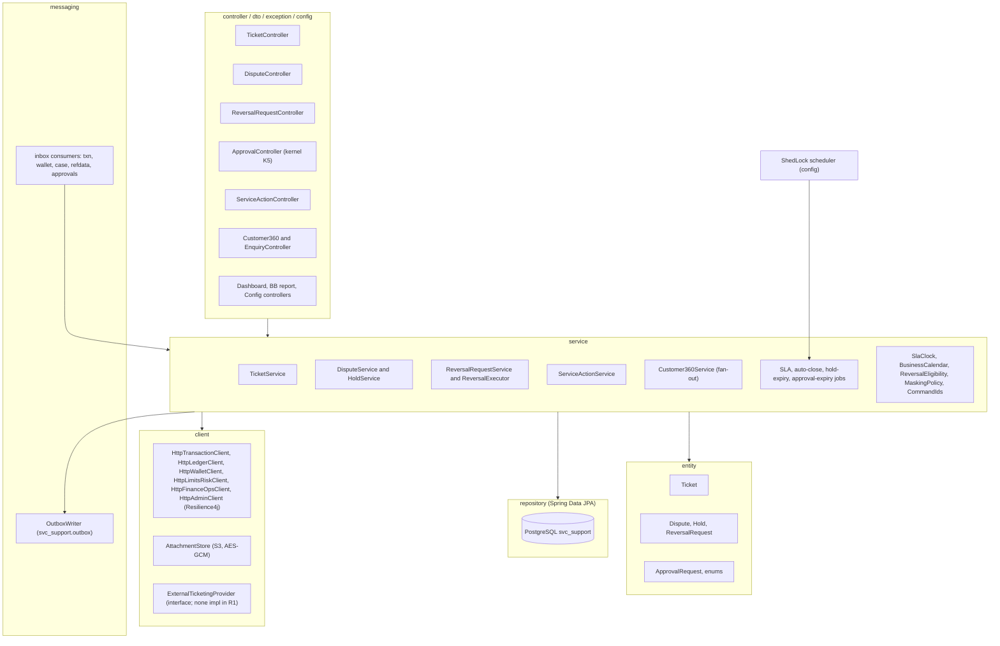

### 3.3 Runtime and deployment (Compose)

| Item | Value |
|---|---|
| Compose service | `support-service`, ports 8109 / 9109, Spring profile `dev` (all jobs in one container), `mem_limit` 384 MB |
| Infra dependencies | postgres, kafka-init, object-store (S3-compatible). Readiness covers only these; never waits for another service at start-up |
| Database | `jdbc:postgresql://postgres:5432/bitspay?currentSchema=svc_support`, role `svc_support`; Flyway `spring.flyway.schemas=svc_support` (`create-schemas=false` in the stack, `true` in Testcontainers) |
| Object storage | bucket `bitspay-docs`, key prefix `support/{ticketId}/{attachmentId}`; env `BITSPAY_S3_ENDPOINT`, `BITSPAY_S3_ACCESSKEY`, `BITSPAY_S3_SECRETKEY`, `BITSPAY_S3_REGION` (property `bitspay.support.attachments.store = s3`; `local-fs` for the `local` profile) |
| Attachment encryption | Envelope AES-GCM: per-file DEK wrapped by the service key `BITSPAY_FIELD_CIPHER_KEY` (kernel K8.3) |
| Clients | `BITSPAY_CLIENTS_TRANSACTION_BASEURL`, `_LEDGER_`, `_WALLET_`, `_LIMITSRISK_`, `_REPORTING_` (finance-ops-service), `_NOTIFICATION_` (admin-service; also used for the refdata and legal-hold reads on the same host). Tests and profile `local` point these at WireMock |
| Redis / TigerBeetle / ClickHouse | none |
| Consumer groups | `support-service` (`txn.events`, `wallet.events`, `case.events`, `refdata.events`); `support-service.approvals` (`approval.events`) |
| Produced topics | `support.events` (own); writes `notification.requests`, `approval.events`, `audit.events` (inbound topics of admin-service) — all through the one outbox |

Scheduled jobs (ShedLock, table `shedlock`):

| Job | Schedule | Does |
|---|---|---|
| `sla-evaluator` | every 1 min | Tickets with `next_sla_check_at ≤ now`: 75 % warning, 100 % breach + escalation, 150 % level 3 (BR-S-12) |
| `ticket-auto-close` | every 15 min | RESOLVED > `autoCloseDays` → CLOSED; PENDING_CUSTOMER idle > `customerReplyDays` → RESOLVED `NO_RESPONSE` (BR-S-07) |
| `hold-expiry` | every 5 min | Release ACTIVE holds past `expires_at`, unless a reversal of that dispute is APPROVED / EXECUTING / PENDING_FUNDS / FAILED_RETRYABLE (BR-S-23); `HOLD_EXPIRING` alert 24 h before |
| `hold-retry` | every 30 s | Re-send `create-hold` for REQUESTED (≤ 10 min, same `commandId`), `release-hold` for RELEASE_REQUESTED, pending flag set / clear |
| `reversal-executor` | after commit + every 1 min | Execute APPROVED and re-try EXECUTING requests (BR-S-33/34); daily auto-retry of PENDING_FUNDS while the hold is ACTIVE (`autoRetryPendingFunds`) |
| `approval-expiry` | every 5 min | PENDING approvals past `expires_at` → EXPIRED (+ `APPROVAL_EXPIRED`, reversal → EXPIRED) |
| `housekeeping` | daily 02:00 Dhaka | Delete outbox rows > 3 d, `processed_event` > 14 d, `idempotency_record` > 8 d |
| `retention-purge` | R2 (disabled) | Purge COMPLAINT records past retention after a legal-hold check |

### 3.4 Key flows

**F1 — Ticket from the app with SLA and customer notification**

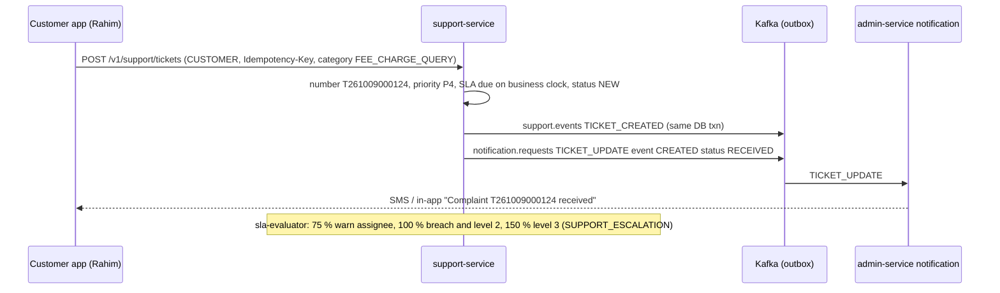

**F2 — Wrong transfer: dispute, hold, consent, reversal (happy path)**

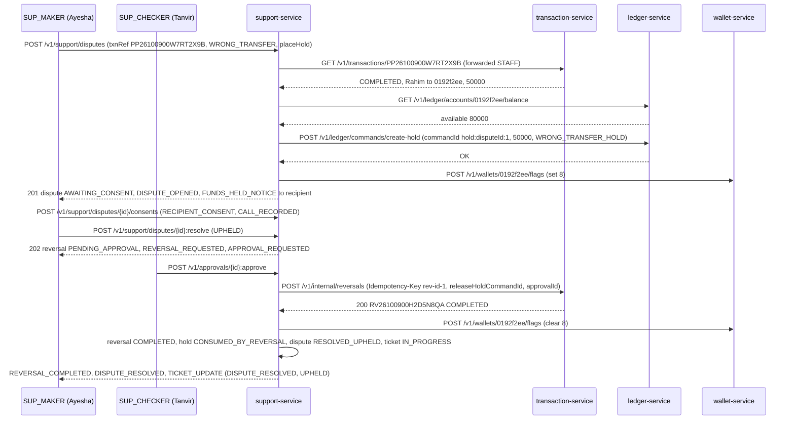

**F3 — Customer 360 (fan-out, partial results)**

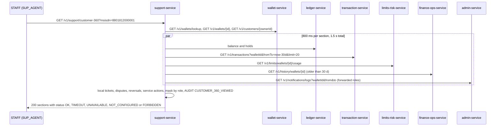

**F4 — Reversal executor: unknown outcome, definitive refusal, lost response**

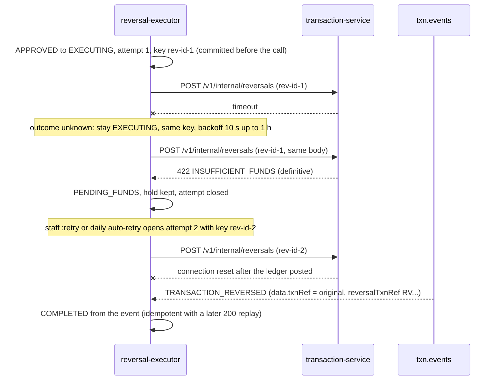

**F5 — Compliance reversal recommendation**

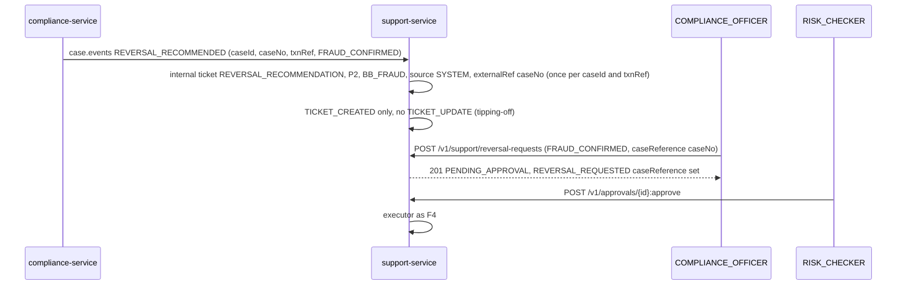

**F6 — Forwarded block with wallet-side approval**

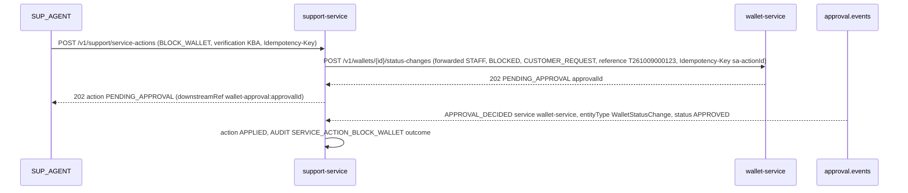

### 3.5 State machines

**Ticket**

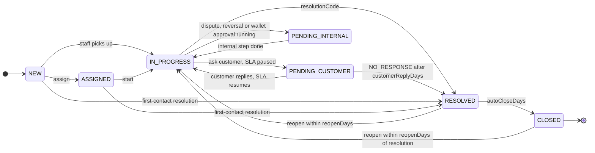

**Dispute**

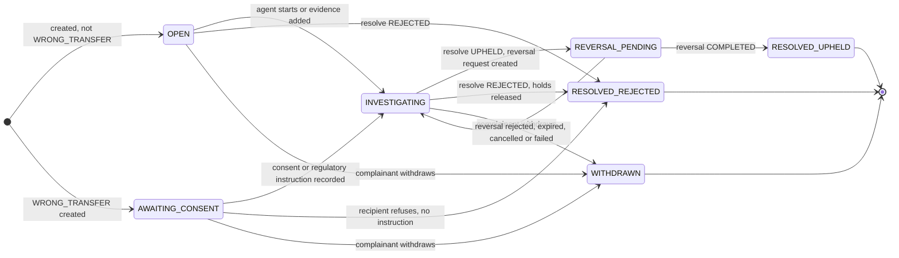

**Ledger hold**

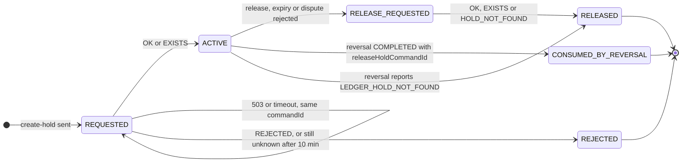

**Reversal request**

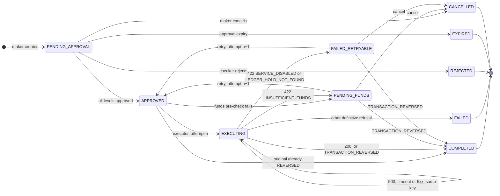

**Service action**

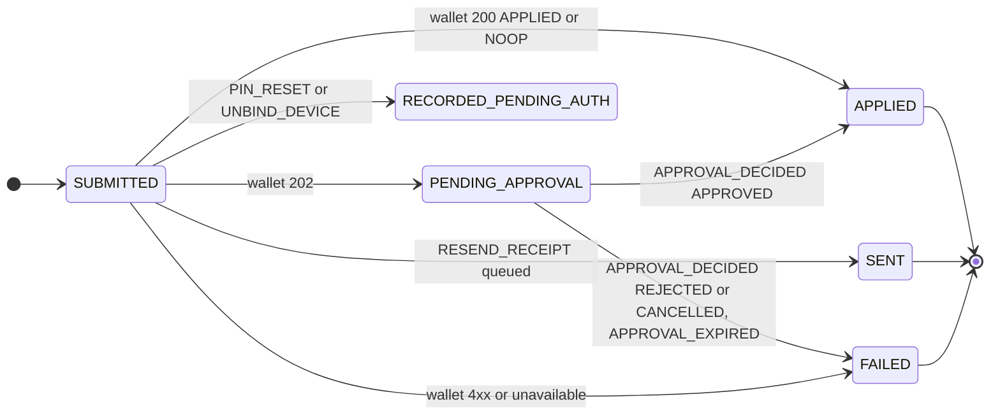

### 3.6 Architecture decisions

| ADR | Decision | Why | Consequence |
|---|---|---|---|
| ADR-01 | Block / unblock and contact updates are **forwarded** to wallet-service with the staff member's own `X-Actor-*` headers; wallet-service runs the maker-checker. support-service stores a `service_action` and completes it from `approval.events` (filtered to wallet-service `WalletStatusChange` / `CustomerProfile`). | wallet-service owns status and profile maker-checker; no double approval | `WALLET_UPSERTED` is a projection source only, never used to complete actions |
| ADR-02 | Reversal maker-checker is local. Execution calls transaction-service as `SERVICE` with **one key per attempt** `rev-{reversalRequestId}-{attempt}`. The same key (same body) is re-sent only while the outcome is unknown; any definitive answer closes the attempt. `TRANSACTION_REVERSED` reconciles lost responses. | Exactly-once money effect; a definitive refusal is final for its key (kernel K3.3 rule 5) | `reversal_request` stores `attempt`, `idempotency_key`, `attempt_started_at` |
| ADR-03 | Hold `commandId = UUIDv5(SUPPORT_NS, "hold:{disputeId}:{seq}")`, `SUPPORT_NS = 6f0b8a52-3c1d-5e7f-9a2b-4c6d8e0f1a3b`; a new hold after a `REJECTED` uses `seq + 1`. Release `commandId = UUIDv5(SUPPORT_NS, "release:" + holdCommandId)`. | Deterministic ⇒ retries idempotent at the ledger; REJECTED is final for a `commandId` | `holdCommandId` stored = the one that actually posted |
| ADR-04 | Customer 360 is a stateless fan-out (virtual threads, structured concurrency) with a per-section timeout and status; balances never cached. | SUP-001 must stay usable when one dependency is down | 360 is always 200 once the subject is resolved |
| ADR-05 | SLA deadlines are stored as absolute timestamps computed by `BusinessCalendar`: weekend days and time zone from `CALENDAR.WEEKEND_DAYS` / `CALENDAR.TIMEZONE`, holidays from `HOLIDAY` refdata, business hours 09:00–17:00 from local `SUPPORT_PARAMS`. | Cheap evaluation through the index on `next_sla_check_at`; one calendar for the platform | A holiday change recomputes open deadlines that fall on the changed date |
| ADR-06 | Ticket number `T{yyMMdd}{6-digit seq}` per Asia/Dhaka calendar date via `ticket_number_counter` (`UPDATE … RETURNING`); beyond 999 999 / day the sequence grows to 7 digits. | Short, readable over the phone / USSD (SUP-002) | Column `varchar(14)` |
| ADR-07 | Hold amount = `min(requested ?? principal, principal, available)`. A reversal may be **partial** (`amountPoisha` < principal): partial forces `reverseFee = reverseCommission = false` and is final. The funds pre-check uses `amountPoisha ?? principal`. | Recipients who spent part of the money can still return the rest (SUP-005) | The original ends `REVERSED` either way |
| ADR-08 | Dashboards and the BB dataset are computed from the support DB (indexed, ≤ 3 s), not from the analytics store. support's `bb-complaints` dataset is the RR-05 system of record; `TICKET_STATUS_CHANGED` carries the fields needed to reproduce it from events. | Volume is small; no runtime dependency | Definition `resolvedWithinSla = !slaBreached at RESOLVED` is shared |
| ADR-09 | Customer ticket notifications are **sent by support-service** on `notification.requests` (`TICKET_UPDATE`); notification has no rules on `support.events`. Internal tickets are never notified. (OPEN D-12) | Support can suppress internal / tipping-off tickets | No `previousCustomerVisibleStatus` field on the event |
| ADR-10 | History older than the 30-day hot window and non-transaction references come from finance-ops-service history (`GET /v1/history/wallets/{walletId}`, `GET /v1/history/transactions/{txnRef}`); the statement endpoint is never used for enquiry. Client enabled by default. | One cursor-based, filterable source for old data | 3.5 s client timeout against a 3 s SLA |

### 3.7 Latency / throughput budget

support-service is not on the payment hot path. Its share of the 5k TPS design target is negligible (≤ 50 000 tickets / day ≈ 0.6 / s average, peaks ≈ 20 / s).

| Operation | Budget | Notes |
|---|---|---|
| Ticket create / comment / transition | p95 ≤ 300 ms | local DB + outbox |
| Ticket search | ≤ 3 s (PER-008) | indexed |
| Dispute create | p95 ≤ 1.5 s | transaction GET (1 s) + balance (800 ms) + create-hold (1 s) in sequence; hold falls back to REQUESTED |
| Customer 360 | p95 ≤ 1.5 s | 800 ms per section, 1.5 s total |
| Enquiry ≤ 30 d / older | ≤ 1 s / ≤ 3.5 s | transaction-service / history |
| Dashboard | ≤ 3 s | |
| BB dataset | ≤ 60 s | |

## 4. Data model

### 4.1 Tables (Flyway `V1__init.sql`)

All tables live in `svc_support` (unqualified DDL; `search_path`). Mutable rows carry `created_at`, `updated_at`, `version`. Every `txnRef`-like column is `varchar(32)` (opaque 1..32).

```sql
CREATE TABLE ticket (
  ticket_id             uuid PRIMARY KEY,
  ticket_number         varchar(14) NOT NULL UNIQUE,              -- T261009000123 (14 on 7-digit overflow)
  category              text NOT NULL,
  sub_category          text,
  bb_category           text NOT NULL CHECK (bb_category IN ('BB_FRAUD','BB_TRANSACTION','BB_AGENT','BB_MERCHANT','BB_ACCOUNT','BB_CHARGES','BB_OTHER')),
  internal              boolean NOT NULL DEFAULT false,           -- CATEGORIES.internal (REVERSAL_RECOMMENDATION): never notified / never listed to owners
  priority              text NOT NULL CHECK (priority IN ('P1','P2','P3','P4')),
  status                text NOT NULL CHECK (status IN ('NEW','ASSIGNED','IN_PROGRESS','PENDING_CUSTOMER','PENDING_INTERNAL','RESOLVED','CLOSED')),
  channel               text NOT NULL CHECK (channel IN ('APP','USSD','PARTNER_APP','PORTAL','BACKOFFICE','API','SYSTEM')),
  source                text NOT NULL CHECK (source IN ('APP','USSD','IVR','CHATBOT','CALL_CENTRE','AGENT','PORTAL','EMAIL','BACKOFFICE','SYSTEM')),
  subject               text NOT NULL,
  description           text NOT NULL,
  customer_id           uuid,
  wallet_id             uuid,
  msisdn                varchar(13),                              -- full; masked on output per role
  msisdn_hash           char(64),                                 -- kernel K2 HMAC (MSISDN)
  language              text CHECK (language IN ('bn','en')),
  txn_ref               varchar(32),
  raised_by_type        text NOT NULL,
  raised_by_id          text NOT NULL,
  assignee_id           text,
  assignee_team         text,
  escalation_level      smallint NOT NULL DEFAULT 1 CHECK (escalation_level BETWEEN 1 AND 3),
  first_response_due_at timestamptz,
  first_responded_at    timestamptz,
  resolution_due_at     timestamptz NOT NULL,
  sla_paused_at         timestamptz,
  sla_paused_business_minutes int NOT NULL DEFAULT 0,
  sla_warning_sent      boolean NOT NULL DEFAULT false,
  sla_breached          boolean NOT NULL DEFAULT false,
  first_response_breached boolean NOT NULL DEFAULT false,
  next_sla_check_at     timestamptz,
  resolution_code       text CHECK (resolution_code IN ('ANSWERED','FIXED','REVERSED','REFUNDED_BY_MERCHANT','REJECTED_NO_FAULT','DUPLICATE','NO_RESPONSE','REFERRED')),
  resolution_note       text,
  first_contact_resolution boolean NOT NULL DEFAULT false,
  resolved_at           timestamptz,
  closed_at             timestamptz,
  reopen_count          int NOT NULL DEFAULT 0,
  reassigned            boolean NOT NULL DEFAULT false,
  external_ref          text,                                     -- compliance caseNo (REVERSAL_RECOMMENDATION); CRM ref (R2)
  origin_key            text UNIQUE,                              -- 'case:{caseId}:{txnRef}' for REVERSAL_RECOMMENDED idempotency
  retention_until       date,                                     -- closed_at + RETENTION.COMPLAINT.totalYears
  created_at            timestamptz NOT NULL DEFAULT now(),
  updated_at            timestamptz NOT NULL DEFAULT now(),
  version               bigint NOT NULL DEFAULT 1
);
CREATE INDEX ix_ticket_status   ON ticket (status, priority, created_at);
CREATE INDEX ix_ticket_sla      ON ticket (next_sla_check_at) WHERE status NOT IN ('RESOLVED','CLOSED');
CREATE INDEX ix_ticket_wallet   ON ticket (wallet_id, created_at DESC);
CREATE INDEX ix_ticket_customer ON ticket (customer_id, created_at DESC);
CREATE INDEX ix_ticket_msisdn   ON ticket (msisdn_hash, created_at DESC);
CREATE INDEX ix_ticket_assignee ON ticket (assignee_id) WHERE status NOT IN ('RESOLVED','CLOSED');
CREATE INDEX ix_ticket_created  ON ticket (created_at);
CREATE INDEX ix_ticket_resolved ON ticket (resolved_at) WHERE resolved_at IS NOT NULL;
CREATE INDEX ix_ticket_txn      ON ticket (txn_ref) WHERE txn_ref IS NOT NULL;

CREATE TABLE ticket_number_counter (
  business_date date PRIMARY KEY,            -- Asia/Dhaka calendar date
  last_seq      int  NOT NULL
);

CREATE TABLE ticket_comment (
  comment_id   uuid PRIMARY KEY,
  ticket_id    uuid NOT NULL REFERENCES ticket,
  visibility   text NOT NULL CHECK (visibility IN ('CUSTOMER','INTERNAL')),
  body         text NOT NULL CHECK (length(body) <= 4000),
  author_type  text NOT NULL,
  author_id    text NOT NULL,
  created_at   timestamptz NOT NULL DEFAULT now()
);
CREATE INDEX ix_comment_ticket ON ticket_comment (ticket_id, created_at);

CREATE TABLE attachment (
  attachment_id    uuid PRIMARY KEY,
  ticket_id        uuid NOT NULL REFERENCES ticket,
  dispute_id       uuid,
  purpose          text NOT NULL CHECK (purpose IN ('TICKET','EVIDENCE','CONSENT','REGULATORY_INSTRUCTION')),
  file_name        text NOT NULL,
  content_type     text NOT NULL CHECK (content_type IN ('image/jpeg','image/png','application/pdf','audio/mpeg','audio/ogg','text/plain')),
  size_bytes       int  NOT NULL CHECK (size_bytes BETWEEN 1 AND 10485760),
  sha256_hex       char(64) NOT NULL,
  storage_key      text NOT NULL,
  dek_wrapped      bytea NOT NULL,
  iv               bytea NOT NULL,
  uploaded_by_type text NOT NULL,
  uploaded_by_id   text NOT NULL,
  created_at       timestamptz NOT NULL DEFAULT now()
);
CREATE INDEX ix_attachment_ticket ON attachment (ticket_id);

CREATE TABLE ticket_history (
  id           bigserial PRIMARY KEY,
  ticket_id    uuid NOT NULL,
  event        text NOT NULL,          -- CREATED, ASSIGNED, STATUS_CHANGED, ESCALATED, SLA_WARNING, SLA_BREACHED, REOPENED, COMMENTED, NOTIFIED
  from_value   text,
  to_value     text,
  actor_type   text NOT NULL,
  actor_id     text NOT NULL,
  details      jsonb,
  occurred_at  timestamptz NOT NULL DEFAULT now()
);
CREATE INDEX ix_ticket_history ON ticket_history (ticket_id, occurred_at);

CREATE TABLE dispute (
  dispute_id             uuid PRIMARY KEY,
  ticket_id              uuid NOT NULL REFERENCES ticket,
  dispute_type           text NOT NULL CHECK (dispute_type IN ('WRONG_TRANSFER','UNAUTHORISED_TXN','MERCHANT_DISPUTE','DUPLICATE_TXN','CASH_OUT_NOT_RECEIVED','OTHER')),
  state                  text NOT NULL CHECK (state IN ('OPEN','INVESTIGATING','AWAITING_CONSENT','REVERSAL_PENDING','RESOLVED_UPHELD','RESOLVED_REJECTED','WITHDRAWN')),
  txn_ref                varchar(32) NOT NULL,
  txn_id                 uuid NOT NULL,
  txn_type               text NOT NULL,
  txn_completed_at       timestamptz NOT NULL,
  principal_poisha       bigint NOT NULL CHECK (principal_poisha > 0),
  fee_poisha             bigint NOT NULL DEFAULT 0,
  from_wallet_id         uuid NOT NULL,
  to_wallet_id           uuid NOT NULL,
  complainant_wallet_id  uuid NOT NULL,
  counterparty_wallet_id uuid NOT NULL,
  claim_amount_poisha    bigint CHECK (claim_amount_poisha > 0),
  description            text NOT NULL,
  outcome_reason_code    text,
  outcome_note           text,
  reversal_request_id    uuid,
  opened_by_type         text NOT NULL,
  opened_by_id           text NOT NULL,
  resolved_by            text,
  resolved_at            timestamptz,
  created_at             timestamptz NOT NULL DEFAULT now(),
  updated_at             timestamptz NOT NULL DEFAULT now(),
  version                bigint NOT NULL DEFAULT 1
);
CREATE UNIQUE INDEX ux_dispute_active_txn ON dispute (txn_ref)
  WHERE state NOT IN ('RESOLVED_UPHELD','RESOLVED_REJECTED','WITHDRAWN');
CREATE INDEX ix_dispute_state   ON dispute (state, created_at);
CREATE INDEX ix_dispute_wallets ON dispute (complainant_wallet_id);
CREATE INDEX ix_dispute_cp      ON dispute (counterparty_wallet_id);

CREATE TABLE ledger_hold (
  hold_id            uuid PRIMARY KEY,
  dispute_id         uuid NOT NULL REFERENCES dispute,
  seq                int  NOT NULL,
  hold_command_id    uuid NOT NULL UNIQUE,                 -- ADR-03
  account_id         uuid NOT NULL,                        -- held wallet (counterparty)
  amount_poisha      bigint NOT NULL CHECK (amount_poisha > 0),
  reason_code        text NOT NULL CHECK (reason_code IN ('DISPUTE_HOLD','WRONG_TRANSFER_HOLD')),
  state              text NOT NULL CHECK (state IN ('REQUESTED','ACTIVE','REJECTED','RELEASE_REQUESTED','RELEASED','CONSUMED_BY_REVERSAL')),
  ledger_result      jsonb,
  first_requested_at timestamptz NOT NULL DEFAULT now(),
  expires_at         timestamptz,
  extension_count    int NOT NULL DEFAULT 0,
  release_reason     text,
  release_command_id uuid,
  flag_set           boolean NOT NULL DEFAULT false,
  flag_clear_pending boolean NOT NULL DEFAULT false,
  placed_by          text NOT NULL,
  created_at         timestamptz NOT NULL DEFAULT now(),
  updated_at         timestamptz NOT NULL DEFAULT now(),
  version            bigint NOT NULL DEFAULT 1,
  UNIQUE (dispute_id, seq)
);
CREATE INDEX ix_hold_expiry  ON ledger_hold (expires_at) WHERE state = 'ACTIVE';
CREATE INDEX ix_hold_account ON ledger_hold (account_id) WHERE state IN ('ACTIVE','REQUESTED','RELEASE_REQUESTED');
CREATE INDEX ix_hold_retry   ON ledger_hold (state, updated_at) WHERE state IN ('REQUESTED','RELEASE_REQUESTED') OR flag_clear_pending;

CREATE TABLE dispute_consent (
  consent_id     uuid PRIMARY KEY,
  dispute_id     uuid NOT NULL REFERENCES dispute,
  consent_type   text NOT NULL CHECK (consent_type IN ('RECIPIENT_CONSENT','REGULATORY_INSTRUCTION')),
  method         text NOT NULL CHECK (method IN ('CALL_RECORDED','IN_PERSON','WRITTEN','APP_CONFIRMATION','BB_LETTER','COURT_ORDER')),
  reference      text NOT NULL,
  attachment_id  uuid,
  note           text,
  recorded_by    text NOT NULL,
  recorded_at    timestamptz NOT NULL DEFAULT now()
);

CREATE TABLE reversal_request (
  reversal_request_id     uuid PRIMARY KEY,
  ticket_id               uuid NOT NULL REFERENCES ticket,
  dispute_id              uuid REFERENCES dispute,
  original_txn_ref        varchar(32) NOT NULL,
  original_txn_id         uuid NOT NULL,
  original_txn_type       text NOT NULL,
  principal_poisha        bigint NOT NULL CHECK (principal_poisha > 0),   -- original principal
  amount_poisha           bigint NOT NULL CHECK (amount_poisha > 0),      -- requested; < principal = partial
  from_wallet_id          uuid NOT NULL,                                  -- original from
  to_wallet_id            uuid NOT NULL,                                  -- original to (debited by the reversal)
  reason_code             text NOT NULL CHECK (reason_code IN ('WRONG_TRANSFER','DISPUTE_UPHELD','SYSTEM_ERROR','FRAUD_CONFIRMED')),
  reverse_fee             boolean NOT NULL,
  reverse_commission      boolean NOT NULL,
  release_hold_command_id uuid,
  omit_release_hold       boolean NOT NULL DEFAULT false,                 -- set after LEDGER_HOLD_NOT_FOUND
  case_reference          text,
  comment                 text NOT NULL,
  state                   text NOT NULL CHECK (state IN ('PENDING_APPROVAL','APPROVED','EXECUTING','COMPLETED','PENDING_FUNDS',
                                                         'FAILED_RETRYABLE','FAILED','REJECTED','EXPIRED','CANCELLED')),
  approval_id             uuid,
  maker_id                text NOT NULL,
  attempt                 int NOT NULL DEFAULT 1,
  idempotency_key         varchar(64) NOT NULL UNIQUE,                    -- rev-{reversal_request_id}-{attempt}
  attempt_started_at      timestamptz,                                    -- first send of the current attempt (24 h / 72 h rules)
  calls_in_attempt        int NOT NULL DEFAULT 0,
  next_attempt_at         timestamptz,
  last_error_code         text,
  failure_code            text,                                           -- REVERSAL_COMPLETED.failureCode
  reversal_txn_ref        varchar(32),
  executed_at             timestamptz,
  created_at              timestamptz NOT NULL DEFAULT now(),
  updated_at              timestamptz NOT NULL DEFAULT now(),
  version                 bigint NOT NULL DEFAULT 1
);
CREATE UNIQUE INDEX ux_reversal_active_txn ON reversal_request (original_txn_ref)
  WHERE state NOT IN ('REJECTED','EXPIRED','CANCELLED','FAILED');
CREATE INDEX ix_reversal_exec ON reversal_request (next_attempt_at) WHERE state IN ('APPROVED','EXECUTING');
CREATE INDEX ix_reversal_state ON reversal_request (state, created_at);

CREATE TABLE service_action (
  action_id      uuid PRIMARY KEY,
  ticket_id      uuid NOT NULL REFERENCES ticket,
  action_type    text NOT NULL CHECK (action_type IN ('BLOCK_WALLET','UNBLOCK_WALLET','RESEND_RECEIPT','PIN_RESET','UNBIND_DEVICE','UPDATE_CONTACT')),
  wallet_id      uuid,
  customer_id    uuid,
  txn_ref        varchar(32),                                  -- RESEND_RECEIPT
  payload        jsonb NOT NULL,                               -- PII per kernel K6 when audited
  verification   jsonb,                                        -- {method, note}
  state          text NOT NULL CHECK (state IN ('SUBMITTED','PENDING_APPROVAL','APPLIED','SENT','RECORDED_PENDING_AUTH','FAILED')),
  downstream_ref text,                                         -- wallet-approval:{approvalId} | wallet-change:{changeRequestId} | notification:{requestId}
  approval_id    uuid,                                         -- wallet-side approval (match for approval.events)
  error          text,
  actor_id       text NOT NULL,
  created_at     timestamptz NOT NULL DEFAULT now(),
  updated_at     timestamptz NOT NULL DEFAULT now(),
  version        bigint NOT NULL DEFAULT 1
);
CREATE INDEX ix_action_wallet   ON service_action (wallet_id, created_at DESC);
CREATE INDEX ix_action_approval ON service_action (approval_id) WHERE approval_id IS NOT NULL;
CREATE INDEX ix_action_receipt  ON service_action (txn_ref, created_at) WHERE action_type = 'RESEND_RECEIPT';

CREATE TABLE wallet_projection (                -- from wallet.events WALLET_UPSERTED
  wallet_id      uuid PRIMARY KEY,
  owner_type     text NOT NULL,
  owner_id       uuid NOT NULL,
  wallet_type    char(1) NOT NULL,
  msisdn_hash    char(64) NOT NULL,             -- kernel K2
  msisdn_masked  varchar(13) NOT NULL,          -- 8801711****00
  display_name   text NOT NULL,
  language       text NOT NULL,
  status         char(1) NOT NULL,
  status_reason  text,
  wallet_version bigint NOT NULL
);
CREATE INDEX ix_wproj_msisdn ON wallet_projection (msisdn_hash);

CREATE TABLE business_holiday (                 -- from refdata.events HOLIDAY
  holiday_date date PRIMARY KEY,
  name_en      text,
  kind         text,
  bank_holiday boolean NOT NULL,
  active       boolean NOT NULL,
  ref_version  bigint NOT NULL
);

CREATE TABLE refdata_item (                     -- REASON_CODE and SYSTEM_PARAM items read (latest version wins)
  type        text NOT NULL,
  code        text NOT NULL,
  attributes  jsonb NOT NULL,
  active      boolean NOT NULL,
  ref_version bigint NOT NULL,
  PRIMARY KEY (type, code)
);

CREATE TABLE config_document (
  config_key     text NOT NULL CHECK (config_key IN ('CATEGORIES','SLA_POLICY','ESCALATION','HOLD_POLICY','REVERSAL_POLICY','MASKING_POLICY','SUPPORT_PARAMS')),
  config_version int  NOT NULL,
  status         text NOT NULL CHECK (status IN ('DRAFT','PENDING_APPROVAL','ACTIVE','RETIRED','REJECTED')),
  payload        jsonb NOT NULL,
  maker_id       text NOT NULL,
  approval_id    uuid,
  created_at     timestamptz NOT NULL DEFAULT now(),
  updated_at     timestamptz NOT NULL DEFAULT now(),
  version        bigint NOT NULL DEFAULT 1,
  PRIMARY KEY (config_key, config_version)
);
CREATE UNIQUE INDEX ux_support_config_active ON config_document (config_key) WHERE status = 'ACTIVE';

CREATE TABLE approval_request (                 -- kernel K5
  id               uuid PRIMARY KEY,
  entity_type      text NOT NULL CHECK (entity_type IN ('ReversalRequest','HoldExtension','ConfigDocument')),
  entity_id        text NOT NULL,
  action           text NOT NULL CHECK (action IN ('EXECUTE_REVERSAL','EXTEND_HOLD','ACTIVATE')),
  payload          jsonb NOT NULL,
  maker_id         text NOT NULL,
  maker_user_id    text,
  maker_roles      text[] NOT NULL DEFAULT '{}',
  status           text NOT NULL CHECK (status IN ('PENDING','APPROVED','REJECTED','EXPIRED','CANCELLED')),
  level            int NOT NULL DEFAULT 1,
  required_levels  int NOT NULL DEFAULT 1,
  checker_roles    jsonb NOT NULL,                -- per level: [["SUP_CHECKER","OPS_CHECKER"],["FIN_CHECKER"]]
  amount_poisha    bigint,
  summary          text NOT NULL CHECK (length(summary) <= 200),
  created_at       timestamptz NOT NULL DEFAULT now(),
  expires_at       timestamptz NOT NULL,
  decided_by       text[] NOT NULL DEFAULT '{}',
  decided_at       timestamptz,
  comments         jsonb NOT NULL DEFAULT '[]'::jsonb,
  updated_at       timestamptz NOT NULL DEFAULT now(),
  version          bigint NOT NULL DEFAULT 1
);
CREATE INDEX ix_approval_pending ON approval_request (status, created_at) WHERE status = 'PENDING';

CREATE TABLE idempotency_record (               -- kernel K3.3: retention ≥ 7 days
  actor_id text NOT NULL, idem_key text NOT NULL, request_hash char(64) NOT NULL,
  response_status int NOT NULL, response_body jsonb NOT NULL, created_at timestamptz NOT NULL DEFAULT now(),
  PRIMARY KEY (actor_id, idem_key)
);

CREATE TABLE shedlock (
  name varchar(64) PRIMARY KEY, lock_until timestamptz NOT NULL, locked_at timestamptz NOT NULL, locked_by varchar(255) NOT NULL
);

-- outbox / inbox (kernel K8.2, verbatim)
CREATE TABLE IF NOT EXISTS outbox (
  id             uuid PRIMARY KEY,
  aggregate_type text        NOT NULL,
  aggregate_id   text        NOT NULL,
  event_type     text        NOT NULL,
  payload        jsonb       NULL,
  created_at     timestamptz NOT NULL DEFAULT now(),
  published_at   timestamptz
);
CREATE INDEX IF NOT EXISTS outbox_unpublished ON outbox (created_at) WHERE published_at IS NULL;

CREATE TABLE IF NOT EXISTS processed_event (
  event_id     uuid PRIMARY KEY,
  topic        text NOT NULL,
  processed_at timestamptz NOT NULL DEFAULT now()
);
```

`V2__seed_config.sql` inserts the provisional ACTIVE config documents of §8.2 (`maker_id = 'seed'`).

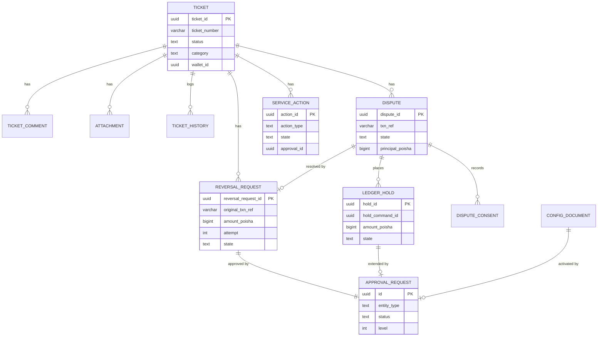

### 4.2 Redis keys / caches

None. Balances are never cached. `wallet_projection` is a private projection used for MSISDN search and display; the wallet status cache owned by wallet-service is not read.

### 4.3 Retention and archival

| Data | Retention | Rule |
|---|---|---|
| Tickets, comments, attachments, disputes, consents, holds, reversal requests, service actions | `RETENTION.COMPLAINT` (seed: 12 months online, 5 years total, basis `CASE_CLOSURE`, end action `PURGE`) | `retention_until = closed_at + totalYears`; online window `onlineMonths`. Local fallback 12 / 5 until the refdata item is received. Purge is R2 (`retention-purge` job disabled) and calls `GET /v1/retention/legal-holds` first (subjectType `CUSTOMER` / `WALLET` / `TXN` and category `COMPLAINT`); an ACTIVE hold (including `subjectType CATEGORY`) skips the record; an unknown answer skips the run |
| `outbox` | 3 days | kernel K8.2 |
| `processed_event` | 14 days | kernel K8.2 |
| `idempotency_record` | 8 days (≥ 7 d, kernel K3.3, OPEN D-01) | housekeeping |
| `ticket_history` | as its ticket | |
| `wallet_projection`, `business_holiday`, `refdata_item` | compacted state | overwritten by newer versions |

## 5. Provided contracts (mirror of `contracts/provided/` — the artefact wins on conflict)

### 5.1 REST operations

Base URL `http://support-service:8109`. Every operation takes the kernel K3.1 headers (`X-Correlation-Id`, `X-Actor-Type`, `X-Actor-Id`, `X-Actor-Wallet-Id` for wallet holders, `X-Actor-Roles` for STAFF, `X-Actor-User-Id` optional, `X-Channel`). "Own" means `X-Actor-Id` = the ticket/dispute `customerId` or `X-Actor-Wallet-Id` = its `walletId` (partners: the wallet they operate). A caller that is not allowed gets `403 ACTOR_NOT_ALLOWED`; an owner asking for someone else's ticket/dispute gets `404 NOT_FOUND` (no existence leak). Missing or ill-formed headers → `400 VALIDATION_FAILED`.

| # | Operation | Audience | Actors & roles | Idempotency | Purpose |
|---|---|---|---|---|---|
| 1 | `POST /v1/support/tickets` | customer | CUSTOMER (own (linked to X-Actor-Id / X-Actor-Wallet-Id)); AGENT (own or on behalf of a customer (by msisdn)); MERCHANT (own or on behalf of a customer); DISTRIBUTOR (own or on behalf of a customer); STAFF `SUP_AGENT`, `SUP_MAKER`; SYSTEM `X-Actor-Id` ∈ {ivr-adaptor, chatbot-adaptor} — X-Channel SYSTEM; body source IVR \| CHATBOT; list = config support.system-callers | `Idempotency-Key` required | Register a complaint / ticket (SUP-002) |
| 2 | `GET /v1/support/tickets` | staff | STAFF any K7 staff role | read | Search tickets (staff, ≤ 3 s) |
| 3 | `GET /v1/support/tickets/{ticketId}` | staff | STAFF any K7 staff role → `TicketView`; CUSTOMER (own) → `TicketCustomerView`; AGENT (own) → `TicketCustomerView`; MERCHANT (own) → `TicketCustomerView` | read | Get a ticket (staff full view; owner customer view) |
| 4 | `GET /v1/support/tickets/by-number/{ticketNumber}` | staff | STAFF any K7 staff role → `TicketView`; CUSTOMER (own) → `TicketCustomerView`; AGENT (own) → `TicketCustomerView`; MERCHANT (own) → `TicketCustomerView` | read | Get a ticket by its number |
| 5 | `GET /v1/support/my/tickets` | customer | CUSTOMER (own); AGENT (own); MERCHANT (own) | read | Complainant's own tickets (customer-visible status only, SUP-003) |
| 6 | `POST /v1/support/tickets/{ticketId}/comments` | staff | STAFF any SUP_* role; CUSTOMER (own (visibility forced CUSTOMER)); AGENT (own); MERCHANT (own) | state-guarded (no key) | Add a comment |
| 7 | `POST /v1/support/tickets/{ticketId}/attachments` | staff | STAFF any SUP_* role, COMPLIANCE_OFFICER; CUSTOMER (own); AGENT (own); MERCHANT (own) | state-guarded (no key) | Upload an attachment (encrypted at rest; ≤ 10 MB, ≤ 20 per ticket) |
| 8 | `GET /v1/support/tickets/{ticketId}/attachments/{attachmentId}` | staff | STAFF any SUP_* role, COMPLIANCE_OFFICER, AUDITOR | read | Download an attachment (audited ATTACHMENT_DOWNLOADED) |
| 9 | `POST /v1/support/tickets/{ticketId}:assign` | staff | STAFF `SUP_AGENT` (self only); STAFF `SUP_MAKER`, `SUP_CHECKER` (anyone) | state-guarded (no key) | Assign a ticket |
| 10 | `POST /v1/support/tickets/{ticketId}:transition` | staff | STAFF `SUP_AGENT`, `SUP_MAKER`, `SUP_CHECKER`, `OPS_MAKER`, `COMPLIANCE_OFFICER` | state-guarded (no key) | Change ticket status (BR-S-05) |
| 11 | `POST /v1/support/tickets/{ticketId}:escalate` | staff | STAFF `SUP_AGENT`, `SUP_MAKER`, `SUP_CHECKER` | state-guarded (no key) | Manual escalation +1 level (max 3) |
| 12 | `POST /v1/support/tickets/{ticketId}:reopen` | customer | STAFF `SUP_AGENT`, `SUP_MAKER`, `SUP_CHECKER`; CUSTOMER (own); AGENT (own); MERCHANT (own) | state-guarded (no key) | Reopen within reopenDays of resolution |
| 13 | `POST /v1/support/disputes` | customer | STAFF `SUP_AGENT`, `SUP_MAKER`; CUSTOMER (own transaction); MERCHANT (own transaction); AGENT (own transaction) | `Idempotency-Key` required | Open a dispute on a txnRef (SUP-004/005, PRT-008) |
| 14 | `GET /v1/support/disputes` | staff | STAFF any K7 staff role; CUSTOMER (own); MERCHANT (own); AGENT (own) | read | List disputes |
| 15 | `GET /v1/support/disputes/{disputeId}` | staff | STAFF any K7 staff role; CUSTOMER (own); MERCHANT (own); AGENT (own) | read | Get a dispute |
| 16 | `POST /v1/support/disputes/{disputeId}/evidence` | customer | STAFF any SUP_* role, COMPLIANCE_OFFICER; CUSTOMER (own); MERCHANT (own); AGENT (own) | state-guarded (no key) | Upload evidence (attachment purpose EVIDENCE) |
| 17 | `POST /v1/support/disputes/{disputeId}/holds` | staff | STAFF `SUP_MAKER` | state-guarded (no key) | Place a ledger hold on the counterparty (BR-S-20..24) |
| 18 | `POST /v1/support/disputes/{disputeId}/holds/{holdId}:release` | staff | STAFF `SUP_MAKER`, `SUP_CHECKER` | state-guarded (no key) | Release a hold |
| 19 | `POST /v1/support/disputes/{disputeId}/holds/{holdId}:extend` | staff | STAFF `SUP_MAKER` | state-guarded (no key) | Request a hold extension (approval HoldExtension) |
| 20 | `POST /v1/support/disputes/{disputeId}/consents` | staff | STAFF `SUP_AGENT`, `SUP_MAKER`, `COMPLIANCE_OFFICER` | state-guarded (no key) | Record recipient consent or regulatory instruction (BR-S-25) |
| 21 | `POST /v1/support/disputes/{disputeId}:resolve` | staff | STAFF `SUP_MAKER` — UPHELD additionally needs a maker role allowed for the reversal reason (REVERSAL_POLICY) | state-guarded (no key) | Resolve a dispute; UPHELD creates a reversal request (maker = caller) |
| 22 | `POST /v1/support/reversal-requests` | staff | STAFF `SUP_MAKER`, `OPS_MAKER` for reasons WRONG_TRANSFER, DISPUTE_UPHELD; STAFF `OPS_MAKER` for reasons SYSTEM_ERROR; STAFF `COMPLIANCE_OFFICER`, `RISK_ANALYST` for reasons FRAUD_CONFIRMED | `Idempotency-Key` required | Create a standalone reversal request (BR-S-30..32) |
| 23 | `GET /v1/support/reversal-requests` | staff | STAFF any K7 staff role | read | List reversal requests |
| 24 | `GET /v1/support/reversal-requests/{reversalRequestId}` | staff | STAFF any K7 staff role | read | Get a reversal request |
| 25 | `POST /v1/support/reversal-requests/{reversalRequestId}:retry` | staff | STAFF `SUP_MAKER`, `OPS_MAKER` | state-guarded (no key) | Retry a PENDING_FUNDS / FAILED_RETRYABLE request (next attempt, new key) |
| 26 | `POST /v1/support/reversal-requests/{reversalRequestId}:cancel` | staff | STAFF `SUP_MAKER`, `OPS_MAKER` | state-guarded (no key) | Cancel before execution |
| 27 | `GET /v1/approvals` | staff | STAFF any K7 staff role | read | List approvals (kernel K5) |
| 28 | `POST /v1/approvals/{id}:approve` | staff | STAFF a role in the current level's checkerRoles (SUP_CHECKER, OPS_CHECKER, RISK_CHECKER, CAMLCO, FIN_CHECKER, ADMIN per entityType/level) | state-guarded (no key) | Approve the current level |
| 29 | `POST /v1/approvals/{id}:reject` | staff | STAFF a role in the current level's checkerRoles (SUP_CHECKER, OPS_CHECKER, RISK_CHECKER, CAMLCO, FIN_CHECKER, ADMIN per entityType/level) | state-guarded (no key) | Reject |
| 30 | `POST /v1/support/service-actions` | staff | STAFF `SUP_AGENT`, `SUP_MAKER` | `Idempotency-Key` required | Service action (SUP-008): block/unblock, resend receipt, contact update, PIN reset / device unbind (recorded) |
| 31 | `GET /v1/support/service-actions/{actionId}` | staff | STAFF any SUP_* role, OPS_*, AUDITOR | read | Get a service action |
| 32 | `GET /v1/support/customer-360` | staff | STAFF `SUP_AGENT`, `SUP_MAKER`, `SUP_CHECKER`, `OPS_MAKER`, `OPS_CHECKER`, `COMPLIANCE_OFFICER`, `AUDITOR`, `READ_ONLY` | read | Customer 360 fan-out with partial results (SUP-001; audited CUSTOMER_360_VIEWED) |
| 33 | `GET /v1/support/transactions/{txnRef}` | staff | STAFF any K7 staff role | read | Transaction enquiry by reference with dispute/reversal annotations (SUP-007) |
| 34 | `GET /v1/support/transactions` | staff | STAFF any K7 staff role | read | Transaction enquiry by wallet / msisdn / date / amount (≤ 30 d hot, older via history) |
| 35 | `GET /v1/support/dashboards/summary` | staff | STAFF `SUP_AGENT`, `SUP_MAKER`, `SUP_CHECKER`, `OPS_MAKER`, `OPS_CHECKER`, `AUDITOR` | read | Dashboard figures (SUP-009) |
| 36 | `GET /v1/support/reports/bb-complaints` | staff | STAFF `SUP_CHECKER`, `COMPLIANCE_OFFICER`, `AUDITOR` | read | Bangladesh Bank complaint dataset (SUP-011, RR-05 system of record) |
| 37 | `GET /v1/support/config/{key}` | staff | STAFF any K7 staff role | read | Get the ACTIVE config document |
| 38 | `GET /v1/support/config/{key}/versions` | staff | STAFF any K7 staff role | read | List versions of a config document |
| 39 | `POST /v1/support/config/{key}/versions` | staff | STAFF `SUP_CHECKER`, `ADMIN` | state-guarded (no key) | Propose a new version (approval ConfigDocument / ACTIVATE) |

#### 5.1.1 `POST /v1/support/tickets`

Register a complaint / ticket (SUP-002). Side effects: support.events TICKET_CREATED; notification.requests TICKET_UPDATE (event CREATED) unless the category is internal.

- **Audience:** customer · **Actors:** CUSTOMER (own (linked to X-Actor-Id / X-Actor-Wallet-Id)); AGENT (own or on behalf of a customer (by msisdn)); MERCHANT (own or on behalf of a customer); DISTRIBUTOR (own or on behalf of a customer); STAFF `SUP_AGENT`, `SUP_MAKER`; SYSTEM `X-Actor-Id` ∈ {ivr-adaptor, chatbot-adaptor} — X-Channel SYSTEM; body source IVR \| CHATBOT; list = config support.system-callers
- **Idempotency:** `Idempotency-Key` required (kernel K3.3; scope `(X-Actor-Id, key)`, retention ≥ 7 d; same key + same body → original response replayed; different body → 409 `IDEMPOTENCY_CONFLICT`)
- **Request** (`application/json`):

| Field | Type | Req | Null | Constraints / enum | Notes |
|---|---|---|---|---|---|
| source | enum{APP, USSD, IVR, CHATBOT, CALL_CENTRE, AGENT, PORTAL, EMAIL, BACKOFFICE, SYSTEM} | Y | N |  | origin of the complaint; IVR/CHATBOT adaptors call as SYSTEM with X-Channel SYSTEM |
| category | string | Y | N | `^[A-Z][A-Z0-9_]{1,39}$` | CATEGORIES key (config-driven; open set) |
| subCategory | string | N | Y | maxLength 64 |  |
| priority | enum{P1, P2, P3, P4} | N | Y |  | STAFF only; may only raise above the category default |
| subject | string | Y | N | minLength 1; maxLength 200 |  |
| description | string | Y | N | minLength 1; maxLength 4000 |  |
| msisdn | string | N | Y | `^8801[3-9][0-9]{8}$` | full 13 digits 8801… |
| walletId | uuid | N | Y |  | link priority walletId > customerId > msisdn |
| customerId | uuid | N | Y |  |  |
| txnRef | string | N | Y | `^[A-Z0-9-]{1,32}$` | opaque reference 1..32 [A-Z0-9-] |

```json
{
  "source": "CALL_CENTRE",
  "category": "WRONG_TRANSFER",
  "subject": "Sent 500 Tk to wrong number",
  "description": "Customer meant 8801711000000 but typed 8801711000009",
  "msisdn": "8801812000001",
  "txnRef": "PP26100900W7RT2X9B"
}
```

- **Response 201** — Created (same key + same body replays this):

| Field | Type | Req | Null | Constraints / enum | Notes |
|---|---|---|---|---|---|
| ticketId | uuid | Y | N |  | UUIDv7 |
| ticketNumber | string | Y | N | `^T[0-9]{12,13}$` | T{yyMMdd}{6+ digit daily seq} (Asia/Dhaka date) |
| status | enum{NEW, ASSIGNED, IN_PROGRESS, PENDING_CUSTOMER, PENDING_INTERNAL, RESOLVED, CLOSED} | Y | N |  |  |
| customerVisibleStatus | enum{RECEIVED, IN_PROGRESS, AWAITING_YOUR_RESPONSE, RESOLVED, CLOSED} | Y | N |  |  |
| priority | enum{P1, P2, P3, P4} | Y | N |  |  |
| category | string | Y | N | `^[A-Z][A-Z0-9_]{1,39}$` | CATEGORIES key (config-driven; open set) |
| walletId | uuid | Y | Y |  | null if unresolved |
| customerId | uuid | Y | Y |  |  |
| firstResponseDueAt | timestamp | Y | Y |  |  |
| resolutionDueAt | timestamp | Y | N |  |  |
| createdAt | timestamp | Y | N |  |  |

```json
{
  "ticketId": "0192f800-0000-7000-8000-000000000123",
  "ticketNumber": "T261009000123",
  "status": "NEW",
  "customerVisibleStatus": "RECEIVED",
  "priority": "P2",
  "category": "WRONG_TRANSFER",
  "walletId": "0192f2aa-1c3e-7b51-8a2d-5e0f3c9b7a01",
  "customerId": "0192f2a0-5b1c-7d10-8e11-0a1b2c3d4e01",
  "firstResponseDueAt": "2026-10-09T10:00:00.000Z",
  "resolutionDueAt": "2026-10-12T08:00:00.000Z",
  "createdAt": "2026-10-09T08:00:00.000Z"
}
```

- **Errors** (`application/problem+json`, kernel K3.6):

| HTTP | code | reason | extensions | when |
|---|---|---|---|---|
| 400 | `VALIDATION_FAILED` | `UNKNOWN_CATEGORY`, `PRIORITY_LOWERED` | `errors[]` | VALIDATION_FAILED (reason: UNKNOWN_CATEGORY, PRIORITY_LOWERED) |
| 403 | `ACTOR_NOT_ALLOWED` | — | — | ACTOR_NOT_ALLOWED |
| 409 | `IDEMPOTENCY_CONFLICT` | — | — | IDEMPOTENCY_CONFLICT |

#### 5.1.2 `GET /v1/support/tickets`

Search tickets (staff, ≤ 3 s).

- **Audience:** staff · **Actors:** STAFF any K7 staff role
- **Idempotency:** none (read)
- **Pagination:** kernel K3.4 (`limit` 1..200 default 50, opaque `cursor` 24 h, `{items, nextCursor}`)
- **Parameters:**

| Name | In | Type | Req | Constraints / enum | Notes |
|---|---|---|---|---|---|
| status | query | enum{NEW, ASSIGNED, IN_PROGRESS, PENDING_CUSTOMER, PENDING_INTERNAL, RESOLVED, CLOSED} | N |  |  |
| category | query | string | N | `^[A-Z][A-Z0-9_]{1,39}$` | CATEGORIES key (config-driven; open set) |
| priority | query | enum{P1, P2, P3, P4} | N |  |  |
| assigneeId | query | string | N | maxLength 64 |  |
| msisdn | query | string | N | `^8801[3-9][0-9]{8}$` | searched by hash |
| walletId | query | uuid | N |  |  |
| txnRef | query | string | N | `^[A-Z0-9-]{1,32}$` | opaque reference 1..32 [A-Z0-9-] |
| slaBreached | query | bool | N |  |  |
| from | query | timestamp | N |  | createdAt ≥ |
| to | query | timestamp | N |  | createdAt < |

- **Response 200** — OK:

| Field | Type | Req | Null | Constraints / enum | Notes |
|---|---|---|---|---|---|
| items | array<object `TicketSummary`> | Y | N |  |  |
| items[].ticketId | uuid | Y | N |  |  |
| items[].ticketNumber | string | Y | N | `^T[0-9]{12,13}$` | T{yyMMdd}{6+ digit daily seq} (Asia/Dhaka date) |
| items[].category | string | Y | N | `^[A-Z][A-Z0-9_]{1,39}$` | CATEGORIES key (config-driven; open set) |
| items[].priority | enum{P1, P2, P3, P4} | Y | N |  |  |
| items[].status | enum{NEW, ASSIGNED, IN_PROGRESS, PENDING_CUSTOMER, PENDING_INTERNAL, RESOLVED, CLOSED} | Y | N |  |  |
| items[].customerVisibleStatus | enum{RECEIVED, IN_PROGRESS, AWAITING_YOUR_RESPONSE, RESOLVED, CLOSED} | Y | N |  |  |
| items[].walletId | uuid | Y | Y |  |  |
| items[].assigneeId | string | Y | Y |  |  |
| items[].escalationLevel | int32 | Y | N |  |  |
| items[].slaBreached | bool | Y | N |  |  |
| items[].resolutionDueAt | timestamp | Y | N |  |  |
| items[].createdAt | timestamp | Y | N |  |  |
| items[].updatedAt | timestamp | Y | N |  |  |
| nextCursor | string | Y | Y |  |  |

```json
{
  "items": [
    {
      "ticketId": "0192f800-0000-7000-8000-000000000123",
      "ticketNumber": "T261009000123",
      "category": "WRONG_TRANSFER",
      "priority": "P2",
      "status": "IN_PROGRESS",
      "customerVisibleStatus": "IN_PROGRESS",
      "walletId": "0192f2aa-1c3e-7b51-8a2d-5e0f3c9b7a01",
      "assigneeId": "0192f0b2-0000-7000-8000-0000000000a1",
      "escalationLevel": 1,
      "slaBreached": false,
      "resolutionDueAt": "2026-10-12T08:00:00.000Z",
      "createdAt": "2026-10-09T08:00:00.000Z",
      "updatedAt": "2026-10-09T08:20:00.000Z"
    }
  ],
  "nextCursor": null
}
```

- **Errors** (`application/problem+json`, kernel K3.6):

| HTTP | code | reason | extensions | when |
|---|---|---|---|---|
| 400 | `VALIDATION_FAILED` | `INVALID_CURSOR` | `errors[]` | VALIDATION_FAILED (reason: INVALID_CURSOR) |
| 403 | `ACTOR_NOT_ALLOWED` | — | — | ACTOR_NOT_ALLOWED |

#### 5.1.3 `GET /v1/support/tickets/{ticketId}`

Get a ticket (staff full view; owner customer view).

- **Audience:** staff · **Actors:** STAFF any K7 staff role → `TicketView`; CUSTOMER (own) → `TicketCustomerView`; AGENT (own) → `TicketCustomerView`; MERCHANT (own) → `TicketCustomerView`
- **Idempotency:** none (read)
- **Parameters:**

| Name | In | Type | Req | Constraints / enum | Notes |
|---|---|---|---|---|---|
| ticketId | path | uuid | Y |  |  |

- **Response 200** — OK:

  - variant `TicketView` (see its table in this section or §5.1 component tables)
  - variant `TicketCustomerView` (see its table in this section or §5.1 component tables)

```json
{
  "ticketId": "0192f800-0000-7000-8000-000000000123",
  "ticketNumber": "T261009000123",
  "category": "WRONG_TRANSFER",
  "subCategory": null,
  "bbCategory": "BB_TRANSACTION",
  "priority": "P2",
  "status": "IN_PROGRESS",
  "customerVisibleStatus": "IN_PROGRESS",
  "source": "CALL_CENTRE",
  "channel": "BACKOFFICE",
  "subject": "Sent 500 Tk to wrong number",
  "description": "Customer meant 8801711000000 but typed 8801711000009",
  "customerId": "0192f2a0-5b1c-7d10-8e11-0a1b2c3d4e01",
  "walletId": "0192f2aa-1c3e-7b51-8a2d-5e0f3c9b7a01",
  "msisdn": "8801812000001",
  "txnRef": "PP26100900W7RT2X9B",
  "raisedByType": "STAFF",
  "raisedById": "0192f0b2-0000-7000-8000-0000000000a1",
  "assigneeId": "0192f0b2-0000-7000-8000-0000000000a1",
  "assigneeTeam": "L1",
  "escalationLevel": 1,
  "firstResponseDueAt": "2026-10-09T10:00:00.000Z",
  "firstRespondedAt": "2026-10-09T08:20:00.000Z",
  "resolutionDueAt": "2026-10-12T08:00:00.000Z",
  "slaBreached": false,
  "slaPaused": false,
  "resolutionCode": null,
  "resolutionNote": null,
  "firstContactResolution": false,
  "resolvedAt": null,
  "closedAt": null,
  "reopenCount": 0,
  "externalRef": null,
  "comments": [
    {
      "commentId": "0192f800-0000-7000-8000-0000000001c1",
      "visibility": "CUSTOMER",
      "body": "We have contacted the recipient.",
      "authorType": "STAFF",
      "authorId": "0192f0b2-0000-7000-8000-0000000000a1",
      "createdAt": "2026-10-09T08:20:00.000Z"
    }
  ],
  "attachments": [],
  "disputeIds": [
    "0192f801-0000-7000-8000-000000000005"
  ],
  "reversalRequestIds": [],
  "createdAt": "2026-10-09T08:00:00.000Z",
  "updatedAt": "2026-10-09T08:20:00.000Z",
  "version": 4
}
```

- **Errors** (`application/problem+json`, kernel K3.6):

| HTTP | code | reason | extensions | when |
|---|---|---|---|---|
| 403 | `ACTOR_NOT_ALLOWED` | — | — | ACTOR_NOT_ALLOWED |
| 404 | `NOT_FOUND` | — | — | NOT_FOUND |

#### 5.1.4 `GET /v1/support/tickets/by-number/{ticketNumber}`

Get a ticket by its number.

- **Audience:** staff · **Actors:** STAFF any K7 staff role → `TicketView`; CUSTOMER (own) → `TicketCustomerView`; AGENT (own) → `TicketCustomerView`; MERCHANT (own) → `TicketCustomerView`
- **Idempotency:** none (read)
- **Parameters:**

| Name | In | Type | Req | Constraints / enum | Notes |
|---|---|---|---|---|---|
| ticketNumber | path | string | Y | `^T[0-9]{12,13}$` | T{yyMMdd}{6+ digit daily seq} (Asia/Dhaka date) |

- **Response 200** — OK:

  - variant `TicketView` (see its table in this section or §5.1 component tables)
  - variant `TicketCustomerView` (see its table in this section or §5.1 component tables)

```json
{
  "ticketNumber": "T261009000123",
  "category": "WRONG_TRANSFER",
  "subject": "Sent 500 Tk to wrong number",
  "customerVisibleStatus": "IN_PROGRESS",
  "createdAt": "2026-10-09T08:00:00.000Z",
  "updatedAt": "2026-10-09T08:20:00.000Z",
  "comments": [
    {
      "body": "We have contacted the recipient.",
      "at": "2026-10-09T08:20:00.000Z"
    }
  ]
}
```

- **Errors** (`application/problem+json`, kernel K3.6):

| HTTP | code | reason | extensions | when |
|---|---|---|---|---|
| 403 | `ACTOR_NOT_ALLOWED` | — | — | ACTOR_NOT_ALLOWED |
| 404 | `NOT_FOUND` | — | — | NOT_FOUND |

#### 5.1.5 `GET /v1/support/my/tickets`

Complainant's own tickets (customer-visible status only, SUP-003).

- **Audience:** customer · **Actors:** CUSTOMER (own); AGENT (own); MERCHANT (own)
- **Idempotency:** none (read)
- **Pagination:** kernel K3.4 (`limit` 1..200 default 50, opaque `cursor` 24 h, `{items, nextCursor}`)
- **Response 200** — OK:

| Field | Type | Req | Null | Constraints / enum | Notes |
|---|---|---|---|---|---|
| items | array<object `TicketCustomerView`> | Y | N |  |  |
| nextCursor | string | Y | Y |  |  |

```json
{
  "items": [
    {
      "ticketNumber": "T261009000123",
      "category": "WRONG_TRANSFER",
      "subject": "Sent 500 Tk to wrong number",
      "customerVisibleStatus": "IN_PROGRESS",
      "createdAt": "2026-10-09T08:00:00.000Z",
      "updatedAt": "2026-10-09T08:20:00.000Z",
      "comments": [
        {
          "body": "We have contacted the recipient.",
          "at": "2026-10-09T08:20:00.000Z"
        }
      ]
    }
  ],
  "nextCursor": null
}
```

- **Errors** (`application/problem+json`, kernel K3.6):

| HTTP | code | reason | extensions | when |
|---|---|---|---|---|
| 400 | `VALIDATION_FAILED` | `INVALID_CURSOR` | `errors[]` | VALIDATION_FAILED (reason: INVALID_CURSOR) |
| 403 | `ACTOR_NOT_ALLOWED` | — | — | ACTOR_NOT_ALLOWED |

#### 5.1.6 `POST /v1/support/tickets/{ticketId}/comments`

Add a comment. Owner comment on PENDING_CUSTOMER moves the ticket to IN_PROGRESS (TICKET_STATUS_CHANGED + TICKET_UPDATE). A first CUSTOMER-visible staff comment sets firstRespondedAt.

- **Audience:** staff · **Actors:** STAFF any SUP_* role; CUSTOMER (own (visibility forced CUSTOMER)); AGENT (own); MERCHANT (own)
- **Idempotency:** none — the state machine rejects a repeated call with 409 `STATE_CONFLICT`
- **Parameters:**

| Name | In | Type | Req | Constraints / enum | Notes |
|---|---|---|---|---|---|
| ticketId | path | uuid | Y |  |  |

- **Request** (`application/json`):

| Field | Type | Req | Null | Constraints / enum | Notes |
|---|---|---|---|---|---|
| body | string | Y | N | minLength 1; maxLength 4000 |  |
| visibility | enum{CUSTOMER, INTERNAL} | N | N |  | default CUSTOMER; owner always CUSTOMER |

```json
{
  "body": "We have contacted the recipient.",
  "visibility": "CUSTOMER"
}
```

- **Response 201** — Created:

| Field | Type | Req | Null | Constraints / enum | Notes |
|---|---|---|---|---|---|
| commentId | uuid | Y | N |  |  |
| createdAt | timestamp | Y | N |  |  |
| ticketStatus | enum{NEW, ASSIGNED, IN_PROGRESS, PENDING_CUSTOMER, PENDING_INTERNAL, RESOLVED, CLOSED} | Y | N |  |  |

```json
{
  "commentId": "0192f800-0000-7000-8000-0000000001c1",
  "createdAt": "2026-10-09T08:20:00.000Z",
  "ticketStatus": "IN_PROGRESS"
}
```

- **Errors** (`application/problem+json`, kernel K3.6):

| HTTP | code | reason | extensions | when |
|---|---|---|---|---|
| 400 | `VALIDATION_FAILED` | — | `errors[]` | VALIDATION_FAILED |
| 403 | `ACTOR_NOT_ALLOWED` | — | — | ACTOR_NOT_ALLOWED |
| 404 | `NOT_FOUND` | — | — | NOT_FOUND |
| 409 | `STATE_CONFLICT` | `TICKET_CLOSED` | — | STATE_CONFLICT (reason: TICKET_CLOSED) |

#### 5.1.7 `POST /v1/support/tickets/{ticketId}/attachments`

Upload an attachment (encrypted at rest; ≤ 10 MB, ≤ 20 per ticket).

- **Audience:** staff · **Actors:** STAFF any SUP_* role, COMPLIANCE_OFFICER; CUSTOMER (own); AGENT (own); MERCHANT (own)
- **Idempotency:** none — the state machine rejects a repeated call with 409 `STATE_CONFLICT`
- **Parameters:**

| Name | In | Type | Req | Constraints / enum | Notes |
|---|---|---|---|---|---|
| ticketId | path | uuid | Y |  |  |

- **Request** (`multipart/form-data`):

| Field | Type | Req | Null | Constraints / enum | Notes |
|---|---|---|---|---|---|
| file | string | Y | N |  | ≤ 10 MB; magic-byte checked |
| purpose | enum{TICKET, EVIDENCE, CONSENT, REGULATORY_INSTRUCTION} | N | N |  |  |

```json
{
  "purpose": "TICKET"
}
```

- **Response 201** — Created:

| Field | Type | Req | Null | Constraints / enum | Notes |
|---|---|---|---|---|---|
| attachmentId | uuid | Y | N |  |  |
| purpose | enum{TICKET, EVIDENCE, CONSENT, REGULATORY_INSTRUCTION} | Y | N |  |  |
| fileName | string | Y | N | maxLength 255 |  |
| contentType | enum{image/jpeg, image/png, application/pdf, audio/mpeg, audio/ogg, text/plain} | Y | N |  |  |
| sizeBytes | int32 | Y | N | minimum 1; maximum 10485760 |  |
| sha256Hex | string | Y | N | `^[0-9a-f]{64}$` |  |
| disputeId | uuid | Y | Y |  |  |
| createdAt | timestamp | Y | N |  |  |

```json
{
  "attachmentId": "0192f800-0000-7000-8000-0000000002a1",
  "purpose": "TICKET",
  "fileName": "screenshot.png",
  "contentType": "image/png",
  "sizeBytes": 183402,
  "sha256Hex": "9f2c4b1d8e7a6f5c3b2a1d0e9f8c7b6a5d4e3f2a1b0c9d8e7f6a5b4c3d2e1f0a",
  "disputeId": null,
  "createdAt": "2026-10-09T08:12:00.000Z"
}
```

- **Errors** (`application/problem+json`, kernel K3.6):

| HTTP | code | reason | extensions | when |
|---|---|---|---|---|
| 400 | `VALIDATION_FAILED` | `UNSUPPORTED_CONTENT_TYPE`, `ATTACHMENT_LIMIT_REACHED` | `errors[]` | VALIDATION_FAILED (reason: UNSUPPORTED_CONTENT_TYPE, ATTACHMENT_LIMIT_REACHED) |
| 403 | `ACTOR_NOT_ALLOWED` | — | — | ACTOR_NOT_ALLOWED |
| 404 | `NOT_FOUND` | — | — | NOT_FOUND |
| 409 | `STATE_CONFLICT` | `TICKET_CLOSED` | — | STATE_CONFLICT (reason: TICKET_CLOSED) |

#### 5.1.8 `GET /v1/support/tickets/{ticketId}/attachments/{attachmentId}`

Download an attachment (audited ATTACHMENT_DOWNLOADED).

- **Audience:** staff · **Actors:** STAFF any SUP_* role, COMPLIANCE_OFFICER, AUDITOR
- **Idempotency:** none (read)
- **Parameters:**

| Name | In | Type | Req | Constraints / enum | Notes |
|---|---|---|---|---|---|
| ticketId | path | uuid | Y |  |  |
| attachmentId | path | uuid | Y |  |  |

- **Response 200** (`application/octet-stream`) — File bytes (decrypted); Content-Type = stored contentType; header X-Content-Sha256

- **Errors** (`application/problem+json`, kernel K3.6):

| HTTP | code | reason | extensions | when |
|---|---|---|---|---|
| 403 | `ACTOR_NOT_ALLOWED` | — | — | ACTOR_NOT_ALLOWED |
| 404 | `NOT_FOUND` | — | — | NOT_FOUND |

#### 5.1.9 `POST /v1/support/tickets/{ticketId}:assign`

Assign a ticket.

- **Audience:** staff · **Actors:** STAFF `SUP_AGENT` (self only); STAFF `SUP_MAKER`, `SUP_CHECKER` (anyone)
- **Idempotency:** none — the state machine rejects a repeated call with 409 `STATE_CONFLICT`
- **Parameters:**

| Name | In | Type | Req | Constraints / enum | Notes |
|---|---|---|---|---|---|
| ticketId | path | uuid | Y |  |  |

- **Request** (`application/json`):

| Field | Type | Req | Null | Constraints / enum | Notes |
|---|---|---|---|---|---|
| assigneeId | string | N | Y | maxLength 64 | staff uuid; SUP_AGENT may assign only to self |
| team | string | N | Y | maxLength 64 |  |

```json
{
  "assigneeId": "0192f0b2-0000-7000-8000-0000000000a1",
  "team": "L1"
}
```

- **Response 200** — OK:

| Field | Type | Req | Null | Constraints / enum | Notes |
|---|---|---|---|---|---|
| ticketId | uuid | Y | N |  |  |
| ticketNumber | string | Y | N | `^T[0-9]{12,13}$` | T{yyMMdd}{6+ digit daily seq} (Asia/Dhaka date) |
| category | string | Y | N | `^[A-Z][A-Z0-9_]{1,39}$` | CATEGORIES key (config-driven; open set) |
| subCategory | string | Y | Y |  |  |
| bbCategory | enum{BB_FRAUD, BB_TRANSACTION, BB_AGENT, BB_MERCHANT, BB_ACCOUNT, BB_CHARGES, BB_OTHER} | Y | N |  |  |
| priority | enum{P1, P2, P3, P4} | Y | N |  |  |
| status | enum{NEW, ASSIGNED, IN_PROGRESS, PENDING_CUSTOMER, PENDING_INTERNAL, RESOLVED, CLOSED} | Y | N |  |  |
| customerVisibleStatus | enum{RECEIVED, IN_PROGRESS, AWAITING_YOUR_RESPONSE, RESOLVED, CLOSED} | Y | N |  |  |
| source | enum{APP, USSD, IVR, CHATBOT, CALL_CENTRE, AGENT, PORTAL, EMAIL, BACKOFFICE, SYSTEM} | Y | N |  |  |
| channel | enum{APP, USSD, PARTNER_APP, PORTAL, BACKOFFICE, API, SYSTEM} | Y | N |  |  |
| subject | string | Y | N |  |  |
| description | string | Y | N |  |  |
| customerId | uuid | Y | Y |  |  |
| walletId | uuid | Y | Y |  |  |
| msisdn | string | Y | Y |  | clear or masked per MASKING_POLICY and caller role |
| txnRef | string | Y | Y | `^[A-Z0-9-]{1,32}$` | opaque reference 1..32 [A-Z0-9-] |
| raisedByType | string | Y | N |  |  |
| raisedById | string | Y | N | maxLength 64 |  |
| assigneeId | string | Y | Y | maxLength 64 |  |
| assigneeTeam | string | Y | Y |  |  |
| escalationLevel | int32 | Y | N | minimum 1; maximum 3 |  |
| firstResponseDueAt | timestamp | Y | Y |  |  |
| firstRespondedAt | timestamp | Y | Y |  |  |
| resolutionDueAt | timestamp | Y | N |  |  |
| slaBreached | bool | Y | N |  |  |
| slaPaused | bool | Y | N |  |  |
| resolutionCode | enum{ANSWERED, FIXED, REVERSED, REFUNDED_BY_MERCHANT, REJECTED_NO_FAULT, DUPLICATE, NO_RESPONSE, REFERRED} | Y | Y |  |  |
| resolutionNote | string | Y | Y |  |  |
| firstContactResolution | bool | Y | N |  |  |
| resolvedAt | timestamp | Y | Y |  |  |
| closedAt | timestamp | Y | Y |  |  |
| reopenCount | int32 | Y | N | minimum 0 |  |
| externalRef | string | Y | Y |  | compliance caseNo for REVERSAL_RECOMMENDATION tickets; CRM ref (R2) |
| comments | array<object `Comment`> | Y | N |  |  |
| comments[].commentId | uuid | Y | N |  |  |
| comments[].visibility | enum{CUSTOMER, INTERNAL} | Y | N |  |  |
| comments[].body | string | Y | N | maxLength 4000 |  |
| comments[].authorType | string | Y | N |  | X-Actor-Type of the author |
| comments[].authorId | string | Y | N | maxLength 64 |  |
| comments[].createdAt | timestamp | Y | N |  |  |
| attachments | array<object `AttachmentMeta`> | Y | N |  |  |
| attachments[].attachmentId | uuid | Y | N |  |  |
| attachments[].purpose | enum{TICKET, EVIDENCE, CONSENT, REGULATORY_INSTRUCTION} | Y | N |  |  |
| attachments[].fileName | string | Y | N | maxLength 255 |  |
| attachments[].contentType | enum{image/jpeg, image/png, application/pdf, audio/mpeg, audio/ogg, text/plain} | Y | N |  |  |
| attachments[].sizeBytes | int32 | Y | N | minimum 1; maximum 10485760 |  |
| attachments[].sha256Hex | string | Y | N | `^[0-9a-f]{64}$` |  |
| attachments[].disputeId | uuid | Y | Y |  |  |
| attachments[].createdAt | timestamp | Y | N |  |  |
| disputeIds | array<uuid> | Y | N |  |  |
| reversalRequestIds | array<uuid> | Y | N |  |  |
| createdAt | timestamp | Y | N |  |  |
| updatedAt | timestamp | Y | N |  |  |
| version | int64 | Y | N | minimum 1 |  |

```json
{
  "ticketId": "0192f800-0000-7000-8000-000000000123",
  "ticketNumber": "T261009000123",
  "category": "WRONG_TRANSFER",
  "subCategory": null,
  "bbCategory": "BB_TRANSACTION",
  "priority": "P2",
  "status": "IN_PROGRESS",
  "customerVisibleStatus": "IN_PROGRESS",
  "source": "CALL_CENTRE",
  "channel": "BACKOFFICE",
  "subject": "Sent 500 Tk to wrong number",
  "description": "Customer meant 8801711000000 but typed 8801711000009",
  "customerId": "0192f2a0-5b1c-7d10-8e11-0a1b2c3d4e01",
  "walletId": "0192f2aa-1c3e-7b51-8a2d-5e0f3c9b7a01",
  "msisdn": "8801812000001",
  "txnRef": "PP26100900W7RT2X9B",
  "raisedByType": "STAFF",
  "raisedById": "0192f0b2-0000-7000-8000-0000000000a1",
  "assigneeId": "0192f0b2-0000-7000-8000-0000000000a1",
  "assigneeTeam": "L1",
  "escalationLevel": 1,
  "firstResponseDueAt": "2026-10-09T10:00:00.000Z",
  "firstRespondedAt": "2026-10-09T08:20:00.000Z",
  "resolutionDueAt": "2026-10-12T08:00:00.000Z",
  "slaBreached": false,
  "slaPaused": false,
  "resolutionCode": null,
  "resolutionNote": null,
  "firstContactResolution": false,
  "resolvedAt": null,
  "closedAt": null,
  "reopenCount": 0,
  "externalRef": null,
  "comments": [
    {
      "commentId": "0192f800-0000-7000-8000-0000000001c1",
      "visibility": "CUSTOMER",
      "body": "We have contacted the recipient.",
      "authorType": "STAFF",
      "authorId": "0192f0b2-0000-7000-8000-0000000000a1",
      "createdAt": "2026-10-09T08:20:00.000Z"
    }
  ],
  "attachments": [],
  "disputeIds": [
    "0192f801-0000-7000-8000-000000000005"
  ],
  "reversalRequestIds": [],
  "createdAt": "2026-10-09T08:00:00.000Z",
  "updatedAt": "2026-10-09T08:20:00.000Z",
  "version": 4
}
```

- **Errors** (`application/problem+json`, kernel K3.6):

| HTTP | code | reason | extensions | when |
|---|---|---|---|---|
| 400 | `VALIDATION_FAILED` | — | `errors[]` | VALIDATION_FAILED |
| 403 | `ACTOR_NOT_ALLOWED` | — | — | ACTOR_NOT_ALLOWED |
| 404 | `NOT_FOUND` | — | — | NOT_FOUND |
| 409 | `STATE_CONFLICT` | `TICKET_CLOSED` | — | STATE_CONFLICT (reason: TICKET_CLOSED) |

#### 5.1.10 `POST /v1/support/tickets/{ticketId}:transition`

Change ticket status (BR-S-05).

- **Audience:** staff · **Actors:** STAFF `SUP_AGENT`, `SUP_MAKER`, `SUP_CHECKER`, `OPS_MAKER`, `COMPLIANCE_OFFICER`
- **Idempotency:** none — the state machine rejects a repeated call with 409 `STATE_CONFLICT`
- **Parameters:**

| Name | In | Type | Req | Constraints / enum | Notes |
|---|---|---|---|---|---|
| ticketId | path | uuid | Y |  |  |

- **Request** (`application/json`):

| Field | Type | Req | Null | Constraints / enum | Notes |
|---|---|---|---|---|---|
| targetStatus | enum{NEW, ASSIGNED, IN_PROGRESS, PENDING_CUSTOMER, PENDING_INTERNAL, RESOLVED, CLOSED} | Y | N |  |  |
| resolutionCode | enum{ANSWERED, FIXED, REVERSED, REFUNDED_BY_MERCHANT, REJECTED_NO_FAULT, DUPLICATE, NO_RESPONSE, REFERRED} | N | Y |  | required when targetStatus = RESOLVED |
| note | string | N | Y | maxLength 2000 |  |

```json
{
  "targetStatus": "RESOLVED",
  "resolutionCode": "REVERSED",
  "note": "Funds returned to customer"
}
```

- **Response 200** — OK:

| Field | Type | Req | Null | Constraints / enum | Notes |
|---|---|---|---|---|---|
| ticketId | uuid | Y | N |  |  |
| ticketNumber | string | Y | N | `^T[0-9]{12,13}$` | T{yyMMdd}{6+ digit daily seq} (Asia/Dhaka date) |
| category | string | Y | N | `^[A-Z][A-Z0-9_]{1,39}$` | CATEGORIES key (config-driven; open set) |
| subCategory | string | Y | Y |  |  |
| bbCategory | enum{BB_FRAUD, BB_TRANSACTION, BB_AGENT, BB_MERCHANT, BB_ACCOUNT, BB_CHARGES, BB_OTHER} | Y | N |  |  |
| priority | enum{P1, P2, P3, P4} | Y | N |  |  |
| status | enum{NEW, ASSIGNED, IN_PROGRESS, PENDING_CUSTOMER, PENDING_INTERNAL, RESOLVED, CLOSED} | Y | N |  |  |
| customerVisibleStatus | enum{RECEIVED, IN_PROGRESS, AWAITING_YOUR_RESPONSE, RESOLVED, CLOSED} | Y | N |  |  |
| source | enum{APP, USSD, IVR, CHATBOT, CALL_CENTRE, AGENT, PORTAL, EMAIL, BACKOFFICE, SYSTEM} | Y | N |  |  |
| channel | enum{APP, USSD, PARTNER_APP, PORTAL, BACKOFFICE, API, SYSTEM} | Y | N |  |  |
| subject | string | Y | N |  |  |
| description | string | Y | N |  |  |
| customerId | uuid | Y | Y |  |  |
| walletId | uuid | Y | Y |  |  |
| msisdn | string | Y | Y |  | clear or masked per MASKING_POLICY and caller role |
| txnRef | string | Y | Y | `^[A-Z0-9-]{1,32}$` | opaque reference 1..32 [A-Z0-9-] |
| raisedByType | string | Y | N |  |  |
| raisedById | string | Y | N | maxLength 64 |  |
| assigneeId | string | Y | Y | maxLength 64 |  |
| assigneeTeam | string | Y | Y |  |  |
| escalationLevel | int32 | Y | N | minimum 1; maximum 3 |  |
| firstResponseDueAt | timestamp | Y | Y |  |  |
| firstRespondedAt | timestamp | Y | Y |  |  |
| resolutionDueAt | timestamp | Y | N |  |  |
| slaBreached | bool | Y | N |  |  |
| slaPaused | bool | Y | N |  |  |
| resolutionCode | enum{ANSWERED, FIXED, REVERSED, REFUNDED_BY_MERCHANT, REJECTED_NO_FAULT, DUPLICATE, NO_RESPONSE, REFERRED} | Y | Y |  |  |
| resolutionNote | string | Y | Y |  |  |
| firstContactResolution | bool | Y | N |  |  |
| resolvedAt | timestamp | Y | Y |  |  |
| closedAt | timestamp | Y | Y |  |  |
| reopenCount | int32 | Y | N | minimum 0 |  |
| externalRef | string | Y | Y |  | compliance caseNo for REVERSAL_RECOMMENDATION tickets; CRM ref (R2) |
| comments | array<object `Comment`> | Y | N |  |  |
| comments[].commentId | uuid | Y | N |  |  |
| comments[].visibility | enum{CUSTOMER, INTERNAL} | Y | N |  |  |
| comments[].body | string | Y | N | maxLength 4000 |  |
| comments[].authorType | string | Y | N |  | X-Actor-Type of the author |
| comments[].authorId | string | Y | N | maxLength 64 |  |
| comments[].createdAt | timestamp | Y | N |  |  |
| attachments | array<object `AttachmentMeta`> | Y | N |  |  |
| attachments[].attachmentId | uuid | Y | N |  |  |
| attachments[].purpose | enum{TICKET, EVIDENCE, CONSENT, REGULATORY_INSTRUCTION} | Y | N |  |  |
| attachments[].fileName | string | Y | N | maxLength 255 |  |
| attachments[].contentType | enum{image/jpeg, image/png, application/pdf, audio/mpeg, audio/ogg, text/plain} | Y | N |  |  |
| attachments[].sizeBytes | int32 | Y | N | minimum 1; maximum 10485760 |  |
| attachments[].sha256Hex | string | Y | N | `^[0-9a-f]{64}$` |  |
| attachments[].disputeId | uuid | Y | Y |  |  |
| attachments[].createdAt | timestamp | Y | N |  |  |
| disputeIds | array<uuid> | Y | N |  |  |
| reversalRequestIds | array<uuid> | Y | N |  |  |
| createdAt | timestamp | Y | N |  |  |
| updatedAt | timestamp | Y | N |  |  |
| version | int64 | Y | N | minimum 1 |  |

```json
{
  "ticketId": "0192f800-0000-7000-8000-000000000123",
  "ticketNumber": "T261009000123",
  "category": "WRONG_TRANSFER",
  "subCategory": null,
  "bbCategory": "BB_TRANSACTION",
  "priority": "P2",
  "status": "RESOLVED",
  "customerVisibleStatus": "RESOLVED",
  "source": "CALL_CENTRE",
  "channel": "BACKOFFICE",
  "subject": "Sent 500 Tk to wrong number",
  "description": "Customer meant 8801711000000 but typed 8801711000009",
  "customerId": "0192f2a0-5b1c-7d10-8e11-0a1b2c3d4e01",
  "walletId": "0192f2aa-1c3e-7b51-8a2d-5e0f3c9b7a01",
  "msisdn": "8801812000001",
  "txnRef": "PP26100900W7RT2X9B",
  "raisedByType": "STAFF",
  "raisedById": "0192f0b2-0000-7000-8000-0000000000a1",
  "assigneeId": "0192f0b2-0000-7000-8000-0000000000a1",
  "assigneeTeam": "L1",
  "escalationLevel": 1,
  "firstResponseDueAt": "2026-10-09T10:00:00.000Z",
  "firstRespondedAt": "2026-10-09T08:20:00.000Z",
  "resolutionDueAt": "2026-10-12T08:00:00.000Z",
  "slaBreached": false,
  "slaPaused": false,
  "resolutionCode": "REVERSED",
  "resolutionNote": "Funds returned to customer",
  "firstContactResolution": false,
  "resolvedAt": "2026-10-09T09:31:00.000Z",
  "closedAt": null,
  "reopenCount": 0,
  "externalRef": null,
  "comments": [
    {
      "commentId": "0192f800-0000-7000-8000-0000000001c1",
      "visibility": "CUSTOMER",
      "body": "We have contacted the recipient.",
      "authorType": "STAFF",
      "authorId": "0192f0b2-0000-7000-8000-0000000000a1",
      "createdAt": "2026-10-09T08:20:00.000Z"
    }
  ],
  "attachments": [],
  "disputeIds": [
    "0192f801-0000-7000-8000-000000000005"
  ],
  "reversalRequestIds": [],
  "createdAt": "2026-10-09T08:00:00.000Z",
  "updatedAt": "2026-10-09T08:20:00.000Z",
  "version": 4
}
```

- **Errors** (`application/problem+json`, kernel K3.6):

| HTTP | code | reason | extensions | when |
|---|---|---|---|---|
| 400 | `VALIDATION_FAILED` | — | `errors[]` | VALIDATION_FAILED |
| 403 | `ACTOR_NOT_ALLOWED` | — | — | ACTOR_NOT_ALLOWED |
| 404 | `NOT_FOUND` | — | — | NOT_FOUND |
| 409 | `STATE_CONFLICT` | `ILLEGAL_TRANSITION`, `OPEN_DISPUTE_OR_REVERSAL` | — | STATE_CONFLICT (reason: ILLEGAL_TRANSITION, OPEN_DISPUTE_OR_REVERSAL) |

#### 5.1.11 `POST /v1/support/tickets/{ticketId}:escalate`

Manual escalation +1 level (max 3).

- **Audience:** staff · **Actors:** STAFF `SUP_AGENT`, `SUP_MAKER`, `SUP_CHECKER`
- **Idempotency:** none — the state machine rejects a repeated call with 409 `STATE_CONFLICT`
- **Parameters:**

| Name | In | Type | Req | Constraints / enum | Notes |
|---|---|---|---|---|---|
| ticketId | path | uuid | Y |  |  |

- **Request** (`application/json`):

| Field | Type | Req | Null | Constraints / enum | Notes |
|---|---|---|---|---|---|
| reason | string | Y | N | minLength 1; maxLength 500 |  |

```json
{
  "reason": "Customer threatens BB complaint"
}
```

- **Response 200** — OK:

| Field | Type | Req | Null | Constraints / enum | Notes |
|---|---|---|---|---|---|
| ticketId | uuid | Y | N |  |  |
| ticketNumber | string | Y | N | `^T[0-9]{12,13}$` | T{yyMMdd}{6+ digit daily seq} (Asia/Dhaka date) |
| category | string | Y | N | `^[A-Z][A-Z0-9_]{1,39}$` | CATEGORIES key (config-driven; open set) |
| subCategory | string | Y | Y |  |  |
| bbCategory | enum{BB_FRAUD, BB_TRANSACTION, BB_AGENT, BB_MERCHANT, BB_ACCOUNT, BB_CHARGES, BB_OTHER} | Y | N |  |  |
| priority | enum{P1, P2, P3, P4} | Y | N |  |  |
| status | enum{NEW, ASSIGNED, IN_PROGRESS, PENDING_CUSTOMER, PENDING_INTERNAL, RESOLVED, CLOSED} | Y | N |  |  |
| customerVisibleStatus | enum{RECEIVED, IN_PROGRESS, AWAITING_YOUR_RESPONSE, RESOLVED, CLOSED} | Y | N |  |  |
| source | enum{APP, USSD, IVR, CHATBOT, CALL_CENTRE, AGENT, PORTAL, EMAIL, BACKOFFICE, SYSTEM} | Y | N |  |  |
| channel | enum{APP, USSD, PARTNER_APP, PORTAL, BACKOFFICE, API, SYSTEM} | Y | N |  |  |
| subject | string | Y | N |  |  |
| description | string | Y | N |  |  |
| customerId | uuid | Y | Y |  |  |
| walletId | uuid | Y | Y |  |  |
| msisdn | string | Y | Y |  | clear or masked per MASKING_POLICY and caller role |
| txnRef | string | Y | Y | `^[A-Z0-9-]{1,32}$` | opaque reference 1..32 [A-Z0-9-] |
| raisedByType | string | Y | N |  |  |
| raisedById | string | Y | N | maxLength 64 |  |
| assigneeId | string | Y | Y | maxLength 64 |  |
| assigneeTeam | string | Y | Y |  |  |
| escalationLevel | int32 | Y | N | minimum 1; maximum 3 |  |
| firstResponseDueAt | timestamp | Y | Y |  |  |
| firstRespondedAt | timestamp | Y | Y |  |  |
| resolutionDueAt | timestamp | Y | N |  |  |
| slaBreached | bool | Y | N |  |  |
| slaPaused | bool | Y | N |  |  |
| resolutionCode | enum{ANSWERED, FIXED, REVERSED, REFUNDED_BY_MERCHANT, REJECTED_NO_FAULT, DUPLICATE, NO_RESPONSE, REFERRED} | Y | Y |  |  |
| resolutionNote | string | Y | Y |  |  |
| firstContactResolution | bool | Y | N |  |  |
| resolvedAt | timestamp | Y | Y |  |  |
| closedAt | timestamp | Y | Y |  |  |
| reopenCount | int32 | Y | N | minimum 0 |  |
| externalRef | string | Y | Y |  | compliance caseNo for REVERSAL_RECOMMENDATION tickets; CRM ref (R2) |
| comments | array<object `Comment`> | Y | N |  |  |
| comments[].commentId | uuid | Y | N |  |  |
| comments[].visibility | enum{CUSTOMER, INTERNAL} | Y | N |  |  |
| comments[].body | string | Y | N | maxLength 4000 |  |
| comments[].authorType | string | Y | N |  | X-Actor-Type of the author |
| comments[].authorId | string | Y | N | maxLength 64 |  |
| comments[].createdAt | timestamp | Y | N |  |  |
| attachments | array<object `AttachmentMeta`> | Y | N |  |  |
| attachments[].attachmentId | uuid | Y | N |  |  |
| attachments[].purpose | enum{TICKET, EVIDENCE, CONSENT, REGULATORY_INSTRUCTION} | Y | N |  |  |
| attachments[].fileName | string | Y | N | maxLength 255 |  |
| attachments[].contentType | enum{image/jpeg, image/png, application/pdf, audio/mpeg, audio/ogg, text/plain} | Y | N |  |  |
| attachments[].sizeBytes | int32 | Y | N | minimum 1; maximum 10485760 |  |
| attachments[].sha256Hex | string | Y | N | `^[0-9a-f]{64}$` |  |
| attachments[].disputeId | uuid | Y | Y |  |  |
| attachments[].createdAt | timestamp | Y | N |  |  |
| disputeIds | array<uuid> | Y | N |  |  |
| reversalRequestIds | array<uuid> | Y | N |  |  |
| createdAt | timestamp | Y | N |  |  |
| updatedAt | timestamp | Y | N |  |  |
| version | int64 | Y | N | minimum 1 |  |

```json
{
  "ticketId": "0192f800-0000-7000-8000-000000000123",
  "ticketNumber": "T261009000123",
  "category": "WRONG_TRANSFER",
  "subCategory": null,
  "bbCategory": "BB_TRANSACTION",
  "priority": "P2",
  "status": "IN_PROGRESS",
  "customerVisibleStatus": "IN_PROGRESS",
  "source": "CALL_CENTRE",
  "channel": "BACKOFFICE",
  "subject": "Sent 500 Tk to wrong number",
  "description": "Customer meant 8801711000000 but typed 8801711000009",
  "customerId": "0192f2a0-5b1c-7d10-8e11-0a1b2c3d4e01",
  "walletId": "0192f2aa-1c3e-7b51-8a2d-5e0f3c9b7a01",
  "msisdn": "8801812000001",
  "txnRef": "PP26100900W7RT2X9B",
  "raisedByType": "STAFF",
  "raisedById": "0192f0b2-0000-7000-8000-0000000000a1",
  "assigneeId": "0192f0b2-0000-7000-8000-0000000000a1",
  "assigneeTeam": "L1",
  "escalationLevel": 2,
  "firstResponseDueAt": "2026-10-09T10:00:00.000Z",
  "firstRespondedAt": "2026-10-09T08:20:00.000Z",
  "resolutionDueAt": "2026-10-12T08:00:00.000Z",
  "slaBreached": false,
  "slaPaused": false,
  "resolutionCode": null,
  "resolutionNote": null,
  "firstContactResolution": false,
  "resolvedAt": null,
  "closedAt": null,
  "reopenCount": 0,
  "externalRef": null,
  "comments": [
    {
      "commentId": "0192f800-0000-7000-8000-0000000001c1",
      "visibility": "CUSTOMER",
      "body": "We have contacted the recipient.",
      "authorType": "STAFF",
      "authorId": "0192f0b2-0000-7000-8000-0000000000a1",
      "createdAt": "2026-10-09T08:20:00.000Z"
    }
  ],
  "attachments": [],
  "disputeIds": [
    "0192f801-0000-7000-8000-000000000005"
  ],
  "reversalRequestIds": [],
  "createdAt": "2026-10-09T08:00:00.000Z",
  "updatedAt": "2026-10-09T08:20:00.000Z",
  "version": 4
}
```

- **Errors** (`application/problem+json`, kernel K3.6):

| HTTP | code | reason | extensions | when |
|---|---|---|---|---|
| 400 | `VALIDATION_FAILED` | — | `errors[]` | VALIDATION_FAILED |
| 403 | `ACTOR_NOT_ALLOWED` | — | — | ACTOR_NOT_ALLOWED |
| 404 | `NOT_FOUND` | — | — | NOT_FOUND |
| 409 | `STATE_CONFLICT` | `TICKET_CLOSED`, `MAX_ESCALATION_LEVEL` | — | STATE_CONFLICT (reason: TICKET_CLOSED, MAX_ESCALATION_LEVEL) |

#### 5.1.12 `POST /v1/support/tickets/{ticketId}:reopen`

Reopen within reopenDays of resolution.

- **Audience:** customer · **Actors:** STAFF `SUP_AGENT`, `SUP_MAKER`, `SUP_CHECKER`; CUSTOMER (own); AGENT (own); MERCHANT (own)
- **Idempotency:** none — the state machine rejects a repeated call with 409 `STATE_CONFLICT`
- **Parameters:**

| Name | In | Type | Req | Constraints / enum | Notes |
|---|---|---|---|---|---|
| ticketId | path | uuid | Y |  |  |

- **Request** (`application/json`):

| Field | Type | Req | Null | Constraints / enum | Notes |
|---|---|---|---|---|---|
| reason | string | Y | N | minLength 1; maxLength 500 |  |

```json
{
  "reason": "Money not received yet"
}
```

- **Response 200** — OK:

  - variant `TicketView` (see its table in this section or §5.1 component tables)
  - variant `TicketCustomerView` (see its table in this section or §5.1 component tables)

```json
{
  "ticketNumber": "T261009000123",
  "category": "WRONG_TRANSFER",
  "subject": "Sent 500 Tk to wrong number",
  "customerVisibleStatus": "IN_PROGRESS",
  "createdAt": "2026-10-09T08:00:00.000Z",
  "updatedAt": "2026-10-09T08:20:00.000Z",
  "comments": [
    {
      "body": "We have contacted the recipient.",
      "at": "2026-10-09T08:20:00.000Z"
    }
  ]
}
```

- **Errors** (`application/problem+json`, kernel K3.6):

| HTTP | code | reason | extensions | when |
|---|---|---|---|---|
| 400 | `VALIDATION_FAILED` | — | `errors[]` | VALIDATION_FAILED |
| 403 | `ACTOR_NOT_ALLOWED` | — | — | ACTOR_NOT_ALLOWED |
| 404 | `NOT_FOUND` | — | — | NOT_FOUND |
| 409 | `STATE_CONFLICT` | `REOPEN_NOT_ALLOWED` | — | STATE_CONFLICT (reason: REOPEN_NOT_ALLOWED) |

#### 5.1.13 `POST /v1/support/disputes`

Open a dispute on a txnRef (SUP-004/005, PRT-008). Re-reads the transaction from transaction-service; nothing is created when it is unreachable (503). May auto-place a hold (BR-S-21).

- **Audience:** customer · **Actors:** STAFF `SUP_AGENT`, `SUP_MAKER`; CUSTOMER (own transaction); MERCHANT (own transaction); AGENT (own transaction)
- **Idempotency:** `Idempotency-Key` required (kernel K3.3; scope `(X-Actor-Id, key)`, retention ≥ 7 d; same key + same body → original response replayed; different body → 409 `IDEMPOTENCY_CONFLICT`)
- **Request** (`application/json`):

| Field | Type | Req | Null | Constraints / enum | Notes |
|---|---|---|---|---|---|
| ticketId | uuid | N | Y |  | absent → a ticket is created |
| txnRef | string | Y | N | `^[A-Z0-9-]{1,32}$` | opaque reference 1..32 [A-Z0-9-] |
| disputeType | enum{WRONG_TRANSFER, UNAUTHORISED_TXN, MERCHANT_DISPUTE, DUPLICATE_TXN, CASH_OUT_NOT_RECEIVED, OTHER} | Y | N |  |  |
| complainantWalletId | uuid | N | Y |  | required for STAFF; forced to own wallet for other actors |
| description | string | Y | N | minLength 1; maxLength 4000 |  |
| claimAmountPoisha | int64 (poisha) | N | Y | minimum 1; ≤ 10^13 |  |
| placeHold | bool | N | N |  | default false; honoured only when HOLD_POLICY autoHold |

```json
{
  "ticketId": "0192f800-0000-7000-8000-000000000123",
  "txnRef": "PP26100900W7RT2X9B",
  "disputeType": "WRONG_TRANSFER",
  "complainantWalletId": "0192f2aa-1c3e-7b51-8a2d-5e0f3c9b7a01",
  "description": "Wrong recipient",
  "placeHold": true
}
```

- **Response 201** — Created:

| Field | Type | Req | Null | Constraints / enum | Notes |
|---|---|---|---|---|---|
| disputeId | uuid | Y | N |  |  |
| ticketId | uuid | Y | N |  |  |
| ticketNumber | string | Y | N | `^T[0-9]{12,13}$` | T{yyMMdd}{6+ digit daily seq} (Asia/Dhaka date) |
| disputeType | enum{WRONG_TRANSFER, UNAUTHORISED_TXN, MERCHANT_DISPUTE, DUPLICATE_TXN, CASH_OUT_NOT_RECEIVED, OTHER} | Y | N |  |  |
| state | enum{OPEN, INVESTIGATING, AWAITING_CONSENT, REVERSAL_PENDING, RESOLVED_UPHELD, RESOLVED_REJECTED, WITHDRAWN} | Y | N |  |  |
| txn | object `TxnSummary` | Y | N |  |  |
| txn.txnRef | string | Y | N | `^[A-Z0-9-]{1,32}$` | opaque reference 1..32 [A-Z0-9-] |
| txn.txnType | string | Y | N |  | transaction type |
| txn.amountPoisha | int64 (poisha) | Y | N | minimum 1; ≤ 10^13 |  |
| txn.feePoisha | int64 (poisha) | Y | N | minimum 0; ≤ 10^13 |  |
| txn.fromWalletId | uuid | Y | N |  |  |
| txn.toWalletId | uuid | Y | N |  |  |
| txn.completedAt | timestamp | Y | N |  |  |
| complainantWalletId | uuid | Y | N |  |  |
| counterpartyWalletId | uuid | Y | N |  |  |
| claimAmountPoisha | int64 (poisha) | Y | Y | minimum 1; ≤ 10^13 |  |
| holds | array<object `Hold`> | Y | N |  | [] if none |
| holds[].holdId | uuid | Y | N |  |  |
| holds[].holdCommandId | uuid | Y | N |  | ledger commandId that posted (hold:{disputeId}:{seq}) |
| holds[].accountId | uuid | Y | N |  | held wallet (counterparty) |
| holds[].amountPoisha | int64 (poisha) | Y | N | minimum 1; ≤ 10^13 |  |
| holds[].reasonCode | enum{DISPUTE_HOLD, WRONG_TRANSFER_HOLD} | Y | N |  |  |
| holds[].state | enum{REQUESTED, ACTIVE, REJECTED, RELEASE_REQUESTED, RELEASED, CONSUMED_BY_REVERSAL} | Y | N |  |  |
| holds[].expiresAt | timestamp | Y | Y |  | null while REQUESTED / REJECTED |
| holds[].extensionCount | int32 | Y | N | minimum 0 |  |
| consents | array<object `ConsentView`> | Y | N |  |  |
| consents[].consentId | uuid | Y | N |  |  |
| consents[].consentType | enum{RECIPIENT_CONSENT, REGULATORY_INSTRUCTION} | Y | N |  |  |
| consents[].method | string | Y | N |  |  |
| consents[].reference | string | Y | N |  |  |
| consents[].attachmentId | uuid | Y | Y |  |  |
| consents[].recordedBy | string | Y | N |  |  |
| consents[].recordedAt | timestamp | Y | N |  |  |
| outcomeReasonCode | string | Y | Y |  | null until resolved |
| reversalRequestId | uuid | Y | Y |  |  |
| resolvedAt | timestamp | Y | Y |  |  |
| createdAt | timestamp | Y | N |  |  |
| updatedAt | timestamp | Y | N |  |  |

```json
{
  "disputeId": "0192f801-0000-7000-8000-000000000005",
  "ticketId": "0192f800-0000-7000-8000-000000000123",
  "ticketNumber": "T261009000123",
  "disputeType": "WRONG_TRANSFER",
  "state": "AWAITING_CONSENT",
  "txn": {
    "txnRef": "PP26100900W7RT2X9B",
    "txnType": "P2P",
    "amountPoisha": 50000,
    "feePoisha": 500,
    "fromWalletId": "0192f2aa-1c3e-7b51-8a2d-5e0f3c9b7a01",
    "toWalletId": "0192f2ee-5c6d-7e8f-9a0b-1c2d3e4f5a6b",
    "completedAt": "2026-10-09T07:41:10.000Z"
  },
  "complainantWalletId": "0192f2aa-1c3e-7b51-8a2d-5e0f3c9b7a01",
  "counterpartyWalletId": "0192f2ee-5c6d-7e8f-9a0b-1c2d3e4f5a6b",
  "claimAmountPoisha": null,
  "holds": [
    {
      "holdId": "0192f802-0000-7000-8000-000000000001",
      "holdCommandId": "2e9c4a1b-7d3f-5e60-8a1b-9c2d3e4f5a60",
      "accountId": "0192f2ee-5c6d-7e8f-9a0b-1c2d3e4f5a6b",
      "amountPoisha": 50000,
      "reasonCode": "WRONG_TRANSFER_HOLD",
      "state": "ACTIVE",
      "expiresAt": "2026-10-16T08:05:00.000Z",
      "extensionCount": 0
    }
  ],
  "consents": [],
  "outcomeReasonCode": null,
  "reversalRequestId": null,
  "resolvedAt": null,
  "createdAt": "2026-10-09T08:05:00.000Z",
  "updatedAt": "2026-10-09T08:05:00.000Z"
}
```

- **Errors** (`application/problem+json`, kernel K3.6):

| HTTP | code | reason | extensions | when |
|---|---|---|---|---|
| 400 | `VALIDATION_FAILED` | — | `errors[]` | VALIDATION_FAILED |
| 403 | `ACTOR_NOT_ALLOWED` | — | — | ACTOR_NOT_ALLOWED |
| 404 | `NOT_FOUND` | — | — | NOT_FOUND |
| 409 | `STATE_CONFLICT`, `IDEMPOTENCY_CONFLICT` | `ACTIVE_DISPUTE_EXISTS`, `TXN_NOT_COMPLETED`, `TXN_TYPE_NOT_ALLOWED`, `OUTSIDE_DISPUTE_WINDOW`, `NOT_A_PARTY` | `disputeId` (ACTIVE_DISPUTE_EXISTS) | STATE_CONFLICT, IDEMPOTENCY_CONFLICT (reason: ACTIVE_DISPUTE_EXISTS, TXN_NOT_COMPLETED, TXN_TYPE_NOT_ALLOWED, OUTSIDE_DISPUTE_WINDOW, NOT_A_PARTY) |
| 503 | `DEPENDENCY_UNAVAILABLE` | `TRANSACTION_SERVICE_UNAVAILABLE` | `retryable: true` | DEPENDENCY_UNAVAILABLE (reason: TRANSACTION_SERVICE_UNAVAILABLE) |

#### 5.1.14 `GET /v1/support/disputes`

List disputes.

- **Audience:** staff · **Actors:** STAFF any K7 staff role; CUSTOMER (own); MERCHANT (own); AGENT (own)
- **Idempotency:** none (read)
- **Pagination:** kernel K3.4 (`limit` 1..200 default 50, opaque `cursor` 24 h, `{items, nextCursor}`)
- **Parameters:**

| Name | In | Type | Req | Constraints / enum | Notes |
|---|---|---|---|---|---|
| state | query | enum{OPEN, INVESTIGATING, AWAITING_CONSENT, REVERSAL_PENDING, RESOLVED_UPHELD, RESOLVED_REJECTED, WITHDRAWN} | N |  |  |
| type | query | enum{WRONG_TRANSFER, UNAUTHORISED_TXN, MERCHANT_DISPUTE, DUPLICATE_TXN, CASH_OUT_NOT_RECEIVED, OTHER} | N |  |  |
| walletId | query | uuid | N |  |  |

- **Response 200** — OK:

| Field | Type | Req | Null | Constraints / enum | Notes |
|---|---|---|---|---|---|
| items | array<object `DisputeView`> | Y | N |  |  |
| items[].disputeId | uuid | Y | N |  |  |
| items[].ticketId | uuid | Y | N |  |  |
| items[].ticketNumber | string | Y | N | `^T[0-9]{12,13}$` | T{yyMMdd}{6+ digit daily seq} (Asia/Dhaka date) |
| items[].disputeType | enum{WRONG_TRANSFER, UNAUTHORISED_TXN, MERCHANT_DISPUTE, DUPLICATE_TXN, CASH_OUT_NOT_RECEIVED, OTHER} | Y | N |  |  |
| items[].state | enum{OPEN, INVESTIGATING, AWAITING_CONSENT, REVERSAL_PENDING, RESOLVED_UPHELD, RESOLVED_REJECTED, WITHDRAWN} | Y | N |  |  |
| items[].txn | object `TxnSummary` | Y | N |  |  |
| items[].txn.txnRef | string | Y | N | `^[A-Z0-9-]{1,32}$` | opaque reference 1..32 [A-Z0-9-] |
| items[].txn.txnType | string | Y | N |  | transaction type |
| items[].txn.amountPoisha | int64 (poisha) | Y | N | minimum 1; ≤ 10^13 |  |
| items[].txn.feePoisha | int64 (poisha) | Y | N | minimum 0; ≤ 10^13 |  |
| items[].txn.fromWalletId | uuid | Y | N |  |  |
| items[].txn.toWalletId | uuid | Y | N |  |  |
| items[].txn.completedAt | timestamp | Y | N |  |  |
| items[].complainantWalletId | uuid | Y | N |  |  |
| items[].counterpartyWalletId | uuid | Y | N |  |  |
| items[].claimAmountPoisha | int64 (poisha) | Y | Y | minimum 1; ≤ 10^13 |  |
| items[].holds | array<object `Hold`> | Y | N |  | [] if none |
| items[].consents | array<object `ConsentView`> | Y | N |  |  |
| items[].outcomeReasonCode | string | Y | Y |  | null until resolved |
| items[].reversalRequestId | uuid | Y | Y |  |  |
| items[].resolvedAt | timestamp | Y | Y |  |  |
| items[].createdAt | timestamp | Y | N |  |  |
| items[].updatedAt | timestamp | Y | N |  |  |
| nextCursor | string | Y | Y |  |  |

```json
{
  "items": [
    {
      "disputeId": "0192f801-0000-7000-8000-000000000005",
      "ticketId": "0192f800-0000-7000-8000-000000000123",
      "ticketNumber": "T261009000123",
      "disputeType": "WRONG_TRANSFER",
      "state": "AWAITING_CONSENT",
      "txn": {
        "txnRef": "PP26100900W7RT2X9B",
        "txnType": "P2P",
        "amountPoisha": 50000,
        "feePoisha": 500,
        "fromWalletId": "0192f2aa-1c3e-7b51-8a2d-5e0f3c9b7a01",
        "toWalletId": "0192f2ee-5c6d-7e8f-9a0b-1c2d3e4f5a6b",
        "completedAt": "2026-10-09T07:41:10.000Z"
      },
      "complainantWalletId": "0192f2aa-1c3e-7b51-8a2d-5e0f3c9b7a01",
      "counterpartyWalletId": "0192f2ee-5c6d-7e8f-9a0b-1c2d3e4f5a6b",
      "claimAmountPoisha": null,
      "holds": [
        {
          "holdId": "0192f802-0000-7000-8000-000000000001",
          "holdCommandId": "2e9c4a1b-7d3f-5e60-8a1b-9c2d3e4f5a60",
          "accountId": "0192f2ee-5c6d-7e8f-9a0b-1c2d3e4f5a6b",
          "amountPoisha": 50000,
          "reasonCode": "WRONG_TRANSFER_HOLD",
          "state": "ACTIVE",
          "expiresAt": "2026-10-16T08:05:00.000Z",
          "extensionCount": 0
        }
      ],
      "consents": [],
      "outcomeReasonCode": null,
      "reversalRequestId": null,
      "resolvedAt": null,
      "createdAt": "2026-10-09T08:05:00.000Z",
      "updatedAt": "2026-10-09T08:05:00.000Z"
    }
  ],
  "nextCursor": null
}
```

- **Errors** (`application/problem+json`, kernel K3.6):

| HTTP | code | reason | extensions | when |
|---|---|---|---|---|
| 400 | `VALIDATION_FAILED` | `INVALID_CURSOR` | `errors[]` | VALIDATION_FAILED (reason: INVALID_CURSOR) |
| 403 | `ACTOR_NOT_ALLOWED` | — | — | ACTOR_NOT_ALLOWED |

#### 5.1.15 `GET /v1/support/disputes/{disputeId}`

Get a dispute.

- **Audience:** staff · **Actors:** STAFF any K7 staff role; CUSTOMER (own); MERCHANT (own); AGENT (own)
- **Idempotency:** none (read)
- **Parameters:**

| Name | In | Type | Req | Constraints / enum | Notes |
|---|---|---|---|---|---|
| disputeId | path | uuid | Y |  |  |

- **Response 200** — OK:

| Field | Type | Req | Null | Constraints / enum | Notes |
|---|---|---|---|---|---|
| disputeId | uuid | Y | N |  |  |
| ticketId | uuid | Y | N |  |  |
| ticketNumber | string | Y | N | `^T[0-9]{12,13}$` | T{yyMMdd}{6+ digit daily seq} (Asia/Dhaka date) |
| disputeType | enum{WRONG_TRANSFER, UNAUTHORISED_TXN, MERCHANT_DISPUTE, DUPLICATE_TXN, CASH_OUT_NOT_RECEIVED, OTHER} | Y | N |  |  |
| state | enum{OPEN, INVESTIGATING, AWAITING_CONSENT, REVERSAL_PENDING, RESOLVED_UPHELD, RESOLVED_REJECTED, WITHDRAWN} | Y | N |  |  |
| txn | object `TxnSummary` | Y | N |  |  |
| txn.txnRef | string | Y | N | `^[A-Z0-9-]{1,32}$` | opaque reference 1..32 [A-Z0-9-] |
| txn.txnType | string | Y | N |  | transaction type |
| txn.amountPoisha | int64 (poisha) | Y | N | minimum 1; ≤ 10^13 |  |
| txn.feePoisha | int64 (poisha) | Y | N | minimum 0; ≤ 10^13 |  |
| txn.fromWalletId | uuid | Y | N |  |  |
| txn.toWalletId | uuid | Y | N |  |  |
| txn.completedAt | timestamp | Y | N |  |  |
| complainantWalletId | uuid | Y | N |  |  |
| counterpartyWalletId | uuid | Y | N |  |  |
| claimAmountPoisha | int64 (poisha) | Y | Y | minimum 1; ≤ 10^13 |  |
| holds | array<object `Hold`> | Y | N |  | [] if none |
| holds[].holdId | uuid | Y | N |  |  |
| holds[].holdCommandId | uuid | Y | N |  | ledger commandId that posted (hold:{disputeId}:{seq}) |
| holds[].accountId | uuid | Y | N |  | held wallet (counterparty) |
| holds[].amountPoisha | int64 (poisha) | Y | N | minimum 1; ≤ 10^13 |  |
| holds[].reasonCode | enum{DISPUTE_HOLD, WRONG_TRANSFER_HOLD} | Y | N |  |  |
| holds[].state | enum{REQUESTED, ACTIVE, REJECTED, RELEASE_REQUESTED, RELEASED, CONSUMED_BY_REVERSAL} | Y | N |  |  |
| holds[].expiresAt | timestamp | Y | Y |  | null while REQUESTED / REJECTED |
| holds[].extensionCount | int32 | Y | N | minimum 0 |  |
| consents | array<object `ConsentView`> | Y | N |  |  |
| consents[].consentId | uuid | Y | N |  |  |
| consents[].consentType | enum{RECIPIENT_CONSENT, REGULATORY_INSTRUCTION} | Y | N |  |  |
| consents[].method | string | Y | N |  |  |
| consents[].reference | string | Y | N |  |  |
| consents[].attachmentId | uuid | Y | Y |  |  |
| consents[].recordedBy | string | Y | N |  |  |
| consents[].recordedAt | timestamp | Y | N |  |  |
| outcomeReasonCode | string | Y | Y |  | null until resolved |
| reversalRequestId | uuid | Y | Y |  |  |
| resolvedAt | timestamp | Y | Y |  |  |
| createdAt | timestamp | Y | N |  |  |
| updatedAt | timestamp | Y | N |  |  |

```json
{
  "disputeId": "0192f801-0000-7000-8000-000000000005",
  "ticketId": "0192f800-0000-7000-8000-000000000123",
  "ticketNumber": "T261009000123",
  "disputeType": "WRONG_TRANSFER",
  "state": "AWAITING_CONSENT",
  "txn": {
    "txnRef": "PP26100900W7RT2X9B",
    "txnType": "P2P",
    "amountPoisha": 50000,
    "feePoisha": 500,
    "fromWalletId": "0192f2aa-1c3e-7b51-8a2d-5e0f3c9b7a01",
    "toWalletId": "0192f2ee-5c6d-7e8f-9a0b-1c2d3e4f5a6b",
    "completedAt": "2026-10-09T07:41:10.000Z"
  },
  "complainantWalletId": "0192f2aa-1c3e-7b51-8a2d-5e0f3c9b7a01",
  "counterpartyWalletId": "0192f2ee-5c6d-7e8f-9a0b-1c2d3e4f5a6b",
  "claimAmountPoisha": null,
  "holds": [
    {
      "holdId": "0192f802-0000-7000-8000-000000000001",
      "holdCommandId": "2e9c4a1b-7d3f-5e60-8a1b-9c2d3e4f5a60",
      "accountId": "0192f2ee-5c6d-7e8f-9a0b-1c2d3e4f5a6b",
      "amountPoisha": 50000,
      "reasonCode": "WRONG_TRANSFER_HOLD",
      "state": "ACTIVE",
      "expiresAt": "2026-10-16T08:05:00.000Z",
      "extensionCount": 0
    }
  ],
  "consents": [],
  "outcomeReasonCode": null,
  "reversalRequestId": null,
  "resolvedAt": null,
  "createdAt": "2026-10-09T08:05:00.000Z",
  "updatedAt": "2026-10-09T08:05:00.000Z"
}
```

- **Errors** (`application/problem+json`, kernel K3.6):

| HTTP | code | reason | extensions | when |
|---|---|---|---|---|
| 403 | `ACTOR_NOT_ALLOWED` | — | — | ACTOR_NOT_ALLOWED |
| 404 | `NOT_FOUND` | — | — | NOT_FOUND |

#### 5.1.16 `POST /v1/support/disputes/{disputeId}/evidence`

Upload evidence (attachment purpose EVIDENCE). OPEN → INVESTIGATING on the first evidence.

- **Audience:** customer · **Actors:** STAFF any SUP_* role, COMPLIANCE_OFFICER; CUSTOMER (own); MERCHANT (own); AGENT (own)
- **Idempotency:** none — the state machine rejects a repeated call with 409 `STATE_CONFLICT`
- **Parameters:**

| Name | In | Type | Req | Constraints / enum | Notes |
|---|---|---|---|---|---|
| disputeId | path | uuid | Y |  |  |

- **Request** (`multipart/form-data`):

| Field | Type | Req | Null | Constraints / enum | Notes |
|---|---|---|---|---|---|
| file | string | Y | N |  | ≤ 10 MB; magic-byte checked |
| purpose | enum{TICKET, EVIDENCE, CONSENT, REGULATORY_INSTRUCTION} | N | N |  |  |

```json
{
  "purpose": "TICKET"
}
```

- **Response 201** — Created:

| Field | Type | Req | Null | Constraints / enum | Notes |
|---|---|---|---|---|---|
| attachmentId | uuid | Y | N |  |  |
| purpose | enum{TICKET, EVIDENCE, CONSENT, REGULATORY_INSTRUCTION} | Y | N |  |  |
| fileName | string | Y | N | maxLength 255 |  |
| contentType | enum{image/jpeg, image/png, application/pdf, audio/mpeg, audio/ogg, text/plain} | Y | N |  |  |
| sizeBytes | int32 | Y | N | minimum 1; maximum 10485760 |  |
| sha256Hex | string | Y | N | `^[0-9a-f]{64}$` |  |
| disputeId | uuid | Y | Y |  |  |
| createdAt | timestamp | Y | N |  |  |

```json
{
  "attachmentId": "0192f800-0000-7000-8000-0000000002a1",
  "purpose": "EVIDENCE",
  "fileName": "screenshot.png",
  "contentType": "image/png",
  "sizeBytes": 183402,
  "sha256Hex": "9f2c4b1d8e7a6f5c3b2a1d0e9f8c7b6a5d4e3f2a1b0c9d8e7f6a5b4c3d2e1f0a",
  "disputeId": "0192f801-0000-7000-8000-000000000005",
  "createdAt": "2026-10-09T08:12:00.000Z"
}
```

- **Errors** (`application/problem+json`, kernel K3.6):

| HTTP | code | reason | extensions | when |
|---|---|---|---|---|
| 400 | `VALIDATION_FAILED` | `UNSUPPORTED_CONTENT_TYPE`, `ATTACHMENT_LIMIT_REACHED` | `errors[]` | VALIDATION_FAILED (reason: UNSUPPORTED_CONTENT_TYPE, ATTACHMENT_LIMIT_REACHED) |
| 403 | `ACTOR_NOT_ALLOWED` | — | — | ACTOR_NOT_ALLOWED |
| 404 | `NOT_FOUND` | — | — | NOT_FOUND |
| 409 | `STATE_CONFLICT` | `DISPUTE_NOT_OPEN` | — | STATE_CONFLICT (reason: DISPUTE_NOT_OPEN) |

#### 5.1.17 `POST /v1/support/disputes/{disputeId}/holds`

Place a ledger hold on the counterparty (BR-S-20..24).

- **Audience:** staff · **Actors:** STAFF `SUP_MAKER`
- **Idempotency:** none — the state machine rejects a repeated call with 409 `STATE_CONFLICT`
- **Parameters:**

| Name | In | Type | Req | Constraints / enum | Notes |
|---|---|---|---|---|---|
| disputeId | path | uuid | Y |  |  |

- **Request** (`application/json`, optional body):

| Field | Type | Req | Null | Constraints / enum | Notes |
|---|---|---|---|---|---|
| amountPoisha | int64 (poisha) | N | Y | minimum 1; ≤ 10^13 | requested; capped at min(principal, available) |

```json
{
  "amountPoisha": 50000
}
```

- **Response 201** — Created (state ACTIVE, or REQUESTED while the ledger outcome is unknown):

| Field | Type | Req | Null | Constraints / enum | Notes |
|---|---|---|---|---|---|
| holdId | uuid | Y | N |  |  |
| holdCommandId | uuid | Y | N |  | ledger commandId that posted (hold:{disputeId}:{seq}) |
| accountId | uuid | Y | N |  | held wallet (counterparty) |
| amountPoisha | int64 (poisha) | Y | N | minimum 1; ≤ 10^13 |  |
| reasonCode | enum{DISPUTE_HOLD, WRONG_TRANSFER_HOLD} | Y | N |  |  |
| state | enum{REQUESTED, ACTIVE, REJECTED, RELEASE_REQUESTED, RELEASED, CONSUMED_BY_REVERSAL} | Y | N |  |  |
| expiresAt | timestamp | Y | Y |  | null while REQUESTED / REJECTED |
| extensionCount | int32 | Y | N | minimum 0 |  |

```json
{
  "holdId": "0192f802-0000-7000-8000-000000000001",
  "holdCommandId": "2e9c4a1b-7d3f-5e60-8a1b-9c2d3e4f5a60",
  "accountId": "0192f2ee-5c6d-7e8f-9a0b-1c2d3e4f5a6b",
  "amountPoisha": 50000,
  "reasonCode": "WRONG_TRANSFER_HOLD",
  "state": "ACTIVE",
  "expiresAt": "2026-10-16T08:05:00.000Z",
  "extensionCount": 0
}
```

- **Errors** (`application/problem+json`, kernel K3.6):

| HTTP | code | reason | extensions | when |
|---|---|---|---|---|
| 400 | `VALIDATION_FAILED` | — | `errors[]` | VALIDATION_FAILED |
| 403 | `ACTOR_NOT_ALLOWED` | — | — | ACTOR_NOT_ALLOWED |
| 404 | `NOT_FOUND` | — | — | NOT_FOUND |
| 409 | `STATE_CONFLICT` | `DISPUTE_NOT_OPEN`, `HOLD_NOT_ALLOWED`, `NO_FUNDS_TO_HOLD` | — | STATE_CONFLICT (reason: DISPUTE_NOT_OPEN, HOLD_NOT_ALLOWED, NO_FUNDS_TO_HOLD) |
| 503 | `DEPENDENCY_UNAVAILABLE` | `LEDGER_UNAVAILABLE` | `retryable: true` | DEPENDENCY_UNAVAILABLE (reason: LEDGER_UNAVAILABLE) |

#### 5.1.18 `POST /v1/support/disputes/{disputeId}/holds/{holdId}:release`

Release a hold. Returns RELEASE_REQUESTED when the ledger is unavailable (released later by the hold job).

- **Audience:** staff · **Actors:** STAFF `SUP_MAKER`, `SUP_CHECKER`
- **Idempotency:** none — the state machine rejects a repeated call with 409 `STATE_CONFLICT`
- **Parameters:**

| Name | In | Type | Req | Constraints / enum | Notes |
|---|---|---|---|---|---|
| disputeId | path | uuid | Y |  |  |
| holdId | path | uuid | Y |  |  |

- **Request** (`application/json`):

| Field | Type | Req | Null | Constraints / enum | Notes |
|---|---|---|---|---|---|
| reason | string | Y | N | minLength 1; maxLength 500 |  |

```json
{
  "reason": "Recipient returned the money in cash"
}
```

- **Response 200** — OK:

| Field | Type | Req | Null | Constraints / enum | Notes |
|---|---|---|---|---|---|
| holdId | uuid | Y | N |  |  |
| holdCommandId | uuid | Y | N |  | ledger commandId that posted (hold:{disputeId}:{seq}) |
| accountId | uuid | Y | N |  | held wallet (counterparty) |
| amountPoisha | int64 (poisha) | Y | N | minimum 1; ≤ 10^13 |  |
| reasonCode | enum{DISPUTE_HOLD, WRONG_TRANSFER_HOLD} | Y | N |  |  |
| state | enum{REQUESTED, ACTIVE, REJECTED, RELEASE_REQUESTED, RELEASED, CONSUMED_BY_REVERSAL} | Y | N |  |  |
| expiresAt | timestamp | Y | Y |  | null while REQUESTED / REJECTED |
| extensionCount | int32 | Y | N | minimum 0 |  |

```json
{
  "holdId": "0192f802-0000-7000-8000-000000000001",
  "holdCommandId": "2e9c4a1b-7d3f-5e60-8a1b-9c2d3e4f5a60",
  "accountId": "0192f2ee-5c6d-7e8f-9a0b-1c2d3e4f5a6b",
  "amountPoisha": 50000,
  "reasonCode": "WRONG_TRANSFER_HOLD",
  "state": "RELEASED",
  "expiresAt": "2026-10-16T08:05:00.000Z",
  "extensionCount": 0
}
```

- **Errors** (`application/problem+json`, kernel K3.6):

| HTTP | code | reason | extensions | when |
|---|---|---|---|---|
| 400 | `VALIDATION_FAILED` | — | `errors[]` | VALIDATION_FAILED |
| 403 | `ACTOR_NOT_ALLOWED` | — | — | ACTOR_NOT_ALLOWED |
| 404 | `NOT_FOUND` | — | — | NOT_FOUND |
| 409 | `STATE_CONFLICT` | `HOLD_NOT_ACTIVE`, `HOLD_LOCKED_BY_REVERSAL` | — | STATE_CONFLICT (reason: HOLD_NOT_ACTIVE, HOLD_LOCKED_BY_REVERSAL) |

#### 5.1.19 `POST /v1/support/disputes/{disputeId}/holds/{holdId}:extend`

Request a hold extension (approval HoldExtension).

- **Audience:** staff · **Actors:** STAFF `SUP_MAKER`
- **Idempotency:** none — the state machine rejects a repeated call with 409 `STATE_CONFLICT`
- **Parameters:**

| Name | In | Type | Req | Constraints / enum | Notes |
|---|---|---|---|---|---|
| disputeId | path | uuid | Y |  |  |
| holdId | path | uuid | Y |  |  |

- **Request** (`application/json`):

| Field | Type | Req | Null | Constraints / enum | Notes |
|---|---|---|---|---|---|
| days | int32 | Y | N | minimum 1 | ≤ HOLD_POLICY maxHoldDays |
| reason | string | Y | N | minLength 1; maxLength 500 |  |

```json
{
  "days": 7,
  "reason": "Recipient unreachable, BB letter awaited"
}
```

- **Response 202** — Accepted (approval pending):

| Field | Type | Req | Null | Constraints / enum | Notes |
|---|---|---|---|---|---|
| holdId | uuid | Y | N |  |  |
| approvalId | uuid | Y | N |  |  |
| status | enum{PENDING} | Y | N |  |  |
| requiredLevels | int32 | Y | N | minimum 1 |  |

```json
{
  "holdId": "0192f802-0000-7000-8000-000000000001",
  "approvalId": "0192f804-0000-7000-8000-000000000002",
  "status": "PENDING",
  "requiredLevels": 1
}
```

- **Errors** (`application/problem+json`, kernel K3.6):

| HTTP | code | reason | extensions | when |
|---|---|---|---|---|
| 400 | `VALIDATION_FAILED` | — | `errors[]` | VALIDATION_FAILED |
| 403 | `ACTOR_NOT_ALLOWED` | — | — | ACTOR_NOT_ALLOWED |
| 404 | `NOT_FOUND` | — | — | NOT_FOUND |
| 409 | `STATE_CONFLICT` | `HOLD_NOT_ACTIVE`, `MAX_EXTENSIONS_REACHED` | — | STATE_CONFLICT (reason: HOLD_NOT_ACTIVE, MAX_EXTENSIONS_REACHED) |

#### 5.1.20 `POST /v1/support/disputes/{disputeId}/consents`

Record recipient consent or regulatory instruction (BR-S-25).

- **Audience:** staff · **Actors:** STAFF `SUP_AGENT`, `SUP_MAKER`, `COMPLIANCE_OFFICER`
- **Idempotency:** none — the state machine rejects a repeated call with 409 `STATE_CONFLICT`
- **Parameters:**

| Name | In | Type | Req | Constraints / enum | Notes |
|---|---|---|---|---|---|
| disputeId | path | uuid | Y |  |  |

- **Request** (`application/json`):

| Field | Type | Req | Null | Constraints / enum | Notes |
|---|---|---|---|---|---|
| consentType | enum{RECIPIENT_CONSENT, REGULATORY_INSTRUCTION} | Y | N |  |  |
| method | enum{CALL_RECORDED, IN_PERSON, WRITTEN, APP_CONFIRMATION, BB_LETTER, COURT_ORDER} | Y | N |  |  |
| reference | string | Y | N | minLength 1; maxLength 64 |  |
| attachmentId | uuid | N | Y |  | required for REGULATORY_INSTRUCTION (purpose REGULATORY_INSTRUCTION) |
| note | string | N | Y | maxLength 1000 |  |

```json
{
  "consentType": "RECIPIENT_CONSENT",
  "method": "CALL_RECORDED",
  "reference": "CALLREC-20261009-5531",
  "attachmentId": null,
  "note": "Recipient confirmed the 500 Tk was not meant for him and agrees to return it"
}
```

- **Response 201** — Created:

| Field | Type | Req | Null | Constraints / enum | Notes |
|---|---|---|---|---|---|
| consentId | uuid | Y | N |  |  |
| disputeState | enum{OPEN, INVESTIGATING, AWAITING_CONSENT, REVERSAL_PENDING, RESOLVED_UPHELD, RESOLVED_REJECTED, WITHDRAWN} | Y | N |  |  |

```json
{
  "consentId": "0192f805-0000-7000-8000-000000000001",
  "disputeState": "INVESTIGATING"
}
```

- **Errors** (`application/problem+json`, kernel K3.6):

| HTTP | code | reason | extensions | when |
|---|---|---|---|---|
| 400 | `VALIDATION_FAILED` | `CONSENT_ATTACHMENT_REQUIRED` | `errors[]` | VALIDATION_FAILED (reason: CONSENT_ATTACHMENT_REQUIRED) |
| 403 | `ACTOR_NOT_ALLOWED` | — | — | ACTOR_NOT_ALLOWED |
| 404 | `NOT_FOUND` | — | — | NOT_FOUND |
| 409 | `STATE_CONFLICT` | `DISPUTE_NOT_OPEN` | — | STATE_CONFLICT (reason: DISPUTE_NOT_OPEN) |

#### 5.1.21 `POST /v1/support/disputes/{disputeId}:resolve`

Resolve a dispute; UPHELD creates a reversal request (maker = caller).

- **Audience:** staff · **Actors:** STAFF `SUP_MAKER` — UPHELD additionally needs a maker role allowed for the reversal reason (REVERSAL_POLICY)
- **Idempotency:** none — the state machine rejects a repeated call with 409 `STATE_CONFLICT`
- **Parameters:**

| Name | In | Type | Req | Constraints / enum | Notes |
|---|---|---|---|---|---|
| disputeId | path | uuid | Y |  |  |

- **Request** (`application/json`):

| Field | Type | Req | Null | Constraints / enum | Notes |
|---|---|---|---|---|---|
| outcome | enum{UPHELD, REJECTED, WITHDRAWN} | Y | N |  |  |
| reasonCode | string | N | Y | `^[A-Z_]{3,40}$` | UPHELD: WRONG_TRANSFER \| DISPUTE_UPHELD \| FRAUD_CONFIRMED; REJECTED: free code ^[A-Z_]{3,40}$; WITHDRAWN: null |
| note | string | Y | N | minLength 1; maxLength 2000 |  |
| reverseFee | bool | N | Y |  | UPHELD only; default per REVERSAL_POLICY |
| reverseCommission | bool | N | Y |  | UPHELD only; default per REVERSAL_POLICY |
| amountPoisha | int64 (poisha) | N | Y | minimum 1; ≤ 10^13 | UPHELD only; partial principal 0 < x ≤ original principal; partial forces both flags false |

```json
{
  "outcome": "UPHELD",
  "reasonCode": "WRONG_TRANSFER",
  "note": "Consent recorded",
  "reverseFee": false,
  "reverseCommission": false,
  "amountPoisha": null
}
```

- **Response 202** — Accepted (UPHELD: reversal pending approval; REJECTED / WITHDRAWN: terminal state, reversalRequest null):

| Field | Type | Req | Null | Constraints / enum | Notes |
|---|---|---|---|---|---|
| disputeId | uuid | Y | N |  |  |
| state | enum{OPEN, INVESTIGATING, AWAITING_CONSENT, REVERSAL_PENDING, RESOLVED_UPHELD, RESOLVED_REJECTED, WITHDRAWN} | Y | N |  |  |
| reversalRequest | object `ReversalSummary` \| null | Y | Y |  |  |
| reversalRequest.reversalRequestId | uuid | Y | N |  |  |
| reversalRequest.state | enum{PENDING_APPROVAL, APPROVED, EXECUTING, COMPLETED, PENDING_FUNDS, FAILED_RETRYABLE, FAILED, REJECTED, EXPIRED, CANCELLED} | Y | N |  |  |
| reversalRequest.approvalId | uuid | Y | N |  |  |
| reversalRequest.requiredLevels | int32 | Y | N | minimum 1 |  |
| reversalRequest.amountPoisha | int64 (poisha) | Y | N | minimum 1; ≤ 10^13 |  |
| reversalRequest.releaseHoldCommandId | uuid | Y | Y |  |  |

```json
{
  "disputeId": "0192f801-0000-7000-8000-000000000005",
  "state": "REVERSAL_PENDING",
  "reversalRequest": {
    "reversalRequestId": "0192f803-0000-7000-8000-000000000007",
    "state": "PENDING_APPROVAL",
    "approvalId": "0192f804-0000-7000-8000-000000000002",
    "requiredLevels": 1,
    "amountPoisha": 50000,
    "releaseHoldCommandId": "2e9c4a1b-7d3f-5e60-8a1b-9c2d3e4f5a60"
  }
}
```

- **Errors** (`application/problem+json`, kernel K3.6):

| HTTP | code | reason | extensions | when |
|---|---|---|---|---|
| 400 | `VALIDATION_FAILED` | `PARTIAL_WITH_FEE_FLAGS` | `errors[]` | VALIDATION_FAILED (reason: PARTIAL_WITH_FEE_FLAGS) |
| 403 | `ACTOR_NOT_ALLOWED` | — | — | ACTOR_NOT_ALLOWED |
| 404 | `NOT_FOUND` | — | — | NOT_FOUND |
| 409 | `STATE_CONFLICT` | `DISPUTE_NOT_OPEN`, `CONSENT_REQUIRED`, `ACTIVE_REVERSAL_EXISTS`, `OUTSIDE_REVERSAL_WINDOW`, `TXN_NOT_COMPLETED` | `reversalRequestId` (ACTIVE_REVERSAL_EXISTS) | STATE_CONFLICT (reason: DISPUTE_NOT_OPEN, CONSENT_REQUIRED, ACTIVE_REVERSAL_EXISTS, OUTSIDE_REVERSAL_WINDOW, TXN_NOT_COMPLETED) |
| 503 | `DEPENDENCY_UNAVAILABLE` | `TRANSACTION_SERVICE_UNAVAILABLE` | `retryable: true` | DEPENDENCY_UNAVAILABLE (reason: TRANSACTION_SERVICE_UNAVAILABLE) |

#### 5.1.22 `POST /v1/support/reversal-requests`

Create a standalone reversal request (BR-S-30..32).

- **Audience:** staff · **Actors:** STAFF `SUP_MAKER`, `OPS_MAKER` for reasons WRONG_TRANSFER, DISPUTE_UPHELD; STAFF `OPS_MAKER` for reasons SYSTEM_ERROR; STAFF `COMPLIANCE_OFFICER`, `RISK_ANALYST` for reasons FRAUD_CONFIRMED
- **Idempotency:** `Idempotency-Key` required (kernel K3.3; scope `(X-Actor-Id, key)`, retention ≥ 7 d; same key + same body → original response replayed; different body → 409 `IDEMPOTENCY_CONFLICT`)
- **Request** (`application/json`):

| Field | Type | Req | Null | Constraints / enum | Notes |
|---|---|---|---|---|---|
| ticketId | uuid | Y | N |  |  |
| disputeId | uuid | N | Y |  |  |
| originalTxnRef | string | Y | N | `^[A-Z0-9-]{1,32}$` | opaque reference 1..32 [A-Z0-9-] |
| reasonCode | enum{WRONG_TRANSFER, DISPUTE_UPHELD, SYSTEM_ERROR, FRAUD_CONFIRMED} | Y | N |  |  |
| reverseFee | bool | N | Y |  | default per REVERSAL_POLICY |
| reverseCommission | bool | N | Y |  | default per REVERSAL_POLICY |
| amountPoisha | int64 (poisha) | N | Y | minimum 1; ≤ 10^13 | partial principal; absent = full |
| caseReference | string | N | Y | maxLength 64 | required for FRAUD_CONFIRMED and SYSTEM_ERROR |
| comment | string | Y | N | minLength 1; maxLength 500 |  |

```json
{
  "ticketId": "0192f800-0000-7000-8000-000000000200",
  "disputeId": null,
  "originalTxnRef": "CO26100900Q8ZK4M1D",
  "reasonCode": "SYSTEM_ERROR",
  "reverseFee": true,
  "reverseCommission": true,
  "amountPoisha": null,
  "caseReference": "INC-2026-0412",
  "comment": "Duplicate posting from agent app bug"
}
```

- **Response 201** — Created (PENDING_APPROVAL):

| Field | Type | Req | Null | Constraints / enum | Notes |
|---|---|---|---|---|---|
| reversalRequestId | uuid | Y | N |  |  |
| ticketId | uuid | Y | N |  |  |
| disputeId | uuid | Y | Y |  |  |
| originalTxnRef | string | Y | N | `^[A-Z0-9-]{1,32}$` | opaque reference 1..32 [A-Z0-9-] |
| originalTxnType | string | Y | N |  |  |
| principalPoisha | int64 (poisha) | Y | N | minimum 1; ≤ 10^13 |  |
| amountPoisha | int64 (poisha) | Y | N | minimum 1; ≤ 10^13 | requested principal |
| fromWalletId | uuid | Y | N |  |  |
| toWalletId | uuid | Y | N |  |  |
| reasonCode | enum{WRONG_TRANSFER, DISPUTE_UPHELD, SYSTEM_ERROR, FRAUD_CONFIRMED} | Y | N |  |  |
| reverseFee | bool | Y | N |  |  |
| reverseCommission | bool | Y | N |  |  |
| releaseHoldCommandId | uuid | Y | Y |  |  |
| caseReference | string | Y | Y |  |  |
| comment | string | Y | N |  |  |
| state | enum{PENDING_APPROVAL, APPROVED, EXECUTING, COMPLETED, PENDING_FUNDS, FAILED_RETRYABLE, FAILED, REJECTED, EXPIRED, CANCELLED} | Y | N |  |  |
| approvalId | uuid | Y | N |  |  |
| requiredLevels | int32 | Y | N | minimum 1 |  |
| makerId | string | Y | N |  |  |
| attempt | int32 | Y | N | minimum 1 |  |
| lastErrorCode | string | Y | Y |  |  |
| nextAttemptAt | timestamp | Y | Y |  |  |
| reversalTxnRef | string | Y | Y | `^[A-Z0-9-]{1,32}$` | opaque reference 1..32 [A-Z0-9-] |
| executedAt | timestamp | Y | Y |  |  |
| createdAt | timestamp | Y | N |  |  |
| updatedAt | timestamp | Y | N |  |  |

```json
{
  "reversalRequestId": "0192f803-0000-7000-8000-000000000007",
  "ticketId": "0192f800-0000-7000-8000-000000000200",
  "disputeId": null,
  "originalTxnRef": "CO26100900Q8ZK4M1D",
  "originalTxnType": "CASH_OUT",
  "principalPoisha": 50000,
  "amountPoisha": 50000,
  "fromWalletId": "0192f2aa-1c3e-7b51-8a2d-5e0f3c9b7a01",
  "toWalletId": "0192f4a0-0a01-7c00-8a00-00000000a001",
  "reasonCode": "SYSTEM_ERROR",
  "reverseFee": true,
  "reverseCommission": true,
  "releaseHoldCommandId": null,
  "caseReference": "INC-2026-0412",
  "comment": "Duplicate posting from agent app bug",
  "state": "PENDING_APPROVAL",
  "approvalId": "0192f804-0000-7000-8000-000000000002",
  "requiredLevels": 1,
  "makerId": "0192f0b2-0000-7000-8000-0000000000b3",
  "attempt": 1,
  "lastErrorCode": null,
  "nextAttemptAt": null,
  "reversalTxnRef": null,
  "executedAt": null,
  "createdAt": "2026-10-09T09:00:00.000Z",
  "updatedAt": "2026-10-09T09:00:00.000Z"
}
```

- **Errors** (`application/problem+json`, kernel K3.6):

| HTTP | code | reason | extensions | when |
|---|---|---|---|---|
| 400 | `VALIDATION_FAILED` | `PARTIAL_WITH_FEE_FLAGS` | `errors[]` | VALIDATION_FAILED (reason: PARTIAL_WITH_FEE_FLAGS) |
| 403 | `ACTOR_NOT_ALLOWED` | — | — | ACTOR_NOT_ALLOWED |
| 404 | `NOT_FOUND` | — | — | NOT_FOUND |
| 409 | `STATE_CONFLICT`, `IDEMPOTENCY_CONFLICT` | `TXN_NOT_COMPLETED`, `TXN_TYPE_NOT_ALLOWED`, `OUTSIDE_REVERSAL_WINDOW`, `ACTIVE_REVERSAL_EXISTS`, `CONSENT_REQUIRED`, `REVERSAL_PREREQUISITE_MISSING` | `reversalRequestId` (ACTIVE_REVERSAL_EXISTS) | STATE_CONFLICT, IDEMPOTENCY_CONFLICT (reason: TXN_NOT_COMPLETED, TXN_TYPE_NOT_ALLOWED, OUTSIDE_REVERSAL_WINDOW, ACTIVE_REVERSAL_EXISTS, CONSENT_REQUIRED, REVERSAL_PREREQUISITE_MISSING) |
| 503 | `DEPENDENCY_UNAVAILABLE` | `TRANSACTION_SERVICE_UNAVAILABLE` | `retryable: true` | DEPENDENCY_UNAVAILABLE (reason: TRANSACTION_SERVICE_UNAVAILABLE) |

#### 5.1.23 `GET /v1/support/reversal-requests`

List reversal requests.

- **Audience:** staff · **Actors:** STAFF any K7 staff role
- **Idempotency:** none (read)
- **Pagination:** kernel K3.4 (`limit` 1..200 default 50, opaque `cursor` 24 h, `{items, nextCursor}`)
- **Parameters:**

| Name | In | Type | Req | Constraints / enum | Notes |
|---|---|---|---|---|---|
| state | query | enum{PENDING_APPROVAL, APPROVED, EXECUTING, COMPLETED, PENDING_FUNDS, FAILED_RETRYABLE, FAILED, REJECTED, EXPIRED, CANCELLED} | N |  |  |
| originalTxnRef | query | string | N | `^[A-Z0-9-]{1,32}$` | opaque reference 1..32 [A-Z0-9-] |

- **Response 200** — OK:

| Field | Type | Req | Null | Constraints / enum | Notes |
|---|---|---|---|---|---|
| items | array<object `ReversalRequestView`> | Y | N |  |  |
| items[].reversalRequestId | uuid | Y | N |  |  |
| items[].ticketId | uuid | Y | N |  |  |
| items[].disputeId | uuid | Y | Y |  |  |
| items[].originalTxnRef | string | Y | N | `^[A-Z0-9-]{1,32}$` | opaque reference 1..32 [A-Z0-9-] |
| items[].originalTxnType | string | Y | N |  |  |
| items[].principalPoisha | int64 (poisha) | Y | N | minimum 1; ≤ 10^13 |  |
| items[].amountPoisha | int64 (poisha) | Y | N | minimum 1; ≤ 10^13 | requested principal |
| items[].fromWalletId | uuid | Y | N |  |  |
| items[].toWalletId | uuid | Y | N |  |  |
| items[].reasonCode | enum{WRONG_TRANSFER, DISPUTE_UPHELD, SYSTEM_ERROR, FRAUD_CONFIRMED} | Y | N |  |  |
| items[].reverseFee | bool | Y | N |  |  |
| items[].reverseCommission | bool | Y | N |  |  |
| items[].releaseHoldCommandId | uuid | Y | Y |  |  |
| items[].caseReference | string | Y | Y |  |  |
| items[].comment | string | Y | N |  |  |
| items[].state | enum{PENDING_APPROVAL, APPROVED, EXECUTING, COMPLETED, PENDING_FUNDS, FAILED_RETRYABLE, FAILED, REJECTED, EXPIRED, CANCELLED} | Y | N |  |  |
| items[].approvalId | uuid | Y | N |  |  |
| items[].requiredLevels | int32 | Y | N | minimum 1 |  |
| items[].makerId | string | Y | N |  |  |
| items[].attempt | int32 | Y | N | minimum 1 |  |
| items[].lastErrorCode | string | Y | Y |  |  |
| items[].nextAttemptAt | timestamp | Y | Y |  |  |
| items[].reversalTxnRef | string | Y | Y | `^[A-Z0-9-]{1,32}$` | opaque reference 1..32 [A-Z0-9-] |
| items[].executedAt | timestamp | Y | Y |  |  |
| items[].createdAt | timestamp | Y | N |  |  |
| items[].updatedAt | timestamp | Y | N |  |  |
| nextCursor | string | Y | Y |  |  |

```json
{
  "items": [
    {
      "reversalRequestId": "0192f803-0000-7000-8000-000000000007",
      "ticketId": "0192f800-0000-7000-8000-000000000123",
      "disputeId": "0192f801-0000-7000-8000-000000000005",
      "originalTxnRef": "PP26100900W7RT2X9B",
      "originalTxnType": "P2P",
      "principalPoisha": 50000,
      "amountPoisha": 50000,
      "fromWalletId": "0192f2aa-1c3e-7b51-8a2d-5e0f3c9b7a01",
      "toWalletId": "0192f2ee-5c6d-7e8f-9a0b-1c2d3e4f5a6b",
      "reasonCode": "WRONG_TRANSFER",
      "reverseFee": false,
      "reverseCommission": false,
      "releaseHoldCommandId": "2e9c4a1b-7d3f-5e60-8a1b-9c2d3e4f5a60",
      "caseReference": null,
      "comment": "Consent recorded",
      "state": "COMPLETED",
      "approvalId": "0192f804-0000-7000-8000-000000000002",
      "requiredLevels": 1,
      "makerId": "0192f0b2-0000-7000-8000-0000000000a1",
      "attempt": 1,
      "lastErrorCode": null,
      "nextAttemptAt": null,
      "reversalTxnRef": "RV26100900H2D5N8QA",
      "executedAt": "2026-10-09T09:30:00.040Z",
      "createdAt": "2026-10-09T09:00:00.000Z",
      "updatedAt": "2026-10-09T09:30:00.100Z"
    }
  ],
  "nextCursor": null
}
```

- **Errors** (`application/problem+json`, kernel K3.6):

| HTTP | code | reason | extensions | when |
|---|---|---|---|---|
| 400 | `VALIDATION_FAILED` | `INVALID_CURSOR` | `errors[]` | VALIDATION_FAILED (reason: INVALID_CURSOR) |
| 403 | `ACTOR_NOT_ALLOWED` | — | — | ACTOR_NOT_ALLOWED |

#### 5.1.24 `GET /v1/support/reversal-requests/{reversalRequestId}`

Get a reversal request.

- **Audience:** staff · **Actors:** STAFF any K7 staff role
- **Idempotency:** none (read)
- **Parameters:**

| Name | In | Type | Req | Constraints / enum | Notes |
|---|---|---|---|---|---|
| reversalRequestId | path | uuid | Y |  |  |

- **Response 200** — OK:

| Field | Type | Req | Null | Constraints / enum | Notes |
|---|---|---|---|---|---|
| reversalRequestId | uuid | Y | N |  |  |
| ticketId | uuid | Y | N |  |  |
| disputeId | uuid | Y | Y |  |  |
| originalTxnRef | string | Y | N | `^[A-Z0-9-]{1,32}$` | opaque reference 1..32 [A-Z0-9-] |
| originalTxnType | string | Y | N |  |  |
| principalPoisha | int64 (poisha) | Y | N | minimum 1; ≤ 10^13 |  |
| amountPoisha | int64 (poisha) | Y | N | minimum 1; ≤ 10^13 | requested principal |
| fromWalletId | uuid | Y | N |  |  |
| toWalletId | uuid | Y | N |  |  |
| reasonCode | enum{WRONG_TRANSFER, DISPUTE_UPHELD, SYSTEM_ERROR, FRAUD_CONFIRMED} | Y | N |  |  |
| reverseFee | bool | Y | N |  |  |
| reverseCommission | bool | Y | N |  |  |
| releaseHoldCommandId | uuid | Y | Y |  |  |
| caseReference | string | Y | Y |  |  |
| comment | string | Y | N |  |  |
| state | enum{PENDING_APPROVAL, APPROVED, EXECUTING, COMPLETED, PENDING_FUNDS, FAILED_RETRYABLE, FAILED, REJECTED, EXPIRED, CANCELLED} | Y | N |  |  |
| approvalId | uuid | Y | N |  |  |
| requiredLevels | int32 | Y | N | minimum 1 |  |
| makerId | string | Y | N |  |  |
| attempt | int32 | Y | N | minimum 1 |  |
| lastErrorCode | string | Y | Y |  |  |
| nextAttemptAt | timestamp | Y | Y |  |  |
| reversalTxnRef | string | Y | Y | `^[A-Z0-9-]{1,32}$` | opaque reference 1..32 [A-Z0-9-] |
| executedAt | timestamp | Y | Y |  |  |
| createdAt | timestamp | Y | N |  |  |
| updatedAt | timestamp | Y | N |  |  |

```json
{
  "reversalRequestId": "0192f803-0000-7000-8000-000000000007",
  "ticketId": "0192f800-0000-7000-8000-000000000123",
  "disputeId": "0192f801-0000-7000-8000-000000000005",
  "originalTxnRef": "PP26100900W7RT2X9B",
  "originalTxnType": "P2P",
  "principalPoisha": 50000,
  "amountPoisha": 50000,
  "fromWalletId": "0192f2aa-1c3e-7b51-8a2d-5e0f3c9b7a01",
  "toWalletId": "0192f2ee-5c6d-7e8f-9a0b-1c2d3e4f5a6b",
  "reasonCode": "WRONG_TRANSFER",
  "reverseFee": false,
  "reverseCommission": false,
  "releaseHoldCommandId": "2e9c4a1b-7d3f-5e60-8a1b-9c2d3e4f5a60",
  "caseReference": null,
  "comment": "Consent recorded",
  "state": "COMPLETED",
  "approvalId": "0192f804-0000-7000-8000-000000000002",
  "requiredLevels": 1,
  "makerId": "0192f0b2-0000-7000-8000-0000000000a1",
  "attempt": 1,
  "lastErrorCode": null,
  "nextAttemptAt": null,
  "reversalTxnRef": "RV26100900H2D5N8QA",
  "executedAt": "2026-10-09T09:30:00.040Z",
  "createdAt": "2026-10-09T09:00:00.000Z",
  "updatedAt": "2026-10-09T09:30:00.100Z"
}
```

- **Errors** (`application/problem+json`, kernel K3.6):

| HTTP | code | reason | extensions | when |
|---|---|---|---|---|
| 403 | `ACTOR_NOT_ALLOWED` | — | — | ACTOR_NOT_ALLOWED |
| 404 | `NOT_FOUND` | — | — | NOT_FOUND |

#### 5.1.25 `POST /v1/support/reversal-requests/{reversalRequestId}:retry`

Retry a PENDING_FUNDS / FAILED_RETRYABLE request (next attempt, new key).

- **Audience:** staff · **Actors:** STAFF `SUP_MAKER`, `OPS_MAKER`
- **Idempotency:** none — the state machine rejects a repeated call with 409 `STATE_CONFLICT`
- **Parameters:**

| Name | In | Type | Req | Constraints / enum | Notes |
|---|---|---|---|---|---|
| reversalRequestId | path | uuid | Y |  |  |

- **Response 202** — Accepted (executor picks it up):

| Field | Type | Req | Null | Constraints / enum | Notes |
|---|---|---|---|---|---|
| reversalRequestId | uuid | Y | N |  |  |
| ticketId | uuid | Y | N |  |  |
| disputeId | uuid | Y | Y |  |  |
| originalTxnRef | string | Y | N | `^[A-Z0-9-]{1,32}$` | opaque reference 1..32 [A-Z0-9-] |
| originalTxnType | string | Y | N |  |  |
| principalPoisha | int64 (poisha) | Y | N | minimum 1; ≤ 10^13 |  |
| amountPoisha | int64 (poisha) | Y | N | minimum 1; ≤ 10^13 | requested principal |
| fromWalletId | uuid | Y | N |  |  |
| toWalletId | uuid | Y | N |  |  |
| reasonCode | enum{WRONG_TRANSFER, DISPUTE_UPHELD, SYSTEM_ERROR, FRAUD_CONFIRMED} | Y | N |  |  |
| reverseFee | bool | Y | N |  |  |
| reverseCommission | bool | Y | N |  |  |
| releaseHoldCommandId | uuid | Y | Y |  |  |
| caseReference | string | Y | Y |  |  |
| comment | string | Y | N |  |  |
| state | enum{PENDING_APPROVAL, APPROVED, EXECUTING, COMPLETED, PENDING_FUNDS, FAILED_RETRYABLE, FAILED, REJECTED, EXPIRED, CANCELLED} | Y | N |  |  |
| approvalId | uuid | Y | N |  |  |
| requiredLevels | int32 | Y | N | minimum 1 |  |
| makerId | string | Y | N |  |  |
| attempt | int32 | Y | N | minimum 1 |  |
| lastErrorCode | string | Y | Y |  |  |
| nextAttemptAt | timestamp | Y | Y |  |  |
| reversalTxnRef | string | Y | Y | `^[A-Z0-9-]{1,32}$` | opaque reference 1..32 [A-Z0-9-] |
| executedAt | timestamp | Y | Y |  |  |
| createdAt | timestamp | Y | N |  |  |
| updatedAt | timestamp | Y | N |  |  |

```json
{
  "reversalRequestId": "0192f803-0000-7000-8000-000000000007",
  "ticketId": "0192f800-0000-7000-8000-000000000123",
  "disputeId": "0192f801-0000-7000-8000-000000000005",
  "originalTxnRef": "PP26100900W7RT2X9B",
  "originalTxnType": "P2P",
  "principalPoisha": 50000,
  "amountPoisha": 50000,
  "fromWalletId": "0192f2aa-1c3e-7b51-8a2d-5e0f3c9b7a01",
  "toWalletId": "0192f2ee-5c6d-7e8f-9a0b-1c2d3e4f5a6b",
  "reasonCode": "WRONG_TRANSFER",
  "reverseFee": false,
  "reverseCommission": false,
  "releaseHoldCommandId": "2e9c4a1b-7d3f-5e60-8a1b-9c2d3e4f5a60",
  "caseReference": null,
  "comment": "Consent recorded",
  "state": "APPROVED",
  "approvalId": "0192f804-0000-7000-8000-000000000002",
  "requiredLevels": 1,
  "makerId": "0192f0b2-0000-7000-8000-0000000000a1",
  "attempt": 2,
  "lastErrorCode": "INSUFFICIENT_FUNDS",
  "nextAttemptAt": null,
  "reversalTxnRef": null,
  "executedAt": null,
  "createdAt": "2026-10-09T09:00:00.000Z",
  "updatedAt": "2026-10-09T09:30:00.100Z"
}
```

- **Errors** (`application/problem+json`, kernel K3.6):

| HTTP | code | reason | extensions | when |
|---|---|---|---|---|
| 403 | `ACTOR_NOT_ALLOWED` | — | — | ACTOR_NOT_ALLOWED |
| 404 | `NOT_FOUND` | — | — | NOT_FOUND |
| 409 | `STATE_CONFLICT` | `NOT_RETRYABLE` | — | STATE_CONFLICT (reason: NOT_RETRYABLE) |

#### 5.1.26 `POST /v1/support/reversal-requests/{reversalRequestId}:cancel`

Cancel before execution.

- **Audience:** staff · **Actors:** STAFF `SUP_MAKER`, `OPS_MAKER`
- **Idempotency:** none — the state machine rejects a repeated call with 409 `STATE_CONFLICT`
- **Parameters:**

| Name | In | Type | Req | Constraints / enum | Notes |
|---|---|---|---|---|---|
| reversalRequestId | path | uuid | Y |  |  |

- **Response 200** — OK:

| Field | Type | Req | Null | Constraints / enum | Notes |
|---|---|---|---|---|---|
| reversalRequestId | uuid | Y | N |  |  |
| ticketId | uuid | Y | N |  |  |
| disputeId | uuid | Y | Y |  |  |
| originalTxnRef | string | Y | N | `^[A-Z0-9-]{1,32}$` | opaque reference 1..32 [A-Z0-9-] |
| originalTxnType | string | Y | N |  |  |
| principalPoisha | int64 (poisha) | Y | N | minimum 1; ≤ 10^13 |  |
| amountPoisha | int64 (poisha) | Y | N | minimum 1; ≤ 10^13 | requested principal |
| fromWalletId | uuid | Y | N |  |  |
| toWalletId | uuid | Y | N |  |  |
| reasonCode | enum{WRONG_TRANSFER, DISPUTE_UPHELD, SYSTEM_ERROR, FRAUD_CONFIRMED} | Y | N |  |  |
| reverseFee | bool | Y | N |  |  |
| reverseCommission | bool | Y | N |  |  |
| releaseHoldCommandId | uuid | Y | Y |  |  |
| caseReference | string | Y | Y |  |  |
| comment | string | Y | N |  |  |
| state | enum{PENDING_APPROVAL, APPROVED, EXECUTING, COMPLETED, PENDING_FUNDS, FAILED_RETRYABLE, FAILED, REJECTED, EXPIRED, CANCELLED} | Y | N |  |  |
| approvalId | uuid | Y | N |  |  |
| requiredLevels | int32 | Y | N | minimum 1 |  |
| makerId | string | Y | N |  |  |
| attempt | int32 | Y | N | minimum 1 |  |
| lastErrorCode | string | Y | Y |  |  |
| nextAttemptAt | timestamp | Y | Y |  |  |
| reversalTxnRef | string | Y | Y | `^[A-Z0-9-]{1,32}$` | opaque reference 1..32 [A-Z0-9-] |
| executedAt | timestamp | Y | Y |  |  |
| createdAt | timestamp | Y | N |  |  |
| updatedAt | timestamp | Y | N |  |  |

```json
{
  "reversalRequestId": "0192f803-0000-7000-8000-000000000007",
  "ticketId": "0192f800-0000-7000-8000-000000000123",
  "disputeId": "0192f801-0000-7000-8000-000000000005",
  "originalTxnRef": "PP26100900W7RT2X9B",
  "originalTxnType": "P2P",
  "principalPoisha": 50000,
  "amountPoisha": 50000,
  "fromWalletId": "0192f2aa-1c3e-7b51-8a2d-5e0f3c9b7a01",
  "toWalletId": "0192f2ee-5c6d-7e8f-9a0b-1c2d3e4f5a6b",
  "reasonCode": "WRONG_TRANSFER",
  "reverseFee": false,
  "reverseCommission": false,
  "releaseHoldCommandId": "2e9c4a1b-7d3f-5e60-8a1b-9c2d3e4f5a60",
  "caseReference": null,
  "comment": "Consent recorded",
  "state": "CANCELLED",
  "approvalId": "0192f804-0000-7000-8000-000000000002",
  "requiredLevels": 1,
  "makerId": "0192f0b2-0000-7000-8000-0000000000a1",
  "attempt": 1,
  "lastErrorCode": null,
  "nextAttemptAt": null,
  "reversalTxnRef": null,
  "executedAt": null,
  "createdAt": "2026-10-09T09:00:00.000Z",
  "updatedAt": "2026-10-09T09:30:00.100Z"
}
```

- **Errors** (`application/problem+json`, kernel K3.6):

| HTTP | code | reason | extensions | when |
|---|---|---|---|---|
| 403 | `ACTOR_NOT_ALLOWED` | — | — | ACTOR_NOT_ALLOWED |
| 404 | `NOT_FOUND` | — | — | NOT_FOUND |
| 409 | `STATE_CONFLICT` | `NOT_CANCELLABLE` | — | STATE_CONFLICT (reason: NOT_CANCELLABLE) |

#### 5.1.27 `GET /v1/approvals`

List approvals (kernel K5).

- **Audience:** staff · **Actors:** STAFF any K7 staff role
- **Idempotency:** none (read)
- **Pagination:** kernel K3.4 (`limit` 1..200 default 50, opaque `cursor` 24 h, `{items, nextCursor}`)
- **Parameters:**

| Name | In | Type | Req | Constraints / enum | Notes |
|---|---|---|---|---|---|
| status | query | enum{PENDING, APPROVED, REJECTED, EXPIRED, CANCELLED} | N |  | default PENDING |
| entityType | query | enum{ReversalRequest, HoldExtension, ConfigDocument} | N |  |  |

- **Response 200** — OK:

| Field | Type | Req | Null | Constraints / enum | Notes |
|---|---|---|---|---|---|
| items | array<object `ApprovalItem`> | Y | N |  |  |
| items[].approvalId | uuid | Y | N |  |  |
| items[].service | enum{support-service} | Y | N |  |  |
| items[].entityType | enum{ReversalRequest, HoldExtension, ConfigDocument} | Y | N |  |  |
| items[].entityId | string | Y | N | maxLength 128 |  |
| items[].action | enum{EXECUTE_REVERSAL, EXTEND_HOLD, ACTIVATE} | Y | N |  |  |
| items[].makerId | string | Y | N |  | STAFF canonical uuid |
| items[].checkerId | string | Y | Y |  |  |
| items[].level | int32 | Y | N | minimum 1 |  |
| items[].requiredLevels | int32 | Y | N | minimum 1 |  |
| items[].checkerRoles | array<enum{OPS_MAKER, OPS_CHECKER, FIN_MAKER, FIN_CHECKER, SUP_AGENT, SUP_MAKER, SUP_CHECKER, RISK_ANALYST, RISK_CHECKER, COMPLIANCE_OFFICER, CAMLCO, PARTNER_OPS_MAKER, PARTNER_OPS_CHECKER, PRICING_MAKER, PRICING_CHECKER, ADMIN, AUDITOR, READ_ONLY}> | Y | N | minItems 1 |  |
| items[].amountPoisha | int64 (poisha) | Y | Y | minimum 0; ≤ 10^13 | reversal principal; else null |
| items[].status | enum{PENDING, APPROVED, REJECTED, EXPIRED, CANCELLED} | Y | N |  |  |
| items[].summary | string | Y | N | maxLength 200 |  |
| items[].deepLink | string | Y | N |  |  |
| items[].requestedAt | timestamp | Y | N |  |  |
| items[].decidedAt | timestamp | Y | Y |  |  |
| items[].expiresAt | timestamp | Y | N |  |  |
| nextCursor | string | Y | Y |  |  |

```json
{
  "items": [
    {
      "approvalId": "0192f804-0000-7000-8000-000000000002",
      "service": "support-service",
      "entityType": "ReversalRequest",
      "entityId": "0192f803-0000-7000-8000-000000000007",
      "action": "EXECUTE_REVERSAL",
      "makerId": "0192f0b2-0000-7000-8000-0000000000a1",
      "checkerId": null,
      "level": 1,
      "requiredLevels": 1,
      "checkerRoles": [
        "SUP_CHECKER",
        "OPS_CHECKER"
      ],
      "amountPoisha": 50000,
      "status": "PENDING",
      "summary": "Reverse PP26100900W7RT2X9B (WRONG_TRANSFER) 500.00 Tk",
      "deepLink": "/v1/approvals/0192f804-0000-7000-8000-000000000002",
      "requestedAt": "2026-10-09T09:00:00.000Z",
      "decidedAt": null,
      "expiresAt": "2026-10-12T09:00:00.000Z"
    }
  ],
  "nextCursor": null
}
```

- **Errors** (`application/problem+json`, kernel K3.6):

| HTTP | code | reason | extensions | when |
|---|---|---|---|---|
| 400 | `VALIDATION_FAILED` | `INVALID_CURSOR` | `errors[]` | VALIDATION_FAILED (reason: INVALID_CURSOR) |
| 403 | `ACTOR_NOT_ALLOWED` | — | — | ACTOR_NOT_ALLOWED |

#### 5.1.28 `POST /v1/approvals/{id}:approve`

Approve the current level.

- **Audience:** staff · **Actors:** STAFF a role in the current level's checkerRoles (SUP_CHECKER, OPS_CHECKER, RISK_CHECKER, CAMLCO, FIN_CHECKER, ADMIN per entityType/level)
- **Idempotency:** none — the state machine rejects a repeated call with 409 `STATE_CONFLICT`
- **Parameters:**

| Name | In | Type | Req | Constraints / enum | Notes |
|---|---|---|---|---|---|
| id | path | uuid | Y |  |  |

- **Request** (`application/json`, optional body):

| Field | Type | Req | Null | Constraints / enum | Notes |
|---|---|---|---|---|---|
| comment | string | N | Y | minLength 1; maxLength 500 |  |

```json
{
  "comment": "Consent verified"
}
```

- **Response 200** — OK:

| Field | Type | Req | Null | Constraints / enum | Notes |
|---|---|---|---|---|---|
| approvalId | uuid | Y | N |  |  |
| service | enum{support-service} | Y | N |  |  |
| entityType | enum{ReversalRequest, HoldExtension, ConfigDocument} | Y | N |  |  |
| entityId | string | Y | N | maxLength 128 |  |
| action | enum{EXECUTE_REVERSAL, EXTEND_HOLD, ACTIVATE} | Y | N |  |  |
| makerId | string | Y | N |  | STAFF canonical uuid |
| checkerId | string | Y | Y |  |  |
| level | int32 | Y | N | minimum 1 |  |
| requiredLevels | int32 | Y | N | minimum 1 |  |
| checkerRoles | array<enum{OPS_MAKER, OPS_CHECKER, FIN_MAKER, FIN_CHECKER, SUP_AGENT, SUP_MAKER, SUP_CHECKER, RISK_ANALYST, RISK_CHECKER, COMPLIANCE_OFFICER, CAMLCO, PARTNER_OPS_MAKER, PARTNER_OPS_CHECKER, PRICING_MAKER, PRICING_CHECKER, ADMIN, AUDITOR, READ_ONLY}> | Y | N | minItems 1 |  |
| amountPoisha | int64 (poisha) | Y | Y | minimum 0; ≤ 10^13 | reversal principal; else null |
| status | enum{PENDING, APPROVED, REJECTED, EXPIRED, CANCELLED} | Y | N |  |  |
| summary | string | Y | N | maxLength 200 |  |
| deepLink | string | Y | N |  |  |
| requestedAt | timestamp | Y | N |  |  |
| decidedAt | timestamp | Y | Y |  |  |
| expiresAt | timestamp | Y | N |  |  |

```json
{
  "approvalId": "0192f804-0000-7000-8000-000000000002",
  "service": "support-service",
  "entityType": "ReversalRequest",
  "entityId": "0192f803-0000-7000-8000-000000000007",
  "action": "EXECUTE_REVERSAL",
  "makerId": "0192f0b2-0000-7000-8000-0000000000a1",
  "checkerId": "0192f0b2-0000-7000-8000-0000000000a2",
  "level": 1,
  "requiredLevels": 1,
  "checkerRoles": [
    "SUP_CHECKER",
    "OPS_CHECKER"
  ],
  "amountPoisha": 50000,
  "status": "APPROVED",
  "summary": "Reverse PP26100900W7RT2X9B (WRONG_TRANSFER) 500.00 Tk",
  "deepLink": "/v1/approvals/0192f804-0000-7000-8000-000000000002",
  "requestedAt": "2026-10-09T09:00:00.000Z",
  "decidedAt": "2026-10-09T09:29:59.000Z",
  "expiresAt": "2026-10-12T09:00:00.000Z"
}
```

- **Errors** (`application/problem+json`, kernel K3.6):

| HTTP | code | reason | extensions | when |
|---|---|---|---|---|
| 403 | `ACTOR_NOT_ALLOWED` | — | — | ACTOR_NOT_ALLOWED |
| 404 | `NOT_FOUND` | — | — | NOT_FOUND |
| 409 | `STATE_CONFLICT` | `NOT_PENDING`, `APPROVAL_EXPIRED`, `REVALIDATION_FAILED` | — | STATE_CONFLICT (reason: NOT_PENDING, APPROVAL_EXPIRED, REVALIDATION_FAILED) |
| 422 | `MAKER_CHECKER_VIOLATION` | — | — | MAKER_CHECKER_VIOLATION |

#### 5.1.29 `POST /v1/approvals/{id}:reject`

Reject.

- **Audience:** staff · **Actors:** STAFF a role in the current level's checkerRoles (SUP_CHECKER, OPS_CHECKER, RISK_CHECKER, CAMLCO, FIN_CHECKER, ADMIN per entityType/level)
- **Idempotency:** none — the state machine rejects a repeated call with 409 `STATE_CONFLICT`
- **Parameters:**

| Name | In | Type | Req | Constraints / enum | Notes |
|---|---|---|---|---|---|
| id | path | uuid | Y |  |  |

- **Request** (`application/json`):

| Field | Type | Req | Null | Constraints / enum | Notes |
|---|---|---|---|---|---|
| comment | string | Y | N | minLength 1; maxLength 500 |  |
| reasonCode | string | N | Y | `^[A-Z_]{3,40}$` |  |

```json
{
  "comment": "Consent recording missing",
  "reasonCode": null
}
```

- **Response 200** — OK:

| Field | Type | Req | Null | Constraints / enum | Notes |
|---|---|---|---|---|---|
| approvalId | uuid | Y | N |  |  |
| service | enum{support-service} | Y | N |  |  |
| entityType | enum{ReversalRequest, HoldExtension, ConfigDocument} | Y | N |  |  |
| entityId | string | Y | N | maxLength 128 |  |
| action | enum{EXECUTE_REVERSAL, EXTEND_HOLD, ACTIVATE} | Y | N |  |  |
| makerId | string | Y | N |  | STAFF canonical uuid |
| checkerId | string | Y | Y |  |  |
| level | int32 | Y | N | minimum 1 |  |
| requiredLevels | int32 | Y | N | minimum 1 |  |
| checkerRoles | array<enum{OPS_MAKER, OPS_CHECKER, FIN_MAKER, FIN_CHECKER, SUP_AGENT, SUP_MAKER, SUP_CHECKER, RISK_ANALYST, RISK_CHECKER, COMPLIANCE_OFFICER, CAMLCO, PARTNER_OPS_MAKER, PARTNER_OPS_CHECKER, PRICING_MAKER, PRICING_CHECKER, ADMIN, AUDITOR, READ_ONLY}> | Y | N | minItems 1 |  |
| amountPoisha | int64 (poisha) | Y | Y | minimum 0; ≤ 10^13 | reversal principal; else null |
| status | enum{PENDING, APPROVED, REJECTED, EXPIRED, CANCELLED} | Y | N |  |  |
| summary | string | Y | N | maxLength 200 |  |
| deepLink | string | Y | N |  |  |
| requestedAt | timestamp | Y | N |  |  |
| decidedAt | timestamp | Y | Y |  |  |
| expiresAt | timestamp | Y | N |  |  |

```json
{
  "approvalId": "0192f804-0000-7000-8000-000000000002",
  "service": "support-service",
  "entityType": "ReversalRequest",
  "entityId": "0192f803-0000-7000-8000-000000000007",
  "action": "EXECUTE_REVERSAL",
  "makerId": "0192f0b2-0000-7000-8000-0000000000a1",
  "checkerId": "0192f0b2-0000-7000-8000-0000000000a2",
  "level": 1,
  "requiredLevels": 1,
  "checkerRoles": [
    "SUP_CHECKER",
    "OPS_CHECKER"
  ],
  "amountPoisha": 50000,
  "status": "REJECTED",
  "summary": "Reverse PP26100900W7RT2X9B (WRONG_TRANSFER) 500.00 Tk",
  "deepLink": "/v1/approvals/0192f804-0000-7000-8000-000000000002",
  "requestedAt": "2026-10-09T09:00:00.000Z",
  "decidedAt": "2026-10-09T09:29:59.000Z",
  "expiresAt": "2026-10-12T09:00:00.000Z"
}
```

- **Errors** (`application/problem+json`, kernel K3.6):

| HTTP | code | reason | extensions | when |
|---|---|---|---|---|
| 400 | `VALIDATION_FAILED` | — | `errors[]` | VALIDATION_FAILED |
| 403 | `ACTOR_NOT_ALLOWED` | — | — | ACTOR_NOT_ALLOWED |
| 404 | `NOT_FOUND` | — | — | NOT_FOUND |
| 409 | `STATE_CONFLICT` | `NOT_PENDING`, `APPROVAL_EXPIRED` | — | STATE_CONFLICT (reason: NOT_PENDING, APPROVAL_EXPIRED) |
| 422 | `MAKER_CHECKER_VIOLATION` | — | — | MAKER_CHECKER_VIOLATION |

#### 5.1.30 `POST /v1/support/service-actions`

Service action (SUP-008): block/unblock, resend receipt, contact update, PIN reset / device unbind (recorded).

- **Audience:** staff · **Actors:** STAFF `SUP_AGENT`, `SUP_MAKER`
- **Idempotency:** `Idempotency-Key` required (kernel K3.3; scope `(X-Actor-Id, key)`, retention ≥ 7 d; same key + same body → original response replayed; different body → 409 `IDEMPOTENCY_CONFLICT`)
- **Request** (`application/json`):

| Field | Type | Req | Null | Constraints / enum | Notes |
|---|---|---|---|---|---|
| ticketId | uuid | Y | N |  |  |
| actionType | enum{BLOCK_WALLET, UNBLOCK_WALLET, RESEND_RECEIPT, PIN_RESET, UNBIND_DEVICE, UPDATE_CONTACT} | Y | N |  |  |
| walletId | uuid | N | Y |  |  |
| customerId | uuid | N | Y |  |  |
| verification | object | N | Y |  | required for BLOCK_WALLET / UNBLOCK_WALLET / UPDATE_CONTACT |
| verification.method | enum{KBA, NID_CHECK, OTP_UPSTREAM} | Y | N |  |  |
| verification.note | string | N | Y | maxLength 140 |  |
| payload | object | Y | N |  | BLOCK/UNBLOCK: {comment}; RESEND_RECEIPT: {txnRef}; UPDATE_CONTACT: non-empty subset of {msisdn, email, presentAddress, occupation, incomeBand, sourceOfFunds, purposeOfAccount} + comment (≤ 140); PIN_RESET / UNBIND_DEVICE: {comment} |

```json
{
  "ticketId": "0192f800-0000-7000-8000-000000000123",
  "actionType": "BLOCK_WALLET",
  "walletId": "0192f2aa-1c3e-7b51-8a2d-5e0f3c9b7a01",
  "customerId": null,
  "verification": {
    "method": "KBA",
    "note": "DOB, last txn amount verified"
  },
  "payload": {
    "comment": "Phone lost"
  }
}
```

- **Response 202** — Accepted (state per action type; may be PENDING_APPROVAL at wallet-service):

| Field | Type | Req | Null | Constraints / enum | Notes |
|---|---|---|---|---|---|
| actionId | uuid | Y | N |  |  |
| ticketId | uuid | Y | N |  |  |
| actionType | enum{BLOCK_WALLET, UNBLOCK_WALLET, RESEND_RECEIPT, PIN_RESET, UNBIND_DEVICE, UPDATE_CONTACT} | Y | N |  |  |
| walletId | uuid | Y | Y |  |  |
| customerId | uuid | Y | Y |  |  |
| state | enum{SUBMITTED, PENDING_APPROVAL, APPLIED, SENT, RECORDED_PENDING_AUTH, FAILED} | Y | N |  |  |
| downstreamRef | string | Y | Y |  | wallet-approval:{approvalId} \| wallet-change:{changeRequestId} \| notification:{requestId} |
| error | string | Y | Y |  |  |
| actorId | string | Y | N |  |  |
| createdAt | timestamp | Y | N |  |  |
| updatedAt | timestamp | Y | N |  |  |

```json
{
  "actionId": "0192f807-0000-7000-8000-000000000001",
  "ticketId": "0192f800-0000-7000-8000-000000000123",
  "actionType": "BLOCK_WALLET",
  "walletId": "0192f2aa-1c3e-7b51-8a2d-5e0f3c9b7a01",
  "customerId": "0192f2a0-5b1c-7d10-8e11-0a1b2c3d4e01",
  "state": "PENDING_APPROVAL",
  "downstreamRef": "wallet-approval:0192f400-1111-7000-8000-00000000b001",
  "error": null,
  "actorId": "0192f0b2-0000-7000-8000-0000000000a1",
  "createdAt": "2026-10-09T08:30:00.000Z",
  "updatedAt": "2026-10-09T08:30:00.200Z"
}
```

- **Errors** (`application/problem+json`, kernel K3.6):

| HTTP | code | reason | extensions | when |
|---|---|---|---|---|
| 400 | `VALIDATION_FAILED` | — | `errors[]` | VALIDATION_FAILED |
| 403 | `ACTOR_NOT_ALLOWED` | — | — | ACTOR_NOT_ALLOWED |
| 404 | `NOT_FOUND` | — | — | NOT_FOUND |
| 409 | `STATE_CONFLICT`, `IDEMPOTENCY_CONFLICT` | `RECEIPT_RESEND_LIMIT`, `TXN_NOT_ON_TICKET_WALLET`, `TICKET_CLOSED` | — | STATE_CONFLICT, IDEMPOTENCY_CONFLICT (reason: RECEIPT_RESEND_LIMIT, TXN_NOT_ON_TICKET_WALLET, TICKET_CLOSED) |

#### 5.1.31 `GET /v1/support/service-actions/{actionId}`

Get a service action.

- **Audience:** staff · **Actors:** STAFF any SUP_* role, OPS_*, AUDITOR
- **Idempotency:** none (read)
- **Parameters:**

| Name | In | Type | Req | Constraints / enum | Notes |
|---|---|---|---|---|---|
| actionId | path | uuid | Y |  |  |

- **Response 200** — OK:

| Field | Type | Req | Null | Constraints / enum | Notes |
|---|---|---|---|---|---|
| actionId | uuid | Y | N |  |  |
| ticketId | uuid | Y | N |  |  |
| actionType | enum{BLOCK_WALLET, UNBLOCK_WALLET, RESEND_RECEIPT, PIN_RESET, UNBIND_DEVICE, UPDATE_CONTACT} | Y | N |  |  |
| walletId | uuid | Y | Y |  |  |
| customerId | uuid | Y | Y |  |  |
| state | enum{SUBMITTED, PENDING_APPROVAL, APPLIED, SENT, RECORDED_PENDING_AUTH, FAILED} | Y | N |  |  |
| downstreamRef | string | Y | Y |  | wallet-approval:{approvalId} \| wallet-change:{changeRequestId} \| notification:{requestId} |
| error | string | Y | Y |  |  |
| actorId | string | Y | N |  |  |
| createdAt | timestamp | Y | N |  |  |
| updatedAt | timestamp | Y | N |  |  |

```json
{
  "actionId": "0192f807-0000-7000-8000-000000000001",
  "ticketId": "0192f800-0000-7000-8000-000000000123",
  "actionType": "BLOCK_WALLET",
  "walletId": "0192f2aa-1c3e-7b51-8a2d-5e0f3c9b7a01",
  "customerId": "0192f2a0-5b1c-7d10-8e11-0a1b2c3d4e01",
  "state": "APPLIED",
  "downstreamRef": "wallet-approval:0192f400-1111-7000-8000-00000000b001",
  "error": null,
  "actorId": "0192f0b2-0000-7000-8000-0000000000a1",
  "createdAt": "2026-10-09T08:30:00.000Z",
  "updatedAt": "2026-10-09T08:30:00.200Z"
}
```

- **Errors** (`application/problem+json`, kernel K3.6):

| HTTP | code | reason | extensions | when |
|---|---|---|---|---|
| 403 | `ACTOR_NOT_ALLOWED` | — | — | ACTOR_NOT_ALLOWED |
| 404 | `NOT_FOUND` | — | — | NOT_FOUND |

#### 5.1.32 `GET /v1/support/customer-360`

Customer 360 fan-out with partial results (SUP-001; audited CUSTOMER_360_VIEWED).

- **Audience:** staff · **Actors:** STAFF `SUP_AGENT`, `SUP_MAKER`, `SUP_CHECKER`, `OPS_MAKER`, `OPS_CHECKER`, `COMPLIANCE_OFFICER`, `AUDITOR`, `READ_ONLY`
- **Idempotency:** none (read)
- **Parameters:**

| Name | In | Type | Req | Constraints / enum | Notes |
|---|---|---|---|---|---|
| msisdn | query | string | N | `^8801[3-9][0-9]{8}$` | exactly one of msisdn / walletId / customerId |
| walletId | query | uuid | N |  |  |
| customerId | query | uuid | N |  |  |

- **Response 200** — OK:

| Field | Type | Req | Null | Constraints / enum | Notes |
|---|---|---|---|---|---|
| subject | object | Y | N |  |  |
| subject.customerId | uuid | Y | Y |  |  |
| subject.walletId | uuid | Y | N |  |  |
| subject.msisdn | string | Y | N |  | clear or masked per MASKING_POLICY |
| sections | object | Y | N |  |  |
| sections.profile | object | Y | N |  |  |
| sections.profile.status | enum{OK, TIMEOUT, UNAVAILABLE, NOT_CONFIGURED, FORBIDDEN} | Y | N |  |  |
| sections.profile.data | object \| null | Y | Y |  |  |
| sections.wallets | object | Y | N |  |  |
| sections.wallets.status | enum{OK, TIMEOUT, UNAVAILABLE, NOT_CONFIGURED, FORBIDDEN} | Y | N |  |  |
| sections.wallets.data | array<object> \| null | Y | Y |  |  |
| sections.balances | object | Y | N |  |  |
| sections.balances.status | enum{OK, TIMEOUT, UNAVAILABLE, NOT_CONFIGURED, FORBIDDEN} | Y | N |  |  |
| sections.balances.data | object \| null | Y | Y |  |  |
| sections.holds | object | Y | N |  |  |
| sections.holds.status | enum{OK, TIMEOUT, UNAVAILABLE, NOT_CONFIGURED, FORBIDDEN} | Y | N |  |  |
| sections.holds.data | array<object> \| null | Y | Y |  |  |
| sections.transactions | object | Y | N |  |  |
| sections.transactions.status | enum{OK, TIMEOUT, UNAVAILABLE, NOT_CONFIGURED, FORBIDDEN} | Y | N |  |  |
| sections.transactions.data | object \| null | Y | Y |  |  |
| sections.limits | object | Y | N |  |  |
| sections.limits.status | enum{OK, TIMEOUT, UNAVAILABLE, NOT_CONFIGURED, FORBIDDEN} | Y | N |  |  |
| sections.limits.data | object \| null | Y | Y |  |  |
| sections.olderHistory | object | Y | N |  |  |
| sections.olderHistory.status | enum{OK, TIMEOUT, UNAVAILABLE, NOT_CONFIGURED, FORBIDDEN} | Y | N |  |  |
| sections.olderHistory.data | object \| null | Y | Y |  |  |
| sections.notifications | object | Y | N |  |  |
| sections.notifications.status | enum{OK, TIMEOUT, UNAVAILABLE, NOT_CONFIGURED, FORBIDDEN} | Y | N |  |  |
| sections.notifications.data | object \| null | Y | Y |  |  |
| sections.devices | object | Y | N |  |  |
| sections.devices.status | enum{OK, TIMEOUT, UNAVAILABLE, NOT_CONFIGURED, FORBIDDEN} | Y | N |  |  |
| sections.devices.data | object \| null | Y | Y |  |  |
| sections.tickets | object | Y | N |  |  |
| sections.tickets.status | enum{OK, TIMEOUT, UNAVAILABLE, NOT_CONFIGURED, FORBIDDEN} | Y | N |  |  |
| sections.tickets.data | array<object> \| null | Y | Y |  |  |
| sections.disputes | object | Y | N |  |  |
| sections.disputes.status | enum{OK, TIMEOUT, UNAVAILABLE, NOT_CONFIGURED, FORBIDDEN} | Y | N |  |  |
| sections.disputes.data | array<object> \| null | Y | Y |  |  |
| sections.reversalRequests | object | Y | N |  |  |
| sections.reversalRequests.status | enum{OK, TIMEOUT, UNAVAILABLE, NOT_CONFIGURED, FORBIDDEN} | Y | N |  |  |
| sections.reversalRequests.data | array<object> \| null | Y | Y |  |  |
| sections.serviceActions | object | Y | N |  |  |
| sections.serviceActions.status | enum{OK, TIMEOUT, UNAVAILABLE, NOT_CONFIGURED, FORBIDDEN} | Y | N |  |  |
| sections.serviceActions.data | array<object> \| null | Y | Y |  |  |
| generatedAt | timestamp | Y | N |  |  |

```json
{
  "subject": {
    "customerId": "0192f2a0-5b1c-7d10-8e11-0a1b2c3d4e01",
    "walletId": "0192f2aa-1c3e-7b51-8a2d-5e0f3c9b7a01",
    "msisdn": "8801812000001"
  },
  "sections": {
    "profile": {
      "status": "OK",
      "data": {
        "nameEn": "Rahim Uddin",
        "kycTier": 2,
        "kycStatus": "APPROVED",
        "riskGrade": "LOW",
        "nidMasked": "******6789",
        "language": "bn"
      }
    },
    "wallets": {
      "status": "OK",
      "data": [
        {
          "walletId": "0192f2aa-1c3e-7b51-8a2d-5e0f3c9b7a01",
          "walletType": "C",
          "status": "A",
          "statusReasonCode": "KYC_APPROVED",
          "flags": 0
        }
      ]
    },
    "balances": {
      "status": "OK",
      "data": {
        "ledgerBalancePoisha": 94925,
        "availableBalancePoisha": 94925,
        "heldPoisha": 0,
        "asOf": "2026-10-09T08:10:00.120Z"
      }
    },
    "holds": {
      "status": "OK",
      "data": []
    },
    "transactions": {
      "status": "OK",
      "data": {
        "items": [
          {
            "txnRef": "PP26100900W7RT2X9B",
            "txnType": "P2P",
            "status": "COMPLETED",
            "amountPoisha": 50000,
            "direction": "OUT",
            "disputeState": "AWAITING_CONSENT"
          }
        ],
        "nextCursor": null
      }
    },
    "limits": {
      "status": "TIMEOUT",
      "data": null
    },
    "olderHistory": {
      "status": "OK",
      "data": {
        "items": [],
        "nextCursor": null
      }
    },
    "notifications": {
      "status": "FORBIDDEN",
      "data": null
    },
    "devices": {
      "status": "NOT_CONFIGURED",
      "data": null
    },
    "tickets": {
      "status": "OK",
      "data": [
        {
          "ticketNumber": "T261009000123",
          "status": "IN_PROGRESS",
          "category": "WRONG_TRANSFER"
        }
      ]
    },
    "disputes": {
      "status": "OK",
      "data": [
        {
          "disputeId": "0192f801-0000-7000-8000-000000000005",
          "state": "AWAITING_CONSENT"
        }
      ]
    },
    "reversalRequests": {
      "status": "OK",
      "data": []
    },
    "serviceActions": {
      "status": "OK",
      "data": []
    }
  },
  "generatedAt": "2026-10-09T08:10:00.000Z"
}
```

- **Errors** (`application/problem+json`, kernel K3.6):

| HTTP | code | reason | extensions | when |
|---|---|---|---|---|
| 400 | `VALIDATION_FAILED` | — | `errors[]` | VALIDATION_FAILED |
| 403 | `ACTOR_NOT_ALLOWED` | — | — | ACTOR_NOT_ALLOWED |
| 404 | `NOT_FOUND` | — | — | NOT_FOUND |
| 503 | `DEPENDENCY_UNAVAILABLE` | `SUBJECT_UNRESOLVABLE` | `retryable: true` | DEPENDENCY_UNAVAILABLE (reason: SUBJECT_UNRESOLVABLE) |

#### 5.1.33 `GET /v1/support/transactions/{txnRef}`

Transaction enquiry by reference with dispute/reversal annotations (SUP-007). transaction-service first; on 404 or a non-transaction prefix, finance-ops history lookup.

- **Audience:** staff · **Actors:** STAFF any K7 staff role
- **Idempotency:** none (read)
- **Parameters:**

| Name | In | Type | Req | Constraints / enum | Notes |
|---|---|---|---|---|---|
| txnRef | path | string | Y | `^[A-Z0-9-]{1,32}$` | opaque reference 1..32 [A-Z0-9-] |

- **Response 200** — OK:

| Field | Type | Req | Null | Constraints / enum | Notes |
|---|---|---|---|---|---|
| txnRef | string | Y | N | `^[A-Z0-9-]{1,32}$` | opaque reference 1..32 [A-Z0-9-] |
| txnType | string | Y | Y |  |  |
| status | enum{INITIATED, COMPLETED, FAILED, REVERSED, PARTIALLY_REFUNDED, REFUNDED} | Y | N |  |  |
| direction | enum{IN, OUT} | Y | Y |  | relative to the queried wallet |
| amountPoisha | int64 (poisha) | Y | N | minimum 0; ≤ 10^13 |  |
| feePoisha | int64 (poisha) | Y | N | minimum 0; ≤ 10^13 |  |
| vatPoisha | int64 (poisha) | Y | N | minimum 0; ≤ 10^13 |  |
| fromWalletId | uuid | Y | Y |  |  |
| toWalletId | uuid | Y | Y |  |  |
| counterpartyMsisdn | string | Y | Y |  | masked per MASKING_POLICY |
| channel | string | Y | Y |  |  |
| createdAt | timestamp | Y | N |  |  |
| completedAt | timestamp | Y | Y |  |  |
| originalTxnRef | string | Y | Y | `^[A-Z0-9-]{1,32}$` | opaque reference 1..32 [A-Z0-9-] |
| reversalTxnRef | string | Y | Y | `^[A-Z0-9-]{1,32}$` | opaque reference 1..32 [A-Z0-9-] |
| source | enum{TRANSACTION_SERVICE, HISTORY} | Y | N |  | where the item came from |
| disputeState | enum{OPEN, INVESTIGATING, AWAITING_CONSENT, REVERSAL_PENDING, RESOLVED_UPHELD, RESOLVED_REJECTED, WITHDRAWN} | Y | Y |  |  |
| disputeId | uuid | Y | Y |  |  |
| reversalState | enum{PENDING_APPROVAL, APPROVED, EXECUTING, COMPLETED, PENDING_FUNDS, FAILED_RETRYABLE, FAILED, REJECTED, EXPIRED, CANCELLED} | Y | Y |  |  |
| reversalRequestId | uuid | Y | Y |  |  |

```json
{
  "txnRef": "PP26100900W7RT2X9B",
  "txnType": "P2P",
  "status": "COMPLETED",
  "direction": "OUT",
  "amountPoisha": 50000,
  "feePoisha": 500,
  "vatPoisha": 75,
  "fromWalletId": "0192f2aa-1c3e-7b51-8a2d-5e0f3c9b7a01",
  "toWalletId": "0192f2ee-5c6d-7e8f-9a0b-1c2d3e4f5a6b",
  "counterpartyMsisdn": "8801711000009",
  "channel": "APP",
  "createdAt": "2026-10-09T07:41:09.950Z",
  "completedAt": "2026-10-09T07:41:10.000Z",
  "originalTxnRef": null,
  "reversalTxnRef": null,
  "source": "TRANSACTION_SERVICE",
  "disputeState": "AWAITING_CONSENT",
  "disputeId": "0192f801-0000-7000-8000-000000000005",
  "reversalState": null,
  "reversalRequestId": null
}
```

- **Errors** (`application/problem+json`, kernel K3.6):

| HTTP | code | reason | extensions | when |
|---|---|---|---|---|
| 400 | `VALIDATION_FAILED` | — | `errors[]` | VALIDATION_FAILED |
| 403 | `ACTOR_NOT_ALLOWED` | — | — | ACTOR_NOT_ALLOWED |
| 404 | `NOT_FOUND` | — | — | NOT_FOUND |
| 503 | `DEPENDENCY_UNAVAILABLE` | `TRANSACTION_SERVICE_UNAVAILABLE` | `retryable: true` | DEPENDENCY_UNAVAILABLE (reason: TRANSACTION_SERVICE_UNAVAILABLE) |

#### 5.1.34 `GET /v1/support/transactions`

Transaction enquiry by wallet / msisdn / date / amount (≤ 30 d hot, older via history). Amount filters are applied per page returned by the source: a page may hold fewer than limit items while nextCursor is non-null.

- **Audience:** staff · **Actors:** STAFF any K7 staff role
- **Idempotency:** none (read)
- **Pagination:** kernel K3.4 (`limit` 1..200 default 50, opaque `cursor` 24 h, `{items, nextCursor}`)
- **Parameters:**

| Name | In | Type | Req | Constraints / enum | Notes |
|---|---|---|---|---|---|
| msisdn | query | string | N | `^8801[3-9][0-9]{8}$` | exactly one of msisdn / walletId / partnerWalletId |
| walletId | query | uuid | N |  |  |
| partnerWalletId | query | uuid | N |  |  |
| fromTs | query | timestamp | N |  |  |
| toTs | query | timestamp | N |  |  |
| txnType | query | string | N |  |  |
| status | query | enum{COMPLETED, FAILED, REVERSED, PARTIALLY_REFUNDED, REFUNDED} | N |  |  |
| minAmountPoisha | query | int64 (poisha) | N | minimum 0; ≤ 10^13 |  |
| maxAmountPoisha | query | int64 (poisha) | N | minimum 0; ≤ 10^13 |  |

- **Response 200** — OK:

| Field | Type | Req | Null | Constraints / enum | Notes |
|---|---|---|---|---|---|
| items | array<object `SupportTransaction`> | Y | N |  |  |
| items[].txnRef | string | Y | N | `^[A-Z0-9-]{1,32}$` | opaque reference 1..32 [A-Z0-9-] |
| items[].txnType | string | Y | Y |  |  |
| items[].status | enum{INITIATED, COMPLETED, FAILED, REVERSED, PARTIALLY_REFUNDED, REFUNDED} | Y | N |  |  |
| items[].direction | enum{IN, OUT} | Y | Y |  | relative to the queried wallet |
| items[].amountPoisha | int64 (poisha) | Y | N | minimum 0; ≤ 10^13 |  |
| items[].feePoisha | int64 (poisha) | Y | N | minimum 0; ≤ 10^13 |  |
| items[].vatPoisha | int64 (poisha) | Y | N | minimum 0; ≤ 10^13 |  |
| items[].fromWalletId | uuid | Y | Y |  |  |
| items[].toWalletId | uuid | Y | Y |  |  |
| items[].counterpartyMsisdn | string | Y | Y |  | masked per MASKING_POLICY |
| items[].channel | string | Y | Y |  |  |
| items[].createdAt | timestamp | Y | N |  |  |
| items[].completedAt | timestamp | Y | Y |  |  |
| items[].originalTxnRef | string | Y | Y | `^[A-Z0-9-]{1,32}$` | opaque reference 1..32 [A-Z0-9-] |
| items[].reversalTxnRef | string | Y | Y | `^[A-Z0-9-]{1,32}$` | opaque reference 1..32 [A-Z0-9-] |
| items[].source | enum{TRANSACTION_SERVICE, HISTORY} | Y | N |  | where the item came from |
| items[].disputeState | enum{OPEN, INVESTIGATING, AWAITING_CONSENT, REVERSAL_PENDING, RESOLVED_UPHELD, RESOLVED_REJECTED, WITHDRAWN} | Y | Y |  |  |
| items[].disputeId | uuid | Y | Y |  |  |
| items[].reversalState | enum{PENDING_APPROVAL, APPROVED, EXECUTING, COMPLETED, PENDING_FUNDS, FAILED_RETRYABLE, FAILED, REJECTED, EXPIRED, CANCELLED} | Y | Y |  |  |
| items[].reversalRequestId | uuid | Y | Y |  |  |
| nextCursor | string | Y | Y |  |  |

```json
{
  "items": [
    {
      "txnRef": "PP26100900W7RT2X9B",
      "txnType": "P2P",
      "status": "COMPLETED",
      "direction": "OUT",
      "amountPoisha": 50000,
      "feePoisha": 500,
      "vatPoisha": 75,
      "fromWalletId": "0192f2aa-1c3e-7b51-8a2d-5e0f3c9b7a01",
      "toWalletId": "0192f2ee-5c6d-7e8f-9a0b-1c2d3e4f5a6b",
      "counterpartyMsisdn": "8801711000009",
      "channel": "APP",
      "createdAt": "2026-10-09T07:41:09.950Z",
      "completedAt": "2026-10-09T07:41:10.000Z",
      "originalTxnRef": null,
      "reversalTxnRef": null,
      "source": "TRANSACTION_SERVICE",
      "disputeState": "AWAITING_CONSENT",
      "disputeId": "0192f801-0000-7000-8000-000000000005",
      "reversalState": null,
      "reversalRequestId": null
    }
  ],
  "nextCursor": null
}
```

- **Errors** (`application/problem+json`, kernel K3.6):

| HTTP | code | reason | extensions | when |
|---|---|---|---|---|
| 400 | `VALIDATION_FAILED` | `INVALID_CURSOR` | `errors[]` | VALIDATION_FAILED (reason: INVALID_CURSOR) |
| 403 | `ACTOR_NOT_ALLOWED` | — | — | ACTOR_NOT_ALLOWED |
| 404 | `NOT_FOUND` | — | — | NOT_FOUND |
| 422 | `SERVICE_DISABLED` | `HISTORY_NOT_CONFIGURED` | — | SERVICE_DISABLED (reason: HISTORY_NOT_CONFIGURED) |
| 503 | `DEPENDENCY_UNAVAILABLE` | `TRANSACTION_SERVICE_UNAVAILABLE` | `retryable: true` | DEPENDENCY_UNAVAILABLE (reason: TRANSACTION_SERVICE_UNAVAILABLE) |

#### 5.1.35 `GET /v1/support/dashboards/summary`

Dashboard figures (SUP-009).

- **Audience:** staff · **Actors:** STAFF `SUP_AGENT`, `SUP_MAKER`, `SUP_CHECKER`, `OPS_MAKER`, `OPS_CHECKER`, `AUDITOR`
- **Idempotency:** none (read)
- **Parameters:**

| Name | In | Type | Req | Constraints / enum | Notes |
|---|---|---|---|---|---|
| from | query | date | Y |  | YYYY-MM-DD (Asia/Dhaka) |
| to | query | date | Y |  | YYYY-MM-DD (Asia/Dhaka) |
| team | query | string | N |  |  |

- **Response 200** — OK:

| Field | Type | Req | Null | Constraints / enum | Notes |
|---|---|---|---|---|---|
| from | date | Y | N |  | YYYY-MM-DD (Asia/Dhaka) |
| to | date | Y | N |  | YYYY-MM-DD (Asia/Dhaka) |
| team | string | Y | Y |  |  |
| open | int32 | Y | N | minimum 0 |  |
| createdInPeriod | int32 | Y | N | minimum 0 |  |
| resolvedInPeriod | int32 | Y | N | minimum 0 |  |
| byStatus | object | Y | N |  | open tickets per status |
| ageingOpen | object | Y | N |  | buckets 0-1d, 1-3d, 3-7d, 7-15d, >15d |
| slaBreachedOpen | int32 | Y | N | minimum 0 |  |
| slaBreachedResolvedInPeriod | int32 | Y | N | minimum 0 |  |
| slaComplianceRate | number | Y | N | minimum 0; maximum 1 |  |
| firstContactResolutionRate | number | Y | N | minimum 0; maximum 1 |  |
| avgFirstResponseMinutes | number | Y | Y |  |  |
| avgResolutionHours | number | Y | Y |  |  |
| byCategory | array<object> | Y | N |  |  |
| byCategory[].category | string | Y | N | `^[A-Z][A-Z0-9_]{1,39}$` | CATEGORIES key (config-driven; open set) |
| byCategory[].created | int32 | Y | N | minimum 0 |  |
| byCategory[].resolved | int32 | Y | N | minimum 0 |  |

```json
{
  "from": "2026-10-01",
  "to": "2026-10-09",
  "team": null,
  "open": 412,
  "createdInPeriod": 1630,
  "resolvedInPeriod": 1544,
  "byStatus": {
    "NEW": 40,
    "ASSIGNED": 81,
    "IN_PROGRESS": 210,
    "PENDING_CUSTOMER": 52,
    "PENDING_INTERNAL": 29
  },
  "ageingOpen": {
    "0-1d": 190,
    "1-3d": 130,
    "3-7d": 61,
    "7-15d": 25,
    ">15d": 6
  },
  "slaBreachedOpen": 18,
  "slaBreachedResolvedInPeriod": 37,
  "slaComplianceRate": 0.976,
  "firstContactResolutionRate": 0.41,
  "avgFirstResponseMinutes": 47,
  "avgResolutionHours": 19.6,
  "byCategory": [
    {
      "category": "WRONG_TRANSFER",
      "created": 220,
      "resolved": 205
    }
  ]
}
```

- **Errors** (`application/problem+json`, kernel K3.6):

| HTTP | code | reason | extensions | when |
|---|---|---|---|---|
| 400 | `VALIDATION_FAILED` | — | `errors[]` | VALIDATION_FAILED |
| 403 | `ACTOR_NOT_ALLOWED` | — | — | ACTOR_NOT_ALLOWED |

#### 5.1.36 `GET /v1/support/reports/bb-complaints`

Bangladesh Bank complaint dataset (SUP-011, RR-05 system of record).

- **Audience:** staff · **Actors:** STAFF `SUP_CHECKER`, `COMPLIANCE_OFFICER`, `AUDITOR`
- **Idempotency:** none (read)
- **Parameters:**

| Name | In | Type | Req | Constraints / enum | Notes |
|---|---|---|---|---|---|
| period | query | string | Y | `^[0-9]{4}-[0-9]{2}$` | YYYY-MM |
| format | query | enum{json, csv} | N |  | default json |

- **Response 200** — Dataset (json or csv with the same columns):

| Field | Type | Req | Null | Constraints / enum | Notes |
|---|---|---|---|---|---|
| period | string | Y | N | `^[0-9]{4}-[0-9]{2}$` |  |
| generatedAt | timestamp | Y | N |  |  |
| rows | array<object `BbComplaintRow`> | Y | N |  |  |
| rows[].period | string | Y | N | `^[0-9]{4}-[0-9]{2}$` |  |
| rows[].bbCategory | enum{BB_FRAUD, BB_TRANSACTION, BB_AGENT, BB_MERCHANT, BB_ACCOUNT, BB_CHARGES, BB_OTHER, TOTAL} | Y | N |  |  |
| rows[].openingPending | int32 | Y | N | minimum 0 |  |
| rows[].received | int32 | Y | N | minimum 0 |  |
| rows[].resolved | int32 | Y | N | minimum 0 |  |
| rows[].resolvedWithinSla | int32 | Y | N | minimum 0 |  |
| rows[].closingPending | int32 | Y | N | minimum 0 |  |
| rows[].avgResolutionDays | number | Y | Y |  |  |
| rows[].receivedByChannel | object | Y | N |  |  |

```json
{
  "period": "2026-10",
  "generatedAt": "2026-11-01T02:00:00.000Z",
  "rows": [
    {
      "period": "2026-10",
      "bbCategory": "BB_TRANSACTION",
      "openingPending": 120,
      "received": 2210,
      "resolved": 2150,
      "resolvedWithinSla": 2102,
      "closingPending": 180,
      "avgResolutionDays": 1.8,
      "receivedByChannel": {
        "APP": 1400,
        "CALL_CENTRE": 610,
        "USSD": 200
      }
    }
  ]
}
```

- **Response 200** (`text/csv`) — Dataset (json or csv with the same columns)

- **Errors** (`application/problem+json`, kernel K3.6):

| HTTP | code | reason | extensions | when |
|---|---|---|---|---|
| 400 | `VALIDATION_FAILED` | — | `errors[]` | VALIDATION_FAILED |
| 403 | `ACTOR_NOT_ALLOWED` | — | — | ACTOR_NOT_ALLOWED |

#### 5.1.37 `GET /v1/support/config/{key}`

Get the ACTIVE config document.

- **Audience:** staff · **Actors:** STAFF any K7 staff role
- **Idempotency:** none (read)
- **Parameters:**

| Name | In | Type | Req | Constraints / enum | Notes |
|---|---|---|---|---|---|
| key | path | enum{CATEGORIES, SLA_POLICY, ESCALATION, HOLD_POLICY, REVERSAL_POLICY, MASKING_POLICY, SUPPORT_PARAMS} | Y |  |  |

- **Response 200** — OK:

| Field | Type | Req | Null | Constraints / enum | Notes |
|---|---|---|---|---|---|
| configKey | enum{CATEGORIES, SLA_POLICY, ESCALATION, HOLD_POLICY, REVERSAL_POLICY, MASKING_POLICY, SUPPORT_PARAMS} | Y | N |  |  |
| configVersion | int32 | Y | N | minimum 1 |  |
| status | enum{DRAFT, PENDING_APPROVAL, ACTIVE, RETIRED, REJECTED} | Y | N |  |  |
| payload | object | Y | N |  |  |
| makerId | string | Y | N |  |  |
| approvalId | uuid | Y | Y |  |  |
| createdAt | timestamp | Y | N |  |  |
| updatedAt | timestamp | Y | N |  |  |

```json
{
  "configKey": "SUPPORT_PARAMS",
  "configVersion": 1,
  "status": "ACTIVE",
  "payload": {
    "autoCloseDays": 7,
    "customerReplyDays": 14,
    "reopenDays": 15,
    "fcrMinutes": 30,
    "receiptResendPerTxnPerDay": 3,
    "contactUpdateMode": "WALLET_API",
    "businessHours": {
      "start": "09:00",
      "end": "17:00"
    }
  },
  "makerId": "seed",
  "approvalId": null,
  "createdAt": "2026-10-01T00:00:00.000Z",
  "updatedAt": "2026-10-01T00:00:00.000Z"
}
```

- **Errors** (`application/problem+json`, kernel K3.6):

| HTTP | code | reason | extensions | when |
|---|---|---|---|---|
| 403 | `ACTOR_NOT_ALLOWED` | — | — | ACTOR_NOT_ALLOWED |
| 404 | `NOT_FOUND` | — | — | NOT_FOUND |

#### 5.1.38 `GET /v1/support/config/{key}/versions`

List versions of a config document.

- **Audience:** staff · **Actors:** STAFF any K7 staff role
- **Idempotency:** none (read)
- **Pagination:** kernel K3.4 (`limit` 1..200 default 50, opaque `cursor` 24 h, `{items, nextCursor}`)
- **Parameters:**

| Name | In | Type | Req | Constraints / enum | Notes |
|---|---|---|---|---|---|
| key | path | enum{CATEGORIES, SLA_POLICY, ESCALATION, HOLD_POLICY, REVERSAL_POLICY, MASKING_POLICY, SUPPORT_PARAMS} | Y |  |  |

- **Response 200** — OK:

| Field | Type | Req | Null | Constraints / enum | Notes |
|---|---|---|---|---|---|
| items | array<object `ConfigDocument`> | Y | N |  |  |
| items[].configKey | enum{CATEGORIES, SLA_POLICY, ESCALATION, HOLD_POLICY, REVERSAL_POLICY, MASKING_POLICY, SUPPORT_PARAMS} | Y | N |  |  |
| items[].configVersion | int32 | Y | N | minimum 1 |  |
| items[].status | enum{DRAFT, PENDING_APPROVAL, ACTIVE, RETIRED, REJECTED} | Y | N |  |  |
| items[].payload | object | Y | N |  |  |
| items[].makerId | string | Y | N |  |  |
| items[].approvalId | uuid | Y | Y |  |  |
| items[].createdAt | timestamp | Y | N |  |  |
| items[].updatedAt | timestamp | Y | N |  |  |
| nextCursor | string | Y | Y |  |  |

```json
{
  "items": [
    {
      "configKey": "SUPPORT_PARAMS",
      "configVersion": 1,
      "status": "ACTIVE",
      "payload": {
        "autoCloseDays": 7,
        "customerReplyDays": 14,
        "reopenDays": 15,
        "fcrMinutes": 30,
        "receiptResendPerTxnPerDay": 3,
        "contactUpdateMode": "WALLET_API",
        "businessHours": {
          "start": "09:00",
          "end": "17:00"
        }
      },
      "makerId": "seed",
      "approvalId": null,
      "createdAt": "2026-10-01T00:00:00.000Z",
      "updatedAt": "2026-10-01T00:00:00.000Z"
    }
  ],
  "nextCursor": null
}
```

- **Errors** (`application/problem+json`, kernel K3.6):

| HTTP | code | reason | extensions | when |
|---|---|---|---|---|
| 400 | `VALIDATION_FAILED` | `INVALID_CURSOR` | `errors[]` | VALIDATION_FAILED (reason: INVALID_CURSOR) |
| 403 | `ACTOR_NOT_ALLOWED` | — | — | ACTOR_NOT_ALLOWED |

#### 5.1.39 `POST /v1/support/config/{key}/versions`

Propose a new version (approval ConfigDocument / ACTIVATE).

- **Audience:** staff · **Actors:** STAFF `SUP_CHECKER`, `ADMIN`
- **Idempotency:** none — the state machine rejects a repeated call with 409 `STATE_CONFLICT`
- **Parameters:**

| Name | In | Type | Req | Constraints / enum | Notes |
|---|---|---|---|---|---|
| key | path | enum{CATEGORIES, SLA_POLICY, ESCALATION, HOLD_POLICY, REVERSAL_POLICY, MASKING_POLICY, SUPPORT_PARAMS} | Y |  |  |

- **Request** (`application/json`):

| Field | Type | Req | Null | Constraints / enum | Notes |
|---|---|---|---|---|---|
| payload | object | Y | N |  | full document for the key (schema per SPEC §8) |
| comment | string | Y | N | minLength 1; maxLength 500 |  |

```json
{
  "payload": {
    "autoCloseDays": 10,
    "customerReplyDays": 14,
    "reopenDays": 15,
    "fcrMinutes": 30,
    "receiptResendPerTxnPerDay": 3,
    "contactUpdateMode": "WALLET_API",
    "businessHours": {
      "start": "09:00",
      "end": "17:00"
    }
  },
  "comment": "Ops asked for 10 days"
}
```

- **Response 202** — Accepted:

| Field | Type | Req | Null | Constraints / enum | Notes |
|---|---|---|---|---|---|
| configKey | enum{CATEGORIES, SLA_POLICY, ESCALATION, HOLD_POLICY, REVERSAL_POLICY, MASKING_POLICY, SUPPORT_PARAMS} | Y | N |  |  |
| configVersion | int32 | Y | N | minimum 1 |  |
| status | enum{PENDING_APPROVAL} | Y | N |  |  |
| approvalId | uuid | Y | N |  |  |

```json
{
  "configKey": "SUPPORT_PARAMS",
  "configVersion": 2,
  "status": "PENDING_APPROVAL",
  "approvalId": "0192f804-0000-7000-8000-0000000000c2"
}
```

- **Errors** (`application/problem+json`, kernel K3.6):

| HTTP | code | reason | extensions | when |
|---|---|---|---|---|
| 400 | `VALIDATION_FAILED` | `CONFIG_INVALID` | `errors[]` | VALIDATION_FAILED (reason: CONFIG_INVALID) |
| 403 | `ACTOR_NOT_ALLOWED` | — | — | ACTOR_NOT_ALLOWED |
| 409 | `STATE_CONFLICT` | `VERSION_NOT_DRAFT` | — | STATE_CONFLICT (reason: VERSION_NOT_DRAFT) |

#### 5.1.C Shared response components

**`TicketView`**

| Field | Type | Req | Null | Constraints / enum | Notes |
|---|---|---|---|---|---|
| ticketId | uuid | Y | N |  |  |
| ticketNumber | string | Y | N | `^T[0-9]{12,13}$` | T{yyMMdd}{6+ digit daily seq} (Asia/Dhaka date) |
| category | string | Y | N | `^[A-Z][A-Z0-9_]{1,39}$` | CATEGORIES key (config-driven; open set) |
| subCategory | string | Y | Y |  |  |
| bbCategory | enum{BB_FRAUD, BB_TRANSACTION, BB_AGENT, BB_MERCHANT, BB_ACCOUNT, BB_CHARGES, BB_OTHER} | Y | N |  |  |
| priority | enum{P1, P2, P3, P4} | Y | N |  |  |
| status | enum{NEW, ASSIGNED, IN_PROGRESS, PENDING_CUSTOMER, PENDING_INTERNAL, RESOLVED, CLOSED} | Y | N |  |  |
| customerVisibleStatus | enum{RECEIVED, IN_PROGRESS, AWAITING_YOUR_RESPONSE, RESOLVED, CLOSED} | Y | N |  |  |
| source | enum{APP, USSD, IVR, CHATBOT, CALL_CENTRE, AGENT, PORTAL, EMAIL, BACKOFFICE, SYSTEM} | Y | N |  |  |
| channel | enum{APP, USSD, PARTNER_APP, PORTAL, BACKOFFICE, API, SYSTEM} | Y | N |  |  |
| subject | string | Y | N |  |  |
| description | string | Y | N |  |  |
| customerId | uuid | Y | Y |  |  |
| walletId | uuid | Y | Y |  |  |
| msisdn | string | Y | Y |  | clear or masked per MASKING_POLICY and caller role |
| txnRef | string | Y | Y | `^[A-Z0-9-]{1,32}$` | opaque reference 1..32 [A-Z0-9-] |
| raisedByType | string | Y | N |  |  |
| raisedById | string | Y | N | maxLength 64 |  |
| assigneeId | string | Y | Y | maxLength 64 |  |
| assigneeTeam | string | Y | Y |  |  |
| escalationLevel | int32 | Y | N | minimum 1; maximum 3 |  |
| firstResponseDueAt | timestamp | Y | Y |  |  |
| firstRespondedAt | timestamp | Y | Y |  |  |
| resolutionDueAt | timestamp | Y | N |  |  |
| slaBreached | bool | Y | N |  |  |
| slaPaused | bool | Y | N |  |  |
| resolutionCode | enum{ANSWERED, FIXED, REVERSED, REFUNDED_BY_MERCHANT, REJECTED_NO_FAULT, DUPLICATE, NO_RESPONSE, REFERRED} | Y | Y |  |  |
| resolutionNote | string | Y | Y |  |  |
| firstContactResolution | bool | Y | N |  |  |
| resolvedAt | timestamp | Y | Y |  |  |
| closedAt | timestamp | Y | Y |  |  |
| reopenCount | int32 | Y | N | minimum 0 |  |
| externalRef | string | Y | Y |  | compliance caseNo for REVERSAL_RECOMMENDATION tickets; CRM ref (R2) |
| comments | array<object `Comment`> | Y | N |  |  |
| comments[].commentId | uuid | Y | N |  |  |
| comments[].visibility | enum{CUSTOMER, INTERNAL} | Y | N |  |  |
| comments[].body | string | Y | N | maxLength 4000 |  |
| comments[].authorType | string | Y | N |  | X-Actor-Type of the author |
| comments[].authorId | string | Y | N | maxLength 64 |  |
| comments[].createdAt | timestamp | Y | N |  |  |
| attachments | array<object `AttachmentMeta`> | Y | N |  |  |
| attachments[].attachmentId | uuid | Y | N |  |  |
| attachments[].purpose | enum{TICKET, EVIDENCE, CONSENT, REGULATORY_INSTRUCTION} | Y | N |  |  |
| attachments[].fileName | string | Y | N | maxLength 255 |  |
| attachments[].contentType | enum{image/jpeg, image/png, application/pdf, audio/mpeg, audio/ogg, text/plain} | Y | N |  |  |
| attachments[].sizeBytes | int32 | Y | N | minimum 1; maximum 10485760 |  |
| attachments[].sha256Hex | string | Y | N | `^[0-9a-f]{64}$` |  |
| attachments[].disputeId | uuid | Y | Y |  |  |
| attachments[].createdAt | timestamp | Y | N |  |  |
| disputeIds | array<uuid> | Y | N |  |  |
| reversalRequestIds | array<uuid> | Y | N |  |  |
| createdAt | timestamp | Y | N |  |  |
| updatedAt | timestamp | Y | N |  |  |
| version | int64 | Y | N | minimum 1 |  |

**`TicketCustomerView`**

| Field | Type | Req | Null | Constraints / enum | Notes |
|---|---|---|---|---|---|
| ticketNumber | string | Y | N | `^T[0-9]{12,13}$` | T{yyMMdd}{6+ digit daily seq} (Asia/Dhaka date) |
| category | string | Y | N | `^[A-Z][A-Z0-9_]{1,39}$` | CATEGORIES key (config-driven; open set) |
| subject | string | Y | N |  |  |
| customerVisibleStatus | enum{RECEIVED, IN_PROGRESS, AWAITING_YOUR_RESPONSE, RESOLVED, CLOSED} | Y | N |  |  |
| createdAt | timestamp | Y | N |  |  |
| updatedAt | timestamp | Y | N |  |  |
| comments | array<object `CustomerComment`> | Y | N |  | CUSTOMER-visibility comments only; may be [] |
| comments[].body | string | Y | N |  |  |
| comments[].at | timestamp | Y | N |  |  |

**`Comment`**

| Field | Type | Req | Null | Constraints / enum | Notes |
|---|---|---|---|---|---|
| commentId | uuid | Y | N |  |  |
| visibility | enum{CUSTOMER, INTERNAL} | Y | N |  |  |
| body | string | Y | N | maxLength 4000 |  |
| authorType | string | Y | N |  | X-Actor-Type of the author |
| authorId | string | Y | N | maxLength 64 |  |
| createdAt | timestamp | Y | N |  |  |

**`AttachmentMeta`**

| Field | Type | Req | Null | Constraints / enum | Notes |
|---|---|---|---|---|---|
| attachmentId | uuid | Y | N |  |  |
| purpose | enum{TICKET, EVIDENCE, CONSENT, REGULATORY_INSTRUCTION} | Y | N |  |  |
| fileName | string | Y | N | maxLength 255 |  |
| contentType | enum{image/jpeg, image/png, application/pdf, audio/mpeg, audio/ogg, text/plain} | Y | N |  |  |
| sizeBytes | int32 | Y | N | minimum 1; maximum 10485760 |  |
| sha256Hex | string | Y | N | `^[0-9a-f]{64}$` |  |
| disputeId | uuid | Y | Y |  |  |
| createdAt | timestamp | Y | N |  |  |

**`Hold`**

| Field | Type | Req | Null | Constraints / enum | Notes |
|---|---|---|---|---|---|
| holdId | uuid | Y | N |  |  |
| holdCommandId | uuid | Y | N |  | ledger commandId that posted (hold:{disputeId}:{seq}) |
| accountId | uuid | Y | N |  | held wallet (counterparty) |
| amountPoisha | int64 (poisha) | Y | N | minimum 1; ≤ 10^13 |  |
| reasonCode | enum{DISPUTE_HOLD, WRONG_TRANSFER_HOLD} | Y | N |  |  |
| state | enum{REQUESTED, ACTIVE, REJECTED, RELEASE_REQUESTED, RELEASED, CONSUMED_BY_REVERSAL} | Y | N |  |  |
| expiresAt | timestamp | Y | Y |  | null while REQUESTED / REJECTED |
| extensionCount | int32 | Y | N | minimum 0 |  |

**`ConsentView`**

| Field | Type | Req | Null | Constraints / enum | Notes |
|---|---|---|---|---|---|
| consentId | uuid | Y | N |  |  |
| consentType | enum{RECIPIENT_CONSENT, REGULATORY_INSTRUCTION} | Y | N |  |  |
| method | string | Y | N |  |  |
| reference | string | Y | N |  |  |
| attachmentId | uuid | Y | Y |  |  |
| recordedBy | string | Y | N |  |  |
| recordedAt | timestamp | Y | N |  |  |

**`TxnSummary`**

| Field | Type | Req | Null | Constraints / enum | Notes |
|---|---|---|---|---|---|
| txnRef | string | Y | N | `^[A-Z0-9-]{1,32}$` | opaque reference 1..32 [A-Z0-9-] |
| txnType | string | Y | N |  | transaction type |
| amountPoisha | int64 (poisha) | Y | N | minimum 1; ≤ 10^13 |  |
| feePoisha | int64 (poisha) | Y | N | minimum 0; ≤ 10^13 |  |
| fromWalletId | uuid | Y | N |  |  |
| toWalletId | uuid | Y | N |  |  |
| completedAt | timestamp | Y | N |  |  |

**`ReversalSummary`**

| Field | Type | Req | Null | Constraints / enum | Notes |
|---|---|---|---|---|---|
| reversalRequestId | uuid | Y | N |  |  |
| state | enum{PENDING_APPROVAL, APPROVED, EXECUTING, COMPLETED, PENDING_FUNDS, FAILED_RETRYABLE, FAILED, REJECTED, EXPIRED, CANCELLED} | Y | N |  |  |
| approvalId | uuid | Y | N |  |  |
| requiredLevels | int32 | Y | N | minimum 1 |  |
| amountPoisha | int64 (poisha) | Y | N | minimum 1; ≤ 10^13 |  |
| releaseHoldCommandId | uuid | Y | Y |  |  |

### 5.2 Events produced

| Topic | Key (= aggregateId) | aggregateType | Compacted / tombstones | Partitions dev/prod | Retention | eventTypes |
|---|---|---|---|---|---|---|
| `support.events` | `ticketId` | `Ticket` | no / no | 3 / 6 | 7 d | `TICKET_CREATED`, `TICKET_STATUS_CHANGED`, `DISPUTE_OPENED`, `DISPUTE_RESOLVED`, `REVERSAL_REQUESTED`, `REVERSAL_COMPLETED` |

All six types: envelope per kernel K4.1 (`producer: "support-service"`, `eventVersion: 1`, `eventId` = outbox row id, UUIDv7); written through `svc_support.outbox` in the same DB transaction as the state change; ordered per ticket (key `ticketId`). Producers emit every listed key (`null` when not applicable). Every dispute/reversal event carries `walletIds[]` = all wallets whose closure must be blocked while the item is open (never empty). Customer notifications for tickets and disputes are **not** derived from these events: support sends `TICKET_UPDATE` on `notification.requests` itself (§6, OPEN D-12).

#### 5.2.1 `TICKET_CREATED` (aggregateType `Ticket`)

Ticket created (any channel). Producer support-service; aggregateType Ticket; key = aggregateId = ticketId.

| Field | Type | Req | Null | Constraints / enum | Notes |
|---|---|---|---|---|---|
| ticketId | uuid | Y | N |  | Ticket id (UUIDv7) = Kafka key |
| ticketNumber | string | Y | N | `^T\d{6}\d{6,}$` | T{yyMMdd}{6+ digit seq}, Asia/Dhaka calendar date |
| category | string | Y | N | `^[A-Z][A-Z0-9_]{1,39}$` | CATEGORIES key (config-driven, open set) |
| subCategory | string | Y | Y |  |  |
| bbCategory | enum{BB_FRAUD, BB_TRANSACTION, BB_AGENT, BB_MERCHANT, BB_ACCOUNT, BB_CHARGES, BB_OTHER} | Y | N |  |  |
| priority | enum{P1, P2, P3, P4} | Y | N |  |  |
| source | enum{APP, USSD, IVR, CHATBOT, CALL_CENTRE, AGENT, PORTAL, EMAIL, BACKOFFICE, SYSTEM} | Y | N |  | origin of the complaint |
| channel | enum{APP, USSD, PARTNER_APP, PORTAL, BACKOFFICE, API, SYSTEM} | Y | N |  | X-Channel of the creating request |
| customerId | uuid | Y | Y |  | null for unidentified callers / partner tickets |
| walletId | uuid | Y | Y |  |  |
| msisdn | string | Y | Y | `^8801[3-9][0-9]{8}$` | full 13 digits |
| language | enum{bn, en} | Y | Y |  |  |
| txnRef | string | Y | Y | `^[A-Z0-9-]{1,32}$` | opaque reference |
| status | enum{NEW} | Y | N |  | always NEW |
| customerVisibleStatus | enum{RECEIVED} | Y | N |  | always RECEIVED |
| resolutionDueAt | timestamp | Y | N |  |  |
| createdAt | timestamp | Y | N |  |  |

```json
{
  "eventId": "0192f806-0000-7000-8000-000000000001",
  "eventType": "TICKET_CREATED",
  "eventVersion": 1,
  "occurredAt": "2026-10-09T08:00:00.012Z",
  "producer": "support-service",
  "aggregateType": "Ticket",
  "aggregateId": "0192f800-0000-7000-8000-000000000123",
  "correlationId": "c-77a1",
  "data": {
    "ticketId": "0192f800-0000-7000-8000-000000000123",
    "ticketNumber": "T261009000123",
    "category": "WRONG_TRANSFER",
    "subCategory": null,
    "bbCategory": "BB_TRANSACTION",
    "priority": "P2",
    "source": "CALL_CENTRE",
    "channel": "BACKOFFICE",
    "customerId": "0192f2a0-0000-7000-8000-00000000a001",
    "walletId": "0192f2aa-1c3e-7b51-8a2d-5e0f3c9b7a01",
    "msisdn": "8801812000001",
    "language": "bn",
    "txnRef": "PP26100900W7RT2X9B",
    "status": "NEW",
    "customerVisibleStatus": "RECEIVED",
    "resolutionDueAt": "2026-10-12T08:00:00.000Z",
    "createdAt": "2026-10-09T08:00:00.000Z"
  }
}
```

#### 5.2.2 `TICKET_STATUS_CHANGED` (aggregateType `Ticket`)

Any status change, escalation-level change or SLA breach (status may equal previousStatus). Producer support-service; aggregateType Ticket; key = aggregateId = ticketId.

| Field | Type | Req | Null | Constraints / enum | Notes |
|---|---|---|---|---|---|
| ticketId | uuid | Y | N |  |  |
| ticketNumber | string | Y | N | `^T\d{6}\d{6,}$` |  |
| previousStatus | enum{NEW, ASSIGNED, IN_PROGRESS, PENDING_CUSTOMER, PENDING_INTERNAL, RESOLVED, CLOSED} | Y | N |  |  |
| status | enum{NEW, ASSIGNED, IN_PROGRESS, PENDING_CUSTOMER, PENDING_INTERNAL, RESOLVED, CLOSED} | Y | N |  |  |
| customerVisibleStatus | enum{RECEIVED, IN_PROGRESS, AWAITING_YOUR_RESPONSE, RESOLVED, CLOSED} | Y | N |  |  |
| customerId | uuid | Y | Y |  |  |
| walletId | uuid | Y | Y |  |  |
| msisdn | string | Y | Y | `^8801[3-9][0-9]{8}$` | full 13 digits |
| language | enum{bn, en} | Y | Y |  |  |
| escalationLevel | int32 | Y | N | 1..3 |  |
| slaBreached | bool | Y | N |  |  |
| resolutionCode | enum{ANSWERED, FIXED, REVERSED, REFUNDED_BY_MERCHANT, REJECTED_NO_FAULT, DUPLICATE, NO_RESPONSE, REFERRED} | Y | Y |  | non-null iff status in {RESOLVED, CLOSED} |
| changedAt | timestamp | Y | N |  |  |
| category | string | Y | N | `^[A-Z][A-Z0-9_]{1,39}$` |  |
| bbCategory | enum{BB_FRAUD, BB_TRANSACTION, BB_AGENT, BB_MERCHANT, BB_ACCOUNT, BB_CHARGES, BB_OTHER} | Y | N |  |  |
| source | enum{APP, USSD, IVR, CHATBOT, CALL_CENTRE, AGENT, PORTAL, EMAIL, BACKOFFICE, SYSTEM} | Y | N |  |  |
| channel | enum{APP, USSD, PARTNER_APP, PORTAL, BACKOFFICE, API, SYSTEM} | Y | N |  | channel of ticket creation |
| priority | enum{P1, P2, P3, P4} | Y | N |  | current |
| createdAt | timestamp | Y | N |  | ticket creation |
| resolutionDueAt | timestamp | Y | N |  | current |
| firstContactResolution | bool | Y | N |  |  |

```json
{
  "eventId": "0192f806-0000-7000-8000-000000000012",
  "eventType": "TICKET_STATUS_CHANGED",
  "eventVersion": 1,
  "occurredAt": "2026-10-09T09:31:00.015Z",
  "producer": "support-service",
  "aggregateType": "Ticket",
  "aggregateId": "0192f800-0000-7000-8000-000000000123",
  "correlationId": "c-77a1",
  "data": {
    "ticketId": "0192f800-0000-7000-8000-000000000123",
    "ticketNumber": "T261009000123",
    "previousStatus": "IN_PROGRESS",
    "status": "RESOLVED",
    "customerVisibleStatus": "RESOLVED",
    "customerId": "0192f2a0-0000-7000-8000-00000000a001",
    "walletId": "0192f2aa-1c3e-7b51-8a2d-5e0f3c9b7a01",
    "msisdn": "8801812000001",
    "language": "bn",
    "escalationLevel": 1,
    "slaBreached": false,
    "resolutionCode": "REVERSED",
    "changedAt": "2026-10-09T09:31:00.000Z",
    "category": "WRONG_TRANSFER",
    "bbCategory": "BB_TRANSACTION",
    "source": "CALL_CENTRE",
    "channel": "BACKOFFICE",
    "priority": "P2",
    "createdAt": "2026-10-09T08:00:00.000Z",
    "resolutionDueAt": "2026-10-12T08:00:00.000Z",
    "firstContactResolution": false
  }
}
```

#### 5.2.3 `DISPUTE_OPENED` (aggregateType `Ticket`)

Dispute created. Producer support-service; aggregateType Ticket; key = aggregateId = ticketId.

| Field | Type | Req | Null | Constraints / enum | Notes |
|---|---|---|---|---|---|
| disputeId | uuid | Y | N |  |  |
| ticketId | uuid | Y | N |  |  |
| ticketNumber | string | Y | N | `^T\d{6}\d{6,}$` |  |
| disputeType | enum{WRONG_TRANSFER, UNAUTHORISED_TXN, MERCHANT_DISPUTE, DUPLICATE_TXN, CASH_OUT_NOT_RECEIVED, OTHER} | Y | N |  |  |
| txnRef | string | Y | N | `^[A-Z0-9-]{1,32}$` | disputed transaction |
| txnType | string | Y | N | `^[A-Z][A-Z0-9_]*$` | transaction type of the disputed transaction |
| amountPoisha | int64 (poisha) | Y | N | > 0 | original principal |
| complainantWalletId | uuid | Y | N |  |  |
| counterpartyWalletId | uuid | Y | N |  |  |
| walletIds | array<uuid> | Y | N | ≥ 1 item | complainant + counterparty |
| holdCommandIds | array<uuid> | Y | N |  | holds placed at creation; may be [] |
| openedAt | timestamp | Y | N |  |  |

```json
{
  "eventId": "0192f806-0000-7000-8000-000000000003",
  "eventType": "DISPUTE_OPENED",
  "eventVersion": 1,
  "occurredAt": "2026-10-09T08:05:00.020Z",
  "producer": "support-service",
  "aggregateType": "Ticket",
  "aggregateId": "0192f800-0000-7000-8000-000000000123",
  "correlationId": "c-77a1",
  "data": {
    "disputeId": "0192f801-0000-7000-8000-000000000005",
    "ticketId": "0192f800-0000-7000-8000-000000000123",
    "ticketNumber": "T261009000123",
    "disputeType": "WRONG_TRANSFER",
    "txnRef": "PP26100900W7RT2X9B",
    "txnType": "P2P",
    "amountPoisha": 50000,
    "complainantWalletId": "0192f2aa-1c3e-7b51-8a2d-5e0f3c9b7a01",
    "counterpartyWalletId": "0192f2ee-5c6d-7e8f-9a0b-1c2d3e4f5a6b",
    "walletIds": [
      "0192f2aa-1c3e-7b51-8a2d-5e0f3c9b7a01",
      "0192f2ee-5c6d-7e8f-9a0b-1c2d3e4f5a6b"
    ],
    "holdCommandIds": [
      "2e9c4a1b-7d3f-5e60-8a1b-9c2d3e4f5a60"
    ],
    "openedAt": "2026-10-09T08:05:00.000Z"
  }
}
```

#### 5.2.4 `DISPUTE_RESOLVED` (aggregateType `Ticket`)

Dispute reached RESOLVED_UPHELD (after the reversal COMPLETED), RESOLVED_REJECTED or WITHDRAWN. Producer support-service; aggregateType Ticket; key = aggregateId = ticketId.

| Field | Type | Req | Null | Constraints / enum | Notes |
|---|---|---|---|---|---|
| disputeId | uuid | Y | N |  |  |
| ticketId | uuid | Y | N |  |  |
| outcome | enum{UPHELD, REJECTED, WITHDRAWN} | Y | N |  |  |
| reasonCode | string | Y | Y | `^[A-Z][A-Z0-9_]{2,39}$` | outcome reason; null for WITHDRAWN |
| txnRef | string | Y | N | `^[A-Z0-9-]{1,32}$` |  |
| reversalRequestId | uuid | Y | Y |  | non-null iff outcome = UPHELD |
| walletIds | array<uuid> | Y | N | ≥ 1 item | same set as DISPUTE_OPENED |
| resolvedAt | timestamp | Y | N |  |  |

```json
{
  "eventId": "0192f806-0000-7000-8000-000000000011",
  "eventType": "DISPUTE_RESOLVED",
  "eventVersion": 1,
  "occurredAt": "2026-10-09T09:30:30.010Z",
  "producer": "support-service",
  "aggregateType": "Ticket",
  "aggregateId": "0192f800-0000-7000-8000-000000000123",
  "correlationId": "c-77a1",
  "data": {
    "disputeId": "0192f801-0000-7000-8000-000000000005",
    "ticketId": "0192f800-0000-7000-8000-000000000123",
    "outcome": "UPHELD",
    "reasonCode": "WRONG_TRANSFER",
    "txnRef": "PP26100900W7RT2X9B",
    "reversalRequestId": "0192f803-0000-7000-8000-000000000007",
    "walletIds": [
      "0192f2aa-1c3e-7b51-8a2d-5e0f3c9b7a01",
      "0192f2ee-5c6d-7e8f-9a0b-1c2d3e4f5a6b"
    ],
    "resolvedAt": "2026-10-09T09:30:30.000Z"
  }
}
```

#### 5.2.5 `REVERSAL_REQUESTED` (aggregateType `Ticket`)

Reversal request created (PENDING_APPROVAL). Producer support-service; aggregateType Ticket; key = aggregateId = ticketId.

| Field | Type | Req | Null | Constraints / enum | Notes |
|---|---|---|---|---|---|
| reversalRequestId | uuid | Y | N |  |  |
| ticketId | uuid | Y | N |  |  |
| disputeId | uuid | Y | Y |  | null for standalone requests (SYSTEM_ERROR / FRAUD_CONFIRMED) |
| originalTxnRef | string | Y | N | `^[A-Z0-9-]{1,32}$` |  |
| reasonCode | enum{WRONG_TRANSFER, DISPUTE_UPHELD, SYSTEM_ERROR, FRAUD_CONFIRMED} | Y | N |  |  |
| reverseFee | bool | Y | N |  | false if partial |
| reverseCommission | bool | Y | N |  | false if partial |
| releaseHoldCommandId | uuid | Y | Y |  |  |
| amountPoisha | int64 (poisha) | Y | N | > 0 | requested principal; < original principal = partial |
| makerId | uuid | Y | N |  | maker X-Actor-Id (STAFF uuid) |
| approvalId | uuid | Y | N |  |  |
| caseReference | string | Y | Y |  | compliance caseNo for requests opened from REVERSAL_RECOMMENDED; else null |
| walletIds | array<uuid> | Y | N | ≥ 1 item | original from + to |
| requestedAt | timestamp | Y | N |  |  |

```json
{
  "eventId": "0192f806-0000-7000-8000-000000000008",
  "eventType": "REVERSAL_REQUESTED",
  "eventVersion": 1,
  "occurredAt": "2026-10-09T09:00:00.011Z",
  "producer": "support-service",
  "aggregateType": "Ticket",
  "aggregateId": "0192f800-0000-7000-8000-000000000123",
  "correlationId": "c-77a1",
  "data": {
    "reversalRequestId": "0192f803-0000-7000-8000-000000000007",
    "ticketId": "0192f800-0000-7000-8000-000000000123",
    "disputeId": "0192f801-0000-7000-8000-000000000005",
    "originalTxnRef": "PP26100900W7RT2X9B",
    "reasonCode": "WRONG_TRANSFER",
    "reverseFee": false,
    "reverseCommission": false,
    "releaseHoldCommandId": "2e9c4a1b-7d3f-5e60-8a1b-9c2d3e4f5a60",
    "amountPoisha": 50000,
    "makerId": "0192f0b2-0000-7000-8000-0000000000a1",
    "approvalId": "0192f804-0000-7000-8000-000000000002",
    "caseReference": null,
    "walletIds": [
      "0192f2aa-1c3e-7b51-8a2d-5e0f3c9b7a01",
      "0192f2ee-5c6d-7e8f-9a0b-1c2d3e4f5a6b"
    ],
    "requestedAt": "2026-10-09T09:00:00.000Z"
  }
}
```

#### 5.2.6 `REVERSAL_COMPLETED` (aggregateType `Ticket`)

Reversal request reached COMPLETED, FAILED, REJECTED, EXPIRED or CANCELLED (all terminal). Producer support-service; aggregateType Ticket; key = aggregateId = ticketId.

| Field | Type | Req | Null | Constraints / enum | Notes |
|---|---|---|---|---|---|
| reversalRequestId | uuid | Y | N |  |  |
| ticketId | uuid | Y | N |  |  |
| originalTxnRef | string | Y | N | `^[A-Z0-9-]{1,32}$` |  |
| outcome | enum{COMPLETED, FAILED, REJECTED, EXPIRED, CANCELLED} | Y | N |  |  |
| reversalTxnRef | string | Y | Y | `^[A-Z0-9-]{1,32}$` | non-null iff COMPLETED |
| failureCode | string | Y | Y | `^[A-Z][A-Z0-9_]*$` | FAILED: transaction problem code or transaction.failureCode; REJECTED APPROVAL_REJECTED; EXPIRED APPROVAL_EXPIRED; CANCELLED CANCELLED_BY_MAKER; null on COMPLETED |
| walletIds | array<uuid> | Y | N | ≥ 1 item |  |
| completedAt | timestamp | Y | N |  |  |

```json
{
  "eventId": "0192f806-0000-7000-8000-000000000010",
  "eventType": "REVERSAL_COMPLETED",
  "eventVersion": 1,
  "occurredAt": "2026-10-09T09:30:00.100Z",
  "producer": "support-service",
  "aggregateType": "Ticket",
  "aggregateId": "0192f800-0000-7000-8000-000000000123",
  "correlationId": "c-77a1",
  "data": {
    "reversalRequestId": "0192f803-0000-7000-8000-000000000007",
    "ticketId": "0192f800-0000-7000-8000-000000000123",
    "originalTxnRef": "PP26100900W7RT2X9B",
    "outcome": "COMPLETED",
    "reversalTxnRef": "RV26100900H2D5N8QA",
    "failureCode": null,
    "walletIds": [
      "0192f2aa-1c3e-7b51-8a2d-5e0f3c9b7a01",
      "0192f2ee-5c6d-7e8f-9a0b-1c2d3e4f5a6b"
    ],
    "completedAt": "2026-10-09T09:30:00.040Z"
  }
}
```

### 5.3 Owned codes (mirror of `contracts/provided/codes.yaml`)

**Code sets**

| Set | Values | Notes |
|---|---|---|
| `ticketStatus` | `NEW`, `ASSIGNED`, `IN_PROGRESS`, `PENDING_CUSTOMER`, `PENDING_INTERNAL`, `RESOLVED`, `CLOSED` | Internal ticket status (support.events status / previousStatus; staff ticket views) |
| `customerVisibleStatus` | `RECEIVED`, `IN_PROGRESS`, `AWAITING_YOUR_RESPONSE`, `RESOLVED`, `CLOSED` | Status shown to the complainant (mapping BR-S-04) |
| `ticketPriority` | `P1`, `P2`, `P3`, `P4` | Ticket priority |
| `ticketSource` | `APP`, `USSD`, `IVR`, `CHATBOT`, `CALL_CENTRE`, `AGENT`, `PORTAL`, `EMAIL`, `BACKOFFICE`, `SYSTEM` | Origin of the complaint (request body source; IVR / CHATBOT adaptors call as SYSTEM with X-Channel SYSTEM) |
| `bbCategory` | `BB_FRAUD`, `BB_TRANSACTION`, `BB_AGENT`, `BB_MERCHANT`, `BB_ACCOUNT`, `BB_CHARGES`, `BB_OTHER` | Bangladesh Bank complaint category (RR-05 / SUP-011 dataset); derived from CATEGORIES |
| `ticketCategory` | `UNAUTHORISED_TXN`, `WRONG_TRANSFER`, `TXN_FAILED_DEBITED`, `CASH_OUT_ISSUE`, `CASH_IN_ISSUE`, `MERCHANT_PAYMENT_ISSUE`, `ACCOUNT_ACCESS`, `ACCOUNT_STATUS`, `KYC_ONBOARDING`, `AGENT_SERVICE`, `FEE_CHARGE_QUERY`, `CLOSURE_REQUEST`, `GENERAL_ENQUIRY`, `OTHER`, `REVERSAL_RECOMMENDATION` | Seed keys of the CATEGORIES config document. Open set (config-driven, governed by the ConfigDocument approval); consumers treat category as a string and handle unknown values |
| `resolutionCode` | `ANSWERED`, `FIXED`, `REVERSED`, `REFUNDED_BY_MERCHANT`, `REJECTED_NO_FAULT`, `DUPLICATE`, `NO_RESPONSE`, `REFERRED` | Resolution code of a RESOLVED / CLOSED ticket |
| `disputeType` | `WRONG_TRANSFER`, `UNAUTHORISED_TXN`, `MERCHANT_DISPUTE`, `DUPLICATE_TXN`, `CASH_OUT_NOT_RECEIVED`, `OTHER` | Dispute type |
| `disputeState` | `OPEN`, `INVESTIGATING`, `AWAITING_CONSENT`, `REVERSAL_PENDING`, `RESOLVED_UPHELD`, `RESOLVED_REJECTED`, `WITHDRAWN` | Dispute state (the 'Disputed' indicator of a transaction is held here, OPEN D-34) |
| `disputeOutcome` | `UPHELD`, `REJECTED`, `WITHDRAWN` | Outcome of a resolved dispute (DISPUTE_RESOLVED.outcome; :resolve request) |
| `holdState` | `REQUESTED`, `ACTIVE`, `REJECTED`, `RELEASE_REQUESTED`, `RELEASED`, `CONSUMED_BY_REVERSAL` | Support ledger hold state |
| `consentType` | `RECIPIENT_CONSENT`, `REGULATORY_INSTRUCTION` |  |
| `consentMethod` | `CALL_RECORDED`, `IN_PERSON`, `WRITTEN`, `APP_CONFIRMATION`, `BB_LETTER`, `COURT_ORDER` |  |
| `reversalRequestState` | `PENDING_APPROVAL`, `APPROVED`, `EXECUTING`, `COMPLETED`, `PENDING_FUNDS`, `FAILED_RETRYABLE`, `FAILED`, `REJECTED`, `EXPIRED`, `CANCELLED` | Reversal request state |
| `reversalOutcome` | `COMPLETED`, `FAILED`, `REJECTED`, `EXPIRED`, `CANCELLED` | REVERSAL_COMPLETED.outcome (all terminal for consumers) |
| `reversalFailureCode` | `APPROVAL_REJECTED`, `APPROVAL_EXPIRED`, `CANCELLED_BY_MAKER` | Support-generated REVERSAL_COMPLETED.failureCode values; for outcome FAILED the value is the transaction problem code or transaction.failureCode (open) |
| `serviceActionType` | `BLOCK_WALLET`, `UNBLOCK_WALLET`, `RESEND_RECEIPT`, `PIN_RESET`, `UNBIND_DEVICE`, `UPDATE_CONTACT` |  |
| `serviceActionState` | `SUBMITTED`, `PENDING_APPROVAL`, `APPLIED`, `SENT`, `RECORDED_PENDING_AUTH`, `FAILED` |  |
| `verificationMethod` | `KBA`, `NID_CHECK`, `OTP_UPSTREAM` |  |
| `sectionStatus` | `OK`, `TIMEOUT`, `UNAVAILABLE`, `NOT_CONFIGURED`, `FORBIDDEN` | Customer-360 section status |
| `configKey` | `CATEGORIES`, `SLA_POLICY`, `ESCALATION`, `HOLD_POLICY`, `REVERSAL_POLICY`, `MASKING_POLICY`, `SUPPORT_PARAMS` |  |
| `configStatus` | `DRAFT`, `PENDING_APPROVAL`, `ACTIVE`, `RETIRED`, `REJECTED` |  |
| `attachmentPurpose` | `TICKET`, `EVIDENCE`, `CONSENT`, `REGULATORY_INSTRUCTION` |  |

**Problem reasons** (all provider-owned; kernel-reserved `INVALID_CURSOR` included where paging applies)

| code | reason | operations | extensions |
|---|---|---|---|
| `VALIDATION_FAILED` | `INVALID_CURSOR` | `GET /v1/support/tickets`, `GET /v1/support/my/tickets`, `GET /v1/support/disputes`, `GET /v1/support/reversal-requests`, `GET /v1/support/transactions`, `GET /v1/approvals` | — |
| `VALIDATION_FAILED` | `UNKNOWN_CATEGORY` | `POST /v1/support/tickets` | — |
| `VALIDATION_FAILED` | `PRIORITY_LOWERED` | `POST /v1/support/tickets` | — |
| `VALIDATION_FAILED` | `CONSENT_ATTACHMENT_REQUIRED` | `POST /v1/support/disputes/{disputeId}/consents` | — |
| `VALIDATION_FAILED` | `PARTIAL_WITH_FEE_FLAGS` | `POST /v1/support/reversal-requests`, `POST /v1/support/disputes/{disputeId}:resolve` | — |
| `VALIDATION_FAILED` | `UNSUPPORTED_CONTENT_TYPE` | `POST /v1/support/tickets/{ticketId}/attachments`, `POST /v1/support/disputes/{disputeId}/evidence` | — |
| `VALIDATION_FAILED` | `ATTACHMENT_LIMIT_REACHED` | `POST /v1/support/tickets/{ticketId}/attachments`, `POST /v1/support/disputes/{disputeId}/evidence` | — |
| `VALIDATION_FAILED` | `CONFIG_INVALID` | `POST /v1/support/config/{key}/versions` | — |
| `STATE_CONFLICT` | `TICKET_CLOSED` | `POST /v1/support/tickets/{ticketId}/comments`, `POST /v1/support/tickets/{ticketId}/attachments`, `POST /v1/support/tickets/{ticketId}:assign`, `POST /v1/support/tickets/{ticketId}:escalate` | — |
| `STATE_CONFLICT` | `ILLEGAL_TRANSITION` | `POST /v1/support/tickets/{ticketId}:transition` | — |
| `STATE_CONFLICT` | `OPEN_DISPUTE_OR_REVERSAL` | `POST /v1/support/tickets/{ticketId}:transition` | — |
| `STATE_CONFLICT` | `MAX_ESCALATION_LEVEL` | `POST /v1/support/tickets/{ticketId}:escalate` | — |
| `STATE_CONFLICT` | `REOPEN_NOT_ALLOWED` | `POST /v1/support/tickets/{ticketId}:reopen` | — |
| `STATE_CONFLICT` | `ACTIVE_DISPUTE_EXISTS` | `POST /v1/support/disputes` | `disputeId` |
| `STATE_CONFLICT` | `TXN_NOT_COMPLETED` | `POST /v1/support/disputes`, `POST /v1/support/reversal-requests` | — |
| `STATE_CONFLICT` | `TXN_TYPE_NOT_ALLOWED` | `POST /v1/support/disputes`, `POST /v1/support/reversal-requests` | — |
| `STATE_CONFLICT` | `OUTSIDE_DISPUTE_WINDOW` | `POST /v1/support/disputes` | — |
| `STATE_CONFLICT` | `NOT_A_PARTY` | `POST /v1/support/disputes` | — |
| `STATE_CONFLICT` | `DISPUTE_NOT_OPEN` | `POST /v1/support/disputes/{disputeId}/holds`, `POST /v1/support/disputes/{disputeId}/consents`, `POST /v1/support/disputes/{disputeId}:resolve`, `POST /v1/support/disputes/{disputeId}/evidence` | — |
| `STATE_CONFLICT` | `HOLD_NOT_ALLOWED` | `POST /v1/support/disputes/{disputeId}/holds` | — |
| `STATE_CONFLICT` | `NO_FUNDS_TO_HOLD` | `POST /v1/support/disputes/{disputeId}/holds` | — |
| `STATE_CONFLICT` | `HOLD_NOT_ACTIVE` | `POST /v1/support/disputes/{disputeId}/holds/{holdId}:release`, `POST /v1/support/disputes/{disputeId}/holds/{holdId}:extend` | — |
| `STATE_CONFLICT` | `HOLD_LOCKED_BY_REVERSAL` | `POST /v1/support/disputes/{disputeId}/holds/{holdId}:release` | — |
| `STATE_CONFLICT` | `MAX_EXTENSIONS_REACHED` | `POST /v1/support/disputes/{disputeId}/holds/{holdId}:extend` | — |
| `STATE_CONFLICT` | `CONSENT_REQUIRED` | `POST /v1/support/disputes/{disputeId}:resolve`, `POST /v1/support/reversal-requests` | — |
| `STATE_CONFLICT` | `ACTIVE_REVERSAL_EXISTS` | `POST /v1/support/disputes/{disputeId}:resolve`, `POST /v1/support/reversal-requests` | `reversalRequestId` |
| `STATE_CONFLICT` | `OUTSIDE_REVERSAL_WINDOW` | `POST /v1/support/disputes/{disputeId}:resolve`, `POST /v1/support/reversal-requests` | — |
| `STATE_CONFLICT` | `REVERSAL_PREREQUISITE_MISSING` | `POST /v1/support/reversal-requests` | — |
| `STATE_CONFLICT` | `NOT_RETRYABLE` | `POST /v1/support/reversal-requests/{reversalRequestId}:retry` | — |
| `STATE_CONFLICT` | `NOT_CANCELLABLE` | `POST /v1/support/reversal-requests/{reversalRequestId}:cancel` | — |
| `STATE_CONFLICT` | `RECEIPT_RESEND_LIMIT` | `POST /v1/support/service-actions` | — |
| `STATE_CONFLICT` | `TXN_NOT_ON_TICKET_WALLET` | `POST /v1/support/service-actions` | — |
| `STATE_CONFLICT` | `VERSION_NOT_DRAFT` | `POST /v1/support/config/{key}/versions` | — |
| `STATE_CONFLICT` | `NOT_PENDING` | `POST /v1/approvals/{id}:approve`, `POST /v1/approvals/{id}:reject` | — |
| `STATE_CONFLICT` | `APPROVAL_EXPIRED` | `POST /v1/approvals/{id}:approve`, `POST /v1/approvals/{id}:reject` | — |
| `STATE_CONFLICT` | `REVALIDATION_FAILED` | `POST /v1/approvals/{id}:approve` | — |
| `SERVICE_DISABLED` | `HISTORY_NOT_CONFIGURED` | `GET /v1/support/transactions` | — |
| `DEPENDENCY_UNAVAILABLE` | `TRANSACTION_SERVICE_UNAVAILABLE` | `POST /v1/support/disputes`, `POST /v1/support/reversal-requests`, `POST /v1/support/disputes/{disputeId}:resolve`, `GET /v1/support/transactions/{txnRef}`, `GET /v1/support/transactions` | — |
| `DEPENDENCY_UNAVAILABLE` | `LEDGER_UNAVAILABLE` | `POST /v1/support/disputes/{disputeId}/holds` | — |
| `DEPENDENCY_UNAVAILABLE` | `SUBJECT_UNRESOLVABLE` | `GET /v1/support/customer-360` | — |

**Problem extensions**

| Name | Type | When |
|---|---|---|
| `disputeId` | uuid | reason = ACTIVE_DISPUTE_EXISTS (the existing active dispute) |
| `reversalRequestId` | uuid | reason = ACTIVE_REVERSAL_EXISTS (the existing active reversal request) |

**Maker-checker `entityType` values** (single module: no `data.module`)

| entityType | action | amountPoisha | checkerRoles per level |
|---|---|---|---|
| `ReversalRequest` | `EXECUTE_REVERSAL` | requested principal | L1 SUP_CHECKER,OPS_CHECKER (FRAUD_CONFIRMED: RISK_CHECKER,CAMLCO); L2 FIN_CHECKER when principal > singleLevelMaxPoisha |
| `HoldExtension` | `EXTEND_HOLD` | null | SUP_CHECKER |
| `ConfigDocument` | `ACTIVATE` | null | SUP_CHECKER,ADMIN |

**Notification templates sent on `notification.requests`** (variables exactly as below; MONEY = int64 poisha named `…Poisha`, DATETIME = ISO-8601 UTC ms Z, MSISDN = full 13 digits masked by the template, INT = int64, TEXT = string; never pre-formatted or pre-masked)

`TXN_RECEIPT` [TRANSACTIONAL] — trigger: service action RESEND_RECEIPT (≤ receiptResendPerTxnPerDay = 3 per txn per day) · recipient: ticket's walletId · dedupeKey `rcpt:{actionId}`

| Variable | Type | Req | Source / constraints |
|---|---|---|---|
| `txnRef` | TEXT | Y |  |
| `txnType` | TEXT | Y |  |
| `amountPoisha` | MONEY | Y |  |
| `feePoisha` | MONEY | N | fee + VAT |
| `counterpartyMsisdn` | MSISDN | N | full 13-digit; masked by template |
| `time` | DATETIME | Y | completion time |

`FUNDS_HELD_NOTICE` [SERVICE] — trigger: hold ACTIVE and HOLD_POLICY notifyCounterparty · recipient: counterparty walletId · dedupeKey `hold:{holdCommandId}`

| Variable | Type | Req | Source / constraints |
|---|---|---|---|
| `amountPoisha` | MONEY | Y |  |
| `txnRef` | TEXT | Y |  |
| `ticketNumber` | TEXT | Y |  |
| `heldUntil` | DATETIME | Y |  |

`FUNDS_RELEASED_NOTICE` [SERVICE] — trigger: hold released (expiry / manual / dispute rejected) · recipient: counterparty walletId · dedupeKey `release:{holdCommandId}`

| Variable | Type | Req | Source / constraints |
|---|---|---|---|
| `amountPoisha` | MONEY | Y |  |
| `txnRef` | TEXT | Y |  |
| `ticketNumber` | TEXT | Y |  |

`TICKET_UPDATE` [SERVICE] — trigger: ticket created; every customer-visible status change; dispute resolved (SRS SUP-002/004). Never for internal tickets (category REVERSAL_RECOMMENDATION, tipping-off). OPEN D-12 · recipient: ticket walletId, else msisdn (SMS only) · dedupeKey `tk:{ticketId}:{event}:{status}`

| Variable | Type | Req | Source / constraints |
|---|---|---|---|
| `ticketNumber` | TEXT | Y |  |
| `event` | TEXT | Y | enum{CREATED,STATUS_CHANGED,DISPUTE_RESOLVED} |
| `status` | TEXT | Y | customerVisibleStatus |
| `outcome` | TEXT | N | enum{UPHELD,REJECTED,WITHDRAWN} on DISPUTE_RESOLVED |
| `dueAt` | DATETIME | N | resolution due |

`SUPPORT_ESCALATION` [INTERNAL] — trigger: SLA 75 % warning, breach, escalation, hold expiring, reversal EXECUTING > 30 min · recipient: assignee staffUserId or recipient.role SUP_MAKER / SUP_CHECKER · dedupeKey `esc:{ticketId}:{kind}:{escalationLevel}`

| Variable | Type | Req | Source / constraints |
|---|---|---|---|
| `ticketNumber` | TEXT | Y |  |
| `priority` | TEXT | Y |  |
| `kind` | TEXT | Y | enum{SLA_WARNING,SLA_BREACHED,ESCALATED,HOLD_EXPIRING,REVERSAL_STUCK} |
| `escalationLevel` | INT | Y |  |
| `dueAt` | DATETIME | Y |  |

**Reason codes introduced:** none (support uses the governance Reversal group `WRONG_TRANSFER`, `DISPUTE_UPHELD`, `SYSTEM_ERROR`, `FRAUD_CONFIRMED`; the Hold group `DISPUTE_HOLD`, `WRONG_TRANSFER_HOLD`; and the wallet-status reason `CUSTOMER_REQUEST`, all owned by other services).

**Reference prefixes minted:** `T` — ticket number `T{yyMMdd}{6+ digit daily seq}` (Asia/Dhaka calendar date, 13..14 chars, e.g. `T261009000123`). It is a non-ledger business reference: never a `txnRef`, never sent to the ledger. support-service mints **no** `txnRef` (the reversal `RV…` reference is minted by transaction-service).

**Product codes:** none (support owns no product switch; `FEATURE.REVERSAL` is enforced by transaction-service and reaches support as `422 SERVICE_DISABLED`).

**Metrics** (part of the contract, kernel K8.4): `bitspay_support_tickets_created_total{category,source}` (counter), `bitspay_support_tickets_open{priority,status}` (gauge), `bitspay_support_sla_breaches_total{priority,kind}` (counter), `bitspay_support_holds_active{}` (gauge), `bitspay_support_hold_amount_poisha_active{}` (gauge), `bitspay_support_reversals_total{reason,state}` (counter), `bitspay_support_reversal_executing_age_seconds{}` (gauge), `bitspay_support_360_section_status_total{section,status}` (counter), `bitspay_support_notifications_requested_total{template}` (counter).

### 5.4 Data contracts

None. support-service owns no cache format, shared algorithm or golden-vector file. Its ledger hold `commandId` derivation (ADR-03) is its own business and is restated in §6.4 for the ledger caller rules.

## 6. Consumed contracts (mirror of `contract.yaml → consumes`)

**Outbound identity rules.**
- `X-Correlation-Id` propagated; `X-Channel` = the channel of the inbound request that caused the call, `SYSTEM` for jobs and event consumers.
- **SERVICE** (`X-Actor-Type: SERVICE`, `X-Actor-Id: support-service`): ledger commands and reads, reversals, wallet flags, history reads, and every call made by a job or consumer. **SYSTEM** for refdata bootstrap and legal-hold reads.
- **Forwarded staff** (the staff member's own `X-Actor-Type: STAFF`, `X-Actor-Id`, `X-Actor-Roles`, `X-Actor-User-Id`): wallet reads, wallet status changes, customer PATCH, limits usage, transaction reads by staff. Downstream masking and maker-checker then apply to the real person. Notification logs: SERVICE `support-service` with the staff user's forwarded `X-Actor-Roles`.
- **Forwarded holder** (the caller's own `X-Actor-Type`, `X-Actor-Id`, `X-Actor-Wallet-Id`): only on `GET /v1/transactions/{txnRef}` for CUSTOMER / MERCHANT / AGENT callers of `POST /v1/support/disputes`, so the party check is done by transaction-service. Forwarding under the future auth layer: OPEN D-33.
- Every dependency is called through one concrete `client.Http<Svc>Client` (Resilience4j circuit breaker + timeout; base URL `bitspay.clients.<svc>.base-url`); tests and profile `local` point it at WireMock.

| Producer | Artefact | Pinned (major / contractVersion) | Fields used | Why |
|---|---|---|---|---|
| transaction-service | `POST /v1/internal/reversals` | 1 / 1.0.0 | §6.1 | execute approved reversals |
| transaction-service | `GET /v1/transactions/{txnRef}` | 1 / 1.0.0 | §6.2 | eligibility, re-check, enquiry |
| transaction-service | `GET /v1/transactions` | 1 / 1.0.0 | §6.3 | 360 / enquiry (30 d) |
| transaction-service | `txn.events` `TRANSACTION_REVERSED` | v1 / 1.0.0 | §6.13 | lost-response reconciliation |
| ledger-service | `POST /v1/ledger/commands/create-hold` and `POST /v1/ledger/commands/release-hold` | 1 / 1.0.0 | §6.4 | dispute holds |
| ledger-service | `GET /v1/ledger/accounts/{id}/balance` | 1 / 1.0.0 | §6.5 | hold sizing, funds pre-check, 360 |
| ledger-service | `GET /v1/ledger/holds` | 1 / 1.0.0 | §6.6 | 360, hold reconciliation |
| wallet-service | `GET /v1/wallets/lookup`, `GET /v1/wallets/{walletId}`, `GET /v1/customers/{customerId}` | 1 / 1.0.0 | §6.7 | linking, 360 |
| wallet-service | `POST /v1/wallets/{walletId}/status-changes` | 1 / 1.0.0 | §6.8 | block / unblock |
| wallet-service | `POST /v1/wallets/{walletId}/flags` | 1 / 1.0.0 | §6.9 | flag 8 |
| wallet-service | `PATCH /v1/customers/{customerId}` | 1 / 1.0.0 | §6.10 | contact update |
| wallet-service | `wallet.events` `WALLET_UPSERTED` | v1 / 1.0.0 | §6.14 | wallet projection |
| limits-risk-service | `GET /v1/limits/wallets/{walletId}/usage` | 1 / 1.0.0 | §6.11 | 360 limits |
| finance-ops-service | `GET /v1/history/wallets/{walletId}`, `GET /v1/history/transactions/{txnRef}` | 1 / 1.0.0 | §6.12 | history > 30 d, non-transaction refs |
| admin-service | `GET /v1/notifications/logs` | 1 / 1.0.0 | §6.12a | 360 notifications |
| admin-service | `GET /v1/refdata/{type}`, `GET /v1/retention/legal-holds` | 1 / 1.0.0 | §6.12b | bootstrap, legal holds (R2) |
| admin-service | `refdata.events` `REFDATA_UPSERTED` | v1 / 1.0.0 | §6.16 | calendar, reason codes, retention |
| admin-service (schema owner; records by wallet-service) | `approval.events` `APPROVAL_DECIDED`, `APPROVAL_EXPIRED` | v1 / 1.0.0 | §6.17 | complete forwarded actions |
| compliance-service | `case.events` `REVERSAL_RECOMMENDED` | v1 / 1.0.0 | §6.15 | internal review ticket |
| admin-service | inbound `notification.requests`, `approval.events`, `audit.events` (written) | v1 / 1.0.0 | `*` | §6.18 |

### 6.1 transaction-service — `POST /v1/internal/reversals`

- **Pin:** transaction-service, major 1, contractVersion 1.0.0. **Caller:** the reversal executor only (ArchUnit rule). Identity SERVICE `support-service` (transaction-service authorises `support-service` in `reversal.allowedServices`).
- **Idempotency:** `Idempotency-Key = rev-{reversalRequestId}-{attempt}` (attempt 1, 2, …; ≤ 64 chars). The same key with the same body is re-sent **only** after 503 / timeout / 5xx / connection failure. Any definitive non-200 (400 / 403 / 404 / 409 / 422) closes the attempt; the next attempt (by `:retry`, auto-retry or the FAILED_RETRYABLE path) increments `attempt` and therefore gets a new key, a new reversal `txnId` / `RV…` and a new ledger `commandId`. A key is never reused more than 72 h after its first use; before retrying an attempt whose first send is older than 24 h, support resolves the outcome with `GET /v1/transactions/{originalTxnRef}` (status `REVERSED` → COMPLETED) and retries only if it is not reversed.
- **Request body sent:**

| Field | Type | Req | Null | Constraints / enum | Notes |
|---|---|---|---|---|---|
| originalTxnRef | string | Y | N | opaque 1..32; original COMPLETED, `txnType ∉ {REVERSAL, MERCHANT_REFUND}`, nothing refunded or pending, no reversal pending | unknown → 404; otherwise → 409 `STATE_CONFLICT` |
| reasonCode | enum{WRONG_TRANSFER, DISPUTE_UPHELD, SYSTEM_ERROR, FRAUD_CONFIRMED} | Y | N | Reversal group | |
| reverseFee | bool | Y | N | must be `false` when partial | |
| reverseCommission | bool | Y | N | must be `false` when partial | |
| releaseHoldCommandId | uuid | N | Y | an OPEN support hold (`DISPUTE_HOLD` / `WRONG_TRANSFER_HOLD`) on the original's credited (to) account | voided first in the chain; omitted on the attempt after `LEDGER_HOLD_NOT_FOUND` |
| approvalId | uuid | Y | N | support approval (recorded, not re-verified) | |
| amountPoisha | int64 (poisha) | N | Y | 0 < x ≤ original principal; x < principal ⇒ partial | sent only when the request is partial; x > principal → 400 |

- **Response 200 used** (`PaymentResult` of the REVERSAL `RV…`):

| Field | Type | Req | Null | Constraints / enum | Notes |
|---|---|---|---|---|---|
| txnRef | string | Y | N | 18-char transaction reference (opaque to support) | stored as `reversal_txn_ref` |
| status | enum{COMPLETED, FAILED, INITIATED} | Y | N | `COMPLETED` on 200 | |
| amountPoisha | int64 (poisha) | Y | N | > 0 | principal reversed |
| feePoisha | int64 (poisha) | Y | N | ≥ 0 | fee reversed (0 when not reversed) |
| vatPoisha | int64 (poisha) | Y | N | ≥ 0 | VAT reversed |
| completedAt | timestamp | Y | Y | | `executed_at` |

- **Problem extension used:** `problem.transaction.failureCode` (enum; support branches only on `LEDGER_HOLD_NOT_FOUND`; any other value is recorded as `failure_code`).
- **Outcome mapping** (BR-S-34): see §7.4.
- **Resilience:** connect 300 ms / read 3 s, circuit breaker; on breaker open the request stays EXECUTING (`next_attempt_at` backoff 10 s → 1 h, no limit); alert `SUPPORT_ESCALATION` kind `REVERSAL_STUCK` after 30 min.
- **Stubs:** `stubs/transaction-service/reversal-ok.json`, `reversal-insufficient-funds.json`, `reversal-hold-not-found.json`, `reversal-state-conflict.json`, `reversal-503.json`.

### 6.2 transaction-service — `GET /v1/transactions/{txnRef}`

- **When:** dispute creation (BR-S-20), reversal-request creation and `:resolve` UPHELD (BR-S-30), executor pre-check (BR-S-33), 409 reconciliation (BR-S-34), enquiry (BR-S-53), receipt resend (BR-S-41).
- **Identity:** STAFF callers → forwarded staff headers; CUSTOMER / MERCHANT / AGENT callers of `POST /v1/support/disputes` → their own `X-Actor-Type`, `X-Actor-Id`, `X-Actor-Wallet-Id` (transaction-service returns 404 when the caller is not a party); jobs → SERVICE.
- **Fields used** (`TransactionView`):

| Field | Type | Req | Null | Constraints / enum | Notes |
|---|---|---|---|---|---|
| txnId | uuid | Y | N | UUIDv7 | `dispute.txn_id`, `reversal_request.original_txn_id` |
| txnRef | string | Y | N | opaque | |
| txnType | enum | Y | N | `P2P`, `CASH_IN`, `CASH_OUT`, `MERCHANT_PAYMENT`, `MERCHANT_REFUND`, `FLOAT_TRANSFER`, `REVERSAL` | |
| status | enum{INITIATED, COMPLETED, FAILED, REVERSED, PARTIALLY_REFUNDED, REFUNDED} | Y | N | current lifecycle state | |
| amountPoisha | int64 (poisha) | Y | N | > 0 | principal |
| feePoisha | int64 (poisha) | Y | N | ≥ 0 | |
| vatPoisha | int64 (poisha) | Y | N | ≥ 0 | |
| fromWalletId | uuid | Y | N | | |
| toWalletId | uuid | Y | N | | |
| channel | enum | Y | N | `X-Channel` values | enquiry display |
| createdAt | timestamp | Y | N | | |
| completedAt | timestamp | Y | Y | | dispute / reversal windows |
| originalTxnRef | string | Y | Y | opaque 1..32 | REVERSAL / MERCHANT_REFUND only |
| reversalTxnRef | string | Y | Y | | non-null only when `status = REVERSED` |
| reversedAmountPoisha | int64 (poisha) | Y | Y | ≤ amountPoisha | non-null only when `status = REVERSED` |

- **Errors:** 404 (unknown, archived beyond the online window — OPEN D-24 —, non-transaction prefix, or caller not a party) → history lookup §6.12 for enquiry, else 404 to the caller; 403 → 403; 503 / timeout → 503 `DEPENDENCY_UNAVAILABLE` `reason: TRANSACTION_SERVICE_UNAVAILABLE` to the caller (nothing created), executor pre-check stays APPROVED.
- **Resilience:** connect 300 ms / read 1 s, circuit breaker, no retry inside a user request.
- **Stubs:** `txn-get-p2p-completed.json`, `txn-get-reversed.json`, `txn-get-404.json`.

### 6.3 transaction-service — `GET /v1/transactions`

- **When:** customer-360 transactions section (`walletId`, `fromTs = now − 30 d`, `limit = 20`) and enquiry within the hot window. Earlier `fromTs` values are clamped by the provider to now − 30 d, so support requests older ranges from history (§6.12).
- **Identity:** forwarded staff. **Parameters sent:** `walletId` (uuid, Y), `fromTs`, `toTs` (timestamp), `txnType`, `status`, `limit` (1..200), `cursor`.
- **Fields used** (`{items: [TransactionView + direction], nextCursor}`, order `createdAt desc, txnId desc`):

| Field | Type | Req | Null | Notes |
|---|---|---|---|---|
| items[].txnRef | string | Y | N | |
| items[].txnType | enum | Y | N | |
| items[].status | enum | Y | N | lifecycle enum as §6.2 |
| items[].direction | enum{DEBIT, CREDIT} | Y | N | relative to `walletId`; mapped `DEBIT → OUT`, `CREDIT → IN` |
| items[].amountPoisha / feePoisha / vatPoisha | int64 (poisha) | Y | N | |
| items[].fromWalletId / toWalletId | uuid | Y | N | |
| items[].channel | enum | Y | N | |
| items[].createdAt | timestamp | Y | N | |
| items[].completedAt | timestamp | Y | Y | |
| items[].originalTxnRef | string | Y | Y | |
| items[].reversalTxnRef | string | Y | Y | |
| nextCursor | string | Y | Y | |

- Amount filters (`minAmountPoisha`, `maxAmountPoisha`) are applied locally on each page.
- **Resilience:** 300 ms / 800 ms; failure → section `TIMEOUT` / `UNAVAILABLE`; enquiry → 503. **Stub:** `txn-list-rahim.json`.

### 6.4 ledger-service — `POST /v1/ledger/commands/create-hold` and `POST /v1/ledger/commands/release-hold`

- **Identity:** `X-Actor-Type: SERVICE`, `X-Actor-Id: support-service` (the ledger allows `support-service` for commands 14 and 15). `Idempotency-Key` = `commandId` (logged only; ledger idempotency is the `commandId`).
- **create-hold** (type 14) — request:

| Field | Type | Req | Null | Constraints / enum | Notes |
|---|---|---|---|---|---|
| commandId | uuid | Y | N | = `holdCommandId`; `UUIDv5(SUPPORT_NS, "hold:{disputeId}:{seq}")` | a new hold after a REJECTED uses `seq + 1` |
| accountId | uuid | Y | N | account type ∈ {100, 110, 120, 130, 140} (wallet accounts) | the counterparty wallet |
| amountPoisha | int64 (poisha) | Y | N | 1..10^13, ≤ available | `min(requested ?? principal, principal, available)` |
| reasonCode | string | Y | N | `WRONG_TRANSFER_HOLD` (WRONG_TRANSFER disputes) \| `DISPUTE_HOLD` (others) | only these two can later be consumed by a reversal |

- **release-hold** (type 15) — request:

| Field | Type | Req | Null | Constraints / enum |
|---|---|---|---|---|
| commandId | uuid | Y | N | `UUIDv5(SUPPORT_NS, "release:" + holdCommandId)` (stable per hold) |
| holdCommandId | uuid | Y | N | the hold `commandId` that actually posted |

- **Response used** (single command response, HTTP 200 for OK / EXISTS / REJECTED):

| Field | Type | Req | Null | Constraints / enum |
|---|---|---|---|---|
| commandId | uuid | Y | N | echo |
| result | enum{OK, EXISTS, REJECTED} | Y | N | |
| rejectionCode | enum{INSUFFICIENT_FUNDS, ACCOUNT_NOT_FOUND, ACCOUNT_CLOSED, MAX_BALANCE_EXCEEDED, ORIGINAL_NOT_FOUND, ALREADY_REVERSED, HOLD_NOT_FOUND, INVALID_AMOUNT, OTHER} | Y | Y | non-null iff REJECTED |
| transferIds | array<uuid> | Y | N | `[]` when REJECTED; stored in `ledger_result` |
| postedAt | timestamp | Y | Y | |

- **Handling:** create-hold `OK|EXISTS` → ACTIVE (`expires_at = now + maxHoldDays`), set flag 8, `FUNDS_HELD_NOTICE`; `REJECTED` (any code) → hold REJECTED (final for that `commandId`); 400 / 403 / 409 → REJECTED + bug alert (never retried unchanged); 503 / timeout → REQUESTED, retried with the **same** `commandId` and body for ≤ 10 min, then REJECTED + `SUPPORT_ESCALATION` alert. release-hold `OK|EXISTS` → RELEASED; `REJECTED HOLD_NOT_FOUND` → RELEASED + WARN ("already released"); 503 → RELEASE_REQUESTED, retried with the same `commandId` (unbounded, alert after 10 min).
- **Resilience:** 300 ms / 1 s, circuit breaker. **Stubs:** `ledger-create-hold-ok.json`, `ledger-create-hold-insufficient.json`, `ledger-release-hold-ok.json`, `ledger-release-hold-notfound.json`, `ledger-503.json`.
- support-service does **not** call `GET /v1/ledger/accounts/{id}/transfers` or `GET /v1/ledger/commands/{commandId}`.

### 6.5 ledger-service — `GET /v1/ledger/accounts/{id}/balance`

| Field | Type | Req | Null | Notes |
|---|---|---|---|---|
| availableBalancePoisha | int64 (poisha) | Y | N | = ledger − held; hold sizing, funds pre-check |
| ledgerBalancePoisha | int64 (poisha) | Y | N | 360 |
| heldPoisha | int64 (poisha) | Y | N | 360 |
| asOf | timestamp | Y | N | 360 |
| closed | bool | Y | N | closed account → no hold (409 `HOLD_NOT_ALLOWED`) |

SERVICE identity; 300 ms / 800 ms; never cached. Failure: hold placement → 503 `LEDGER_UNAVAILABLE`; executor pre-check → stay APPROVED; 360 → section `UNAVAILABLE`. Stub `ledger-balance-recipient.json`.

### 6.6 ledger-service — `GET /v1/ledger/holds?accountId=`

Not paged (bounded by open holds). Fields used: `items` (whole objects: `holdCommandId` uuid, `accountId` uuid, `amountPoisha` int64 poisha, `reasonCode` string, `transferId` uuid, `createdBy` string, `createdAt` timestamp — all Req, non-null) and `totalHeldPoisha` int64 (poisha). The 360 passes the items through; the hold job reconciles its own ACTIVE holds by `holdCommandId` where `createdBy = support-service`. SERVICE identity; 300 / 800 ms; failure → section `UNAVAILABLE`. Stub `ledger-holds-one.json`.

### 6.7 wallet-service — reads

- **`GET /v1/wallets/lookup?msisdn=&walletType=`** (300 / 500 ms): uses `walletId` uuid, `displayNameMasked` string, `walletType` enum{C, A, D, M, I}, `status` enum{P, A, D, X, C, F, Q} (never `Z`) — all Req, non-null. 404 → ticket created unlinked / 360 404; 400 → malformed MSISDN (400 to caller); failure → local `wallet_projection`.
- **`GET /v1/wallets/{walletId}`** (forwarded staff; MSISDN masked per the staff roles): uses

| Field | Type | Req | Null | Constraints / enum |
|---|---|---|---|---|
| walletId | uuid | Y | N | |
| ownerType | enum{CUSTOMER, AGENT, MERCHANT, DISTRIBUTOR, INSTITUTION} | Y | N | |
| ownerId | uuid | Y | N | customerId / partnerId |
| msisdn | string | Y | N | clear or masked |
| displayName | string | Y | N | 1..100 |
| language | enum{bn, en} | Y | N | |
| status | enum{P, A, D, X, C, F, Q, Z} | Y | N | |
| statusReasonCode | string | Y | N | wallet status reasons |
| kycTier | int32 | Y | N | 0..2 |
| walletType | enum{C, A, D, M, I} | Y | N | |
| flags | int32 | Y | N | 0..31 bitmask |
| version | int64 | Y | N | |

- **`GET /v1/customers/{customerId}`** (forwarded staff; masking per roles; NID never in clear — OPEN D-20): uses

| Field | Type | Req | Null | Constraints / enum |
|---|---|---|---|---|
| customerId | uuid | Y | N | |
| status | enum{PRE_REGISTERED, REGISTERED, ACTIVE, CLOSED} | Y | N | |
| msisdn | string | Y | N | clear or masked |
| nameEn | string | Y | Y | |
| nidMasked | string | Y | Y | `******` + last 4 |
| kycTier | int32 | Y | N | 0..2 |
| kycStatus | enum{NOT_STARTED, IN_PROGRESS, PENDING_REVIEW, APPROVED, REJECTED} | Y | N | |
| riskGrade | enum{LOW, MEDIUM, HIGH} | Y | Y | |
| language | enum{bn, en} | Y | N | |
| wallets | array<{walletId uuid, walletType enum, status enum}> | Y | N | may be empty |

- Failure → section `UNAVAILABLE`; 403 → `FORBIDDEN`. Stubs `wallet-lookup-rahim.json`, `wallet-get-rahim.json`, `customer-get-rahim.json`.

### 6.8 wallet-service — `POST /v1/wallets/{walletId}/status-changes` (BLOCK / UNBLOCK)

- **Identity:** forwarded staff headers (the staff member who raised the service action). `Idempotency-Key: sa-{actionId}`. 300 ms / 1 s.
- **Request:**

| Field | Type | Req | Null | Constraints / enum | Notes |
|---|---|---|---|---|---|
| targetStatus | enum | Y | N | support sends `BLOCKED` (block) or `ACTIVE` (unblock = lift) | |
| reasonCode | string | Y | N | `CUSTOMER_REQUEST` | wallet status reason group |
| reference | string | cond | Y | ≤ 64 | support always sends the ticketNumber |
| comment | string | Y | N | 1..500 | |

- **Response used:** `changeRequestId` uuid (Y, N), `outcome` enum{APPLIED, PENDING_APPROVAL, NOOP} (Y, N), `approvalId` uuid (Y, Y; non-null iff PENDING_APPROVAL), `walletStatus` enum{P, A, D, X, C, F, Q, Z} (Y, N). STAFF requests normally return `202 PENDING_APPROVAL` → action PENDING_APPROVAL with `approval_id`, completed from `approval.events` (§6.17). 200 `APPLIED` / `NOOP` → action APPLIED.
- **Errors:** 400 / 403 / 404 / 409 `STATE_CONFLICT` (`reason` ∈ `WALLET_CLOSED`, `TARGET_NOT_ALLOWED`, `ALREADY_PENDING`, `REKYC_REQUIRED`, `OPEN_REGULATORY_FREEZE`) / 409 `IDEMPOTENCY_CONFLICT` → action FAILED with `code` / `reason` in `error`; 503 / timeout → FAILED (staff retries; the same key is reused because the outcome was unknown). Unblock lifts only `CUSTOMER_REQUEST` restrictions; AML / fraud restrictions stay (wallet-service enforces).
- **Stubs:** `wallet-status-change-pending.json`, `wallet-status-change-already-pending.json`.

### 6.9 wallet-service — `POST /v1/wallets/{walletId}/flags`

- **Identity:** SERVICE `support-service` (the flag holder). Request: `set` int32 (Y, N, 0..31; support sends `8` or `0`), `clear` int32 (Y, N; `8` or `0`; disjoint from `set`), `reasonCode` string (Y, N; `WRONG_TRANSFER_HOLD` \| `DISPUTE_HOLD`). Response used: `flags` int32.
- `set: 8, clear: 0` after a hold becomes ACTIVE; `set: 0, clear: 8` when the last support hold on that wallet leaves ACTIVE. The bit stays set while any other holder holds it.
- Errors 400 / 403 / 404 / 409 `WALLET_CLOSED` → logged, not retried; failure → `flag_set = false` / `flag_clear_pending = true`, retried by `hold-retry` (non-blocking). Stub `wallet-flags-ok.json`.

### 6.10 wallet-service — `PATCH /v1/customers/{customerId}` (UPDATE_CONTACT)

- **Identity:** forwarded staff; `Idempotency-Key: sa-{actionId}`. Used when `contactUpdateMode = WALLET_API` (default); `RECORD_ONLY` keeps the action SUBMITTED for manual follow-up.
- **Request** = a non-empty subset of:

| Field | Type | Req | Null | Constraints / enum | Notes |
|---|---|---|---|---|---|
| msisdn | string | N | N | `^8801[3-9][0-9]{8}$` | |
| email | string | N | Y | ≤ 254 | |
| presentAddress | object | N | N | `{line1, line2?, division, district, upazila?, union?, postCode?}`, GEO codes | |
| occupation, incomeBand, sourceOfFunds, purposeOfAccount | string | N | N | wallet configured lists | |
| reason | string | Y | N | 1..140 | = the action comment |
| reference | string | N | Y | ≤ 64 | the ticketNumber |

- **Response 202 used:** `changeRequestId` uuid, `outcome` enum{PENDING_APPROVAL}, `approvalId` uuid (all Req, non-null) → action PENDING_APPROVAL; completed from `approval.events` (`CustomerProfile`).
- **Errors:** 400 / 403 / 404 / 409 `STATE_CONFLICT` `reason ∈ {FIELD_LOCKED, DUPLICATE_MSISDN, MSISDN_COOLING, ALREADY_PENDING}` → FAILED. Stub `wallet-customer-patch-pending.json`.

### 6.11 limits-risk-service — `GET /v1/limits/wallets/{walletId}/usage`

Forwarded staff; 300 / 500 ms. Response passed through to the 360 `limits` section: `walletId` uuid, `asOf` timestamp, `userCategory` string, `kycTier` int32, `riskGrade` enum{LOW, MEDIUM, HIGH}, `maxBalancePoisha` int64 (poisha, nullable), `items` array<UsageItem> (whole objects). 404 → `UNAVAILABLE`; 403 → `FORBIDDEN`; timeout → `TIMEOUT`; 503 → `UNAVAILABLE`. Stub `limits-usage-rahim.json`.

### 6.12 finance-ops-service — history

- **Identity:** SERVICE `support-service` (the only SERVICE caller of these reads; MSISDNs are returned unmasked to it and masked by support per role). Client enabled by default (`bitspay.clients.reporting.enabled=true`); timeout **3.5 s** against the provider's 3 s SLA. The statement endpoint is never used for enquiry.
- **`GET /v1/history/wallets/{walletId}`** — for enquiry / 360 ranges older than 30 days. Parameters mapped 1:1: `fromTs`, `toTs`, `txnType`, `status` enum{COMPLETED, FAILED, REVERSED, PARTIALLY_REFUNDED, REFUNDED}, `minAmountPoisha`, `maxAmountPoisha`, `limit`, `cursor`. Response `{items: [HistoryItem], nextCursor}`; fields used:

| Field | Type | Req | Null | Constraints / enum | Notes |
|---|---|---|---|---|---|
| txnRef | string | Y | Y | 1..32 `[A-Z0-9-]` (`rowRef` for disbursement) | |
| txnType | string | Y | Y | | null for non-transaction commands |
| status | enum{COMPLETED, FAILED, REVERSED, PARTIALLY_REFUNDED, REFUNDED} | Y | N | | |
| direction | enum{IN, OUT} | Y | N | relative to the path wallet | merge rule `DEBIT ↔ OUT`, `CREDIT ↔ IN` |
| amountPoisha, feePoisha, vatPoisha, totalDebitPoisha | int64 (poisha) | Y | N | ≥ 0 | |
| counterparty | object | Y | Y | `{walletId uuid\|null, displayName string\|null, msisdnMasked string\|null}` | |
| channel | string | Y | Y | | |
| createdAt | timestamp | Y | N | | |
| completedAt | timestamp | Y | Y | | |
| failureCode | string | Y | Y | | |
| originalTxnRef | string | Y | Y | | |
| source | enum{TRANSACTION, DISBURSEMENT, CAMPAIGN, COMMISSION, TREASURY, RECON, LEDGER} | Y | N | | |
| nextCursor | string | Y | Y | | |

- **`GET /v1/history/transactions/{txnRef}`** — one `HistoryItem` (same fields). Called when §6.2 returns 404 or the reference is not a transaction-service prefix (`PP`, `CI`, `CO`, `MP`, `MR`, `FT`, `RV`): e.g. `CR`, `CC`, `EI`, `ER`, `TR`, `MJ`, `CMS-`, `RCA-`, disbursement `rowRef` (OPEN D-10, D-13). `WC…` returns 404 until OPEN D-51; `BD` / `RQ` are non-ledger references → 404. For SERVICE callers `direction` is relative to the payer (`OUT`) and `counterparty` = payee.
- **Errors:** 400 / 403 / 404 / 503 → 360 section `UNAVAILABLE`, enquiry 503 (404 → 404). Client disabled → 360 `NOT_CONFIGURED`, enquiry 422 `SERVICE_DISABLED` `reason: HISTORY_NOT_CONFIGURED`. Stubs `history-wallet-rahim.json`, `history-ref-cr.json`.

### 6.12a admin-service — `GET /v1/notifications/logs`

SERVICE `support-service` with the staff user's **forwarded `X-Actor-Roles`**; exactly one selector (support uses `walletId`), `from = now − 30 d`, `to = now` (timestamps, span ≤ 93 d), `limit ≤ 50`. Items (`notificationId`, `createdAt`, `templateCode`, `templateVersion`, `category`, `recipient{walletId, staffUserId, role, msisdnMasked}`, `language`, `txnRef`, `sourceEventType`, `deliveries[]`) and `nextCursor` are passed through as the 360 `notifications` section. 403 → `FORBIDDEN` (no retry); timeout → `TIMEOUT`; other failures → `UNAVAILABLE`; 400 → bug alert. Each call is audited by admin-service. 300 / 800 ms. Stub `notification-logs-rahim.json`.

### 6.12b admin-service — `GET /v1/refdata/{type}` and `GET /v1/retention/legal-holds`

- **`GET /v1/refdata/{type}`** (SYSTEM): bootstrap of `HOLIDAY`, `REASON_CODE` and `SYSTEM_PARAM` at start-up and hourly until the topic has delivered them; fields `items[].type`, `code`, `attributes`, `version`, `active`, `nextCursor`; paged with `limit` / `cursor`. Failure → keep local fallbacks.
- **`GET /v1/retention/legal-holds?subjectType=&subjectId=&category=COMPLAINT`** (SYSTEM, R2): before any purge; fields `items[].holdId`, `category`, `subjectType`, `subjectId`, `status` (ACTIVE only). Any item → skip the record; failure → skip the run.

### 6.13 transaction-service — `txn.events` `TRANSACTION_REVERSED`

- **Group** `support-service`; inbox (`processed_event`) in the same DB transaction; 5 retries then `txn.events.dlq`. Other `txn.events` types are ignored and counted (`reason = FILTERED`). Key = the original's from walletId; ordering versus the REVERSAL's own `TRANSACTION_COMPLETED` is not guaranteed.
- **Fields used** (`data` describes the **original** transaction):

| Field | Type | Req | Null | Notes |
|---|---|---|---|---|
| txnRef | string | Y | N | the **original's** txnRef → match `reversal_request.original_txn_ref` (never `originalTxnRef`, which is null here) |
| txnId | uuid | Y | N | cross-check `original_txn_id` |
| status | enum | Y | N | `REVERSED` |
| reversalTxnRef | string | Y | Y | non-null on REVERSED → `reversal_txn_ref` |
| reversedAmountPoisha | int64 (poisha) | Y | Y | < amountPoisha ⇒ partial |
| reverseFee | bool | Y | Y | as executed |
| reverseCommission | bool | Y | Y | as executed |

- **Effect:** BR-S-35. Fixture `fixtures/events/txn.events.TRANSACTION_REVERSED.jsonl`.

### 6.14 wallet-service — `wallet.events` `WALLET_UPSERTED`

- **Group** `support-service`; compacted topic; no inbox — version compare (apply only if `version` > stored). Fields used: `walletId` uuid, `version` int64, `ownerType` enum, `ownerId` uuid, `walletType` enum{C, A, D, M, I}, `msisdn` string (13 digits), `displayName` string, `language` enum{bn, en}, `status` enum code, `statusReasonCode` string (all Req, non-null).
- **Effect:** upsert `wallet_projection` (MSISDN stored only as `msisdn_hash` + `msisdn_masked`). Never used to complete service actions. Fixture `wallet.events.WALLET_UPSERTED.jsonl`.

### 6.15 compliance-service — `case.events` `REVERSAL_RECOMMENDED`

- **Group** `support-service`; inbox; other `case.events` types ignored (`FILTERED`). Key `caseId`.
- **Fields used:**

| Field | Type | Req | Null | Notes |
|---|---|---|---|---|
| caseId | uuid | Y | N | idempotency with txnRef |
| caseNo | string | Y | N | ticket `externalRef`; later `caseReference` |
| domain | enum{FRAUD, AML} | Y | N | shown on the ticket |
| txnRef | string | Y | N | opaque |
| walletIds | array<uuid> | Y | N | from / to of the txn → ticket `walletId` = first wallet |
| amountPoisha | int64 (poisha) | Y | N | informational |
| reasonCode | enum{FRAUD_CONFIRMED} | Y | N | support tolerates any of its reversal codes |
| recommendedAt | timestamp | Y | N | |

- **Effect:** BR-S-27. Fixture `case.events.REVERSAL_RECOMMENDED.jsonl`.

### 6.16 admin-service — `refdata.events` `REFDATA_UPSERTED`

- **Group** `support-service`; compacted; version compare (latest `version` wins; dedupe on `(type, code, version)`), no inbox. Fields used: `type` enum, `code` string, `attributes` object, `version` int64, `active` bool.
- **Items read:** `HOLIDAY` (all codes; attributes `date`, `kind`, `bankHoliday`, `provisional`) → `business_holiday`; `REASON_CODE` codes `WRONG_TRANSFER`, `DISPUTE_UPHELD`, `SYSTEM_ERROR`, `FRAUD_CONFIRMED`, `DISPUTE_HOLD`, `WRONG_TRANSFER_HOLD`, `CUSTOMER_REQUEST` → validation (an inactive code is refused with 400); `SYSTEM_PARAM` `CALENDAR.WEEKEND_DAYS` (`{valueType: STRING, value: "FRI,SAT"}`), `CALENDAR.TIMEZONE` (`{valueType: STRING, value: "Asia/Dhaka"}`), `RETENTION.COMPLAINT` (`{valueType: RETENTION, onlineMonths: 12, totalYears: 5, basis: CASE_CLOSURE, endAction: PURGE, legalHold}`). Other types / codes ignored (`FILTERED`).
- **Business-day rule:** a date is a non-business day ⇔ its weekday ∈ `CALENDAR.WEEKEND_DAYS` **or** an ACTIVE `HOLIDAY` with `bankHoliday = true` exists for it. Fallbacks until received: weekend `FRI,SAT`, zone `Asia/Dhaka`, retention 12 / 5.

### 6.17 `approval.events` `APPROVAL_DECIDED` / `APPROVAL_EXPIRED` (records written by wallet-service; schema owner admin-service)

- **Group** `support-service.approvals`; inbox. **Filter:** `data.service = "wallet-service"` ∧ `data.entityType ∈ {WalletStatusChange, CustomerProfile}` (codes owned by wallet-service, set `entityTypes`); everything else ignored (`FILTERED`), including support's own approvals.
- **Fields used:** `approvalId` uuid, `service` string, `entityType` string, `status` enum{PENDING, APPROVED, REJECTED, EXPIRED, CANCELLED}, `level` int32, `requiredLevels` int32 (all Req, non-null).
- **Effect:** match `data.approvalId = service_action.approval_id`. `APPROVAL_DECIDED` `APPROVED` (final level) → APPLIED; `REJECTED` / `CANCELLED` → FAILED; intermediate `PENDING` → no change; `APPROVAL_EXPIRED` → FAILED. No match → ignore. Each completion writes `AUDIT_RECORDED` `SERVICE_ACTION_<TYPE>` (outcome).

### 6.18 Inbound topics written (owner admin-service)

| Topic | eventTypes written | What |
|---|---|---|
| `notification.requests` | `NOTIFICATION_REQUESTED` | Templates `TXN_RECEIPT`, `FUNDS_HELD_NOTICE`, `FUNDS_RELEASED_NOTICE`, `TICKET_UPDATE`, `SUPPORT_ESCALATION` (variables §5.3). `requestId` = UUIDv5(SUPPORT_NS, templateCode + ":" + triggerId), where triggerId is the id of the business fact that caused it (the `ticket_history` row, hold `commandId`, release `commandId`, `actionId`) — a re-send of the same fact never produces a second message; `dedupeKey` as §5.3; `priority: null` (template category authoritative); `language: null` unless the ticket language is known; `channels: []` (template defaults); `reminder: null`; key = first non-null of `recipient.walletId` → `staffUserId` → `msisdn` → `role`; `aggregateType: Notification`. Staff alerts use `recipient.staffUserId` (assignee) or `recipient.role` `SUP_MAKER` / `SUP_CHECKER` (one request per role), never `variables.role`. |
| `approval.events` | `APPROVAL_REQUESTED`, `APPROVAL_DECIDED`, `APPROVAL_EXPIRED` | entityTypes `ReversalRequest` (`EXECUTE_REVERSAL`, `amountPoisha` = requested principal), `HoldExtension` (`EXTEND_HOLD`), `ConfigDocument` (`ACTIVATE`); `service: "support-service"`, no `module`; `checkerRoles` mandatory per level; `level` 1-based; `deepLink /v1/approvals/{approvalId}`; key `approvalId`, `aggregateType: Approval` |
| `audit.events` | `AUDIT_RECORDED` | every state-changing API and job, plus `CUSTOMER_360_VIEWED` (with the sections returned) and `ATTACHMENT_DOWNLOADED`; actions listed in `contract.yaml`; `service: "support-service"`, key = `entityId`, `aggregateType: Audit`. PII per kernel K6 (MSISDN masked, no NID, free text ≤ 140, no case narrative) |

### 6.19 Reference data read (summary)

| Type | Codes | Fallback |
|---|---|---|
| `HOLIDAY` | all | none (only weekends excluded) |
| `REASON_CODE` | `WRONG_TRANSFER`, `DISPUTE_UPHELD`, `SYSTEM_ERROR`, `FRAUD_CONFIRMED`, `DISPUTE_HOLD`, `WRONG_TRANSFER_HOLD`, `CUSTOMER_REQUEST` | the static lists in §7 (validation passes while the projection is empty) |
| `SYSTEM_PARAM` | `CALENDAR.WEEKEND_DAYS`, `CALENDAR.TIMEZONE`, `RETENTION.COMPLAINT` | `FRI,SAT`, `Asia/Dhaka`, 12 / 5 / CASE_CLOSURE / PURGE |

support-service reads no `FEATURE.*` code and no `CUTOFF.EOD` (it emits no `businessDate`).

## 7. Business rules and calculations

Rule ids are stable (`BR-S-nn`). Config keys in `CAPS` are the config documents of §8.2.

### 7.1 Tickets (SUP-002 / SUP-003)

- **BR-S-01 Numbering.** `T` + Asia/Dhaka calendar date `yyMMdd` of `createdAt` + 6-digit zero-padded daily sequence from `ticket_number_counter` (`INSERT … ON CONFLICT (business_date) DO UPDATE SET last_seq = last_seq + 1 RETURNING last_seq`, same DB transaction as the ticket). Beyond 999 999 / day the sequence simply grows to 7 digits (column allows 14). Example: 2026-10-09 14:00 Dhaka, 123rd ticket → `T261009000123`. Returned in the create response and `TICKET_CREATED`.
- **BR-S-02 Category and priority.** `category` must be an ACTIVE `CATEGORIES` key → else 400 `UNKNOWN_CATEGORY`. Priority = category default; STAFF may raise it (P4 → P2), never lower it (400 `PRIORITY_LOWERED`); non-staff `priority` is ignored. `UNAUTHORISED_TXN` is always P1. `bbCategory` and `internal` come from `CATEGORIES`. Internal categories (`REVERSAL_RECOMMENDATION`) can only be created by the case consumer (BR-S-27); a create request naming one → 400 `UNKNOWN_CATEGORY`.
- **BR-S-03 Linking.** Priority `walletId` > `customerId` > `msisdn`. An MSISDN is resolved through `wallet_projection` (by K2 hash), then wallet-service `GET /v1/wallets/lookup` (`walletType = C`); unresolved → the ticket is still created without links. CUSTOMER actors are always linked to themselves (`customerId = X-Actor-Id`, `walletId = X-Actor-Wallet-Id`); body link fields are ignored. An AGENT / MERCHANT / DISTRIBUTOR raising a ticket on behalf of a customer stores `raised_by_type` = its actor type and links the customer by `msisdn`; without `msisdn` the ticket is the partner's own (linked to `X-Actor-Wallet-Id`, `customerId = null`). STAFF and SYSTEM tickets link by the body fields. `channel` = `X-Channel`; `source` from the body (`IVR` / `CHATBOT` adaptors call as `SYSTEM` with `X-Channel: SYSTEM`; `X-Channel: IVR` does not exist). `language` = the linked wallet's language (projection or wallet read), else null.
- **BR-S-04 Customer-visible status.** `NEW` / `ASSIGNED` → `RECEIVED`; `IN_PROGRESS` / `PENDING_INTERNAL` → `IN_PROGRESS`; `PENDING_CUSTOMER` → `AWAITING_YOUR_RESPONSE`; `RESOLVED` → `RESOLVED`; `CLOSED` → `CLOSED`.
- **BR-S-05 Transitions.** Only the edges of the ticket state machine (§3.5); others → 409 `ILLEGAL_TRANSITION`. `RESOLVED` requires `resolutionCode` ∈ {ANSWERED, FIXED, REVERSED, REFUNDED_BY_MERCHANT, REJECTED_NO_FAULT, DUPLICATE, NO_RESPONSE, REFERRED} (else 400). A ticket with an active dispute (state not terminal) or a non-terminal reversal request cannot be RESOLVED → 409 `OPEN_DISPUTE_OR_REVERSAL`. The system moves a ticket to `PENDING_INTERNAL` while a dispute is `REVERSAL_PENDING` or a service action is `PENDING_APPROVAL`, and back to `IN_PROGRESS` when it ends. Comments, attachments, assign and escalate on a CLOSED ticket → 409 `TICKET_CLOSED`.
- **BR-S-06 First response and FCR.** First response = the first CUSTOMER-visible STAFF comment or the first STAFF transition out of NEW / ASSIGNED (`first_responded_at`). FCR = resolved by the creating STAFF user within `fcrMinutes` (30) of creation, with no reassignment (`reassigned = false`) and no reopen.
- **BR-S-07 Auto-close and reopen.** RESOLVED for `autoCloseDays` (7) → CLOSED. PENDING_CUSTOMER idle for `customerReplyDays` (14) → RESOLVED with `NO_RESPONSE`. Reopen (owner or STAFF) allowed within `reopenDays` (15) of `resolved_at` → IN_PROGRESS; restarts the resolution SLA from now (`resolution_due_at` recomputed, `sla_breached` reset), increments `reopen_count`, clears FCR. Outside the window or not RESOLVED / CLOSED → 409 `REOPEN_NOT_ALLOWED`. Closing sets `retention_until`.
- **BR-S-08 Customer notifications (`TICKET_UPDATE`).** On ticket creation (`event = CREATED`), on every change of `customerVisibleStatus` (`event = STATUS_CHANGED`) and on dispute resolution (`event = DISPUTE_RESOLVED`, with `outcome`), support writes one `notification.requests` `TICKET_UPDATE` to the ticket's `walletId`, else to its `msisdn` (SMS only); no recipient → nothing sent. Variables: `ticketNumber`, `event`, `status` (customerVisibleStatus), `outcome` (DISPUTE_RESOLVED only), `dueAt` (= `resolutionDueAt` while open). **Never** for `internal` tickets (tipping-off). An SLA breach or escalation without a customer-visible status change sends nothing to the customer. (OPEN D-12)
- **BR-S-09 Owner views.** Owners see only `TicketCustomerView` (no internal status, assignee, INTERNAL comments or attachments of others); internal tickets are never listed or returned to owners (404). An owner's comment is forced to `CUSTOMER` visibility; an owner's comment on PENDING_CUSTOMER moves the ticket to IN_PROGRESS.

### 7.2 SLA and escalation (SUP-003)

- **BR-S-10 Deadlines.** From `SLA_POLICY[priority]`: `firstResponse` and `resolution` durations with `clock = CALENDAR | BUSINESS`. Business clock: business hours 09:00–17:00 local (`SUPPORT_PARAMS.businessHours`) in zone `CALENDAR.TIMEZONE`, on business days (§6.16 rule). `deadline = calendar.add(createdAt, duration)`. Worked example: P3 (56 business hours = 7 business days), created Thursday 2026-10-08 16:00 Dhaka → Thursday has 1 h left; Friday / Saturday are weekend; 55 h remain = 5 full days Sun..Thu 2026-10-11..15 (40 h) + Sunday 2026-10-18 (8 h) + 7 h on Monday 2026-10-19 → due Monday 2026-10-19 16:00 Dhaka (10:00Z), absent holidays.
- **BR-S-11 Pause.** Entering PENDING_CUSTOMER sets `sla_paused_at` (resolution clock only). Leaving it adds the elapsed clock-type minutes to `resolution_due_at` and to `sla_paused_business_minutes`.
- **BR-S-12 Evaluator.** For tickets with `next_sla_check_at ≤ now`: at 75 % of the resolution time → `SLA_WARNING` (history + `SUPPORT_ESCALATION` kind `SLA_WARNING` to the assignee, else role `SUP_MAKER`); at 100 % → `sla_breached = true`, escalation level 2 (queue `SUP_MAKER`), `TICKET_STATUS_CHANGED` (status may equal previousStatus), `SUPPORT_ESCALATION` kind `SLA_BREACHED`; at 150 % → level 3 (queue `SUP_CHECKER`), `TICKET_STATUS_CHANGED`, `SUPPORT_ESCALATION` kind `ESCALATED`. A first-response breach also escalates to level 2. `next_sla_check_at` = the next threshold; paused tickets are skipped.
- **BR-S-13 Escalation matrix.** `ESCALATION` maps level → target team / roles and notification recipients. Manual `:escalate` raises one level (max 3; else 409 `MAX_ESCALATION_LEVEL`), emits `TICKET_STATUS_CHANGED` and `SUPPORT_ESCALATION` kind `ESCALATED`.
- **BR-S-14 Holiday change.** A `HOLIDAY` or `CALENDAR.*` change recomputes `first_response_due_at` / `resolution_due_at` of open BUSINESS-clock tickets whose remaining window covers the changed date (same remaining business minutes).

### 7.3 Disputes and holds (SUP-004 / SUP-005)

- **BR-S-20 Eligibility at creation.** Re-read the transaction (§6.2). Required: status `COMPLETED` (else 409 `TXN_NOT_COMPLETED`); `txnType` allowed for the `disputeType` (`HOLD_POLICY[type].txnTypes`, else 409 `TXN_TYPE_NOT_ALLOWED`); `completedAt ≥ now − disputeWindowDays` (90; else 409 `OUTSIDE_DISPUTE_WINDOW`); complainant ∈ {from, to} (else 409 `NOT_A_PARTY`); counterparty = the other party; no active dispute for the `txnRef` (else 409 `ACTIVE_DISPUTE_EXISTS` with extension `disputeId`). Customer / partner callers: complainant = their own wallet (body value ignored); the transaction read is made with their own headers, so a non-party gets 404. A reference that is not a transaction-service transaction → 404. Transaction-service unavailable → 503, nothing created. Without `ticketId` a ticket is created first (category from the dispute type, `WRONG_TRANSFER` → `WRONG_TRANSFER`, `UNAUTHORISED_TXN` → `UNAUTHORISED_TXN`, `MERCHANT_DISPUTE` → `MERCHANT_PAYMENT_ISSUE`, `CASH_OUT_NOT_RECEIVED` → `CASH_OUT_ISSUE`, others → `TXN_FAILED_DEBITED`). Initial state: `AWAITING_CONSENT` for WRONG_TRANSFER, else `OPEN`. Emits `DISPUTE_OPENED` with `walletIds = [complainant, counterparty]` and the holds placed in the same request.
- **BR-S-21 Hold placement.** Allowed only if `HOLD_POLICY[type].holdAllowed` and `completedAt ≥ now − maxTxnAgeDaysForHold` (else 409 `HOLD_NOT_ALLOWED`; also when the counterparty account is `closed`). Target = the counterparty wallet. `amount = min(requested ?? principal, principal, available)` where `available` = ledger `availableBalancePoisha` of the counterparty; `available ≤ 0` → 409 `NO_FUNDS_TO_HOLD` (the dispute continues). Auto-placement at creation when `placeHold = true` and `HOLD_POLICY[type].autoHold`; an auto-hold failure never fails the dispute creation (the hold stays REQUESTED / is absent). Worked example: principal 50 000, available 30 000, requested absent → hold 30 000.
- **BR-S-22 Hold execution.** `create-hold` with `commandId` per ADR-03 and `reasonCode` = `WRONG_TRANSFER_HOLD` (WRONG_TRANSFER) else `DISPUTE_HOLD`. `OK` / `EXISTS` → ACTIVE, `expires_at = now + maxHoldDays`; `REJECTED` (e.g. INSUFFICIENT_FUNDS after a race with spending) → REJECTED; a new attempt is a new hold with `seq + 1` and a fresh balance read. After ACTIVE: wallet flag 8 set (holder support-service) and `FUNDS_HELD_NOTICE` to the counterparty if `notifyCounterparty` (variables `amountPoisha`, `txnRef`, `ticketNumber`, `heldUntil` = `expires_at`). `HOLD_PLACED` audited.
- **BR-S-23 Release.** `release-hold` (ADR-03 commandId) on: dispute REJECTED / WITHDRAWN, manual `:release`, expiry (`hold-expiry` job: notify assignee `SUPPORT_ESCALATION` kind `HOLD_EXPIRING` 24 h before, then release and send `FUNDS_RELEASED_NOTICE`). A hold is **consumed** instead of released when a reversal passes it as `releaseHoldCommandId` and completes (→ CONSUMED_BY_REVERSAL, no separate release). Ledger `HOLD_NOT_FOUND` on release → RELEASED + WARN. The `hold-expiry` job and manual release never release a hold whose dispute has a reversal request in APPROVED / EXECUTING / PENDING_FUNDS / FAILED_RETRYABLE (manual → 409 `HOLD_LOCKED_BY_REVERSAL`). When the last support hold on a wallet leaves ACTIVE → flags `{set: 0, clear: 8}`. `FUNDS_RELEASED_NOTICE` (`amountPoisha`, `txnRef`, `ticketNumber`) goes to the counterparty on every release except consumption.
- **BR-S-24 Extension.** `:extend` creates an approval (`HoldExtension` / `EXTEND_HOLD`, checker `SUP_CHECKER`), at most `maxExtensions` (1) per hold, each ≤ `maxHoldDays`; on approval `expires_at += days`, `extension_count + 1`. Not ACTIVE → 409 `HOLD_NOT_ACTIVE`; limit reached → 409 `MAX_EXTENSIONS_REACHED`.
- **BR-S-25 Consent.** A WRONG_TRANSFER reversal requires one `RECIPIENT_CONSENT` or `REGULATORY_INSTRUCTION`. `REGULATORY_INSTRUCTION` requires `reference` and an attachment with purpose `REGULATORY_INSTRUCTION` on the same ticket (else 400 `CONSENT_ATTACHMENT_REQUIRED`). Recording consent moves AWAITING_CONSENT → INVESTIGATING. Disputes in a terminal state → 409 `DISPUTE_NOT_OPEN`.
- **BR-S-26 Resolution.** `UPHELD` → creates a reversal request (BR-S-30, maker = caller, `reasonCode` = `WRONG_TRANSFER` for wrong transfers, else the given `DISPUTE_UPHELD` / `FRAUD_CONFIRMED`; fee / commission defaults from `REVERSAL_POLICY` unless given; optional partial `amountPoisha`) and moves the dispute to REVERSAL_PENDING. The dispute becomes RESOLVED_UPHELD when the reversal is COMPLETED, and returns to INVESTIGATING if the reversal ends REJECTED / EXPIRED / CANCELLED / FAILED. `REJECTED` / `WITHDRAWN` → release all ACTIVE holds, terminal. Every terminal state emits `DISPUTE_RESOLVED` (`reasonCode` null for WITHDRAWN, `reversalRequestId` non-null iff UPHELD), sends `TICKET_UPDATE` (event DISPUTE_RESOLVED) and moves the ticket to IN_PROGRESS for the agent to close. A recipient who refuses with no instruction → resolve REJECTED from AWAITING_CONSENT.
- **BR-S-27 Compliance recommendation.** On `REVERSAL_RECOMMENDED`: create one ticket per `(caseId, txnRef)` (`origin_key = case:{caseId}:{txnRef}`; a duplicate is a no-op): category `REVERSAL_RECOMMENDATION` (internal), priority P2, `bbCategory BB_FRAUD`, `source SYSTEM`, `channel SYSTEM`, `raisedByType SERVICE`, `raisedById compliance-service`, `externalRef = caseNo`, `txnRef`, `walletId = walletIds[0]`, subject `Reversal recommended by case {caseNo}` (no narrative). Emits `TICKET_CREATED`; **no** `TICKET_UPDATE` or any other customer message. Never auto-reversed: a `COMPLIANCE_OFFICER` / `RISK_ANALYST` maker creates the reversal request (`FRAUD_CONFIRMED`, `caseReference = caseNo`), approved by `RISK_CHECKER` / `CAMLCO`.

### 7.4 Reversal requests (SUP-005 / SUP-006)

- **BR-S-30 Creation checks** (standalone requests and `:resolve` UPHELD). Re-read the original (§6.2): status `COMPLETED` (not REVERSED, REFUNDED, PARTIALLY_REFUNDED; else 409 `TXN_NOT_COMPLETED`); `txnType ∈ reversibleTxnTypes` (P2P, CASH_IN, CASH_OUT, MERCHANT_PAYMENT, FLOAT_TRANSFER; else 409 `TXN_TYPE_NOT_ALLOWED`); `completedAt ≥ now − reversalWindowDays` (180; else 409 `OUTSIDE_REVERSAL_WINDOW`); no other active request for `originalTxnRef` (409 `ACTIVE_REVERSAL_EXISTS` + `reversalRequestId`). Reason prerequisites: `WRONG_TRANSFER` → a WRONG_TRANSFER dispute on this txn with consent (409 `CONSENT_REQUIRED`); `DISPUTE_UPHELD` → a dispute being resolved UPHELD (only through `:resolve`); `FRAUD_CONFIRMED` and `SYSTEM_ERROR` → `caseReference` (409 `REVERSAL_PREREQUISITE_MISSING`). `ticketId` is mandatory for standalone requests (404 when unknown). Partial: `amountPoisha` 0 < x ≤ principal; x < principal with `reverseFee` or `reverseCommission` true → 400 `PARTIAL_WITH_FEE_FLAGS`; partial requests always send both flags false; `amountPoisha` absent = full principal. `releaseHoldCommandId` = the ACTIVE hold of the linked dispute on the original's **to** wallet (if any). Emits `REVERSAL_REQUESTED` (`walletIds = [from, to]`, `makerId` = maker `X-Actor-Id`) and `APPROVAL_REQUESTED`.
- **BR-S-31 Maker roles and defaults** (`REVERSAL_POLICY`): WRONG_TRANSFER / DISPUTE_UPHELD → `SUP_MAKER`, `OPS_MAKER`; SYSTEM_ERROR → `OPS_MAKER`; FRAUD_CONFIRMED → `COMPLIANCE_OFFICER`, `RISK_ANALYST`. Wrong role → 403. Default flags (overridable by the maker, recorded): WRONG_TRANSFER `reverseFee = false, reverseCommission = false`; DISPUTE_UPHELD, SYSTEM_ERROR, FRAUD_CONFIRMED `true / true`.
- **BR-S-32 Approval levels.** Requested principal ≤ `singleLevelMaxPoisha` (2 500 000 = 25 000 Tk) → 1 level, checkers `SUP_CHECKER`, `OPS_CHECKER` (FRAUD_CONFIRMED: `RISK_CHECKER`, `CAMLCO`); above → 2 levels, level 2 `FIN_CHECKER`. Checker ≠ maker and ≠ any earlier-level checker (also compared on `X-Actor-User-Id`) → else 422 `MAKER_CHECKER_VIOLATION`. Role not in the current level's roles → 403. Expiry `approvalExpiryHours` (72) → EXPIRED. Before the final approval the request is revalidated (original still COMPLETED, still within the window); failure → 409 `REVALIDATION_FAILED` and the request stays PENDING_APPROVAL. Example: 3 000 000 poisha (30 000 Tk) WRONG_TRANSFER → L1 `SUP_CHECKER`/`OPS_CHECKER`, then L2 `FIN_CHECKER`.
- **BR-S-33 Execution** (`reversal-executor`, single-flight per request via `SELECT … FOR UPDATE SKIP LOCKED`). For APPROVED requests: re-read the original — already `REVERSED` → BR-S-35 path (COMPLETED with its `reversalTxnRef`); otherwise funds pre-check `available(to wallet) + activeOwnHold ≥ amountPoisha ?? principal`, else PENDING_FUNDS (no call). Then commit `EXECUTING`, `attempt_started_at` (first send of this attempt), key `rev-{id}-{attempt}`, and call §6.1 with `releaseHoldCommandId` (unless `omit_release_hold`), `approvalId` and `amountPoisha` when partial. Worked example: principal 50 000, recipient available 0, own ACTIVE hold 50 000 → 0 + 50 000 ≥ 50 000 → call.
- **BR-S-34 Response mapping:**

| Response | New state | Next attempt | Side effects |
|---|---|---|---|
| 200 `COMPLETED` | COMPLETED | — | hold CONSUMED_BY_REVERSAL, flag 8 cleared if last, dispute RESOLVED_UPHELD, ticket IN_PROGRESS, `REVERSAL_COMPLETED`, `DISPUTE_RESOLVED`, `TICKET_UPDATE` |
| 422 `INSUFFICIENT_FUNDS` | PENDING_FUNDS | new key (attempt + 1) on `:retry` / auto-retry | hold kept |
| 422 `SERVICE_DISABLED` (`FEATURE.REVERSAL` off) | FAILED_RETRYABLE | new key on `:retry` | |
| 422 `WALLET_NOT_TRANSACTABLE` (account closed / missing) | FAILED | — | `failure_code`, alert |
| 409 `STATE_CONFLICT` with `transaction.failureCode = LEDGER_HOLD_NOT_FOUND` | FAILED_RETRYABLE | new key, **without** `releaseHoldCommandId` | hold marked RELEASED |
| other 409 `STATE_CONFLICT` (with or without `transaction`) | `GET` original: `REVERSED` → COMPLETED (`reversalTxnRef` from that body); else FAILED | — | |
| 409 `IDEMPOTENCY_CONFLICT`, 400, 403, 404 | FAILED | — | ERROR alert (bug) |
| 503 (before or after intent), timeout, 5xx, connection error | stays EXECUTING | **same** key, backoff 10 s, 20 s, 40 s … capped at 1 h, no limit | `SUPPORT_ESCALATION` `REVERSAL_STUCK` after 30 min |

  `REVERSAL_COMPLETED.failureCode`: FAILED → the problem `code` or `transaction.failureCode`; REJECTED `APPROVAL_REJECTED`; EXPIRED `APPROVAL_EXPIRED`; CANCELLED `CANCELLED_BY_MAKER`; COMPLETED null. PENDING_FUNDS / FAILED_RETRYABLE are retried only by `:retry` (STAFF `SUP_MAKER`, `OPS_MAKER`; other states → 409 `NOT_RETRYABLE`) or, for PENDING_FUNDS, daily while the hold is ACTIVE when `autoRetryPendingFunds`. A retry sets APPROVED with `attempt + 1`.
- **BR-S-35 Lost-response reconciliation.** `TRANSACTION_REVERSED` whose `data.txnRef` matches a request in APPROVED / EXECUTING / PENDING_FUNDS / FAILED_RETRYABLE → COMPLETED with `data.reversalTxnRef` (same cascade as a 200; idempotent with a later 200 replay). No match → if an active dispute exists for that txnRef, add an INTERNAL ticket comment "reversed by another path" and resolve the dispute UPHELD only if a reversal request of it exists; otherwise ignore.
- **BR-S-36 Party notifications.** Money notifications to the parties come from the REVERSAL transaction's own events (notification rules on `txn.events`); support sends only `TICKET_UPDATE` for the ticket. support sends no reversal SMS of its own.
- **BR-S-37 Cancel.** `:cancel` allowed in PENDING_APPROVAL (the approval becomes CANCELLED, `APPROVAL_DECIDED` status CANCELLED), PENDING_FUNDS and FAILED_RETRYABLE; never once EXECUTING or terminal (409 `NOT_CANCELLABLE`). Emits `REVERSAL_COMPLETED` outcome CANCELLED; the dispute returns to INVESTIGATING.

### 7.5 Service actions (SUP-008)

- **BR-S-40 Block / unblock.** Require `verification` (`KBA`, `NID_CHECK`, `OTP_UPSTREAM`) and a ticket linked to the wallet. Forwarded as §6.8 `{targetStatus: BLOCKED | ACTIVE, reasonCode: CUSTOMER_REQUEST, reference: ticketNumber, comment}` with the staff headers and `Idempotency-Key: sa-{actionId}`. Outcome mapping §6.8; completion from `approval.events` §6.17. Unblock lifts only `CUSTOMER_REQUEST` restrictions.
- **BR-S-41 Resend receipt.** `payload.txnRef` must involve the ticket's wallet (409 `TXN_NOT_ON_TICKET_WALLET`); at most `receiptResendPerTxnPerDay` (3) per txn per Dhaka day (409 `RECEIPT_RESEND_LIMIT`). Sends `TXN_RECEIPT` to the ticket's wallet: `txnRef`, `txnType`, `amountPoisha`, `feePoisha` (= fee + VAT), `counterpartyMsisdn` (the other party's full MSISDN from `wallet_projection` / wallet read, omitted if unknown), `time` (= `completedAt`). State SENT, `downstream_ref = notification:{requestId}`.
- **BR-S-42 PIN reset / device unbind.** Stored as RECORDED_PENDING_AUTH and audited; no downstream call (OPEN D-34).
- **BR-S-43 Contact update.** `contactUpdateMode = WALLET_API` (default) → §6.10 with the staff headers, `reason` = comment (≤ 140), `reference` = ticketNumber; 202 → PENDING_APPROVAL, completed from `approval.events` (`CustomerProfile`); 409 (`FIELD_LOCKED`, …) → FAILED. `RECORD_ONLY` → SUBMITTED for manual follow-up in wallet-service.
- **BR-S-44 Audit.** Every action writes `AUDIT_RECORDED` `SERVICE_ACTION_<TYPE>` with the verification method, ticket and outcome (no PII beyond masked MSISDN).

### 7.6 Customer 360, enquiry and masking (SUP-001 / SUP-007)

- **BR-S-50 Fan-out.** Exactly one of `msisdn` / `walletId` / `customerId` (else 400). Subject resolution: wallet lookup / projection → wallet → customer. Sections in parallel with 800 ms each and a 1.5 s total budget; each reports `OK | TIMEOUT | UNAVAILABLE | NOT_CONFIGURED | FORBIDDEN`. Response 200 whenever the subject is resolved; 404 when no wallet / customer exists; 503 `SUBJECT_UNRESOLVABLE` only when wallet-service and the projection both fail. `devices` is `NOT_CONFIGURED` (auth layer later). `olderHistory` covers now − 90 d .. now − 30 d (first page).
- **BR-S-51 Masking** (`MASKING_POLICY`, applied after downstream masking; the most restrictive wins): NID always last-4; MSISDN full for `SUP_*`, `OPS_*`, `COMPLIANCE_OFFICER`, masked (`8801711****00`) for `AUDITOR`, `READ_ONLY`; counterparty MSISDNs in transaction lists masked for everyone except `COMPLIANCE_OFFICER`; balances hidden (`data: null`, status `FORBIDDEN`) for `READ_ONLY`.
- **BR-S-52 Audit of views.** Every 360 view and every attachment download writes `AUDIT_RECORDED` (`CUSTOMER_360_VIEWED` with the list of sections returned; `ATTACHMENT_DOWNLOADED`) (BOM-008).
- **BR-S-53 Enquiry.** By reference: transaction-service first; 404 or a non-transaction prefix → history lookup (§6.12). By wallet / msisdn / partner wallet: ranges inside the last 30 days → transaction-service list; ranges (or the part of a range) older than 30 days → history; a range spanning both is served newest-first from transaction-service, then continues from history (cursor encodes the source). History client disabled → 422 `SERVICE_DISABLED` `reason: HISTORY_NOT_CONFIGURED` for older ranges. Amount filters are applied per source page (a page may hold fewer than `limit` items while `nextCursor` is non-null). Each item is annotated with `disputeState` / `disputeId` and `reversalState` / `reversalRequestId` from local data (the "Disputed" indicator, OPEN D-34).

### 7.7 Dashboards and BB dataset (SUP-009 / SUP-011)

- **BR-S-60 Dashboard.** For `[from, to]` (Dhaka dates, inclusive) and optional team: `open` = tickets not RESOLVED / CLOSED now; `createdInPeriod`, `resolvedInPeriod`; `byStatus` of open tickets; `ageingOpen` buckets on `now − created_at` (0-1d, 1-3d, 3-7d, 7-15d, >15d); `slaBreachedOpen`; `slaBreachedResolvedInPeriod`; `slaComplianceRate = 1 − slaBreachedResolvedInPeriod / resolvedInPeriod` (1 when none resolved); `firstContactResolutionRate = FCR resolved / resolvedInPeriod`; `avgFirstResponseMinutes`, `avgResolutionHours` over tickets resolved in the period; `byCategory`. Internal tickets are included for staff.
- **BR-S-61 BB complaint dataset** (format provisional, B-07). One row per `bbCategory` plus `TOTAL` for the month `period`: `openingPending` (open at period start), `received` (created in period), `resolved` (resolved in period), `resolvedWithinSla` (`!slaBreached` at RESOLVED), `closingPending` (= opening + received − resolved), `avgResolutionDays`, `receivedByChannel` (by `source`). Internal (`REVERSAL_RECOMMENDATION`) tickets are excluded. CSV has the same columns (`receivedByChannel` as `CHANNEL:count;…`). Reporting reproduces RR-05 from `TICKET_STATUS_CHANGED` with the same definitions.

### 7.8 Approvals and configuration (kernel K5)

- **BR-S-70** Approvals follow kernel K5 locally: list / approve / reject endpoints, maker ≠ checker, level-2 checker ≠ level-1 checker, expiry 72 h, revalidation before the final decision, one `APPROVAL_DECIDED` per level and `AUDIT_RECORDED` per decision. Decisions apply the entity action in the same DB transaction (reversal → APPROVED and executor wake-up; hold extension → `expires_at`; config → ACTIVE, previous ACTIVE → RETIRED).
- **BR-S-71** Config documents (`CATEGORIES`, `SLA_POLICY`, `ESCALATION`, `HOLD_POLICY`, `REVERSAL_POLICY`, `MASKING_POLICY`, `SUPPORT_PARAMS`) are versioned. A new version (STAFF `SUP_CHECKER`, `ADMIN`) is validated against its schema (400 `CONFIG_INVALID`) and becomes ACTIVE only after an approval (`ConfigDocument` / `ACTIVATE`, checkers `SUP_CHECKER`, `ADMIN`, ≠ maker). The active version is cached in memory and refreshed on activation.

### 7.9 Idempotency and concurrency

- `POST /v1/support/tickets`, `POST /v1/support/disputes`, `POST /v1/support/reversal-requests` and `POST /v1/support/service-actions` require `Idempotency-Key` (kernel K3.3, retention ≥ 7 d). Other POSTs are guarded by the state machines and optimistic locking (`version`); a lost race → 409.
- One active dispute per `txnRef` and one active reversal request per original (partial unique indexes). Ticket numbers are gapless per day under concurrency (counter row lock).
- Event consumers: inbox for `txn.events`, `case.events`, `approval.events`; version compare for `wallet.events` and `refdata.events`. Every consumer tolerates redelivery and unknown fields / enum values.

## 8. Configuration

### 8.1 Application properties

| Property | Default | Meaning | Provisional / OPEN |
|---|---|---|---|
| `server.port` / `management.server.port` | 8109 / 9109 | kernel K8.1 | |
| `bitspay.clients.transaction.base-url` | `http://transaction-service:8102` | | |
| `bitspay.clients.ledger.base-url` | `http://ledger-service:8101` | | |
| `bitspay.clients.wallet.base-url` | `http://wallet-service:8103` | | |
| `bitspay.clients.limitsrisk.base-url` | `http://limits-risk-service:8105` | | |
| `bitspay.clients.reporting.base-url` / `.enabled` | `http://finance-ops-service:8112` / `true` | history reads (§6.12) | |
| `bitspay.clients.notification.base-url` / `.enabled` | `http://admin-service:8115` / `true` | notification logs, refdata bootstrap, legal holds | |
| `bitspay.clients.<svc>.base-url` | service URL | WireMock in `local` and tests | |
| `bitspay.clients.<svc>.connect-timeout` / `.read-timeout` | per §6 (300 ms / 500 ms … 3.5 s) | | |
| `bitspay.support.system-callers` | `ivr-adaptor,chatbot-adaptor` | `X-Actor-Id` values allowed for SYSTEM ticket creation | provisional |
| `bitspay.support.namespace` | `6f0b8a52-3c1d-5e7f-9a2b-4c6d8e0f1a3b` | `SUPPORT_NS` for UUIDv5 (ADR-03); never change after go-live | |
| `bitspay.support.attachments.store` | `s3` (`local-fs` in `local`) | | |
| `bitspay.support.attachments.bucket` / `.prefix` | `bitspay-docs` / `support/` | | |
| `bitspay.support.attachments.max-bytes` / `.max-per-ticket` | 10485760 / 20 | | |
| `bitspay.support.c360.section-timeout` / `.total-budget` | 800 ms / 1500 ms | BR-S-50 | |
| `bitspay.support.c360.transactions-limit` / `.notifications-days` | 20 / 30 | | |
| `bitspay.support.reversal.backoff-initial` / `.backoff-max` / `.stuck-alert` | 10 s / 1 h / 30 min | BR-S-34 | |
| `bitspay.support.hold.request-timeout` | 10 min | REQUESTED → REJECTED | |
| `bitspay.support.idempotency.retention` | 8 d | ≥ 7 d (kernel K3.3) | OPEN D-01 |
| `bitspay.support.retention.purge.enabled` | `false` | R2 | |
| `bitspay.outbox.relay` | `debezium` | kernel K8.3 | |
| `bitspay.crypto.field-cipher-key` (`BITSPAY_FIELD_CIPHER_KEY`) | — | KEK for attachment DEKs | |
| `bitspay.crypto.platform-hmac-key` (`BITSPAY_PLATFORM_HMAC_KEY`) | — | MSISDN hash (K2) | |

### 8.2 Config documents (provisional seeds — SRS B-10, B-07 pending; changed only through `ConfigDocument` approval)

`CATEGORIES`:

| category | default priority | BB category | dispute types allowed | internal |
|---|---|---|---|---|
| UNAUTHORISED_TXN | P1 | BB_FRAUD | UNAUTHORISED_TXN | no |
| WRONG_TRANSFER | P2 | BB_TRANSACTION | WRONG_TRANSFER | no |
| TXN_FAILED_DEBITED | P2 | BB_TRANSACTION | DUPLICATE_TXN, OTHER | no |
| CASH_OUT_ISSUE | P2 | BB_AGENT | CASH_OUT_NOT_RECEIVED | no |
| CASH_IN_ISSUE | P2 | BB_AGENT | OTHER | no |
| MERCHANT_PAYMENT_ISSUE | P3 | BB_MERCHANT | MERCHANT_DISPUTE, DUPLICATE_TXN | no |
| ACCOUNT_ACCESS | P2 | BB_ACCOUNT | — | no |
| ACCOUNT_STATUS | P3 | BB_ACCOUNT | — | no |
| KYC_ONBOARDING | P3 | BB_ACCOUNT | — | no |
| AGENT_SERVICE | P3 | BB_AGENT | — | no |
| FEE_CHARGE_QUERY | P4 | BB_CHARGES | — | no |
| CLOSURE_REQUEST | P3 | BB_ACCOUNT | — | no |
| GENERAL_ENQUIRY | P4 | BB_OTHER | — | no |
| OTHER | P4 | BB_OTHER | OTHER | no |
| REVERSAL_RECOMMENDATION | P2 | BB_FRAUD | — | **yes** (created only from `REVERSAL_RECOMMENDED`; never notified, never shown to owners, excluded from the BB dataset) |

`SLA_POLICY`: P1 first response 30 min / resolution 24 h, CALENDAR; P2 2 h / 72 h, CALENDAR; P3 8 business h / 56 business h (7 business days), BUSINESS; P4 16 business h / 80 business h (10 business days), BUSINESS.

`ESCALATION`: level 1 = assignee / `SUP_AGENT` pool; level 2 = `SUP_MAKER` (team lead) at 100 % or on a first-response breach; level 3 = `SUP_CHECKER` (support manager) at 150 %. Warning at 75 % to the assignee.

`HOLD_POLICY`:
```json
{ "WRONG_TRANSFER":        { "txnTypes": ["P2P","CASH_IN"], "holdAllowed": true, "autoHold": true,  "maxHoldDays": 7,  "maxTxnAgeDaysForHold": 30, "notifyCounterparty": true },
  "UNAUTHORISED_TXN":      { "txnTypes": ["P2P","CASH_OUT","MERCHANT_PAYMENT"], "holdAllowed": true, "autoHold": true, "maxHoldDays": 15, "maxTxnAgeDaysForHold": 30, "notifyCounterparty": false },
  "MERCHANT_DISPUTE":      { "txnTypes": ["MERCHANT_PAYMENT"], "holdAllowed": true, "autoHold": false, "maxHoldDays": 15, "maxTxnAgeDaysForHold": 60, "notifyCounterparty": true },
  "DUPLICATE_TXN":         { "txnTypes": ["P2P","MERCHANT_PAYMENT","CASH_OUT"], "holdAllowed": true, "autoHold": false, "maxHoldDays": 7, "maxTxnAgeDaysForHold": 30, "notifyCounterparty": true },
  "CASH_OUT_NOT_RECEIVED": { "txnTypes": ["CASH_OUT"], "holdAllowed": true, "autoHold": false, "maxHoldDays": 7, "maxTxnAgeDaysForHold": 7, "notifyCounterparty": true },
  "OTHER":                 { "txnTypes": ["P2P","CASH_IN","CASH_OUT","MERCHANT_PAYMENT","FLOAT_TRANSFER"], "holdAllowed": false },
  "disputeWindowDays": 90, "maxExtensions": 1 }
```

`REVERSAL_POLICY`:
```json
{ "reversibleTxnTypes": ["P2P","CASH_IN","CASH_OUT","MERCHANT_PAYMENT","FLOAT_TRANSFER"], "reversalWindowDays": 180,
  "singleLevelMaxPoisha": 2500000, "approvalExpiryHours": 72, "autoRetryPendingFunds": true,
  "makerRoles": { "WRONG_TRANSFER": ["SUP_MAKER","OPS_MAKER"], "DISPUTE_UPHELD": ["SUP_MAKER","OPS_MAKER"], "SYSTEM_ERROR": ["OPS_MAKER"], "FRAUD_CONFIRMED": ["COMPLIANCE_OFFICER","RISK_ANALYST"] },
  "checkerRoles": { "default": [["SUP_CHECKER","OPS_CHECKER"],["FIN_CHECKER"]], "FRAUD_CONFIRMED": [["RISK_CHECKER","CAMLCO"],["FIN_CHECKER"]] },
  "defaults": { "WRONG_TRANSFER": {"reverseFee": false, "reverseCommission": false}, "DISPUTE_UPHELD": {"reverseFee": true, "reverseCommission": true},
                "SYSTEM_ERROR": {"reverseFee": true, "reverseCommission": true}, "FRAUD_CONFIRMED": {"reverseFee": true, "reverseCommission": true} } }
```

`MASKING_POLICY`:
```json
{ "fullMsisdnRoles": ["SUP_AGENT","SUP_MAKER","SUP_CHECKER","OPS_MAKER","OPS_CHECKER","COMPLIANCE_OFFICER"],
  "counterpartyMsisdnFullRoles": ["COMPLIANCE_OFFICER"], "hideBalancesRoles": ["READ_ONLY"], "nid": "LAST4" }
```

`SUPPORT_PARAMS`:
```json
{ "autoCloseDays": 7, "customerReplyDays": 14, "reopenDays": 15, "fcrMinutes": 30, "receiptResendPerTxnPerDay": 3,
  "contactUpdateMode": "WALLET_API", "businessHours": { "start": "09:00", "end": "17:00" },
  "calendarFallback": { "weekendDays": "FRI,SAT", "timezone": "Asia/Dhaka" },
  "retentionFallback": { "onlineMonths": 12, "totalYears": 5 } }
```

## 9. Non-functional requirements

| Area | Target / behaviour |
|---|---|
| Throughput | ≤ 50 000 tickets / day, ≤ 5 000 disputes / day (negligible share of the 5k TPS system design target); 5-year retention ≈ 90 M tickets (partitioning deferred to R2) |
| Latency | §3.7: ticket APIs p95 ≤ 300 ms; search ≤ 3 s (PER-008); 360 p95 ≤ 1.5 s; dashboard ≤ 3 s; BB dataset ≤ 60 s |
| Availability / resilience | transaction-service down → disputes / reversals cannot be created (503) and execution retries; ledger down → holds REQUESTED and retried, releases retried; wallet-service down → 360 partial, service actions FAILED (staff retries), flag updates retried; finance-ops down → older history UNAVAILABLE; Kafka down → outbox accumulates |
| Memory | `mem_limit` 384 MB (Compose); JVM per kernel K8.3 |
| Money safety | Correct key per attempt (ADR-02); same `commandId` on every hold retry; executor single-flight per request (`FOR UPDATE SKIP LOCKED`); concurrency test proves one call sequence per request |
| Security / PII | Attachments AES-GCM encrypted; MSISDN stored with its K2 hash (search by hash); NID never stored; no PII in logs; staff headers forwarded only to the calls listed in §6 |
| Metrics | kernel K8.4 generic metrics plus `bitspay_support_tickets_created_total{category,source}`, `bitspay_support_tickets_open{priority,status}`, `bitspay_support_sla_breaches_total{priority,kind}`, `bitspay_support_holds_active`, `bitspay_support_hold_amount_poisha_active`, `bitspay_support_reversals_total{reason,state}`, `bitspay_support_reversal_executing_age_seconds`, `bitspay_support_360_section_status_total{section,status}`, `bitspay_support_notifications_requested_total{template}` |
| Alerts (rules not built this phase; metrics exposed) | reversal EXECUTING > 30 min; hold REQUESTED / RELEASE_REQUESTED > 10 min; holds expiring today > 0 (info); SLA breach rate > 5 % per day; any DLQ record |
| Logging | JSON logs per kernel K9; `txnRef` and `ticketNumber` allowed; MSISDN masked; never NID, attachment bytes or consent narratives |

## 10. Work packages (build order for Claude Code)

### WP-1 Skeleton and contracts
- **Goal:** a green, contract-first project.
- **Scope:** Gradle project from the build template; profiles `local` / `dev` / `hybrid`; Flyway `V1__init.sql` (§4.1, incl. outbox / inbox) and `V2__seed_config.sql` (§8.2); `ActorContext` + `@RequiresActor`; problem+json model with provider reasons and extensions (`codes.yaml`); idempotency filter (K3.3); outbox writer; inbox helper; ShedLock; ArchUnit (layering, money as `long`, only `ReversalExecutor` may call `HttpTransactionClient.reverse`); all 39 operations served as stubs returning the `openapi.yaml` examples; WireMock stubs from `contracts/consumed/` wired; event fixtures wired; WireMock-backed `Http<Svc>Client` for every dependency.
- **Acceptance:** provider contract tests (every operation and the six event schemas) green; OpenAPI drift check green; Flyway idempotent on an empty `svc_support`; role cannot read another schema.
- **Depends on:** nothing.

### WP-2 Tickets core (SUP-002, SUP-003 status, PRT-008 tracking)
- **Scope:** numbering (ADR-06); CATEGORIES; create / search / get / by-number / my-tickets; comments; attachments (encrypted store); assign; transitions (BR-S-05); reopen; FCR flag; `TICKET_CREATED` / `TICKET_STATUS_CHANGED`; `TICKET_UPDATE` (BR-S-08); `wallet.events` projection.
- **Acceptance:** `ticketNumbering_isSequentialPerDhakaDay_underConcurrency`; `customerView_hidesInternalComments`; `resolve_withActiveDispute_409`; `ticketCreated_eventCarriesTicketNumber`; `ticketUpdate_sentOnCreateAndVisibleStatusChange_notForInternal`; `ivrAdaptor_systemActor_sourceIvr`.
- **Depends on:** WP-1.

### WP-3 SLA, escalation, auto-close, dashboards, BB dataset (SUP-003, SUP-009, SUP-011)
- **Scope:** `BusinessCalendar` with `refdata.events` (HOLIDAY, CALENDAR.*) and bootstrap; deadlines, pause / resume, `sla-evaluator`, escalation, `SUPPORT_ESCALATION`; `ticket-auto-close`; dashboard and BB dataset queries (json / csv); config document endpoints with `ConfigDocument` approvals.
- **Acceptance:** `businessSla_P3_createdThursday1600_dueMonday1600` (§7.2 example); `pendingCustomer_pausesResolutionClock`; `slaBreach_escalatesToLevel2_andEmitsStatusChanged`; `holidayChange_recomputesOpenDeadlines`; `bbDataset_openingPlusReceivedMinusResolved_equalsClosing`; `config_activation_requiresSecondPerson`.
- **Depends on:** WP-2.

### WP-4 Disputes, holds, consent (SUP-004, SUP-005, LED-009, PRT-008)
- **Scope:** dispute API with transaction-service validation (forwarded headers for holders); hold placement / release / extension through the ledger; wallet flag 8; consent capture; `hold-expiry` and `hold-retry` jobs; `DISPUTE_*` events; `FUNDS_HELD_NOTICE` / `FUNDS_RELEASED_NOTICE`; `HoldExtension` approvals.
- **Acceptance:** `dispute_wrongTransfer_autoHold_minOfPrincipalAndAvailable`; `hold_retry_usesSameCommandId`; `hold_rejected_nextHoldUsesSeqPlusOne`; `holdExpiry_releasesAndClearsFlagWhenLast`; `holdExpiry_skipsHoldWithApprovedReversal`; `dispute_duplicateForTxn_409_withDisputeIdExtension`; `regulatoryInstruction_requiresAttachment`; `customerDispute_notAParty_404`.
- **Depends on:** WP-2.

### WP-5 Reversal requests and execution (SUP-005, SUP-006, LED-011, BOM-004/005)
- **Scope:** eligibility (BR-S-30/31), partial reversals, maker-checker levels (BR-S-32), executor with key-per-attempt and mapping (BR-S-33/34), `:retry` / `:cancel`, `txn.events` reconciliation (BR-S-35), `REVERSAL_*` events, dispute / ticket cascade; `case.events REVERSAL_RECOMMENDED` consumer (BR-S-27).
- **Acceptance:** `reversal_checkerEqualsMaker_422`; `reversal_above25kTk_requiresFinChecker`; `reversal_503_retriesWithSameIdempotencyKey`; `reversal_422InsufficientFunds_retryUsesAttempt2Key`; `reversal_holdNotFound_nextAttemptWithoutReleaseHold`; `reversal_lostResponse_completedByTransactionReversedEvent_matchedByDataTxnRef`; `reversal_partial_forcesFlagsFalse`; `reversal_concurrentExecutors_singleCall`; `reversalRecommended_createsInternalTicket_once_noCustomerNotification`.
- **Depends on:** WP-4.

### WP-6 Service actions, customer 360, enquiry (SUP-001, SUP-007, SUP-008, BOM-008)
- **Scope:** forwarded block / unblock and contact update with completion from `approval.events` (group `support-service.approvals`); resend receipt (`TXN_RECEIPT`); recorded PIN / device actions; 360 fan-out with timeouts, masking and audit; enquiry endpoints with the history fallback; notification-log section.
- **Acceptance:** `block_forwardsStaffHeaders_andCompletesFromApprovalEvents`; `approvalEvents_otherServiceOrEntityType_ignored`; `contactUpdate_walletApiMode_pendingApproval`; `resendReceipt_limit3PerDay`; `customer360_limitsTimeout_returnsPartialWithStatus`; `customer360_auditorRole_masksMsisdn`; `customer360_notificationLogs403_sectionForbidden`; `customer360_viewAudited`; `enquiry_olderThan30d_routedToHistory`; `enquiry_nonTransactionPrefix_usesHistoryLookup`.
- **Depends on:** WP-2 (WP-5 for annotations).

### WP-7 Integration on the Compose stack
- **Scope:** switch stubs to the real transaction, ledger, wallet, limits-risk, finance-ops and admin services; walk by hand: wrong transfer → hold → consent → maker-checker reversal → hold voided in the reversal chain → flag 8 cleared → ticket resolved; wallet closure pre-check blocked while the dispute is open (wallet-service reads `support.events`); ticket SMS visible in notification logs.
- **Acceptance:** scenario steps checked off in `docs/PROGRESS.md`; no DLQ records.
- **Depends on:** WP-5, WP-6.

### WP-8 Hardening
- **Scope:** failure drills on the Compose stack (transaction-service stopped during execution → no double reversal after recovery; ledger stopped during hold placement); log-scan for PII; `docs/TRACEABILITY.md`.
- **Acceptance:** drills pass; traceability complete.
- **Depends on:** WP-7.

## 11. Test plan

| Layer | Must-have tests |
|---|---|
| Service unit | `businessCalendar_skipsWeekendDaysAndBankHolidays`, `slaClock_pauseResume_addsBusinessMinutes`, `ticketStateMachine_illegalTransitions_throw`, `disputeStateMachine_illegalTransitions_throw`, `reversalStateMachine_illegalTransitions_throw`, `holdAmount_isMinOfPrincipalAvailableRequested`, `holdCommandId_deterministicUuidV5`, `releaseCommandId_deterministicUuidV5`, `reversalKey_perAttempt`, `reversalLevels_byAmountAndReason`, `masking_mostRestrictiveWins`, `customerVisibleStatus_mapping`, `ticketNumber_format` |
| Service (Mockito / WireMock) | `resolveUpheld_createsReversalWithDefaultsFromPolicy`, `reversalEligibility_partiallyRefundedMerchantPayment_rejected`, `wrongTransferReversal_withoutConsent_rejected`, `fraudConfirmed_requiresCaseReferenceAndComplianceMaker`, `partialReversal_withFeeFlags_400`, `responseMapping_table_BR_S_34` (one case per row) |
| Provider contract | every operation in `contracts/provided/openapi.yaml` (request / response / problem shapes, reasons); every `support.events` type validates against its schema; example envelopes in `contracts/provided/events/` round-trip |
| Consumer contract | stubs from `contracts/consumed/` snapshots: `/v1/internal/reversals`, ledger `create-hold` / `release-hold`, balance, holds, wallet lookup / get / customers / status-changes / flags / PATCH, limits usage, history (both), notification logs, refdata, legal holds; fixtures: `TRANSACTION_REVERSED`, `WALLET_UPSERTED`, `REVERSAL_RECOMMENDED`, `REFDATA_UPSERTED` (HOLIDAY, CALENDAR.*, RETENTION.COMPLAINT), `APPROVAL_DECIDED` / `APPROVAL_EXPIRED` (wallet-service) |
| Integration (Testcontainers + WireMock) | `wrongTransfer_endToEnd_holdConsentApproveExecute_allEventsInOrder`, `reversal_503_retriesWithSameIdempotencyKey`, `hold_ledgerDown_requestedThenActiveAfterRecovery`, `attachments_encryptedAtRest`, `customer360_partialResults`, `outbox_rowsWrittenInSameTransaction` |
| Event idempotency | `transactionReversed_deliveredTwice_appliedOnce`, `reversalRecommended_deliveredTwice_oneTicket`, `approvalDecided_deliveredTwice_oneCompletion`, `walletUpserted_olderVersion_ignored`, `refdata_olderVersion_ignored`, `poisonEvent_dlqAfter5Retries`, `unknownEventType_ignoredAndCounted` |
| Event shape | `supportEvents_envelopeKeyIsTicketId`, `disputeOpened_containsWalletIds`, `ticketStatusChanged_carriesRr05Fields`, `reversalCompleted_failureCodePerOutcome` |
| Concurrency (≥ 100 threads where money is involved) | `ticketNumber_200parallelCreates_uniqueAndGapless`, `reversal_concurrentExecutors_singleCall`, `approve_parallelCheckers_oneDecisionPerLevel`, `dispute_parallelOpenSameTxn_oneWins` |
| Property (jqwik) | `holdAmount_neverExceedsPrincipalOrAvailable`, `slaDeadline_monotonicInDuration`, `partialReversal_amountWithinBounds` |
| Manual Compose scenarios | WP-7 wrong-transfer walk; failure drills of WP-8 |

## 12. Definition of done (additions to kernel K10)

- [ ] Wrong-transfer scenario passes on the Compose stack: hold placed, maker-checker reversal executed once, hold voided in the reversal chain, flag 8 cleared, dispute / ticket resolved, `support.events` sequence correct, `TICKET_UPDATE` sent.
- [ ] No code path calls `/v1/internal/reversals` without an APPROVED local approval (test + ArchUnit rule: `ReversalExecutor` is the only caller).
- [ ] Key-per-attempt and same-`commandId` rules proven by tests (503 keeps the key; a definitive refusal changes it).
- [ ] Internal tickets never produce a customer notification and never appear in owner views (test).
- [ ] Log-scan test: no NID, full MSISDN or attachment bytes in logs.
- [ ] Idempotency records kept ≥ 7 days.

## 13. Open decisions, deferred items, assumptions

| Tag | Topic | Provisional value used | Where used |
|---|---|---|---|
| OPEN D-01 | Idempotency-Key retention | ≥ 7 days (8 d configured) | §4.3, §7.9, §8.1 |
| OPEN D-10 | Opaque `txnRef` 1..32 `[A-Z0-9-]` for every consumer; owner formats for non-transaction references | columns `varchar(32)`, no parsing; prefix check only to choose the history lookup | §1.4, §4.1, §6.12 |
| OPEN D-12 | Who sends ticket / dispute notifications | support-service sends `TICKET_UPDATE` via `notification.requests`; none for internal tickets | ADR-09, BR-S-08, §5.3, §6.18 |
| OPEN D-13 | Human-readable id of disbursement credits | `rowRef = {batchRef}-{rowNo}` resolvable via history lookup; `BD` / `RQ` → 404 | §6.12 |
| OPEN D-16 | Ledger 400 vs REJECTED split; REJECTED final for its `commandId` | hold `REJECTED` final; new hold = `seq + 1`; 400 / 403 / 409 → REJECTED + bug alert | §6.4, BR-S-22 |
| OPEN D-20 | PII for SERVICE callers; NID reveal | NID never revealed; masking per forwarded staff roles | §6.7, BR-S-51 |
| OPEN D-24 | Online horizon of `GET /v1/transactions/{txnRef}` (24 months vs 5 years) | 404 → history lookup fallback | §6.2, BR-S-53 |
| OPEN D-33 | Forwarded customer / partner / staff headers under the future auth layer | trusted-header forwarding as in §6 | §6 (identity rules) |
| OPEN D-34 | Provisional credit, "Disputed" state, PIN / device actions | holds only; `disputeState` shown in support APIs; PIN / device RECORDED_PENDING_AUTH | §1.3, BR-S-42, BR-S-53, codes `disputeState`, `serviceActionType` |
| OPEN D-36 | Reversal path for disbursement rows | not supported (`TXN_TYPE_NOT_ALLOWED`) | §1.3, BR-S-30 |
| OPEN D-51 | Reference event for `WC` closure payouts | `WC…` lookup returns 404 | §6.12 |

**Deferred items (interim behaviour):** CRM integration (SUP-010) → `ExternalTicketingProvider` `none`; provisional dispute credit → holds only; PIN / device actions → recorded; purge of complaint records → R2 job disabled, legal-hold check designed; `ticket` partitioning → R2; BB dataset format → provisional (B-07); SLA / escalation / hold / reversal seeds → provisional (B-10).

**Assumptions:**
1. Provisional seeds (SLA times, escalation thresholds, hold days 7 / 15, dispute window 90 d, reversal window 180 d, two-level threshold 25 000 Tk, fee / commission reversal defaults) are config pending Operations / Compliance / Finance confirmation.
2. Business hours 09:00–17:00 local; weekend days and time zone from `CALENDAR.*`; holidays with `bankHoliday = true` are non-business days.
3. Wallet closure requests arrive as tickets (`CLOSURE_REQUEST`); the closure itself is done by staff through wallet-service's closure API (not proxied).
4. Merchant refunds are handled by transaction-service merchant refund, not by reversal.
5. Notification templates of §5.3 are seeded by admin-service from this pack's `codes.yaml`.
6. IVR / chatbot adaptor `X-Actor-Id` values (`ivr-adaptor`, `chatbot-adaptor`) are configurable; the tool names are not yet fixed.

**Provenance (sources consolidated into this baseline):**
- Old spec: SVC-09 support-service v1.2 + v5.0 overlay (Dev Plan v5.0).
- Contract Catalogue v1.4: §7.2 topic registry (support.events, txn.events, wallet.events, case.events, approval.events, refdata.events), §7.3 `support.events` (lines 3486–3648), `txn.events`, `wallet.events`, `case.events REVERSAL_RECOMMENDED`, `notification.requests`, `approval.events`, `audit.events`, `refdata.events`; §8.6.1 group C5 (4459–4488); §2.4–§2.7 (create-hold, release-hold, balance, holds); §3.1, §3.2.3, §3.2.4, §3.3; §4.1, §4.3.1, §4.3.3–§4.3.8; §5.2 usage; §8.1, §8.4, §8.5; §11.1, §11.2, §11.4; §12.1 group ids.
- Contract audit §4.8 edits applied: C-001, C-002, C-008, C-018, C-020, C-023, C-030, C-031, C-044, C-057, C-064, C-067, C-068, C-088, C-092, C-094, C-095, C-111, C-122, C-124, C-130 (findings F-SUPPORT-001..023).
- Decisions referenced: D-01, D-10, D-12, D-13, D-16, D-20, D-24, D-33, D-34, D-36, D-51.
- GL CCRs: none touch support-service (CCR-GL-01..08 not applicable).
- Local stack: ports 8109 / 9109, `mem_limit` 384 MB, object store, topic partitions 3 / 6, retention 7 d.

## 14. Changelog

| contractVersion | Date | CR | Change |
|---|---|---|---|
| 1.0.0 | 2026-10-13 | — | v6 baseline consolidated from SVC-09 v1.2 + v5.0 overlay + catalogue v1.4 + contract audit + GL CCRs |
