# SVC-02 — transaction-service — Service Specification (v6)

| Field | Value |
|---|---|
| Service | `transaction-service` (`spring.application.name`) |
| Number / owner | SVC-02 · Dev-2 (Track A) · single module (no merged modules) |
| Layer / release | Core (hot path) · R1 (float D↔D and liquidity points R2) |
| contractVersion | 1.0.0 (see `contracts/contract.yaml`) |
| Kernel | 1.0 (`../../../docs/global/GLOBAL-CONVENTIONS.md`) |
| Ports | HTTP 8102 · management 9102 |
| Schema / role | `svc_transaction` (login role `svc_transaction`; outbox `svc_transaction.outbox`) |
| Depends on (pins) | ledger-service@1 (1.0.0) · limits-risk-service@1 (1.0.0) · wallet-service@1 (1.0.0) · pricing-service@1 (1.0.0) · admin-service@1 (1.0.0) |
| Open decisions | OPEN D-01, D-02, D-03, D-04, D-05, D-10, D-13, D-15, D-16, D-17, D-21, D-24, D-27, D-28, D-30, D-31, D-32, D-33, D-44 (§13) |

## 1. Mission and boundaries

### 1.1 Mission

transaction-service is the **payment orchestrator** and the hottest path of Bits Pay. It turns a payment request into exactly one ledger posting, or into a recorded refusal, and announces the outcome on `txn.events`.

**Worked example.** Rahim (customer wallet `…a001`) sends 500 Tk to Karim (customer wallet `…b002`) from the app. transaction-service:

1. checks the `Idempotency-Key` so a resent request is never paid twice;
2. reads both wallets from the Redis status cache: Rahim is `A`ctive (may debit), Karim is `A`ctive (may credit), both type `C`;
3. asks limits-risk whether Rahim may send and Karim may receive; limits-risk answers `ALLOW`, reserves Rahim's daily limit under `txnId`, and returns Karim's maximum balance (300,000 Tk) and Rahim's monthly P2P count;
4. prices the payment in memory from the published plan `PLN-P2P-STD` v3: fee 500 poisha, VAT 75 poisha, borne by Rahim, so Rahim's total debit is 50,575 poisha;
5. writes the intent `INITIATED` with reference `PP26100900K3M9QX2A`;
6. asks ledger-service (command `post-p2p`, `commandId = txnId`) to post the linked chain: 500 Tk Rahim → Karim, 5 Tk Rahim → fee income, 0.75 Tk Rahim → VAT payable, with Karim's balance capped at 300,000 Tk;
7. in **one** DB transaction marks the intent `COMPLETED` and writes the `TRANSACTION_COMPLETED` outbox row;
8. answers `200 COMPLETED`.

The same pipeline serves Salma's cash-in to Rahim at her agent counter, Karim's cash-out at Salma's shop, Rahim's QR payment at Nirob Store, Nirob Store's refund to Rahim, a distributor's float top-up to Salma, and a support-approved reversal. A recovery sweeper guarantees that every intent ends `COMPLETED` or `FAILED` in agreement with the ledger, even if a pod dies between the ledger post and the outcome commit.

Targets: server-side p99 ≤ 300 ms for P2P, cash-out and merchant payment; design load 5,000 TPS sustained, 10,000 TPS burst for 10 minutes, on one Postgres primary.

### 1.2 In scope

- Payment APIs: quote (read-only), P2P, cash-in, cash-out, merchant payment, merchant refund (direct and via local maker-checker), float transfer, internal reversal executor.
- Query APIs: lookup by `txnRef` (while online) and per-wallet history (30-day hot window), incl. `clientReference` and `originalTxnRef` filters.
- Idempotency (Redis critical claim + 7-day Postgres look-back on the intent row), `txnId`/`txnRef` generation, day-partitioned intent table.
- Wallet status read from the Redis status cache with single-flight fallback to wallet-service; negative cache.
- In-memory pricing evaluator, implemented identically to pricing-service's algorithm and locked by the shared golden vectors; snapshot fed by `fee.rules` with bootstrap from pricing-service.
- Float-transfer hierarchy validation from a local `partner.events` projection; purpose codes, reason codes, product switches and the inbound-before-KYC policy from `refdata.events`.
- Saved beneficiaries (PAY-009); "recent" via the history query.
- Recovery sweeper, re-drive of in-flight intents, idempotency takeover, late-post verifier, exception queue, partition maintenance, approval expiry.
- `txn.events` (4 eventTypes) via the transactional outbox; `approval.events` and `audit.events` (inbound topics owned by admin-service) via the same outbox.
- WireMock stubs for every consumed API plus the in-memory `FakeLedgerClient` (profiles `local`/`test`, behind the contracted dev endpoints), so the service never waits for another team.

### 1.3 Out of scope / deferred

| Deferred | Replacement now |
|---|---|
| PIN/OTP/step-up/device binding (AUT, DEV) | Trusted `X-Actor-*` headers via `ActorContext`; risk `STEP_UP` returned as `422 RISK_STEP_UP_REQUIRED` (terminal decline, OPEN D-04) |
| External two-phase flows (NPSB, bill pay, bank payout, remittance), a `PROCESSING`/`PENDING` status, workflow engines (PAY-002/003/004/006/014) | Not built. The state machine and sweeper are designed so a `PENDING` state can be added later without breaking changes |
| Bulk disbursement, scheduled transfers, request money | disbursement-service (it calls `POST /v1/payments/p2p` on behalf of the payer for scheduled transfers and request-money accept) |
| Fee/commission plan configuration, hierarchical commission sharing | pricing-service (this service only evaluates published plans and posts in-line commission) |
| Limit counters, fraud rules | limits-risk-service (`POST /v1/risk/evaluate`) |
| Statements and history older than 30 days; lookups after the online horizon | finance-ops-service reporting |
| Notification and receipt delivery (PAY-012, CIC-008) | This service publishes `txn.events`; admin-service notification renders and delivers. This service sends no `notification.requests` |
| Dispute / wrong-transfer workflow and its maker-checker, holds | support-service; this service only executes `POST /v1/internal/reversals` |
| "Shared" fee bearer (FEE-002) | `SHARED` is a reserved enum value, never produced (OPEN D-03) |
| VAT withheld on commission (COM-005) | AIT only; `vatOnCommissionPoisha` reserved, not emitted (OPEN D-02) |
| Distributor ↔ distributor float and liquidity points (DST-001, LIQ-008, R2) | `D>D` pair disabled by default; enabling needs a change in this pack and treasury's mirror config (OPEN D-28) |
| Reversal of MERCHANT_REFUND rows and of (partially) refunded payments | `409 STATE_CONFLICT`; support uses a new refund or adjustment |
| Provisional dispute credit, "Disputed" state (SUP-004, LED-009) | Not states of this service |
| Archival of partitions older than the online horizon (ARC-003, R2) | Partitions are detached and kept; never deleted by this service |

### 1.4 This service must NEVER

1. Talk to TigerBeetle or compute balances: only ledger-service moves money.
2. Read or write another service's database. Redis access is limited to: read `ws:*` (wallet status cache, owned by wallet-service), write `wsn:*` (negative cache, after a wallet-service 404), read/write its own `idem:*` keys on Redis critical.
3. Call wallet-service or pricing-service on the payment path, except the wallet-status cache-miss fallback and the pricing bootstrap/reload.
4. Answer `COMPLETED` before the outcome row and its outbox row are committed.
5. Mark an `INITIATED` intent `FAILED` without asking the ledger (`GET /v1/ledger/commands/{commandId}`) — never guess.
6. Move money when wallet status, limits/risk or pricing cannot be read — refuse with `503 DEPENDENCY_UNAVAILABLE`.
7. Publish to Kafka directly (outbox only), use `double`/`float` for money, or log PIN, NID, full MSISDN, tokens, `note` or `merchantReference`.
8. Re-send a ledger command with a body different from the stored intent, or reuse a `txnId` for a new attempt.
9. Write a per-payment `AUDIT_RECORDED` for customer payment outcomes of P2P, CASH_IN, CASH_OUT, MERCHANT_PAYMENT or FLOAT_TRANSFER (their trail is `txn.events`, OPEN D-05).
10. Change anything under `contracts/` without a change request (`../../../docs/global/CHANGE-PROCESS.md`).

### 1.5 Modules

Not applicable: single-module service. Package root `com.bracits.bitspay.transaction`; `approval.events` and `audit.events` carry no `module` field.

## 2. SRS traceability

| SRS ID | Requirement (short) | Covered by |
|---|---|---|
| PAY-001 | P2P transfer | `POST /v1/payments/p2p`; BR-TX-01..15, BR-TX-30..45; WP-6 |
| PAY-005 | P2B merchant payment (Bangla QR on-us) | `POST /v1/payments/merchant` (`qrPayloadId`, `merchantReference` stored and published); WP-7 |
| PAY-009 | Saved beneficiaries, recent transactions | `/v1/beneficiaries` CRUD (BR-TX-85); recent = `GET /v1/transactions?walletId=`; WP-10 |
| PAY-011 | Confirmation (amount, fee, total) and receipt data | `POST /v1/payments/quote` (BR-TX-16..19); PaymentResult and TransactionView receipt fields; WP-7 |
| PAY-012 | Real-time confirmation to payer and payee | `TRANSACTION_COMPLETED` on `txn.events`; WP-6 |
| PAY-013 | Validate limits, fees, fraud, AML before commit | Pipeline steps 3–5 before the ledger call; WP-6 |
| PAY-014 | Pending/unknown outcome for outbound interop | Not applicable (no interop); sweeper pattern ready (deferred) |
| PAY-015 | Reference/purpose note, configurable purpose codes | `purposeCode`, `note`; PURPOSE_CODE projection (BR-TX-07) |
| CIC-001 | Cash-in at agent | `POST /v1/payments/cash-in`; WP-7 |
| CIC-002 | Customer-initiated cash-out | `POST /v1/payments/cash-out`; WP-7 |
| CIC-005 | CICO via super-agents / service points | Super-agent wallets are `AGENT` actors (partial: outlet cash ledger elsewhere) |
| CIC-007 | Limits by tier/agent category; fees and commissions | risk evaluate + pricing match on resolved category; commission legs (BR-TX-10..13) |
| CIC-008 | Receipts for both parties | Event data + query API |
| MER-004 | Instant merchant notification | `TRANSACTION_COMPLETED` (key = payer wallet, `toWalletId` = merchant) |
| MER-005 | Category-specific fees | Pricing `match.categoryCode` vs resolved payee category |
| MER-008 | Merchant refund full/partial, window, maker-checker for enterprise | `POST /v1/payments/merchant-refund`, `/v1/merchant-refund-requests`, `/v1/approvals`; BR-TX-46..53; WP-9 |
| AGT-002 | Agent cash-in / cash-out | as CIC-001/002 |
| AGT-005, LIQ-003, LIQ-004 | Float top-up / return execution | `POST /v1/payments/float-transfer` (approval workflow in treasury-service); BR-TX-55..56; WP-9 |
| DST-004 | E-money transfer distributor ↔ agent | Float transfer with hierarchy from `partner.events` |
| LED-004 | Balances consistent after commit | Synchronous final status after the ledger result |
| LED-007 | Unique human-readable ID, client ref, timestamps, channel, status, links | `txnRef`, `clientReference` (= Idempotency-Key, OPEN D-13), `createdAt/completedAt`, `channel`, `originalTxnRef`, `reversalTxnRef` |
| LED-008 | Idempotent financial APIs | BR-TX-30..38 (Redis + DB look-back + deterministic ledger `commandId`) |
| LED-009 | Transaction states, audited transitions | §3.5 state machine; every transition emits `txn.events` (chained by governance, OPEN D-05) |
| LED-010 | Pending resolution / exception queue | Sweeper + `txn_anomaly` + admin endpoints (partial) |
| LED-011 | Reversals as compensating postings | `POST /v1/internal/reversals` → ledger `post-reversal` |
| LED-012 | History with filters | 30-day hot window; older in reporting (partial) |
| LED-015 | Banker's rounding | `HALF_EVEN` in the evaluator; golden vectors G9/G10 |
| FEE-001..003 | Fee plans, bearer, VAT | In-memory evaluator (§7.3) |
| FEE-004 | Fee display before confirmation; fee reversal rules | Quote; `reverseFee` on reversal |
| SUP-006 | Reversal execution with fee/commission flags | `/v1/internal/reversals` (maker-checker done by support) |
| AUD-001(iii) | Financial transactions audited | `txn.events` chained by governance (OPEN D-05) + `audit.events` for non-payment actions (BR-TX-62) |
| PER-002 | Horizontal scale without architecture change | Stateless pods; one schema; scale-out triggers in §9 |
| PER-003 | P2P/cash-out/merchant ≤ 300 ms p99 | Latency budget §3.7 |
| PER-004 | History (30 days) ≤ 300 ms p95 | Keyset UNION over two indexes (ADR-08) |
| PER-013 | Hot accounts no bottleneck | No local balance rows; the ledger handles balances |
| REL-001 | Atomicity, zero discrepancy | Linked ledger chain; intent/outcome/outbox; sweeper |
| REL-003 | Success rate ≥ 99.9 % | `bitspay_transaction_requests_total{outcome}` |
| C-01 | Unlicensed products disabled | `bitspay.features.<product>.enabled` + `FEATURE.<PRODUCT>` → `422 SERVICE_DISABLED` (kernel K3.7) |

## 3. Architecture

### 3.1 Context diagram

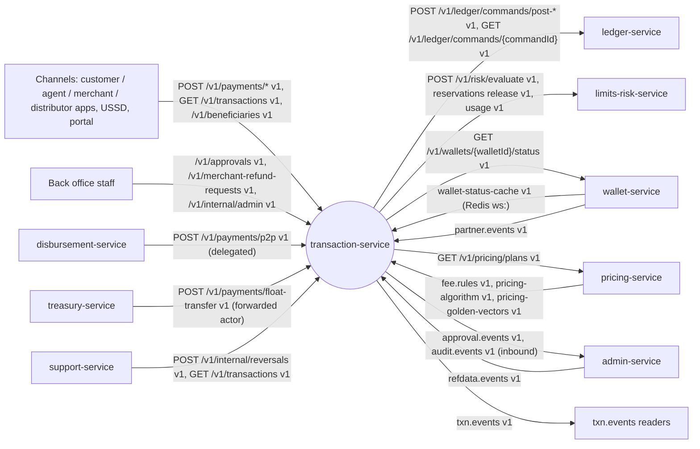

### 3.2 Component diagram

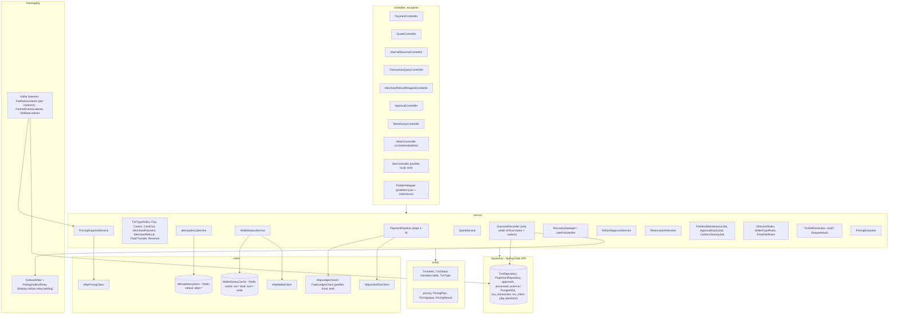

`ArchitectureTest` (ArchUnit) enforces: controllers call only services and never use entities or repositories; only services use repositories, clients and messaging; no `double`/`float` in money packages; `DevController` and `FakeLedgerClient` only under profiles `local`/`test`.

### 3.3 Runtime and deployment (Compose)

| Item | Value |
|---|---|
| Compose service | `transaction-service`, image `bitspay/transaction-service:local`, ports 8102 / 9102 |
| Profiles | `dev` in Compose (all roles in one container); `local` (own infra + WireMock 8099 for every HTTP client, plus the in-memory `FakeLedgerClient` behind the contracted dev endpoints); `hybrid` (IDE against the stack) |
| `mem_limit` | 448 MB |
| Infra `depends_on` (healthy) | postgres, kafka-init, redis-critical, redis-cache |
| Schema | `svc_transaction` (Flyway `spring.flyway.schemas=svc_transaction`, `create-schemas=false` in the stack; Testcontainers `create-schemas=true`) |
| Redis | critical (`BITSPAY_REDIS_CRITICAL_URL`, AOF, `noeviction`): `idem:*`. cache (`BITSPAY_REDIS_CACHE_URL`): read `ws:*`, write `wsn:*` |
| Clients | `BITSPAY_CLIENTS_LEDGER_BASEURL`, `BITSPAY_CLIENTS_LIMITSRISK_BASEURL`, `BITSPAY_CLIENTS_WALLET_BASEURL`, `BITSPAY_CLIENTS_PRICING_BASEURL` |
| Hikari | Compose `SPRING_DATASOURCE_HIKARI_MAXIMUMPOOLSIZE=8`; production 40 per pod |
| Consumer groups | `transaction-service.feerules-${HOSTNAME}` (per instance, `fee.rules`), `transaction-service.partner` (`partner.events`), `transaction-service.refdata` (`refdata.events`) — ids per OPEN D-30 |
| Scheduled jobs (leader by Postgres advisory lock) | sweeper every 5 s (lock `71020000`); late-post verifier every 60 s (`71020001`); approval expiry every 5 min (`71020002`); approval execution retry every 30 s (`71020004`); outbox cleanup hourly (`71020003`, polling relay or `outbox.cleanup.mode=retention`); partition maintenance hourly (`71029999`) |
| Threads | virtual threads (`spring.threads.virtual.enabled=true`); Hikari pool is the concurrency bound |
| Env beyond kernel K8.3 | none (no TigerBeetle, ClickHouse or S3 use) |
| Readiness | DOWN until: pricing snapshot ready (bootstrap done or `fee.rules` caught up), today's and tomorrow's partitions exist, Redis critical reachable. Never waits for another service at start-up |

### 3.4 Key flows

**F1 — P2P happy path (Rahim → Karim, 500 Tk, fee 5 Tk + VAT 0.75 Tk)**

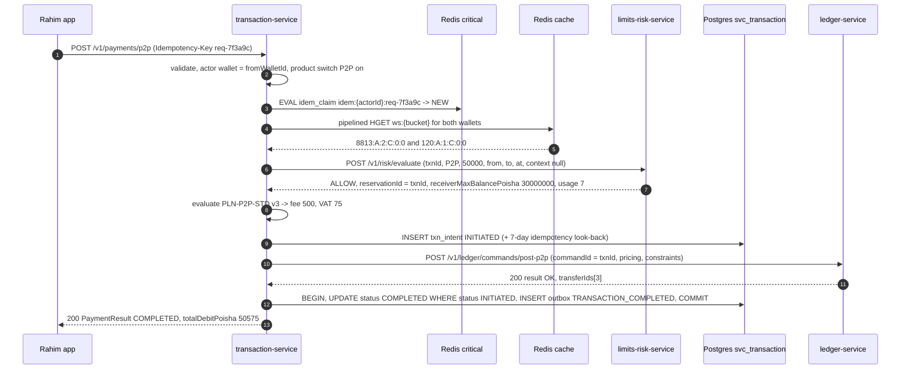

**F2 — Cash-in (Salma → Rahim 1,000 Tk, commission from COMMISSION_PAYABLE)**

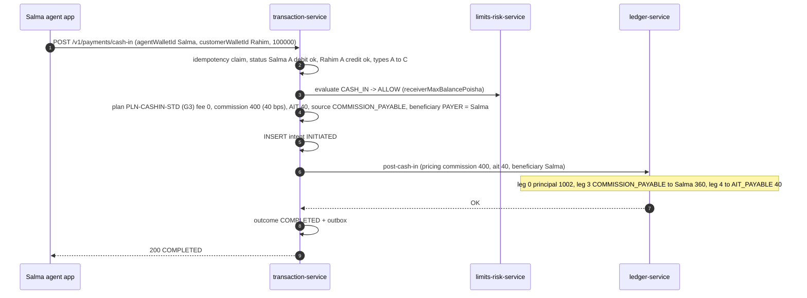

**F3 — Cash-out (Karim → Salma 500 Tk, fee 7.50 Tk, commission 3 Tk from FEE_INCOME), incl. ledger refusal**

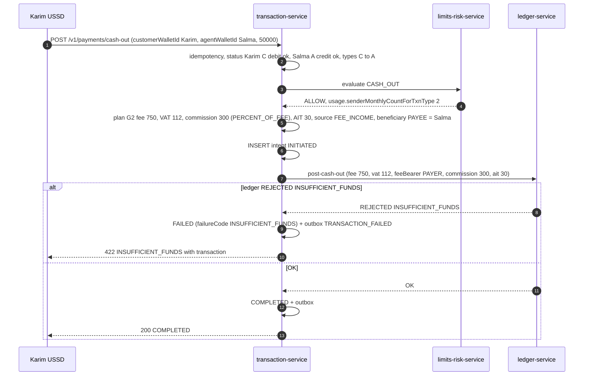

**F4 — Merchant QR payment (Rahim → Nirob Store 350 Tk, MDR 1.5 % borne by the merchant)**

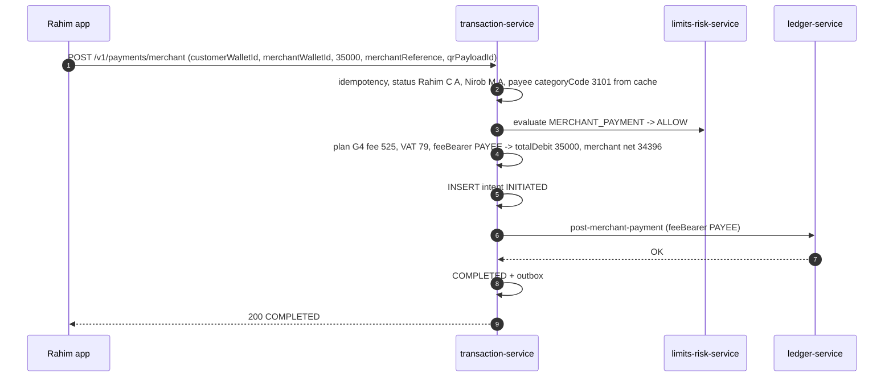

**F5 — Merchant refund (partial), direct or with maker-checker**

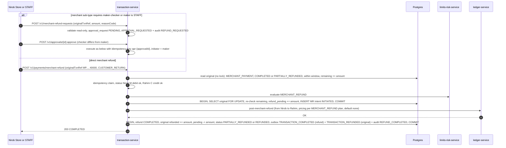

If the locked re-check fails (a concurrent refund won), the call returns `422 REFUND_EXCEEDS_ORIGINAL` (`remainingPoisha`) or `409 STATE_CONFLICT` (reversal pending), nothing is persisted and the reservation is released (BR-TX-15).

**F6 — Float transfer (distributor → Salma top-up)**

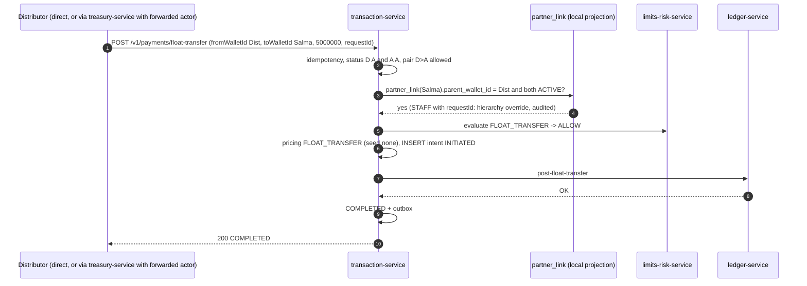

**F7 — Internal reversal (support-service after its maker-checker)**

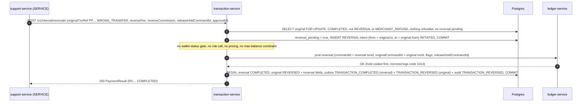

**F8 — Crash after the ledger post, before the outcome commit → sweeper**

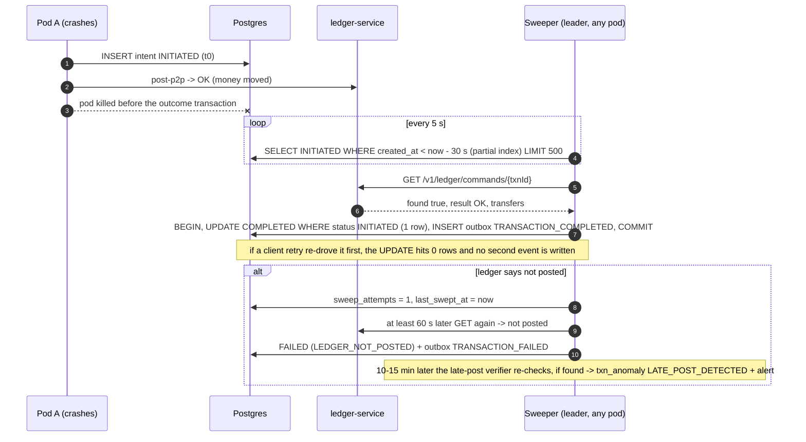

**F9 — Ledger timeout, same-key retry, re-drive, conflict**

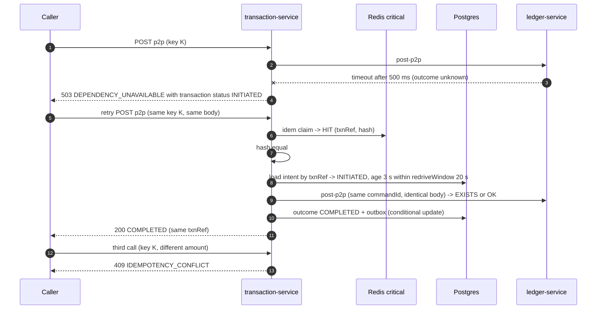

**F10 — Quote (Karim's cash-out confirmation screen)**

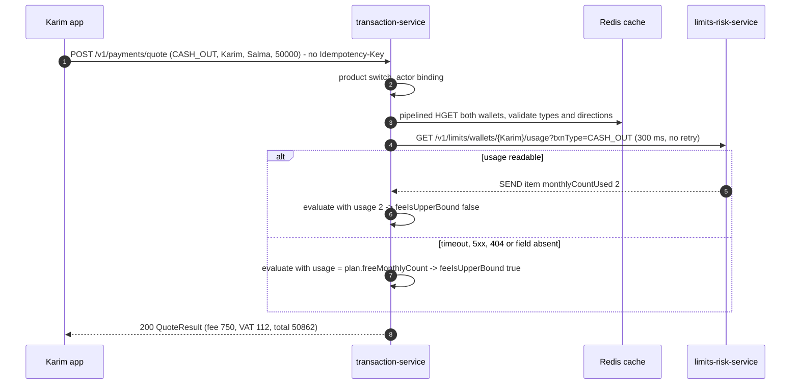

### 3.5 State machines

**Transaction (`txn_intent.status`)**

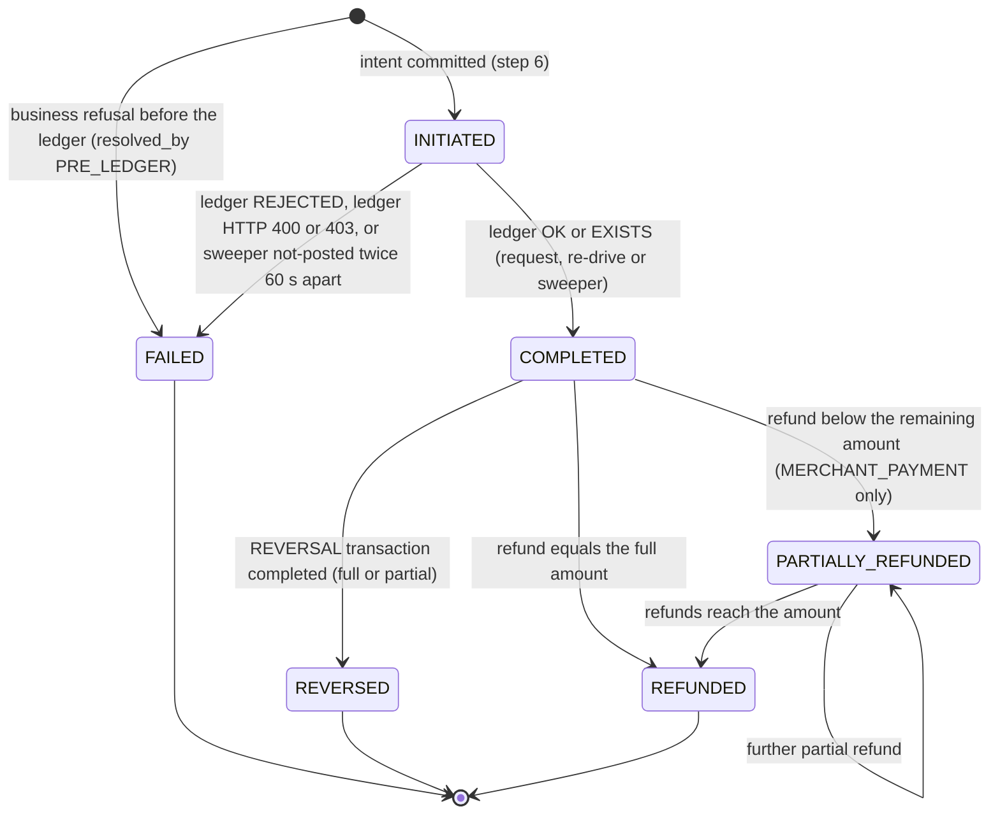

Every transition is a conditional `UPDATE … WHERE status = :expected` (optimistic, `version = version + 1`) in the same DB transaction as its outbox row(s). `INITIATED` never appears on `txn.events`.

**Merchant refund request (`merchant_refund_request.status`, mirrored on `approval_request`)**

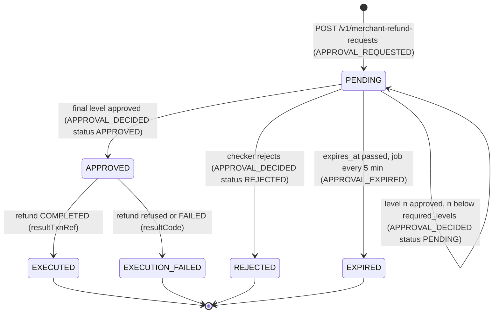

**Exception-queue item (`txn_anomaly`)**: `OPEN → RESOLVED` (staff `:resolve`, resolution text only, audit `ANOMALY_RESOLVED`). Unique per `(txn_id, kind)`.

### 3.6 Architecture decisions

| ADR | Decision | Why | Consequence |
|---|---|---|---|
| ADR-01 One schema, day partitions | All tables live in `svc_transaction`. `txn_intent` is `PARTITION BY RANGE (created_at)` with boundaries at Asia/Dhaka midnight (18:00Z); granularity `DAILY` (production) or `MONTHLY` (local/dev). No physical sharding. | Design peak 5k TPS fits one Postgres primary (≈ 10k commits/s); partitions keep indexes small and make archival a detach | Unique `txn_ref` and `(initiator_actor_id, idempotency_key)` are partition-local indexes created by `ensure_partitions`; global uniqueness of the idempotency scope is enforced by the Redis claim plus the 7-day look-back (BR-TX-36) |
| ADR-02 Partition pruning from IDs | `created_at` = UUIDv7 timestamp of `txn_id`, so a `txnId` alone prunes to one partition; this service parses the `yyMMdd` of **its own** `txnRef` to prune a lookup to one daily partition. The 2 reserved digits are always `00` | Fast lookups without a directory | Other services treat `txnRef` as opaque (OPEN D-10); only the owner parses it |
| ADR-03 txnRef randomness | 8 Crockford chars from `SecureRandom` (40 bits); on unique violation of `*_ref_uq` regenerate and retry (max 3) | Keeps the published format; no coordination | Collision probability at design peak ≈ 5·10⁻⁵ per insert per day |
| ADR-04 Unknown ledger outcome | Ledger timeout/5xx/503/CB-open → keep `INITIATED`, reply 503 with `transaction` (`status: INITIATED`). Same-key retry within `redriveWindow` re-sends the identical command; older → 503 until the sweeper settles | Never guess; ledger IDs are deterministic so re-sending is safe | Clients must retry with the same key; sweeper is mandatory |
| ADR-05 What gets persisted | Business refusals after the idempotency claim (wallet status 422, risk non-ALLOW, ledger REJECTED/400/403) are persisted `FAILED` + `TRANSACTION_FAILED`; same-key retries replay them. 400/403/404, refund-state 409/422 and 503-before-intent are **not** persisted and the idempotency claim is deleted | Fraud/AML need refused attempts; safe refusals must be re-evaluable | Response carries `transaction` iff persisted |
| ADR-06 Pricing snapshot | Immutable `PricingSnapshot` (map `txnType → sorted plans`) swapped atomically. Bootstrap `GET /v1/pricing/plans?status=ACTIVE` following `nextCursor` to the end; then `fee.rules` consumed from earliest with a per-instance group, no reliance on committed offsets. Readiness DOWN until bootstrap succeeded or the topic caught up to its end offsets | Every pod needs every plan; the compacted topic is the source of truth | Pricing-service outage after start-up is irrelevant to payments |
| ADR-07 Identical evaluator | The evaluator is a side-effect-free `service` class implementing the shared algorithm (§6.4) step by step, with `long`/`BigDecimal` `HALF_EVEN`; the shared golden-vector file is copied byte-for-byte into test resources | The fee posted to the ledger must equal pricing-service's quote | A change of the algorithm is a re-pin of the pricing data contracts |
| ADR-08 Wallet history | `GET /v1/transactions?walletId=` = one keyset query: `UNION ALL` of the `(from_wallet_id, created_at)` and `(to_wallet_id, created_at)` index ranges within the window, merged by `(created_at desc, txn_id desc)`; cursor = signed base64 of `(createdAt, txnId, filters hash, actor, issuedAt)` | Meets PER-004 without double-writing receiver rows | Cursor valid 24 h for the same endpoint, actor and filters |
| ADR-09 Payment audit | Customer payment outcomes of P2P, CASH_IN, CASH_OUT, MERCHANT_PAYMENT, FLOAT_TRANSFER are not written to `audit.events` (`bitspay.audit.payments.enabled=false`, not changed); governance chains `txn.events` (OPEN D-05). Reversals, refunds, refund requests/decisions, float overrides, beneficiaries and anomaly resolutions are audited | `txn.events` is the financial record; halves outbox volume | `audit.events` only for non-hot-path actions |
| ADR-10 Fake ledger | `client.FakeLedgerClient` (the second implementation of `client.LedgerClient` next to `HttpLedgerClient`, profiles `local`/`test` only) implements ledger semantics in memory (deterministic transfer IDs, linked all-or-nothing, `debits_must_not_exceed_credits` on wallets, the max-balance formula after fee legs with holds excluded, EXISTS/409, REJECTED final per commandId, reversal mirroring and claim rule, command lookup) plus chaos knobs; selected by `bitspay.clients.ledger=fake` | The critical path never waits on ledger-service | `FakeLedgerContractTest` keeps it honest against stubs and the real image |
| ADR-11 One outbox | One outbox `svc_transaction.outbox`, written in the outcome transaction; read by Debezium `outbox-all` (polling relay fallback). `txn.events` rows never have a NULL payload | Kernel K4.2 | — |
| ADR-12 Partner wallets micro-cache | Caffeine (`expireAfterWrite 2 s`, max 50k) in front of Redis for wallet types `A`, `M`, `D` only; customer wallets always read Redis; `0` disables | Busiest merchant/agent wallets | A freeze reaches partner wallets within 2 s |
| ADR-13 Idempotency retention | Redis claim TTL 26 h; the 7-day retention of kernel K3.3 rule 1 is met by the 7-day DB look-back on the intent row (`dbLookback = 7 d`) | 7 days of Redis keys at 5k TPS would not fit Redis critical | Duplicates older than 26 h are answered from Postgres (repair of the Redis key) |

### 3.7 Latency and throughput budget (server side, per request, design peak)

| Step | Budget p99 | Timeout / guard | Notes |
|---|---|---|---|
| 1 Validation + actor + product switch | 1 ms | — | Jackson + Jakarta Validation |
| 2 Idempotency claim | 2 ms | 50 ms command timeout | Lua script, 1 round trip |
| 3 Wallet status | 2 ms (hit) | 100 ms fallback timeout | 1 pipelined round trip; Caffeine 2 s for partner wallets |
| 4 risk evaluate | 50 ms | 50 ms connect / 150 ms read | limits-risk p95 target 50 ms |
| 5 Pricing | 0.5 ms | — | immutable snapshot indexed by `txnType` |
| 6 Intent insert | 10 ms | `statement_timeout` 1 s; abort if > `intentDeadline` (1 s) since the claim | includes the 7-day idempotency look-back (index-only per partition) |
| 7 Ledger command | 20 ms | 100 ms connect / 500 ms read | ledger p99 target 20 ms |
| 8 Outcome transaction | 10 ms | `statement_timeout` 1 s | UPDATE + 1–3 outbox inserts |
| 9 Serialise / reply | 2 ms | — | |
| **Total** | **≈ 98 ms nominal p99** | hard request deadline 1.5 s | ≥ 200 ms headroom for GC, network, queueing |

Quote p99 30 ms (+ ≤ 300 ms usage call); lookup by `txnRef` p95 20 ms; wallet history p95 300 ms.

## 4. Data model

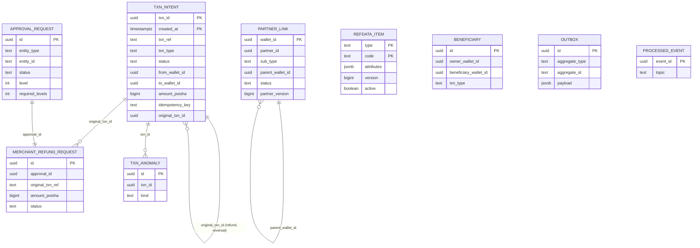

### 4.1 Tables — Flyway `V1__init.sql`

One Flyway location (`db/migration`), one history table, schema `svc_transaction`. Unqualified DDL lands in `svc_transaction` via `search_path`. Placeholder `${partitionGranularity}` = `DAILY` (production) or `MONTHLY` (local/dev, Testcontainers). Running V1 twice from an empty schema is idempotent (`IF NOT EXISTS` everywhere; `ensure_partitions` skips existing partitions).

```sql
-- ============ partition helper ============
-- Creates p_count partitions of txn_intent starting at Dhaka business date p_from,
-- each with the partition-local unique indexes required by ADR-01. Idempotent.
CREATE OR REPLACE FUNCTION ensure_partitions(p_from date, p_count int, p_granularity text DEFAULT 'DAILY')
RETURNS int LANGUAGE plpgsql AS $$
DECLARE
  d date := CASE WHEN p_granularity = 'MONTHLY' THEN date_trunc('month', p_from)::date ELSE p_from END;
  nxt date; part text; created int := 0; i int;
BEGIN
  FOR i IN 1..p_count LOOP
    nxt  := CASE WHEN p_granularity = 'MONTHLY' THEN (d + interval '1 month')::date ELSE d + 1 END;
    part := 'txn_intent_p' || to_char(d, CASE WHEN p_granularity = 'MONTHLY' THEN 'YYYYMM' ELSE 'YYYYMMDD' END);
    IF to_regclass(part) IS NULL THEN
      EXECUTE format('CREATE TABLE %I PARTITION OF txn_intent FOR VALUES FROM (%L) TO (%L)',
                     part, (d::timestamp AT TIME ZONE 'Asia/Dhaka'), (nxt::timestamp AT TIME ZONE 'Asia/Dhaka'));
      EXECUTE format('CREATE UNIQUE INDEX %I ON %I (txn_ref)', part || '_ref_uq', part);
      EXECUTE format('CREATE UNIQUE INDEX %I ON %I (initiator_actor_id, idempotency_key)', part || '_idem_uq', part);
      created := created + 1;
    END IF;
    d := nxt;
  END LOOP;
  RETURN created;
END $$;

-- ============ transactions ============
CREATE TABLE IF NOT EXISTS txn_intent (
  txn_id                    uuid        NOT NULL,              -- UUIDv7 = ledger commandId = risk reservation id
  created_at                timestamptz NOT NULL,              -- = UUIDv7 timestamp of txn_id (ms) = risk evaluate `at`
  txn_ref                   text        NOT NULL CHECK (txn_ref ~ '^(PP|CI|CO|MP|MR|FT|RV)[0-9]{6}00[0-9A-HJKMNP-TV-Z]{8}$'),
  txn_type                  text        NOT NULL CHECK (txn_type IN
                              ('P2P','CASH_IN','CASH_OUT','MERCHANT_PAYMENT','MERCHANT_REFUND','FLOAT_TRANSFER','REVERSAL')),
  status                    text        NOT NULL CHECK (status IN
                              ('INITIATED','COMPLETED','FAILED','REVERSED','PARTIALLY_REFUNDED','REFUNDED')),
  failure_code              text        CHECK (failure_code IN ('WALLET_NOT_TRANSACTABLE','LIMIT_EXCEEDED','RISK_BLOCKED',
                              'RISK_HELD_FOR_REVIEW','RISK_STEP_UP_REQUIRED','SERVICE_DISABLED','INSUFFICIENT_FUNDS',
                              'MAX_BALANCE_EXCEEDED','LEDGER_ORIGINAL_NOT_FOUND','LEDGER_ALREADY_REVERSED','LEDGER_HOLD_NOT_FOUND',
                              'LEDGER_INVALID_AMOUNT','LEDGER_OTHER','LEDGER_NOT_POSTED')),
  failure_detail            text,                               -- internal only (never in a response)
  failure_wallet_id         uuid,                               -- WALLET_NOT_TRANSACTABLE replay (problem walletId)
  failure_wallet_status     text,                               -- status NAME for replay (problem walletStatus)
  limit_code                text,                               -- LIMIT_EXCEEDED replay extensions
  limit_party               text        CHECK (limit_party IN ('FROM','TO')),
  limit_remaining_poisha    bigint,
  limit_remaining_count     int,
  limit_resets_at           timestamptz,
  channel                   text        NOT NULL CHECK (channel IN ('APP','USSD','PARTNER_APP','PORTAL','BACKOFFICE','API','SYSTEM')),
  initiator_actor_type      text        NOT NULL,
  initiator_actor_id        text        NOT NULL CHECK (length(initiator_actor_id) <= 64),
  initiator_user_id         text,                               -- X-Actor-User-Id when present
  initiator_wallet_id       uuid,
  idempotency_key           text        NOT NULL CHECK (length(idempotency_key) <= 64),  -- = clientReference
  request_hash              bytea       NOT NULL,              -- SHA-256 of canonical {path, body} (BR-TX-30)
  correlation_id            text,
  device_id                 text        CHECK (length(device_id) <= 128),
  from_wallet_id            uuid        NOT NULL,
  from_wallet_type          char(1)     NOT NULL CHECK (from_wallet_type IN ('C','A','D','M','I')),
  from_kyc_tier             smallint,
  from_category_code        int,
  from_flags                int,
  from_wallet_status        char(1),
  to_wallet_id              uuid        NOT NULL,
  to_wallet_type            char(1)     NOT NULL CHECK (to_wallet_type IN ('C','A','D','M','I')),
  to_kyc_tier               smallint,
  to_category_code          int,
  to_flags                  int,
  to_wallet_status          char(1),
  amount_poisha             bigint      NOT NULL CHECK (amount_poisha > 0 AND amount_poisha <= 10000000000000),
  fee_poisha                bigint      NOT NULL DEFAULT 0 CHECK (fee_poisha >= 0),
  vat_poisha                bigint      NOT NULL DEFAULT 0 CHECK (vat_poisha >= 0),
  fee_bearer                text        NOT NULL DEFAULT 'PAYER' CHECK (fee_bearer IN ('PAYER','PAYEE','OPERATOR')),
  total_debit_poisha        bigint      NOT NULL,
  commission_poisha         bigint      NOT NULL DEFAULT 0 CHECK (commission_poisha >= 0),
  ait_poisha                bigint      NOT NULL DEFAULT 0 CHECK (ait_poisha >= 0 AND ait_poisha <= commission_poisha),
  commission_source         text        CHECK (commission_source IN ('FEE_INCOME','COMMISSION_PAYABLE')),
  commission_beneficiary_wallet_id uuid,
  pricing_plan_id           text,
  pricing_plan_version      int,
  risk_decision             text,
  risk_score                int         CHECK (risk_score BETWEEN 0 AND 100),
  risk_reason_codes         text[],
  reservation_id            uuid,
  receiver_max_balance_poisha bigint,
  purpose_code              text        CHECK (length(purpose_code) <= 32),
  note                      text        CHECK (length(note) <= 140),
  merchant_reference        text        CHECK (length(merchant_reference) <= 64),
  qr_payload_id             uuid,
  float_request_id          text        CHECK (length(float_request_id) <= 64),
  hierarchy_override        boolean     NOT NULL DEFAULT false,
  original_txn_id           uuid,                               -- REVERSAL / MERCHANT_REFUND
  original_created_at       timestamptz,                        -- partition key of the original (direct lock)
  original_txn_ref          text        CHECK (length(original_txn_ref) <= 32),
  reason_code               text        CHECK (reason_code ~ '^[A-Z_]{3,40}$'),
  approval_id               uuid,                               -- REVERSAL; approved MERCHANT_REFUND
  reverse_fee               boolean,                            -- REVERSAL rows: as executed
  reverse_commission        boolean,
  release_hold_command_id   uuid,
  partial_reversal          boolean     NOT NULL DEFAULT false, -- REVERSAL rows: amount < original principal
  refunded_poisha           bigint      NOT NULL DEFAULT 0,      -- on MERCHANT_PAYMENT originals
  refund_pending_poisha     bigint      NOT NULL DEFAULT 0,
  reversal_pending          boolean     NOT NULL DEFAULT false,  -- on originals
  reversal_txn_ref          text,
  reversed_amount_poisha    bigint,                             -- on originals once REVERSED
  ledger_result             text        CHECK (ledger_result IN ('OK','EXISTS','REJECTED','HTTP_400','HTTP_403')),
  ledger_rejection_code     text,
  ledger_detail             text,
  ledger_transfer_ids       uuid[]      NOT NULL DEFAULT '{}',
  resolved_by               text        CHECK (resolved_by IN ('REQUEST','REDRIVE','SWEEPER','PRE_LEDGER')),
  sweep_attempts            smallint    NOT NULL DEFAULT 0,
  last_swept_at             timestamptz,
  completed_at              timestamptz,
  updated_at                timestamptz NOT NULL DEFAULT now(),
  version                   bigint      NOT NULL DEFAULT 0,
  CONSTRAINT txn_intent_pk PRIMARY KEY (txn_id, created_at),
  CONSTRAINT refund_bounds CHECK (refunded_poisha + refund_pending_poisha <= amount_poisha),
  CONSTRAINT total_debit_rule CHECK (
    (txn_type = 'REVERSAL' AND total_debit_poisha = amount_poisha) OR
    (txn_type <> 'REVERSAL' AND total_debit_poisha = amount_poisha + CASE WHEN fee_bearer = 'PAYER' THEN fee_poisha + vat_poisha ELSE 0 END)),
  CONSTRAINT operator_zero_fee CHECK (fee_bearer <> 'OPERATOR' OR txn_type = 'REVERSAL' OR (fee_poisha = 0 AND vat_poisha = 0))
) PARTITION BY RANGE (created_at);

CREATE INDEX IF NOT EXISTS txn_intent_from_ix      ON txn_intent (from_wallet_id, created_at DESC, txn_id DESC);
CREATE INDEX IF NOT EXISTS txn_intent_to_ix        ON txn_intent (to_wallet_id, created_at DESC, txn_id DESC);
CREATE INDEX IF NOT EXISTS txn_intent_initiated_ix ON txn_intent (created_at) WHERE status = 'INITIATED';
CREATE INDEX IF NOT EXISTS txn_intent_swept_ix     ON txn_intent (completed_at) WHERE status = 'FAILED' AND resolved_by = 'SWEEPER';
CREATE INDEX IF NOT EXISTS txn_intent_original_ix  ON txn_intent (original_txn_id) WHERE original_txn_id IS NOT NULL;
CREATE INDEX IF NOT EXISTS txn_intent_origref_ix   ON txn_intent (original_txn_ref) WHERE original_txn_ref IS NOT NULL;
CREATE INDEX IF NOT EXISTS txn_intent_clientref_ix ON txn_intent (from_wallet_id, idempotency_key);

-- initial partitions: yesterday .. +7 days
SELECT ensure_partitions((now() AT TIME ZONE 'Asia/Dhaka')::date - 1, 9, '${partitionGranularity}');

-- ============ projections ============
-- partner.events (compacted): float hierarchy and refund maker-checker sub-type; keyed by walletId
CREATE TABLE IF NOT EXISTS partner_link (
  wallet_id           uuid PRIMARY KEY,
  partner_id          uuid        NOT NULL UNIQUE,
  partner_type        text        NOT NULL CHECK (partner_type IN ('AGENT','MERCHANT','DISTRIBUTOR','INSTITUTION')),
  sub_type            text        NOT NULL,                 -- e.g. SUPER_AGENT, ENTERPRISE, MASTER
  category_code       int         NOT NULL,
  parent_partner_id   uuid,
  parent_wallet_id    uuid,                                 -- ancestorWalletIds[0]; null directly under the Operator
  ancestor_wallet_ids uuid[]      NOT NULL DEFAULT '{}',
  status              text        NOT NULL,                 -- ACTIVE, SUSPENDED, PENDING_TERMINATION, TERMINATED, ...
  partner_version     bigint      NOT NULL,                 -- apply only if newer
  effective_from      timestamptz,
  updated_at          timestamptz NOT NULL DEFAULT now()
);
CREATE INDEX IF NOT EXISTS partner_link_parent_ix ON partner_link (parent_wallet_id);

-- partner versions for events whose walletId is null (not yet ACTIVE): recorded, no wallet-keyed effect
CREATE TABLE IF NOT EXISTS partner_version_seen (
  partner_id      uuid PRIMARY KEY,
  partner_version bigint      NOT NULL,
  updated_at      timestamptz NOT NULL DEFAULT now()
);

-- refdata.events: PURPOSE_CODE, REASON_CODE, SYSTEM_PARAM (FEATURE.*, WALLET.ALLOW_INBOUND_BEFORE_KYC)
CREATE TABLE IF NOT EXISTS refdata_item (
  type       text        NOT NULL CHECK (type IN ('PURPOSE_CODE','REASON_CODE','SYSTEM_PARAM')),
  code       text        NOT NULL,
  name_en    text        NOT NULL,
  name_bn    text,
  attributes jsonb       NOT NULL,
  active     boolean     NOT NULL,
  version    bigint      NOT NULL,
  updated_at timestamptz NOT NULL DEFAULT now(),
  PRIMARY KEY (type, code)
);

-- ============ PAY-009 saved beneficiaries ============
CREATE TABLE IF NOT EXISTS beneficiary (
  id                    uuid PRIMARY KEY,
  owner_wallet_id       uuid        NOT NULL,
  beneficiary_wallet_id uuid        NOT NULL,
  txn_type              text        NOT NULL DEFAULT 'P2P' CHECK (txn_type IN ('P2P','MERCHANT_PAYMENT','CASH_OUT')),
  nickname              text        NOT NULL CHECK (length(nickname) BETWEEN 1 AND 40),
  last_used_at          timestamptz,
  created_at            timestamptz NOT NULL DEFAULT now(),
  updated_at            timestamptz NOT NULL DEFAULT now(),
  version               bigint      NOT NULL DEFAULT 0,
  CONSTRAINT beneficiary_uq UNIQUE (owner_wallet_id, beneficiary_wallet_id, txn_type)
);
CREATE INDEX IF NOT EXISTS beneficiary_owner_ix ON beneficiary (owner_wallet_id, nickname);

-- ============ maker-checker (kernel K5) ============
CREATE TABLE IF NOT EXISTS approval_request (
  id               uuid PRIMARY KEY,
  entity_type      text        NOT NULL CHECK (entity_type IN ('MerchantRefund')),
  entity_id        text        NOT NULL,                    -- originalTxnRef
  action           text        NOT NULL CHECK (action IN ('REFUND')),
  payload          jsonb       NOT NULL,                    -- {originalTxnRef, amountPoisha, reasonCode, requestId}
  maker_id         text        NOT NULL,
  maker_actor_type text        NOT NULL,
  maker_user_id    text,                                    -- X-Actor-User-Id of the maker
  maker_wallet_id  uuid,
  maker_channel    text        NOT NULL,
  status           text        NOT NULL CHECK (status IN ('PENDING','APPROVED','REJECTED','EXPIRED','EXECUTED','EXECUTION_FAILED')),
  level            int         NOT NULL DEFAULT 1,
  required_levels  int         NOT NULL DEFAULT 1 CHECK (required_levels BETWEEN 1 AND 2),
  checker_roles    text[]      NOT NULL,
  amount_poisha    bigint      NOT NULL,
  comment          text,
  created_at       timestamptz NOT NULL DEFAULT now(),
  expires_at       timestamptz NOT NULL,
  decided_by       text[]      NOT NULL DEFAULT '{}',       -- checker ids, one per decided level
  decided_by_user  text[]      NOT NULL DEFAULT '{}',       -- X-Actor-User-Id per decided level ('' when absent)
  decided_at       timestamptz,
  updated_at       timestamptz NOT NULL DEFAULT now(),
  version          bigint      NOT NULL DEFAULT 0
);
CREATE INDEX IF NOT EXISTS approval_pending_ix ON approval_request (status, expires_at) WHERE status = 'PENDING';
CREATE INDEX IF NOT EXISTS approval_entity_ix  ON approval_request (entity_type, entity_id);

CREATE TABLE IF NOT EXISTS merchant_refund_request (
  id                 uuid PRIMARY KEY,                      -- requestId
  approval_id        uuid        NOT NULL UNIQUE REFERENCES approval_request (id),
  original_txn_id    uuid        NOT NULL,
  original_created_at timestamptz NOT NULL,
  original_txn_ref   text        NOT NULL,
  merchant_wallet_id uuid        NOT NULL,
  amount_poisha      bigint      NOT NULL CHECK (amount_poisha > 0),
  reason_code        text        NOT NULL CHECK (reason_code ~ '^[A-Z_]{3,40}$'),
  maker_id           text        NOT NULL,
  idempotency_key    text        NOT NULL,
  request_hash       bytea       NOT NULL,
  status             text        NOT NULL CHECK (status IN ('PENDING','APPROVED','REJECTED','EXPIRED','EXECUTED','EXECUTION_FAILED')),
  result_txn_ref     text,
  result_code        text,
  created_at         timestamptz NOT NULL DEFAULT now(),
  expires_at         timestamptz NOT NULL,
  updated_at         timestamptz NOT NULL DEFAULT now(),
  version            bigint      NOT NULL DEFAULT 0,
  CONSTRAINT mrr_idem_uq UNIQUE (maker_id, idempotency_key)
);
CREATE INDEX IF NOT EXISTS mrr_merchant_ix ON merchant_refund_request (merchant_wallet_id, created_at DESC);

-- ============ exception queue (LED-010) ============
CREATE TABLE IF NOT EXISTS txn_anomaly (
  id          uuid PRIMARY KEY,
  txn_id      uuid        NOT NULL,
  txn_ref     text        NOT NULL,
  kind        text        NOT NULL CHECK (kind IN ('LATE_POST_DETECTED','STUCK_INITIATED','LEDGER_STATE_MISMATCH')),
  detail      jsonb       NOT NULL,
  created_at  timestamptz NOT NULL DEFAULT now(),
  resolved_at timestamptz,
  resolved_by text,
  resolution  text        CHECK (length(resolution) <= 500),
  CONSTRAINT txn_anomaly_uq UNIQUE (txn_id, kind)
);
CREATE INDEX IF NOT EXISTS txn_anomaly_open_ix ON txn_anomaly (created_at DESC) WHERE resolved_at IS NULL;

-- ============ job bookkeeping (observability only) ============
CREATE TABLE IF NOT EXISTS job_run (
  job          text PRIMARY KEY CHECK (job IN ('SWEEPER','LATE_POST_VERIFIER','PARTITION_MAINTENANCE','APPROVAL_EXPIRY','APPROVAL_EXECUTION','OUTBOX_CLEANUP')),
  leader       text        NOT NULL,
  last_run_at  timestamptz NOT NULL,
  scanned      int         NOT NULL DEFAULT 0,
  completed    int         NOT NULL DEFAULT 0,
  failed       int         NOT NULL DEFAULT 0,
  pending      int         NOT NULL DEFAULT 0
);

-- ============ outbox + inbox (kernel K8.2) ============
CREATE TABLE IF NOT EXISTS outbox (
  id             uuid PRIMARY KEY,                    -- = envelope eventId
  aggregate_type text        NOT NULL,                -- = Kafka topic
  aggregate_id   text        NOT NULL,                -- = Kafka key = envelope aggregateId
  event_type     text        NOT NULL,
  payload        jsonb       NULL,                    -- full envelope; never NULL for this service's topics
  created_at     timestamptz NOT NULL DEFAULT now(),
  published_at   timestamptz                          -- polling relay only
);
CREATE INDEX IF NOT EXISTS outbox_unpublished ON outbox (created_at) WHERE published_at IS NULL;

CREATE TABLE IF NOT EXISTS processed_event (
  event_id     uuid PRIMARY KEY,
  topic        text NOT NULL,
  processed_at timestamptz NOT NULL DEFAULT now()
);
```

Rules on the schema:
- `txn_intent` rows are never deleted by this service; partitions older than the online horizon are detached (R2 archival).
- The 7-day idempotency look-back query is `SELECT … FROM txn_intent WHERE initiator_actor_id = ? AND idempotency_key = ? AND created_at > now() - interval '7 days'`; it uses the partition-local `*_idem_uq` indexes of ≤ 8 daily partitions.
- `original_created_at` lets the refund/reversal lock the original by its full primary key (one partition, no scan).

### 4.2 Redis keys and caches

| Cluster | Key | Value | TTL | Owner / access |
|---|---|---|---|---|
| critical | `idem:{actorId}:{idempotencyKey}` | `{txnRef}\|{txnId}\|{requestHashHex}\|{claimedAtEpochMs}` | 93,600 s (26 h) | this service (read/write) |
| cache | `ws:{bucket}` field `base64url_nopad(uuidBytes(walletId))` | `{version}:{statusCode}:{kycTier}:{walletTypeCode}:{categoryCode}:{flags}` | none | wallet-service writes; this service reads (data contract `wallet-status-cache` v1, §6.3) |
| cache | `wsn:{walletId}` (canonical lower-case uuid) | `1` | 60 s | written here only after a wallet-service `404`; wallet-service deletes it when the wallet becomes READY |
| in-process | Caffeine partner-wallet micro-cache | parsed status | 2 s, max 50k | wallet types `A`, `M`, `D` only (ADR-12) |
| in-process | `PricingSnapshot` | immutable plan map | until replaced | ADR-06 |

Lua scripts (Redis critical):
- `idem_claim.lua` (KEYS[1] = idem key; ARGV = value, ttl): `local cur = redis.call('GET', KEYS[1]); if cur then return cur end; redis.call('SET', KEYS[1], ARGV[1], 'EX', ARGV[2]); return false` → `nil` = NEW, the stored value = HIT.
- `idem_cas.lua` (takeover, BR-TX-35): replace only if the current value equals the expected old value.
- `idem_del_if.lua` (release, BR-TX-38): delete only if the value equals ours.

### 4.3 Retention and archival

| Data | Online | Then |
|---|---|---|
| `txn_intent` partitions | Query API: lookups while online — `bitspay.txn.query.onlineMonths` = 24 (OPEN D-24); history query: 30 days. Rows kept ≥ 5 years (PER-012) | Partitions detached for platform archival (R2, ARC-003); never deleted by this service |
| `outbox` | 3 days (cleanup job) | deleted |
| `processed_event` | 14 days | deleted |
| `idem:*` (Redis) | 26 h | expires (7-day retention via DB look-back, ADR-13) |
| `approval_request`, `merchant_refund_request`, `txn_anomaly`, `beneficiary` | indefinite (small) | — |
| `partner_link`, `refdata_item`, `partner_version_seen` | current state | — |

## 5. Provided contracts (mirror of `contracts/provided/` — the artefact wins on conflict)

### 5.1 REST operations

Common to every operation: kernel K3.1 headers (`X-Correlation-Id` generated if absent and echoed), K3.6 problem+json, K3.4 pagination. Money is int64 poisha, amounts 1..10^13. A wallet-holder caller of a payment must send `X-Actor-Wallet-Id` = the debited (from) wallet, else `403` (STAFF and SERVICE callers excepted). Request bodies reject unknown fields only where noted (`additionalProperties: false` on payment requests → `400`).

| Operation | Audience | Actors & roles | Idempotency | Purpose |
|---|---|---|---|---|
| `POST /v1/payments/quote` | customer | CUSTOMER (P2P, CASH_OUT, MERCHANT_PAYMENT), AGENT (CASH_IN, FLOAT_TRANSFER), DISTRIBUTOR (FLOAT_TRANSFER), STAFF `OPS_CHECKER`/`FIN_CHECKER` (FLOAT_TRANSFER) | none (read-only) | Wallet-based fee quote |
| `POST /v1/payments/p2p` | customer | CUSTOMER (incl. delegated by disbursement-service with the payer's headers) | `Idempotency-Key` | P2P |
| `POST /v1/payments/cash-in` | partner | AGENT | `Idempotency-Key` | Cash-in |
| `POST /v1/payments/cash-out` | customer | CUSTOMER | `Idempotency-Key` | Cash-out |
| `POST /v1/payments/merchant` | customer | CUSTOMER | `Idempotency-Key` | Merchant payment |
| `POST /v1/payments/merchant-refund` | partner | MERCHANT | `Idempotency-Key` | Direct merchant refund |
| `POST /v1/payments/float-transfer` | partner | DISTRIBUTOR, AGENT, STAFF `OPS_CHECKER`/`FIN_CHECKER`; forwarded by treasury-service | `Idempotency-Key` | Float top-up / return |
| `POST /v1/internal/reversals` | service | SERVICE `support-service` | `Idempotency-Key` `rev-{id}-{attempt}` | Reversal executor |
| `GET /v1/transactions/{txnRef}` | customer | party wallet holders, STAFF (any), SERVICE, SYSTEM | — | Lookup |
| `GET /v1/transactions` | customer | holder of `walletId`, STAFF (any), SERVICE | — (paged) | Wallet history |
| `POST /v1/merchant-refund-requests` | partner | MERCHANT, STAFF `OPS_MAKER`/`SUP_MAKER` | `Idempotency-Key` | Refund via maker-checker |
| `GET /v1/merchant-refund-requests` | partner | MERCHANT (own), STAFF | — (paged) | List requests |
| `GET /v1/merchant-refund-requests/{id}` | partner | MERCHANT (own), STAFF | — | Request status |
| `GET /v1/approvals` | staff | STAFF `OPS_MAKER`, `OPS_CHECKER`, `SUP_MAKER`, `SUP_CHECKER`, `ADMIN`, `AUDITOR`; MERCHANT (self-approval only) | — (paged) | Approval inbox |
| `POST /v1/approvals/{id}:approve` | staff | STAFF `OPS_CHECKER`/`SUP_CHECKER`; MERCHANT checker only with self-approval | natural | Approve level / execute refund |
| `POST /v1/approvals/{id}:reject` | staff | as approve | natural | Reject |
| `GET /v1/beneficiaries` · `POST /v1/beneficiaries` · `PATCH /v1/beneficiaries/{id}` · `DELETE /v1/beneficiaries/{id}` | customer | CUSTOMER (owner wallet) | natural (unique) | Saved beneficiaries |
| `GET /v1/internal/admin/pricing/plans` · `POST /v1/internal/admin/pricing:reload` | staff | STAFF `ADMIN`, `PRICING_CHECKER` | natural | Pricing snapshot inspect / reload |
| `GET /v1/internal/admin/sweeper` · `POST /v1/internal/admin/sweeper:run` | staff | STAFF `ADMIN`, `OPS_CHECKER` | natural | Sweeper status / force pass |
| `GET /v1/internal/admin/anomalies` · `POST /v1/internal/admin/anomalies/{id}:resolve` | staff | STAFF `OPS_CHECKER`, `FIN_CHECKER` (GET also `ADMIN`, `AUDITOR`) | natural | Exception queue |
| `POST /v1/internal/dev/fake-ledger/accounts/{id}:fund` · `GET /v1/internal/dev/fake-ledger/accounts/{id}` · `POST /v1/internal/dev/fake-ledger/chaos` · `PUT /v1/internal/dev/wallet-cache/{walletId}` | internal | any (profiles `local`/`test` only; beans absent otherwise) | — | Local demos and tests |

**Idempotency of payment POSTs** (kernel K3.3; OPEN D-01): missing key → `400`. Scope `(X-Actor-Id, key)`, retained ≥ 7 days. Same key + same body (canonical hash of path + body) → replay of the **outcome of that request** (`COMPLETED`/`FAILED`, or the 503 with `INITIATED` resolved by re-drive), never the current lifecycle status (current status via `GET /v1/transactions/{txnRef}`). Same key + different body → `409 IDEMPOTENCY_CONFLICT`. A definitive 400/403/404/409/422 is final for its key; a new attempt needs a new key and gets a new `txnId`/`txnRef` (hence a new ledger `commandId`). The same key is re-sent only after 503, a timeout, a 5xx or a connection failure. Callers never reuse a key after 72 h and resolve the outcome with `GET /v1/transactions/{txnRef}` (or `GET /v1/transactions?walletId={from}&clientReference={key}`) before retrying anything older than 24 h.

**Which responses carry `transaction`**: a request whose intent was **persisted** returns the PaymentResult — top-level on 200, as the problem member `transaction` on any non-200 (422 money decisions, 409 ledger refusals, 503 after intent with `status: INITIATED`). Refusals decided before persistence (400, 403, 404, 409 `IDEMPOTENCY_CONFLICT`, 409 state/window, 422 `REFUND_EXCEEDS_ORIGINAL`, 422 `MAKER_CHECKER_VIOLATION`, 422 `SERVICE_DISABLED` from a product switch, 503 before intent) carry none.

#### 5.1.0 `PaymentResult` (all payment POSTs except quote; also the problem member `transaction`)

| Field | Type | Req | Null | Constraints / enum | Notes |
|---|---|---|---|---|---|
| txnRef | string | Y | N | `^(PP\|CI\|CO\|MP\|MR\|FT\|RV)\d{6}00[0-9A-HJKMNP-TV-Z]{8}$` (18) | consumers: opaque |
| txnId | uuid | Y | N | UUIDv7 | = ledger `commandId` |
| txnType | enum | Y | N | `txnType` code set (7) | |
| status | enum{COMPLETED, FAILED, INITIATED} | Y | N | `INITIATED` only inside a 503 problem | outcome of that request |
| failureCode | enum | Y | Y | `failureCode` code set | null unless `FAILED` |
| amountPoisha | int64 (poisha) | Y | N | > 0 | REVERSAL: principal reversed |
| feePoisha | int64 (poisha) | Y | N | ≥ 0 | REVERSAL: fee reversed |
| vatPoisha | int64 (poisha) | Y | N | ≥ 0 | REVERSAL: VAT reversed |
| totalDebitPoisha | int64 (poisha) | Y | N | amount + (feeBearer = PAYER ? fee + vat : 0); REVERSAL = amount | |
| feeBearer | enum{PAYER, PAYEE, OPERATOR} | Y | N | `SHARED` reserved (OPEN D-03) | `PAYER` when no plan; REVERSAL = original's |
| currency | string | Y | N | `"BDT"` | |
| fromWalletId | uuid | Y | N | internal from (mapping below) | |
| toWalletId | uuid | Y | N | internal to | |
| createdAt | timestamp | Y | N | = UUIDv7 time of `txnId` | |
| completedAt | timestamp | Y | Y | | null while `INITIATED`; set for COMPLETED and FAILED |

Body → internal from/to: p2p `fromWalletId → toWalletId`; cash-in `agentWalletId → customerWalletId`; cash-out `customerWalletId → agentWalletId`; merchant `customerWalletId → merchantWalletId`; merchant-refund `original.toWalletId → original.fromWalletId`; float-transfer `fromWalletId → toWalletId`; reversals `original.toWalletId → original.fromWalletId`.

```json
{ "txnRef": "PP26100900K3M9QX2A", "txnId": "0192f3c1-7a2b-7c00-9a51-3f2c8e1d0a11", "txnType": "P2P", "status": "COMPLETED",
  "failureCode": null, "amountPoisha": 50000, "feePoisha": 500, "vatPoisha": 75, "totalDebitPoisha": 50575,
  "feeBearer": "PAYER", "currency": "BDT", "fromWalletId": "0192f2aa-0001-7000-8000-00000000a001",
  "toWalletId": "0192f2bb-0002-7000-8000-00000000b002", "createdAt": "2026-10-09T08:03:22.101Z", "completedAt": "2026-10-09T08:03:22.161Z" }
```

**Payment POST error table** (p2p, cash-in, cash-out, merchant, merchant-refund, float-transfer; "txn" = problem carries `transaction`):

| HTTP | `code` | Extensions | When | txn? |
|---|---|---|---|---|
| 400 | `VALIDATION_FAILED` | `errors[]` | schema/constraints, from = to, wallet type vs txnType, float pair not allowed, missing `Idempotency-Key`, `requestId` missing for STAFF float, unknown purpose/reason code | no |
| 403 | `ACTOR_NOT_ALLOWED` | — | actor type/role, wallet binding, float hierarchy, SERVICE actor on float | no |
| 404 | `NOT_FOUND` | — | unknown wallet / original txn | no |
| 409 | `IDEMPOTENCY_CONFLICT` | — | same key, different body | no |
| 409 | `STATE_CONFLICT` | — | refund state, window or concurrency (not persisted) | no |
| 409 | `STATE_CONFLICT` | `transaction` | ledger REJECTED `ORIGINAL_NOT_FOUND`/`ALREADY_REVERSED`/`HOLD_NOT_FOUND`/`INVALID_AMOUNT`/`OTHER`, or ledger HTTP 400/403 (persisted FAILED) | yes |
| 422 | `WALLET_NOT_TRANSACTABLE` | `walletId`, `walletStatus` (status NAME), `transaction` | status blocks the direction; ledger `ACCOUNT_NOT_FOUND`/`ACCOUNT_CLOSED` (`walletStatus: CLOSED`) | yes |
| 422 | `LIMIT_EXCEEDED` | `limitCode`, `limitParty`, `remainingPoisha`, `remainingCount`, `resetsAt`, `transaction` | risk LIMIT_EXCEEDED | yes |
| 422 | `RISK_BLOCKED` / `RISK_HELD_FOR_REVIEW` / `RISK_STEP_UP_REQUIRED` | `transaction` | risk BLOCK / HOLD / STEP_UP (OPEN D-04) | yes |
| 422 | `SERVICE_DISABLED` | `transaction` | risk decision SERVICE_DISABLED (emergency control) | yes |
| 422 | `SERVICE_DISABLED` | — | product switch (config / `FEATURE.<PRODUCT>`), before any side effect | no |
| 422 | `INSUFFICIENT_FUNDS` / `MAX_BALANCE_EXCEEDED` | `transaction` | ledger REJECTED | yes |
| 422 | `REFUND_EXCEEDS_ORIGINAL` | `remainingPoisha` (never null) | refund > refundable remainder (merchant-refund only) | no |
| 422 | `MAKER_CHECKER_VIOLATION` | — | refund requires approval (merchant-refund only) | no |
| 503 | `DEPENDENCY_UNAVAILABLE` | `retryable: true` | before intent | no |
| 503 | `DEPENDENCY_UNAVAILABLE` | `retryable: true`, `transaction` (`INITIATED`) | after intent, ledger outcome unknown; retry with the same key | yes |

LIMIT_EXCEEDED problem example:
```json
{ "type": "about:blank", "title": "Limit exceeded", "status": 422, "code": "LIMIT_EXCEEDED",
  "limitCode": "P2P_SEND_DAILY_AMOUNT", "limitParty": "FROM", "remainingPoisha": 120000, "remainingCount": null,
  "resetsAt": "2026-10-09T18:00:00.000Z", "instance": "/v1/payments/p2p", "correlationId": "c-0f3e9b",
  "transaction": { "txnRef": "PP26100900R8T2WQ4M", "txnId": "0192f3c1-7a2b-7c00-9a51-3f2c8e1d0f55", "txnType": "P2P",
    "status": "FAILED", "failureCode": "LIMIT_EXCEEDED", "amountPoisha": 500000, "feePoisha": 2500, "vatPoisha": 375,
    "totalDebitPoisha": 502875, "feeBearer": "PAYER", "currency": "BDT", "fromWalletId": "0192f2aa-0001-7000-8000-00000000a001",
    "toWalletId": "0192f2bb-0002-7000-8000-00000000b002", "createdAt": "2026-10-09T08:05:00.101Z", "completedAt": "2026-10-09T08:05:00.140Z" } }
```

503 after intent example:
```json
{ "type": "about:blank", "title": "Dependency unavailable", "status": 503, "code": "DEPENDENCY_UNAVAILABLE", "retryable": true,
  "instance": "/v1/payments/p2p", "correlationId": "c-0f3e9d",
  "transaction": { "txnRef": "PP26100900W2X7K4QB", "txnId": "0192f3c1-7a2b-7c00-9a51-3f2c8e1d0f77", "txnType": "P2P", "status": "INITIATED",
    "failureCode": null, "amountPoisha": 50000, "feePoisha": 500, "vatPoisha": 75, "totalDebitPoisha": 50575, "feeBearer": "PAYER",
    "currency": "BDT", "fromWalletId": "0192f2aa-0001-7000-8000-00000000a001", "toWalletId": "0192f2bb-0002-7000-8000-00000000b002",
    "createdAt": "2026-10-09T08:07:00.101Z", "completedAt": null } }
```

#### 5.1.1 `POST /v1/payments/quote`

- Actors: the actor rules of the quoted `txnType`'s payment endpoint (incl. wallet binding and, for FLOAT_TRANSFER, the pair and hierarchy rules). No `Idempotency-Key`, no persistence, no risk evaluation, no reservation. p99 30 ms (+ ≤ 300 ms usage call). OPEN D-17.
- Behaviour: product switch; reads both wallets' status (types and directions validated as for the payment); reads the sender's monthly count from limits-risk usage (`direction = SEND` item of the quoted `txnType`, field `monthlyCountUsed`; 300 ms, no retry); evaluates the pricing algorithm with `usage.senderMonthlyCountForTxnType = monthlyCountUsed`. If the count cannot be read (timeout, 5xx/503, 404, field absent), evaluates with `usage.senderMonthlyCountForTxnType = freeMonthlyCount` of the plan (without the free allowance — an upper bound) and returns `feeIsUpperBound: true`. The payment re-evaluates at execution.

Request `QuoteRequest`:

| Field | Type | Req | Null | Constraints / enum | Notes |
|---|---|---|---|---|---|
| txnType | enum{P2P, CASH_IN, CASH_OUT, MERCHANT_PAYMENT, FLOAT_TRANSFER} | Y | N | MERCHANT_REFUND, REVERSAL → 400 | |
| fromWalletId | uuid | Y | N | debited side (agent for CASH_IN, customer for CASH_OUT/MERCHANT_PAYMENT) | |
| toWalletId | uuid | Y | N | ≠ fromWalletId | |
| amountPoisha | int64 (poisha) | Y | N | 1..10^13 | |

```json
{ "txnType": "CASH_OUT", "fromWalletId": "0192f2bb-0002-7000-8000-00000000b002", "toWalletId": "0192f2cc-0003-7000-8000-00000000c003", "amountPoisha": 50000 }
```

Response 200 `QuoteResult`:

| Field | Type | Req | Null | Constraints / enum | Notes |
|---|---|---|---|---|---|
| txnType | enum | Y | N | as request | echo |
| fromWalletId | uuid | Y | N | | echo |
| toWalletId | uuid | Y | N | | echo |
| amountPoisha | int64 (poisha) | Y | N | | echo |
| feePoisha | int64 (poisha) | Y | N | ≥ 0 | 0 when no plan or `feeBearer = OPERATOR` |
| vatPoisha | int64 (poisha) | Y | N | ≥ 0 | |
| feeBearer | enum{PAYER, PAYEE, OPERATOR} | Y | N | `SHARED` reserved | `PAYER` when no plan matched |
| totalDebitPoisha | int64 (poisha) | Y | N | amount + (feeBearer = PAYER ? fee + vat : 0) | |
| creditToPayeePoisha | int64 (poisha) | Y | N | amount − (feeBearer = PAYEE ? fee + vat : 0) | |
| commissionPoisha | int64 (poisha) | Y | N | ≥ 0 | gross |
| aitPoisha | int64 (poisha) | Y | N | 0..commissionPoisha | |
| pricingPlanId | string | Y | Y | `^PLN-[A-Z0-9-]{2,60}$` | null = no plan matched |
| pricingPlanVersion | int32 | Y | Y | ≥ 1 | null iff pricingPlanId null |
| feeIsUpperBound | bool | Y | N | | `true` ⇒ the monthly count could not be read; actual fee ≤ shown |
| currency | string | Y | N | `"BDT"` | |
| quotedAt | timestamp | Y | N | | evaluation instant `at` |

```json
{ "txnType": "CASH_OUT", "fromWalletId": "0192f2bb-0002-7000-8000-00000000b002", "toWalletId": "0192f2cc-0003-7000-8000-00000000c003",
  "amountPoisha": 50000, "feePoisha": 750, "vatPoisha": 112, "feeBearer": "PAYER", "totalDebitPoisha": 50862,
  "creditToPayeePoisha": 50000, "commissionPoisha": 300, "aitPoisha": 30, "pricingPlanId": "PLN-CASHOUT-STD",
  "pricingPlanVersion": 2, "feeIsUpperBound": false, "currency": "BDT", "quotedAt": "2026-10-09T08:03:20.002Z" }
```

Errors:

| HTTP | `code` | Extensions | When |
|---|---|---|---|
| 400 | `VALIDATION_FAILED` | `errors[]` | schema, from = to, txnType not quotable, wallet type vs txnType, float pair |
| 403 | `ACTOR_NOT_ALLOWED` | — | actor rules |
| 404 | `NOT_FOUND` | — | unknown wallet |
| 422 | `WALLET_NOT_TRANSACTABLE` | `walletId`, `walletStatus` | status blocks the direction |
| 422 | `SERVICE_DISABLED` | — | product switch |
| 503 | `DEPENDENCY_UNAVAILABLE` | `retryable` | wallet status or pricing snapshot unavailable (an unreadable usage count is not an error) |

No quote error carries `transaction`.

#### 5.1.2 `POST /v1/payments/p2p`

- Actors: CUSTOMER, `X-Actor-Wallet-Id = fromWalletId`. **Delegated P2P**: disbursement-service may call with the payer's CUSTOMER headers (`X-Actor-Id` = payer customerId, `X-Actor-Wallet-Id = fromWalletId`) and `X-Channel: SYSTEM` (or the forwarded channel); treated as a normal P2P (OPEN D-33). A non-empty `FEATURE.P2P.channels` must include `SYSTEM`.
- Idempotency: `Idempotency-Key` required. p99 300 ms.

| Field | Type | Req | Null | Constraints / enum | Notes |
|---|---|---|---|---|---|
| fromWalletId | uuid | Y | N | type C, debit-allowed status | |
| toWalletId | uuid | Y | N | type C, credit-allowed status (`P` only if `WALLET.ALLOW_INBOUND_BEFORE_KYC`) | |
| amountPoisha | int64 (poisha) | Y | N | 1..10^13 | |
| purposeCode | string | N | Y | ≤ 32; an active `PURPOSE_CODE` when that list is non-empty | |
| note | string | N | Y | ≤ 140; control characters stripped | never logged |

```json
{ "fromWalletId": "0192f2aa-0001-7000-8000-00000000a001", "toWalletId": "0192f2bb-0002-7000-8000-00000000b002",
  "amountPoisha": 50000, "purposeCode": "FAMILY_SUPPORT", "note": "for Eid shopping" }
```

Response 200: PaymentResult (§5.1.0 example). Errors: payment POST error table (no `REFUND_EXCEEDS_ORIGINAL`, no `MAKER_CHECKER_VIOLATION`).

#### 5.1.3 `POST /v1/payments/cash-in`

- Actors: AGENT, `X-Actor-Wallet-Id = agentWalletId`. `Idempotency-Key` required.

| Field | Type | Req | Null | Constraints / enum | Notes |
|---|---|---|---|---|---|
| agentWalletId | uuid | Y | N | type A | from |
| customerWalletId | uuid | Y | N | type C | to |
| amountPoisha | int64 (poisha) | Y | N | 1..10^13 | |

```json
{ "agentWalletId": "0192f2cc-0003-7000-8000-00000000c003", "customerWalletId": "0192f2aa-0001-7000-8000-00000000a001", "amountPoisha": 100000 }
```

Response 200:
```json
{ "txnRef": "CI26100900B7N2K8QD", "txnId": "0192f3c5-1a00-7c00-9a51-3f2c8e1d0a21", "txnType": "CASH_IN", "status": "COMPLETED", "failureCode": null,
  "amountPoisha": 100000, "feePoisha": 0, "vatPoisha": 0, "totalDebitPoisha": 100000, "feeBearer": "PAYER", "currency": "BDT",
  "fromWalletId": "0192f2cc-0003-7000-8000-00000000c003", "toWalletId": "0192f2aa-0001-7000-8000-00000000a001",
  "createdAt": "2026-10-09T10:15:00.120Z", "completedAt": "2026-10-09T10:15:00.170Z" }
```
Errors: payment POST error table.

#### 5.1.4 `POST /v1/payments/cash-out`

- Actors: CUSTOMER, `X-Actor-Wallet-Id = customerWalletId`. `Idempotency-Key` required. p99 300 ms.

| Field | Type | Req | Null | Constraints / enum | Notes |
|---|---|---|---|---|---|
| customerWalletId | uuid | Y | N | type C | from |
| agentWalletId | uuid | Y | N | type A | to |
| amountPoisha | int64 (poisha) | Y | N | 1..10^13 | |

```json
{ "customerWalletId": "0192f2bb-0002-7000-8000-00000000b002", "agentWalletId": "0192f2cc-0003-7000-8000-00000000c003", "amountPoisha": 50000 }
```

Response 200:
```json
{ "txnRef": "CO26100900H4W8P2ZN", "txnId": "0192f3d0-0000-7000-8000-000000000001", "txnType": "CASH_OUT", "status": "COMPLETED", "failureCode": null,
  "amountPoisha": 50000, "feePoisha": 750, "vatPoisha": 112, "totalDebitPoisha": 50862, "feeBearer": "PAYER", "currency": "BDT",
  "fromWalletId": "0192f2bb-0002-7000-8000-00000000b002", "toWalletId": "0192f2cc-0003-7000-8000-00000000c003",
  "createdAt": "2026-10-09T11:00:00.010Z", "completedAt": "2026-10-09T11:00:00.075Z" }
```
Errors: payment POST error table.

#### 5.1.5 `POST /v1/payments/merchant`

- Actors: CUSTOMER, `X-Actor-Wallet-Id = customerWalletId`. `Idempotency-Key` required. With PAYEE-borne MDR the response has `feeBearer: "PAYEE"` and `totalDebitPoisha = amountPoisha`. p99 300 ms.

| Field | Type | Req | Null | Constraints / enum | Notes |
|---|---|---|---|---|---|
| customerWalletId | uuid | Y | N | type C | from |
| merchantWalletId | uuid | Y | N | type M | to |
| amountPoisha | int64 (poisha) | Y | N | 1..10^13 | |
| merchantReference | string | N | Y | ≤ 64 (Bangla QR tag 62.01 ≤ 25) | never logged |
| qrPayloadId | uuid | N | Y | id of the decoded QR payload | |

```json
{ "customerWalletId": "0192f2aa-0001-7000-8000-00000000a001", "merchantWalletId": "0192f2dd-0004-7000-8000-00000000d004",
  "amountPoisha": 35000, "merchantReference": "INV-2026-0042", "qrPayloadId": "0192f3b0-0000-7000-8000-0000000000f1" }
```

Response 200:
```json
{ "txnRef": "MP26100900H8N2KQ5X", "txnId": "0192f3e0-0000-7000-8000-000000000001", "txnType": "MERCHANT_PAYMENT", "status": "COMPLETED", "failureCode": null,
  "amountPoisha": 35000, "feePoisha": 525, "vatPoisha": 79, "totalDebitPoisha": 35000, "feeBearer": "PAYEE", "currency": "BDT",
  "fromWalletId": "0192f2aa-0001-7000-8000-00000000a001", "toWalletId": "0192f2dd-0004-7000-8000-00000000d004",
  "createdAt": "2026-10-09T12:00:00.010Z", "completedAt": "2026-10-09T12:00:00.068Z" }
```
Errors: payment POST error table.

#### 5.1.6 `POST /v1/payments/merchant-refund`

- Actors: MERCHANT, `X-Actor-Wallet-Id = original.toWalletId`. STAFF refunds only through an approval (§5.1.11). A merchant whose sub-type requires maker-checker gets `422 MAKER_CHECKER_VIOLATION`. `Idempotency-Key` required. p99 400 ms.

| Field | Type | Req | Null | Constraints / enum | Notes |
|---|---|---|---|---|---|
| originalTxnRef | string | Y | N | opaque 1..32 `[A-Z0-9-]`; a MERCHANT_PAYMENT in COMPLETED/PARTIALLY_REFUNDED within `refund.windowDays` of `completedAt` | unknown → 404; window/status → 409 |
| amountPoisha | int64 (poisha) | Y | N | 1 .. original.amount − refunded − pending | else 422 `REFUND_EXCEEDS_ORIGINAL` + `remainingPoisha` |
| reasonCode | string | Y | N | `^[A-Z_]{3,40}$`; Merchant refund group (OPEN D-32) | validated against REASON_CODE once that projection is non-empty |

```json
{ "originalTxnRef": "MP26100900H8N2KQ5W", "amountPoisha": 40000, "reasonCode": "CUSTOMER_RETURN" }
```

Response 200:
```json
{ "txnRef": "MR26101200A7K2M9QX", "txnId": "0192f5b0-0000-7000-8000-000000000001", "txnType": "MERCHANT_REFUND", "status": "COMPLETED", "failureCode": null,
  "amountPoisha": 40000, "feePoisha": 0, "vatPoisha": 0, "totalDebitPoisha": 40000, "feeBearer": "PAYER", "currency": "BDT",
  "fromWalletId": "0192f2dd-0004-7000-8000-00000000d004", "toWalletId": "0192f2aa-0001-7000-8000-00000000a001",
  "createdAt": "2026-10-12T06:15:00.120Z", "completedAt": "2026-10-12T06:15:00.210Z" }
```
Errors: full payment POST error table incl. `REFUND_EXCEEDS_ORIGINAL` and `MAKER_CHECKER_VIOLATION`.

#### 5.1.7 `POST /v1/payments/float-transfer`

- Actors: DISTRIBUTOR or AGENT with `X-Actor-Wallet-Id = fromWalletId` (hierarchy: direct parent ↔ child, else 403); or STAFF `OPS_CHECKER`/`FIN_CHECKER` (hierarchy overridden and audited; `requestId` mandatory). treasury-service forwards the context of the actor owning `fromWalletId` (TOP_UP: the approving parent's; RETURN: the requester's) or the STAFF approver's, with `Idempotency-Key = <float request id>`. SERVICE actors → 403.

| Field | Type | Req | Null | Constraints / enum | Notes |
|---|---|---|---|---|---|
| fromWalletId | uuid | Y | N | type D or A | |
| toWalletId | uuid | Y | N | (from, to) pair ∈ `float.allowedPairs` (default `D>A, A>D, A:SUPER_AGENT>A, A>A:SUPER_AGENT`; `D>D` only when enabled, OPEN D-28) | pair refused → 400 |
| amountPoisha | int64 (poisha) | Y | N | 1..10^13 | |
| requestId | string | N (Y for STAFF) | Y | ≤ 64 `[A-Za-z0-9_-]` | echoed on `txn.events` |

```json
{ "fromWalletId": "0192f4a1-0d03-7c00-8a00-00000000d003", "toWalletId": "0192f2cc-0003-7000-8000-00000000c003",
  "amountPoisha": 5000000, "requestId": "0192f6a0-0000-7000-8000-000000000001" }
```

Response 200:
```json
{ "txnRef": "FT26100900P3X8K2NM", "txnId": "0192f6a1-0000-7000-8000-000000000001", "txnType": "FLOAT_TRANSFER", "status": "COMPLETED", "failureCode": null,
  "amountPoisha": 5000000, "feePoisha": 0, "vatPoisha": 0, "totalDebitPoisha": 5000000, "feeBearer": "PAYER", "currency": "BDT",
  "fromWalletId": "0192f4a1-0d03-7c00-8a00-00000000d003", "toWalletId": "0192f2cc-0003-7000-8000-00000000c003",
  "createdAt": "2026-10-09T13:00:00.010Z", "completedAt": "2026-10-09T13:00:00.060Z" }
```
Errors: payment POST error table (403 also for hierarchy; 503 when the `partner_link` projection lacks an `A`/`D` wallet).

#### 5.1.8 `POST /v1/internal/reversals`

- Actors: `X-Actor-Type: SERVICE`, `X-Actor-Id ∈ reversal.allowedServices` (`support-service`); others → 403. No wallet-status gate, no risk, no pricing, no max-balance constraint.
- Idempotency: caller key per attempt `rev-{reversalRequestId}-{attempt}`; the same key (same body) only after 503/timeout/5xx/connection failure; any definitive non-200 → next attempt with a new key (⇒ new reversal `txnId`/`RV…` ⇒ new ledger `commandId`). p99 400 ms.

| Field | Type | Req | Null | Constraints / enum | Notes |
|---|---|---|---|---|---|
| originalTxnRef | string | Y | N | opaque 1..32; original COMPLETED, `txnType ∉ {REVERSAL, MERCHANT_REFUND}`, nothing refunded or pending, no reversal pending | unknown → 404; otherwise → 409 |
| reasonCode | enum{WRONG_TRANSFER, DISPUTE_UPHELD, SYSTEM_ERROR, FRAUD_CONFIRMED} | Y | N | Reversal group | outside → 400 |
| reverseFee | bool | Y | N | false when partial | |
| reverseCommission | bool | Y | N | false when partial | |
| releaseHoldCommandId | uuid | N | Y | an OPEN support hold (`DISPUTE_HOLD`/`WRONG_TRANSFER_HOLD`) on the original's credited (to) account | voided first in the chain |
| approvalId | uuid | Y | N | support approval | recorded, not re-verified |
| amountPoisha | int64 (poisha) | N | Y | 0 < x ≤ original principal; x < principal ⇒ partial | x > principal → 400; sent to the ledger only when partial |

Partial rules: partial ⇒ `reverseFee = reverseCommission = false`, else 400; the original ends `REVERSED` either way; a partial reversal is final.

```json
{ "originalTxnRef": "PP26100900K3M9QX2A", "reasonCode": "WRONG_TRANSFER", "reverseFee": true, "reverseCommission": true,
  "releaseHoldCommandId": "8d3c1f0e-2b4a-5c6d-9e8f-0a1b2c3d4e5f", "approvalId": "0192f8bb-0000-7000-8000-000000000001", "amountPoisha": null }
```

Response 200: PaymentResult of the REVERSAL: from = original.to, to = original.from, `amountPoisha` = principal reversed, `feePoisha`/`vatPoisha` = reversed fee/VAT (0 when not reversed), `totalDebitPoisha = amountPoisha`, `feeBearer` = original's.
```json
{ "txnRef": "RV26100900Q2D5M8XT", "txnId": "0192f4a0-0000-7000-8000-000000000001", "txnType": "REVERSAL", "status": "COMPLETED",
  "failureCode": null, "amountPoisha": 50000, "feePoisha": 500, "vatPoisha": 75, "totalDebitPoisha": 50000,
  "feeBearer": "PAYER", "currency": "BDT", "fromWalletId": "0192f2bb-0002-7000-8000-00000000b002",
  "toWalletId": "0192f2aa-0001-7000-8000-00000000a001", "createdAt": "2026-10-09T09:30:00.000Z", "completedAt": "2026-10-09T09:30:00.040Z" }
```

Errors:

| HTTP | `code` | When | txn? |
|---|---|---|---|
| 400 | `VALIDATION_FAILED` | schema; reason outside the Reversal group; partial with flags true; amount > principal; missing key | no |
| 403 | `ACTOR_NOT_ALLOWED` | not SERVICE / not in `reversal.allowedServices` | no |
| 404 | `NOT_FOUND` | original unknown (incl. other owners' reference namespaces) | no |
| 409 | `IDEMPOTENCY_CONFLICT` | same key, different body | no |
| 409 | `STATE_CONFLICT` | original not reversible (state, type, refunds, pending reversal) — not persisted | no |
| 409 | `STATE_CONFLICT` | ledger REJECTED `ORIGINAL_NOT_FOUND`/`ALREADY_REVERSED`/`HOLD_NOT_FOUND`/`INVALID_AMOUNT`/`OTHER`, or ledger HTTP 400/403 | yes (`failureCode` `LEDGER_<code>` / `LEDGER_OTHER`) |
| 422 | `INSUFFICIENT_FUNDS` | ledger REJECTED | yes |
| 422 | `WALLET_NOT_TRANSACTABLE` | ledger `ACCOUNT_CLOSED` / `ACCOUNT_NOT_FOUND` | yes |
| 422 | `SERVICE_DISABLED` | `FEATURE.REVERSAL` off (before any side effect) | no |
| 503 | `DEPENDENCY_UNAVAILABLE` | before intent (`retryable: true`) | no |
| 503 | `DEPENDENCY_UNAVAILABLE` | after intent, ledger outcome unknown | yes (`INITIATED`) |

#### 5.1.9 `GET /v1/transactions/{txnRef}`

- Actors: party wallet holders (`X-Actor-Wallet-Id ∈ {from, to}`), STAFF (any role), SERVICE, SYSTEM; support-service may forward a CUSTOMER/MERCHANT/AGENT caller's own headers. p95 20 ms. Available while online (`bitspay.txn.query.onlineMonths`, OPEN D-24); older/archived → 404 (history in reporting). A reference with a prefix this service does not mint → 404.
- Response 200 `TransactionView` = all PaymentResult fields with `status` widened, plus:

| Field | Type | Req | Null | Constraints / enum | Notes |
|---|---|---|---|---|---|
| status | enum{INITIATED, COMPLETED, FAILED, REVERSED, PARTIALLY_REFUNDED, REFUNDED} | Y | N | | current lifecycle state |
| channel | enum | Y | N | `X-Channel` values | |
| initiatorActorType | enum | Y | N | actor types | refund via approval = maker's |
| clientReference | string | Y | N | ≤ 64; = the `Idempotency-Key` as received | OPEN D-13 |
| purposeCode | string | Y | Y | ≤ 32 | P2P only |
| note | string | Y | Y | ≤ 140 | P2P only |
| merchantReference | string | Y | Y | ≤ 64 | MERCHANT_PAYMENT only |
| qrPayloadId | uuid | Y | Y | | MERCHANT_PAYMENT only |
| requestId | string | Y | Y | ≤ 64 | FLOAT_TRANSFER only |
| commissionPoisha | int64 (poisha) | Y | N | ≥ 0 | gross; REVERSAL: reversed |
| aitPoisha | int64 (poisha) | Y | N | 0..commissionPoisha | REVERSAL: reversed |
| commissionBeneficiaryWalletId | uuid | Y | Y | | null when commission 0; REVERSAL: original's beneficiary |
| pricingPlanId | string | Y | Y | | null: no plan, or REVERSAL |
| pricingPlanVersion | int32 | Y | Y | | null iff pricingPlanId null |
| reasonCode | string | Y | Y | ≤ 40 | REVERSAL / MERCHANT_REFUND only |
| originalTxnRef | string | Y | Y | opaque 1..32 | REVERSAL / MERCHANT_REFUND only |
| reversalTxnRef | string | Y | Y | | non-null only when `status = REVERSED` |
| reversedAmountPoisha | int64 (poisha) | Y | Y | ≤ amountPoisha | non-null only when `status = REVERSED` |
| refundedTotalPoisha | int64 (poisha) | Y | N | ≥ 0; 0 unless refunded | MERCHANT_PAYMENT |

```json
{ "txnRef": "PP26100900K3M9QX2A", "txnId": "0192f3c1-7a2b-7c00-9a51-3f2c8e1d0a11", "txnType": "P2P", "status": "REVERSED",
  "failureCode": null, "amountPoisha": 50000, "feePoisha": 500, "vatPoisha": 75, "totalDebitPoisha": 50575, "feeBearer": "PAYER",
  "currency": "BDT", "fromWalletId": "0192f2aa-0001-7000-8000-00000000a001", "toWalletId": "0192f2bb-0002-7000-8000-00000000b002",
  "createdAt": "2026-10-09T08:03:22.101Z", "completedAt": "2026-10-09T08:03:22.161Z", "channel": "APP",
  "initiatorActorType": "CUSTOMER", "clientReference": "req-7f3a9c", "purposeCode": "FAMILY_SUPPORT", "note": "for Eid shopping",
  "merchantReference": null, "qrPayloadId": null, "requestId": null, "commissionPoisha": 0, "aitPoisha": 0,
  "commissionBeneficiaryWalletId": null, "pricingPlanId": "PLN-P2P-STD", "pricingPlanVersion": 3, "reasonCode": null,
  "originalTxnRef": null, "reversalTxnRef": "RV26100900Q2D5M8XT", "reversedAmountPoisha": 50000, "refundedTotalPoisha": 0 }
```

Errors: 400 (malformed reference), 403 `ACTOR_NOT_ALLOWED`, 404 `NOT_FOUND` (unknown, archived, foreign prefix, or caller not a party), 503.

#### 5.1.10 `GET /v1/transactions`

- Actors: holder of `walletId` (`X-Actor-Wallet-Id = walletId`), STAFF, SERVICE. p95 300 ms. Hot window 30 days. Kernel K3.4 pagination.

| Param | Type | Req | Null | Constraints / enum | Notes |
|---|---|---|---|---|---|
| walletId | uuid | Y | N | | either side of the txn |
| fromTs | timestamp | N | — | default now − 30 d; earlier values are **clamped** to now − 30 d (never rejected) | |
| toTs | timestamp | N | — | default now | |
| txnType | enum | N | — | `txnType` code set | |
| status | enum | N | — | TransactionView status | |
| originalTxnRef | string | N | — | opaque 1..32 | lists refunds / reversal of a payment |
| clientReference | string | N | — | ≤ 64 `[A-Za-z0-9_-]`; with `walletId` = the debited wallet | caller's `Idempotency-Key`; returns 0..1 items |
| limit | int32 | N | — | 1..200, default 50; outside → 400 | |
| cursor | string | N | — | opaque, 24 h, same endpoint/actor/filters | invalid → 400 `reason: INVALID_CURSOR` |

Response 200:

| Field | Type | Req | Null | Constraints / enum | Notes |
|---|---|---|---|---|---|
| items | array<TransactionView + direction> | Y | N | 0..limit; ordered `createdAt desc, txnId desc` | |
| items[].direction | enum{DEBIT, CREDIT} | Y | N | relative to `walletId`; DEBIT when `walletId = fromWalletId` | |
| nextCursor | string | Y | Y | null on the last page | |

```json
{ "items": [ { "txnRef": "MR26101200A7K2M9QX", "txnId": "0192f5b0-0000-7000-8000-000000000001", "txnType": "MERCHANT_REFUND",
    "status": "COMPLETED", "failureCode": null, "amountPoisha": 40000, "feePoisha": 0, "vatPoisha": 0, "totalDebitPoisha": 40000,
    "feeBearer": "PAYER", "currency": "BDT", "fromWalletId": "0192f2dd-0004-7000-8000-00000000d004",
    "toWalletId": "0192f2aa-0001-7000-8000-00000000a001", "createdAt": "2026-10-12T06:15:00.120Z", "completedAt": "2026-10-12T06:15:00.210Z",
    "channel": "PARTNER_APP", "initiatorActorType": "MERCHANT", "clientReference": "mr-77a0", "purposeCode": null, "note": null,
    "merchantReference": null, "qrPayloadId": null, "requestId": null, "commissionPoisha": 0, "aitPoisha": 0,
    "commissionBeneficiaryWalletId": null, "pricingPlanId": null, "pricingPlanVersion": null, "reasonCode": "CUSTOMER_RETURN",
    "originalTxnRef": "MP26100900H8N2KQ5W", "reversalTxnRef": null, "reversedAmountPoisha": null, "refundedTotalPoisha": 0,
    "direction": "CREDIT" } ],
  "nextCursor": null }
```

Errors: 400 `VALIDATION_FAILED` (bad parameter, `limit`, `reason: INVALID_CURSOR`), 403 `ACTOR_NOT_ALLOWED`, 503.

#### 5.1.11 Merchant refund requests and approvals (entityType `MerchantRefund`)

`POST /v1/merchant-refund-requests` — makers MERCHANT (`X-Actor-Wallet-Id = original.toWalletId`), STAFF `OPS_MAKER`/`SUP_MAKER`; `Idempotency-Key` required (scope `(X-Actor-Id, key)`, stored on the request row; same key + same body → the same 201; different body → 409). Validation identical to §5.1.6 (read-only).

| Field | Type | Req | Null | Constraints / enum | Notes |
|---|---|---|---|---|---|
| originalTxnRef | string | Y | N | as §5.1.6 | |
| amountPoisha | int64 (poisha) | Y | N | as §5.1.6 | |
| reasonCode | string | Y | N | as §5.1.6 | |

Response 201:

| Field | Type | Req | Null | Constraints / enum | Notes |
|---|---|---|---|---|---|
| requestId | uuid | Y | N | | |
| approvalId | uuid | Y | N | | |
| status | enum{PENDING} | Y | N | | |
| expiresAt | timestamp | Y | N | requestedAt + 72 h | |

```json
{ "requestId": "0192f7a0-0000-7000-8000-000000000001", "approvalId": "0192f7a1-0000-7000-8000-000000000001", "status": "PENDING", "expiresAt": "2026-10-15T06:00:00.000Z" }
```
Errors: 400, 403, 404, 409 (`IDEMPOTENCY_CONFLICT`, `STATE_CONFLICT` window/status), 422 (`REFUND_EXCEEDS_ORIGINAL` + `remainingPoisha`, `SERVICE_DISABLED`), 503.

`GET /v1/merchant-refund-requests/{id}` and `GET /v1/merchant-refund-requests?merchantWalletId=&status=&limit=&cursor=` (paged, `createdAt desc`) — MERCHANT (own), STAFF. Item:

| Field | Type | Req | Null | Constraints / enum | Notes |
|---|---|---|---|---|---|
| requestId | uuid | Y | N | | |
| approvalId | uuid | Y | N | | |
| originalTxnRef | string | Y | N | | |
| merchantWalletId | uuid | Y | N | | |
| amountPoisha | int64 (poisha) | Y | N | | |
| reasonCode | string | Y | N | | |
| status | enum{PENDING, APPROVED, REJECTED, EXPIRED, EXECUTED, EXECUTION_FAILED} | Y | N | | |
| resultTxnRef | string | Y | Y | | `MR…` when executed |
| resultCode | string | Y | Y | problem `code` or `failureCode` when EXECUTION_FAILED | |
| createdAt | timestamp | Y | N | | |
| expiresAt | timestamp | Y | N | | |

`GET /v1/approvals?status=&entityType=&limit=&cursor=` (kernel K5) — item `ApprovalView`: `approvalId` uuid, `entityType` `MerchantRefund`, `entityId` (= originalTxnRef), `action` `REFUND`, `makerId`, `makerActorType`, `status` (PENDING…EXECUTION_FAILED), `level` (1-based), `requiredLevels` (1..2), `checkerRoles` (`OPS_CHECKER`, `SUP_CHECKER`), `amountPoisha`, `payload` `{originalTxnRef, amountPoisha, reasonCode, requestId}`, `createdAt`, `expiresAt`, `decidedBy[]`, `decidedAt` (nullable). Example in `openapi.yaml`.

`POST /v1/approvals/{id}:approve` `{comment?}` (1..500) and `POST /v1/approvals/{id}:reject` `{comment (1..500), reasonCode? ^[A-Z_]{3,40}$}`. Checkers STAFF `OPS_CHECKER`/`SUP_CHECKER`; a MERCHANT checker only if `refund.merchantSelfApproval = true`, identified by `X-Actor-Id` = the owning partner and a present `X-Actor-User-Id` ≠ the maker's. Two levels when `amount ≥ refund.secondLevelThresholdPoisha`; a level-2 checker ≠ the level-1 checker. The final approval executes the refund synchronously (`Idempotency-Key = apr-{approvalId}`, initiator = the maker's identity, `approval_id` set). Response `ApprovalDecisionResult`:

| Field | Type | Req | Null | Constraints / enum | Notes |
|---|---|---|---|---|---|
| approvalId | uuid | Y | N | | |
| status | enum{PENDING, APPROVED, REJECTED, EXPIRED, CANCELLED} | Y | N | | PENDING when level 1 of 2 approved |
| requestStatus | enum (request status) | Y | N | | EXECUTED / EXECUTION_FAILED after execution |
| resultTxnRef | string | Y | Y | | |
| transaction | object PaymentResult | Y | Y | | null unless executed or persisted FAILED |

```json
{ "approvalId": "0192f7a1-0000-7000-8000-000000000001", "status": "APPROVED", "requestStatus": "EXECUTED", "resultTxnRef": "MR26101300C4D8N2QX",
  "transaction": { "txnRef": "MR26101300C4D8N2QX", "txnId": "0192f7b0-0000-7000-8000-000000000001", "txnType": "MERCHANT_REFUND", "status": "COMPLETED",
    "failureCode": null, "amountPoisha": 80000, "feePoisha": 0, "vatPoisha": 0, "totalDebitPoisha": 80000, "feeBearer": "PAYER", "currency": "BDT",
    "fromWalletId": "0192f2dd-0004-7000-8000-00000000d004", "toWalletId": "0192f2aa-0001-7000-8000-00000000a001",
    "createdAt": "2026-10-13T04:00:00.010Z", "completedAt": "2026-10-13T04:00:00.090Z" } }
```

Errors (kernel K5): 403 `ACTOR_NOT_ALLOWED` (role not in the current level's `checkerRoles`), 404, 409 `STATE_CONFLICT` (not PENDING / expired / revalidation failed), 422 `MAKER_CHECKER_VIOLATION` (checker = maker, same checker on two levels), 503 (the decision itself could not be recorded: DB or Redis critical unavailable; nothing changed). If the final approval is recorded but the refund execution meets an unknown outcome (503 before or after intent), the call still returns 200 with `status: APPROVED`, `requestStatus: APPROVED` and `transaction` null or `INITIATED`; the approval-execution job finishes it with the same key (BR-TX-51).

#### 5.1.12 Beneficiaries (PAY-009)

`GET /v1/beneficiaries?walletId=` (not paged; ≤ 50 items, `nickname asc`), `POST /v1/beneficiaries`, `PATCH /v1/beneficiaries/{id}` `{nickname}`, `DELETE /v1/beneficiaries/{id}` — CUSTOMER with `X-Actor-Wallet-Id` = owner wallet (else 403 on list/create, 404 on update/delete).

| Field | Type | Req | Null | Constraints / enum | Notes |
|---|---|---|---|---|---|
| id | uuid | Y (response) | N | | |
| ownerWalletId | uuid | Y | N | = `X-Actor-Wallet-Id` | |
| beneficiaryWalletId | uuid | Y | N | must exist with a type valid for `txnType` (P2P → C, MERCHANT_PAYMENT → M, CASH_OUT → A) | checked via the status cache |
| txnType | enum{P2P, MERCHANT_PAYMENT, CASH_OUT} | Y | N | | |
| nickname | string | Y | N | 1..40 | |
| lastUsedAt | timestamp | Y (response) | Y | | not maintained in R1 (always null) |
| createdAt / updatedAt | timestamp | Y (response) | N | | |

```json
{ "ownerWalletId": "0192f2aa-0001-7000-8000-00000000a001", "beneficiaryWalletId": "0192f2bb-0002-7000-8000-00000000b002", "txnType": "P2P", "nickname": "Karim bhai" }
```
Errors: 400; 403; 404 (beneficiary wallet unknown; id not owned); 409 `STATE_CONFLICT` (duplicate, or > 50 per wallet); 503 (wallet status unavailable).

#### 5.1.13 Staff and internal operations

| Operation | Response | Notes |
|---|---|---|
| `GET /v1/internal/admin/pricing/plans` | `PricingSnapshotView {source BOOTSTRAP\|TOPIC\|NONE, ready, plansLoaded, builtAt, ageSeconds, topicOffset, topicEndOffset, plans[{planId, version, txnType, status, priority, effectiveFrom, effectiveTo}]}` | read-only |
| `POST /v1/internal/admin/pricing:reload` | same | forces a bootstrap; 503 if pricing-service unavailable (snapshot unchanged) |
| `GET /v1/internal/admin/sweeper` · `POST /v1/internal/admin/sweeper:run` | `SweeperStatus {jobs[{job, leader, lastRunAt, scanned, completed, failed, pending}], initiatedBacklog, oldestInitiatedAgeSeconds}` | `:run` executes one pass only on the current leader |
| `GET /v1/internal/admin/anomalies?resolved=&kind=&limit=&cursor=` | page of `Anomaly {id, txnId, txnRef, kind, detail, createdAt, resolvedAt, resolvedBy, resolution}` | |
| `POST /v1/internal/admin/anomalies/{id}:resolve` `{resolution 1..500}` | `Anomaly` | 409 if already resolved; audit `ANOMALY_RESOLVED`; no money effect |
| `POST /v1/internal/dev/fake-ledger/accounts/{id}:fund` `{amountPoisha}` · `GET /v1/internal/dev/fake-ledger/accounts/{id}` | `FakeLedgerAccount {accountId, creditsPostedPoisha, debitsPostedPoisha, availablePoisha}` | profiles `local`/`test` only |
| `POST /v1/internal/dev/fake-ledger/chaos` `{mode NONE\|LATENCY\|FAIL_BEFORE_POST\|FAIL_AFTER_POST\|UNAVAILABLE, rate, delayMs}` | echo | profiles `local`/`test` only |
| `PUT /v1/internal/dev/wallet-cache/{walletId}` `{version, status, kycTier, walletType, categoryCode, flags}` | echo | writes `ws:` in local Redis cache; profiles `local`/`test` only |

### 5.2 Events produced

| Topic | Key (= aggregateId) | Compacted / tombstones | Partitions dev/prod | Retention | eventTypes |
|---|---|---|---|---|---|
| `txn.events` | sender (from) walletId of the transaction in `data`; `TRANSACTION_REVERSED` / `TRANSACTION_REFUNDED`: the **original's** from walletId | no / no | 3 / 96 | 7 d | `TRANSACTION_COMPLETED`, `TRANSACTION_FAILED`, `TRANSACTION_REVERSED`, `TRANSACTION_REFUNDED` |

Envelope: kernel K4.1, `producer: "transaction-service"`, `eventVersion: 1`, `aggregateType: "Transaction"`, `eventId` = outbox row `id` (UUIDv7). Written only through `svc_transaction.outbox` in the outcome transaction (or the PRE_LEDGER FAILED insert). Ordering is per sender wallet only: a REVERSAL's own COMPLETED (key = original's to-wallet) and the original's REVERSED (key = original's from-wallet) may arrive in either order. Consumers correlate a REVERSED/REFUNDED event to the original by `data.txnRef` (or `txnId`), not by `originalTxnRef`.

| eventType | aggregateType | When emitted | `data` describes | `status` |
|---|---|---|---|---|
| `TRANSACTION_COMPLETED` | Transaction | any transaction (incl. REVERSAL and MERCHANT_REFUND rows) reaches COMPLETED | that transaction | `COMPLETED` |
| `TRANSACTION_FAILED` | Transaction | any transaction reaches FAILED (pre-ledger refusal, ledger REJECTED/400/403, sweeper) | that transaction | `FAILED` |
| `TRANSACTION_REVERSED` | Transaction | same DB transaction as the REVERSAL's COMPLETED | the **original** transaction (incl. original `txnId`, `txnRef`) + reversal fields | `REVERSED` (also for a partial reversal) |
| `TRANSACTION_REFUNDED` | Transaction | same DB transaction as a MERCHANT_REFUND's COMPLETED | the **original** MERCHANT_PAYMENT + `refundedTotalPoisha` | `PARTIALLY_REFUNDED` \| `REFUNDED` |

`data` (one shape for all four; schema files `contracts/provided/events/txn.events/<EVENT_TYPE>.v1.schema.json`; every key always present):

| Field | Type | Req | Null | Constraints / enum | Notes |
|---|---|---|---|---|---|
| txnId | uuid | Y | N | | REVERSED/REFUNDED: the original's |
| txnRef | string | Y | N | `^[A-Z]{2}\d{6}00[0-9A-HJKMNP-TV-Z]{8}$` (18) | REVERSED/REFUNDED: the original's |
| txnType | enum | Y | N | 7 types | |
| status | enum | Y | N | `COMPLETED`, `FAILED`, `REVERSED`, `PARTIALLY_REFUNDED`, `REFUNDED` (per eventType) | |
| channel | enum | Y | N | `X-Channel` values | |
| initiatorActorType | enum | Y | N | 8 actor types | refund via approval: the maker's |
| initiatorActorId | string | Y | N | ≤ 64 | |
| clientReference | string | Y | N | ≤ 64 `[A-Za-z0-9_-]` | = `Idempotency-Key` of the creating request (OPEN D-13) |
| fromWalletId / toWalletId | uuid | Y | N | | |
| fromWalletType / toWalletType | enum{C, A, D, M, I} | Y | N | | |
| amountPoisha | int64 (poisha) | Y | N | > 0 | REVERSAL row: principal reversed |
| feePoisha, vatPoisha | int64 (poisha) | Y | N | ≥ 0 | REVERSAL row: reversed (0 when not reversed) |
| feeBearer | enum{PAYER, PAYEE, OPERATOR} | Y | N | never null | `PAYER` when no plan; REVERSAL row: the original's; `SHARED` reserved (OPEN D-03) |
| commissionPoisha, aitPoisha | int64 (poisha) | Y | N | ≥ 0; ait ≤ commission | gross; REVERSAL row: reversed |
| commissionBeneficiaryWalletId | uuid | Y | Y | | null when commission 0; REVERSAL row: original beneficiary |
| pricingPlanId | string | Y | Y | `^PLN-[A-Z0-9-]{2,60}$` | null when no plan or REVERSAL |
| pricingPlanVersion | int32 | Y | Y | ≥ 1 | same rule |
| riskDecision | enum | Y | Y | `ALLOW`, `ALLOW_AND_ALERT`, `STEP_UP`, `HOLD`, `BLOCK`, `LIMIT_EXCEEDED`, `SERVICE_DISABLED` | null when no risk call (REVERSAL, failure before risk) |
| riskScore | int32 | Y | Y | 0..100 | same rule |
| deviceId | string | Y | Y | ≤ 128 | `X-Device-Id` |
| purposeCode | string | Y | Y | ≤ 32 | P2P only |
| note | string | Y | Y | ≤ 140 | P2P only |
| merchantReference | string | Y | Y | ≤ 64 | MERCHANT_PAYMENT only |
| qrPayloadId | uuid | Y | Y | | MERCHANT_PAYMENT only |
| requestId | string | Y | Y | ≤ 64 | FLOAT_TRANSFER only |
| reasonCode | enum | Y | Y | Reversal group or Merchant refund group | REVERSAL / MERCHANT_REFUND only (OPEN D-32) |
| approvalId | uuid | Y | Y | | REVERSAL; approved MERCHANT_REFUND (OPEN D-32) |
| originalTxnRef | string | Y | Y | opaque 1..32 | REVERSAL and MERCHANT_REFUND rows; on REVERSED/REFUNDED the original's own value |
| failureCode | enum | Y | Y | `failureCode` code set | non-null only on FAILED |
| ledgerTransferIds | array<uuid> | Y | N | leg order | `[]` for pre-ledger failures |
| createdAt | timestamp | Y | N | = UUIDv7 time of `txnId` = risk evaluate `at` | limits-risk re-applies counters of an expired reservation with it (OPEN D-15) |
| completedAt | timestamp | Y | N | time of the final state | REVERSED/REFUNDED: the original's |
| reversalTxnRef | string | Y | Y | `RV…` | non-null only on REVERSED |
| reverseFee | bool | Y | Y | | non-null only on REVERSED; false when partial |
| reverseCommission | bool | Y | Y | | non-null only on REVERSED; false when partial |
| reversedAmountPoisha | int64 (poisha) | Y | Y | 0 < x ≤ amountPoisha | non-null only on REVERSED |
| refundedTotalPoisha | int64 (poisha) | Y | Y | 0 < x ≤ amountPoisha | non-null only on REFUNDED; cumulative incl. this refund |

Reserved, not emitted: `vatOnCommissionPoisha` (OPEN D-02).

**REVERSAL rows** (`txnType = REVERSAL` on COMPLETED/FAILED): `amountPoisha` = principal reversed; fee/VAT/commission/AIT = amounts reversed (0 when not reversed); `commissionBeneficiaryWalletId` = the original's; `feeBearer` = the original's; `pricingPlanId`/`pricingPlanVersion`/`riskDecision`/`riskScore` = null.

Full envelope example (`TRANSACTION_COMPLETED`; examples for all four in `contracts/provided/events/txn.events/*.v1.example.json`):
```json
{ "eventId": "0192f3c1-7a2b-7c00-9a51-3f2c8e1d0b99", "eventType": "TRANSACTION_COMPLETED", "eventVersion": 1,
  "occurredAt": "2026-10-09T08:03:22.161Z", "producer": "transaction-service", "aggregateType": "Transaction",
  "aggregateId": "0192f2aa-0001-7000-8000-00000000a001", "correlationId": "c-0f3e9a",
  "data": { "txnId": "0192f3c1-7a2b-7c00-9a51-3f2c8e1d0a11", "txnRef": "PP26100900K3M9QX2A", "txnType": "P2P", "status": "COMPLETED",
    "channel": "APP", "initiatorActorType": "CUSTOMER", "initiatorActorId": "0192f1aa-0001-7000-8000-0000000000a1", "clientReference": "req-7f3a9c",
    "fromWalletId": "0192f2aa-0001-7000-8000-00000000a001", "fromWalletType": "C", "toWalletId": "0192f2bb-0002-7000-8000-00000000b002", "toWalletType": "C",
    "amountPoisha": 50000, "feePoisha": 500, "vatPoisha": 75, "feeBearer": "PAYER", "commissionPoisha": 0, "aitPoisha": 0,
    "commissionBeneficiaryWalletId": null, "pricingPlanId": "PLN-P2P-STD", "pricingPlanVersion": 3, "riskDecision": "ALLOW", "riskScore": 12,
    "deviceId": "d-123", "purposeCode": "FAMILY_SUPPORT", "note": null, "merchantReference": null, "qrPayloadId": null, "requestId": null,
    "reasonCode": null, "approvalId": null, "originalTxnRef": null, "failureCode": null,
    "ledgerTransferIds": ["fc214b7c-f80c-8143-4f0e-107e2518a302", "3c9f8cd0-5cc5-1049-aa02-80dfc5c61a13", "586bb84d-c6dc-fcd7-62fc-a264483349f4"],
    "createdAt": "2026-10-09T08:03:22.101Z", "completedAt": "2026-10-09T08:03:22.161Z",
    "reversalTxnRef": null, "reverseFee": null, "reverseCommission": null, "reversedAmountPoisha": null, "refundedTotalPoisha": null } }
```

`TRANSACTION_REVERSED` = the original's `data` with `status: REVERSED`, `reversalTxnRef: "RV26100900Q2D5M8XT"`, `reverseFee`, `reverseCommission`, `reversedAmountPoisha`. `TRANSACTION_REFUNDED` = the original MERCHANT_PAYMENT's `data` with `status: PARTIALLY_REFUNDED|REFUNDED` and `refundedTotalPoisha`. `TRANSACTION_FAILED` before the ledger has `ledgerTransferIds: []` and pricing fields carrying the evaluated values (0 / null if the refusal came before pricing).

### 5.3 Owned codes (mirror of `contracts/provided/codes.yaml`)

| Kind | Content |
|---|---|
| Code sets | `txnType` (7); `paymentResultStatus` (COMPLETED, FAILED, INITIATED); `transactionStatus` (6); `failureCode` (14); `transactionDirection` (DEBIT, CREDIT); `merchantRefundRequestStatus` (6); `quoteTxnType` (5); `auditAction` (13); `anomalyKind` (3) |
| Problem reasons | `VALIDATION_FAILED` / `INVALID_CURSOR` on `GET /v1/transactions`, `GET /v1/merchant-refund-requests`, `GET /v1/approvals`, `GET /v1/internal/admin/anomalies` |
| Problem extensions | `transaction` (PaymentResult; whenever the intent was persisted); `limitCode` (string), `limitParty` (FROM\|TO), `remainingPoisha` (int64\|null), `remainingCount` (int32\|null), `resetsAt` (timestamp\|null) with `LIMIT_EXCEEDED`; `walletId` (uuid), `walletStatus` (status name) with `WALLET_NOT_TRANSACTABLE`; `remainingPoisha` (int64, never null) with `REFUND_EXCEEDS_ORIGINAL` |
| Entity types (K5) | `MerchantRefund` |
| Notification templates | none (this service sends no `notification.requests`) |
| Reason codes | group "Reversal": `WRONG_TRANSFER`, `DISPUTE_UPHELD`, `SYSTEM_ERROR`, `FRAUD_CONFIRMED`; group "Merchant refund" (OPEN D-32): `CUSTOMER_RETURN`, `DUPLICATE_PAYMENT`, `ORDER_CANCELLED`, `PRICE_ADJUSTMENT`, `OTHER` |
| txnRef prefixes | `PP`, `CI`, `CO`, `MP`, `MR`, `FT`, `RV` — format `{prefix}{yyMMdd}00{8 Crockford base32}` (18 chars), alphabet `0-9A-HJKMNP-TV-Z`, `yyMMdd` = Asia/Dhaka date of `createdAt`, reserved digits always `00` |
| Product codes (K3.7) | `P2P`, `CASH_IN`, `CASH_OUT`, `MERCHANT_PAYMENT`, `MERCHANT_REFUND`, `FLOAT_TRANSFER`, `REVERSAL` |
| Metrics | §9 |

### 5.4 Data contracts

None provided. (Consumed data contracts: `wallet-status-cache` §6.3.1, `pricing-algorithm` §6.4.3, `pricing-golden-vectors` §6.4.4.)

## 6. Consumed contracts (mirror of `contract.yaml → consumes`)

| Producer | Artefact | Pinned (major / contractVersion) | Fields used | Why |
|---|---|---|---|---|
| ledger-service | `POST /v1/ledger/commands/post-p2p`, `post-cash-in`, `post-cash-out`, `post-merchant-payment`, `post-merchant-refund`, `post-float-transfer` | v1 / 1.0.0 | req `commandId, txnRef, fromAccountId, toAccountId, amountPoisha, pricing.*, constraints.destinationMaxBalancePoisha, metadata.channel, metadata.initiatorActorId`; res `commandId, result, rejectionCode, detail, transferIds, postedAt` | Move the money (pipeline step 7) |
| ledger-service | `POST /v1/ledger/commands/post-reversal` | v1 / 1.0.0 | req `commandId, txnRef, originalCommandId, reverseFee, reverseCommission, releaseHoldCommandId, amountPoisha`; res as above | Reversal executor |
| ledger-service | `GET /v1/ledger/commands/{commandId}` | v1 / 1.0.0 | `path.commandId`; res `commandId, found, result, rejectionCode, transfers[].transferId, transfers[].legIndex` | Sweeper, late-post verifier |
| limits-risk-service | `POST /v1/risk/evaluate` | v1 / 1.0.0 | full request; res `decision, reasonCodes, riskScore, reservationId, receiverMaxBalancePoisha, usage.senderMonthlyCountForTxnType, violatedLimit.{limitCode, party, dimension, remainingValue, resetsAt}` | Limits + fraud + reservation (step 4) |
| limits-risk-service | `POST /v1/limits/reservations/{txnId}:release` | v1 / 1.0.0 | `path.txnId`, `req.reasonCode`; res `txnId, released, state` | Release when no intent was committed |
| limits-risk-service | `GET /v1/limits/wallets/{walletId}/usage` | v1 / 1.0.0 | `path.walletId`, `query.txnType`; res `items[].txnType, items[].direction, items[].monthlyCountUsed` | Quote free-allowance count (OPEN D-17) |
| wallet-service | data `wallet-status-cache` | v1 / 1.0.0 | bucket/key/field rule, value `version, statusCode, kycTier, walletTypeCode, categoryCode, flags`, negative cache | Wallet status on the hot path |
| wallet-service | `GET /v1/wallets/{walletId}/status` | v1 / 1.0.0 | `path.walletId`; res `walletId, version, status, kycTier, walletType, categoryCode, flags` | Cache-miss fallback |
| wallet-service | codes `walletStatus`, `walletType`, `categoryCode` | 1.0.0 | all values | Direction, type and category rules |
| wallet-service | `partner.events` `PARTNER_UPSERTED` | v1 / 1.0.0 | `partnerId, partnerType, subType, categoryCode, walletId, parentPartnerId, ancestorWalletIds, status, version, effectiveFrom` | Float hierarchy, refund maker-checker sub-type |
| pricing-service | `fee.rules` `PRICING_PLAN_UPSERTED` (+ tombstones) | v1 / 1.0.0 | `planId, version, status, txnType, match, priority, effectiveFrom, effectiveTo, fee, feeBearer, vatBps, freeMonthlyCount, commission` | Pricing snapshot |
| pricing-service | `GET /v1/pricing/plans` | v1 / 1.0.0 | `query.status, query.limit, query.cursor`; res `items, nextCursor` | Snapshot bootstrap |
| pricing-service | data `pricing-algorithm` | v1 / 1.0.0 | `*` (every step implemented) | Identical evaluator |
| pricing-service | data `pricing-golden-vectors` | v1 / 1.0.0 | `schemaVersion, catalogueVersion, rounding, outputFields, vectors[]` | Mandatory test vectors |
| admin-service | `refdata.events` `REFDATA_UPSERTED` | v1 / 1.0.0 | `type, code, nameEn, nameBn, attributes, version, active` | Purpose/reason codes, product switches, inbound-before-KYC |
| admin-service | inbound `approval.events` (3 types), `audit.events` | v1 / 1.0.0 | `*` (writer) | Maker-checker and audit trail |

**Outbound headers on every call** (kernel K3.2): `X-Actor-Type: SERVICE`, `X-Actor-Id: transaction-service`, `X-Channel` = the inbound request's channel (`SYSTEM` for the sweeper, late-post verifier, bootstrap, event consumers and jobs), propagated `X-Correlation-Id` (jobs generate one). `X-Device-Id` is never forwarded; the device travels in bodies (`deviceId`). No actor context is forwarded by this service. Ledger commands additionally send `Idempotency-Key = commandId` (logged only by the ledger).

**Resilience summary**

| Dependency | Timeout | Retries | Circuit breaker / bulkhead | Failure behaviour |
|---|---|---|---|---|
| ledger commands | connect 100 ms, read 500 ms | none (re-drive is explicit) | CB `ledger` (50 % over 200 calls, open 5 s); bulkhead 512/pod | timeout/5xx/503/CB-open → keep `INITIATED`, 503 with `transaction` |
| ledger lookup | read 1 s | 2 | CB `ledger-lookup` | skip the row this pass; never FAILED on error |
| risk evaluate | connect 50 ms, read 150 ms | none | CB `risk`; bulkhead 512/pod | 503, not persisted, key deleted, async release (none after a 409) |
| risk release | read 1 s | 3 (100/400/1600 ms) | CB `risk-release` | count failures; 10-minute limits-risk expiry is the backstop |
| risk usage (quote) | 300 ms | none | CB `risk-usage` | `feeIsUpperBound: true` |
| wallet status API | read 100 ms | none; single-flight per walletId | CB `wallet`; bulkhead 64/pod | 404 → `wsn:` + 404; else 503 |
| pricing plans | read 2 s | 5, exponential backoff | — | readiness DOWN until bootstrap or topic caught up |

### 6.1 ledger-service

#### 6.1.1 Payment commands (types 1–6)

`POST /v1/ledger/commands/post-p2p` (1), `post-cash-in` (2), `post-cash-out` (3), `post-merchant-payment` (4), `post-merchant-refund` (5), `post-float-transfer` (6) — one body shape. Pin v1 / 1.0.0. Called at pipeline step 7, on re-drive (BR-TX-34) and by approved refund execution.

**commandId derivation (restated for this caller).** Attempt 1 `commandId = txnId` (UUIDv7 generated before the idempotency claim). A new attempt is always a **new payment intent**: a new `Idempotency-Key` ⇒ new `txnId` ⇒ new `commandId`. The same `commandId` is re-sent only with the identical body rebuilt from the stored intent (re-drive). The `txnId` that posted is the one stored; `ledgerTransferIds` come from that command.

Body sent (subset of the ledger's contract; every field listed is sent):

| Field | Type | Req | Null | Constraints / enum | Notes |
|---|---|---|---|---|---|
| commandId | uuid | Y | N | stable across retries | = `txnId` |
| txnRef | string | Y | N | 1..32 `[A-Z0-9-]` | `PP`/`CI`/`CO`/`MP`/`MR`/`FT` |
| fromAccountId | uuid | Y | N | type per guard table; ≠ `toAccountId` | internal from |
| toAccountId | uuid | Y | N | type per guard table | internal to |
| amountPoisha | int64 (poisha) | Y | N | 1..10^13 | principal |
| pricing | object | N | Y | | **always sent** by this service |
| pricing.feePoisha | int64 (poisha) | Y\* | N | 0..10^13 | 0 when no plan; 0 when OPERATOR |
| pricing.vatPoisha | int64 (poisha) | Y\* | N | 0..10^13 | |
| pricing.feeBearer | enum{PAYER, PAYEE, OPERATOR} | Y\* | N | `OPERATOR` ⇒ fee = vat = 0; `SHARED` reserved (ledger → 400) | `PAYER` when no plan |
| pricing.commissionPoisha | int64 (poisha) | Y\* | N | 0..10^13 | gross |
| pricing.commissionSource | enum{FEE_INCOME, COMMISSION_PAYABLE} | Y\* | Y | required when commission > 0 | sent null when commission 0 |
| pricing.commissionBeneficiaryAccountId | uuid | Y\* | Y | required when commission > 0; account type ∈ {110 agent, 120 distributor} | payer wallet if plan beneficiary = PAYER, payee wallet if PAYEE |
| pricing.aitPoisha | int64 (poisha) | Y\* | N | 0 ≤ ait ≤ commission | |
| constraints | object | N | Y | | omitted when risk returned `receiverMaxBalancePoisha: null` |
| constraints.destinationMaxBalancePoisha | int64 (poisha) | N | Y | ≥ 0 | = risk `receiverMaxBalancePoisha` |
| metadata | object | N | Y | excluded from the ledger's idempotency comparison | always sent |
| metadata.channel | string | N | Y | `X-Channel` value | |
| metadata.initiatorActorId | string | N | Y | ≤ 64 | |

(\* = required when `pricing` is present.)

```json
{ "commandId": "0192f3d0-0000-7000-8000-000000000001", "txnRef": "CO26100900H4W8P2ZN",
  "fromAccountId": "0192f2bb-0002-7000-8000-00000000b002", "toAccountId": "0192f2cc-0003-7000-8000-00000000c003", "amountPoisha": 50000,
  "pricing": { "feePoisha": 750, "vatPoisha": 112, "feeBearer": "PAYER", "commissionPoisha": 300, "commissionSource": "FEE_INCOME",
               "commissionBeneficiaryAccountId": "0192f2cc-0003-7000-8000-00000000c003", "aitPoisha": 30 },
  "constraints": { "destinationMaxBalancePoisha": 500000000 },
  "metadata": { "channel": "USSD", "initiatorActorId": "0192f1bb-0000-7000-8000-000000000001" } }
```

Response used (single command response, HTTP 200 for OK/EXISTS/REJECTED):

| Field | Type | Req | Null | Constraints / enum | Notes |
|---|---|---|---|---|---|
| commandId | uuid | Y | N | echo | |
| result | enum{OK, EXISTS, REJECTED} | Y | N | `EXISTS` = already applied, same outcome | |
| rejectionCode | enum{INSUFFICIENT_FUNDS, ACCOUNT_NOT_FOUND, ACCOUNT_CLOSED, MAX_BALANCE_EXCEEDED, ORIGINAL_NOT_FOUND, ALREADY_REVERSED, HOLD_NOT_FOUND, INVALID_AMOUNT, OTHER} | Y | Y | non-null iff REJECTED | |
| detail | string | Y | Y | branch only on tokens `NOT_REVERSIBLE`, `ACCOUNT_TYPE_MISMATCH`, `id_already_failed` | stored in `ledger_detail` |
| transferIds | array<uuid> | Y | N | business legs actually created, leg order; `[]` when REJECTED | stored as `ledgerTransferIds` |
| postedAt | timestamp | Y | Y | null when REJECTED | |

Ledger rules this service relies on (restated):
- Same `commandId` + same body (canonical JSON without `metadata`) → `EXISTS` with the original result; different body → HTTP `409 IDEMPOTENCY_CONFLICT`. A `REJECTED` result is final for its `commandId` (journaled synchronously, replayed on retry) (OPEN D-16).
- HTTP 400 `VALIDATION_FAILED` = structural (nothing journaled; caller bug, never retried unchanged); `REJECTED INVALID_AMOUNT` = semantic (journaled, final). 403 = caller not allowed.
- Account-type guards (mismatch → `REJECTED OTHER`, `detail: ACCOUNT_TYPE_MISMATCH`): p2p 100→100; cash-in 110→100; cash-out 100→110; merchant-payment 100→130; merchant-refund 130→100; float-transfer {110,120}→{110,120}; commission beneficiary of types 1–6 ∈ {110, 120}. Unknown account → `ACCOUNT_NOT_FOUND`; closed → `ACCOUNT_CLOSED` (OPEN D-16).
- Leg templates (linked chain, all-or-nothing): leg 0 from→to principal (code 1000 + type); leg 1 bearer account (PAYER → from, PAYEE → to) → FEE_INCOME fee (2001, if fee > 0); leg 2 bearer → VAT_PAYABLE vat (2002, if vat > 0); leg 3 commissionSource → beneficiary `commission − ait` (2003, if > 0); leg 4 commissionSource → AIT_PAYABLE ait (2004, if > 0); legs 5–8 technical balance-bounds legs when `destinationMaxBalancePoisha` is set (never in `transferIds`). Leg indexes are fixed by position.
- Max-balance semantics: after the whole chain, `available(to) = credits_posted − debits_posted − debits_pending ≤ L`; held funds and pending credits do not count; breach → `REJECTED MAX_BALANCE_EXCEEDED`.
- Transfer ID derivation (used by the Fake ledger): `transferId(commandId, legIndex)` = first 16 bytes of `SHA-256(uuidBytes(commandId) || uint8(legIndex))`, big-endian u128 rendered as canonical UUID; if 0 or 2^128−1 → `legIndex += 128` and retry. Vector: commandId `0192f3c1-7a2b-7c00-9a51-3f2c8e1d0a11` legs 0/1/2 → `fc214b7c-f80c-8143-4f0e-107e2518a302`, `3c9f8cd0-5cc5-1049-aa02-80dfc5c61a13`, `586bb84d-c6dc-fcd7-62fc-a264483349f4`.
- System accounts (fixed IDs used by the Fake): FEE_INCOME `…0200`, VAT_PAYABLE `…0210`, COMMISSION_PAYABLE `…0220`, AIT_PAYABLE `…0230` (all `00000000-0000-0000-0000-000000000xxx`).

Outcome mapping (BR-TX-44): see §7.4.

Stubs: `stubs/ledger-service/post-{p2p,cash-in,cash-out,merchant-payment,merchant-refund,float-transfer}-{ok,exists,insufficient,max-balance,account-closed,timeout,503,400}.json`. "Magic amount" convention shared with the Fake: `amountPoisha ≥ 9000000` → `REJECTED INSUFFICIENT_FUNDS`; `amountPoisha = 8888800` → `REJECTED MAX_BALANCE_EXCEEDED`; `333300` → `fixedDelay 2000` (timeout). Stub transfer IDs are canonical UUID text copied from the ledger vectors, `detail: null`.

#### 6.1.2 `POST /v1/ledger/commands/post-reversal` (type 7)

Pin v1 / 1.0.0. `commandId` = reversal `txnId` (new attempt = new key ⇒ new `txnId`).

| Field | Type | Req | Null | Constraints / enum | Notes |
|---|---|---|---|---|---|
| commandId | uuid | Y | N | | = reversal txnId |
| txnRef | string | Y | N | 1..32 | `RV…` |
| originalCommandId | uuid | Y | N | original command type ∈ {1–6} for this caller | = original `txnId` |
| reverseFee | bool | Y | N | false when partial | mirrors original legs 1–2 |
| reverseCommission | bool | Y | N | false when partial | mirrors original legs 3–4 |
| releaseHoldCommandId | uuid | N | Y | OPEN support hold (`DISPUTE_HOLD`/`WRONG_TRANSFER_HOLD`) on the original leg-0 credit account | omitted when none; else `REJECTED HOLD_NOT_FOUND` |
| amountPoisha | int64 (poisha) | N | Y | 0 < x < principal | sent **only** for a partial reversal |

```json
{ "commandId": "0192f4a0-0000-7000-8000-000000000001", "txnRef": "RV26100900Q2D5M8XT",
  "originalCommandId": "0192f3c1-7a2b-7c00-9a51-3f2c8e1d0a11", "reverseFee": true, "reverseCommission": true,
  "releaseHoldCommandId": "8d3c1f0e-2b4a-5c6d-9e8f-0a1b2c3d4e5f" }
```

Response: as §6.1.1. Ledger rules relied on: leg 0 = void of the hold (only with `releaseHoldCommandId`); leg `1 + i` = mirror of original leg `i` (code 1013); legs 1–2 mirrored only with `reverseFee`, 3–4 only with `reverseCommission`; at most one posted reversal per original (`REJECTED ALREADY_REVERSED`); a REJECTED other than `ALREADY_REVERSED` releases the ledger's claim on the original (OPEN D-16); partial ⇒ flags false else 400. Rejections: `ORIGINAL_NOT_FOUND`, `ALREADY_REVERSED`, `HOLD_NOT_FOUND`, `INSUFFICIENT_FUNDS`, `ACCOUNT_CLOSED`, `OTHER` (`NOT_REVERSIBLE`).

Stubs: `stubs/ledger-service/post-reversal-{ok,partial-ok,already-reversed,hold-not-found,insufficient,timeout}.json`.

#### 6.1.3 `GET /v1/ledger/commands/{commandId}`

Pin v1 / 1.0.0. Never 404. Used by the sweeper and the late-post verifier. Journal retention 8 days (the sweeper look-back of 7 days stays inside it).

| Field used | Type | Req | Null | Constraints / enum | Notes |
|---|---|---|---|---|---|
| commandId | uuid | Y | N | | |
| found | bool | Y | N | true ⇔ ≥ 1 business leg exists | |
| result | enum{OK, REJECTED} | Y | Y | `EXISTS` also accepted as posted | null when unknown |
| rejectionCode | enum (§6.1.1) | Y | Y | only with REJECTED | |
| transfers[].transferId | uuid | Y | N | | |
| transfers[].legIndex | int32 | Y | N | | orders `ledgerTransferIds` |

Interpretation order: `result = REJECTED` → FAILED with the BR-TX-44 mapping, whatever `found` says; `found = true` and `result ∈ {OK, EXISTS}` → COMPLETED (`ledgerTransferIds` = transfers ordered by `legIndex`); otherwise not posted.

```json
{ "commandId": "0192f3c1-7a2b-7c00-9a51-3f2c8e1d0a11", "found": true, "result": "OK", "rejectionCode": null,
  "transfers": [ { "transferId": "fc214b7c-f80c-8143-4f0e-107e2518a302", "legIndex": 0 } ] }
```
Stubs: `stubs/ledger-service/command-{found,notfound,rejected,503}.json`.

### 6.2 limits-risk-service

#### 6.2.1 `POST /v1/risk/evaluate`

Pin v1 / 1.0.0. Called at step 4 for every payment type except REVERSAL (never sent). Idempotent per `txnId`: re-evaluating a held reservation returns the same decision; a `txnId` is never reused.

Request sent (wallet data from the status cache):

| Field | Type | Req | Null | Constraints / enum | Notes |
|---|---|---|---|---|---|
| txnId | uuid | Y | N | UUIDv7 | = reservation id = ledger `commandId` |
| txnType | enum | Y | N | P2P, CASH_IN, CASH_OUT, MERCHANT_PAYMENT, MERCHANT_REFUND, FLOAT_TRANSFER | |
| channel | enum | Y | N | = inbound `X-Channel` | |
| deviceId | string | N | Y | ≤ 128 | from `X-Device-Id` |
| amountPoisha | int64 (poisha) | Y | N | 1..10^13 | |
| from / to | object Party | Y | N | | SEND / RECEIVE |
| Party.walletId | uuid | Y | N | | |
| Party.walletType | enum{C, A, D, M, I} | Y | N | | |
| Party.kycTier | int32 | Y | N | 0..2 | |
| Party.categoryCode | int32 | Y | N | category code set | |
| Party.flags | int32 | Y | N | 0..31 | |
| at | timestamp | N | Y | | always sent = `createdAt` (UUIDv7 time of `txnId`) |
| context | object | N | Y | | always `null` until the edge layer exists |

```json
{ "txnId": "0192f3c1-7a2b-7c00-9a51-3f2c8e1d0a11", "txnType": "P2P", "channel": "APP", "deviceId": "d-123", "amountPoisha": 50000,
  "from": { "walletId": "0192f2aa-0001-7000-8000-00000000a001", "walletType": "C", "kycTier": 2, "categoryCode": 0, "flags": 0 },
  "to":   { "walletId": "0192f2bb-0002-7000-8000-00000000b002", "walletType": "C", "kycTier": 1, "categoryCode": 0, "flags": 0 },
  "at": "2026-10-09T08:03:22.101Z", "context": null }
```

Response used:

| Field | Type | Req | Null | Constraints / enum | Notes |
|---|---|---|---|---|---|
| decision | enum{ALLOW, ALLOW_AND_ALERT, STEP_UP, HOLD, BLOCK, LIMIT_EXCEEDED, SERVICE_DISABLED} | Y | N | | unknown value → 503 |
| reasonCodes | array<string> | Y | N | | stored (`risk_reason_codes`) |
| riskScore | int32 | Y | N | 0..100 | |
| reservationId | uuid | Y | Y | = txnId for ALLOW / ALLOW_AND_ALERT | |
| receiverMaxBalancePoisha | int64 (poisha) | Y | Y | null = no maximum | → ledger `constraints` |
| usage.senderMonthlyCountForTxnType | int32 | Y | Y | ≥ 0; count **before** this txn | null → 0 for pricing |
| violatedLimit.limitCode | string | Y\*\* | N | `<SCOPE>_<SEND\|RECEIVE\|ANY>_<DIMENSION>` | |
| violatedLimit.party | enum{FROM, TO} | Y\*\* | N | | |
| violatedLimit.dimension | enum{TXN_ALLOWED, PER_TXN_MIN, PER_TXN_MAX, DAILY_COUNT, DAILY_AMOUNT, WEEKLY_COUNT, WEEKLY_AMOUNT, MONTHLY_COUNT, MONTHLY_AMOUNT, MAX_BALANCE} | Y\*\* | N | | selects remainingPoisha vs remainingCount |
| violatedLimit.remainingValue | int64 | Y\*\* | Y | poisha for amount/MAX_BALANCE dimensions, count for `*_COUNT` | |
| violatedLimit.resetsAt | timestamp | Y\*\* | Y | | |

(\*\* = present when `violatedLimit` is non-null, i.e. iff `LIMIT_EXCEEDED`.)

```json
{ "decision": "ALLOW", "reasonCodes": [], "riskScore": 12, "reservationId": "0192f3c1-7a2b-7c00-9a51-3f2c8e1d0a11",
  "receiverMaxBalancePoisha": 30000000, "usage": { "senderMonthlyCountForTxnType": 7 }, "violatedLimit": null }
```

Reservation semantics relied on: ALLOW/ALLOW_AND_ALERT reserve counters for both sides atomically (reservation id = `txnId`); committed by `TRANSACTION_COMPLETED`, released by `TRANSACTION_FAILED` or by the explicit release; a reservation still open 10 minutes after creation is released by limits-risk only once its `txn.events` watermark has passed `createdAt + 10 min`; a `TRANSACTION_COMPLETED` for an expired reservation re-applies its counters using `createdAt` (OPEN D-15). Hence `createdAt` on `txn.events` **must equal** the evaluate `at`.

HTTP responses: 200 for every decision; `400 VALIDATION_FAILED` and `409 STATE_CONFLICT` (txnId released/expired) are integration bugs; `503`.

Stubs: `stubs/limits-risk-service/evaluate-{allow,allow-and-alert,limit-exceeded-amount,limit-exceeded-count,block,hold,step-up,service-disabled,timeout,400,409}.json`. Magic amounts: `777700` → LIMIT_EXCEEDED (`violatedLimit` object: `limitCode P2P_SEND_DAILY_AMOUNT`, `party FROM`, `dimension DAILY_AMOUNT`, `remainingValue 120000`, `resetsAt 2026-10-09T18:00:00.000Z`), `777701` → LIMIT_EXCEEDED `DAILY_COUNT` (`remainingValue 0`), `666600` → BLOCK, `555500` → HOLD, `444400` → STEP_UP, `222200` → SERVICE_DISABLED, `333300` → fixedDelay 400 ms.

#### 6.2.2 `POST /v1/limits/reservations/{txnId}:release`

Pin v1 / 1.0.0. Called asynchronously (virtual thread) when risk may have reserved but no intent row was committed (503 at steps 4–6 except after a risk 409; idempotency takeover). Idempotent.

| Field | Type | Req | Null | Constraints / enum | Notes |
|---|---|---|---|---|---|
| path txnId | uuid | Y | N | | |
| reasonCode (body) | string | N | Y | ≤ 64 `[A-Z0-9_]`, informational | sent `NO_INTENT` |
| res.txnId | uuid | Y | N | | logged |
| res.released | bool | Y | N | true ⇔ state ∈ {RELEASED, EXPIRED} | logged |
| res.state | enum{RELEASED, COMMITTED, EXPIRED, NOT_FOUND} | Y | N | all final | logged; any state ends the retries |

Stubs: `stubs/limits-risk-service/release-{released,not-found,503}.json`.

#### 6.2.3 `GET /v1/limits/wallets/{walletId}/usage?txnType=` (quote only, OPEN D-17)

Path `walletId` = quote `fromWalletId`; query `txnType` = quote `txnType`. Timeout 300 ms, no retry.

| Field used | Type | Req | Null | Constraints / enum | Notes |
|---|---|---|---|---|---|
| items[].txnType | enum | Y | N | | select the quoted txnType |
| items[].direction | enum{SEND, RECEIVE} | Y | N | | select SEND |
| items[].monthlyCountUsed | int32 | Y | N | ≥ 0, incl. outstanding reservations | → `usage.senderMonthlyCountForTxnType` |

Timeout, 5xx/503, 404 or no matching item → `feeIsUpperBound = true` (no fallback to other fields). Stubs: `stubs/limits-risk-service/usage-{karim-cashout,404,timeout}.json`.

### 6.3 wallet-service

#### 6.3.1 Data contract `wallet-status-cache` v1 (Redis cache cluster)

Pin version 1 / 1.0.0. Writer wallet-service; this service reads.

```
bucket  = murmur3_x86_32(uuidBytes(walletId), seed = 0) unsigned  mod 131072
key     = "ws:" + bucket                       e.g. ws:88123
field   = base64url_nopad(uuidBytes(walletId)) (22 chars)
value   = "{version}:{statusCode}:{kycTier}:{walletTypeCode}:{categoryCode}:{flags}"   e.g. "8813:A:2:C:0:0", "9002:A:2:M:3101:0"
```

- `version` monotonic; no TTL; a closed wallet has status `Z`; the field is never deleted.
- Readers fetch sender and receiver in one round trip (pipelined `HGET`). On miss: `GET /v1/wallets/{walletId}/status` with single-flight + circuit breaker; if both unavailable → `503 DEPENDENCY_UNAVAILABLE`.
- A value that cannot be parsed is treated as a miss and counted (`bitspay_transaction_wallet_cache_corrupt_total`).
- **Negative cache**: key `wsn:{walletId}` (canonical lower-case uuid), value `1`, TTL 60 s, written by readers only after a `404` from the status API; wallet-service deletes it when the wallet becomes READY. A `wsn:` hit → `404 NOT_FOUND` without calling wallet-service.

Shared test vectors for bucket/field encoding come from the snapshot in `contracts/consumed/wallet-service/`.

#### 6.3.2 `GET /v1/wallets/{walletId}/status`

Pin v1 / 1.0.0. Cache-miss fallback (payments, quote, beneficiary create). p99 ≤ 20 ms on the provider.

| Field used | Type | Req | Null | Constraints / enum |
|---|---|---|---|---|
| walletId | uuid | Y | N | |
| version | int64 | Y | N | ≥ 1, < 2^53 |
| status | enum{P, A, D, X, C, F, Q, Z} | Y | N | |
| kycTier | int32 | Y | N | 0..2 |
| walletType | enum{C, A, D, M, I} | Y | N | |
| categoryCode | int32 | Y | N | category code set |
| flags | int32 | Y | N | 0..31 |

```json
{ "walletId": "0192f2aa-0001-7000-8000-00000000a001", "version": 8813, "status": "A", "kycTier": 2, "walletType": "C", "categoryCode": 0, "flags": 0 }
```
Errors: `404` (unknown or not READY → write `wsn:`, reply `404 NOT_FOUND`), `503`. Stubs: `stubs/wallet-service/status-{rahim,karim,salma,nirob,distributor,404,timeout}.json`.

#### 6.3.3 Code sets `walletStatus`, `walletType`, `categoryCode`

| Status | Code | Debit allowed | Credit allowed |
|---|---|---|---|
| `PENDING_KYC` | `P` | no | only if `WALLET.ALLOW_INBOUND_BEFORE_KYC` = true (default false) |
| `ACTIVE` | `A` | yes | yes |
| `DORMANT` | `D` | no | yes |
| `DEBIT_BLOCKED` | `X` | no | yes |
| `CREDIT_BLOCKED` | `C` | yes | no |
| `BLOCKED` | `F` | no | no |
| `PENDING_CLOSURE` | `Q` | not via this service (closure payout/redemption only) | no |
| `CLOSED` | `Z` | no | no |

Wallet types: `C` CUSTOMER, `A` AGENT, `D` DISTRIBUTOR, `M` MERCHANT, `I` INSTITUTION. KYC tier 0..2. Category codes (OPEN D-21): customer `0`; agent `101` RETAIL, `102` SUPER_AGENT, `103` MERCHANT_AGENT, `104` BANK_AGENT; distributor `201` MASTER, `202` DISTRIBUTOR, `203` SUB; merchant `3000 + d×100 + g` (`d`: MICRO 1, SMALL 2, ENTERPRISE 3, ONLINE 4; `g` = MCC group 01..07, 99), e.g. MICRO grocery `3101`; institution `401`..`404`. Flags bitmask: 1 AML_WATCH, 2 PIN_RESET_COOLING, 4 PRE_REGISTERED, 8 HAS_OPEN_LIEN, 16 NEW_DEVICE_COOLING (passed to risk unchanged). An unknown status or type code in the cache is treated as a corrupt value (miss → status API); an unknown code from the API → `503 DEPENDENCY_UNAVAILABLE` and counted — never treated as allowed.

#### 6.3.4 `partner.events` `PARTNER_UPSERTED` (compacted)

Pin v1 / 1.0.0. Group `transaction-service.partner` (OPEN D-30). Fixtures: `fixtures/events/partner.events.PARTNER_UPSERTED.jsonl` (distributor, Salma, Salma older version, Nirob ENTERPRISE, walletId-null applicant, Salma PENDING_TERMINATION).

| Field used | Type | Req | Null | Constraints / enum | Notes |
|---|---|---|---|---|---|
| partnerId | uuid | Y | N | | = key |
| partnerType | enum | Y | N | AGENT, MERCHANT, DISTRIBUTOR, INSTITUTION | |
| subType | enum | Y | N | AGENT RETAIL\|SUPER_AGENT\|MERCHANT_AGENT\|BANK_AGENT; MERCHANT MICRO\|SMALL\|ENTERPRISE\|ONLINE; DISTRIBUTOR MASTER\|DISTRIBUTOR\|SUB; INSTITUTION EMPLOYER\|GOVERNMENT\|NGO\|OTHER | float pairs, refund maker-checker |
| categoryCode | int32 | Y | N | | stored |
| walletId | uuid | Y | Y | null until ACTIVE | null → no wallet-keyed effect; version still recorded |
| parentPartnerId | uuid | Y | Y | = ancestorPartnerIds[0] | |
| ancestorWalletIds | array<uuid> | Y | N | 0..3, nearest first | `parent_wallet_id = ancestorWalletIds[0]` (null when empty) |
| status | enum | Y | N | PENDING_SCREENING, PENDING_APPROVAL, ACTIVE, SUSPENDED, PENDING_TERMINATION, TERMINATED, REJECTED | |
| version | int64 | Y | N | strictly increasing per partner | apply only if newer |
| effectiveFrom | timestamp | Y | N | | stored |

Processing: one DB transaction = `processed_event` insert + version-guarded upsert (`partner_link` by `walletId`, or `partner_version_seen` when `walletId` is null). Unknown eventType → ignored + `bitspay_consumer_events_ignored_total{reason=UNKNOWN_TYPE}`; null value → ignored (`NULL_VALUE`); 5 retries then `partner.events.dlq` (kernel K4.3). Money-path rule: only `ACTIVE` counts as active, except a float RETURN (child → parent) where the child may be `ACTIVE` or `PENDING_TERMINATION` and the parent must be `ACTIVE`.

### 6.4 pricing-service

#### 6.4.1 `fee.rules` `PRICING_PLAN_UPSERTED` + tombstones

Pin v1 / 1.0.0. Group `transaction-service.feerules-${HOSTNAME}` — **per instance**, auto-offset-reset earliest, offsets not relied on (every pod rebuilds its snapshot from the compacted topic). Compacted, 1 partition, key = `planId`, tombstones declared by the producer (OPEN D-31). Fixtures: `fixtures/events/fee.rules.PRICING_PLAN_UPSERTED.jsonl` (PLN-P2P-STD v3, v2 stale, PLN-CASHOUT-STD, PLN-CASHIN-STD, PLN-MERCHANT-STD, an EXPIRED plan) and `fixtures/events/fee.rules.tombstone.md` (null value, key `PLN-P2P-STD`).

Consumer obligations: (1) null value → remove `planId` from the snapshot; (2) otherwise parse the envelope and read `data`; unknown `eventType` → ignore + metric; unknown fields ignored; reserved names (`feeBearer: SHARED`, `payerShareBps`, `commission.vatBps`) accepted by the parser; (3) apply only if `data.version ≥` the version held for that planId; (4) `status ≠ ACTIVE` → remove from candidates; (5) before the topic has caught up, bootstrap from `GET /v1/pricing/plans?status=ACTIVE` following `nextCursor` to the end. No inbox (in-memory, idempotent by version).

PlanJson fields used (`data`):

| Field | Type | Req | Null | Constraints / enum | Notes |
|---|---|---|---|---|---|
| planId | string | Y | N | `^PLN-[A-Z0-9-]{2,60}$` | Kafka key |
| version | int32 | Y | N | ≥ 1 | |
| status | enum{ACTIVE, EXPIRED} | Y | N | | keep only ACTIVE |
| txnType | enum | Y | N | 7 types | |
| match | object | Y | N | all five keys present | |
| match.channel | enum | Y | Y | `X-Channel` values | null = any |
| match.payerWalletType | enum{C, A, D, M, I} | Y | Y | | null = any |
| match.payeeWalletType | enum{C, A, D, M, I} | Y | Y | | null = any |
| match.payerKycTier | int32 | Y | Y | 0..9 | null = any |
| match.categoryCode | int32 | Y | Y | category code | compared with the resolved category |
| priority | int32 | Y | N | 0..100000 | higher wins |
| effectiveFrom | timestamp | Y | N | | inclusive |
| effectiveTo | timestamp | Y | Y | > effectiveFrom | exclusive; null = open |
| fee.type | enum{FIXED, PERCENT, SLAB, NONE} | Y | N | NONE ⇒ min = max = 0 | |
| fee.fixedPoisha | int64 (poisha) | Y | N | ≥ 0 | |
| fee.percentBps | int32 | Y | N | 0..10000 | |
| fee.slabs[] | array<object> | Y | N | SLAB: contiguous from 1, last `toPoisha` null; else `[]` | |
| fee.slabs[].fromPoisha / toPoisha | int64 (poisha) | Y | N / Y | inclusive; null = no upper bound | |
| fee.slabs[].fixedPoisha / percentBps | int64 / int32 | Y | N | | |
| fee.minPoisha | int64 (poisha) | Y | N | ≥ 0 | not applied for NONE / allowance-zeroed fee |
| fee.maxPoisha | int64 (poisha) | Y | N | 0 = no cap | |
| feeBearer | enum{PAYER, PAYEE, OPERATOR} | Y | N | `SHARED` reserved | |
| vatBps | int32 | Y | N | 0..10000 | VAT on fee |
| freeMonthlyCount | int32 | Y | N | ≥ 0 | |
| commission.type | enum{NONE, FIXED, PERCENT_OF_AMOUNT, PERCENT_OF_FEE} | Y | N | | |
| commission.valueBps | int32 | Y | N | 0..10000 | |
| commission.fixedPoisha | int64 (poisha) | Y | N | ≥ 0 | |
| commission.source | enum{FEE_INCOME, COMMISSION_PAYABLE} | Y | Y | null iff NONE | |
| commission.beneficiary | enum{PAYER, PAYEE} | Y | Y | null iff NONE | |
| commission.aitBps | int32 | Y | N | 0..10000 | |
| commission.minPoisha | int64 (poisha) | N | N | default 0 | absent ⇒ 0 (OPEN D-27) |
| commission.maxPoisha | int64 (poisha) | N | N | 0 = no cap | absent ⇒ 0 (OPEN D-27) |

```json
{ "planId": "PLN-P2P-STD", "version": 3, "status": "ACTIVE", "txnType": "P2P",
  "match": { "channel": null, "payerWalletType": "C", "payeeWalletType": null, "payerKycTier": null, "categoryCode": null },
  "priority": 100, "effectiveFrom": "2026-10-01T00:00:00.000Z", "effectiveTo": null,
  "fee": { "type": "SLAB", "fixedPoisha": 0, "percentBps": 0,
           "slabs": [ {"fromPoisha": 1, "toPoisha": 100000, "fixedPoisha": 500, "percentBps": 0},
                      {"fromPoisha": 100001, "toPoisha": null, "fixedPoisha": 0, "percentBps": 50} ],
           "minPoisha": 0, "maxPoisha": 2500 },
  "feeBearer": "PAYER", "vatBps": 1500, "freeMonthlyCount": 0,
  "commission": { "type": "NONE", "valueBps": 0, "fixedPoisha": 0, "source": null, "beneficiary": null, "aitBps": 0, "minPoisha": 0, "maxPoisha": 0 } }
```

Publication rules relied on: a plan version is published when it becomes ACTIVE (boundary lag ≤ 30 s accepted; the fee posted to the ledger by this service is authoritative, OPEN D-44); an ACTIVE version that expires with no successor is re-published `EXPIRED`; superseded versions are replaced under the same key; tombstone = plan retired. The evaluator also checks `effectiveFrom ≤ at < effectiveTo` itself, so a late publication never applies a plan outside its window.

#### 6.4.2 `GET /v1/pricing/plans?status=ACTIVE&limit=&cursor=`

Pin v1 / 1.0.0. Bootstrap at start-up and on `POST /v1/internal/admin/pricing:reload`. `limit` default 200; **page until `nextCursor` is null**.

| Field used | Type | Req | Null | Notes |
|---|---|---|---|---|
| query.status | enum | Y | N | `ACTIVE` |
| query.limit | int32 | N | — | 200 |
| query.cursor | string | N | Y | from previous page |
| res.items | array<PlanJson> | Y | N | ordered by planId; byte-for-byte the last `fee.rules` data |
| res.nextCursor | string | Y | Y | null on the last page |

The response header `X-Snapshot-Outbox-Position` is logged. Read 2 s, 5 retries with exponential backoff. Stubs: `stubs/pricing-service/plans-active-page1.json`, `plans-active-page2.json` (seed plans §8.2).

#### 6.4.3 Data contract `pricing-algorithm` v1 (consumed spec, copied)

Pin version 1 / 1.0.0. pricing-service and transaction-service implement this algorithm **identically**.

Inputs: `txnType`, `channel`, `amountPoisha`, `payer{walletType, kycTier, categoryCode}`, `payee{walletType, kycTier, categoryCode}`, `usage.senderMonthlyCountForTxnType` (before this txn), `at`.

0. **Resolved category**: `categoryCode` = `payee.categoryCode` when the payee wallet type ∈ {`A`, `D`, `M`, `I`}, else `payer.categoryCode` (CASH_OUT, MERCHANT_PAYMENT, FLOAT_TRANSFER → payee; CASH_IN, MERCHANT_REFUND → payer; P2P → 0).
1. Candidates = plans with `status = ACTIVE`, same `txnType`, `effectiveFrom ≤ at < effectiveTo (or ∞)` (`effectiveTo` exclusive), and every non-null `match` field equal to the transaction's value (`categoryCode` vs the resolved category).
2. Pick highest `priority`; tie → most non-null `match` fields; tie → highest `version`; tie → lexicographically smallest `planId`. **None** → `{planId: null, planVersion: null, feePoisha: 0, vatPoisha: 0, feeBearer: null, commissionPoisha: 0, aitPoisha: 0, commissionSource: null, commissionBeneficiary: null}` — stop.
3. If `freeMonthlyCount > 0` and `usage.senderMonthlyCountForTxnType < freeMonthlyCount` → fee = 0 (commission still computed on amount-based types).
4. Fee: FIXED → `fixedPoisha`; PERCENT → `roundHalfEven(amount × percentBps / 10000)`; SLAB → slab where `from ≤ amount ≤ to` → `fixed + roundHalfEven(amount × percentBps / 10000)`; NONE → 0. Then clamp to `[minPoisha, maxPoisha]` (`maxPoisha = 0` = no cap). The clamp is **not** applied when the fee was zeroed by the free allowance (step 3) **or** `fee.type = NONE` (a NONE fee is always 0, even if a pre-validation plan carries `minPoisha > 0`).
5. VAT = `roundHalfEven(fee × vatBps / 10000)`.
6. Commission gross: NONE → 0; FIXED → fixed; PERCENT_OF_AMOUNT → `roundHalfEven(amount × valueBps / 10000)`; PERCENT_OF_FEE → `roundHalfEven(fee × valueBps / 10000)` (fee from step 4). Commission clamp (OPEN D-27): for type ≠ NONE, clamp gross to `[commission.minPoisha, commission.maxPoisha]` (`maxPoisha = 0` = no cap; absent = 0) **before** AIT. Whether `commission.minPoisha` applies when the unclamped gross is 0 (PERCENT_OF_FEE on an allowance-zeroed fee) is undecided (OPEN D-27); plans must not combine `commission.minPoisha > 0`, PERCENT_OF_FEE and `freeMonthlyCount > 0`. AIT = `roundHalfEven(gross × aitBps / 10000)`. Net to beneficiary = gross − AIT.
7. `feeBearer = OPERATOR` ⇒ output `fee = vat = 0` regardless of the computed fee (consistency metric if it was > 0).
8. Output (9 fields): `{planId, planVersion, feePoisha, vatPoisha, feeBearer, commissionPoisha (gross), aitPoisha, commissionSource, commissionBeneficiary}`. `commissionSource`/`commissionBeneficiary` are echoed from the plan (may be non-null with `commissionPoisha = 0`). Reserved, not emitted: `vatOnCommissionPoisha` (OPEN D-02). Consumers that need a non-null bearer map `feeBearer: null` → `PAYER`.

All arithmetic in `long`/`BigDecimal` with `RoundingMode.HALF_EVEN`, never `double`. This service's implementation obligations are BR-TX-10..14 and BR-TX-20..24 (§7.3).

#### 6.4.4 Data contract `pricing-golden-vectors` v1

Pin version 1 / 1.0.0. File format: `{schemaVersion, catalogueVersion, rounding: "HALF_EVEN", outputFields: [9 step-8 names], vectors: [...], extensionVectors: [...]}`; vector item `{id, tier: CATALOGUE|EXTENSION, provisional: false, description, plans: array<PlanJson> | "SAME_AS:<id>", input: PricingQuoteRequest, expected: PricingQuoteResult}`. Copied byte-for-byte to `src/test/resources/golden/pricing-golden-vectors.json` from the consumed snapshot (pricing-service also serves it at `GET /v1/pricing/golden-vectors` with `ETag` = SHA-256 for the build-time copy). Every `tier: CATALOGUE` vector is mandatory (test `pricing_goldenVectors_all`); `extensionVectors` (X3–X5) are informative.

| # | Plan (summary) | amount | usage | fee | vat | commission | ait |
|---|---|---|---|---|---|---|---|
| G1 | P2P FIXED 500, vat 1500 | 50000 | 0 | 500 | 75 | 0 | 0 |
| G2 | CASH_OUT PERCENT 150 bps, vat 1500, comm PERCENT_OF_FEE 4000, ait 1000 | 50000 | 0 | 750 | 112 (112.5→112) | 300 | 30 |
| G3 | CASH_IN NONE, comm PERCENT_OF_AMOUNT 40 bps source COMMISSION_PAYABLE, ait 1000 | 100000 | 0 | 0 | 0 | 400 | 40 |
| G4 | MERCHANT_PAYMENT PERCENT 150 bps, bearer PAYEE, vat 1500 | 35000 | 0 | 525 | 79 | 0 | 0 |
| G5 | P2P SLAB (1–100000: 500 fixed; ≥ 100001: 50 bps), max 2500 | 100001 | 0 | 500 | 75 | 0 | 0 |
| G6 | same as G5 | 1000000 | 0 | 2500 (5000 capped) | 375 | 0 | 0 |
| G7 | P2P FIXED 500, freeMonthlyCount 5 | 50000 | 4 | 0 | 0 | 0 | 0 |
| G8 | same as G7 | 50000 | 5 | 500 | 75 | 0 | 0 |
| G9 | PERCENT 125 bps (half-even) | 1000 | 0 | 12 (12.5→12) | 2 (1.8→2) | 0 | 0 |
| G10 | PERCENT 175 bps | 1000 | 0 | 18 (17.5→18) | 3 (2.7→3) | 0 | 0 |
| G11 | two plans match, priority 100 vs 200 | — | — | priority 200 wins | | | |
| G12 | two plans same priority, one has `payerKycTier = 2` | — | — | more specific wins | | | |
| X1 | FLOAT_TRANSFER, no plan matches (payer D cat 202, payee A cat 101) | 5000000 | 0 | 0 | 0 | 0 | 0 — planId, planVersion, feeBearer, commissionSource, commissionBeneficiary null |
| X2 | MERCHANT_PAYMENT; plan A `categoryCode = 3101` PERCENT 100 bps bearer PAYEE vat 1500; plan B generic PERCENT 150 bps, same priority; payee M cat 3101 | 35000 | 0 | 350 (plan A) | 52 (52.5→52) | 0 | 0 |
| X6 | CASH_IN fee NONE with `minPoisha 1000` (pre-validation plan), vat 1500, comm NONE | 100000 | 0 | 0 (no clamp for NONE) | 0 | 0 | 0 — planId non-null |
| X7 | P2P FIXED 500, `feeBearer OPERATOR` (pre-validation plan), vat 1500 | 50000 | 0 | 0 (step 7) | 0 | 0 | 0 — feeBearer OPERATOR |
| X8 | CASH_IN NONE, comm PERCENT_OF_AMOUNT 40 bps, COMMISSION_PAYABLE, PAYER, ait 1000, `commission.maxPoisha 2000` | 1000000 | 0 | 0 | 0 | 2000 (4000 capped) | 200 |
| X9 | as X8 but `commission.minPoisha 500`, `maxPoisha 0` | 50000 | 0 | 0 | 0 | 500 (200 raised) | 50 |

### 6.5 admin-service — `refdata.events` `REFDATA_UPSERTED` (compacted, never tombstoned)

Pin v1 / 1.0.0. Group `transaction-service.refdata` (OPEN D-30). Key `{type}:{code}`. Fixtures: `fixtures/events/refdata.events.REFDATA_UPSERTED.jsonl` (PURPOSE_CODE FAMILY_SUPPORT, REASON_CODE CUSTOMER_RETURN, FEATURE.P2P disabled, FEATURE.P2P channels [APP, SYSTEM], WALLET.ALLOW_INBOUND_BEFORE_KYC true, GEO item to ignore, older version to ignore).

| Field used | Type | Req | Null | Constraints / enum | Notes |
|---|---|---|---|---|---|
| type | enum | Y | N | GEO, MCC, PURPOSE_CODE, REASON_CODE, BANK, HOLIDAY, SYSTEM_PARAM | only PURPOSE_CODE, REASON_CODE, SYSTEM_PARAM (listed codes) applied; others ignored (`FILTERED`) |
| code | string | Y | N | per-type regex | |
| nameEn | string | Y | N | ≤ 200 | |
| nameBn | string | Y | N | ≤ 200 | |
| attributes | object | Y | N | per type, below | |
| version | int64 | Y | N | +1 per approved change | dedupe `(type, code, version)`; apply only a higher version |
| active | bool | Y | N | | inactive = not usable |

Attributes used: `PURPOSE_CODE {appliesTo: array<txnType>, requiresNote: bool}`; `REASON_CODE {domain, customerVisible}` (validation uses the §8.4 group lists of `codes.yaml`, not `domain`); `SYSTEM_PARAM FEATURE.<PRODUCT> {valueType: FEATURE, enabled: bool, channels: array<X-Channel> ([] = all), licenceRef: string|null}`; `SYSTEM_PARAM WALLET.ALLOW_INBOUND_BEFORE_KYC {valueType: BOOL, value: bool}`.

```json
{ "type": "SYSTEM_PARAM", "code": "FEATURE.CASH_OUT", "parentCode": null, "nameEn": "Cash-out enabled", "nameBn": "ক্যাশ আউট চালু",
  "attributes": { "valueType": "FEATURE", "enabled": true, "channels": [], "licenceRef": null }, "version": 4, "active": true }
```

Processing: `processed_event` + version-guarded upsert of `refdata_item` in one DB transaction; an in-memory read model is refreshed after commit (product switches and the policy flag are read on every request without a DB hit).

### 6.6 Inbound topics written (owner admin-service, pin v1 / 1.0.0, `fieldsUsed: *`)

| Topic | eventTypes | Key | When this service writes |
|---|---|---|---|
| `approval.events` | `APPROVAL_REQUESTED`, `APPROVAL_DECIDED`, `APPROVAL_EXPIRED` | approvalId | merchant refund request created; each level decision (one `APPROVAL_DECIDED` per level); expiry job |
| `audit.events` | `AUDIT_RECORDED` | entityId | actions below, in the same DB transaction as the state change |

`approval.events` values set by this service: `service: "transaction-service"` (no `module`), `entityType: MerchantRefund`, `entityId` = originalTxnRef, `action: REFUND`, `makerId` (STAFF uuid or the MERCHANT's `X-Actor-Id`), `checkerId` (decider of the reported level; null on REQUESTED/EXPIRED), `level` (1-based), `requiredLevels` (1..2), `checkerRoles: ["OPS_CHECKER","SUP_CHECKER"]` (staff roles only; a merchant self-approval checker is never a role), `amountPoisha` (refund amount), `status` (PENDING/APPROVED/REJECTED/EXPIRED), `summary` (≤ 200, no PII, e.g. "Refund 800.00 Tk of MP26100900H8N2KQ5W"), `deepLink: /v1/approvals/{approvalId}`, `requestedAt`, `decidedAt`, `expiresAt` (+72 h).

`audit.events` (kernel K6): `service: "transaction-service"` (no `module`), `actorType`/`actorId`/`actorUserId`/`actorRoles` from the request (`SYSTEM` + job name for jobs), `action` ∈ `auditAction` code set, `entityType` ∈ {Transaction, MerchantRefund, Beneficiary, TxnAnomaly}, `entityId` (original txnId / requestId / beneficiaryId / anomalyId), `before`/`after` (status fields, amounts, reason codes, approvalId; never `note`, never MSISDN), `channel`, `ip: null`, `deviceId`, `outcome` (SUCCESS / FAILURE / DENIED), `correlationId`, `occurredAt`.

| Action | entityType / entityId | before → after |
|---|---|---|
| `TRANSACTION_REVERSED` | Transaction / original txnId | `{status: COMPLETED}` → `{status: REVERSED, reversalTxnRef, reversedAmountPoisha, approvalId, reasonCode}` |
| `REVERSAL_FAILED` | Transaction / original txnId | null → `{reversalTxnRef, failureCode, approvalId}` (outcome FAILURE) |
| `REFUND_COMPLETED` / `REFUND_FAILED` | Transaction / original txnId | `{status, refundedPoisha}` → `{status, refundedPoisha, refundTxnRef, approvalId}` / failure |
| `REFUND_REQUESTED` / `REFUND_APPROVED` / `REFUND_REJECTED` / `REFUND_EXPIRED` | MerchantRefund / requestId | request status transition; `REFUND_APPROVED` one per level |
| `FLOAT_HIERARCHY_OVERRIDE` | Transaction / txnId | null → `{fromWalletId, toWalletId, amountPoisha, requestId}` |
| `BENEFICIARY_CREATED` / `_UPDATED` / `_DELETED` | Beneficiary / id | nickname, txnType (beneficiary wallet id allowed) |
| `ANOMALY_RESOLVED` | TxnAnomaly / id | `{resolvedAt: null}` → `{resolution (≤ 140)}` |

Per-payment exception: no `AUDIT_RECORDED` for customer payment outcomes of P2P, CASH_IN, CASH_OUT, MERCHANT_PAYMENT, FLOAT_TRANSFER — governance chains `txn.events` (OPEN D-05).

### 6.7 Reference data read (refdata items and fallbacks)

| Item | Use | Fallback until received |
|---|---|---|
| `SYSTEM_PARAM FEATURE.{P2P, CASH_IN, CASH_OUT, MERCHANT_PAYMENT, MERCHANT_REFUND, FLOAT_TRANSFER, REVERSAL}` | product switch (kernel K3.7, BR-TX-06) | allowed (config decides) |
| `SYSTEM_PARAM WALLET.ALLOW_INBOUND_BEFORE_KYC` | credit to `P` wallets | `bitspay.txn.allowInboundBeforeKyc` = false |
| `PURPOSE_CODE` (all) | P2P `purposeCode` validation | empty projection → any value accepted + `bitspay_transaction_purpose_unvalidated_total` |
| `REASON_CODE` (Reversal + Merchant refund groups) | refund/reversal `reasonCode` | reversal: closed list in code; refund: Merchant refund group list in code until the projection is non-empty |

No refdata bootstrap call is made; the fallbacks above make the service correct before the topic is read.

## 7. Business rules and calculations

### 7.1 Per-txnType validation matrix

`P*` = `PENDING_KYC` accepted as receiver only when `WALLET.ALLOW_INBOUND_BEFORE_KYC` is true (refdata; local fallback `false`). Status and type letters per §6.3.3.

| txnType | Prefix | Initiator (`X-Actor-Type`) and binding | from type | to type | from (debit) status allowed | to (credit) status allowed | Risk call | Pricing txnType | Ledger command / principal code | Max-balance constraint |
|---|---|---|---|---|---|---|---|---|---|---|
| P2P | PP | CUSTOMER; actor wallet = `fromWalletId` (incl. delegated by disbursement-service) | C | C | A, C | A, D, X, P* | yes | P2P | `post-p2p` / 1001 | if risk returns it |
| CASH_IN | CI | AGENT; actor wallet = `agentWalletId` | A | C | A, C | A, D, X, P* | yes | CASH_IN | `post-cash-in` / 1002 | if risk returns it |
| CASH_OUT | CO | CUSTOMER; actor wallet = `customerWalletId` | C | A | A, C | A, D, X | yes | CASH_OUT | `post-cash-out` / 1003 | if risk returns it |
| MERCHANT_PAYMENT | MP | CUSTOMER; actor wallet = `customerWalletId` | C | M | A, C | A, D, X | yes | MERCHANT_PAYMENT | `post-merchant-payment` / 1004 | if risk returns it |
| MERCHANT_REFUND | MR | MERCHANT (actor wallet = original `toWalletId`); STAFF via approval only | M | C | A, C | A, D, X, P* | yes | MERCHANT_REFUND | `post-merchant-refund` / 1005 | if risk returns it |
| FLOAT_TRANSFER | FT | DISTRIBUTOR/AGENT (actor wallet = `fromWalletId`, direct parent/child); STAFF `OPS_CHECKER`/`FIN_CHECKER` | D or A | A or D (pairs BR-TX-55) | A, C | A, D, X | yes | FLOAT_TRANSFER | `post-float-transfer` / 1006 | if risk returns it |
| REVERSAL | RV | SERVICE `support-service` | original to | original from | not checked (ledger rejects closed) | not checked | no | — (no pricing) | `post-reversal` / 1013 | never |

Never allowed for any type (except REVERSAL): debit from `P`, `D`, `X`, `F`, `Q`, `Z`; credit to `C`, `F`, `Q`, `Z` (and `P` unless P*). Institution wallets (`I`) are never a party here (disbursement-service posts directly).

### 7.2 Validation, wallet status and risk

- **BR-TX-01** Actor binding per §7.1; violation → `403 ACTOR_NOT_ALLOWED`. Missing or ill-formed required `X-Actor-*`/`X-Channel` header → `400 VALIDATION_FAILED` (`errors[].field` = header name) (kernel K3.1).
- **BR-TX-02** `from ≠ to`, else `400 VALIDATION_FAILED`.
- **BR-TX-03** Wallet types must match §7.1. Types come from the status cache, never from the request. Mismatch → `400 VALIDATION_FAILED` (`field` = the body field, message names the type). Not persisted.
- **BR-TX-04** Direction rules per §7.1, else `422 WALLET_NOT_TRANSACTABLE` with `walletId` and `walletStatus` (status **name**, e.g. `DEBIT_BLOCKED`); persisted FAILED (`resolved_by = PRE_LEDGER`, `riskDecision` null) → `TRANSACTION_FAILED`. No risk call is made, so no reservation exists.
- **BR-TX-05** Unknown wallet (`wsn:` hit or wallet-service 404) → `404 NOT_FOUND`; not persisted. Cache value that fails to parse → miss (metric).
- **BR-TX-06** Product switch (kernel K3.7): allowed ⇔ `bitspay.features.<PRODUCT>.enabled` **and** (no `FEATURE.<PRODUCT>` received **or** its `enabled = true`) **and** (`channels` empty **or** `X-Channel ∈ channels`). Else `422 SERVICE_DISABLED` before step 2 (no claim, nothing stored). Applies to quote (for the quoted product), payments, refund requests, approvals' execution (MERCHANT_REFUND) and reversals (REVERSAL).
- **BR-TX-07** `purposeCode` (P2P only; other types → 400 if present): when the PURPOSE_CODE projection is non-empty it must be an active code whose `appliesTo` contains `P2P` (else 400); when `requiresNote = true`, `note` is mandatory (else 400). Empty projection → accepted + `bitspay_transaction_purpose_unvalidated_total`. `note` ≤ 140 chars, control characters stripped, never logged.
- **BR-TX-08** Risk decision mapping (persisted FAILED unless stated):

| decision / response | Result |
|---|---|
| `ALLOW`, `ALLOW_AND_ALERT` | continue; decision, score, reason codes stored and published |
| `LIMIT_EXCEEDED` | `422 LIMIT_EXCEEDED`; extensions `limitCode` ← `violatedLimit.limitCode`, `limitParty` ← `party`, `remainingPoisha` ← `remainingValue` when `dimension` ∈ {`*_AMOUNT`, `MAX_BALANCE`} else null, `remainingCount` ← `remainingValue` when `dimension` ∈ {`*_COUNT`} else null, `resetsAt` ← `violatedLimit.resetsAt`. The `violatedLimit` object is not forwarded. Extension values are stored on the row for replay |
| `BLOCK` | `422 RISK_BLOCKED` |
| `HOLD` | `422 RISK_HELD_FOR_REVIEW` (terminal decline in R1, OPEN D-04) |
| `STEP_UP` | `422 RISK_STEP_UP_REQUIRED` (OPEN D-04) |
| `SERVICE_DISABLED` | `422 SERVICE_DISABLED` (with `transaction`) |
| HTTP `400` / `409` from evaluate | integration bug: `503`, nothing persisted, claim deleted, `bitspay_transaction_risk_contract_errors_total{status}`; after a `409` **no** release call |
| unknown decision, timeout, 5xx, CB open | `503`, not persisted, claim deleted, asynchronous release (BR-TX-15) |

  Example: `violatedLimit {limitCode: P2P_SEND_DAILY_AMOUNT, party: FROM, dimension: DAILY_AMOUNT, remainingValue: 120000, resetsAt: 2026-10-09T18:00:00.000Z}` → `limitCode P2P_SEND_DAILY_AMOUNT`, `limitParty FROM`, `remainingPoisha 120000`, `remainingCount null`, `resetsAt 2026-10-09T18:00:00.000Z`. With `dimension: DAILY_COUNT, remainingValue: 0` → `remainingPoisha null`, `remainingCount 0`. With `dimension: PER_TXN_MAX` → both null, `resetsAt null`.
- **BR-TX-09** `receiverMaxBalancePoisha` non-null → ledger `constraints.destinationMaxBalancePoisha`; null → `constraints` omitted.
- **BR-TX-15** Reservation release: whenever risk may have reserved (evaluate sent, no 409 answer) but no intent row was committed (503 at steps 4–6, intent deadline exceeded, BR-TX-35 takeover, refund locked re-check failure), call `POST /v1/limits/reservations/{txnId}:release` `{reasonCode: NO_INTENT}` asynchronously (3 retries). Failures only counted; limits-risk's watermark-guarded 10-minute expiry is the backstop. Persisted FAILED rows need no call: `TRANSACTION_FAILED` releases them.

### 7.3 Pricing implementation obligations and quote

- **BR-TX-10** Pricing input: `txnType`; `channel = X-Channel`; `payer{walletType, kycTier, categoryCode}` = from wallet, `payee{…}` = to wallet, all from the status cache; resolved category per algorithm step 0; `usage.senderMonthlyCountForTxnType` from risk (`null` → 0); `at` = `createdAt` (UUIDv7 time of `txnId`). Example: merchant payment to Nirob Store (payee `M`, category 3101) → resolved category 3101; cash-in by Salma (payee `C`) → payer category 101.
- **BR-TX-11** Evaluation = the algorithm of §6.4.3 exactly. Step 7: `feeBearer = OPERATOR` ⇒ fee = VAT = 0 and `bitspay_transaction_pricing_inconsistent_total{plan_id}` if the computed fee was > 0.
- **BR-TX-12** `commissionBeneficiaryAccountId` (ledger) / `commissionBeneficiaryWalletId` (event) = payer wallet if `commission.beneficiary = PAYER`, payee wallet if `PAYEE`; `commissionSource` from the plan; commission 0 ⇒ beneficiary and source sent/stored as null.
- **BR-TX-13** `totalDebitPoisha = amount + (feeBearer = PAYER ? fee + vat : 0)`. Evaluator `feeBearer: null` (no plan) → stored, sent and published as `PAYER` (inert with zero fee). Example G4: merchant 35,000 poisha, fee 525, VAT 79, bearer PAYEE → `totalDebitPoisha = 35000`; the merchant's net credit = 35000 − 525 − 79 = 34,396.
- **BR-TX-14** Pricing snapshot not ready (no bootstrap and topic not caught up) → `503` before step 6 (+ release).
- **BR-TX-20** Snapshot maintenance: plans are kept per `planId` at the highest version seen; `status ≠ ACTIVE` or tombstone removes the plan; candidates are pre-sorted per `txnType` by (priority desc, non-null match count desc, version desc, planId asc); a new snapshot is built off-thread and swapped atomically; readers never see a partial snapshot.
- **BR-TX-21** Arithmetic: inputs are `long`; every `roundHalfEven(x × bps / 10000)` is computed as `BigDecimal.valueOf(x).multiply(BigDecimal.valueOf(bps)).divide(BigDecimal.valueOf(10000), 0, RoundingMode.HALF_EVEN).longValueExact()`. No `double`. Overflow → `ArithmeticException` → 503 + metric (cannot happen within the 10^13 bound).
- **BR-TX-22** Slab lookup: first slab with `fromPoisha ≤ amount ≤ (toPoisha ?? ∞)`; a gap (invalid plan) → no fee from that plan's slab = plan treated as invalid → evaluation error metric and the plan is skipped at load time.
- **BR-TX-23** Golden vectors: every `tier: CATALOGUE` vector (G1–G12, X1, X2, X6, X7, X8, X9) must pass in `pricing_goldenVectors_all`; the file is byte-identical to the pinned snapshot (checksum test). The evaluator is never "improved" locally; a difference is a re-pin of `pricing-algorithm`.
- **BR-TX-24** Worked example G2 (Karim's cash-out 50,000 at Salma, `PLN-CASHOUT-STD`): fee = hev(50000 × 150 / 10000) = 750; VAT = hev(750 × 1500 / 10000) = hev(112.5) = 112; commission gross = hev(750 × 4000 / 10000) = 300; AIT = hev(300 × 1000 / 10000) = 30; net to Salma (PAYEE) = 270 from FEE_INCOME; total debit = 50000 + 750 + 112 = 50,862.
- **BR-TX-16** Quote actors and validation: as the quoted payment (BR-TX-01..06, float pair/hierarchy BR-TX-55); `txnType` ∈ {P2P, CASH_IN, CASH_OUT, MERCHANT_PAYMENT, FLOAT_TRANSFER} else 400. No idempotency claim, no persistence, no risk evaluate, no reservation.
- **BR-TX-17** Quote usage: `GET /v1/limits/wallets/{fromWalletId}/usage?txnType={txnType}` (300 ms, no retry); `usage = monthlyCountUsed` of the `SEND` item. On any failure (timeout, 5xx/503, 404, missing item) → evaluate with `usage = plan.freeMonthlyCount` (i.e. without allowance) and `feeIsUpperBound = true`; metric `bitspay_transaction_quote_usage_unavailable_total`. The usage call is skipped when the chosen plan has `freeMonthlyCount = 0` (`feeIsUpperBound = false`).
- **BR-TX-18** Quote output: `feeBearer` never null (no plan → `PAYER`); `totalDebitPoisha` per BR-TX-13; `creditToPayeePoisha = amount − (feeBearer = PAYEE ? fee + vat : 0)`; `pricingPlanId/Version` from the evaluator; `quotedAt = at` = server now.
- **BR-TX-19** Quote errors never carry `transaction`; an unreadable usage count is never an error.

### 7.4 Idempotency, intent and outcome

- **BR-TX-30** Scope `(X-Actor-Id, Idempotency-Key)`. `requestHash = SHA-256(canonical JSON {path, body})`: keys sorted, UUIDs lower-case, strings trimmed, absent = null, numbers as integers. Headers are not hashed.
- **BR-TX-31** `txnId` (UUIDv7) and `txnRef` are generated **before** the claim and stored in the Redis value.
- **BR-TX-32** Claim HIT with a different hash → `409 IDEMPOTENCY_CONFLICT`.
- **BR-TX-33** HIT, same hash, row final → replay the response rebuilt from the row (200 PaymentResult; or the problem with `transaction`, rebuilt from `failure_code` and the stored extension values); no downstream call. The replay is the outcome of that request, not the current status (a later REVERSED original still replays `COMPLETED`).
- **BR-TX-34** HIT, row `INITIATED`: age ≤ `redriveWindow` (20 s) → re-send the identical ledger command rebuilt from the row (same `commandId`, pricing, constraints), then the outcome (`resolved_by = REDRIVE`); older → 503 with `transaction.status = INITIATED`.
- **BR-TX-35** HIT, no row: claim age < `takeoverAfter` (10 s) → 503 (in progress); otherwise CAS-replace the Redis value with a new `txnId`/`txnRef` and process fresh; release the old `txnId` reservation asynchronously. Safe because step 6 must start within `intentDeadline` (1 s) of the claim and `statement_timeout` is 1 s.
- **BR-TX-36** In the intent transaction: `SELECT … FROM txn_intent WHERE initiator_actor_id = ? AND idempotency_key = ? AND created_at > now() − dbLookback (7 d)`; found → repair the Redis key and apply BR-TX-32..34. A `23505` on `*_idem_uq` is handled the same way; on `*_ref_uq` regenerate `txnRef` (max 3).
- **BR-TX-37** Redis critical unavailable → 503; never proceed without a claim.
- **BR-TX-38** Outcomes that are not persisted (400/403/404, 409 state, 422 `REFUND_EXCEEDS_ORIGINAL`/`MAKER_CHECKER_VIOLATION`/switch `SERVICE_DISABLED`, 503-before-intent) delete the claim with `idem_del_if`. Callers treat definitive 4xx as final for the key (kernel K3.3 rule 5); a non-conforming re-send is evaluated fresh.
- **BR-TX-39** Retention: Redis claim 26 h; DB look-back 7 d (OPEN D-01, ADR-13). A lookup older than 7 days by the same key is a new request (callers never reuse a key after 72 h).
- **BR-TX-40** `txnRef = prefix + yyMMdd(createdAt in Asia/Dhaka) + "00" + 8 chars Crockford base32 (0-9A-HJKMNP-TV-Z)`; 18 chars. Lookup by `txnRef`: validate the prefix (foreign → 404), parse `yyMMdd` to prune to one partition (owner only).
- **BR-TX-42** The pipeline aborts with 503 (no intent, claim deleted, release) if more than `intentDeadline` (1 s) has passed since the claim when step 6 starts.
- **BR-TX-43** The outcome update is `WHERE txn_id = ? AND created_at = ? AND status = 'INITIATED'`; 0 rows → re-read and return the final state without writing events.
- **BR-TX-44** Ledger result mapping:

| Ledger | Status | HTTP / code | failureCode | Also |
|---|---|---|---|---|
| `OK`, `EXISTS` | COMPLETED | 200 | — | `ledgerTransferIds` = `transferIds` |
| `REJECTED INSUFFICIENT_FUNDS` | FAILED | 422 `INSUFFICIENT_FUNDS` + txn | `INSUFFICIENT_FUNDS` | |
| `REJECTED MAX_BALANCE_EXCEEDED` | FAILED | 422 `MAX_BALANCE_EXCEEDED` + txn | `MAX_BALANCE_EXCEEDED` | |
| `REJECTED ACCOUNT_NOT_FOUND` / `ACCOUNT_CLOSED` | FAILED | 422 `WALLET_NOT_TRANSACTABLE` + txn (`walletId` = from or to as indicated by `detail`, else to; `walletStatus: CLOSED`) | `WALLET_NOT_TRANSACTABLE` | |
| `REJECTED ORIGINAL_NOT_FOUND` / `ALREADY_REVERSED` / `HOLD_NOT_FOUND` | FAILED | 409 `STATE_CONFLICT` + txn | `LEDGER_<code>` | `ALREADY_REVERSED` while the original is not REVERSED locally → anomaly `LEDGER_STATE_MISMATCH` |
| `REJECTED INVALID_AMOUNT` / `OTHER` (incl. `ACCOUNT_TYPE_MISMATCH`, `NOT_REVERSIBLE`) | FAILED | 409 `STATE_CONFLICT` + txn | `LEDGER_INVALID_AMOUNT` / `LEDGER_OTHER` | anomaly `LEDGER_STATE_MISMATCH` |
| HTTP 400 / 403 | FAILED | 409 `STATE_CONFLICT` + txn | `LEDGER_OTHER` | anomaly + config/bug alert; never retried |
| HTTP 409 `IDEMPOTENCY_CONFLICT` | stays INITIATED | 503 + txn (`INITIATED`) | — | anomaly `LEDGER_STATE_MISMATCH` + bug alert; never retried automatically (the sweeper resolves via lookup) |
| timeout / 5xx / 503 / CB open | stays INITIATED | 503 + txn (`INITIATED`) | — | `bitspay_transaction_ledger_unknown_total` |

- **BR-TX-45** Events are written only in the outcome transaction (or the PRE_LEDGER FAILED insert), never outside a DB transaction. Kafka key = `fromWalletId` of the transaction in `data` (original's for REVERSED/REFUNDED).

Pipeline (all payment types; REVERSAL skips steps 3–5):

| Step | What | Store / dependency | On failure |
|---|---|---|---|
| 1 | Validate DTO, headers, product switch, actor/type binding | in-process | 400 / 403 / 422 `SERVICE_DISABLED` — nothing stored |
| 2 | Idempotency claim `idem:{actorId}:{key}` | Redis critical | Redis down → 503; HIT → BR-TX-32..35 |
| 3 | Wallet status for both sides (pipelined `HGET`) | Redis cache → wallet-service fallback | unknown → 404; unavailable → 503; type → 400; direction → 422 persisted |
| 4 | `POST /v1/risk/evaluate` (reserves limits) | limits-risk | timeout/5xx → 503 + async release; non-ALLOW → 422 persisted FAILED |
| 5 | Pricing (in-memory, uses `usage` from step 4) | snapshot | not ready → 503 + release |
| 6 | Insert `txn_intent` INITIATED (+ 7-day look-back) | Postgres | DB down → 503 + release |
| 7 | Ledger command (`commandId = txnId`) | ledger-service | BR-TX-44 |
| 8 | One DB transaction: conditional UPDATE + outbox `txn.events` (+ refund/reversal side effects, + `audit.events` where required) | Postgres | DB down → reply 503 with `INITIATED`; sweeper resolves |
| 9 | Reply 200 (COMPLETED) or the mapped problem with `transaction` | — | — |

### 7.5 Merchant refund

- **BR-TX-46** Original: `txn_type = MERCHANT_PAYMENT`, status `COMPLETED|PARTIALLY_REFUNDED`, `reversal_pending = false`; else `409 STATE_CONFLICT`. Unknown or foreign `originalTxnRef` → 404. The refunding merchant must be the original's `toWalletId` (MERCHANT actor wallet), else 403.
- **BR-TX-47** Window: `now − original.completed_at ≤ refund.windowDays` (30), else 409.
- **BR-TX-48** `amount ≤ original.amount − refunded − refund_pending`, else `422 REFUND_EXCEEDS_ORIGINAL` with `remainingPoisha` = that remainder (≥ 0, never null). Checked first without a lock, then again under `SELECT … FOR UPDATE` on the original in the intent transaction, and by the `refund_bounds` CHECK. Example: original 120,000; refunded 40,000; pending 0 → remaining 80,000; a request for 90,000 → 422 with `remainingPoisha: 80000`.
- **BR-TX-49** Maker-checker required when `partner_link(merchant).sub_type ∈ refund.makerChecker.subTypes` (seed `ENTERPRISE`) or the maker is STAFF. A direct `POST /v1/payments/merchant-refund` in that case → `422 MAKER_CHECKER_VIOLATION` (`detail`: use `/v1/merchant-refund-requests`). Missing `partner_link` for the merchant → treated as requiring maker-checker (safe default).
- **BR-TX-50** Checker ≠ maker (compare actorType + actorId, and `X-Actor-User-Id` when both present), else `422 MAKER_CHECKER_VIOLATION`. Checker roles `OPS_CHECKER`, `SUP_CHECKER`; a MERCHANT checker only if `refund.merchantSelfApproval = true` **and** `X-Actor-Id` = the owning partner **and** both requests carry distinct `X-Actor-User-Id`. Levels: `amount ≥ refund.secondLevelThresholdPoisha` → 2 levels; the level-2 checker differs from the level-1 checker. Expiry 72 h (job every 5 min → `APPROVAL_EXPIRED` + audit `REFUND_EXPIRED`). On approve, the request is revalidated (BR-TX-46..48); failure → 409 `STATE_CONFLICT` (approval stays PENDING) or execution failure as below.
- **BR-TX-51** The final approval executes the refund inside the approve call with `Idempotency-Key = apr-{approvalId}`, initiator = the maker's identity (actor type/id/user, channel of the request), `approval_id` set. Result stored on the request: `EXECUTED` (`resultTxnRef`) or `EXECUTION_FAILED` (`resultCode` = problem code or `failureCode`). If the execution outcome is unknown (503 before or after intent), the request stays `APPROVED` and the approval-execution job (every 30 s, leader lock `71020004`) re-runs the execution with the same key until a final result; the approval itself stays `APPROVED`.
- **BR-TX-52** Refund pricing uses `MERCHANT_REFUND` plans (seed: none). The original MDR is not returned (`refund.mdrMode = NONE`).
- **BR-TX-53** On refund COMPLETED: original `refunded += amount`, `refund_pending −= amount`, status `REFUNDED` if `refunded = amount` else `PARTIALLY_REFUNDED`; events `TRANSACTION_COMPLETED` (refund row) + `TRANSACTION_REFUNDED` (original, `refundedTotalPoisha` = new `refunded`) + audit `REFUND_COMPLETED`. On FAILED: `refund_pending −= amount`; `TRANSACTION_FAILED` (refund row) + audit `REFUND_FAILED`. All in the outcome transaction.

### 7.6 Float transfer

- **BR-TX-55** Pairs (config `float.allowedPairs`, default `D>A, A>D, A:SUPER_AGENT>A, A>A:SUPER_AGENT`; `D>D` only when added, OPEN D-28); `A:SUPER_AGENT` = `partner_link.sub_type = SUPER_AGENT`. Pair not allowed → `400 VALIDATION_FAILED`. Hierarchy for DISTRIBUTOR/AGENT actors: TOP_UP when `partner_link(to).parent_wallet_id = from`, both `ACTIVE`; RETURN when `partner_link(from).parent_wallet_id = to`, child (`from`) `ACTIVE` or `PENDING_TERMINATION` and parent (`to`) `ACTIVE`. Otherwise `403 ACTOR_NOT_ALLOWED` (not the actor's direct parent/child, or status), not persisted. Missing `partner_link` for an `A`/`D` wallet → 503 (projection lag; never guess).
- **BR-TX-56** STAFF float: roles `float.overrideRoles` (`OPS_CHECKER`, `FIN_CHECKER`); `requestId` mandatory (else 400); hierarchy check skipped (`hierarchy_override = true`); the pair rule still applies; audit `FLOAT_HIERARCHY_OVERRIDE` in the intent transaction. SERVICE actor → 403.

### 7.7 Reversal

- **BR-TX-57** Actor SERVICE ∈ `reversal.allowedServices`; `approvalId` mandatory (recorded, not re-verified); `reasonCode` in the Reversal group else 400.
- **BR-TX-58** Original: `COMPLETED`, `txnType ∉ {REVERSAL, MERCHANT_REFUND}`, `refunded = refund_pending = 0`, `reversal_pending = false`; else `409 STATE_CONFLICT` (not persisted). Not found → 404.
- **BR-TX-59** REVERSAL row: `from = original.to`, `to = original.from`, `amount = request.amountPoisha ?? original.amount` (`amountPoisha > original.amount` → 400; `amountPoisha < original.amount` ⇒ partial, then `reverseFee`/`reverseCommission` must be false, else 400; `amountPoisha = original.amount` ⇒ full, sent to the ledger without `amountPoisha`); `fee/vat = reverseFee ? original : 0`; `commission/ait = reverseCommission ? original : 0`; `commissionBeneficiaryWalletId = original's`; `fee_bearer = original's`; `total_debit = amount`; pricing plan fields null; risk fields null. No wallet-status gate (the ledger rejects closed accounts), no risk, no pricing, no max-balance constraint (corrective credit). Intent transaction: lock original `FOR UPDATE`, set `reversal_pending = true`, insert the REVERSAL intent. Example (partial): original P2P 50,000 + fee 500 + VAT 75; support reverses 20,000 → REVERSAL row amount 20,000, fee 0, VAT 0, total debit 20,000 from Karim to Rahim; original ends `REVERSED`, `reversedAmountPoisha 20000`.
- **BR-TX-60** Reversal COMPLETED ⇒ original `REVERSED`, `reversal_txn_ref`, `reversed_amount_poisha` set, `reversal_pending = false`; events `TRANSACTION_COMPLETED` (reversal row, key = original's to-wallet) + `TRANSACTION_REVERSED` (original, key = original's from-wallet, with `reverseFee`, `reverseCommission`, `reversedAmountPoisha` as executed) + audit `TRANSACTION_REVERSED`. Reversal FAILED ⇒ `reversal_pending = false`; `TRANSACTION_FAILED` + audit `REVERSAL_FAILED`; `LEDGER_ALREADY_REVERSED` while the original is not REVERSED locally ⇒ anomaly `LEDGER_STATE_MISMATCH`.

### 7.8 Audit, approvals events, beneficiaries

- **BR-TX-62** `audit.events` per §6.6 in the same DB transaction as the state change; never for customer payment outcomes (OPEN D-05). `before`/`after` follow kernel K6 (no note, no MSISDN, free text ≤ 140).
- **BR-TX-63** `approval.events`: one `APPROVAL_REQUESTED` per request, one `APPROVAL_DECIDED` per level decision (intermediate: `status PENDING`, `level` = next level, `checkerId` = the checker who just approved; final: `APPROVED`/`REJECTED` with `level` = decided level), `APPROVAL_EXPIRED` on expiry; same transaction as the approval row change.
- **BR-TX-85** Beneficiaries: ≤ 50 per wallet (409 above); the beneficiary wallet must exist (status cache/API) with a type valid for `txnType` (P2P → C, MERCHANT_PAYMENT → M, CASH_OUT → A), else 404/400; duplicates → `409 STATE_CONFLICT`; audit on create/update/delete. `last_used_at` is not maintained in R1.

### 7.9 Recovery sweeper, late-post verifier, partitions

- **BR-TX-70** Leadership: `pg_try_advisory_lock(71020000)` on a dedicated connection; one leader across pods; lock lost ⇒ stop the loop. Late-post verifier uses `71020001`.
- **BR-TX-71** Each pass: `status = 'INITIATED' AND created_at < now() − sweepAfter (30 s) AND created_at > now() − lookback (7 d)` ordered by `created_at`, limit 500. Rows older than `stuckAlertAfter` (5 min) also get anomaly `STUCK_INITIATED` (once).
- **BR-TX-72** Lookup interpretation order: `result = REJECTED` → FAILED with the BR-TX-44 mapping (whatever `found` says); `found = true` and `result ∈ {OK, EXISTS}` → COMPLETED (`resolved_by = SWEEPER`, transfer IDs ordered by `legIndex`); otherwise not posted: `sweep_attempts = 0` → set `sweep_attempts = 1`, `last_swept_at = now`; `sweep_attempts ≥ 1` and `last_swept_at ≤ now − failRecheckAfter (60 s)` → FAILED `LEDGER_NOT_POSTED`. Refund/reversal side effects on the original are applied exactly as on the request path (shared `OutcomeRecorder`).
- **BR-TX-73** Ledger lookup error → skip the row; metric; never FAILED on error.
- **BR-TX-74** Late-post verifier: rows `FAILED` with `resolved_by = SWEEPER` and `completed_at` 10–15 min ago are looked up once more; found → anomaly `LATE_POST_DETECTED`, `bitspay_transaction_late_post_detected_total`, critical alert; no automatic state change (ops resolves via support reversal or reconciliation).
- **BR-TX-75** Start-up validation fails fast unless `redriveWindow < sweepAfter`, `failRecheckAfter ≥ 60 s`, `intentDeadline + ledger read timeout < takeoverAfter`, and `sweeper.lookback ≤ 7 d` (ledger journal retention 8 days).
- **BR-TX-80** Partition job (hourly, lock `71029999`): `ensure_partitions(today − 1, daysAhead + 2, granularity)`. Readiness DOWN if today's or tomorrow's partition is missing.

### 7.10 Event consumption

- **BR-TX-90** `fee.rules`: in-memory, version-guarded (§6.4.1); no inbox; a malformed record → DLQ immediately (kernel K4.3) and the snapshot keeps the previous plan version.
- **BR-TX-91** `partner.events`, `refdata.events`: `processed_event(event_id)` + effect in one DB transaction; version-guarded (`partner_version`, refdata `version`); unknown eventType or filtered type/code → ignored + `bitspay_consumer_events_ignored_total{reason}`; 5 retries then `<topic>.dlq`.
- **BR-TX-92** This service does not consume `wallet.events` (the status cache loader belongs to wallet-service) nor its own `txn.events`.

### 7.11 Concurrency

- Same idempotency key from 100 threads → exactly one ledger call and one event (Redis claim + DB look-back + unique index).
- Concurrent refunds on one original serialize on `SELECT … FOR UPDATE`; the `refund_bounds` CHECK is the last guard.
- Concurrent reversal requests on one original: the first sets `reversal_pending` under the lock; others get 409.
- Sweeper vs re-drive vs request path: every final write is the conditional `UPDATE … WHERE status = 'INITIATED'`; the loser writes no event.

## 8. Configuration

### 8.1 Properties

| Property | Default | Meaning | Provisional / OPEN |
|---|---|---|---|
| `bitspay.txn.partition.granularity` / `.daysAhead` | `MONTHLY` (local/dev), `DAILY` (production) / 7 | Flyway placeholder `partitionGranularity` + partition job | |
| `bitspay.txn.idempotency.ttl` / `.takeoverAfter` / `.dbLookback` | 26 h / 10 s / 7 d | Redis claim TTL, takeover age, DB look-back | dbLookback per OPEN D-01 |
| `bitspay.txn.pipeline.intentDeadline` / `.requestDeadline` | 1 s / 1.5 s | | |
| `bitspay.txn.redriveWindow` | 20 s | | |
| `bitspay.txn.sweeper.interval` / `.sweepAfter` / `.failRecheckAfter` / `.batchSize` / `.lookback` / `.stuckAlertAfter` / `.latePostCheckAfter` | 5 s / 30 s / 60 s / 500 / 7 d / 5 min / 10 min | BR-TX-70..75 | |
| `bitspay.txn.walletCache.partnerLocalTtl` / `.negativeTtl` | 2 s / 60 s | ADR-12, `wsn:` TTL | |
| `bitspay.txn.allowInboundBeforeKyc` | false | fallback until `WALLET.ALLOW_INBOUND_BEFORE_KYC` is received | provisional (SRS B-05/B-09) |
| `bitspay.txn.refund.windowDays` | 30 | MER-008 | provisional |
| `bitspay.txn.refund.makerChecker.subTypes` | `[ENTERPRISE]` | | provisional |
| `bitspay.txn.refund.secondLevelThresholdPoisha` | 5,000,000 (50,000 Tk) | 2-level approval | provisional |
| `bitspay.txn.refund.approvalExpiry` / `.merchantSelfApproval` / `.mdrMode` | 72 h / false / `NONE` | | |
| `bitspay.txn.refund.checkerRoles` | `[OPS_CHECKER, SUP_CHECKER]` | `approval.events.checkerRoles` | |
| `bitspay.txn.float.allowedPairs` | `D>A, A>D, A:SUPER_AGENT>A, A>A:SUPER_AGENT` | `D>D` addable (must match treasury's mirror) | OPEN D-28 |
| `bitspay.txn.float.overrideRoles` | `[OPS_CHECKER, FIN_CHECKER]` | | |
| `bitspay.txn.reversal.allowedServices` | `[support-service]` | | |
| `bitspay.txn.query.hotWindowDays` / `.onlineMonths` | 30 / 24 | history window / lookup horizon | onlineMonths OPEN D-24 |
| `bitspay.txn.beneficiary.maxPerWallet` | 50 | | |
| `bitspay.txn.quote.usageTimeout` | 300 ms | BR-TX-17 | OPEN D-17 |
| `bitspay.features.{P2P,CASH_IN,CASH_OUT,MERCHANT_PAYMENT,MERCHANT_REFUND,FLOAT_TRANSFER,REVERSAL}.enabled` | true | static product switch (K3.7) | |
| `bitspay.audit.payments.enabled` | false (fixed) | per-payment audit stays off (ADR-09) | OPEN D-05 |
| `bitspay.clients.ledger` | `http` (`fake` in profile `local`) | ledger client choice (ADR-10); every other client is HTTP only and points at WireMock in `local` | |
| `bitspay.clients.{ledger,limitsrisk,wallet,pricing}.base-url` | `http://localhost:8099` (WireMock) in `local`; env `BITSPAY_CLIENTS_*_BASEURL` in Compose | | |
| `bitspay.outbox.relay` / `bitspay.outbox.cleanup.mode` | `debezium` / `retention` (`polling` in `local`) | | |
| `bitspay.security.mode` | `trusted-headers` | | |
| `spring.threads.virtual.enabled` | true | | |
| `spring.datasource.hikari.maximum-pool-size` | 8 (Compose) / 40 (production) | | |

### 8.2 Seed pricing plans (stubs and fixtures; provisional)

| planId | txnType | Definition |
|---|---|---|
| `PLN-P2P-STD` v3 | P2P | SLAB 500 fixed for 1..100,000; 50 bps above; max 2,500; VAT 1500 bps; payer type C (the §6.4.1 example) |
| `PLN-CASHIN-STD` | CASH_IN | fee NONE; commission PERCENT_OF_AMOUNT 40 bps, source COMMISSION_PAYABLE, beneficiary PAYER, AIT 1000 bps (G3) |
| `PLN-CASHOUT-STD` v2 | CASH_OUT | PERCENT 150 bps, VAT 1500 bps; commission PERCENT_OF_FEE 4000 bps, source FEE_INCOME, beneficiary PAYEE, AIT 1000 bps (G2) |
| `PLN-MERCHANT-STD` | MERCHANT_PAYMENT | PERCENT 150 bps, bearer PAYEE, VAT 1500 bps (G4) |
| `PLN-REFUND-NONE`, `PLN-FLOAT-NONE` | MERCHANT_REFUND, FLOAT_TRANSFER | fee NONE, commission NONE |

### 8.3 Fake ledger client (behaviour contract for `FakeLedgerClient`)

1. Accounts: any UUID; wallets (UUIDv7, version nibble 7) have `debits_must_not_exceed_credits`; the fixed system IDs (§6.1.1) have no constraint. Balances start at 0; funded via `POST /v1/internal/dev/fake-ledger/accounts/{id}:fund` (credits from a hidden `FAKE_TRUST` account).
2. Transfer IDs per the ledger derivation (§6.1.1), legs 0–4 per the leg template with fixed indexes.
3. Linked semantics: all legs validated against a copy of balances, then applied atomically under one lock.
4. Same `commandId` + same body hash (canonical JSON without `metadata`) → `EXISTS` with the original transferIds; different hash → HTTP 409; a `REJECTED` result is stored and replayed for its `commandId`.
5. `destinationMaxBalancePoisha` → `REJECTED MAX_BALANCE_EXCEEDED` when, after the whole chain, `credits_posted − debits_posted − debits_pending` of `to` would exceed the limit (fee legs included, holds excluded).
6. Account-type guards per §6.1.1 (`REJECTED OTHER`, detail `ACCOUNT_TYPE_MISMATCH`), using the wallet type registered by the dev wallet-cache endpoint.
7. `post-reversal`: mirror the stored legs (respecting `reverseFee`/`reverseCommission`, partial `amountPoisha`), `ALREADY_REVERSED` on a second posted reversal, claim released on any other REJECTED, `ORIGINAL_NOT_FOUND` if unknown; `releaseHoldCommandId` → `HOLD_NOT_FOUND` (the fake has no holds).
8. `lookup(commandId)` → `{found, result, rejectionCode, transfers[{transferId, legIndex}]}`.
9. Chaos modes: `LATENCY(delayMs)`, `FAIL_BEFORE_POST(rate)` (throws timeout, nothing applied), `FAIL_AFTER_POST(rate)` (applies then throws timeout — crash simulation), `UNAVAILABLE` (503).
10. `FakeLedgerContractTest` runs the same scenarios against the WireMock stubs and (WP-11) the real ledger image.

## 9. Non-functional requirements

**Throughput.** Design target 5,000 TPS sustained system-wide, 10,000 TPS burst for 10 minutes; every payment passes through this service, so its share is 100 %. ≈ 3.5 row writes per payment (intent insert, outcome update, 1–2 outbox rows) ≈ 17.5k row writes/s at 5k TPS on one Postgres primary (production: own Postgres cluster). Pods are stateless; plan ≈ 1,500 TPS per pod (8 vCPU) → 4 pods sustained, 8 at burst, + 25 % headroom. Hikari 40 per pod in production (virtual threads; the pool is the limiter; acquisition timeout 250 ms → 503). Redis ≈ 3 ops per payment. Scale-out triggers: Postgres CPU > 60 % sustained or p99 commit latency > 15 ms → review partitioning/hardware (no sharding in this phase).

**Latency.** p99 ≤ 300 ms server side for P2P, cash-out, merchant payment (budget §3.7); quote p99 30 ms (+ usage call); lookup p95 20 ms; history p95 300 ms.

**Availability and resilience.**

| Failure | Behaviour |
|---|---|
| Redis critical down | 503 for all payments (BR-TX-37); queries unaffected |
| Redis cache down | fallback to wallet-service with bulkhead 64/pod + single-flight; beyond capacity → 503 |
| wallet-service and Redis cache down | 503 |
| limits-risk down / slow | 503 (no money), async reservation release; quote shows upper-bound fee |
| pricing-service down at start | wait for `fee.rules`; not ready until loaded; afterwards irrelevant |
| Kafka down | payments continue (outbox accumulates); projections stale (float may 503 only for wallets missing from `partner_link`) |
| ledger down / timeout | 503 with INITIATED; re-drive/sweeper resolves; CB opens at 50 % failures → fast 503 |
| Postgres down | 503 before intent; after the ledger post the reply is 503 INITIATED and the sweeper resolves once the DB is back |
| Pod crash anywhere | sweeper completes/fails within ≈ 30–95 s; no double posting (deterministic IDs) |

**Memory.** `mem_limit` 448 MB in Compose (`-XX:MaxRAMPercentage=60` per the stack defaults).

**Metrics** (names are part of the contract, `codes.yaml → metrics`; kernel K8.4 generic metrics also exposed):

| Metric | Type | Labels |
|---|---|---|
| `bitspay_transaction_requests_total` | counter | `txn_type`, `outcome` (COMPLETED/FAILED/REJECTED_PRE/UNAVAILABLE), `code` |
| `bitspay_transaction_step_seconds` | histogram | `step` (idem, wallet, risk, pricing, intent, ledger, outcome), `txn_type` |
| `bitspay_transaction_end_to_end_seconds` | histogram | `txn_type` |
| `bitspay_transaction_idempotency_hits_total` | counter | `kind` (replay, redrive, conflict, inprogress, takeover, dbBackstop) |
| `bitspay_transaction_wallet_cache_miss_total` / `_corrupt_total` / `bitspay_transaction_wallet_fallback_errors_total` | counter | — |
| `bitspay_transaction_ledger_unknown_total` | counter | `txn_type` |
| `bitspay_transaction_initiated_oldest_age_seconds` | gauge | `shard` (always `"00"`) |
| `bitspay_transaction_sweeper_resolved_total` | counter | `outcome` |
| `bitspay_transaction_late_post_detected_total` | counter | — |
| `bitspay_transaction_pricing_plans_loaded` / `bitspay_transaction_pricing_snapshot_age_seconds` | gauge | — |
| `bitspay_transaction_pricing_inconsistent_total` | counter | `plan_id` |
| `bitspay_transaction_reservation_release_failures_total` | counter | — |
| `bitspay_transaction_risk_contract_errors_total` | counter | `status` |
| `bitspay_transaction_purpose_unvalidated_total` | counter | — |
| `bitspay_transaction_quote_usage_unavailable_total` | counter | — |
| `bitspay_transaction_anomalies_open` | gauge | `kind` |

Alert conditions (rules not built in this phase; metrics are exposed): p99 end-to-end > 300 ms for 5 min on P2P/CASH_OUT/MERCHANT_PAYMENT; oldest INITIATED > 180 s; any late post; ledger CB open > 1 min; `pricing_plans_loaded == 0` on a ready pod; UNAVAILABLE ratio > 1 % for 5 min; DLQ records on consumed topics.

**Logging and PII.** JSON logs per kernel K9 (`txnRef` field). Never logged: PIN, NID, full MSISDN (this service handles none), tokens, `note`, `merchantReference`. Wallet IDs allowed. Problem `detail` never leaks SQL or stack traces.

**Security.** Trusted headers via `ActorContextFilter`; `@RequiresActor` on every controller method. `/v1/internal/**` not exposed by the future gateway. Dev endpoints and `FakeLedgerClient` exist only in profiles `local`/`test` (bean conditional + `ArchitectureTest`).

## 10. Work packages (build order for Claude Code)

Every WP is completable with only this folder, `00-global/`, Docker (Postgres, Redis × 2, Kafka, WireMock) and the stubs/fixtures. Each ends with `./gradlew check` green, OpenAPI drift check green against `contracts/provided/openapi.yaml`, `docs/PROGRESS.md` updated.

### WP-1 Skeleton and contracts
- Gradle project from the build template; package `com.bracits.bitspay.transaction`; virtual threads; profiles `local`/`dev`/`hybrid`.
- Flyway `V1__init.sql` (§4.1) with outbox/inbox; `ActorContextFilter`, `@RequiresActor`, problem+json mapper incl. every owned extension member (`transaction`, `limitCode`, `limitParty`, `remainingPoisha`, `remainingCount`, `resetsAt`, `walletId`, `walletStatus`).
- All §5.1 operations as controllers + DTOs returning stub responses; springdoc served; stubs and fixtures wired; provider contract tests red → green on shapes.
- `ArchitectureTest` (ArchUnit) rules (layer dependencies controller → service → repository / client / messaging, no `double`/`float` in money packages, dev beans profile-guarded).
- **Acceptance:** provider contract tests for every operation example and every `txn.events` example pass; `flyway_twiceFromEmpty_idempotent`; role cannot read another schema; missing `X-Actor-Type` → 400 problem with `errors[].field`.
- Depends on: —.

### WP-2 Repository, partitions, IDs
- `ensure_partitions`, `PartitionMaintenanceJob`; `TxnRefGenerator`, UUIDv7 generator with `createdAt` extraction; `TxnRepository` (Spring Data JPA, native queries where needed: insert intent with 7-day look-back, conditional outcome update, find by ref/id partition-pruned, lock original by full PK, keyset history query).
- **Acceptance:** `txnRef_formatAndReservedDigits00`, `partition_dhakaBoundary_1800Z`, `insert_refCollision_regenerates`, `findByRef_prunesToOnePartition` (EXPLAIN), `history_unionKeyset_sortedAndCursorStable`.
- Depends on: WP-1.

### WP-3 Pricing evaluator, snapshot, golden vectors
- Side-effect-free evaluator per §6.4.3 (`long` + `BigDecimal HALF_EVEN`); `PricingSnapshot` + `FeeRulesListener` (per-instance group, from earliest, tombstones, envelope `data`) + paged bootstrap client + readiness + admin endpoints.
- Golden file copied from the consumed snapshot.
- **Acceptance:** `pricing_goldenVectors_all` (G1–G12, X1, X2, X6–X9); jqwik properties (fee ≥ 0, clamp respected, vat = hev(fee × bps), net commission = gross − ait ≥ 0, no plan → zeros + bearer PAYER downstream); stale version ignored; tombstone removes; EXPIRED removes; bootstrap follows `nextCursor`; readiness DOWN until loaded.
- Depends on: WP-1.

### WP-4 Idempotency and wallet status
- Lua scripts + `IdempotencyService` (BR-TX-30..39); `WalletStatusService` (bucket/field encoding, pipelined HGET, partner micro-cache, `wsn:` negative cache, single-flight fallback, CB/bulkhead); `DirectionRules`, `WalletTypeRules` (§7.1).
- **Acceptance:** `walletCache_bucketAndFieldEncoding_matchesContract` (vectors from the consumed snapshot), `walletCache_miss_singleFlight_oneHttpCallFor500Concurrent`, `walletCache_bothDown_returns503`, `walletCache_404_writesNegativeCache`, `directionMatrix_allStatusesAllTypes`, `idem_conflict_differentHash_409`, `idem_dbLookback7d_replays`.
- Depends on: WP-2.

### WP-5 Ledger and risk clients (Http + Fake ledger + stubs)
- `client.LedgerClient` (`HttpLedgerClient`: timeouts, CB, bulkhead, no retry; `FakeLedgerClient` per §8.3 + chaos); `client.HttpLimitsRiskClient` (tested against the WireMock stubs incl. magic amounts), `ReservationReleaser`, usage client.
- **Acceptance:** `fakeLedger_transferIds_matchDerivationVectors`, `fakeLedger_linkedChain_allOrNothing`, `fakeLedger_sameCommandDifferentBody_conflict`, `fakeLedger_maxBalance_afterFeeLegs_holdsExcluded`, `FakeLedgerContractTest` green against WireMock; risk timeout → `RiskUnavailableException` within 160 ms; consumer contract tests for every consumed operation parsed from `contracts/consumed/`.
- Depends on: WP-1.

### WP-6 P2P end to end, outbox, events
- `PaymentPipeline` steps 1–9, `P2pPolicy`, `OutcomeRecorder`, outbox writer, polling relay, PRE_LEDGER FAILED path; product switches; refdata listener (PURPOSE_CODE, REASON_CODE, FEATURE.*, WALLET.ALLOW_INBOUND_BEFORE_KYC).
- **Acceptance:** `p2p_happyPath_completedAndOutboxEnvelope` (schema-validated, key = from wallet), `p2p_duplicateIdempotencyKey_returnsOriginalResult`, `p2p_insufficientFunds_422WithTransactionBody`, `p2p_riskLimitExceeded_persistedFailedWithLimitExtensions`, `p2p_riskTimeout_503_keyDeleted_releaseCalled`, `p2p_risk409_503_noRelease`, `p2p_blockedSender_422WalletNotTransactable`, `p2p_featureDisabledByRefdata_422NoSideEffect`, `p2p_channelNotInFeatureChannels_422`, `p2p_100ThreadsSameKey_onePostingOneEvent`, `refdata_sameEventTwice_appliedOnce`.
- Depends on: WP-3, WP-4, WP-5.

### WP-7 Cash-in, cash-out, merchant payment, quote
- Policies for CASH_IN, CASH_OUT, MERCHANT_PAYMENT (commission legs, PAYEE bearer, resolved category); quote with usage call and `feeIsUpperBound`.
- **Acceptance:** `cashIn_commissionFromCommissionPayable_G3Body`, `cashOut_feeAndCommission_G2Body` (assert ledger body), `merchant_payeeBearer_totalDebitEqualsAmount_G4`, `quote_matchesPaymentPricing_forAllSeedPlans`, `quote_usageUnavailable_feeIsUpperBoundTrue`, `quote_noKey_noPersistence`, `cashOut_toCustomerWallet_400`, `merchant_toBlockedMerchant_422`.
- Depends on: WP-6.

### WP-8 Recovery sweeper, re-drive, chaos
- `RecoverySweeper` (advisory-lock leadership), `LatePostVerifier`, re-drive (BR-TX-34), takeover (BR-TX-35), anomaly queue + admin endpoints, start-up validation (BR-TX-75).
- **Acceptance:** `sweeper_crashAfterLedgerPost_completesOnceAndPublishesOnce` (Fake `FAIL_AFTER_POST`), `sweeper_crashBeforeLedger_failsAfterTwoChecks60sApart` (clock injected), `sweeper_rejectedLookup_failsWithMapping`, `sweeper_ledgerLookupError_neverFails`, `sweeper_twoPods_onlyLeaderRuns`, `redrive_retryWithin20s_completesViaExists`, `redrive_after20s_returns503Initiated`, `takeover_noRowAfter10s_processesFresh`, `latePost_detected_createsAnomaly`, `ledger409_staysInitiated_anomaly`, `ledger400_failedLedgerOther_409`.
- Depends on: WP-6.

### WP-9 Merchant refund (+ maker-checker) and float transfer
- `partner.events` listener + `partner_link` (skip null walletId, record version); `MerchantRefundPolicy` with original row lock; refund requests + approvals (kernel K5), `approval.events`, audit, expiry and execution jobs.
- `FloatTransferPolicy` with pair + hierarchy rules (RETURN with PENDING_TERMINATION child), STAFF override.
- **Acceptance:** `refund_partialThenRest_statusPartiallyThenRefunded`, `refund_exceedsRemaining_422WithRemainingPoisha`, `refund_afterWindow_409`, `refund_concurrent50Threads_neverExceedsOriginal`, `refund_enterpriseDirect_422MakerChecker`, `approval_checkerEqualsMaker_422`, `approval_twoLevelsAboveThreshold_distinctCheckers`, `approval_executionUnknown_jobCompletes`, `approval_expiry_eventAndAudit`, `float_distToChild_ok`, `float_returnFromPendingTermination_ok`, `float_toNonChild_403`, `float_missingProjection_503`, `float_staffOverride_requiresRequestId_audited`, `float_serviceActor_403`, `partnerEvents_olderVersion_ignored`, `partnerEvents_nullWalletId_versionRecordedOnly`.
- Depends on: WP-6.

### WP-10 Reversal, queries, beneficiaries
- `/v1/internal/reversals` (BR-TX-57..60, partial), query APIs (`clientReference`, `originalTxnRef`, clamp, cursor), beneficiary CRUD.
- **Acceptance:** `reversal_completed_originalReversed_twoEventsAndAudit`, `reversal_partial_flagsFalse_originalReversed`, `reversal_partialWithFlags_400`, `reversal_amountAbovePrincipal_400`, `reversal_twice_409`, `reversal_ofRefundedPayment_409`, `reversal_concurrent20_onlyOneLedgerCall`, `reversal_nonServiceActor_403`, `reversal_reasonOutsideGroup_400`, `query_byRef_nonParty_404`, `query_byRef_foreignPrefix_404`, `query_fromTsBeyond30d_clamped`, `query_clientReference_returnsOneItem`, `query_invalidCursor_400Reason`, `beneficiary_max50_409`.
- Depends on: WP-6, WP-9.

### WP-11 Integration on the Compose stack
- Profile `dev`: real ledger, limits-risk, wallet (Redis cache), pricing (`fee.rules`), wallet partner module (`partner.events`), admin (`refdata.events`).
- Walk the payment scenarios by hand on the stack (P2P, cash-in, cash-out, merchant, refund, float, reversal, crash-after-post); run `FakeLedgerContractTest` against the real ledger image; fix drift only via a change request.
- **Acceptance:** scenarios green on the stack; golden-vector checksum equals the pricing snapshot; envelopes validated against `contracts/provided/events/`.
- Depends on: WP-1..WP-10.

### WP-12 Hardening
- Chaos walk-through on the stack (kill the container during a payment, flush Redis cache, stop Kafka, stop ledger 30 s) asserting zero money discrepancy (intents vs ledger lookups) via a recon check script; `docs/TRACEABILITY.md`; PII log-scan test; JMH micro-benchmark of the evaluator (< 5 µs/eval with 500 plans). No k6/perf runs in this phase.
- **Acceptance:** after chaos every INITIATED row resolves within 2 min and `count(COMPLETED) == count(ledger commands found)`; log-scan clean.
- Depends on: WP-11.

## 11. Test plan

| Layer | Must-have tests (names are binding; add more freely) |
|---|---|
| Service unit (rules, evaluator) | `pricing_goldenVectors_all`, `pricing_noCandidate_zeroFeePlanNull`, `pricing_effectiveToExclusive`, `pricing_operatorBearer_forcesZero`, `pricing_noneFee_noClamp`, `pricing_commissionClamp_beforeAit`, `directionMatrix_allStatusesAllTypes`, `walletTypeMatrix_perTxnType`, `floatPairRules_defaultAndD2D`, `txnState_illegalTransitions_rejected`, `txnRef_crockfordAlphabetOnly`, `uuidv7_createdAtRoundTrip`, `requestHash_canonicalisation_orderInsensitive`, `limitExtensions_mappingPerDimension` |
| Property (jqwik) | `pricing_feeNeverNegative_vatConsistent`, `pricing_commissionNetPlusAitEqualsGross`, `reversal_amountsMirrorOriginal`, `refund_sumNeverExceedsOriginal`, `totalDebit_rule` |
| Service unit (Mockito / WireMock) | `pipeline_stepOrder_riskBeforePricingBeforeIntent`, `pipeline_intentDeadlineExceeded_503NoIntent`, `pipeline_preLedgerRejection_persistsFailedAndEvent`, `pipeline_400_deletesIdempotencyKey` |
| Integration (Testcontainers PG/Redis/Kafka + WireMock) | all WP acceptance tests; `flyway_twiceFromEmpty_idempotent`; `outbox_pollingRelay_publishesOnce`; `feeRules_tombstone_removesPlan`; `partnerEvents_olderVersion_ignored` |
| Provider contract | every operation's request/response examples and error problems validated against `contracts/provided/openapi.yaml`; every produced event validated against `contracts/provided/events/txn.events/*.v1.schema.json` + kernel envelope; `contract_problem422_hasTransaction`; `contract_problem_extensionsPerCode` |
| Consumer contract | every consumed operation's request built by the clients validated against `contracts/consumed/<producer>/` (ledger bodies per command, risk evaluate, release, usage, wallet status, pricing plans); every consumed fixture parsed (fee.rules, partner.events, refdata.events); data contracts: wallet-status-cache vectors, golden-vector checksum |
| Idempotency | `p2p_duplicateIdempotencyKey_returnsOriginalResult`, `p2p_sameKeyDifferentBody_409`, `p2p_duplicateAfterRedisFlush_dbBackstopReplays`, `p2p_duplicateOfFailed_replays422WithExtensions`, `idem_inProgressNoRow_503`, `idem_takeoverAfter10s` |
| Event idempotency | each consumed fixture delivered twice → single effect; produced events: one test per eventType asserting outbox row, key and schema |
| Concurrency (≥ 100 threads) | `p2p_100ThreadsSameKey_onePostingOneEvent`, `p2p_100ThreadsDistinctKeys_sameSender_noLostUpdates`, `refund_concurrent50Threads_neverExceedsOriginal`, `reversal_concurrent20_onlyOneLedgerCall`, `sweeperAndRedrive_race_singleEvent` |
| Chaos / sweeper | `sweeper_crashAfterLedgerPost_completesOnceAndPublishesOnce`, `sweeper_crashBeforeLedger_failsAfterTwoChecks60sApart`, `sweeper_ledgerLookupError_neverFails`, `sweeper_twoPods_onlyLeaderRuns`, `latePost_detected_createsAnomaly`, `ledgerTimeout_503Initiated_thenRetryCompletes`, `ledgerCircuitOpen_fast503` |
| Security / PII | `logs_neverContainNoteOrMerchantReference`, `devEndpoints_absentInDevProfile`, `internalReversal_customerActor_403` |
| Manual Compose scenarios | WP-11 walk-through: P2P, cash-in, cash-out, merchant, partial refund, enterprise refund via approval, float top-up and return, full and partial reversal, crash after post |

## 12. Definition of done (additions to kernel K10)

- [ ] Every `tier: CATALOGUE` golden vector passes and the vector file is byte-identical to the pinned `pricing-golden-vectors` snapshot (checksum test).
- [ ] Chaos walk-through (WP-8 tests + WP-12) green: crash after post, crash before post, ledger outage, Redis cache flush, Kafka outage — zero discrepancy, each transition published exactly once.
- [ ] `FakeLedgerContractTest` green against the real ledger image.
- [ ] Every problem response carries exactly the extension members declared for its `code` in `codes.yaml → problemExtensions`; every persisted refusal carries `transaction`, every non-persisted one none.
- [ ] No `AUDIT_RECORDED` written for customer payment outcomes; all other state changes audited.
- [ ] Human review of `service` and `entity` packages done.

## 13. Open decisions, deferred items, assumptions

| Tag | Topic | Provisional value used | Where used |
|---|---|---|---|
| OPEN D-01 | Idempotency-Key retention | ≥ 7 days: Redis 26 h + 7-day DB look-back | §5.1, BR-TX-36/39, ADR-13, §8.1 |
| OPEN D-02 | VAT withheld on commission | not posted; `vatOnCommissionPoisha` reserved, not emitted | §1.3, §5.2, §6.4.3 |
| OPEN D-03 | `SHARED` fee bearer | reserved, never produced; parser accepts it | §5.1.0, §5.2, §6.4.1 |
| OPEN D-04 | HOLD / STEP_UP semantics | terminal decline, persisted FAILED | BR-TX-08, failureCode |
| OPEN D-05 | Tamper-evident trail of payment outcomes | no per-payment `AUDIT_RECORDED`; governance chains `txn.events` | §1.4, ADR-09, §6.6, BR-TX-62 |
| OPEN D-10 | txnRef layout / opaque references | 18 chars, reserved digits `00`; consumers opaque 1..32 | §5.3, ADR-02, BR-TX-40 |
| OPEN D-13 | `clientReference` = Idempotency-Key | published on `txn.events` and TransactionView; history filter | §5.1.9, §5.1.10, §5.2 |
| OPEN D-15 | Re-apply counters for an expired reservation | `createdAt` = risk evaluate `at` | §5.2, §6.2.1, BR-TX-10 |
| OPEN D-16 | Ledger rules (400 vs REJECTED, guards, reversal claim, hold rule) | as restated in §6.1 | §6.1, BR-TX-44 |
| OPEN D-17 | Quote when the free-allowance count cannot be read | usage call; `feeIsUpperBound: true` | §5.1.1, §6.2.3, BR-TX-17 |
| OPEN D-21 | Category-code vocabulary | §6.3.3 codes | BR-TX-10, §6.4.3 |
| OPEN D-24 | Online lookup horizon (24 months vs 5 years) | `query.onlineMonths = 24` | §4.3, §5.1.9 |
| OPEN D-27 | Commission min/max clamp; min with allowance-zeroed fee | clamp before AIT; combination prohibited in plans | §6.4.1, §6.4.3 |
| OPEN D-28 | D↔D float and liquidity points (R2) | `D>D` disabled; no liquidity-point path | §1.3, §5.1.7, BR-TX-55 |
| OPEN D-30 | Consumer group ids | `transaction-service.feerules-${HOSTNAME}`, `.partner`, `.refdata` | §3.3, §6 |
| OPEN D-31 | Tombstones on `fee.rules` | null value removes the plan | §6.4.1 |
| OPEN D-32 | Merchant-refund reason seeds; `reasonCode`/`approvalId` on `txn.events` | 5 refund codes; fields published | codes.yaml, §5.1.6, §5.2 |
| OPEN D-33 | Delegated P2P under the future auth layer | disbursement-service calls with the payer's CUSTOMER headers | §5.1.2 |
| OPEN D-44 | Fee-version switch lag | publication lag ≤ 30 s accepted; evaluator enforces the effective window | §6.4.1 |

**Deferred (interim behaviour):** MDR refund on merchant refund (`refund.mdrMode = NONE`); external two-phase flows; resumable HOLD/STEP_UP; beneficiaries' `last_used_at`; partition archival hand-off (R2); reversal of disbursement rows and of MERCHANT_REFUND rows (not served: 404 / 409).

**Assumptions**
1. All seeds marked provisional in §8 (refund window, enterprise threshold, `allowInboundBeforeKyc = false`, pricing seeds) await SRS Appendix B-05/B-09.
2. `usage.senderMonthlyCountForTxnType` is the count before the current transaction (consistent with G7/G8).
3. Ledger transfer IDs are canonical UUID text (stored as `uuid[]`).
4. Redis critical runs with AOF and replicas. A duplicate that reuses an `Idempotency-Key` after a Redis-critical data loss is caught by the 7-day DB look-back (same actor and key), so no residual risk remains within 7 days.
5. `PENDING_CLOSURE` wallets cannot be debited here (closure payout is a wallet-service ledger command).
6. Partner sub-types `SUPER_AGENT` and `ENTERPRISE` arrive verbatim in `partner.events.subType`.
7. `txn.events` retention 7 d is the producer's declaration; the local stack may keep it longer.

**Provenance** (sources consolidated into this baseline):
- Old spec: SVC-02 transaction-service v1.2 with the v5.0 overlay (no sharding, one schema, 5k TPS, Gradle, Compose scope).
- Contract Catalogue v1.4: §1.4/§1.4.1 (extension members owned here), §1.5 (product codes), §3 (1036–1374), `txn.events` §7.3 (2544–2671), §6.1–§6.4 consumed (algorithm and vectors copied), §2.4–§2.7 consumed subsets, §4.1–§4.3.6 consumed subsets, §5.1–§5.2 consumed subsets, `partner.events`, `refdata.events`, `approval.events`, `audit.events`, §8.1–§8.5, §12.1–§12.2.
- Contract audit §4.2 edits applied: C-004, C-006, C-008, C-009, C-010, C-013, C-016, C-018, C-020, C-027, C-032, C-034, C-061, C-065, C-068, C-069, C-070, C-071, C-076, C-077, C-083, C-089, C-096, C-107, C-122, C-127, C-129, C-135.
- Decisions cited: D-01..D-05, D-10, D-13, D-15..D-17, D-21, D-24, D-27, D-28, D-30..D-33, D-44.
- CCR-GL: none apply to this service.
- Metric names renamed from `bitspay_txn_*` to `bitspay_transaction_*` (kernel K8.4 naming).

## 14. Changelog

| contractVersion | Date | CR | Change |
|---|---|---|---|
| 1.0.0 | 2026-10-13 | — | v6 baseline consolidated from SVC-02 v1.2 + v5.0 overlay + catalogue v1.4 + contract audit (§4.2) |
