# SVC-07 — treasury-service — Service Specification (v6)

| Field | Value |
|---|---|
| Service | `treasury-service` (`spring.application.name`) |
| Number / owner | SVC-07 · Dev-1 (single module; Dev-1 also owns ledger-service but builds treasury only against the ledger contract and stubs) |
| Layer / release | Ledger & money control (back office) · R1 (trust rebalance and LIQ-008 liquidity points: R2) |
| contractVersion | 1.0.0 (see `contracts/contract.yaml`) |
| Kernel | 1.0 (`../../../docs/global/GLOBAL-CONVENTIONS.md`) |
| Ports | HTTP 8107 · management 9107 |
| Schema / role | `svc_treasury` (outbox `svc_treasury.outbox`) |
| Depends on (pins) | ledger-service@1 (REST commands + reads, `ledger.changes` v1) · transaction-service@1 (`POST /v1/payments/float-transfer`, `GET /v1/transactions`) · wallet-service@1 (`GET /v1/wallets/{walletId}`, `GET /v1/wallets/lookup`, `partner.events` v1) · admin-service@1 (`refdata.events` v1, `GET /v1/refdata/{type}`, inbound topics `notification.requests`, `approval.events`, `audit.events`) — all `pinnedContractVersion 1.0.0` |
| Open decisions | OPEN D-22 · OPEN D-23 · OPEN D-49 · OPEN D-10 · OPEN D-21 · OPEN D-28 · OPEN D-32 · OPEN D-38 · OPEN D-39 · OPEN D-01 · OPEN D-16 · OPEN D-30 (§13) |

## 1. Mission and boundaries

### 1.1 Mission

treasury-service is where Finance and Operations control **how e-money enters and leaves Bits Pay** and **where float sits**. Bangladesh Bank requires every taka of e-money to be backed 1:1 by money in trust bank accounts. Treasury never moves a balance itself: every movement is a ledger command (issue, redeem, adjust, rebalance) or a transaction-service float transfer.

**Worked example (the cast).**
1. Finance registers trust account #01 at "Partner Bank Ltd" (maker `FIN_MAKER`, checker `FIN_CHECKER`). On approval treasury creates the ledger account `00000000-0000-0000-0000-000000030001` (type `TRUST_SETTLEMENT`).
2. Finance uploads the MT940 statement of 8 Oct: closing balance 1,000,000.00 Tk → confirmation of `100000000` poisha, `balanceKind = CLOSING`. A checker approves → `TRUST_BALANCE_CONFIRMED`.
3. Padma Distribution Ltd (distributor) deposits 500,000 Tk. A Finance maker records an issuance of `50000000` poisha to Padma's wallet with the deposit slip and bank reference `DEP-20261009-000123`. One checker approves (amount ≤ 5×10^8 poisha → 1 level). Inside a row lock on trust #01 treasury reads the ledger mirror (0) and checks the **hard control**: `0 + 50000000 ≤ 100000000 + 0` → pass. It sends `post-emoney-issue` with `commandId` = the issuance id. The ledger answers `OK` → issuance `POSTED`, event `EMONEY_ISSUED`, Padma gets `EMONEY_ISSUED_PARTNER`. Headroom is now `50000000`.
4. Agent **Salma Store** (Padma's child) runs low: a `ledger.changes` event shows her available balance at `450000` poisha (4,500 Tk), below the AGENT/RETAIL low threshold `500000`. Treasury opens a LOW incident, emits `LIQUIDITY_THRESHOLD_BREACHED` and notifies Salma, Padma and the liquidity ops staff (`FLOAT_LOW_BALANCE`).
5. Salma raises a float request: TOP_UP from PARENT, `2000000` poisha. Padma approves in the partner app. Treasury forwards **Padma's** actor context (she owns `fromWalletId`) to transaction-service `POST /v1/payments/float-transfer` with `Idempotency-Key` = the request id. The answer is `COMPLETED`, `txnRef FT26100900AB12CD34` → request `COMPLETED`, Salma is notified. Her position recovers to 24,500 Tk, above `low + 10 %` → state NORMAL, incident closed.
6. Later Rahim and Karim (customers) cash in and out at Salma's shop; Nirob Store (merchant) is monitored with a high-balance threshold only. Finance can also redeem e-money (Padma returns float to the bank; the operator sweeps fee revenue), rebalance between trust banks (R2) and post dual-approved manual journals between system accounts.

### 1.2 In scope
- Trust bank account registry; creates one ledger `TRUST_SETTLEMENT` account per trust bank account (`…0000000300nn`, nn = trust index 01..99).
- Trust balance confirmation: manual entry or statement upload (CSV, MT940, camt.053) with maker-checker → `TRUST_BALANCE_CONFIRMED` (`balanceKind` CLOSING / INTRADAY).
- E-money issuance (maker-checker, 1–3 levels by amount, bank evidence, EMY-009 hard control at execution) and redemption (maker-checker; manual bank payout recorded with `:mark-paid` → `EMONEY_REDEMPTION_PAID_OUT`).
- Trust rebalance between trust accounts (R2) and manual journals between ledger system accounts (BOM-006, dual approval).
- Monthly trust interest records (EMY-008) → `TRUST_INTEREST_RECORDED`.
- Float requests (top-up / return) between a partner and its parent, the operator (via issuance) or the bank (via redemption).
- Liquidity monitoring of every partner wallet from `ledger.changes`: positions, thresholds, incidents, alerts, hierarchy and territory roll-ups, daily statistics.
- E-money regulatory datasets (EMY-008) as STAFF-only APIs backed by a daily snapshot.
- Local maker-checker (kernel K5) with 8 entity types, `approval.events`, `audit.events`, notifications, encrypted evidence attachments.

### 1.3 Out of scope / deferred

| Deferred item | Replacement now |
|---|---|
| Bank APIs, automatic issuance on bank confirmation (EMY-003 auto path), NPSB credits, bank payouts | Finance records deposits and payouts by hand in treasury; the bank statement arrives as an uploaded file |
| Liquidity shortfall prediction (LIQ-007, R3) | none |
| e-money vs trust reconciliation (REC-009) | owned by the reconciliation function elsewhere; treasury publishes confirmed balances and movement events |
| Back-office UI | APIs + Swagger only |
| Incident-close event `LIQUIDITY_THRESHOLD_CLEARED` | not emitted; incidents visible via `GET /v1/liquidity/incidents` (OPEN D-38) |
| Liquidity-point top-ups and distributor ↔ distributor float (R2) | `LIQUIDITY_POINT` reserved; pairs outside `float.allowed-pairs` refused at creation (OPEN D-28) |
| Settlement-bank cut-off (`CUTOFF.SETTLEMENT_BANK`) | not read; no rule uses it (OPEN D-49) |
| Customer-wallet redemption / bank closure payout for customers | not available (ledger redeem sources exclude customer wallets) |
| Consuming `txn.events` for float correlation | not consumed; the synchronous float-transfer answer plus same-key retries and the `GET /v1/transactions` lookup are enough |

### 1.4 This service must NEVER
1. Change a balance itself or talk to TigerBeetle. All money moves through ledger commands or transaction-service float transfers.
2. Issue e-money without a CONFIRMED trust balance that satisfies the hard control **at execution time**, inside the trust-account row lock.
3. Post anything on an unknown ledger or transaction outcome without resolving it first (`GET /v1/ledger/commands/{commandId}`, `GET /v1/transactions?walletId=&clientReference=`), or create a second `commandId` / `Idempotency-Key` for the same attempt.
4. Let a maker approve their own request, or one user approve two levels of the same request; let a float requester approve its own request.
5. Store bank account numbers in clear, log them, return them unmasked or put them on any event.
6. Read another service's database or schema.
7. Name, in its provided contracts, the services that consume its topics or call its APIs.
8. Pre-format money or pre-mask MSISDNs in notification variables.

## 2. SRS traceability

| SRS ID | Requirement (short) | Covered by |
|---|---|---|
| EMY-001 | Issue only on confirmed receipt into trust | BR-07-20..26; `POST /v1/treasury/emoney-issuances`; WP-3 |
| EMY-002 | Redemption on withdrawal / settlement / closure | BR-07-30..35; `POST /v1/treasury/emoney-redemptions`, `:mark-paid`; `EMONEY_REDEEMED`, `EMONEY_REDEMPTION_PAID_OUT`; WP-4 |
| EMY-003 | Maker-checker with bank evidence (auto bank path deferred) | BR-07-23, BR-07-70..72; attachments; WP-1, WP-3 |
| EMY-004 | 1:1 backing, reconciled daily | BR-07-20/21 hard control; BR-07-80 snapshot; `TRUST_BALANCE_CONFIRMED`; WP-2, WP-7 |
| EMY-005 | Multiple trust banks, per-account attribution | BR-07-01..03; one ledger trust account per bank account; WP-2 |
| EMY-006 | Inter-bank rebalancing (R2) | BR-07-36; `TRUST_REBALANCED`; WP-4 |
| EMY-007 | Fully auditable issuance / destruction | entity records (maker, checkers, evidence hashes, bank refs, ledger ids); `audit.events`; `EMONEY_*` events |
| EMY-008 | Regulatory e-money reports (incl. trust interest) | BR-07-80/81; `GET /v1/treasury/reports/*`; `TRUST_INTEREST_RECORDED` (OPEN D-23); WP-7 |
| EMY-009 | Hard control: liability ≤ confirmed trust (+ tolerance 0) | BR-07-20/22 under per-trust-account lock; WP-3 |
| LIQ-001 | Real-time partner float dashboard, hierarchy, map | BR-07-60/61; `/v1/liquidity/positions`, `/hierarchy`, `/territory-summary`; WP-6, WP-7 |
| LIQ-002 | Low / high thresholds with alerts | BR-07-62..65; `/v1/liquidity/thresholds`; `LIQUIDITY_THRESHOLD_BREACHED`; WP-6 |
| LIQ-003 | Float top-up workflow | BR-07-41..48; `/v1/float-requests`; WP-5 |
| LIQ-004 | Float return / redeem to bank | BR-07-45..47 (RETURN to PARENT / BANK); WP-5 |
| LIQ-005 | Settlement (trust) balances in dashboards | `GET /v1/treasury/trust-accounts/positions`; WP-2 |
| LIQ-006 | Liquidity pattern reports, stock-outs | BR-07-65/66; `float_daily_stat`, incidents, utilisation report; WP-6, WP-7 |
| LIQ-007 | Shortfall prediction (R3) | deferred |
| LIQ-008 | Super-agent / liquidity points (R2) | threshold flag `liquidityPoint`; counterparty `LIQUIDITY_POINT` reserved (OPEN D-28) |
| BOM-004/005 | Maker-checker, multi-level, expiry | BR-07-70..72; `/v1/approvals`; WP-1 |
| BOM-006 | Manual journals between system accounts, evidence, dual approval | BR-07-50..52; `MANUAL_JOURNAL_POSTED`; WP-4 |
| AGT-005 | Agent requests float top-up / returns excess | float requests; WP-5 |
| REC-009 | Daily e-money reconciliation (inputs) | `TRUST_BALANCE_CONFIRMED` (CLOSING), `EMONEY_*`, `TRUST_REBALANCED`, `MANUAL_JOURNAL_POSTED` events |

## 3. Architecture

### 3.1 Context diagram

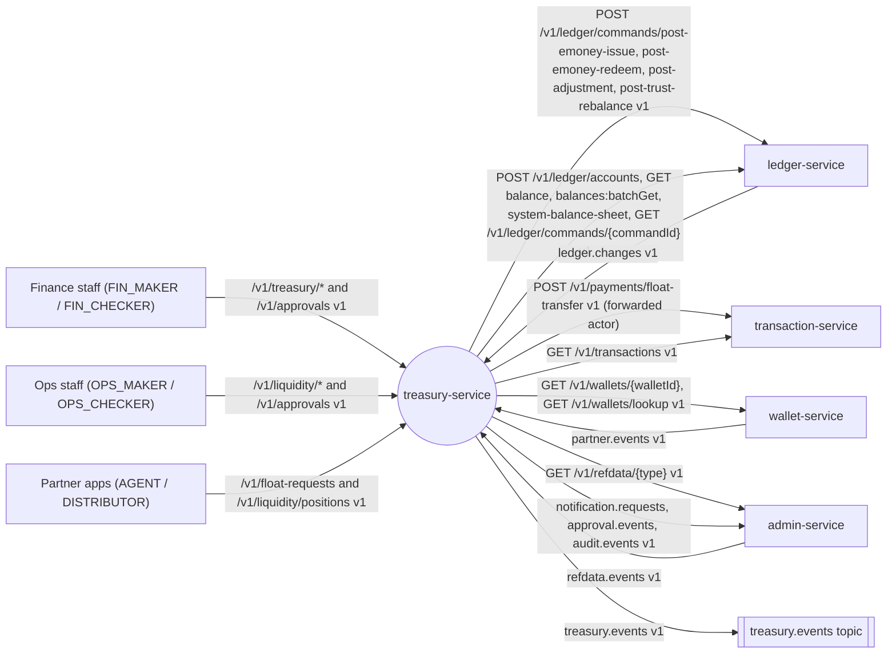

### 3.2 Component diagram

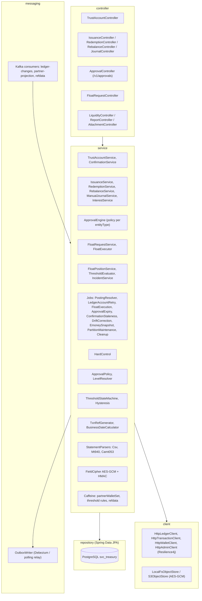

### 3.3 Runtime and deployment (Compose)

| Item | Value |
|---|---|
| Compose service | `treasury-service`, ports 8107 / 9107, profile `dev` (all roles in one container), `mem_limit` 384 MB, `depends_on` postgres, kafka-init (healthy). Readiness covers only own infra; never waits for another service |
| Swagger | `http://localhost:8000/treasury/swagger-ui.html` (edge proxy) |
| Database | `bitspay`, schema `svc_treasury`, login role `svc_treasury`; Flyway `spring.flyway.schemas=svc_treasury`, `create-schemas=false` in the stack (`true` in Testcontainers) |
| Redis / TigerBeetle / ClickHouse | none |
| Object store | attachments: `LocalFsObjectStore` (volume) by default, `S3ObjectStore` optional |
| Env vars beyond kernel K8.3 | `BITSPAY_CLIENTS_LEDGER_BASEURL` (`http://ledger-service:8101`), `BITSPAY_CLIENTS_TRANSACTION_BASEURL` (`:8102`), `BITSPAY_CLIENTS_WALLET_BASEURL` (`:8103`), `BITSPAY_CLIENTS_ADMIN_BASEURL` (`:8115`); `BITSPAY_FIELD_CIPHER_KEY` (bank account numbers); `BITSPAY_TREASURY_ATTACHMENTS_DIR`; `BITSPAY_TREASURY_LIQUIDITY_OPS_STAFF_IDS` (comma-separated staff UUIDs) |
| Consumer groups | `treasury-service.ledger-changes` (`ledger.changes`), `treasury-service.partner-projection` (`partner.events`), `treasury-service.refdata` (`refdata.events`) — OPEN D-30 (group-id pattern) |
| Produced topics | `treasury.events` (outbox), `notification.requests`, `approval.events`, `audit.events` (inbound topics, outbox) |

**Scheduled jobs** (every replica schedules them; each takes `pg_try_advisory_lock(hashtext('<job>'))` so one runs at a time):

| Job | Schedule | Purpose |
|---|---|---|
| `PostingResolverJob` | every 60 s | resolves `POSTING_UNKNOWN`; retries `APPROVED` entities whose execution got 503 / ledger 403 (BR-07-25b) |
| `LedgerAccountRetryJob` | every 60 s | trust accounts in `PENDING_LEDGER` (BR-07-02) |
| `FloatExecutionJob` | every 10 s | `EXECUTING` float requests whose `next_attempt_at` ≤ now (BR-07-45) |
| `ApprovalExpiryJob` | every 5 min | PENDING approvals past `expires_at`; ageing notifications at 24 h / 48 h (BR-07-71) |
| `FloatRequestExpiryJob` | every 5 min | REQUESTED float requests past `expires_at` → EXPIRED |
| `ConfirmationStalenessJob` | hourly | `TRUST_CONFIRMATION_STALE` (BR-07-13) |
| `RealertJob` | every 5 min | re-alerts of open incidents (BR-07-64) |
| `DriftCorrectionJob` | every 15 min | samples positions vs ledger balances (BR-07-61) |
| `EmoneySnapshotJob` | `CUTOFF.EOD` + 10 min (Asia/Dhaka), retried every 5 min | daily e-money snapshot (BR-07-80) |
| `DailyStatCloseJob` | `CUTOFF.EOD` + 1 min | closes `minutes_low` for the business date (BR-07-66) |
| `PartitionMaintenanceJob` | daily 02:00 Asia/Dhaka | creates `float_daily_stat` partitions 3 months ahead |
| `CleanupJob` | hourly | outbox rows > 3 days, `processed_event` > 14 days, `idempotency_record` > 7 days (K3.3, K8.2) |

### 3.4 Key flows

**F1 — E-money issuance with hard control**

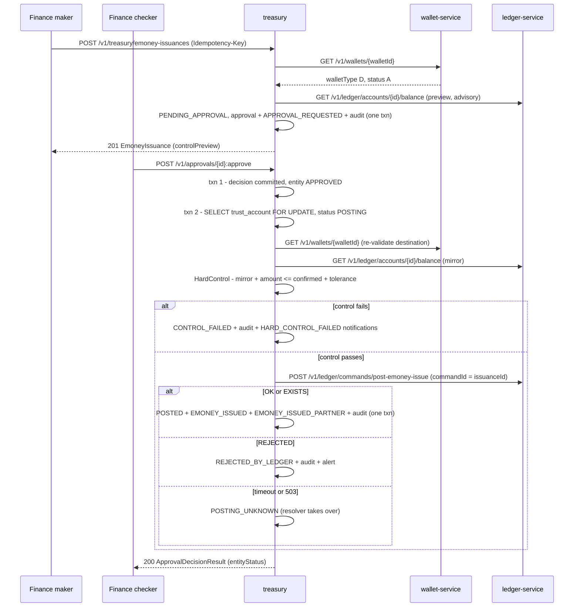

**F1b — Resolving an unknown ledger outcome**

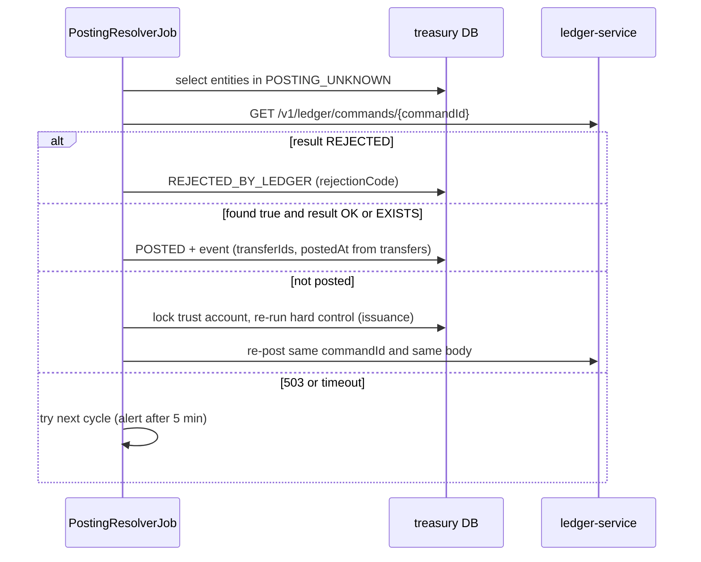

**F2 — Float top-up from the parent distributor**

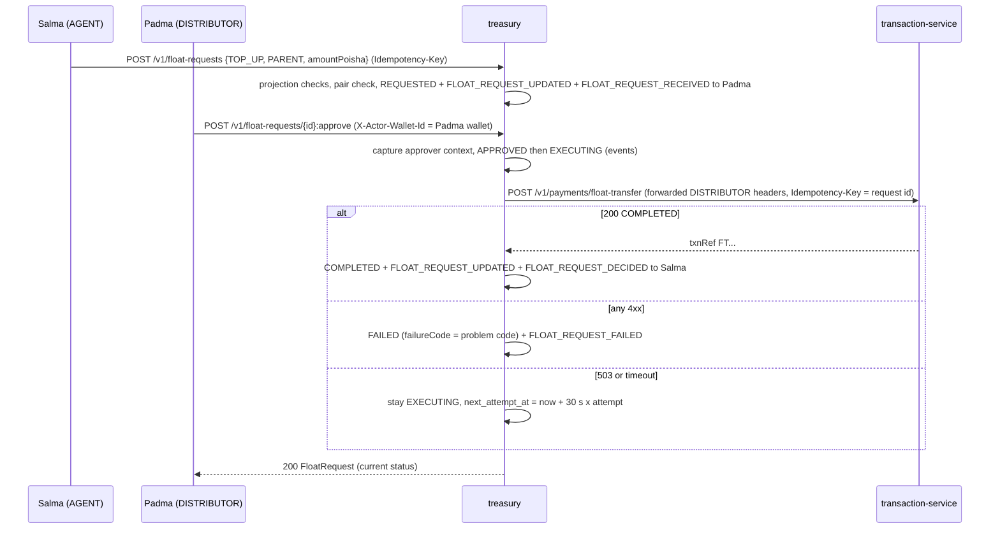

**F2b — Float execution retries, STUCK and the 24 h / 72 h key rules**

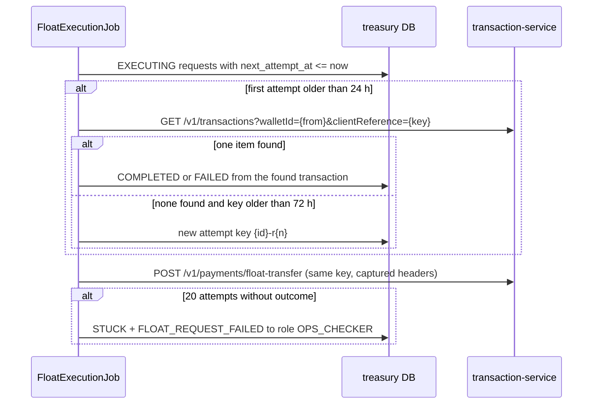

**F3 — Liquidity alert**

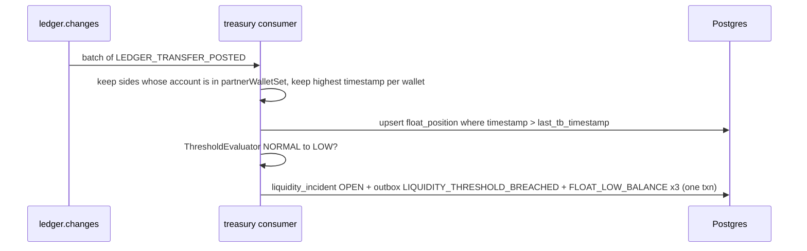

**F4 — Trust balance confirmation from a statement**

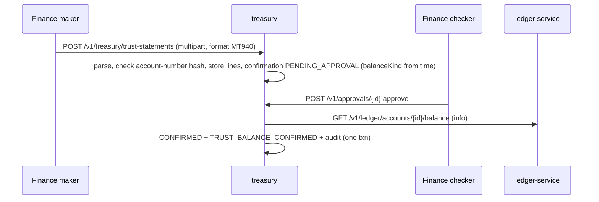

**F5 — Redemption and manual payout**

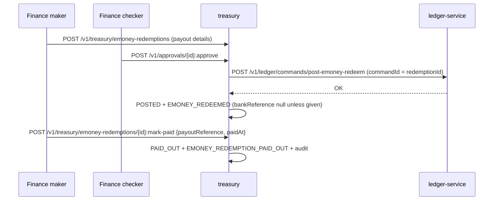

**F6 — Daily e-money snapshot**

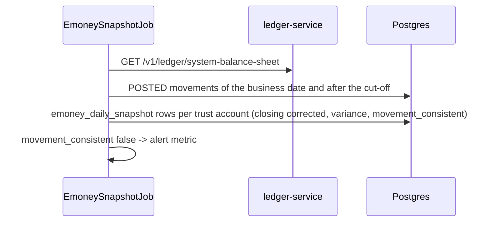

### 3.5 State machines

**Trust account**

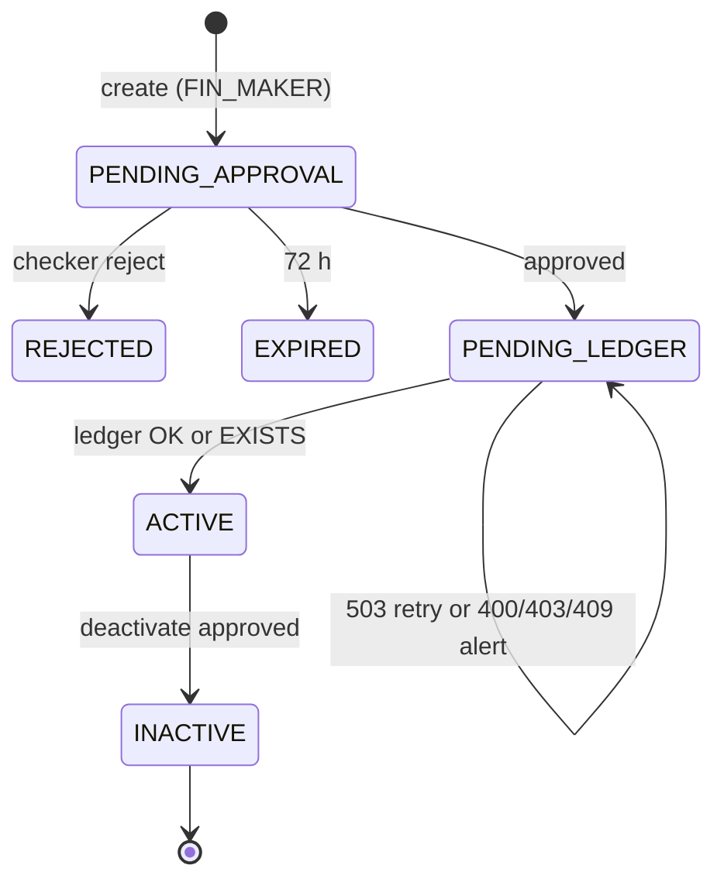

**Trust balance confirmation**

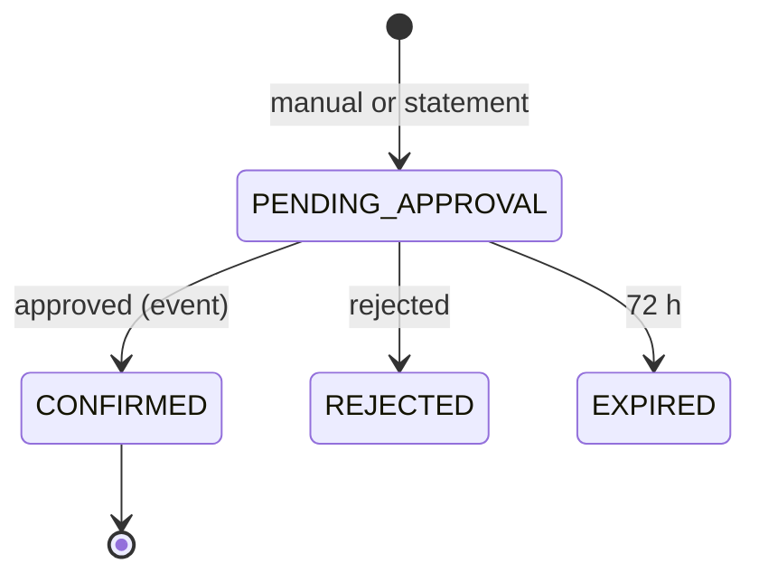

**E-money issuance** (trust rebalance follows the same machine; the control is on the `to` account)

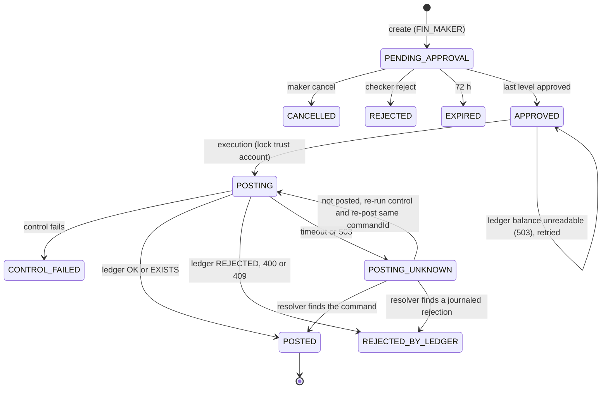

**E-money redemption**

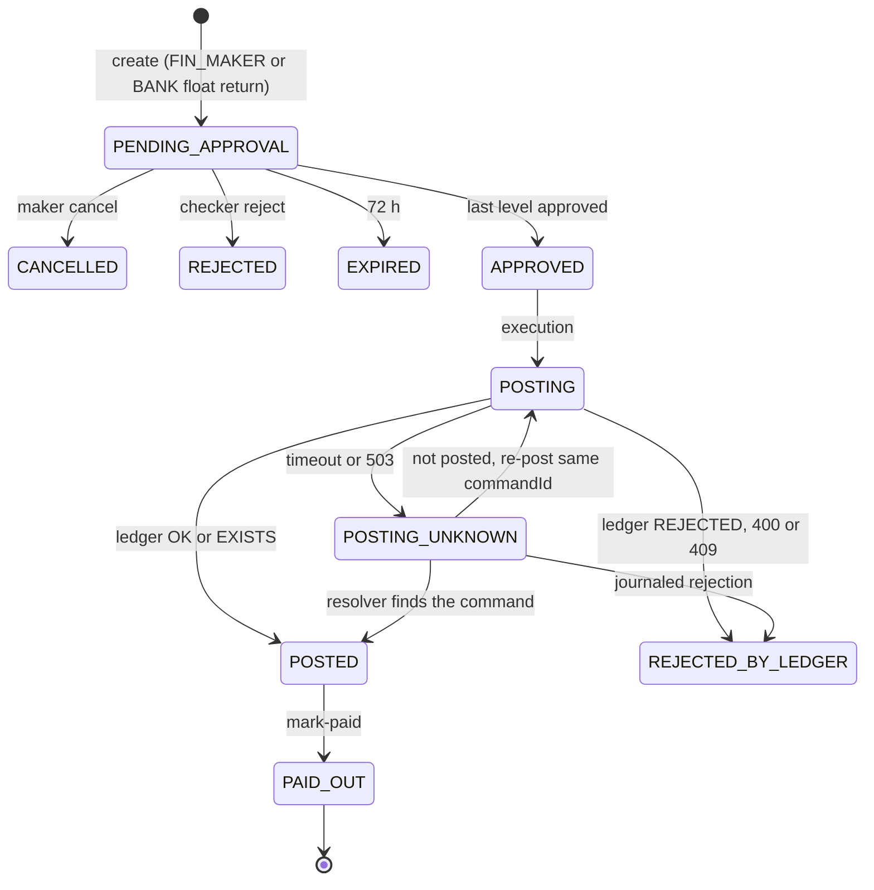

**Manual journal**: as the redemption machine without `PAID_OUT` (terminal `POSTED`).

**Float request**

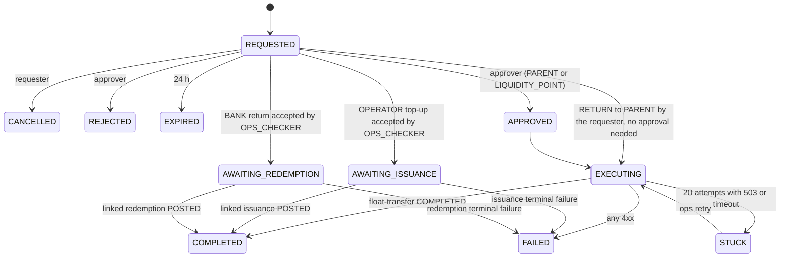

**Approval request** (kernel K5)

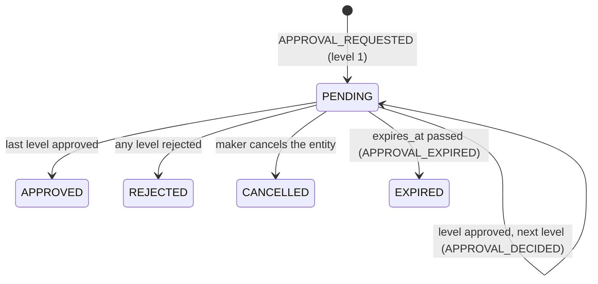

**Float position threshold state** (per wallet; STOCK_OUT is a separate incident flag)

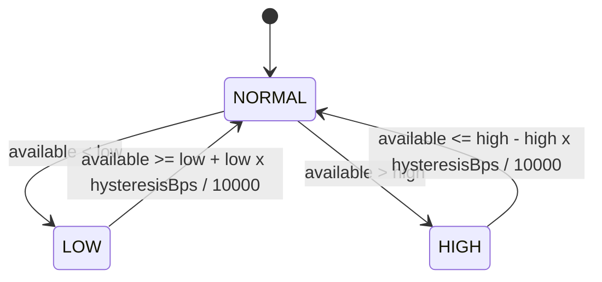

**Trust interest record**

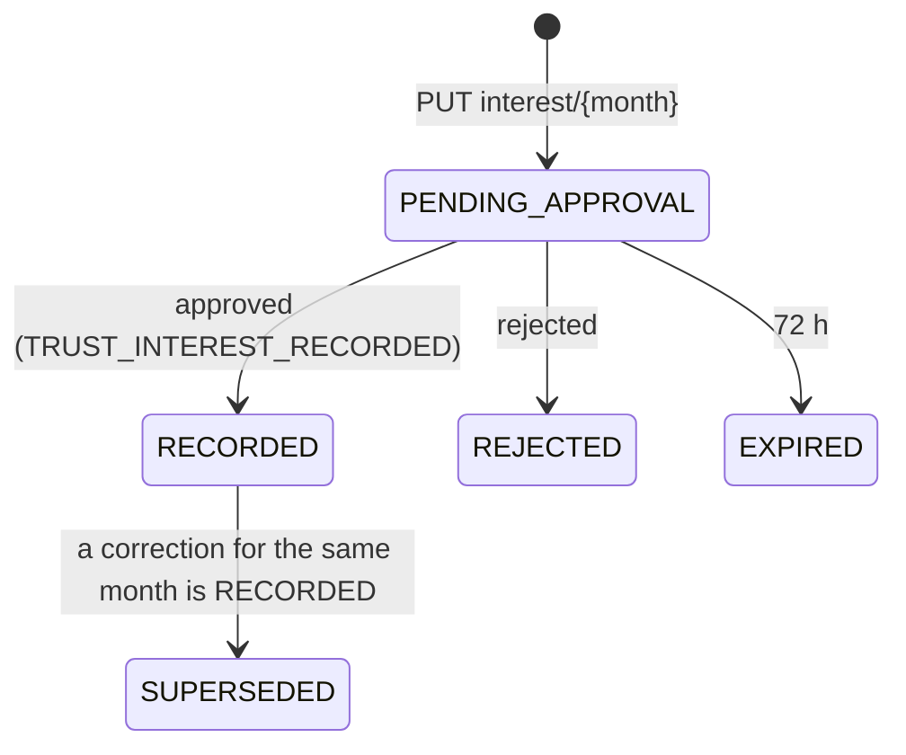

**Liquidity threshold rule**

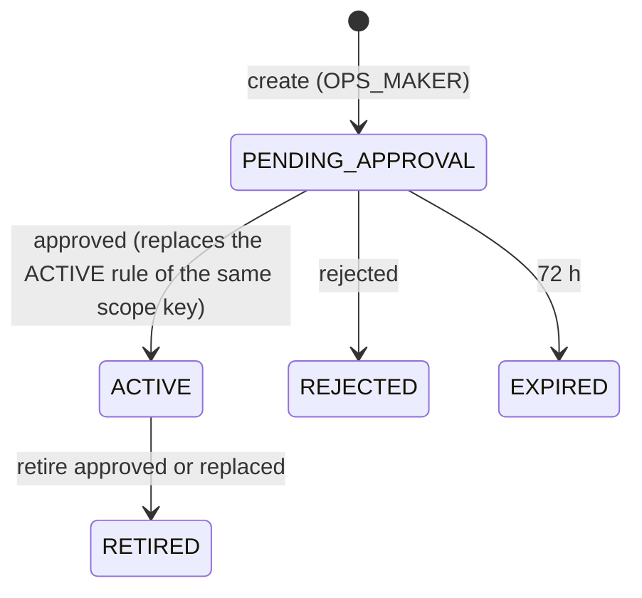

### 3.6 Architecture decisions

| ADR | Decision | Why | Consequence |
|---|---|---|---|
| ADR-T1 | Hard control and posting are serialised per trust account with `SELECT … FOR UPDATE` on `trust_account`, held across the ledger balance read and the ledger post (timeouts 500 ms + 2 s) | Two concurrent issuances must not both pass EMY-009; volume is tiny | Approve-with-post p99 ≤ 3 s; lock order by `trust_index` when two rows are needed (rebalance) |
| ADR-T2 | Ledger `commandId` = the treasury entity id (UUIDv7 of issuance / redemption / rebalance / journal); retries reuse it | Exactly-once with ledger idempotency; a `REJECTED` result is final for the id | A new attempt after a rejection is a new entity (new id) |
| ADR-T3 | Unknown ledger outcome → `POSTING_UNKNOWN`; the resolver reads `GET /v1/ledger/commands/{commandId}`: `result = REJECTED` → `REJECTED_BY_LEDGER`; `found = true` and result OK/EXISTS → `POSTED`; otherwise re-run the control and re-post the same body. New executions on that trust account wait while any posting is unresolved | Never guess; no overshoot window | `409 STATE_CONFLICT reason POSTING_UNKNOWN_PENDING` on approve |
| ADR-T4 | `ledger.changes` idempotency by TB-timestamp guard per wallet (`apply iff timestamp > last_tb_timestamp`), no `processed_event` | High volume; last-writer-wins by TB timestamp is idempotent and order-independent across partitions (kernel K4.3 allows an intrinsic idempotent effect) | Duplicates and out-of-order events are harmless |
| ADR-T5 | One generic `ApprovalEngine` with a policy table per entity type (roles, levels by amount, expiry) | One implementation of kernel K5 for 8 entity types | Policies are configuration |
| ADR-T6 | A float TOP_UP from OPERATOR becomes an issuance linked by `floatRequestId`; a float RETURN to BANK becomes a redemption | Reuses the controlled money paths | No second issuance path |
| ADR-T7 | Statements: treasury parses only what it needs (closing balance, lines for evidence lookup); matching belongs to reconciliation | No duplicate recon framework | Lines are stored for evidence only |
| ADR-T8 | Attachments in an object store (`client.ObjectStore`), AES-GCM encrypted, SHA-256 stored; local filesystem store (`LocalFsObjectStore`) by default | No third-party dependency | Downloads are audited |
| ADR-T9 | Float transfers are executed with the **forwarded actor context of the owner of `fromWalletId`** (or the STAFF approver), captured at approval / creation | transaction-service authorises float transfers by the wallet holder and hierarchy; its contract lists treasury as an allowed forwarder | `approver_actor` stored on the request; jobs replay it unchanged |
| ADR-T10 | `businessDate` everywhere = `localDate(ts @ Asia/Dhaka − CUTOFF.EOD)`, `CUTOFF.EOD` read from `refdata.events` (default `00:00`) | Same business date as every other producer (kernel K1) | Snapshot and stats jobs run relative to the cut-off |
| ADR-T11 | Generic `idempotency_record` table for every keyed POST, scope `(X-Actor-Id, key)`, retained 7 days | Kernel K3.3 replay of the original response | Entity tables keep `idempotency_key` only for traceability |

### 3.7 Latency / throughput budget

Back-office service; no hot payment path. Budgets:

| Path | Budget |
|---|---|
| Reads (`GET`) | p95 ≤ 300 ms |
| Creating writes | p95 ≤ 1 s (includes one wallet read and one ledger balance read) |
| Approve with ledger post | p99 ≤ 3 s (lock wait ≤ 500 ms, balance read ≤ 500 ms, post ≤ 2 s) |
| Float `:approve` with execution | p99 ≤ 3.5 s (float transfer timeout 3 s) |
| `ledger.changes` consumer | keeps up with the system design target: 5k TPS sustained ≈ 19k `LEDGER_TRANSFER_POSTED`/s (≈ 3–4 legs per payment), 10k TPS burst for 10 min ≈ 38k/s; lag alert > 60 s |

## 4. Data model

### 4.1 Tables (Flyway `V1__init.sql`, PostgreSQL 18, schema `svc_treasury`)

All money columns are `bigint` poisha. All ids are UUIDv7 unless stated. STAFF ids are canonical UUIDs. Mutable rows carry `created_at`, `updated_at`, `version`.

```sql
-- V1__init.sql  (search_path = svc_treasury)

CREATE TABLE trust_account (
  id                 uuid PRIMARY KEY,
  trust_index        smallint    NOT NULL UNIQUE CHECK (trust_index BETWEEN 1 AND 99),
  ledger_account_id  uuid        NOT NULL UNIQUE,                 -- 00000000-0000-0000-0000-0000000300nn
  bank_code          text        NOT NULL,                        -- refdata BANK code
  bank_name          text        NOT NULL,
  branch_name        text,
  account_name       text        NOT NULL,
  account_no_enc     bytea       NOT NULL,                        -- FieldCipher AES-GCM
  account_no_hash    char(64)    NOT NULL UNIQUE,                 -- K2 HMAC of BANK_ACCOUNT "<bankCode>:<digits>"
  account_no_masked  text        NOT NULL,                        -- ****4521
  status             text        NOT NULL CHECK (status IN ('PENDING_APPROVAL','PENDING_LEDGER','ACTIVE','INACTIVE','REJECTED','EXPIRED')),
  interest_bearing   boolean     NOT NULL DEFAULT false,
  created_by         uuid        NOT NULL,
  created_at         timestamptz NOT NULL DEFAULT now(),
  updated_at         timestamptz NOT NULL DEFAULT now(),
  version            bigint      NOT NULL DEFAULT 0
);

CREATE TABLE attachment (
  id            uuid PRIMARY KEY,
  file_name     text        NOT NULL,
  content_type  text        NOT NULL,
  size_bytes    bigint      NOT NULL CHECK (size_bytes BETWEEN 1 AND 10485760),
  sha256        bytea       NOT NULL,
  storage_key   text        NOT NULL,
  uploaded_by   uuid        NOT NULL,
  created_at    timestamptz NOT NULL DEFAULT now()
);

CREATE TABLE trust_statement (
  id                      uuid PRIMARY KEY,
  trust_account_id        uuid        NOT NULL REFERENCES trust_account(id),
  format                  text        NOT NULL CHECK (format IN ('CSV','MT940','CAMT053')),
  attachment_id           uuid        NOT NULL REFERENCES attachment(id),
  statement_ref           text,
  period_from             date,
  period_to               date        NOT NULL,
  opening_balance_poisha  bigint,
  closing_balance_poisha  bigint      NOT NULL CHECK (closing_balance_poisha >= 0),
  closing_balance_at      timestamptz NOT NULL,
  line_count              int         NOT NULL,
  file_sha256             bytea       NOT NULL,
  created_by              uuid        NOT NULL,
  created_at              timestamptz NOT NULL DEFAULT now(),
  UNIQUE (trust_account_id, file_sha256)
);

CREATE TABLE trust_statement_line (
  id              uuid PRIMARY KEY,
  statement_id    uuid    NOT NULL REFERENCES trust_statement(id),
  line_no         int     NOT NULL,
  value_date      date    NOT NULL,
  direction       text    NOT NULL CHECK (direction IN ('CREDIT','DEBIT')),
  amount_poisha   bigint  NOT NULL CHECK (amount_poisha > 0),
  bank_reference  text,
  narrative       text,
  used_by_entity  text,                                            -- 'EmoneyIssuance:<id>' once cited
  UNIQUE (statement_id, line_no)
);
CREATE INDEX trust_statement_line_ref ON trust_statement_line (bank_reference);

CREATE TABLE trust_balance_confirmation (
  id                           uuid PRIMARY KEY,
  trust_account_id             uuid        NOT NULL REFERENCES trust_account(id),
  business_date                date        NOT NULL,
  balance_as_of                timestamptz NOT NULL,
  confirmed_balance_poisha     bigint      NOT NULL CHECK (confirmed_balance_poisha >= 0),
  balance_kind                 text        NOT NULL CHECK (balance_kind IN ('CLOSING','INTRADAY')),
  source                       text        NOT NULL CHECK (source IN ('MANUAL','CSV','MT940','CAMT053')),
  statement_id                 uuid REFERENCES trust_statement(id),
  evidence_attachment_ids      uuid[]      NOT NULL DEFAULT '{}',
  mirror_at_confirmation_poisha bigint,                            -- ledger mirror read at approval (info)
  status                       text        NOT NULL CHECK (status IN ('PENDING_APPROVAL','CONFIRMED','REJECTED','EXPIRED')),
  comment                      text,
  maker_id                     uuid        NOT NULL,
  confirmed_at                 timestamptz,
  created_at                   timestamptz NOT NULL DEFAULT now(),
  updated_at                   timestamptz NOT NULL DEFAULT now(),
  version                      bigint      NOT NULL DEFAULT 0
);
CREATE INDEX tbc_latest ON trust_balance_confirmation (trust_account_id, balance_as_of DESC) WHERE status = 'CONFIRMED';
CREATE INDEX tbc_closing ON trust_balance_confirmation (trust_account_id, business_date, balance_as_of DESC)
  WHERE status = 'CONFIRMED' AND balance_kind = 'CLOSING';

CREATE TABLE emoney_issuance (
  id                       uuid PRIMARY KEY,                       -- = ledger commandId
  txn_ref                  varchar(32) NOT NULL UNIQUE,            -- EI{yyMMdd}{10}
  trust_account_id         uuid        NOT NULL REFERENCES trust_account(id),
  destination_type         text        NOT NULL CHECK (destination_type IN ('WALLET','CAMPAIGN_FUNDING')),
  destination_wallet_id    uuid,
  destination_account_id   uuid        NOT NULL,                   -- wallet id or …000000000240
  destination_wallet_type  char(1) CHECK (destination_wallet_type IN ('A','D','I')),
  amount_poisha            bigint      NOT NULL CHECK (amount_poisha > 0 AND amount_poisha <= 10000000000000),
  bank_reference           varchar(64) NOT NULL,
  deposit_date             date        NOT NULL,
  depositor_name           text,
  statement_line_id        uuid REFERENCES trust_statement_line(id),
  evidence_attachment_ids  uuid[]      NOT NULL,
  float_request_id         uuid,
  related_redemption_id    uuid,
  status                   text        NOT NULL CHECK (status IN ('PENDING_APPROVAL','APPROVED','POSTING','POSTING_UNKNOWN','POSTED','CONTROL_FAILED','REJECTED_BY_LEDGER','REJECTED','EXPIRED','CANCELLED')),
  required_levels          int         NOT NULL,
  control_preview          jsonb,
  control_snapshot         jsonb,                                  -- {mirrorPoisha, confirmedPoisha, confirmationId, tolerancePoisha, evaluatedAt, result, failReason}
  ledger_result            text,
  ledger_rejection_code    text,
  ledger_transfer_ids      uuid[]      NOT NULL DEFAULT '{}',
  maker_id                 uuid        NOT NULL,
  checker_ids              uuid[]      NOT NULL DEFAULT '{}',
  idempotency_key          text        NOT NULL,
  posted_at                timestamptz,
  business_date            date,                                   -- of posted_at
  created_at               timestamptz NOT NULL DEFAULT now(),
  updated_at               timestamptz NOT NULL DEFAULT now(),
  version                  bigint      NOT NULL DEFAULT 0,
  UNIQUE (maker_id, idempotency_key)
);
CREATE UNIQUE INDEX issuance_bank_ref_live ON emoney_issuance (trust_account_id, bank_reference)
  WHERE status NOT IN ('REJECTED','EXPIRED','CANCELLED','CONTROL_FAILED','REJECTED_BY_LEDGER');
CREATE INDEX issuance_status ON emoney_issuance (status, updated_at);
CREATE INDEX issuance_posted ON emoney_issuance (business_date) WHERE status = 'POSTED';

CREATE TABLE emoney_redemption (
  id                       uuid PRIMARY KEY,                       -- = ledger commandId
  txn_ref                  varchar(32) NOT NULL UNIQUE,            -- ER…
  trust_account_id         uuid        NOT NULL REFERENCES trust_account(id),
  source_type              text        NOT NULL CHECK (source_type IN ('WALLET','SYSTEM_ACCOUNT')),
  source_wallet_id         uuid,
  source_account_id        uuid        NOT NULL,
  source_account_type      text        NOT NULL,                   -- AGENT_WALLET … CAMPAIGN_FUNDING
  amount_poisha            bigint      NOT NULL CHECK (amount_poisha > 0 AND amount_poisha <= 10000000000000),
  reason_code              text        NOT NULL,
  bank_reference           varchar(64),                            -- optional maker reference (OPEN D-22)
  payout_bank_code         text,
  payout_account_no_enc    bytea,
  payout_account_masked    text,
  payout_account_name      text,
  evidence_attachment_ids  uuid[]      NOT NULL DEFAULT '{}',
  float_request_id         uuid,
  status                   text        NOT NULL CHECK (status IN ('PENDING_APPROVAL','APPROVED','POSTING','POSTING_UNKNOWN','POSTED','PAID_OUT','REJECTED_BY_LEDGER','REJECTED','EXPIRED','CANCELLED')),
  required_levels          int         NOT NULL,
  precheck                 jsonb,
  ledger_result            text,
  ledger_rejection_code    text,
  ledger_transfer_ids      uuid[]      NOT NULL DEFAULT '{}',
  payout_reference         varchar(64),
  paid_out_at              timestamptz,
  maker_id                 uuid        NOT NULL,
  checker_ids              uuid[]      NOT NULL DEFAULT '{}',
  idempotency_key          text        NOT NULL,
  posted_at                timestamptz,
  business_date            date,
  created_at               timestamptz NOT NULL DEFAULT now(),
  updated_at               timestamptz NOT NULL DEFAULT now(),
  version                  bigint      NOT NULL DEFAULT 0,
  UNIQUE (maker_id, idempotency_key)
);
CREATE INDEX redemption_status ON emoney_redemption (status, updated_at);

CREATE TABLE trust_rebalance (
  id                       uuid PRIMARY KEY,                       -- = ledger commandId
  txn_ref                  varchar(32) NOT NULL UNIQUE,            -- TR…
  from_trust_account_id    uuid        NOT NULL REFERENCES trust_account(id),
  to_trust_account_id      uuid        NOT NULL REFERENCES trust_account(id),
  amount_poisha            bigint      NOT NULL CHECK (amount_poisha > 0 AND amount_poisha <= 10000000000000),
  bank_reference           varchar(64) NOT NULL,
  evidence_attachment_ids  uuid[]      NOT NULL,
  status                   text        NOT NULL CHECK (status IN ('PENDING_APPROVAL','APPROVED','POSTING','POSTING_UNKNOWN','POSTED','CONTROL_FAILED','REJECTED_BY_LEDGER','REJECTED','EXPIRED','CANCELLED')),
  required_levels          int         NOT NULL DEFAULT 2,
  control_snapshot         jsonb,
  ledger_result            text,
  ledger_rejection_code    text,
  ledger_transfer_ids      uuid[]      NOT NULL DEFAULT '{}',
  maker_id                 uuid        NOT NULL,
  checker_ids              uuid[]      NOT NULL DEFAULT '{}',
  idempotency_key          text        NOT NULL,
  posted_at                timestamptz,
  business_date            date,
  created_at               timestamptz NOT NULL DEFAULT now(),
  updated_at               timestamptz NOT NULL DEFAULT now(),
  version                  bigint      NOT NULL DEFAULT 0,
  CHECK (from_trust_account_id <> to_trust_account_id),
  UNIQUE (maker_id, idempotency_key)
);

CREATE TABLE manual_journal (
  id                       uuid PRIMARY KEY,                       -- = ledger commandId
  txn_ref                  varchar(32) NOT NULL UNIQUE,            -- MJ…
  debit_account_type       text        NOT NULL,
  debit_account_id         uuid        NOT NULL,
  credit_account_type      text        NOT NULL,
  credit_account_id        uuid        NOT NULL,
  amount_poisha            bigint      NOT NULL CHECK (amount_poisha > 0 AND amount_poisha <= 10000000000000),
  reason_code              text        NOT NULL,
  narrative                text        NOT NULL,
  evidence_attachment_ids  uuid[]      NOT NULL CHECK (cardinality(evidence_attachment_ids) >= 1),
  status                   text        NOT NULL CHECK (status IN ('PENDING_APPROVAL','APPROVED','POSTING','POSTING_UNKNOWN','POSTED','REJECTED_BY_LEDGER','REJECTED','EXPIRED','CANCELLED')),
  required_levels          int         NOT NULL DEFAULT 2,
  ledger_result            text,
  ledger_rejection_code    text,
  ledger_transfer_ids      uuid[]      NOT NULL DEFAULT '{}',
  maker_id                 uuid        NOT NULL,
  checker_ids              uuid[]      NOT NULL DEFAULT '{}',
  idempotency_key          text        NOT NULL,
  posted_at                timestamptz,
  business_date            date,
  created_at               timestamptz NOT NULL DEFAULT now(),
  updated_at               timestamptz NOT NULL DEFAULT now(),
  version                  bigint      NOT NULL DEFAULT 0,
  CHECK (debit_account_id <> credit_account_id),
  UNIQUE (maker_id, idempotency_key)
);

CREATE TABLE trust_interest (
  id               uuid PRIMARY KEY,                               -- = interestId
  trust_account_id uuid        NOT NULL REFERENCES trust_account(id),
  month            date        NOT NULL CHECK (extract(day FROM month) = 1),
  interest_poisha  bigint      NOT NULL CHECK (interest_poisha >= 0),
  status           text        NOT NULL CHECK (status IN ('PENDING_APPROVAL','RECORDED','SUPERSEDED','REJECTED','EXPIRED')),
  comment          text,
  maker_id         uuid        NOT NULL,
  checker_ids      uuid[]      NOT NULL DEFAULT '{}',
  recorded_at      timestamptz,
  created_at       timestamptz NOT NULL DEFAULT now(),
  updated_at       timestamptz NOT NULL DEFAULT now(),
  version          bigint      NOT NULL DEFAULT 0
);
CREATE UNIQUE INDEX trust_interest_recorded ON trust_interest (trust_account_id, month) WHERE status = 'RECORDED';
CREATE UNIQUE INDEX trust_interest_pending  ON trust_interest (trust_account_id, month) WHERE status = 'PENDING_APPROVAL';

-- Partner projection (from compacted partner.events)
CREATE TABLE partner_projection (
  partner_id            uuid PRIMARY KEY,
  partner_type          text        NOT NULL,                      -- AGENT|MERCHANT|DISTRIBUTOR|INSTITUTION
  sub_type              text,
  category_code         int,
  wallet_id             uuid UNIQUE,                               -- null until ACTIVE
  parent_partner_id     uuid,
  ancestor_partner_ids  uuid[]      NOT NULL DEFAULT '{}',          -- nearest first
  ancestor_wallet_ids   uuid[]      NOT NULL DEFAULT '{}',
  division              text, district text, upazila text, union_code text,   -- refdata GEO codes
  status                text        NOT NULL,
  display_name          text,
  msisdn_masked         text,                                      -- 8801711****00, never clear
  version               bigint      NOT NULL,
  effective_from        timestamptz,
  updated_at            timestamptz NOT NULL DEFAULT now()
);
CREATE INDEX partner_proj_ancestors ON partner_projection USING gin (ancestor_partner_ids);
CREATE INDEX partner_proj_parent ON partner_projection (parent_partner_id);
CREATE INDEX partner_proj_district ON partner_projection (district);

-- Reference data projection (from compacted refdata.events): BANK, HOLIDAY, SYSTEM_PARAM CUTOFF.EOD / CALENDAR.*
CREATE TABLE refdata_item (
  type        text        NOT NULL,
  code        text        NOT NULL,
  name_en     text,
  attributes  jsonb       NOT NULL,
  version     bigint      NOT NULL,
  active      boolean     NOT NULL,
  updated_at  timestamptz NOT NULL DEFAULT now(),
  PRIMARY KEY (type, code)
);

CREATE TABLE float_request (
  id                      uuid PRIMARY KEY,                        -- = requestId
  requester_partner_id    uuid        NOT NULL,
  requester_wallet_id     uuid        NOT NULL,
  direction               text        NOT NULL CHECK (direction IN ('TOP_UP','RETURN')),
  counterparty            text        NOT NULL CHECK (counterparty IN ('PARENT','OPERATOR','BANK','LIQUIDITY_POINT')),
  counterparty_wallet_id  uuid,
  amount_poisha           bigint      NOT NULL CHECK (amount_poisha > 0),
  note                    text,
  payout_bank_code        text,
  payout_account_no_enc   bytea,
  payout_account_masked   text,
  payout_account_name     text,
  status                  text        NOT NULL CHECK (status IN ('REQUESTED','APPROVED','EXECUTING','AWAITING_ISSUANCE','AWAITING_REDEMPTION','COMPLETED','FAILED','REJECTED','CANCELLED','EXPIRED','STUCK')),
  created_by_actor        jsonb       NOT NULL,                    -- {type,id,walletId,roles,userId,channel}
  approver_actor          jsonb,                                   -- captured at approval (forwarded on execution)
  execution_key           text,                                    -- Idempotency-Key towards transaction-service ({id} or {id}-r{n})
  execution_key_first_at  timestamptz,                             -- first use of execution_key
  execution_attempts      int         NOT NULL DEFAULT 0,
  next_attempt_at         timestamptz,
  txn_ref                 varchar(32),
  issuance_id             uuid,
  redemption_id           uuid,
  failure_code            text,
  reject_reason           text,
  idempotency_key         text        NOT NULL,
  expires_at              timestamptz NOT NULL,
  created_at              timestamptz NOT NULL DEFAULT now(),
  updated_at              timestamptz NOT NULL DEFAULT now(),
  version                 bigint      NOT NULL DEFAULT 0
);
CREATE INDEX float_request_counterparty ON float_request (counterparty_wallet_id, status);
CREATE INDEX float_request_requester ON float_request (requester_wallet_id, status);
CREATE INDEX float_request_exec ON float_request (status, next_attempt_at) WHERE status = 'EXECUTING';

-- Liquidity
CREATE TABLE float_position (
  wallet_id                 uuid PRIMARY KEY,
  partner_id                uuid        NOT NULL,
  ledger_balance_poisha     bigint      NOT NULL,
  available_balance_poisha  bigint      NOT NULL,
  held_poisha               bigint      NOT NULL DEFAULT 0,
  last_tb_timestamp         bigint      NOT NULL DEFAULT 0,        -- ADR-T4 guard (TB ns)
  source                    text        NOT NULL CHECK (source IN ('CDC','SNAPSHOT','DRIFT_FIX')),
  threshold_state           text        NOT NULL DEFAULT 'NORMAL' CHECK (threshold_state IN ('NORMAL','LOW','HIGH')),
  stock_out                 boolean     NOT NULL DEFAULT false,
  state_since               timestamptz NOT NULL DEFAULT now(),
  last_alert_at             timestamptz,
  open_incident_id          uuid,
  open_stockout_incident_id uuid,
  updated_at                timestamptz NOT NULL DEFAULT now()
);
CREATE INDEX float_position_state ON float_position (threshold_state);

CREATE TABLE liquidity_threshold (
  id               uuid PRIMARY KEY,
  scope            text        NOT NULL CHECK (scope IN ('WALLET','TYPE_SUBTYPE_CATEGORY','TYPE_SUBTYPE','TYPE')),
  wallet_id        uuid,
  partner_type     text,
  sub_type         text,
  category_code    int,
  low_poisha       bigint,                                         -- null = no low alert
  high_poisha      bigint,                                         -- null = no high alert
  stockout_poisha  bigint,
  hysteresis_bps   int         NOT NULL DEFAULT 1000 CHECK (hysteresis_bps BETWEEN 0 AND 5000),
  liquidity_point  boolean     NOT NULL DEFAULT false,             -- LIQ-008 (R2)
  status           text        NOT NULL CHECK (status IN ('PENDING_APPROVAL','ACTIVE','RETIRED','REJECTED','EXPIRED')),
  maker_id         uuid        NOT NULL,
  created_at       timestamptz NOT NULL DEFAULT now(),
  updated_at       timestamptz NOT NULL DEFAULT now(),
  version          bigint      NOT NULL DEFAULT 0,
  CHECK (low_poisha IS NULL OR high_poisha IS NULL OR low_poisha < high_poisha),
  CHECK (stockout_poisha IS NULL OR low_poisha IS NULL OR stockout_poisha < low_poisha)
);
CREATE UNIQUE INDEX liquidity_threshold_active ON liquidity_threshold
  (scope, coalesce(wallet_id::text,''), coalesce(partner_type,''), coalesce(sub_type,''), coalesce(category_code,-1))
  WHERE status = 'ACTIVE';

CREATE TABLE liquidity_incident (
  id                     uuid PRIMARY KEY,
  wallet_id              uuid        NOT NULL,
  partner_id             uuid        NOT NULL,
  incident_type          text        NOT NULL CHECK (incident_type IN ('LOW','HIGH','STOCK_OUT')),
  threshold_poisha       bigint      NOT NULL,
  opened_balance_poisha  bigint      NOT NULL,
  min_balance_poisha     bigint      NOT NULL,
  opened_at              timestamptz NOT NULL,
  closed_at              timestamptz,
  alerts_sent            int         NOT NULL DEFAULT 1
);
CREATE INDEX liquidity_incident_wallet ON liquidity_incident (wallet_id, opened_at DESC);
CREATE INDEX liquidity_incident_open ON liquidity_incident (opened_at) WHERE closed_at IS NULL;

CREATE TABLE float_daily_stat (
  wallet_id       uuid    NOT NULL,
  business_date   date    NOT NULL,
  open_poisha     bigint  NOT NULL,
  close_poisha    bigint  NOT NULL,
  min_poisha      bigint  NOT NULL,
  max_poisha      bigint  NOT NULL,
  credits_poisha  bigint  NOT NULL DEFAULT 0,
  debits_poisha   bigint  NOT NULL DEFAULT 0,
  movement_count  int     NOT NULL DEFAULT 0,
  minutes_low     int     NOT NULL DEFAULT 0,
  PRIMARY KEY (business_date, wallet_id)
) PARTITION BY RANGE (business_date);                               -- monthly partitions (PartitionMaintenanceJob)

CREATE TABLE emoney_daily_snapshot (
  business_date             date        NOT NULL,
  trust_account_id          uuid        NOT NULL REFERENCES trust_account(id),
  opening_mirror_poisha     bigint      NOT NULL,
  issued_poisha             bigint      NOT NULL,
  redeemed_poisha           bigint      NOT NULL,
  rebalance_in_poisha       bigint      NOT NULL,
  rebalance_out_poisha      bigint      NOT NULL,
  closing_mirror_poisha     bigint      NOT NULL,
  confirmed_balance_poisha  bigint,
  confirmation_id           uuid,
  variance_poisha           bigint,                                -- confirmed − closing mirror
  movement_consistent       boolean     NOT NULL,                  -- opening + in − out = closing
  wallets_total_poisha      bigint      NOT NULL,                  -- ledger walletsTotalPoisha (wallets only)
  ledger_as_of              timestamptz NOT NULL,
  taken_at                  timestamptz NOT NULL DEFAULT now(),
  PRIMARY KEY (business_date, trust_account_id)
);

-- Maker-checker (kernel K5) + per-level decisions
CREATE TABLE approval_request (
  id               uuid PRIMARY KEY,
  entity_type      text        NOT NULL,
  entity_id        text        NOT NULL,
  action           text        NOT NULL,
  payload          jsonb       NOT NULL,
  maker_id         uuid        NOT NULL,
  maker_user_id    text,
  status           text        NOT NULL CHECK (status IN ('PENDING','APPROVED','REJECTED','EXPIRED','CANCELLED')),
  level            int         NOT NULL DEFAULT 1,                  -- 1-based level awaiting / just decided
  required_levels  int         NOT NULL,
  level_roles      jsonb       NOT NULL,                            -- [["FIN_CHECKER"],["FIN_CHECKER"],…] per level
  amount_poisha    bigint,
  summary          text        NOT NULL,
  created_at       timestamptz NOT NULL DEFAULT now(),
  expires_at       timestamptz NOT NULL,
  decided_by       uuid[]      NOT NULL DEFAULT '{}',
  decided_at       timestamptz,
  ageing_sent      int         NOT NULL DEFAULT 0,                  -- 0, 24, 48
  updated_at       timestamptz NOT NULL DEFAULT now(),
  version          bigint      NOT NULL DEFAULT 0
);
CREATE INDEX approval_pending ON approval_request (status, created_at) WHERE status = 'PENDING';
CREATE UNIQUE INDEX approval_one_open_per_entity ON approval_request (entity_type, entity_id, action) WHERE status = 'PENDING';

CREATE TABLE approval_decision (
  approval_id    uuid        NOT NULL REFERENCES approval_request(id),
  level          int         NOT NULL,
  checker_id     uuid        NOT NULL,
  checker_user_id text,
  checker_roles  text[]      NOT NULL,
  decision       text        NOT NULL CHECK (decision IN ('APPROVE','REJECT')),
  comment        text,
  reason_code    text,
  decided_at     timestamptz NOT NULL DEFAULT now(),
  PRIMARY KEY (approval_id, level)
);

-- Kernel K3.3 idempotency store (all keyed POSTs)
CREATE TABLE idempotency_record (
  actor_id        text        NOT NULL,
  idem_key        text        NOT NULL,
  operation       text        NOT NULL,                             -- "POST /v1/treasury/emoney-issuances"
  request_hash    bytea       NOT NULL,                             -- SHA-256 of canonical path + body
  response_status int         NOT NULL,
  response_body   jsonb       NOT NULL,
  created_at      timestamptz NOT NULL DEFAULT now(),
  PRIMARY KEY (actor_id, idem_key)
);

-- Outbox / inbox (kernel K8.2, verbatim)
CREATE TABLE IF NOT EXISTS outbox (
  id             uuid PRIMARY KEY,
  aggregate_type text        NOT NULL,
  aggregate_id   text        NOT NULL,
  event_type     text        NOT NULL,
  payload        jsonb       NULL,
  created_at     timestamptz NOT NULL DEFAULT now(),
  published_at   timestamptz
);
CREATE INDEX IF NOT EXISTS outbox_unpublished ON outbox (created_at) WHERE published_at IS NULL;

CREATE TABLE IF NOT EXISTS processed_event (
  event_id     uuid PRIMARY KEY,
  topic        text NOT NULL,
  processed_at timestamptz NOT NULL DEFAULT now()
);
```

`treasury.events` is never tombstoned: a `NULL` outbox payload from treasury is a bug (kernel K4.2).

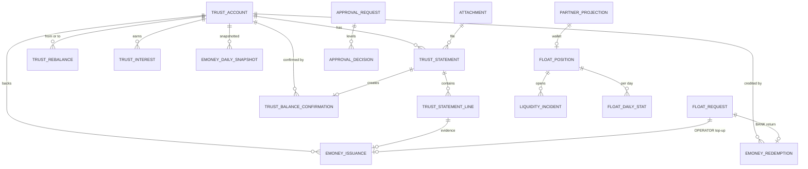

### 4.2 Redis keys / caches

No Redis. In-process Caffeine caches only:

| Cache | Content | Refresh |
|---|---|---|
| `partnerWalletSet` | set of partner wallet ids (~500k uuids) → partnerId | built at start from `partner_projection`; updated by the partner consumer |
| `thresholdRules` | ACTIVE `liquidity_threshold` rows | reloaded on approval / retire and every 5 min |
| `refdata` | BANK, HOLIDAY, `CUTOFF.EOD`, `CALENDAR.*` | updated by the refdata consumer; loaded from `refdata_item` at start |

### 4.3 Retention and archival

| Data | Retention |
|---|---|
| Trust accounts, confirmations, statements, issuances, redemptions, rebalances, journals, interest, approvals, attachments | forever (regulatory, EMY-007); archival policy R2 |
| `float_daily_stat`, `liquidity_incident` | 5 years (monthly partitions dropped by the archival policy later) |
| `float_request` | 10 years (financial records) |
| `emoney_daily_snapshot` | 10 years |
| `outbox` | 3 days after publish (kernel K8.2) |
| `processed_event` | 14 days (used for `partner.events` and `refdata.events` only) |
| `idempotency_record` | 7 days (kernel K3.3, OPEN D-01) |

## 5. Provided contracts

Mirror of `contracts/provided/` — the artefacts win on any conflict (kernel precedence 3). Everything below was generated from the same typed model as `openapi.yaml`, the event schemas and `codes.yaml`.

**Common rules for every operation**
- Headers per kernel K3.1 (`X-Correlation-Id`, `X-Actor-Type`, `X-Actor-Id`, `X-Actor-Wallet-Id` for partner actors, `X-Actor-Roles` for STAFF, `X-Channel`). STAFF ids are canonical UUIDs.
- Errors: RFC 9457 problem+json with the kernel `code` list (K3.6); treasury-owned `reason` values per operation (§5.3). Treasury defines no extension members.
- Lists: cursor pagination per K3.4 (`limit` 1..200, default 50; `INVALID_CURSOR`). Unpaged responses state their bound.
- Idempotency: `Idempotency-Key` required on every creating POST (scope `(X-Actor-Id, key)`, ≥ 7 days, BR-07-00c); optional on action POSTs, where the state guard prevents double execution.
- Requests ignore unknown fields (tolerant reader, K1). Money is int64 poisha; times ISO-8601 UTC with 3 ms digits.
- No operation here is a service-to-service contract: audiences are `staff` (back office) and `partner` (partner channels). Every state-changing operation writes `audit.events` in the same transaction (K6).

### 5.1 REST operations

| # | Operation | Audience | Actors & roles | Idempotency | Purpose |
|---|---|---|---|---|---|
| 5.1.1 | `POST /v1/treasury/trust-accounts` | staff | STAFF `FIN_MAKER` | `Idempotency-Key` **required** (K3.3) | Register a trust bank account (maker) |
| 5.1.2 | `GET /v1/treasury/trust-accounts` | staff | STAFF finance/ops read roles (`FIN_*`, `OPS_*`, `AUDITOR`, `ADMIN`, `READ_ONLY`) | read-only, no key | List trust accounts |
| 5.1.3 | `GET /v1/treasury/trust-accounts/positions` | staff | STAFF finance/ops read roles (`FIN_*`, `OPS_*`, `AUDITOR`, `ADMIN`, `READ_ONLY`) | read-only, no key | Trust positions (LIQ-005) |
| 5.1.4 | `GET /v1/treasury/trust-accounts/{id}` | staff | STAFF finance/ops read roles (`FIN_*`, `OPS_*`, `AUDITOR`, `ADMIN`, `READ_ONLY`) | read-only, no key | Get a trust account |
| 5.1.5 | `POST /v1/treasury/trust-accounts/{id}:deactivate` | staff | STAFF `FIN_MAKER` | `Idempotency-Key` optional (state guard) | Request deactivation (maker) |
| 5.1.6 | `PUT /v1/treasury/trust-accounts/{id}/interest/{month}` | staff | STAFF `FIN_MAKER` | naturally idempotent PUT, no key | Record monthly trust interest (maker, EMY-008) |
| 5.1.7 | `GET /v1/treasury/trust-accounts/{id}/interest` | staff | STAFF finance/ops read roles (`FIN_*`, `OPS_*`, `AUDITOR`, `ADMIN`, `READ_ONLY`) | read-only, no key | List interest records of a trust account |
| 5.1.8 | `POST /v1/treasury/trust-balance-confirmations` | staff | STAFF `FIN_MAKER` | `Idempotency-Key` **required** (K3.3) | Manual trust balance confirmation (maker) |
| 5.1.9 | `GET /v1/treasury/trust-balance-confirmations` | staff | STAFF finance/ops read roles (`FIN_*`, `OPS_*`, `AUDITOR`, `ADMIN`, `READ_ONLY`) | read-only, no key | List confirmations |
| 5.1.10 | `GET /v1/treasury/trust-balance-confirmations/{id}` | staff | STAFF finance/ops read roles (`FIN_*`, `OPS_*`, `AUDITOR`, `ADMIN`, `READ_ONLY`) | read-only, no key | Get a confirmation |
| 5.1.11 | `POST /v1/treasury/trust-statements` | staff | STAFF `FIN_MAKER` | `Idempotency-Key` **required** (K3.3) | Upload a bank statement (CSV / MT940 / camt.053) (maker) |
| 5.1.12 | `GET /v1/treasury/trust-statements/{id}` | staff | STAFF finance/ops read roles (`FIN_*`, `OPS_*`, `AUDITOR`, `ADMIN`, `READ_ONLY`) | read-only, no key | Get a statement |
| 5.1.13 | `GET /v1/treasury/trust-statements/{id}/lines` | staff | STAFF finance/ops read roles (`FIN_*`, `OPS_*`, `AUDITOR`, `ADMIN`, `READ_ONLY`) | read-only, no key | List statement lines |
| 5.1.14 | `POST /v1/treasury/attachments` | staff | STAFF `FIN_MAKER`/`OPS_MAKER` | `Idempotency-Key` optional (state guard) | Upload an evidence file |
| 5.1.15 | `GET /v1/treasury/attachments/{id}` | staff | STAFF finance/ops read roles (`FIN_*`, `OPS_*`, `AUDITOR`, `ADMIN`, `READ_ONLY`) | read-only, no key | Download an evidence file (audited) |
| 5.1.16 | `POST /v1/treasury/emoney-issuances` | staff | STAFF `FIN_MAKER` | `Idempotency-Key` **required** (K3.3) | Create an e-money issuance (maker) |
| 5.1.17 | `GET /v1/treasury/emoney-issuances` | staff | STAFF finance/ops read roles (`FIN_*`, `OPS_*`, `AUDITOR`, `ADMIN`, `READ_ONLY`) | read-only, no key | List issuances |
| 5.1.18 | `GET /v1/treasury/emoney-issuances/{id}` | staff | STAFF finance/ops read roles (`FIN_*`, `OPS_*`, `AUDITOR`, `ADMIN`, `READ_ONLY`) | read-only, no key | Get an issuance |
| 5.1.19 | `POST /v1/treasury/emoney-issuances/{id}:cancel` | staff | STAFF `FIN_MAKER` | `Idempotency-Key` optional (state guard) | Cancel a pending issuance (maker only) |
| 5.1.20 | `POST /v1/treasury/emoney-redemptions` | staff | STAFF `FIN_MAKER` | `Idempotency-Key` **required** (K3.3) | Create an e-money redemption (maker) |
| 5.1.21 | `GET /v1/treasury/emoney-redemptions` | staff | STAFF finance/ops read roles (`FIN_*`, `OPS_*`, `AUDITOR`, `ADMIN`, `READ_ONLY`) | read-only, no key | List redemptions |
| 5.1.22 | `GET /v1/treasury/emoney-redemptions/{id}` | staff | STAFF finance/ops read roles (`FIN_*`, `OPS_*`, `AUDITOR`, `ADMIN`, `READ_ONLY`) | read-only, no key | Get a redemption |
| 5.1.23 | `POST /v1/treasury/emoney-redemptions/{id}:mark-paid` | staff | STAFF `FIN_MAKER` | `Idempotency-Key` optional (state guard) | Record the manual bank payout (POSTED → PAID_OUT) |
| 5.1.24 | `POST /v1/treasury/emoney-redemptions/{id}:cancel` | staff | STAFF `FIN_MAKER` | `Idempotency-Key` optional (state guard) | Cancel a pending redemption (maker only) |
| 5.1.25 | `POST /v1/treasury/trust-rebalances` | staff | STAFF `FIN_MAKER` | `Idempotency-Key` **required** (K3.3) | Create a trust rebalance (maker, R2) |
| 5.1.26 | `GET /v1/treasury/trust-rebalances` | staff | STAFF finance/ops read roles (`FIN_*`, `OPS_*`, `AUDITOR`, `ADMIN`, `READ_ONLY`) | read-only, no key | List rebalances |
| 5.1.27 | `GET /v1/treasury/trust-rebalances/{id}` | staff | STAFF finance/ops read roles (`FIN_*`, `OPS_*`, `AUDITOR`, `ADMIN`, `READ_ONLY`) | read-only, no key | Get a rebalance |
| 5.1.28 | `POST /v1/treasury/trust-rebalances/{id}:cancel` | staff | STAFF `FIN_MAKER` | `Idempotency-Key` optional (state guard) | Cancel a pending rebalance (maker only) |
| 5.1.29 | `POST /v1/treasury/manual-journals` | staff | STAFF `FIN_MAKER` | `Idempotency-Key` **required** (K3.3) | Create a manual journal between system accounts (maker) |
| 5.1.30 | `GET /v1/treasury/manual-journals` | staff | STAFF finance/ops read roles (`FIN_*`, `OPS_*`, `AUDITOR`, `ADMIN`, `READ_ONLY`) | read-only, no key | List manual journals |
| 5.1.31 | `GET /v1/treasury/manual-journals/{id}` | staff | STAFF finance/ops read roles (`FIN_*`, `OPS_*`, `AUDITOR`, `ADMIN`, `READ_ONLY`) | read-only, no key | Get a manual journal |
| 5.1.32 | `POST /v1/treasury/manual-journals/{id}:cancel` | staff | STAFF `FIN_MAKER` | `Idempotency-Key` optional (state guard) | Cancel a pending journal (maker only) |
| 5.1.33 | `GET /v1/treasury/emoney-movements` | staff | STAFF finance/ops read roles (`FIN_*`, `OPS_*`, `AUDITOR`, `ADMIN`, `READ_ONLY`) | read-only, no key | POSTED e-money movements (staff dataset) |
| 5.1.34 | `GET /v1/treasury/reports/emoney-daily` | staff | STAFF finance/ops read roles (`FIN_*`, `OPS_*`, `AUDITOR`, `ADMIN`, `READ_ONLY`) | read-only, no key | Daily e-money dataset (EMY-008) |
| 5.1.35 | `GET /v1/treasury/reports/emoney-monthly` | staff | STAFF finance/ops read roles (`FIN_*`, `OPS_*`, `AUDITOR`, `ADMIN`, `READ_ONLY`) | read-only, no key | Monthly e-money dataset (EMY-008) |
| 5.1.36 | `GET /v1/treasury/wallet-lookup` | staff | STAFF `FIN_MAKER`/`FIN_CHECKER`/`OPS_MAKER`/`OPS_CHECKER` | read-only, no key | Find a wallet by MSISDN (maker convenience) |
| 5.1.37 | `GET /v1/approvals` | staff | STAFF `FIN_CHECKER`/`OPS_CHECKER`/`ADMIN`/`AUDITOR` | read-only, no key | Pending approvals for the caller's roles |
| 5.1.38 | `GET /v1/approvals/{id}` | staff | STAFF `FIN_MAKER`/`FIN_CHECKER`/`OPS_MAKER`/`OPS_CHECKER`/`ADMIN`/`AUDITOR` | read-only, no key | Get an approval |
| 5.1.39 | `POST /v1/approvals/{id}:approve` | staff | STAFF `FIN_CHECKER`/`OPS_CHECKER`/`ADMIN` | `Idempotency-Key` optional (state guard) | Approve the current level (executes on the last level) |
| 5.1.40 | `POST /v1/approvals/{id}:reject` | staff | STAFF `FIN_CHECKER`/`OPS_CHECKER`/`ADMIN` | `Idempotency-Key` optional (state guard) | Reject (entity → REJECTED) |
| 5.1.41 | `POST /v1/float-requests` | partner | AGENT (`X-Actor-Wallet-Id` = own wallet; ACTIVE (RETURN: ACTIVE or PENDING_TERMINATION) in the partner projection); DISTRIBUTOR (same as AGENT); STAFF `OPS_MAKER` | `Idempotency-Key` **required** (K3.3) | Raise a float top-up or return request |
| 5.1.42 | `GET /v1/float-requests` | partner | AGENT (own wallet only); DISTRIBUTOR (own wallet only); STAFF `OPS_MAKER`/`OPS_CHECKER`/`AUDITOR`/`READ_ONLY` | read-only, no key | List float requests (requester or approver view) |
| 5.1.43 | `GET /v1/float-requests/{id}` | partner | AGENT (requester or approver wallet); DISTRIBUTOR (requester or approver wallet); STAFF `OPS_MAKER`/`OPS_CHECKER`/`AUDITOR`/`READ_ONLY` | read-only, no key | Get a float request |
| 5.1.44 | `POST /v1/float-requests/{id}:approve` | partner | DISTRIBUTOR (`X-Actor-Wallet-Id` = `counterpartyWalletId`); AGENT (super-agent parent: `X-Actor-Wallet-Id` = `counterpartyWalletId`); STAFF `OPS_CHECKER` | `Idempotency-Key` optional (state guard) | Approve and execute (approver) |
| 5.1.45 | `POST /v1/float-requests/{id}:reject` | partner | DISTRIBUTOR (`X-Actor-Wallet-Id` = `counterpartyWalletId`); AGENT (super-agent parent: `X-Actor-Wallet-Id` = `counterpartyWalletId`); STAFF `OPS_CHECKER` | `Idempotency-Key` optional (state guard) | Reject (approver) |
| 5.1.46 | `POST /v1/float-requests/{id}:cancel` | partner | AGENT (requester wallet); DISTRIBUTOR (requester wallet); STAFF `OPS_MAKER` | `Idempotency-Key` optional (state guard) | Cancel (requester, while REQUESTED) |
| 5.1.47 | `POST /v1/float-requests/{id}:retry` | staff | STAFF `OPS_CHECKER` | `Idempotency-Key` optional (state guard) | Retry a STUCK execution (ops) |
| 5.1.48 | `GET /v1/liquidity/positions` | partner | STAFF read roles (finance/ops read roles + `PARTNER_OPS_*`, `RISK_ANALYST`, `COMPLIANCE_OFFICER`, `CAMLCO`); DISTRIBUTOR (own descendants only) | read-only, no key | Float positions (LIQ-001) |
| 5.1.49 | `GET /v1/liquidity/positions/{walletId}` | partner | STAFF read roles (finance/ops read roles + `PARTNER_OPS_*`, `RISK_ANALYST`, `COMPLIANCE_OFFICER`, `CAMLCO`); AGENT (own wallet or a descendant); DISTRIBUTOR (own wallet or a descendant); MERCHANT (own wallet) | read-only, no key | Float position of one wallet |
| 5.1.50 | `GET /v1/liquidity/hierarchy/{partnerId}` | partner | STAFF read roles (finance/ops read roles + `PARTNER_OPS_*`, `RISK_ANALYST`, `COMPLIANCE_OFFICER`, `CAMLCO`); DISTRIBUTOR (that partner or one of its ancestors); AGENT (that partner or one of its ancestors) | read-only, no key | Hierarchy roll-up |
| 5.1.51 | `GET /v1/liquidity/territory-summary` | staff | STAFF read roles (finance/ops read roles + `PARTNER_OPS_*`, `RISK_ANALYST`, `COMPLIANCE_OFFICER`, `CAMLCO`) | read-only, no key | Territory (map) summary |
| 5.1.52 | `GET /v1/liquidity/thresholds` | staff | STAFF read roles (finance/ops read roles + `PARTNER_OPS_*`, `RISK_ANALYST`, `COMPLIANCE_OFFICER`, `CAMLCO`) | read-only, no key | List threshold rules |
| 5.1.53 | `POST /v1/liquidity/thresholds` | staff | STAFF `OPS_MAKER` | `Idempotency-Key` **required** (K3.3) | Create or replace a threshold rule (maker, LIQ-002) |
| 5.1.54 | `POST /v1/liquidity/thresholds/{id}:retire` | staff | STAFF `OPS_MAKER` | `Idempotency-Key` optional (state guard) | Retire a threshold rule (maker) |
| 5.1.55 | `GET /v1/liquidity/incidents` | staff | STAFF read roles (finance/ops read roles + `PARTNER_OPS_*`, `RISK_ANALYST`, `COMPLIANCE_OFFICER`, `CAMLCO`) | read-only, no key | Liquidity incidents (LIQ-006) |
| 5.1.56 | `GET /v1/liquidity/reports/utilisation` | staff | STAFF read roles (finance/ops read roles + `PARTNER_OPS_*`, `RISK_ANALYST`, `COMPLIANCE_OFFICER`, `CAMLCO`) | read-only, no key | Float utilisation report (LIQ-006) |

#### 5.1.1 `POST /v1/treasury/trust-accounts`

- **Purpose:** Register a trust bank account (maker). Audience `staff`.
- **Actors:** STAFF `FIN_MAKER`.
- **Idempotency:** `Idempotency-Key` **required** (K3.3).
- **Behaviour:** Creates the row `PENDING_APPROVAL` and an approval (`TrustAccount`/`CREATE`, 1 level `FIN_CHECKER`). On final approval the ledger account is created (BR-07-02).

Request: `TrustAccountCreateRequest`

| Field | Type | Req | Null | Constraints / enum | Notes |
|---|---|---|---|---|---|
| `trustIndex` | int32 | Y | N | 1..99, unique | ledger id `…0300nn` |
| `bankCode` | string | Y | N | ACTIVE refdata BANK code with `trustEligible = true` |  |
| `bankName` | string | Y | N | 1..200 |  |
| `branchName` | string | N | Y | ≤ 200 |  |
| `accountName` | string | Y | N | 1..200 |  |
| `accountNo` | string | Y | N | digits only, 6..20 | encrypted + HMAC hash; never logged or returned |
| `interestBearing` | bool | N | N |  | default false |

```json
{ "trustIndex": 1,
  "bankCode": "BANK-020",
  "bankName": "Partner Bank Ltd",
  "branchName": "Motijheel",
  "accountName": "Bits Pay Trust A/C",
  "accountNo": "0201234567894521",
  "interestBearing": true }
```

Response 201: `TrustAccount`

| Field | Type | Req | Null | Constraints / enum | Notes |
|---|---|---|---|---|---|
| `id` | uuid | Y | N |  | treasury trust account id (= `trustAccountId` on events) |
| `trustIndex` | int32 | Y | N | 1..99 |  |
| `ledgerAccountId` | uuid | Y | N | `00000000-0000-0000-0000-0000000300nn` |  |
| `bankCode` | string | Y | N |  |  |
| `bankName` | string | Y | N |  |  |
| `branchName` | string | Y | Y |  |  |
| `accountName` | string | Y | N |  |  |
| `accountNoMasked` | string | Y | N | `****` + last 4 |  |
| `status` | enum{PENDING_APPROVAL, PENDING_LEDGER, ACTIVE, INACTIVE, REJECTED, EXPIRED} | Y | N |  |  |
| `interestBearing` | bool | Y | N |  |  |
| `approvalId` | uuid | Y | Y |  | open approval (create or deactivate), else null |
| `createdAt` | timestamp | Y | N |  |  |
| `updatedAt` | timestamp | Y | N |  |  |

```json
{ "id": "0192f100-0000-7000-8000-000000000001",
  "trustIndex": 1,
  "ledgerAccountId": "00000000-0000-0000-0000-000000030001",
  "bankCode": "BANK-020",
  "bankName": "Partner Bank Ltd",
  "branchName": "Motijheel",
  "accountName": "Bits Pay Trust A/C",
  "accountNoMasked": "****4521",
  "status": "PENDING_APPROVAL",
  "interestBearing": true,
  "approvalId": "0192f100-0000-7000-8000-00000000a001",
  "createdAt": "2026-10-08T04:00:00.000Z",
  "updatedAt": "2026-10-08T04:00:00.000Z" }
```

| HTTP | code | reason | extensions | when |
|---|---|---|---|---|
| 400 | `VALIDATION_FAILED` | — | `errors[]` | schema, format, range or header violation |
| 403 | `ACTOR_NOT_ALLOWED` | — | — | actor type or role not permitted |
| 409 | `IDEMPOTENCY_CONFLICT` | — | — | same `Idempotency-Key`, different body |
| 409 | `STATE_CONFLICT` | `TRUST_INDEX_TAKEN`, `ACCOUNT_NO_EXISTS` | — | trust index already used / account number already registered |
| 400 | `VALIDATION_FAILED` | `BANK_NOT_ELIGIBLE` | `errors[]` | bank code unknown, inactive or not `trustEligible` |

#### 5.1.2 `GET /v1/treasury/trust-accounts`

- **Purpose:** List trust accounts. Audience `staff`.
- **Actors:** STAFF finance/ops read roles (`FIN_*`, `OPS_*`, `AUDITOR`, `ADMIN`, `READ_ONLY`).
- **Idempotency:** read-only, no key.
- **Behaviour:** Ordered by `trustIndex`. Account numbers masked.

| Param | In | Type | Req | Notes |
|---|---|---|---|---|
| `status` | query | enum{PENDING_APPROVAL, PENDING_LEDGER, ACTIVE, INACTIVE, REJECTED, EXPIRED} | N |  |
| `bankCode` | query | string | N |  |
| `limit` | query | int32 | N | 1..200, default 50 |
| `cursor` | query | string | N | opaque, valid 24 h |

Response 200: cursor page `{items: [TrustAccount], nextCursor}` (K3.4); item: `TrustAccount` (field table at its first use above).

```json
{ "items": [{"id": "0192f100-0000-7000-8000-000000000001", "trustIndex": 1, "ledgerAccountId": "00000000-0000-0000-0000-000000030001", "bankCode": "BANK-020", "bankName": "Partner Bank Ltd", "branchName": "Motijheel", "accountName": "Bits Pay Trust A/C", "accountNoMasked": "****4521", "status": "PENDING_APPROVAL", "interestBearing": true, "approvalId": "0192f100-0000-7000-8000-00000000a001", "createdAt": "2026-10-08T04:00:00.000Z", "updatedAt": "2026-10-08T04:00:00.000Z"}],
  "nextCursor": null }
```

| HTTP | code | reason | extensions | when |
|---|---|---|---|---|
| 400 | `VALIDATION_FAILED` | `INVALID_CURSOR` | `errors[]` | bad filter, `limit` outside 1..200, or bad cursor |
| 403 | `ACTOR_NOT_ALLOWED` | — | — | actor type or role not permitted |

#### 5.1.3 `GET /v1/treasury/trust-accounts/positions`

- **Purpose:** Trust positions (LIQ-005). Audience `staff`.
- **Actors:** STAFF finance/ops read roles (`FIN_*`, `OPS_*`, `AUDITOR`, `ADMIN`, `READ_ONLY`).
- **Idempotency:** read-only, no key.
- **Behaviour:** Reads the ledger mirror per ACTIVE/INACTIVE trust account (one `balances:batchGet`); a ledger failure gives `mirrorBalancePoisha: null`, never an error.

Response 200: `TrustPositions` — Not paged: bounded by the 99 possible trust accounts.

| Field | Type | Req | Null | Constraints / enum | Notes |
|---|---|---|---|---|---|
| `items` | array<object> | Y | N |  |  |
| `items[].trustAccountId` | uuid | Y | N |  |  |
| `items[].trustIndex` | int32 | Y | N |  |  |
| `items[].bankCode` | string | Y | N |  |  |
| `items[].ledgerTrustAccountId` | uuid | Y | N |  |  |
| `items[].mirrorBalancePoisha` | int64 (poisha) | Y | Y |  | ledger mirror (debit-normal); null when the ledger is unreadable |
| `items[].confirmedBalancePoisha` | int64 (poisha) | Y | Y |  | latest CONFIRMED (BR-07-10); null if none |
| `items[].confirmedAsOf` | timestamp | Y | Y |  |  |
| `items[].confirmationAgeHours` | int32 | Y | Y |  |  |
| `items[].headroomPoisha` | int64 (poisha) | Y | Y |  | confirmed + tolerance − mirror; null if either side unknown |
| `items[].pendingIssuancePoisha` | int64 (poisha) | Y | N |  | Σ issuances PENDING_APPROVAL|APPROVED|POSTING|POSTING_UNKNOWN |
| `items[].status` | enum{PENDING_APPROVAL, PENDING_LEDGER, ACTIVE, INACTIVE, REJECTED, EXPIRED} | Y | N |  |  |
| `totals` | object | Y | N |  |  |
| `totals.mirrorPoisha` | int64 (poisha) | Y | Y |  |  |
| `totals.confirmedPoisha` | int64 (poisha) | Y | N |  |  |
| `totals.headroomPoisha` | int64 (poisha) | Y | Y |  |  |
| `asOf` | timestamp | Y | N |  |  |

```json
{ "items": [{"trustAccountId": "0192f100-0000-7000-8000-000000000001", "trustIndex": 1, "bankCode": "BANK-020", "ledgerTrustAccountId": "00000000-0000-0000-0000-000000030001", "mirrorBalancePoisha": 50000000, "confirmedBalancePoisha": 100000000, "confirmedAsOf": "2026-10-08T17:59:59.000Z", "confirmationAgeHours": 14, "headroomPoisha": 50000000, "pendingIssuancePoisha": 0, "status": "ACTIVE"}],
  "totals": {"mirrorPoisha": 50000000, "confirmedPoisha": 100000000, "headroomPoisha": 50000000},
  "asOf": "2026-10-09T08:00:00.000Z" }
```

| HTTP | code | reason | extensions | when |
|---|---|---|---|---|
| 403 | `ACTOR_NOT_ALLOWED` | — | — | actor type or role not permitted |

#### 5.1.4 `GET /v1/treasury/trust-accounts/{id}`

- **Purpose:** Get a trust account. Audience `staff`.
- **Actors:** STAFF finance/ops read roles (`FIN_*`, `OPS_*`, `AUDITOR`, `ADMIN`, `READ_ONLY`).
- **Idempotency:** read-only, no key.

| Param | In | Type | Req | Notes |
|---|---|---|---|---|
| `id` | path | uuid | Y |  |

Response 200: `TrustAccount` (field table at its first use above).

```json
{ "id": "0192f100-0000-7000-8000-000000000001",
  "trustIndex": 1,
  "ledgerAccountId": "00000000-0000-0000-0000-000000030001",
  "bankCode": "BANK-020",
  "bankName": "Partner Bank Ltd",
  "branchName": "Motijheel",
  "accountName": "Bits Pay Trust A/C",
  "accountNoMasked": "****4521",
  "status": "PENDING_APPROVAL",
  "interestBearing": true,
  "approvalId": "0192f100-0000-7000-8000-00000000a001",
  "createdAt": "2026-10-08T04:00:00.000Z",
  "updatedAt": "2026-10-08T04:00:00.000Z" }
```

| HTTP | code | reason | extensions | when |
|---|---|---|---|---|
| 403 | `ACTOR_NOT_ALLOWED` | — | — | actor type or role not permitted |
| 404 | `NOT_FOUND` | — | — | entity unknown |

#### 5.1.5 `POST /v1/treasury/trust-accounts/{id}:deactivate`

- **Purpose:** Request deactivation (maker). Audience `staff`.
- **Actors:** STAFF `FIN_MAKER`.
- **Idempotency:** `Idempotency-Key` optional (state guard).
- **Behaviour:** Approval `TrustAccount`/`DEACTIVATE`. On approval → `INACTIVE` (no new issuance, redemption, rebalance or confirmation).

| Param | In | Type | Req | Notes |
|---|---|---|---|---|
| `id` | path | uuid | Y |  |

Request: `TrustAccountDeactivateRequest`

| Field | Type | Req | Null | Constraints / enum | Notes |
|---|---|---|---|---|---|
| `reason` | string | Y | N | 1..500 |  |

```json
{"reason": "Bank relationship ended; balance moved to trust #02"}
```

Response 202: `ApprovalSubmitted` — Answer of a request that only opens a maker-checker approval.

| Field | Type | Req | Null | Constraints / enum | Notes |
|---|---|---|---|---|---|
| `entityType` | enum{TrustAccount, TrustBalanceConfirmation, EmoneyIssuance, EmoneyRedemption, TrustRebalance, ManualJournal, LiquidityThreshold, TrustInterest} | Y | N |  |  |
| `entityId` | string | Y | N | ≤ 128 |  |
| `action` | enum{CREATE, DEACTIVATE, CONFIRM, ISSUE, REDEEM, REBALANCE, POST, UPSERT, RETIRE, RECORD} | Y | N |  |  |
| `approvalId` | uuid | Y | N |  |  |
| `requiredLevels` | int32 | Y | N | ≥ 1 |  |
| `status` | enum{PENDING} | Y | N |  | approval status |

```json
{ "entityType": "TrustAccount",
  "entityId": "0192f100-0000-7000-8000-000000000001",
  "action": "DEACTIVATE",
  "approvalId": "0192f100-0000-7000-8000-00000000a002",
  "requiredLevels": 1,
  "status": "PENDING" }
```

| HTTP | code | reason | extensions | when |
|---|---|---|---|---|
| 400 | `VALIDATION_FAILED` | — | `errors[]` | schema, format, range or header violation |
| 403 | `ACTOR_NOT_ALLOWED` | — | — | actor type or role not permitted |
| 404 | `NOT_FOUND` | — | — | entity unknown |
| 409 | `STATE_CONFLICT` | `PENDING_APPROVAL_EXISTS` | — | an approval for the same entity and action is already pending |
| 409 | `STATE_CONFLICT` | — | — | trust account not ACTIVE |

#### 5.1.6 `PUT /v1/treasury/trust-accounts/{id}/interest/{month}`

- **Purpose:** Record monthly trust interest (maker, EMY-008). Audience `staff`.
- **Actors:** STAFF `FIN_MAKER`.
- **Idempotency:** naturally idempotent PUT, no key.
- **Behaviour:** PUT is idempotent per `(id, month)` while the same value is pending. Creates a `TrustInterest` row `PENDING_APPROVAL` + approval `RECORD`. On approval → `RECORDED` (a previous RECORDED row for the month → `SUPERSEDED`) and `TRUST_INTEREST_RECORDED` (OPEN D-23).

| Param | In | Type | Req | Notes |
|---|---|---|---|---|
| `id` | path | uuid | Y |  |
| `month` | path | string | Y | `YYYY-MM` |

Request: `TrustInterestRequest`

| Field | Type | Req | Null | Constraints / enum | Notes |
|---|---|---|---|---|---|
| `interestPoisha` | int64 (poisha) | Y | N | 0..10^13 |  |
| `comment` | string | N | Y | ≤ 500 |  |

```json
{"interestPoisha": 412350, "comment": "September interest per bank advice"}
```

Response 202: `TrustInterest`

| Field | Type | Req | Null | Constraints / enum | Notes |
|---|---|---|---|---|---|
| `id` | uuid | Y | N |  | = `interestId` on events |
| `trustAccountId` | uuid | Y | N |  |  |
| `month` | date | Y | N |  | first day of the month |
| `interestPoisha` | int64 (poisha) | Y | N |  |  |
| `status` | enum{PENDING_APPROVAL, RECORDED, SUPERSEDED, REJECTED, EXPIRED} | Y | N |  |  |
| `makerId` | uuid | Y | N |  |  |
| `approvalId` | uuid | Y | Y |  |  |
| `recordedAt` | timestamp | Y | Y |  |  |

```json
{ "id": "0192f108-0000-7000-8000-000000000001",
  "trustAccountId": "0192f100-0000-7000-8000-000000000001",
  "month": "2026-09-01",
  "interestPoisha": 412350,
  "status": "PENDING_APPROVAL",
  "makerId": "0192f0a1-0000-7000-8000-0000000000f1",
  "approvalId": "0192f108-0000-7000-8000-00000000a001",
  "recordedAt": null }
```

| HTTP | code | reason | extensions | when |
|---|---|---|---|---|
| 400 | `VALIDATION_FAILED` | — | `errors[]` | schema, format, range or header violation |
| 403 | `ACTOR_NOT_ALLOWED` | — | — | actor type or role not permitted |
| 404 | `NOT_FOUND` | — | — | entity unknown |
| 409 | `STATE_CONFLICT` | `PENDING_APPROVAL_EXISTS` | — | an approval for the same entity and action is already pending |
| 409 | `STATE_CONFLICT` | — | — | trust account not interest-bearing or month in the future |

#### 5.1.7 `GET /v1/treasury/trust-accounts/{id}/interest`

- **Purpose:** List interest records of a trust account. Audience `staff`.
- **Actors:** STAFF finance/ops read roles (`FIN_*`, `OPS_*`, `AUDITOR`, `ADMIN`, `READ_ONLY`).
- **Idempotency:** read-only, no key.
- **Behaviour:** Ordered by `month` desc.

| Param | In | Type | Req | Notes |
|---|---|---|---|---|
| `id` | path | uuid | Y |  |
| `status` | query | enum{PENDING_APPROVAL, RECORDED, SUPERSEDED, REJECTED, EXPIRED} | N |  |
| `limit` | query | int32 | N | 1..200, default 50 |
| `cursor` | query | string | N | opaque, valid 24 h |

Response 200: cursor page `{items: [TrustInterest], nextCursor}` (K3.4); item: `TrustInterest` (field table at its first use above).

```json
{ "items": [{"id": "0192f108-0000-7000-8000-000000000001", "trustAccountId": "0192f100-0000-7000-8000-000000000001", "month": "2026-09-01", "interestPoisha": 412350, "status": "PENDING_APPROVAL", "makerId": "0192f0a1-0000-7000-8000-0000000000f1", "approvalId": "0192f108-0000-7000-8000-00000000a001", "recordedAt": null}],
  "nextCursor": null }
```

| HTTP | code | reason | extensions | when |
|---|---|---|---|---|
| 400 | `VALIDATION_FAILED` | `INVALID_CURSOR` | `errors[]` | bad filter, `limit` outside 1..200, or bad cursor |
| 403 | `ACTOR_NOT_ALLOWED` | — | — | actor type or role not permitted |
| 404 | `NOT_FOUND` | — | — | entity unknown |

#### 5.1.8 `POST /v1/treasury/trust-balance-confirmations`

- **Purpose:** Manual trust balance confirmation (maker). Audience `staff`.
- **Actors:** STAFF `FIN_MAKER`.
- **Idempotency:** `Idempotency-Key` **required** (K3.3).
- **Behaviour:** 400 when `balanceAsOf` is in the future or `businessDate` is after today (Asia/Dhaka, CUTOFF.EOD). Approval `TrustBalanceConfirmation`/`CONFIRM` (1 level `FIN_CHECKER`).

Request: `ConfirmationCreateRequest`

| Field | Type | Req | Null | Constraints / enum | Notes |
|---|---|---|---|---|---|
| `trustAccountId` | uuid | Y | N | ACTIVE trust account |  |
| `businessDate` | date | Y | N | ≤ today (Asia/Dhaka) |  |
| `balanceAsOf` | timestamp | Y | N | ≤ now |  |
| `confirmedBalancePoisha` | int64 (poisha) | Y | N | 0..10^13 |  |
| `balanceKind` | enum{CLOSING, INTRADAY} | Y | N |  | stated by the maker for MANUAL |
| `evidenceAttachmentIds` | array<uuid> | Y | N | 1..10 attachment ids |  |
| `comment` | string | N | Y | ≤ 500 |  |

```json
{ "trustAccountId": "0192f100-0000-7000-8000-000000000001",
  "businessDate": "2026-10-08",
  "balanceAsOf": "2026-10-08T17:59:59.000Z",
  "confirmedBalancePoisha": 100000000,
  "balanceKind": "CLOSING",
  "evidenceAttachmentIds": ["0192f102-0000-7000-8000-000000000001"],
  "comment": "Bank certificate dated 8 Oct" }
```

Response 201: `TrustBalanceConfirmation`

| Field | Type | Req | Null | Constraints / enum | Notes |
|---|---|---|---|---|---|
| `id` | uuid | Y | N |  | = `confirmationId` on events |
| `trustAccountId` | uuid | Y | N |  |  |
| `businessDate` | date | Y | N |  |  |
| `balanceAsOf` | timestamp | Y | N |  |  |
| `confirmedBalancePoisha` | int64 (poisha) | Y | N |  |  |
| `balanceKind` | enum{CLOSING, INTRADAY} | Y | N |  |  |
| `source` | enum{MANUAL, CSV, MT940, CAMT053} | Y | N |  |  |
| `statementId` | uuid | Y | Y |  |  |
| `evidenceAttachmentIds` | array<uuid> | Y | N |  |  |
| `mirrorAtConfirmationPoisha` | int64 (poisha) | Y | Y |  | read at approval; null before or if unreadable |
| `status` | enum{PENDING_APPROVAL, CONFIRMED, REJECTED, EXPIRED} | Y | N |  |  |
| `makerId` | uuid | Y | N |  |  |
| `approvalId` | uuid | Y | Y |  |  |
| `confirmedAt` | timestamp | Y | Y |  |  |
| `createdAt` | timestamp | Y | N |  |  |

```json
{ "id": "0192f105-0000-7000-8000-000000000001",
  "trustAccountId": "0192f100-0000-7000-8000-000000000001",
  "businessDate": "2026-10-08",
  "balanceAsOf": "2026-10-08T17:59:59.000Z",
  "confirmedBalancePoisha": 100000000,
  "balanceKind": "CLOSING",
  "source": "MANUAL",
  "statementId": null,
  "evidenceAttachmentIds": ["0192f102-0000-7000-8000-000000000001"],
  "mirrorAtConfirmationPoisha": null,
  "status": "PENDING_APPROVAL",
  "makerId": "0192f0a1-0000-7000-8000-0000000000f1",
  "approvalId": "0192f105-0000-7000-8000-00000000a001",
  "confirmedAt": null,
  "createdAt": "2026-10-09T03:00:00.000Z" }
```

| HTTP | code | reason | extensions | when |
|---|---|---|---|---|
| 400 | `VALIDATION_FAILED` | — | `errors[]` | schema, format, range or header violation |
| 403 | `ACTOR_NOT_ALLOWED` | — | — | actor type or role not permitted |
| 404 | `NOT_FOUND` | — | — | trust account or attachment unknown |
| 409 | `IDEMPOTENCY_CONFLICT` | — | — | same `Idempotency-Key`, different body |
| 409 | `STATE_CONFLICT` | `TRUST_INACTIVE` | — | trust account not ACTIVE |

#### 5.1.9 `GET /v1/treasury/trust-balance-confirmations`

- **Purpose:** List confirmations. Audience `staff`.
- **Actors:** STAFF finance/ops read roles (`FIN_*`, `OPS_*`, `AUDITOR`, `ADMIN`, `READ_ONLY`).
- **Idempotency:** read-only, no key.
- **Behaviour:** Ordered by `balanceAsOf` desc.

| Param | In | Type | Req | Notes |
|---|---|---|---|---|
| `trustAccountId` | query | uuid | N |  |
| `from` | query | date | N |  |
| `to` | query | date | N |  |
| `status` | query | enum{PENDING_APPROVAL, CONFIRMED, REJECTED, EXPIRED} | N |  |
| `balanceKind` | query | enum{CLOSING, INTRADAY} | N |  |
| `limit` | query | int32 | N | 1..200, default 50 |
| `cursor` | query | string | N | opaque, valid 24 h |

Response 200: cursor page `{items: [TrustBalanceConfirmation], nextCursor}` (K3.4); item: `TrustBalanceConfirmation` (field table at its first use above).

```json
{ "items": [{"id": "0192f105-0000-7000-8000-000000000001", "trustAccountId": "0192f100-0000-7000-8000-000000000001", "businessDate": "2026-10-08", "balanceAsOf": "2026-10-08T17:59:59.000Z", "confirmedBalancePoisha": 100000000, "balanceKind": "CLOSING", "source": "MANUAL", "statementId": null, "evidenceAttachmentIds": ["0192f102-0000-7000-8000-000000000001"], "mirrorAtConfirmationPoisha": null, "status": "PENDING_APPROVAL", "makerId": "0192f0a1-0000-7000-8000-0000000000f1", "approvalId": "0192f105-0000-7000-8000-00000000a001", "confirmedAt": null, "createdAt": "2026-10-09T03:00:00.000Z"}],
  "nextCursor": null }
```

| HTTP | code | reason | extensions | when |
|---|---|---|---|---|
| 400 | `VALIDATION_FAILED` | `INVALID_CURSOR` | `errors[]` | bad filter, `limit` outside 1..200, or bad cursor |
| 403 | `ACTOR_NOT_ALLOWED` | — | — | actor type or role not permitted |

#### 5.1.10 `GET /v1/treasury/trust-balance-confirmations/{id}`

- **Purpose:** Get a confirmation. Audience `staff`.
- **Actors:** STAFF finance/ops read roles (`FIN_*`, `OPS_*`, `AUDITOR`, `ADMIN`, `READ_ONLY`).
- **Idempotency:** read-only, no key.

| Param | In | Type | Req | Notes |
|---|---|---|---|---|
| `id` | path | uuid | Y |  |

Response 200: `TrustBalanceConfirmation` (field table at its first use above).

```json
{ "id": "0192f105-0000-7000-8000-000000000001",
  "trustAccountId": "0192f100-0000-7000-8000-000000000001",
  "businessDate": "2026-10-08",
  "balanceAsOf": "2026-10-08T17:59:59.000Z",
  "confirmedBalancePoisha": 100000000,
  "balanceKind": "CLOSING",
  "source": "MANUAL",
  "statementId": null,
  "evidenceAttachmentIds": ["0192f102-0000-7000-8000-000000000001"],
  "mirrorAtConfirmationPoisha": null,
  "status": "PENDING_APPROVAL",
  "makerId": "0192f0a1-0000-7000-8000-0000000000f1",
  "approvalId": "0192f105-0000-7000-8000-00000000a001",
  "confirmedAt": null,
  "createdAt": "2026-10-09T03:00:00.000Z" }
```

| HTTP | code | reason | extensions | when |
|---|---|---|---|---|
| 403 | `ACTOR_NOT_ALLOWED` | — | — | actor type or role not permitted |
| 404 | `NOT_FOUND` | — | — | entity unknown |

#### 5.1.11 `POST /v1/treasury/trust-statements`

- **Purpose:** Upload a bank statement (CSV / MT940 / camt.053) (maker). Audience `staff`.
- **Actors:** STAFF `FIN_MAKER`.
- **Idempotency:** `Idempotency-Key` **required** (K3.3).
- **Behaviour:** Parses, stores the lines and creates a confirmation `PENDING_APPROVAL` from the closing balance (BR-07-11).

Request: `multipart/form-data`

| Field | Type | Req | Null | Constraints / enum | Notes |
|---|---|---|---|---|---|
| `file` | string | Y | N | binary, ≤ 10 MiB |  |
| `trustAccountId` | uuid | Y | N |  |  |
| `format` | enum{CSV, MT940, CAMT053} | Y | N |  |  |

```json
{"trustAccountId": "0192f100-0000-7000-8000-000000000001", "format": "MT940", "file": "<MT940 file bytes>"}
```

Response 201: `TrustStatement`

| Field | Type | Req | Null | Constraints / enum | Notes |
|---|---|---|---|---|---|
| `id` | uuid | Y | N |  |  |
| `trustAccountId` | uuid | Y | N |  |  |
| `format` | enum{CSV, MT940, CAMT053} | Y | N |  |  |
| `attachmentId` | uuid | Y | N |  |  |
| `statementRef` | string | Y | Y |  |  |
| `periodFrom` | date | Y | Y |  |  |
| `periodTo` | date | Y | N |  |  |
| `openingBalancePoisha` | int64 (poisha) | Y | Y |  |  |
| `closingBalancePoisha` | int64 (poisha) | Y | N |  |  |
| `closingBalanceAt` | timestamp | Y | N |  |  |
| `lineCount` | int32 | Y | N |  |  |
| `confirmationId` | uuid | Y | N |  | confirmation created from the closing balance |
| `confirmationStatus` | enum{PENDING_APPROVAL, CONFIRMED, REJECTED, EXPIRED} | Y | N |  |  |
| `balanceKind` | enum{CLOSING, INTRADAY} | Y | N |  | CLOSING iff closingBalanceAt ≥ end of businessDate − 1 s |
| `approvalId` | uuid | Y | Y |  |  |
| `createdAt` | timestamp | Y | N |  |  |

```json
{ "id": "0192f109-0000-7000-8000-000000000001",
  "trustAccountId": "0192f100-0000-7000-8000-000000000001",
  "format": "MT940",
  "attachmentId": "0192f102-0000-7000-8000-000000000001",
  "statementRef": "STMT-20261008",
  "periodFrom": "2026-10-08",
  "periodTo": "2026-10-08",
  "openingBalancePoisha": 0,
  "closingBalancePoisha": 100000000,
  "closingBalanceAt": "2026-10-08T17:59:59.000Z",
  "lineCount": 3,
  "confirmationId": "0192f105-0000-7000-8000-000000000001",
  "confirmationStatus": "PENDING_APPROVAL",
  "balanceKind": "CLOSING",
  "approvalId": "0192f105-0000-7000-8000-00000000a001",
  "createdAt": "2026-10-09T03:00:00.000Z" }
```

| HTTP | code | reason | extensions | when |
|---|---|---|---|---|
| 400 | `VALIDATION_FAILED` | `STATEMENT_INVALID` | `errors[]` | unparseable file, more than 2 decimals, debit closing balance |
| 400 | `VALIDATION_FAILED` | `ACCOUNT_MISMATCH` | `errors[]` | account number in the file does not match the trust account |
| 403 | `ACTOR_NOT_ALLOWED` | — | — | actor type or role not permitted |
| 404 | `NOT_FOUND` | — | — | trust account unknown |
| 409 | `IDEMPOTENCY_CONFLICT` | — | — | same `Idempotency-Key`, different body |
| 409 | `STATE_CONFLICT` | `STATEMENT_DUPLICATE` | — | same file already uploaded for this trust account |
| 409 | `STATE_CONFLICT` | `TRUST_INACTIVE` | — | trust account not ACTIVE |

#### 5.1.12 `GET /v1/treasury/trust-statements/{id}`

- **Purpose:** Get a statement. Audience `staff`.
- **Actors:** STAFF finance/ops read roles (`FIN_*`, `OPS_*`, `AUDITOR`, `ADMIN`, `READ_ONLY`).
- **Idempotency:** read-only, no key.

| Param | In | Type | Req | Notes |
|---|---|---|---|---|
| `id` | path | uuid | Y |  |

Response 200: `TrustStatement` (field table at its first use above).

```json
{ "id": "0192f109-0000-7000-8000-000000000001",
  "trustAccountId": "0192f100-0000-7000-8000-000000000001",
  "format": "MT940",
  "attachmentId": "0192f102-0000-7000-8000-000000000001",
  "statementRef": "STMT-20261008",
  "periodFrom": "2026-10-08",
  "periodTo": "2026-10-08",
  "openingBalancePoisha": 0,
  "closingBalancePoisha": 100000000,
  "closingBalanceAt": "2026-10-08T17:59:59.000Z",
  "lineCount": 3,
  "confirmationId": "0192f105-0000-7000-8000-000000000001",
  "confirmationStatus": "PENDING_APPROVAL",
  "balanceKind": "CLOSING",
  "approvalId": "0192f105-0000-7000-8000-00000000a001",
  "createdAt": "2026-10-09T03:00:00.000Z" }
```

| HTTP | code | reason | extensions | when |
|---|---|---|---|---|
| 403 | `ACTOR_NOT_ALLOWED` | — | — | actor type or role not permitted |
| 404 | `NOT_FOUND` | — | — | entity unknown |

#### 5.1.13 `GET /v1/treasury/trust-statements/{id}/lines`

- **Purpose:** List statement lines. Audience `staff`.
- **Actors:** STAFF finance/ops read roles (`FIN_*`, `OPS_*`, `AUDITOR`, `ADMIN`, `READ_ONLY`).
- **Idempotency:** read-only, no key.
- **Behaviour:** Ordered by `lineNo`.

| Param | In | Type | Req | Notes |
|---|---|---|---|---|
| `id` | path | uuid | Y |  |
| `direction` | query | enum{CREDIT, DEBIT} | N |  |
| `bankReference` | query | string | N |  |
| `limit` | query | int32 | N | 1..200, default 50 |
| `cursor` | query | string | N | opaque, valid 24 h |

Response 200: cursor page `{items: [TrustStatementLine], nextCursor}` (K3.4); item: `TrustStatementLine`

| Field | Type | Req | Null | Constraints / enum | Notes |
|---|---|---|---|---|---|
| `id` | uuid | Y | N |  |  |
| `lineNo` | int32 | Y | N |  |  |
| `valueDate` | date | Y | N |  |  |
| `direction` | enum{CREDIT, DEBIT} | Y | N |  |  |
| `amountPoisha` | int64 (poisha) | Y | N | > 0 |  |
| `bankReference` | string | Y | Y |  |  |
| `narrative` | string | Y | Y |  |  |
| `usedByEntity` | string | Y | Y |  | `EmoneyIssuance:<id>` once cited as evidence |

```json
{ "items": [{"id": "0192f10a-0000-7000-8000-000000000001", "lineNo": 1, "valueDate": "2026-10-08", "direction": "CREDIT", "amountPoisha": 50000000, "bankReference": "DEP-20261009-000123", "narrative": "CASH DEP DHAKA NORTH DISTRIBUTION", "usedByEntity": null}],
  "nextCursor": null }
```

| HTTP | code | reason | extensions | when |
|---|---|---|---|---|
| 400 | `VALIDATION_FAILED` | `INVALID_CURSOR` | `errors[]` | bad filter, `limit` outside 1..200, or bad cursor |
| 403 | `ACTOR_NOT_ALLOWED` | — | — | actor type or role not permitted |
| 404 | `NOT_FOUND` | — | — | entity unknown |

#### 5.1.14 `POST /v1/treasury/attachments`

- **Purpose:** Upload an evidence file. Audience `staff`.
- **Actors:** STAFF `FIN_MAKER`/`OPS_MAKER`.
- **Idempotency:** `Idempotency-Key` optional (state guard).
- **Behaviour:** Stored AES-GCM encrypted in the object store; SHA-256 kept.

Request: `multipart/form-data`

| Field | Type | Req | Null | Constraints / enum | Notes |
|---|---|---|---|---|---|
| `file` | string | Y | N | binary, ≤ 10 MiB; pdf, jpg, png, csv, txt, xml |  |

```json
{"file": "<deposit slip PDF bytes>"}
```

Response 201: `Attachment`

| Field | Type | Req | Null | Constraints / enum | Notes |
|---|---|---|---|---|---|
| `id` | uuid | Y | N |  |  |
| `fileName` | string | Y | N |  |  |
| `contentType` | string | Y | N |  |  |
| `sizeBytes` | int64 | Y | N | 1..10485760 |  |
| `sha256` | string | Y | N | 64 lower-case hex |  |
| `uploadedBy` | string | Y | N |  |  |
| `createdAt` | timestamp | Y | N |  |  |

```json
{ "id": "0192f102-0000-7000-8000-000000000001",
  "fileName": "deposit-slip-000123.pdf",
  "contentType": "application/pdf",
  "sizeBytes": 182044,
  "sha256": "9f2c4a7e1b3d5f60718293a4b5c6d7e8f90a1b2c3d4e5f60718293a4b5c6d7e8",
  "uploadedBy": "0192f0a1-0000-7000-8000-0000000000f1",
  "createdAt": "2026-10-09T03:55:00.000Z" }
```

| HTTP | code | reason | extensions | when |
|---|---|---|---|---|
| 400 | `VALIDATION_FAILED` | — | `errors[]` | empty, too large or type not allowed |
| 403 | `ACTOR_NOT_ALLOWED` | — | — | actor type or role not permitted |

#### 5.1.15 `GET /v1/treasury/attachments/{id}`

- **Purpose:** Download an evidence file (audited). Audience `staff`.
- **Actors:** STAFF finance/ops read roles (`FIN_*`, `OPS_*`, `AUDITOR`, `ADMIN`, `READ_ONLY`).
- **Idempotency:** read-only, no key.
- **Behaviour:** Every download writes `AUDIT_RECORDED` action `ATTACHMENT_DOWNLOADED`.

| Param | In | Type | Req | Notes |
|---|---|---|---|---|
| `id` | path | uuid | Y |  |

Response 200: the file bytes (`Content-Type` = stored content type, `Content-Disposition: attachment`).

| HTTP | code | reason | extensions | when |
|---|---|---|---|---|
| 403 | `ACTOR_NOT_ALLOWED` | — | — | actor type or role not permitted |
| 404 | `NOT_FOUND` | — | — | entity unknown |

#### 5.1.16 `POST /v1/treasury/emoney-issuances`

- **Purpose:** Create an e-money issuance (maker). Audience `staff`.
- **Actors:** STAFF `FIN_MAKER`.
- **Idempotency:** `Idempotency-Key` **required** (K3.3).
- **Behaviour:** A failing control preview does **not** block creation; it is returned in `controlPreview`. Approval `EmoneyIssuance`/`ISSUE`, 1–3 levels by amount (BR-07-26).

Request: `IssuanceCreateRequest`

| Field | Type | Req | Null | Constraints / enum | Notes |
|---|---|---|---|---|---|
| `trustAccountId` | uuid | Y | N | ACTIVE trust account |  |
| `destinationType` | enum{WALLET, CAMPAIGN_FUNDING} | Y | N |  |  |
| `destinationWalletId` | uuid | N | Y | required iff WALLET; wallet type ∈ {A, D, I}, credit allowed |  |
| `amountPoisha` | int64 (poisha) | Y | N | 1..10^13 |  |
| `bankReference` | string | Y | N | 1..64; unique per trust account among live issuances |  |
| `depositDate` | date | Y | N | ≤ today |  |
| `depositorName` | string | N | Y | ≤ 200 |  |
| `statementLineId` | uuid | N | Y | CREDIT line of this trust account, amount ≥ issuance, unused |  |
| `evidenceAttachmentIds` | array<uuid> | Y | N | 1..10 |  |
| `floatRequestId` | uuid | N | Y | float request in AWAITING_ISSUANCE; amount must match |  |
| `relatedRedemptionId` | uuid | N | Y | re-issuance after a failed bank payout (BR-07-35) |  |
| `comment` | string | N | Y | ≤ 500 |  |

```json
{ "trustAccountId": "0192f100-0000-7000-8000-000000000001",
  "destinationType": "WALLET",
  "destinationWalletId": "0192f2dd-0000-7000-8000-00000000d001",
  "amountPoisha": 50000000,
  "bankReference": "DEP-20261009-000123",
  "depositDate": "2026-10-09",
  "depositorName": "Padma Distribution Ltd",
  "statementLineId": null,
  "evidenceAttachmentIds": ["0192f102-0000-7000-8000-000000000001"],
  "floatRequestId": null,
  "relatedRedemptionId": null,
  "comment": "Distributor deposit" }
```

Response 201: `EmoneyIssuance`

| Field | Type | Req | Null | Constraints / enum | Notes |
|---|---|---|---|---|---|
| `id` | uuid | Y | N |  | = ledger `commandId` = `issuanceId` |
| `txnRef` | string | Y | N | `EI{yyMMdd}{10 Crockford}` (18) |  |
| `trustAccountId` | uuid | Y | N |  |  |
| `ledgerTrustAccountId` | uuid | Y | N |  |  |
| `destinationType` | enum{WALLET, CAMPAIGN_FUNDING} | Y | N |  |  |
| `destinationWalletId` | uuid | Y | Y |  |  |
| `destinationAccountId` | uuid | Y | N |  | wallet id or CAMPAIGN_FUNDING `…000000000240` |
| `destinationWalletType` | enum{A, D, I} | Y | Y |  |  |
| `amountPoisha` | int64 (poisha) | Y | N |  |  |
| `bankReference` | string | Y | N |  |  |
| `depositDate` | date | Y | N |  |  |
| `depositorName` | string | Y | Y |  |  |
| `statementLineId` | uuid | Y | Y |  |  |
| `evidenceAttachmentIds` | array<uuid> | Y | N |  |  |
| `floatRequestId` | uuid | Y | Y |  |  |
| `relatedRedemptionId` | uuid | Y | Y |  |  |
| `status` | enum{PENDING_APPROVAL, APPROVED, POSTING, POSTING_UNKNOWN, POSTED, CONTROL_FAILED, REJECTED_BY_LEDGER, REJECTED, EXPIRED, CANCELLED} | Y | N |  |  |
| `approvalId` | uuid | Y | Y |  |  |
| `requiredLevels` | int32 | Y | N | 1..3 |  |
| `makerId` | uuid | Y | N |  |  |
| `checkerIds` | array<uuid> | Y | N |  | level order; [] until decided |
| `controlPreview` | object | Y | Y |  |  |
| `controlPreview.mirrorPoisha` | int64 (poisha) | Y | Y |  |  |
| `controlPreview.confirmedPoisha` | int64 (poisha) | Y | Y |  |  |
| `controlPreview.headroomPoisha` | int64 (poisha) | Y | Y |  |  |
| `controlPreview.wouldPass` | bool | Y | N |  |  |
| `controlSnapshot` | object | Y | Y |  | set at execution |
| `controlSnapshot.mirrorPoisha` | int64 (poisha) | Y | Y |  |  |
| `controlSnapshot.confirmedPoisha` | int64 (poisha) | Y | Y |  |  |
| `controlSnapshot.confirmationId` | uuid | Y | Y |  |  |
| `controlSnapshot.tolerancePoisha` | int64 (poisha) | Y | N |  |  |
| `controlSnapshot.evaluatedAt` | timestamp | Y | N |  |  |
| `controlSnapshot.result` | enum{PASS, FAIL} | Y | N |  |  |
| `controlSnapshot.failReason` | enum{EXCEEDS_CONFIRMED, CONFIRMATION_STALE, NO_CONFIRMATION, DESTINATION_NOT_CREDITABLE, TRUST_INACTIVE} | Y | Y |  |  |
| `ledgerResult` | enum{OK, EXISTS, REJECTED} | Y | Y |  |  |
| `ledgerRejectionCode` | string | Y | Y |  |  |
| `ledgerTransferIds` | array<uuid> | Y | N |  |  |
| `postedAt` | timestamp | Y | Y |  |  |
| `createdAt` | timestamp | Y | N |  |  |
| `updatedAt` | timestamp | Y | N |  |  |

```json
{ "id": "0192f103-0000-7000-8000-000000000001",
  "txnRef": "EI2610090K3M9QX2AB",
  "trustAccountId": "0192f100-0000-7000-8000-000000000001",
  "ledgerTrustAccountId": "00000000-0000-0000-0000-000000030001",
  "destinationType": "WALLET",
  "destinationWalletId": "0192f2dd-0000-7000-8000-00000000d001",
  "destinationAccountId": "0192f2dd-0000-7000-8000-00000000d001",
  "destinationWalletType": "D",
  "amountPoisha": 50000000,
  "bankReference": "DEP-20261009-000123",
  "depositDate": "2026-10-09",
  "depositorName": "Padma Distribution Ltd",
  "statementLineId": null,
  "evidenceAttachmentIds": ["0192f102-0000-7000-8000-000000000001"],
  "floatRequestId": null,
  "relatedRedemptionId": null,
  "status": "PENDING_APPROVAL",
  "approvalId": "0192f103-0000-7000-8000-00000000a001",
  "requiredLevels": 1,
  "makerId": "0192f0a1-0000-7000-8000-0000000000f1",
  "checkerIds": [],
  "controlPreview": {"mirrorPoisha": 0, "confirmedPoisha": 100000000, "headroomPoisha": 100000000, "wouldPass": true},
  "controlSnapshot": null,
  "ledgerResult": null,
  "ledgerRejectionCode": null,
  "ledgerTransferIds": [],
  "postedAt": null,
  "createdAt": "2026-10-09T04:00:00.000Z",
  "updatedAt": "2026-10-09T04:00:00.000Z" }
```

| HTTP | code | reason | extensions | when |
|---|---|---|---|---|
| 400 | `VALIDATION_FAILED` | — | `errors[]` | no evidence, `destinationWalletId` missing for WALLET or present for CAMPAIGN_FUNDING, bad statement line |
| 403 | `ACTOR_NOT_ALLOWED` | — | — | actor type or role not permitted |
| 404 | `NOT_FOUND` | — | — | trust account, wallet, attachment, statement line or float request unknown |
| 409 | `IDEMPOTENCY_CONFLICT` | — | — | same `Idempotency-Key`, different body |
| 409 | `STATE_CONFLICT` | `BANK_REFERENCE_USED`, `TRUST_INACTIVE`, `FLOAT_REQUEST_MISMATCH` | — | bank reference already used on this trust account / trust account not ACTIVE / float request not AWAITING_ISSUANCE or amount differs |
| 422 | `WALLET_NOT_TRANSACTABLE` | — | — | destination wallet type not allowed or status does not allow credit |
| 503 | `DEPENDENCY_UNAVAILABLE` | — | `retryable` | a dependency needed for the decision is unreachable (`retryable: true`) |

#### 5.1.17 `GET /v1/treasury/emoney-issuances`

- **Purpose:** List issuances. Audience `staff`.
- **Actors:** STAFF finance/ops read roles (`FIN_*`, `OPS_*`, `AUDITOR`, `ADMIN`, `READ_ONLY`).
- **Idempotency:** read-only, no key.
- **Behaviour:** Ordered by `createdAt` desc; `from`/`to` filter on the creation business date.

| Param | In | Type | Req | Notes |
|---|---|---|---|---|
| `status` | query | enum{PENDING_APPROVAL, APPROVED, POSTING, POSTING_UNKNOWN, POSTED, CONTROL_FAILED, REJECTED_BY_LEDGER, REJECTED, EXPIRED, CANCELLED} | N |  |
| `trustAccountId` | query | uuid | N |  |
| `from` | query | date | N |  |
| `to` | query | date | N |  |
| `limit` | query | int32 | N | 1..200, default 50 |
| `cursor` | query | string | N | opaque, valid 24 h |

Response 200: cursor page `{items: [EmoneyIssuance], nextCursor}` (K3.4); item: `EmoneyIssuance` (field table at its first use above).

```json
{ "items": [{"id": "0192f103-0000-7000-8000-000000000001", "txnRef": "EI2610090K3M9QX2AB", "trustAccountId": "0192f100-0000-7000-8000-000000000001", "ledgerTrustAccountId": "00000000-0000-0000-0000-000000030001", "destinationType": "WALLET", "destinationWalletId": "0192f2dd-0000-7000-8000-00000000d001", "destinationAccountId": "0192f2dd-0000-7000-8000-00000000d001", "destinationWalletType": "D", "amountPoisha": 50000000, "bankReference": "DEP-20261009-000123", "depositDate": "2026-10-09", "depositorName": "Padma Distribution Ltd", "statementLineId": null, "evidenceAttachmentIds": ["0192f102-0000-7000-8000-000000000001"], "floatRequestId": null, "relatedRedemptionId": null, "status": "PENDING_APPROVAL", "approvalId": "0192f103-0000-7000-8000-00000000a001", "requiredLevels": 1, "makerId": "0192f0a1-0000-7000-8000-0000000000f1", "checkerIds": [], "controlPreview": {"mirrorPoisha": 0, "confirmedPoisha": 100000000, "headroomPoisha": 100000000, "wouldPass": true}, "controlSnapshot": null, "ledgerResult": null, "ledgerRejectionCode": null, "ledgerTransferIds": [], "postedAt": null, "createdAt": "2026-10-09T04:00:00.000Z", "updatedAt": "2026-10-09T04:00:00.000Z"}],
  "nextCursor": null }
```

| HTTP | code | reason | extensions | when |
|---|---|---|---|---|
| 400 | `VALIDATION_FAILED` | `INVALID_CURSOR` | `errors[]` | bad filter, `limit` outside 1..200, or bad cursor |
| 403 | `ACTOR_NOT_ALLOWED` | — | — | actor type or role not permitted |

#### 5.1.18 `GET /v1/treasury/emoney-issuances/{id}`

- **Purpose:** Get an issuance. Audience `staff`.
- **Actors:** STAFF finance/ops read roles (`FIN_*`, `OPS_*`, `AUDITOR`, `ADMIN`, `READ_ONLY`).
- **Idempotency:** read-only, no key.

| Param | In | Type | Req | Notes |
|---|---|---|---|---|
| `id` | path | uuid | Y |  |

Response 200: `EmoneyIssuance` (field table at its first use above).

```json
{ "id": "0192f103-0000-7000-8000-000000000001",
  "txnRef": "EI2610090K3M9QX2AB",
  "trustAccountId": "0192f100-0000-7000-8000-000000000001",
  "ledgerTrustAccountId": "00000000-0000-0000-0000-000000030001",
  "destinationType": "WALLET",
  "destinationWalletId": "0192f2dd-0000-7000-8000-00000000d001",
  "destinationAccountId": "0192f2dd-0000-7000-8000-00000000d001",
  "destinationWalletType": "D",
  "amountPoisha": 50000000,
  "bankReference": "DEP-20261009-000123",
  "depositDate": "2026-10-09",
  "depositorName": "Padma Distribution Ltd",
  "statementLineId": null,
  "evidenceAttachmentIds": ["0192f102-0000-7000-8000-000000000001"],
  "floatRequestId": null,
  "relatedRedemptionId": null,
  "status": "PENDING_APPROVAL",
  "approvalId": "0192f103-0000-7000-8000-00000000a001",
  "requiredLevels": 1,
  "makerId": "0192f0a1-0000-7000-8000-0000000000f1",
  "checkerIds": [],
  "controlPreview": {"mirrorPoisha": 0, "confirmedPoisha": 100000000, "headroomPoisha": 100000000, "wouldPass": true},
  "controlSnapshot": null,
  "ledgerResult": null,
  "ledgerRejectionCode": null,
  "ledgerTransferIds": [],
  "postedAt": null,
  "createdAt": "2026-10-09T04:00:00.000Z",
  "updatedAt": "2026-10-09T04:00:00.000Z" }
```

| HTTP | code | reason | extensions | when |
|---|---|---|---|---|
| 403 | `ACTOR_NOT_ALLOWED` | — | — | actor type or role not permitted |
| 404 | `NOT_FOUND` | — | — | entity unknown |

#### 5.1.19 `POST /v1/treasury/emoney-issuances/{id}:cancel`

- **Purpose:** Cancel a pending issuance (maker only). Audience `staff`.
- **Actors:** STAFF `FIN_MAKER`.
- **Idempotency:** `Idempotency-Key` optional (state guard).
- **Behaviour:** Cancels the open approval too (`APPROVAL_DECIDED` status `CANCELLED`).

| Param | In | Type | Req | Notes |
|---|---|---|---|---|
| `id` | path | uuid | Y |  |

Response 200: `EmoneyIssuance` (field table at its first use above).

```json
{ "id": "0192f103-0000-7000-8000-000000000001",
  "txnRef": "EI2610090K3M9QX2AB",
  "trustAccountId": "0192f100-0000-7000-8000-000000000001",
  "ledgerTrustAccountId": "00000000-0000-0000-0000-000000030001",
  "destinationType": "WALLET",
  "destinationWalletId": "0192f2dd-0000-7000-8000-00000000d001",
  "destinationAccountId": "0192f2dd-0000-7000-8000-00000000d001",
  "destinationWalletType": "D",
  "amountPoisha": 50000000,
  "bankReference": "DEP-20261009-000123",
  "depositDate": "2026-10-09",
  "depositorName": "Padma Distribution Ltd",
  "statementLineId": null,
  "evidenceAttachmentIds": ["0192f102-0000-7000-8000-000000000001"],
  "floatRequestId": null,
  "relatedRedemptionId": null,
  "status": "CANCELLED",
  "approvalId": null,
  "requiredLevels": 1,
  "makerId": "0192f0a1-0000-7000-8000-0000000000f1",
  "checkerIds": [],
  "controlPreview": {"mirrorPoisha": 0, "confirmedPoisha": 100000000, "headroomPoisha": 100000000, "wouldPass": true},
  "controlSnapshot": null,
  "ledgerResult": null,
  "ledgerRejectionCode": null,
  "ledgerTransferIds": [],
  "postedAt": null,
  "createdAt": "2026-10-09T04:00:00.000Z",
  "updatedAt": "2026-10-09T04:00:00.000Z" }
```

| HTTP | code | reason | extensions | when |
|---|---|---|---|---|
| 403 | `ACTOR_NOT_ALLOWED` | — | — | caller is not the maker |
| 404 | `NOT_FOUND` | — | — | entity unknown |
| 409 | `STATE_CONFLICT` | — | — | not PENDING_APPROVAL |

#### 5.1.20 `POST /v1/treasury/emoney-redemptions`

- **Purpose:** Create an e-money redemption (maker). Audience `staff`.
- **Actors:** STAFF `FIN_MAKER`.
- **Idempotency:** `Idempotency-Key` **required** (K3.3).
- **Behaviour:** Advisory pre-check returned in `precheck` (BR-07-32); never blocks creation. Approval `EmoneyRedemption`/`REDEEM`, 1–3 levels by amount.

Request: `RedemptionCreateRequest`

| Field | Type | Req | Null | Constraints / enum | Notes |
|---|---|---|---|---|---|
| `trustAccountId` | uuid | Y | N | ACTIVE trust account |  |
| `sourceType` | enum{WALLET, SYSTEM_ACCOUNT} | Y | N |  |  |
| `sourceWalletId` | uuid | N | Y | required iff WALLET; type ∈ {A, D, M, I} |  |
| `sourceSystemAccountType` | enum{FEE_INCOME, VAT_PAYABLE, AIT_PAYABLE, CAMPAIGN_FUNDING} | N | Y | required iff SYSTEM_ACCOUNT |  |
| `amountPoisha` | int64 (poisha) | Y | N | 1..10^13 |  |
| `reasonCode` | enum{FLOAT_RETURN_TO_BANK, MERCHANT_SETTLEMENT, REVENUE_SWEEP, VAT_REMITTANCE, AIT_REMITTANCE, CAMPAIGN_FUNDING_RETURN, CLOSURE_PAYOUT, OTHER} | Y | N |  | must match the source (BR-07-31) |
| `bankReference` | string | N | Y | ≤ 64 | optional maker-supplied reference, OPEN D-22 |
| `payout` | object | N | Y |  | bank payout instruction (manual payout) |
| `payout.bankCode` | string | Y | N | refdata BANK code `^[A-Z0-9-]{3,12}$` |  |
| `payout.accountNo` | string | Y | N | digits only, 6..20 | encrypted at rest; masked last 4 in responses |
| `payout.accountName` | string | Y | N | 1..200 |  |
| `evidenceAttachmentIds` | array<uuid> | N | N | 0..10 |  |
| `floatRequestId` | uuid | N | Y |  |  |
| `comment` | string | N | Y | ≤ 500 |  |

```json
{ "trustAccountId": "0192f100-0000-7000-8000-000000000001",
  "sourceType": "WALLET",
  "sourceWalletId": "0192f2dd-0000-7000-8000-00000000d001",
  "sourceSystemAccountType": null,
  "amountPoisha": 1000000,
  "reasonCode": "FLOAT_RETURN_TO_BANK",
  "bankReference": null,
  "payout": {"bankCode": "BANK-020", "accountNo": "0209999000011234", "accountName": "Padma Distribution Ltd"},
  "evidenceAttachmentIds": [],
  "floatRequestId": null,
  "comment": null }
```

Response 201: `EmoneyRedemption`

| Field | Type | Req | Null | Constraints / enum | Notes |
|---|---|---|---|---|---|
| `id` | uuid | Y | N |  | = ledger `commandId` = `redemptionId` |
| `txnRef` | string | Y | N | `ER{yyMMdd}{10}` (18) |  |
| `trustAccountId` | uuid | Y | N |  |  |
| `ledgerTrustAccountId` | uuid | Y | N |  |  |
| `sourceType` | enum{WALLET, SYSTEM_ACCOUNT} | Y | N |  |  |
| `sourceWalletId` | uuid | Y | Y |  |  |
| `sourceAccountId` | uuid | Y | N |  |  |
| `sourceAccountType` | enum{AGENT_WALLET, DISTRIBUTOR_WALLET, MERCHANT_WALLET, INSTITUTION_WALLET, FEE_INCOME, VAT_PAYABLE, AIT_PAYABLE, CAMPAIGN_FUNDING} | Y | N |  |  |
| `amountPoisha` | int64 (poisha) | Y | N |  |  |
| `reasonCode` | enum{FLOAT_RETURN_TO_BANK, MERCHANT_SETTLEMENT, REVENUE_SWEEP, VAT_REMITTANCE, AIT_REMITTANCE, CAMPAIGN_FUNDING_RETURN, CLOSURE_PAYOUT, OTHER} | Y | N |  |  |
| `bankReference` | string | Y | Y |  |  |
| `payout` | object | Y | Y |  |  |
| `payout.bankCode` | string | Y | N |  |  |
| `payout.accountMasked` | string | Y | N | `****` + last 4 digits |  |
| `payout.accountName` | string | Y | N |  |  |
| `evidenceAttachmentIds` | array<uuid> | Y | N |  |  |
| `floatRequestId` | uuid | Y | Y |  |  |
| `status` | enum{PENDING_APPROVAL, APPROVED, POSTING, POSTING_UNKNOWN, POSTED, PAID_OUT, REJECTED_BY_LEDGER, REJECTED, EXPIRED, CANCELLED} | Y | N |  |  |
| `approvalId` | uuid | Y | Y |  |  |
| `requiredLevels` | int32 | Y | N |  |  |
| `makerId` | uuid | Y | N |  |  |
| `checkerIds` | array<uuid> | Y | N |  |  |
| `precheck` | object | Y | Y |  |  |
| `precheck.sourceAvailablePoisha` | int64 (poisha) | Y | Y |  |  |
| `precheck.trustMirrorPoisha` | int64 (poisha) | Y | Y |  |  |
| `precheck.wouldPass` | bool | Y | N |  |  |
| `ledgerResult` | enum{OK, EXISTS, REJECTED} | Y | Y |  |  |
| `ledgerRejectionCode` | string | Y | Y |  |  |
| `ledgerTransferIds` | array<uuid> | Y | N |  |  |
| `postedAt` | timestamp | Y | Y |  |  |
| `payoutReference` | string | Y | Y |  |  |
| `paidOutAt` | timestamp | Y | Y |  |  |
| `createdAt` | timestamp | Y | N |  |  |
| `updatedAt` | timestamp | Y | N |  |  |

```json
{ "id": "0192f104-0000-7000-8000-000000000001",
  "txnRef": "ER2610090K3M9QX2AC",
  "trustAccountId": "0192f100-0000-7000-8000-000000000001",
  "ledgerTrustAccountId": "00000000-0000-0000-0000-000000030001",
  "sourceType": "WALLET",
  "sourceWalletId": "0192f2dd-0000-7000-8000-00000000d001",
  "sourceAccountId": "0192f2dd-0000-7000-8000-00000000d001",
  "sourceAccountType": "DISTRIBUTOR_WALLET",
  "amountPoisha": 1000000,
  "reasonCode": "FLOAT_RETURN_TO_BANK",
  "bankReference": null,
  "payout": {"bankCode": "BANK-020", "accountMasked": "****1234", "accountName": "Padma Distribution Ltd"},
  "evidenceAttachmentIds": [],
  "floatRequestId": null,
  "status": "PENDING_APPROVAL",
  "approvalId": "0192f104-0000-7000-8000-00000000a001",
  "requiredLevels": 1,
  "makerId": "0192f0a1-0000-7000-8000-0000000000f1",
  "checkerIds": [],
  "precheck": {"sourceAvailablePoisha": 48000000, "trustMirrorPoisha": 50000000, "wouldPass": true},
  "ledgerResult": null,
  "ledgerRejectionCode": null,
  "ledgerTransferIds": [],
  "postedAt": null,
  "payoutReference": null,
  "paidOutAt": null,
  "createdAt": "2026-10-09T08:30:00.000Z",
  "updatedAt": "2026-10-09T08:30:00.000Z" }
```

| HTTP | code | reason | extensions | when |
|---|---|---|---|---|
| 400 | `VALIDATION_FAILED` | — | `errors[]` | source fields inconsistent with `sourceType`, reason ↔ source mismatch, CLOSURE_PAYOUT on a wallet not in `Q` |
| 403 | `ACTOR_NOT_ALLOWED` | — | — | actor type or role not permitted |
| 404 | `NOT_FOUND` | — | — | trust account, wallet, attachment or float request unknown |
| 409 | `IDEMPOTENCY_CONFLICT` | — | — | same `Idempotency-Key`, different body |
| 409 | `STATE_CONFLICT` | `TRUST_INACTIVE` | — | trust account not ACTIVE |
| 422 | `WALLET_NOT_TRANSACTABLE` | — | — | source wallet type not allowed or status does not allow debit |
| 503 | `DEPENDENCY_UNAVAILABLE` | — | `retryable` | a dependency needed for the decision is unreachable (`retryable: true`) |

#### 5.1.21 `GET /v1/treasury/emoney-redemptions`

- **Purpose:** List redemptions. Audience `staff`.
- **Actors:** STAFF finance/ops read roles (`FIN_*`, `OPS_*`, `AUDITOR`, `ADMIN`, `READ_ONLY`).
- **Idempotency:** read-only, no key.

| Param | In | Type | Req | Notes |
|---|---|---|---|---|
| `status` | query | enum{PENDING_APPROVAL, APPROVED, POSTING, POSTING_UNKNOWN, POSTED, PAID_OUT, REJECTED_BY_LEDGER, REJECTED, EXPIRED, CANCELLED} | N |  |
| `trustAccountId` | query | uuid | N |  |
| `reasonCode` | query | enum{FLOAT_RETURN_TO_BANK, MERCHANT_SETTLEMENT, REVENUE_SWEEP, VAT_REMITTANCE, AIT_REMITTANCE, CAMPAIGN_FUNDING_RETURN, CLOSURE_PAYOUT, OTHER} | N |  |
| `from` | query | date | N |  |
| `to` | query | date | N |  |
| `limit` | query | int32 | N | 1..200, default 50 |
| `cursor` | query | string | N | opaque, valid 24 h |

Response 200: cursor page `{items: [EmoneyRedemption], nextCursor}` (K3.4); item: `EmoneyRedemption` (field table at its first use above).

```json
{ "items": [{"id": "0192f104-0000-7000-8000-000000000001", "txnRef": "ER2610090K3M9QX2AC", "trustAccountId": "0192f100-0000-7000-8000-000000000001", "ledgerTrustAccountId": "00000000-0000-0000-0000-000000030001", "sourceType": "WALLET", "sourceWalletId": "0192f2dd-0000-7000-8000-00000000d001", "sourceAccountId": "0192f2dd-0000-7000-8000-00000000d001", "sourceAccountType": "DISTRIBUTOR_WALLET", "amountPoisha": 1000000, "reasonCode": "FLOAT_RETURN_TO_BANK", "bankReference": null, "payout": {"bankCode": "BANK-020", "accountMasked": "****1234", "accountName": "Padma Distribution Ltd"}, "evidenceAttachmentIds": [], "floatRequestId": null, "status": "PENDING_APPROVAL", "approvalId": "0192f104-0000-7000-8000-00000000a001", "requiredLevels": 1, "makerId": "0192f0a1-0000-7000-8000-0000000000f1", "checkerIds": [], "precheck": {"sourceAvailablePoisha": 48000000, "trustMirrorPoisha": 50000000, "wouldPass": true}, "ledgerResult": null, "ledgerRejectionCode": null, "ledgerTransferIds": [], "postedAt": null, "payoutReference": null, "paidOutAt": null, "createdAt": "2026-10-09T08:30:00.000Z", "updatedAt": "2026-10-09T08:30:00.000Z"}],
  "nextCursor": null }
```

| HTTP | code | reason | extensions | when |
|---|---|---|---|---|
| 400 | `VALIDATION_FAILED` | `INVALID_CURSOR` | `errors[]` | bad filter, `limit` outside 1..200, or bad cursor |
| 403 | `ACTOR_NOT_ALLOWED` | — | — | actor type or role not permitted |

#### 5.1.22 `GET /v1/treasury/emoney-redemptions/{id}`

- **Purpose:** Get a redemption. Audience `staff`.
- **Actors:** STAFF finance/ops read roles (`FIN_*`, `OPS_*`, `AUDITOR`, `ADMIN`, `READ_ONLY`).
- **Idempotency:** read-only, no key.

| Param | In | Type | Req | Notes |
|---|---|---|---|---|
| `id` | path | uuid | Y |  |

Response 200: `EmoneyRedemption` (field table at its first use above).

```json
{ "id": "0192f104-0000-7000-8000-000000000001",
  "txnRef": "ER2610090K3M9QX2AC",
  "trustAccountId": "0192f100-0000-7000-8000-000000000001",
  "ledgerTrustAccountId": "00000000-0000-0000-0000-000000030001",
  "sourceType": "WALLET",
  "sourceWalletId": "0192f2dd-0000-7000-8000-00000000d001",
  "sourceAccountId": "0192f2dd-0000-7000-8000-00000000d001",
  "sourceAccountType": "DISTRIBUTOR_WALLET",
  "amountPoisha": 1000000,
  "reasonCode": "FLOAT_RETURN_TO_BANK",
  "bankReference": null,
  "payout": {"bankCode": "BANK-020", "accountMasked": "****1234", "accountName": "Padma Distribution Ltd"},
  "evidenceAttachmentIds": [],
  "floatRequestId": null,
  "status": "PENDING_APPROVAL",
  "approvalId": "0192f104-0000-7000-8000-00000000a001",
  "requiredLevels": 1,
  "makerId": "0192f0a1-0000-7000-8000-0000000000f1",
  "checkerIds": [],
  "precheck": {"sourceAvailablePoisha": 48000000, "trustMirrorPoisha": 50000000, "wouldPass": true},
  "ledgerResult": null,
  "ledgerRejectionCode": null,
  "ledgerTransferIds": [],
  "postedAt": null,
  "payoutReference": null,
  "paidOutAt": null,
  "createdAt": "2026-10-09T08:30:00.000Z",
  "updatedAt": "2026-10-09T08:30:00.000Z" }
```

| HTTP | code | reason | extensions | when |
|---|---|---|---|---|
| 403 | `ACTOR_NOT_ALLOWED` | — | — | actor type or role not permitted |
| 404 | `NOT_FOUND` | — | — | entity unknown |

#### 5.1.23 `POST /v1/treasury/emoney-redemptions/{id}:mark-paid`

- **Purpose:** Record the manual bank payout (POSTED → PAID_OUT). Audience `staff`.
- **Actors:** STAFF `FIN_MAKER`.
- **Idempotency:** `Idempotency-Key` optional (state guard).
- **Behaviour:** Emits `EMONEY_REDEMPTION_PAID_OUT` once (OPEN D-22).

| Param | In | Type | Req | Notes |
|---|---|---|---|---|
| `id` | path | uuid | Y |  |

Request: `MarkPaidRequest`

| Field | Type | Req | Null | Constraints / enum | Notes |
|---|---|---|---|---|---|
| `payoutReference` | string | Y | N | 1..64 |  |
| `paidAt` | timestamp | Y | N | ≤ now, ≥ postedAt |  |

```json
{"payoutReference": "PAY-20261009-000045", "paidAt": "2026-10-09T11:30:00.000Z"}
```

Response 200: `EmoneyRedemption` (field table at its first use above).

```json
{ "id": "0192f104-0000-7000-8000-000000000001",
  "txnRef": "ER2610090K3M9QX2AC",
  "trustAccountId": "0192f100-0000-7000-8000-000000000001",
  "ledgerTrustAccountId": "00000000-0000-0000-0000-000000030001",
  "sourceType": "WALLET",
  "sourceWalletId": "0192f2dd-0000-7000-8000-00000000d001",
  "sourceAccountId": "0192f2dd-0000-7000-8000-00000000d001",
  "sourceAccountType": "DISTRIBUTOR_WALLET",
  "amountPoisha": 1000000,
  "reasonCode": "FLOAT_RETURN_TO_BANK",
  "bankReference": null,
  "payout": {"bankCode": "BANK-020", "accountMasked": "****1234", "accountName": "Padma Distribution Ltd"},
  "evidenceAttachmentIds": [],
  "floatRequestId": null,
  "status": "PAID_OUT",
  "approvalId": null,
  "requiredLevels": 1,
  "makerId": "0192f0a1-0000-7000-8000-0000000000f1",
  "checkerIds": ["0192f0a1-0000-7000-8000-0000000000f2"],
  "precheck": {"sourceAvailablePoisha": 48000000, "trustMirrorPoisha": 50000000, "wouldPass": true},
  "ledgerResult": "OK",
  "ledgerRejectionCode": null,
  "ledgerTransferIds": ["0d6e1f7a-2b3c-8d4e-9f50-61a7b8c9d0e1"],
  "postedAt": "2026-10-09T09:00:00.000Z",
  "payoutReference": "PAY-20261009-000045",
  "paidOutAt": "2026-10-09T11:30:00.000Z",
  "createdAt": "2026-10-09T08:30:00.000Z",
  "updatedAt": "2026-10-09T11:31:00.000Z" }
```

| HTTP | code | reason | extensions | when |
|---|---|---|---|---|
| 400 | `VALIDATION_FAILED` | — | `errors[]` | schema, format, range or header violation |
| 403 | `ACTOR_NOT_ALLOWED` | — | — | actor type or role not permitted |
| 404 | `NOT_FOUND` | — | — | entity unknown |
| 409 | `STATE_CONFLICT` | — | — | not POSTED |

#### 5.1.24 `POST /v1/treasury/emoney-redemptions/{id}:cancel`

- **Purpose:** Cancel a pending redemption (maker only). Audience `staff`.
- **Actors:** STAFF `FIN_MAKER`.
- **Idempotency:** `Idempotency-Key` optional (state guard).

| Param | In | Type | Req | Notes |
|---|---|---|---|---|
| `id` | path | uuid | Y |  |

Response 200: `EmoneyRedemption` (field table at its first use above).

```json
{ "id": "0192f104-0000-7000-8000-000000000001",
  "txnRef": "ER2610090K3M9QX2AC",
  "trustAccountId": "0192f100-0000-7000-8000-000000000001",
  "ledgerTrustAccountId": "00000000-0000-0000-0000-000000030001",
  "sourceType": "WALLET",
  "sourceWalletId": "0192f2dd-0000-7000-8000-00000000d001",
  "sourceAccountId": "0192f2dd-0000-7000-8000-00000000d001",
  "sourceAccountType": "DISTRIBUTOR_WALLET",
  "amountPoisha": 1000000,
  "reasonCode": "FLOAT_RETURN_TO_BANK",
  "bankReference": null,
  "payout": {"bankCode": "BANK-020", "accountMasked": "****1234", "accountName": "Padma Distribution Ltd"},
  "evidenceAttachmentIds": [],
  "floatRequestId": null,
  "status": "CANCELLED",
  "approvalId": null,
  "requiredLevels": 1,
  "makerId": "0192f0a1-0000-7000-8000-0000000000f1",
  "checkerIds": [],
  "precheck": {"sourceAvailablePoisha": 48000000, "trustMirrorPoisha": 50000000, "wouldPass": true},
  "ledgerResult": null,
  "ledgerRejectionCode": null,
  "ledgerTransferIds": [],
  "postedAt": null,
  "payoutReference": null,
  "paidOutAt": null,
  "createdAt": "2026-10-09T08:30:00.000Z",
  "updatedAt": "2026-10-09T08:30:00.000Z" }
```

| HTTP | code | reason | extensions | when |
|---|---|---|---|---|
| 403 | `ACTOR_NOT_ALLOWED` | — | — | caller is not the maker |
| 404 | `NOT_FOUND` | — | — | entity unknown |
| 409 | `STATE_CONFLICT` | — | — | not PENDING_APPROVAL |

#### 5.1.25 `POST /v1/treasury/trust-rebalances`

- **Purpose:** Create a trust rebalance (maker, R2). Audience `staff`.
- **Actors:** STAFF `FIN_MAKER`.
- **Idempotency:** `Idempotency-Key` **required** (K3.3).
- **Behaviour:** Approval `TrustRebalance`/`REBALANCE`, 2 levels.

Request: `RebalanceCreateRequest`

| Field | Type | Req | Null | Constraints / enum | Notes |
|---|---|---|---|---|---|
| `fromTrustAccountId` | uuid | Y | N | ACTIVE |  |
| `toTrustAccountId` | uuid | Y | N | ACTIVE, ≠ from |  |
| `amountPoisha` | int64 (poisha) | Y | N | 1..10^13 |  |
| `bankReference` | string | Y | N | 1..64 (bank transfer reference) |  |
| `evidenceAttachmentIds` | array<uuid> | Y | N | 1..10 |  |
| `comment` | string | N | Y | ≤ 500 |  |

```json
{ "fromTrustAccountId": "0192f100-0000-7000-8000-000000000001",
  "toTrustAccountId": "0192f100-0000-7000-8000-000000000002",
  "amountPoisha": 5000000,
  "bankReference": "TRF-20261009-000777",
  "evidenceAttachmentIds": ["0192f102-0000-7000-8000-000000000001"],
  "comment": null }
```

Response 201: `TrustRebalance`

| Field | Type | Req | Null | Constraints / enum | Notes |
|---|---|---|---|---|---|
| `id` | uuid | Y | N |  | = ledger `commandId` = `rebalanceId` |
| `txnRef` | string | Y | N | `TR{yyMMdd}{10}` (18) |  |
| `fromTrustAccountId` | uuid | Y | N |  |  |
| `toTrustAccountId` | uuid | Y | N |  |  |
| `ledgerFromTrustAccountId` | uuid | Y | N |  |  |
| `ledgerToTrustAccountId` | uuid | Y | N |  |  |
| `amountPoisha` | int64 (poisha) | Y | N |  |  |
| `bankReference` | string | Y | N |  |  |
| `evidenceAttachmentIds` | array<uuid> | Y | N |  |  |
| `status` | enum{PENDING_APPROVAL, APPROVED, POSTING, POSTING_UNKNOWN, POSTED, CONTROL_FAILED, REJECTED_BY_LEDGER, REJECTED, EXPIRED, CANCELLED} | Y | N |  |  |
| `approvalId` | uuid | Y | Y |  |  |
| `requiredLevels` | int32 | Y | N |  |  |
| `makerId` | uuid | Y | N |  |  |
| `checkerIds` | array<uuid> | Y | N |  |  |
| `controlSnapshot` | object | Y | Y |  | control on the destination (`to`) account |
| `controlSnapshot.mirrorPoisha` | int64 (poisha) | Y | Y |  |  |
| `controlSnapshot.confirmedPoisha` | int64 (poisha) | Y | Y |  |  |
| `controlSnapshot.confirmationId` | uuid | Y | Y |  |  |
| `controlSnapshot.tolerancePoisha` | int64 (poisha) | Y | N |  |  |
| `controlSnapshot.evaluatedAt` | timestamp | Y | N |  |  |
| `controlSnapshot.result` | enum{PASS, FAIL} | Y | N |  |  |
| `controlSnapshot.failReason` | enum{EXCEEDS_CONFIRMED, CONFIRMATION_STALE, NO_CONFIRMATION, DESTINATION_NOT_CREDITABLE, TRUST_INACTIVE} | Y | Y |  |  |
| `ledgerResult` | enum{OK, EXISTS, REJECTED} | Y | Y |  |  |
| `ledgerRejectionCode` | string | Y | Y |  |  |
| `ledgerTransferIds` | array<uuid> | Y | N |  |  |
| `postedAt` | timestamp | Y | Y |  |  |
| `createdAt` | timestamp | Y | N |  |  |
| `updatedAt` | timestamp | Y | N |  |  |

```json
{ "id": "0192f107-0000-7000-8000-000000000001",
  "txnRef": "TR2610090P4N7W2QXA",
  "fromTrustAccountId": "0192f100-0000-7000-8000-000000000001",
  "toTrustAccountId": "0192f100-0000-7000-8000-000000000002",
  "ledgerFromTrustAccountId": "00000000-0000-0000-0000-000000030001",
  "ledgerToTrustAccountId": "00000000-0000-0000-0000-000000030002",
  "amountPoisha": 5000000,
  "bankReference": "TRF-20261009-000777",
  "evidenceAttachmentIds": ["0192f102-0000-7000-8000-000000000001"],
  "status": "PENDING_APPROVAL",
  "approvalId": "0192f107-0000-7000-8000-00000000a001",
  "requiredLevels": 2,
  "makerId": "0192f0a1-0000-7000-8000-0000000000f1",
  "checkerIds": [],
  "controlSnapshot": null,
  "ledgerResult": null,
  "ledgerRejectionCode": null,
  "ledgerTransferIds": [],
  "postedAt": null,
  "createdAt": "2026-10-09T12:00:00.000Z",
  "updatedAt": "2026-10-09T12:00:00.000Z" }
```

| HTTP | code | reason | extensions | when |
|---|---|---|---|---|
| 400 | `VALIDATION_FAILED` | — | `errors[]` | from = to, no evidence |
| 403 | `ACTOR_NOT_ALLOWED` | — | — | actor type or role not permitted |
| 404 | `NOT_FOUND` | — | — | trust account or attachment unknown |
| 409 | `IDEMPOTENCY_CONFLICT` | — | — | same `Idempotency-Key`, different body |
| 409 | `STATE_CONFLICT` | `TRUST_INACTIVE`, `BANK_REFERENCE_USED` | — | a trust account is not ACTIVE / bank reference reused |

#### 5.1.26 `GET /v1/treasury/trust-rebalances`

- **Purpose:** List rebalances. Audience `staff`.
- **Actors:** STAFF finance/ops read roles (`FIN_*`, `OPS_*`, `AUDITOR`, `ADMIN`, `READ_ONLY`).
- **Idempotency:** read-only, no key.

| Param | In | Type | Req | Notes |
|---|---|---|---|---|
| `status` | query | enum{PENDING_APPROVAL, APPROVED, POSTING, POSTING_UNKNOWN, POSTED, CONTROL_FAILED, REJECTED_BY_LEDGER, REJECTED, EXPIRED, CANCELLED} | N |  |
| `trustAccountId` | query | uuid | N | from or to |
| `from` | query | date | N |  |
| `to` | query | date | N |  |
| `limit` | query | int32 | N | 1..200, default 50 |
| `cursor` | query | string | N | opaque, valid 24 h |

Response 200: cursor page `{items: [TrustRebalance], nextCursor}` (K3.4); item: `TrustRebalance` (field table at its first use above).

```json
{ "items": [{"id": "0192f107-0000-7000-8000-000000000001", "txnRef": "TR2610090P4N7W2QXA", "fromTrustAccountId": "0192f100-0000-7000-8000-000000000001", "toTrustAccountId": "0192f100-0000-7000-8000-000000000002", "ledgerFromTrustAccountId": "00000000-0000-0000-0000-000000030001", "ledgerToTrustAccountId": "00000000-0000-0000-0000-000000030002", "amountPoisha": 5000000, "bankReference": "TRF-20261009-000777", "evidenceAttachmentIds": ["0192f102-0000-7000-8000-000000000001"], "status": "PENDING_APPROVAL", "approvalId": "0192f107-0000-7000-8000-00000000a001", "requiredLevels": 2, "makerId": "0192f0a1-0000-7000-8000-0000000000f1", "checkerIds": [], "controlSnapshot": null, "ledgerResult": null, "ledgerRejectionCode": null, "ledgerTransferIds": [], "postedAt": null, "createdAt": "2026-10-09T12:00:00.000Z", "updatedAt": "2026-10-09T12:00:00.000Z"}],
  "nextCursor": null }
```

| HTTP | code | reason | extensions | when |
|---|---|---|---|---|
| 400 | `VALIDATION_FAILED` | `INVALID_CURSOR` | `errors[]` | bad filter, `limit` outside 1..200, or bad cursor |
| 403 | `ACTOR_NOT_ALLOWED` | — | — | actor type or role not permitted |

#### 5.1.27 `GET /v1/treasury/trust-rebalances/{id}`

- **Purpose:** Get a rebalance. Audience `staff`.
- **Actors:** STAFF finance/ops read roles (`FIN_*`, `OPS_*`, `AUDITOR`, `ADMIN`, `READ_ONLY`).
- **Idempotency:** read-only, no key.

| Param | In | Type | Req | Notes |
|---|---|---|---|---|
| `id` | path | uuid | Y |  |

Response 200: `TrustRebalance` (field table at its first use above).

```json
{ "id": "0192f107-0000-7000-8000-000000000001",
  "txnRef": "TR2610090P4N7W2QXA",
  "fromTrustAccountId": "0192f100-0000-7000-8000-000000000001",
  "toTrustAccountId": "0192f100-0000-7000-8000-000000000002",
  "ledgerFromTrustAccountId": "00000000-0000-0000-0000-000000030001",
  "ledgerToTrustAccountId": "00000000-0000-0000-0000-000000030002",
  "amountPoisha": 5000000,
  "bankReference": "TRF-20261009-000777",
  "evidenceAttachmentIds": ["0192f102-0000-7000-8000-000000000001"],
  "status": "PENDING_APPROVAL",
  "approvalId": "0192f107-0000-7000-8000-00000000a001",
  "requiredLevels": 2,
  "makerId": "0192f0a1-0000-7000-8000-0000000000f1",
  "checkerIds": [],
  "controlSnapshot": null,
  "ledgerResult": null,
  "ledgerRejectionCode": null,
  "ledgerTransferIds": [],
  "postedAt": null,
  "createdAt": "2026-10-09T12:00:00.000Z",
  "updatedAt": "2026-10-09T12:00:00.000Z" }
```

| HTTP | code | reason | extensions | when |
|---|---|---|---|---|
| 403 | `ACTOR_NOT_ALLOWED` | — | — | actor type or role not permitted |
| 404 | `NOT_FOUND` | — | — | entity unknown |

#### 5.1.28 `POST /v1/treasury/trust-rebalances/{id}:cancel`

- **Purpose:** Cancel a pending rebalance (maker only). Audience `staff`.
- **Actors:** STAFF `FIN_MAKER`.
- **Idempotency:** `Idempotency-Key` optional (state guard).

| Param | In | Type | Req | Notes |
|---|---|---|---|---|
| `id` | path | uuid | Y |  |

Response 200: `TrustRebalance` (field table at its first use above).

```json
{ "id": "0192f107-0000-7000-8000-000000000001",
  "txnRef": "TR2610090P4N7W2QXA",
  "fromTrustAccountId": "0192f100-0000-7000-8000-000000000001",
  "toTrustAccountId": "0192f100-0000-7000-8000-000000000002",
  "ledgerFromTrustAccountId": "00000000-0000-0000-0000-000000030001",
  "ledgerToTrustAccountId": "00000000-0000-0000-0000-000000030002",
  "amountPoisha": 5000000,
  "bankReference": "TRF-20261009-000777",
  "evidenceAttachmentIds": ["0192f102-0000-7000-8000-000000000001"],
  "status": "CANCELLED",
  "approvalId": null,
  "requiredLevels": 2,
  "makerId": "0192f0a1-0000-7000-8000-0000000000f1",
  "checkerIds": [],
  "controlSnapshot": null,
  "ledgerResult": null,
  "ledgerRejectionCode": null,
  "ledgerTransferIds": [],
  "postedAt": null,
  "createdAt": "2026-10-09T12:00:00.000Z",
  "updatedAt": "2026-10-09T12:00:00.000Z" }
```

| HTTP | code | reason | extensions | when |
|---|---|---|---|---|
| 403 | `ACTOR_NOT_ALLOWED` | — | — | caller is not the maker |
| 404 | `NOT_FOUND` | — | — | entity unknown |
| 409 | `STATE_CONFLICT` | — | — | not PENDING_APPROVAL |

#### 5.1.29 `POST /v1/treasury/manual-journals`

- **Purpose:** Create a manual journal between system accounts (maker). Audience `staff`.
- **Actors:** STAFF `FIN_MAKER`.
- **Idempotency:** `Idempotency-Key` **required** (K3.3).
- **Behaviour:** Approval `ManualJournal`/`POST`, exactly 2 levels regardless of amount (BR-07-51).

Request: `JournalCreateRequest`

| Field | Type | Req | Null | Constraints / enum | Notes |
|---|---|---|---|---|---|
| `debitAccountType` | enum{FEE_INCOME, VAT_PAYABLE, COMMISSION_PAYABLE, AIT_PAYABLE, CAMPAIGN_FUNDING, SUSPENSE, ADJUSTMENT_CLEARING} | Y | N |  |  |
| `creditAccountType` | enum{FEE_INCOME, VAT_PAYABLE, COMMISSION_PAYABLE, AIT_PAYABLE, CAMPAIGN_FUNDING, SUSPENSE, ADJUSTMENT_CLEARING} | Y | N | ≠ debit |  |
| `amountPoisha` | int64 (poisha) | Y | N | 1..10^13 |  |
| `reasonCode` | enum{FEE_CORRECTION, VAT_RECLASS, SUSPENSE_CLEARING, COMMISSION_FUNDING, CAMPAIGN_FUNDING_TRANSFER, OTHER} | Y | N |  |  |
| `narrative` | string | Y | N | 1..500; ≥ 20 chars when reasonCode = OTHER |  |
| `evidenceAttachmentIds` | array<uuid> | Y | N | 1..10 |  |

```json
{ "debitAccountType": "FEE_INCOME",
  "creditAccountType": "COMMISSION_PAYABLE",
  "amountPoisha": 100000,
  "reasonCode": "COMMISSION_FUNDING",
  "narrative": "Fund operator commission pool from fee revenue",
  "evidenceAttachmentIds": ["0192f102-0000-7000-8000-000000000001"] }
```

Response 201: `ManualJournal`

| Field | Type | Req | Null | Constraints / enum | Notes |
|---|---|---|---|---|---|
| `id` | uuid | Y | N |  | = ledger `commandId` = `journalId` |
| `txnRef` | string | Y | N | `MJ{yyMMdd}{10}` (18) |  |
| `debitAccountType` | enum{FEE_INCOME, VAT_PAYABLE, COMMISSION_PAYABLE, AIT_PAYABLE, CAMPAIGN_FUNDING, SUSPENSE, ADJUSTMENT_CLEARING} | Y | N |  |  |
| `debitAccountId` | uuid | Y | N |  |  |
| `creditAccountType` | enum{FEE_INCOME, VAT_PAYABLE, COMMISSION_PAYABLE, AIT_PAYABLE, CAMPAIGN_FUNDING, SUSPENSE, ADJUSTMENT_CLEARING} | Y | N |  |  |
| `creditAccountId` | uuid | Y | N |  |  |
| `amountPoisha` | int64 (poisha) | Y | N |  |  |
| `reasonCode` | enum{FEE_CORRECTION, VAT_RECLASS, SUSPENSE_CLEARING, COMMISSION_FUNDING, CAMPAIGN_FUNDING_TRANSFER, OTHER} | Y | N |  |  |
| `narrative` | string | Y | N |  |  |
| `evidenceAttachmentIds` | array<uuid> | Y | N |  |  |
| `status` | enum{PENDING_APPROVAL, APPROVED, POSTING, POSTING_UNKNOWN, POSTED, REJECTED_BY_LEDGER, REJECTED, EXPIRED, CANCELLED} | Y | N |  |  |
| `approvalId` | uuid | Y | Y |  |  |
| `requiredLevels` | int32 | Y | N | 2 |  |
| `makerId` | uuid | Y | N |  |  |
| `checkerIds` | array<uuid> | Y | N |  |  |
| `ledgerResult` | enum{OK, EXISTS, REJECTED} | Y | Y |  |  |
| `ledgerRejectionCode` | string | Y | Y |  |  |
| `ledgerTransferIds` | array<uuid> | Y | N |  |  |
| `postedAt` | timestamp | Y | Y |  |  |
| `createdAt` | timestamp | Y | N |  |  |
| `updatedAt` | timestamp | Y | N |  |  |

```json
{ "id": "0192f106-0000-7000-8000-000000000001",
  "txnRef": "MJ2610091B5C7D9F2H",
  "debitAccountType": "FEE_INCOME",
  "debitAccountId": "00000000-0000-0000-0000-000000000200",
  "creditAccountType": "COMMISSION_PAYABLE",
  "creditAccountId": "00000000-0000-0000-0000-000000000220",
  "amountPoisha": 100000,
  "reasonCode": "COMMISSION_FUNDING",
  "narrative": "Fund operator commission pool from fee revenue",
  "evidenceAttachmentIds": ["0192f102-0000-7000-8000-000000000001"],
  "status": "PENDING_APPROVAL",
  "approvalId": "0192f106-0000-7000-8000-00000000a001",
  "requiredLevels": 2,
  "makerId": "0192f0a1-0000-7000-8000-0000000000f1",
  "checkerIds": [],
  "ledgerResult": null,
  "ledgerRejectionCode": null,
  "ledgerTransferIds": [],
  "postedAt": null,
  "createdAt": "2026-10-09T11:00:00.000Z",
  "updatedAt": "2026-10-09T11:00:00.000Z" }
```

| HTTP | code | reason | extensions | when |
|---|---|---|---|---|
| 400 | `VALIDATION_FAILED` | — | `errors[]` | account type not allowed, debit = credit, no evidence, narrative < 20 chars with OTHER |
| 403 | `ACTOR_NOT_ALLOWED` | — | — | actor type or role not permitted |
| 404 | `NOT_FOUND` | — | — | attachment unknown |
| 409 | `IDEMPOTENCY_CONFLICT` | — | — | same `Idempotency-Key`, different body |

#### 5.1.30 `GET /v1/treasury/manual-journals`

- **Purpose:** List manual journals. Audience `staff`.
- **Actors:** STAFF finance/ops read roles (`FIN_*`, `OPS_*`, `AUDITOR`, `ADMIN`, `READ_ONLY`).
- **Idempotency:** read-only, no key.

| Param | In | Type | Req | Notes |
|---|---|---|---|---|
| `status` | query | enum{PENDING_APPROVAL, APPROVED, POSTING, POSTING_UNKNOWN, POSTED, REJECTED_BY_LEDGER, REJECTED, EXPIRED, CANCELLED} | N |  |
| `reasonCode` | query | enum{FEE_CORRECTION, VAT_RECLASS, SUSPENSE_CLEARING, COMMISSION_FUNDING, CAMPAIGN_FUNDING_TRANSFER, OTHER} | N |  |
| `from` | query | date | N |  |
| `to` | query | date | N |  |
| `limit` | query | int32 | N | 1..200, default 50 |
| `cursor` | query | string | N | opaque, valid 24 h |

Response 200: cursor page `{items: [ManualJournal], nextCursor}` (K3.4); item: `ManualJournal` (field table at its first use above).

```json
{ "items": [{"id": "0192f106-0000-7000-8000-000000000001", "txnRef": "MJ2610091B5C7D9F2H", "debitAccountType": "FEE_INCOME", "debitAccountId": "00000000-0000-0000-0000-000000000200", "creditAccountType": "COMMISSION_PAYABLE", "creditAccountId": "00000000-0000-0000-0000-000000000220", "amountPoisha": 100000, "reasonCode": "COMMISSION_FUNDING", "narrative": "Fund operator commission pool from fee revenue", "evidenceAttachmentIds": ["0192f102-0000-7000-8000-000000000001"], "status": "PENDING_APPROVAL", "approvalId": "0192f106-0000-7000-8000-00000000a001", "requiredLevels": 2, "makerId": "0192f0a1-0000-7000-8000-0000000000f1", "checkerIds": [], "ledgerResult": null, "ledgerRejectionCode": null, "ledgerTransferIds": [], "postedAt": null, "createdAt": "2026-10-09T11:00:00.000Z", "updatedAt": "2026-10-09T11:00:00.000Z"}],
  "nextCursor": null }
```

| HTTP | code | reason | extensions | when |
|---|---|---|---|---|
| 400 | `VALIDATION_FAILED` | `INVALID_CURSOR` | `errors[]` | bad filter, `limit` outside 1..200, or bad cursor |
| 403 | `ACTOR_NOT_ALLOWED` | — | — | actor type or role not permitted |

#### 5.1.31 `GET /v1/treasury/manual-journals/{id}`

- **Purpose:** Get a manual journal. Audience `staff`.
- **Actors:** STAFF finance/ops read roles (`FIN_*`, `OPS_*`, `AUDITOR`, `ADMIN`, `READ_ONLY`).
- **Idempotency:** read-only, no key.

| Param | In | Type | Req | Notes |
|---|---|---|---|---|
| `id` | path | uuid | Y |  |

Response 200: `ManualJournal` (field table at its first use above).

```json
{ "id": "0192f106-0000-7000-8000-000000000001",
  "txnRef": "MJ2610091B5C7D9F2H",
  "debitAccountType": "FEE_INCOME",
  "debitAccountId": "00000000-0000-0000-0000-000000000200",
  "creditAccountType": "COMMISSION_PAYABLE",
  "creditAccountId": "00000000-0000-0000-0000-000000000220",
  "amountPoisha": 100000,
  "reasonCode": "COMMISSION_FUNDING",
  "narrative": "Fund operator commission pool from fee revenue",
  "evidenceAttachmentIds": ["0192f102-0000-7000-8000-000000000001"],
  "status": "PENDING_APPROVAL",
  "approvalId": "0192f106-0000-7000-8000-00000000a001",
  "requiredLevels": 2,
  "makerId": "0192f0a1-0000-7000-8000-0000000000f1",
  "checkerIds": [],
  "ledgerResult": null,
  "ledgerRejectionCode": null,
  "ledgerTransferIds": [],
  "postedAt": null,
  "createdAt": "2026-10-09T11:00:00.000Z",
  "updatedAt": "2026-10-09T11:00:00.000Z" }
```

| HTTP | code | reason | extensions | when |
|---|---|---|---|---|
| 403 | `ACTOR_NOT_ALLOWED` | — | — | actor type or role not permitted |
| 404 | `NOT_FOUND` | — | — | entity unknown |

#### 5.1.32 `POST /v1/treasury/manual-journals/{id}:cancel`

- **Purpose:** Cancel a pending journal (maker only). Audience `staff`.
- **Actors:** STAFF `FIN_MAKER`.
- **Idempotency:** `Idempotency-Key` optional (state guard).

| Param | In | Type | Req | Notes |
|---|---|---|---|---|
| `id` | path | uuid | Y |  |

Response 200: `ManualJournal` (field table at its first use above).

```json
{ "id": "0192f106-0000-7000-8000-000000000001",
  "txnRef": "MJ2610091B5C7D9F2H",
  "debitAccountType": "FEE_INCOME",
  "debitAccountId": "00000000-0000-0000-0000-000000000200",
  "creditAccountType": "COMMISSION_PAYABLE",
  "creditAccountId": "00000000-0000-0000-0000-000000000220",
  "amountPoisha": 100000,
  "reasonCode": "COMMISSION_FUNDING",
  "narrative": "Fund operator commission pool from fee revenue",
  "evidenceAttachmentIds": ["0192f102-0000-7000-8000-000000000001"],
  "status": "CANCELLED",
  "approvalId": null,
  "requiredLevels": 2,
  "makerId": "0192f0a1-0000-7000-8000-0000000000f1",
  "checkerIds": [],
  "ledgerResult": null,
  "ledgerRejectionCode": null,
  "ledgerTransferIds": [],
  "postedAt": null,
  "createdAt": "2026-10-09T11:00:00.000Z",
  "updatedAt": "2026-10-09T11:00:00.000Z" }
```

| HTTP | code | reason | extensions | when |
|---|---|---|---|---|
| 403 | `ACTOR_NOT_ALLOWED` | — | — | caller is not the maker |
| 404 | `NOT_FOUND` | — | — | entity unknown |
| 409 | `STATE_CONFLICT` | — | — | not PENDING_APPROVAL |

#### 5.1.33 `GET /v1/treasury/emoney-movements`

- **Purpose:** POSTED e-money movements (staff dataset). Audience `staff`.
- **Actors:** STAFF finance/ops read roles (`FIN_*`, `OPS_*`, `AUDITOR`, `ADMIN`, `READ_ONLY`).
- **Idempotency:** read-only, no key.
- **Behaviour:** STAFF only; not a service contract. Ordered by `postedAt`. `from`/`to` = business dates, range ≤ 92 days.

| Param | In | Type | Req | Notes |
|---|---|---|---|---|
| `from` | query | date | Y |  |
| `to` | query | date | Y |  |
| `type` | query | enum{ISSUE, REDEEM, REBALANCE} | N |  |
| `trustAccountId` | query | uuid | N |  |
| `limit` | query | int32 | N | 1..200, default 50 |
| `cursor` | query | string | N | opaque, valid 24 h |

Response 200: cursor page `{items: [EmoneyMovement], nextCursor}` (K3.4); item: `EmoneyMovement`

| Field | Type | Req | Null | Constraints / enum | Notes |
|---|---|---|---|---|---|
| `type` | enum{ISSUE, REDEEM, REBALANCE} | Y | N |  |  |
| `entityId` | uuid | Y | N |  |  |
| `txnRef` | string | Y | N |  |  |
| `trustAccountId` | uuid | Y | N |  | REBALANCE: the `from` account |
| `counterTrustAccountId` | uuid | Y | Y |  | REBALANCE: the `to` account |
| `accountId` | uuid | Y | Y |  | ISSUE: destination; REDEEM: source; REBALANCE: null |
| `amountPoisha` | int64 (poisha) | Y | N |  |  |
| `bankReference` | string | Y | Y |  |  |
| `ledgerCommandId` | uuid | Y | N |  |  |
| `postedAt` | timestamp | Y | N |  |  |
| `businessDate` | date | Y | N |  |  |

```json
{ "items": [{"type": "ISSUE", "entityId": "0192f103-0000-7000-8000-000000000001", "txnRef": "EI2610090K3M9QX2AB", "trustAccountId": "0192f100-0000-7000-8000-000000000001", "counterTrustAccountId": null, "accountId": "0192f2dd-0000-7000-8000-00000000d001", "amountPoisha": 50000000, "bankReference": "DEP-20261009-000123", "ledgerCommandId": "0192f103-0000-7000-8000-000000000001", "postedAt": "2026-10-09T08:10:00.000Z", "businessDate": "2026-10-09"}],
  "nextCursor": null }
```

| HTTP | code | reason | extensions | when |
|---|---|---|---|---|
| 400 | `VALIDATION_FAILED` | `INVALID_CURSOR` | `errors[]` | bad filter, `limit` outside 1..200, or bad cursor |
| 403 | `ACTOR_NOT_ALLOWED` | — | — | actor type or role not permitted |

#### 5.1.34 `GET /v1/treasury/reports/emoney-daily`

- **Purpose:** Daily e-money dataset (EMY-008). Audience `staff`.
- **Actors:** STAFF finance/ops read roles (`FIN_*`, `OPS_*`, `AUDITOR`, `ADMIN`, `READ_ONLY`).
- **Idempotency:** read-only, no key.
- **Behaviour:** From `emoney_daily_snapshot`; the current business date is computed live (`provisional: true`).

| Param | In | Type | Req | Notes |
|---|---|---|---|---|
| `businessDate` | query | date | Y |  |

Response 200: `EmoneyDailyReport`

| Field | Type | Req | Null | Constraints / enum | Notes |
|---|---|---|---|---|---|
| `businessDate` | date | Y | N |  |  |
| `provisional` | bool | Y | N |  | true for the current business date (live) |
| `trustAccounts` | array<object> | Y | N |  |  |
| `trustAccounts[].trustAccountId` | uuid | Y | N |  |  |
| `trustAccounts[].trustIndex` | int32 | Y | N |  |  |
| `trustAccounts[].bankCode` | string | Y | N |  |  |
| `trustAccounts[].openingOutstandingPoisha` | int64 (poisha) | Y | N |  |  |
| `trustAccounts[].issuedPoisha` | int64 (poisha) | Y | N |  |  |
| `trustAccounts[].redeemedPoisha` | int64 (poisha) | Y | N |  |  |
| `trustAccounts[].rebalanceInPoisha` | int64 (poisha) | Y | N |  |  |
| `trustAccounts[].rebalanceOutPoisha` | int64 (poisha) | Y | N |  |  |
| `trustAccounts[].closingOutstandingPoisha` | int64 (poisha) | Y | N |  |  |
| `trustAccounts[].confirmedTrustBalancePoisha` | int64 (poisha) | Y | Y |  |  |
| `trustAccounts[].confirmationId` | uuid | Y | Y |  |  |
| `trustAccounts[].variancePoisha` | int64 (poisha) | Y | Y |  |  |
| `trustAccounts[].movementConsistent` | bool | Y | N |  |  |
| `totals` | object | Y | N |  |  |
| `totals.closingOutstandingPoisha` | int64 (poisha) | Y | N |  |  |
| `totals.confirmedTrustBalancePoisha` | int64 (poisha) | Y | Y |  |  |
| `totals.variancePoisha` | int64 (poisha) | Y | Y |  |  |
| `totals.walletsTotalPoisha` | int64 (poisha) | Y | N |  | wallets only |
| `totals.issuanceCount` | int32 | Y | N |  |  |
| `totals.redemptionCount` | int32 | Y | N |  |  |
| `takenAt` | timestamp | Y | Y |  | null when provisional |

```json
{ "businessDate": "2026-10-09",
  "provisional": false,
  "trustAccounts": [{"trustAccountId": "0192f100-0000-7000-8000-000000000001", "trustIndex": 1, "bankCode": "BANK-020", "openingOutstandingPoisha": 0, "issuedPoisha": 100000000, "redeemedPoisha": 0, "rebalanceInPoisha": 0, "rebalanceOutPoisha": 0, "closingOutstandingPoisha": 100000000, "confirmedTrustBalancePoisha": 100000000, "confirmationId": "0192f105-0000-7000-8000-000000000001", "variancePoisha": 0, "movementConsistent": true}],
  "totals": {"closingOutstandingPoisha": 100000000, "confirmedTrustBalancePoisha": 100000000, "variancePoisha": 0, "walletsTotalPoisha": 99999785, "issuanceCount": 1, "redemptionCount": 0},
  "takenAt": "2026-10-09T18:10:02.000Z" }
```

| HTTP | code | reason | extensions | when |
|---|---|---|---|---|
| 400 | `VALIDATION_FAILED` | — | `errors[]` | schema, format, range or header violation |
| 403 | `ACTOR_NOT_ALLOWED` | — | — | actor type or role not permitted |
| 404 | `NOT_FOUND` | — | — | no snapshot for a past business date |

#### 5.1.35 `GET /v1/treasury/reports/emoney-monthly`

- **Purpose:** Monthly e-money dataset (EMY-008). Audience `staff`.
- **Actors:** STAFF finance/ops read roles (`FIN_*`, `OPS_*`, `AUDITOR`, `ADMIN`, `READ_ONLY`).
- **Idempotency:** read-only, no key.
- **Behaviour:** Aggregates daily snapshots; includes RECORDED interest.

| Param | In | Type | Req | Notes |
|---|---|---|---|---|
| `month` | query | string | Y | `YYYY-MM` |

Response 200: `EmoneyMonthlyReport`

| Field | Type | Req | Null | Constraints / enum | Notes |
|---|---|---|---|---|---|
| `month` | string | Y | N | `YYYY-MM` |  |
| `provisional` | bool | Y | N |  |  |
| `trustAccounts` | array<object> | Y | N |  |  |
| `trustAccounts[].trustAccountId` | uuid | Y | N |  |  |
| `trustAccounts[].trustIndex` | int32 | Y | N |  |  |
| `trustAccounts[].bankCode` | string | Y | N |  |  |
| `trustAccounts[].openingOutstandingPoisha` | int64 (poisha) | Y | N |  |  |
| `trustAccounts[].issuedPoisha` | int64 (poisha) | Y | N |  |  |
| `trustAccounts[].redeemedPoisha` | int64 (poisha) | Y | N |  |  |
| `trustAccounts[].rebalanceInPoisha` | int64 (poisha) | Y | N |  |  |
| `trustAccounts[].rebalanceOutPoisha` | int64 (poisha) | Y | N |  |  |
| `trustAccounts[].closingOutstandingPoisha` | int64 (poisha) | Y | N |  |  |
| `trustAccounts[].closingConfirmedTrustBalancePoisha` | int64 (poisha) | Y | Y |  |  |
| `trustAccounts[].interestPoisha` | int64 (poisha) | Y | Y |  | RECORDED interest for the month |
| `totals` | object | Y | N |  |  |
| `totals.issuedPoisha` | int64 (poisha) | Y | N |  |  |
| `totals.redeemedPoisha` | int64 (poisha) | Y | N |  |  |
| `totals.closingOutstandingPoisha` | int64 (poisha) | Y | N |  |  |
| `totals.interestPoisha` | int64 (poisha) | Y | N |  |  |
| `totals.issuanceCount` | int32 | Y | N |  |  |
| `totals.redemptionCount` | int32 | Y | N |  |  |

```json
{ "month": "2026-09",
  "provisional": false,
  "trustAccounts": [{"trustAccountId": "0192f100-0000-7000-8000-000000000001", "trustIndex": 1, "bankCode": "BANK-020", "openingOutstandingPoisha": 0, "issuedPoisha": 100000000, "redeemedPoisha": 1000000, "rebalanceInPoisha": 0, "rebalanceOutPoisha": 0, "closingOutstandingPoisha": 99000000, "closingConfirmedTrustBalancePoisha": 99000000, "interestPoisha": 412350}],
  "totals": {"issuedPoisha": 100000000, "redeemedPoisha": 1000000, "closingOutstandingPoisha": 99000000, "interestPoisha": 412350, "issuanceCount": 1, "redemptionCount": 1} }
```

| HTTP | code | reason | extensions | when |
|---|---|---|---|---|
| 400 | `VALIDATION_FAILED` | — | `errors[]` | schema, format, range or header violation |
| 403 | `ACTOR_NOT_ALLOWED` | — | — | actor type or role not permitted |

#### 5.1.36 `GET /v1/treasury/wallet-lookup`

- **Purpose:** Find a wallet by MSISDN (maker convenience). Audience `staff`.
- **Actors:** STAFF `FIN_MAKER`/`FIN_CHECKER`/`OPS_MAKER`/`OPS_CHECKER`.
- **Idempotency:** read-only, no key.
- **Behaviour:** Pass-through to wallet-service `GET /v1/wallets/lookup`; the MSISDN is never logged.

| Param | In | Type | Req | Notes |
|---|---|---|---|---|
| `msisdn` | query | string | Y | `01…`, `880…` or `+880…` |
| `walletType` | query | enum{C, A, D, M, I} | N | default `D` |

Response 200: `WalletLookupResult`

| Field | Type | Req | Null | Constraints / enum | Notes |
|---|---|---|---|---|---|
| `walletId` | uuid | Y | N |  |  |
| `displayNameMasked` | string | Y | N |  |  |
| `walletType` | enum{C, A, D, M, I} | Y | N |  |  |
| `status` | enum{P, A, D, X, C, F, Q} | Y | N |  |  |

```json
{ "walletId": "0192f2dd-0000-7000-8000-00000000d001",
  "displayNameMasked": "PADMA DISTRIBUTION LTD",
  "walletType": "D",
  "status": "A" }
```

| HTTP | code | reason | extensions | when |
|---|---|---|---|---|
| 400 | `VALIDATION_FAILED` | — | `errors[]` | schema, format, range or header violation |
| 403 | `ACTOR_NOT_ALLOWED` | — | — | actor type or role not permitted |
| 404 | `NOT_FOUND` | — | — | entity unknown |
| 503 | `DEPENDENCY_UNAVAILABLE` | — | `retryable` | a dependency needed for the decision is unreachable (`retryable: true`) |

#### 5.1.37 `GET /v1/approvals`

- **Purpose:** Pending approvals for the caller's roles. Audience `staff`.
- **Actors:** STAFF `FIN_CHECKER`/`OPS_CHECKER`/`ADMIN`/`AUDITOR`.
- **Idempotency:** read-only, no key.
- **Behaviour:** Filtered to approvals whose current-level `checkerRoles` intersect `X-Actor-Roles`; `AUDITOR` sees all (read-only).

| Param | In | Type | Req | Notes |
|---|---|---|---|---|
| `status` | query | enum{PENDING, APPROVED, REJECTED, EXPIRED, CANCELLED} | N | default PENDING |
| `entityType` | query | enum{TrustAccount, TrustBalanceConfirmation, EmoneyIssuance, EmoneyRedemption, TrustRebalance, ManualJournal, LiquidityThreshold, TrustInterest} | N |  |
| `limit` | query | int32 | N | 1..200, default 50 |
| `cursor` | query | string | N | opaque, valid 24 h |

Response 200: cursor page `{items: [ApprovalView], nextCursor}` (K3.4); item: `ApprovalView`

| Field | Type | Req | Null | Constraints / enum | Notes |
|---|---|---|---|---|---|
| `approvalId` | uuid | Y | N |  |  |
| `entityType` | enum{TrustAccount, TrustBalanceConfirmation, EmoneyIssuance, EmoneyRedemption, TrustRebalance, ManualJournal, LiquidityThreshold, TrustInterest} | Y | N |  |  |
| `entityId` | string | Y | N |  |  |
| `action` | enum{CREATE, DEACTIVATE, CONFIRM, ISSUE, REDEEM, REBALANCE, POST, UPSERT, RETIRE, RECORD} | Y | N |  |  |
| `makerId` | uuid | Y | N |  |  |
| `status` | enum{PENDING, APPROVED, REJECTED, EXPIRED, CANCELLED} | Y | N |  |  |
| `level` | int32 | Y | N | 1-based; level awaiting decision or just decided |  |
| `requiredLevels` | int32 | Y | N |  |  |
| `checkerRoles` | array<string> | Y | N | K7 role codes of the current level |  |
| `amountPoisha` | int64 (poisha) | Y | Y |  |  |
| `summary` | string | Y | N | ≤ 200, no PII |  |
| `decisions` | array<object> | Y | N |  |  |
| `decisions[].level` | int32 | Y | N |  |  |
| `decisions[].checkerId` | uuid | Y | N |  |  |
| `decisions[].decision` | enum{APPROVE, REJECT} | Y | N |  |  |
| `decisions[].comment` | string | Y | Y |  |  |
| `decisions[].decidedAt` | timestamp | Y | N |  |  |
| `requestedAt` | timestamp | Y | N |  |  |
| `expiresAt` | timestamp | Y | N |  |  |
| `decidedAt` | timestamp | Y | Y |  |  |

```json
{ "items": [{"approvalId": "0192f103-0000-7000-8000-00000000a001", "entityType": "EmoneyIssuance", "entityId": "0192f103-0000-7000-8000-000000000001", "action": "ISSUE", "makerId": "0192f0a1-0000-7000-8000-0000000000f1", "status": "PENDING", "level": 1, "requiredLevels": 1, "checkerRoles": ["FIN_CHECKER"], "amountPoisha": 50000000, "summary": "Issue 500,000.00 Tk to distributor wallet (trust #01)", "decisions": [], "requestedAt": "2026-10-09T04:00:00.000Z", "expiresAt": "2026-10-12T04:00:00.000Z", "decidedAt": null}],
  "nextCursor": null }
```

| HTTP | code | reason | extensions | when |
|---|---|---|---|---|
| 400 | `VALIDATION_FAILED` | `INVALID_CURSOR` | `errors[]` | bad filter, `limit` outside 1..200, or bad cursor |
| 403 | `ACTOR_NOT_ALLOWED` | — | — | actor type or role not permitted |

#### 5.1.38 `GET /v1/approvals/{id}`

- **Purpose:** Get an approval. Audience `staff`.
- **Actors:** STAFF `FIN_MAKER`/`FIN_CHECKER`/`OPS_MAKER`/`OPS_CHECKER`/`ADMIN`/`AUDITOR`.
- **Idempotency:** read-only, no key.

| Param | In | Type | Req | Notes |
|---|---|---|---|---|
| `id` | path | uuid | Y |  |

Response 200: `ApprovalView` (field table at its first use above).

```json
{ "approvalId": "0192f103-0000-7000-8000-00000000a001",
  "entityType": "EmoneyIssuance",
  "entityId": "0192f103-0000-7000-8000-000000000001",
  "action": "ISSUE",
  "makerId": "0192f0a1-0000-7000-8000-0000000000f1",
  "status": "PENDING",
  "level": 1,
  "requiredLevels": 1,
  "checkerRoles": ["FIN_CHECKER"],
  "amountPoisha": 50000000,
  "summary": "Issue 500,000.00 Tk to distributor wallet (trust #01)",
  "decisions": [],
  "requestedAt": "2026-10-09T04:00:00.000Z",
  "expiresAt": "2026-10-12T04:00:00.000Z",
  "decidedAt": null }
```

| HTTP | code | reason | extensions | when |
|---|---|---|---|---|
| 403 | `ACTOR_NOT_ALLOWED` | — | — | actor type or role not permitted |
| 404 | `NOT_FOUND` | — | — | entity unknown |

#### 5.1.39 `POST /v1/approvals/{id}:approve`

- **Purpose:** Approve the current level (executes on the last level). Audience `staff`.
- **Actors:** STAFF `FIN_CHECKER`/`OPS_CHECKER`/`ADMIN`.
- **Idempotency:** `Idempotency-Key` optional (state guard).
- **Behaviour:** `ADMIN` only where the policy lists it (ManualJournal level 2 when configured). The last level executes in the same request after committing the approval (BR-07-72); a hard-control failure is not an HTTP error: 200 with `entityStatus: CONTROL_FAILED`.

| Param | In | Type | Req | Notes |
|---|---|---|---|---|
| `id` | path | uuid | Y |  |

Request: `ApproveRequest`

| Field | Type | Req | Null | Constraints / enum | Notes |
|---|---|---|---|---|---|
| `comment` | string | N | Y | ≤ 500 |  |

```json
{"comment": "Deposit slip matches statement line"}
```

Response 200: `ApprovalDecisionResult`

| Field | Type | Req | Null | Constraints / enum | Notes |
|---|---|---|---|---|---|
| `approvalId` | uuid | Y | N |  |  |
| `status` | enum{PENDING, APPROVED, REJECTED, EXPIRED, CANCELLED} | Y | N |  |  |
| `level` | int32 | Y | N |  |  |
| `requiredLevels` | int32 | Y | N |  |  |
| `entityType` | enum{TrustAccount, TrustBalanceConfirmation, EmoneyIssuance, EmoneyRedemption, TrustRebalance, ManualJournal, LiquidityThreshold, TrustInterest} | Y | N |  |  |
| `entityId` | string | Y | N |  |  |
| `entityStatus` | string | Y | N |  | entity status after the decision (and execution, on the last level) |
| `ledgerResult` | enum{OK, EXISTS, REJECTED} | Y | Y |  | set when the last level executed a ledger command |

```json
{ "approvalId": "0192f103-0000-7000-8000-00000000a001",
  "status": "APPROVED",
  "level": 1,
  "requiredLevels": 1,
  "entityType": "EmoneyIssuance",
  "entityId": "0192f103-0000-7000-8000-000000000001",
  "entityStatus": "POSTED",
  "ledgerResult": "OK" }
```

| HTTP | code | reason | extensions | when |
|---|---|---|---|---|
| 400 | `VALIDATION_FAILED` | — | `errors[]` | schema, format, range or header violation |
| 403 | `ACTOR_NOT_ALLOWED` | — | — | role not in the current level's `checkerRoles` |
| 404 | `NOT_FOUND` | — | — | entity unknown |
| 409 | `STATE_CONFLICT` | `POSTING_UNKNOWN_PENDING` | — | not PENDING / expired / revalidation failed / a posting on the same trust account is unresolved |
| 422 | `MAKER_CHECKER_VIOLATION` | — | — | checker = maker, or checker already decided an earlier level |
| 503 | `DEPENDENCY_UNAVAILABLE` | — | `retryable` | ledger balance unreadable at execution; the approval is kept and the entity stays APPROVED |

#### 5.1.40 `POST /v1/approvals/{id}:reject`

- **Purpose:** Reject (entity → REJECTED). Audience `staff`.
- **Actors:** STAFF `FIN_CHECKER`/`OPS_CHECKER`/`ADMIN`.
- **Idempotency:** `Idempotency-Key` optional (state guard).

| Param | In | Type | Req | Notes |
|---|---|---|---|---|
| `id` | path | uuid | Y |  |

Request: `RejectRequest`

| Field | Type | Req | Null | Constraints / enum | Notes |
|---|---|---|---|---|---|
| `comment` | string | Y | N | 1..500 |  |
| `reasonCode` | string | N | Y | `^[A-Z_]{3,40}$` |  |

```json
{"comment": "Deposit not visible on the bank statement", "reasonCode": null}
```

Response 200: `ApprovalDecisionResult` (field table at its first use above).

```json
{ "approvalId": "0192f103-0000-7000-8000-00000000a001",
  "status": "REJECTED",
  "level": 1,
  "requiredLevels": 1,
  "entityType": "EmoneyIssuance",
  "entityId": "0192f103-0000-7000-8000-000000000001",
  "entityStatus": "REJECTED",
  "ledgerResult": null }
```

| HTTP | code | reason | extensions | when |
|---|---|---|---|---|
| 400 | `VALIDATION_FAILED` | — | `errors[]` | schema, format, range or header violation |
| 403 | `ACTOR_NOT_ALLOWED` | — | — | role not in the current level's `checkerRoles` |
| 404 | `NOT_FOUND` | — | — | entity unknown |
| 409 | `STATE_CONFLICT` | — | — | not PENDING / expired |
| 422 | `MAKER_CHECKER_VIOLATION` | — | — | checker = maker |

#### 5.1.41 `POST /v1/float-requests`

- **Purpose:** Raise a float top-up or return request. Audience `partner`.
- **Actors:** AGENT (`X-Actor-Wallet-Id` = own wallet; ACTIVE (RETURN: ACTIVE or PENDING_TERMINATION) in the partner projection); DISTRIBUTOR (same as AGENT); STAFF `OPS_MAKER`.
- **Idempotency:** `Idempotency-Key` **required** (K3.3).
- **Behaviour:** Emits `FLOAT_REQUEST_UPDATED` (creation) and `FLOAT_REQUEST_RECEIVED`. A RETURN to PARENT created by the requester itself executes immediately when `float.return-requires-approval = false`.

Request: `FloatRequestCreateRequest`

| Field | Type | Req | Null | Constraints / enum | Notes |
|---|---|---|---|---|---|
| `direction` | enum{TOP_UP, RETURN} | Y | N |  |  |
| `counterparty` | enum{PARENT, OPERATOR, BANK, LIQUIDITY_POINT} | Y | N | OPERATOR only with TOP_UP; BANK only with RETURN; LIQUIDITY_POINT reserved (OPEN D-28) |  |
| `amountPoisha` | int64 (poisha) | Y | N | `float.min-poisha`..`float.max-poisha` (10 000..500 000 000) |  |
| `note` | string | N | Y | ≤ 140 |  |
| `counterpartyWalletId` | uuid | N | Y | required iff LIQUIDITY_POINT |  |
| `requesterWalletId` | uuid | N | Y | required iff X-Actor-Type = STAFF |  |
| `payout` | object | N | Y | required iff counterparty = BANK |  |
| `payout.bankCode` | string | Y | N | refdata BANK code `^[A-Z0-9-]{3,12}$` |  |
| `payout.accountNo` | string | Y | N | digits only, 6..20 | encrypted at rest; masked last 4 in responses |
| `payout.accountName` | string | Y | N | 1..200 |  |

```json
{ "direction": "TOP_UP",
  "counterparty": "PARENT",
  "amountPoisha": 2000000,
  "note": "Eid rush",
  "counterpartyWalletId": null,
  "requesterWalletId": null,
  "payout": null }
```

Response 201: `FloatRequest`

| Field | Type | Req | Null | Constraints / enum | Notes |
|---|---|---|---|---|---|
| `id` | uuid | Y | N |  | = `requestId`; = Idempotency-Key towards transaction-service |
| `status` | enum{REQUESTED, APPROVED, EXECUTING, AWAITING_ISSUANCE, AWAITING_REDEMPTION, COMPLETED, FAILED, REJECTED, CANCELLED, EXPIRED, STUCK} | Y | N |  |  |
| `direction` | enum{TOP_UP, RETURN} | Y | N |  |  |
| `counterparty` | enum{PARENT, OPERATOR, BANK, LIQUIDITY_POINT} | Y | N |  |  |
| `requesterWalletId` | uuid | Y | N |  |  |
| `requesterPartnerId` | uuid | Y | N |  |  |
| `counterpartyWalletId` | uuid | Y | Y |  | null for OPERATOR / BANK |
| `amountPoisha` | int64 (poisha) | Y | N |  |  |
| `note` | string | Y | Y |  |  |
| `payout` | object | Y | Y |  |  |
| `payout.bankCode` | string | Y | N |  |  |
| `payout.accountMasked` | string | Y | N | `****` + last 4 digits |  |
| `payout.accountName` | string | Y | N |  |  |
| `expiresAt` | timestamp | Y | N |  |  |
| `txnRef` | string | Y | Y | opaque 1..32 | FT… / EI… / ER… of the completing movement |
| `issuanceId` | uuid | Y | Y |  |  |
| `redemptionId` | uuid | Y | Y |  |  |
| `failureCode` | string | Y | Y | `^[A-Z][A-Z0-9_]*$` |  |
| `rejectReason` | string | Y | Y |  |  |
| `executionAttempts` | int32 | Y | N |  |  |
| `createdAt` | timestamp | Y | N |  |  |
| `updatedAt` | timestamp | Y | N |  |  |

```json
{ "id": "0192f201-0000-7000-8000-000000000001",
  "status": "REQUESTED",
  "direction": "TOP_UP",
  "counterparty": "PARENT",
  "requesterWalletId": "0192f2ee-0000-7000-8000-00000000e001",
  "requesterPartnerId": "0192f2e0-0000-7000-8000-00000000e000",
  "counterpartyWalletId": "0192f2dd-0000-7000-8000-00000000d001",
  "amountPoisha": 2000000,
  "note": "Eid rush",
  "payout": null,
  "expiresAt": "2026-10-10T08:00:00.000Z",
  "txnRef": null,
  "issuanceId": null,
  "redemptionId": null,
  "failureCode": null,
  "rejectReason": null,
  "executionAttempts": 0,
  "createdAt": "2026-10-09T08:00:00.000Z",
  "updatedAt": "2026-10-09T08:00:00.000Z" }
```

| HTTP | code | reason | extensions | when |
|---|---|---|---|---|
| 400 | `VALIDATION_FAILED` | — | `errors[]` | amount outside [min, max], direction/counterparty mismatch, missing payout or wallet ids |
| 403 | `ACTOR_NOT_ALLOWED` | — | — | requester not an eligible partner in the projection, or wallet ≠ `X-Actor-Wallet-Id` |
| 404 | `NOT_FOUND` | — | — | requester or liquidity-point wallet unknown |
| 409 | `IDEMPOTENCY_CONFLICT` | — | — | same `Idempotency-Key`, different body |
| 409 | `STATE_CONFLICT` | `NO_PARENT`, `FLOAT_PAIR_NOT_ALLOWED`, `PARENT_NOT_ACTIVE`, `TOO_MANY_OPEN_REQUESTS` | — | no parent / pair not in `float.allowed-pairs` / parent not ACTIVE / too many open requests |

#### 5.1.42 `GET /v1/float-requests`

- **Purpose:** List float requests (requester or approver view). Audience `partner`.
- **Actors:** AGENT (own wallet only); DISTRIBUTOR (own wallet only); STAFF `OPS_MAKER`/`OPS_CHECKER`/`AUDITOR`/`READ_ONLY`.
- **Idempotency:** read-only, no key.
- **Behaviour:** Approver view = requests whose `counterpartyWalletId` = `X-Actor-Wallet-Id`. Ordered by `createdAt` desc.

| Param | In | Type | Req | Notes |
|---|---|---|---|---|
| `role` | query | enum{requester, approver} | N | partner actors: requester (default) or approver |
| `status` | query | enum{REQUESTED, APPROVED, EXECUTING, AWAITING_ISSUANCE, AWAITING_REDEMPTION, COMPLETED, FAILED, REJECTED, CANCELLED, EXPIRED, STUCK} | N |  |
| `requesterWalletId` | query | uuid | N | STAFF only |
| `limit` | query | int32 | N | 1..200, default 50 |
| `cursor` | query | string | N | opaque, valid 24 h |

Response 200: cursor page `{items: [FloatRequest], nextCursor}` (K3.4); item: `FloatRequest` (field table at its first use above).

```json
{ "items": [{"id": "0192f201-0000-7000-8000-000000000001", "status": "REQUESTED", "direction": "TOP_UP", "counterparty": "PARENT", "requesterWalletId": "0192f2ee-0000-7000-8000-00000000e001", "requesterPartnerId": "0192f2e0-0000-7000-8000-00000000e000", "counterpartyWalletId": "0192f2dd-0000-7000-8000-00000000d001", "amountPoisha": 2000000, "note": "Eid rush", "payout": null, "expiresAt": "2026-10-10T08:00:00.000Z", "txnRef": null, "issuanceId": null, "redemptionId": null, "failureCode": null, "rejectReason": null, "executionAttempts": 0, "createdAt": "2026-10-09T08:00:00.000Z", "updatedAt": "2026-10-09T08:00:00.000Z"}],
  "nextCursor": null }
```

| HTTP | code | reason | extensions | when |
|---|---|---|---|---|
| 400 | `VALIDATION_FAILED` | `INVALID_CURSOR` | `errors[]` | bad filter, `limit` outside 1..200, or bad cursor |
| 403 | `ACTOR_NOT_ALLOWED` | — | — | actor type or role not permitted |

#### 5.1.43 `GET /v1/float-requests/{id}`

- **Purpose:** Get a float request. Audience `partner`.
- **Actors:** AGENT (requester or approver wallet); DISTRIBUTOR (requester or approver wallet); STAFF `OPS_MAKER`/`OPS_CHECKER`/`AUDITOR`/`READ_ONLY`.
- **Idempotency:** read-only, no key.

| Param | In | Type | Req | Notes |
|---|---|---|---|---|
| `id` | path | uuid | Y |  |

Response 200: `FloatRequest` (field table at its first use above).

```json
{ "id": "0192f201-0000-7000-8000-000000000001",
  "status": "REQUESTED",
  "direction": "TOP_UP",
  "counterparty": "PARENT",
  "requesterWalletId": "0192f2ee-0000-7000-8000-00000000e001",
  "requesterPartnerId": "0192f2e0-0000-7000-8000-00000000e000",
  "counterpartyWalletId": "0192f2dd-0000-7000-8000-00000000d001",
  "amountPoisha": 2000000,
  "note": "Eid rush",
  "payout": null,
  "expiresAt": "2026-10-10T08:00:00.000Z",
  "txnRef": null,
  "issuanceId": null,
  "redemptionId": null,
  "failureCode": null,
  "rejectReason": null,
  "executionAttempts": 0,
  "createdAt": "2026-10-09T08:00:00.000Z",
  "updatedAt": "2026-10-09T08:00:00.000Z" }
```

| HTTP | code | reason | extensions | when |
|---|---|---|---|---|
| 403 | `ACTOR_NOT_ALLOWED` | — | — | actor type or role not permitted |
| 404 | `NOT_FOUND` | — | — | entity unknown |

#### 5.1.44 `POST /v1/float-requests/{id}:approve`

- **Purpose:** Approve and execute (approver). Audience `partner`.
- **Actors:** DISTRIBUTOR (`X-Actor-Wallet-Id` = `counterpartyWalletId`); AGENT (super-agent parent: `X-Actor-Wallet-Id` = `counterpartyWalletId`); STAFF `OPS_CHECKER`.
- **Idempotency:** `Idempotency-Key` optional (state guard).
- **Behaviour:** PARENT / LIQUIDITY_POINT: captures the approver context and executes the float transfer synchronously; the response carries the resulting status (COMPLETED, FAILED or EXECUTING on an unknown outcome). OPERATOR / BANK: only `OPS_CHECKER`; → AWAITING_ISSUANCE / AWAITING_REDEMPTION.

| Param | In | Type | Req | Notes |
|---|---|---|---|---|
| `id` | path | uuid | Y |  |

Response 200: `FloatRequest` (field table at its first use above).

```json
{ "id": "0192f201-0000-7000-8000-000000000001",
  "status": "COMPLETED",
  "direction": "TOP_UP",
  "counterparty": "PARENT",
  "requesterWalletId": "0192f2ee-0000-7000-8000-00000000e001",
  "requesterPartnerId": "0192f2e0-0000-7000-8000-00000000e000",
  "counterpartyWalletId": "0192f2dd-0000-7000-8000-00000000d001",
  "amountPoisha": 2000000,
  "note": "Eid rush",
  "payout": null,
  "expiresAt": "2026-10-10T08:00:00.000Z",
  "txnRef": "FT26100900AB12CD34",
  "issuanceId": null,
  "redemptionId": null,
  "failureCode": null,
  "rejectReason": null,
  "executionAttempts": 1,
  "createdAt": "2026-10-09T08:00:00.000Z",
  "updatedAt": "2026-10-09T08:20:00.050Z" }
```

| HTTP | code | reason | extensions | when |
|---|---|---|---|---|
| 403 | `ACTOR_NOT_ALLOWED` | — | — | not the counterparty wallet / requester tries to approve |
| 404 | `NOT_FOUND` | — | — | entity unknown |
| 409 | `STATE_CONFLICT` | — | — | not REQUESTED, or expired |

#### 5.1.45 `POST /v1/float-requests/{id}:reject`

- **Purpose:** Reject (approver). Audience `partner`.
- **Actors:** DISTRIBUTOR (`X-Actor-Wallet-Id` = `counterpartyWalletId`); AGENT (super-agent parent: `X-Actor-Wallet-Id` = `counterpartyWalletId`); STAFF `OPS_CHECKER`.
- **Idempotency:** `Idempotency-Key` optional (state guard).

| Param | In | Type | Req | Notes |
|---|---|---|---|---|
| `id` | path | uuid | Y |  |

Request: `FloatRejectRequest`

| Field | Type | Req | Null | Constraints / enum | Notes |
|---|---|---|---|---|---|
| `reason` | string | Y | N | 1..140 |  |

```json
{"reason": "Own float is low today"}
```

Response 200: `FloatRequest` (field table at its first use above).

```json
{ "id": "0192f201-0000-7000-8000-000000000001",
  "status": "REJECTED",
  "direction": "TOP_UP",
  "counterparty": "PARENT",
  "requesterWalletId": "0192f2ee-0000-7000-8000-00000000e001",
  "requesterPartnerId": "0192f2e0-0000-7000-8000-00000000e000",
  "counterpartyWalletId": "0192f2dd-0000-7000-8000-00000000d001",
  "amountPoisha": 2000000,
  "note": "Eid rush",
  "payout": null,
  "expiresAt": "2026-10-10T08:00:00.000Z",
  "txnRef": null,
  "issuanceId": null,
  "redemptionId": null,
  "failureCode": null,
  "rejectReason": "Own float is low today",
  "executionAttempts": 0,
  "createdAt": "2026-10-09T08:00:00.000Z",
  "updatedAt": "2026-10-09T08:05:00.000Z" }
```

| HTTP | code | reason | extensions | when |
|---|---|---|---|---|
| 400 | `VALIDATION_FAILED` | — | `errors[]` | schema, format, range or header violation |
| 403 | `ACTOR_NOT_ALLOWED` | — | — | not the counterparty wallet |
| 404 | `NOT_FOUND` | — | — | entity unknown |
| 409 | `STATE_CONFLICT` | — | — | not REQUESTED |

#### 5.1.46 `POST /v1/float-requests/{id}:cancel`

- **Purpose:** Cancel (requester, while REQUESTED). Audience `partner`.
- **Actors:** AGENT (requester wallet); DISTRIBUTOR (requester wallet); STAFF `OPS_MAKER`.
- **Idempotency:** `Idempotency-Key` optional (state guard).

| Param | In | Type | Req | Notes |
|---|---|---|---|---|
| `id` | path | uuid | Y |  |

Response 200: `FloatRequest` (field table at its first use above).

```json
{ "id": "0192f201-0000-7000-8000-000000000001",
  "status": "CANCELLED",
  "direction": "TOP_UP",
  "counterparty": "PARENT",
  "requesterWalletId": "0192f2ee-0000-7000-8000-00000000e001",
  "requesterPartnerId": "0192f2e0-0000-7000-8000-00000000e000",
  "counterpartyWalletId": "0192f2dd-0000-7000-8000-00000000d001",
  "amountPoisha": 2000000,
  "note": "Eid rush",
  "payout": null,
  "expiresAt": "2026-10-10T08:00:00.000Z",
  "txnRef": null,
  "issuanceId": null,
  "redemptionId": null,
  "failureCode": null,
  "rejectReason": null,
  "executionAttempts": 0,
  "createdAt": "2026-10-09T08:00:00.000Z",
  "updatedAt": "2026-10-09T08:03:00.000Z" }
```

| HTTP | code | reason | extensions | when |
|---|---|---|---|---|
| 403 | `ACTOR_NOT_ALLOWED` | — | — | not the requester |
| 404 | `NOT_FOUND` | — | — | entity unknown |
| 409 | `STATE_CONFLICT` | — | — | not REQUESTED |

#### 5.1.47 `POST /v1/float-requests/{id}:retry`

- **Purpose:** Retry a STUCK execution (ops). Audience `staff`.
- **Actors:** STAFF `OPS_CHECKER`.
- **Idempotency:** `Idempotency-Key` optional (state guard).
- **Behaviour:** Obeys the K3.3 key rules (BR-07-45b): resolves the outcome first when the first attempt is older than 24 h.

| Param | In | Type | Req | Notes |
|---|---|---|---|---|
| `id` | path | uuid | Y |  |

Response 200: `FloatRequest` (field table at its first use above).

```json
{ "id": "0192f201-0000-7000-8000-000000000001",
  "status": "COMPLETED",
  "direction": "TOP_UP",
  "counterparty": "PARENT",
  "requesterWalletId": "0192f2ee-0000-7000-8000-00000000e001",
  "requesterPartnerId": "0192f2e0-0000-7000-8000-00000000e000",
  "counterpartyWalletId": "0192f2dd-0000-7000-8000-00000000d001",
  "amountPoisha": 2000000,
  "note": "Eid rush",
  "payout": null,
  "expiresAt": "2026-10-10T08:00:00.000Z",
  "txnRef": "FT26100900AB12CD34",
  "issuanceId": null,
  "redemptionId": null,
  "failureCode": null,
  "rejectReason": null,
  "executionAttempts": 1,
  "createdAt": "2026-10-09T08:00:00.000Z",
  "updatedAt": "2026-10-09T08:20:00.050Z" }
```

| HTTP | code | reason | extensions | when |
|---|---|---|---|---|
| 403 | `ACTOR_NOT_ALLOWED` | — | — | actor type or role not permitted |
| 404 | `NOT_FOUND` | — | — | entity unknown |
| 409 | `STATE_CONFLICT` | — | — | not STUCK |
| 503 | `DEPENDENCY_UNAVAILABLE` | — | `retryable` | a dependency needed for the decision is unreachable (`retryable: true`) |

#### 5.1.48 `GET /v1/liquidity/positions`

- **Purpose:** Float positions (LIQ-001). Audience `partner`.
- **Actors:** STAFF read roles (finance/ops read roles + `PARTNER_OPS_*`, `RISK_ANALYST`, `COMPLIANCE_OFFICER`, `CAMLCO`); DISTRIBUTOR (own descendants only).
- **Idempotency:** read-only, no key.
- **Behaviour:** Ordered by `availableBalancePoisha` asc, then `walletId`.

| Param | In | Type | Req | Notes |
|---|---|---|---|---|
| `partnerType` | query | enum{AGENT, MERCHANT, DISTRIBUTOR, INSTITUTION} | N |  |
| `subType` | query | string | N |  |
| `state` | query | enum{NORMAL, LOW, HIGH} | N |  |
| `stockOut` | query | bool | N |  |
| `district` | query | string | N | refdata GEO code (4 digits) |
| `parentPartnerId` | query | uuid | N |  |
| `limit` | query | int32 | N | 1..200, default 50 |
| `cursor` | query | string | N | opaque, valid 24 h |

Response 200: cursor page `{items: [FloatPositionView], nextCursor}` (K3.4); item: `FloatPositionView`

| Field | Type | Req | Null | Constraints / enum | Notes |
|---|---|---|---|---|---|
| `walletId` | uuid | Y | N |  |  |
| `partnerId` | uuid | Y | N |  |  |
| `partnerType` | enum{AGENT, MERCHANT, DISTRIBUTOR, INSTITUTION} | Y | N |  |  |
| `subType` | string | Y | Y |  |  |
| `displayName` | string | Y | N |  |  |
| `district` | string | Y | Y | refdata GEO code (4 digits) |  |
| `parentPartnerId` | uuid | Y | Y |  |  |
| `ledgerBalancePoisha` | int64 (poisha) | Y | N |  |  |
| `availableBalancePoisha` | int64 (poisha) | Y | N |  |  |
| `heldPoisha` | int64 (poisha) | Y | N |  |  |
| `thresholdState` | enum{NORMAL, LOW, HIGH} | Y | N |  |  |
| `stockOut` | bool | Y | N |  |  |
| `lowPoisha` | int64 (poisha) | Y | Y |  |  |
| `highPoisha` | int64 (poisha) | Y | Y |  |  |
| `stockoutPoisha` | int64 (poisha) | Y | Y |  |  |
| `stateSince` | timestamp | Y | N |  |  |
| `cashInCapacityPoisha` | int64 (poisha) | Y | N |  | = availableBalancePoisha |
| `source` | enum{CDC, SNAPSHOT, DRIFT_FIX} | Y | N |  |  |
| `asOf` | timestamp | Y | N |  |  |

```json
{ "items": [{"walletId": "0192f2ee-0000-7000-8000-00000000e001", "partnerId": "0192f2e0-0000-7000-8000-00000000e000", "partnerType": "AGENT", "subType": "RETAIL", "displayName": "SALMA STORE", "district": "3026", "parentPartnerId": "0192f2d0-0000-7000-8000-00000000d000", "ledgerBalancePoisha": 450000, "availableBalancePoisha": 450000, "heldPoisha": 0, "thresholdState": "LOW", "stockOut": false, "lowPoisha": 500000, "highPoisha": 50000000, "stockoutPoisha": 50000, "stateSince": "2026-10-09T07:55:10.120Z", "cashInCapacityPoisha": 450000, "source": "CDC", "asOf": "2026-10-09T07:55:10.120Z"}],
  "nextCursor": null }
```

| HTTP | code | reason | extensions | when |
|---|---|---|---|---|
| 400 | `VALIDATION_FAILED` | `INVALID_CURSOR` | `errors[]` | bad filter, `limit` outside 1..200, or bad cursor |
| 403 | `ACTOR_NOT_ALLOWED` | — | — | actor type or role not permitted |

#### 5.1.49 `GET /v1/liquidity/positions/{walletId}`

- **Purpose:** Float position of one wallet. Audience `partner`.
- **Actors:** STAFF read roles (finance/ops read roles + `PARTNER_OPS_*`, `RISK_ANALYST`, `COMPLIANCE_OFFICER`, `CAMLCO`); AGENT (own wallet or a descendant); DISTRIBUTOR (own wallet or a descendant); MERCHANT (own wallet).
- **Idempotency:** read-only, no key.

| Param | In | Type | Req | Notes |
|---|---|---|---|---|
| `walletId` | path | uuid | Y |  |

Response 200: `FloatPositionView` (field table at its first use above).

```json
{ "walletId": "0192f2ee-0000-7000-8000-00000000e001",
  "partnerId": "0192f2e0-0000-7000-8000-00000000e000",
  "partnerType": "AGENT",
  "subType": "RETAIL",
  "displayName": "SALMA STORE",
  "district": "3026",
  "parentPartnerId": "0192f2d0-0000-7000-8000-00000000d000",
  "ledgerBalancePoisha": 450000,
  "availableBalancePoisha": 450000,
  "heldPoisha": 0,
  "thresholdState": "LOW",
  "stockOut": false,
  "lowPoisha": 500000,
  "highPoisha": 50000000,
  "stockoutPoisha": 50000,
  "stateSince": "2026-10-09T07:55:10.120Z",
  "cashInCapacityPoisha": 450000,
  "source": "CDC",
  "asOf": "2026-10-09T07:55:10.120Z" }
```

| HTTP | code | reason | extensions | when |
|---|---|---|---|---|
| 403 | `ACTOR_NOT_ALLOWED` | — | — | actor type or role not permitted |
| 404 | `NOT_FOUND` | — | — | entity unknown |

#### 5.1.50 `GET /v1/liquidity/hierarchy/{partnerId}`

- **Purpose:** Hierarchy roll-up. Audience `partner`.
- **Actors:** STAFF read roles (finance/ops read roles + `PARTNER_OPS_*`, `RISK_ANALYST`, `COMPLIANCE_OFFICER`, `CAMLCO`); DISTRIBUTOR (that partner or one of its ancestors); AGENT (that partner or one of its ancestors).
- **Idempotency:** read-only, no key.

| Param | In | Type | Req | Notes |
|---|---|---|---|---|
| `partnerId` | path | uuid | Y |  |

Response 200: `HierarchyRollup` — Not paged: `children` is bounded by `liquidity.hierarchy.max-children` (2,000); `childrenTruncated` says when cut.

| Field | Type | Req | Null | Constraints / enum | Notes |
|---|---|---|---|---|---|
| `partnerId` | uuid | Y | N |  |  |
| `partnerType` | enum{AGENT, MERCHANT, DISTRIBUTOR, INSTITUTION} | Y | N |  |  |
| `displayName` | string | Y | N |  |  |
| `ownAvailablePoisha` | int64 (poisha) | Y | Y |  | null when the partner has no wallet yet |
| `descendants` | object | Y | N |  |  |
| `descendants.count` | int32 | Y | N |  |  |
| `descendants.availablePoisha` | int64 (poisha) | Y | N |  |  |
| `descendants.low` | int32 | Y | N |  |  |
| `descendants.high` | int32 | Y | N |  |  |
| `descendants.stockOut` | int32 | Y | N |  |  |
| `children` | array<object> | Y | N |  |  |
| `children[].partnerId` | uuid | Y | N |  |  |
| `children[].walletId` | uuid | Y | Y |  |  |
| `children[].displayName` | string | Y | N |  |  |
| `children[].partnerType` | enum{AGENT, MERCHANT, DISTRIBUTOR, INSTITUTION} | Y | N |  |  |
| `children[].availablePoisha` | int64 (poisha) | Y | Y |  |  |
| `children[].thresholdState` | enum{NORMAL, LOW, HIGH} | Y | Y |  |  |
| `childrenTruncated` | bool | Y | N |  |  |

```json
{ "partnerId": "0192f2d0-0000-7000-8000-00000000d000",
  "partnerType": "DISTRIBUTOR",
  "displayName": "PADMA DISTRIBUTION LTD",
  "ownAvailablePoisha": 48000000,
  "descendants": {"count": 42, "availablePoisha": 9500000, "low": 3, "high": 0, "stockOut": 1},
  "children": [{"partnerId": "0192f2e0-0000-7000-8000-00000000e000", "walletId": "0192f2ee-0000-7000-8000-00000000e001", "displayName": "SALMA STORE", "partnerType": "AGENT", "availablePoisha": 450000, "thresholdState": "LOW"}],
  "childrenTruncated": false }
```

| HTTP | code | reason | extensions | when |
|---|---|---|---|---|
| 403 | `ACTOR_NOT_ALLOWED` | — | — | actor type or role not permitted |
| 404 | `NOT_FOUND` | — | — | entity unknown |

#### 5.1.51 `GET /v1/liquidity/territory-summary`

- **Purpose:** Territory (map) summary. Audience `staff`.
- **Actors:** STAFF read roles (finance/ops read roles + `PARTNER_OPS_*`, `RISK_ANALYST`, `COMPLIANCE_OFFICER`, `CAMLCO`).
- **Idempotency:** read-only, no key.

| Param | In | Type | Req | Notes |
|---|---|---|---|---|
| `level` | query | enum{division, district, upazila} | Y |  |

Response 200: `TerritorySummary` — Not paged: bounded by the number of GEO codes at the level.

| Field | Type | Req | Null | Constraints / enum | Notes |
|---|---|---|---|---|---|
| `level` | enum{division, district, upazila} | Y | N |  |  |
| `items` | array<object> | Y | N |  |  |
| `items[].geoCode` | string | Y | N | refdata GEO code |  |
| `items[].walletCount` | int32 | Y | N |  |  |
| `items[].availablePoisha` | int64 (poisha) | Y | N |  |  |
| `items[].low` | int32 | Y | N |  |  |
| `items[].high` | int32 | Y | N |  |  |
| `items[].stockOut` | int32 | Y | N |  |  |
| `asOf` | timestamp | Y | N |  |  |

```json
{ "level": "district",
  "items": [{"geoCode": "3026", "walletCount": 812, "availablePoisha": 912000000, "low": 37, "high": 2, "stockOut": 5}],
  "asOf": "2026-10-09T08:00:00.000Z" }
```

| HTTP | code | reason | extensions | when |
|---|---|---|---|---|
| 400 | `VALIDATION_FAILED` | — | `errors[]` | schema, format, range or header violation |
| 403 | `ACTOR_NOT_ALLOWED` | — | — | actor type or role not permitted |

#### 5.1.52 `GET /v1/liquidity/thresholds`

- **Purpose:** List threshold rules. Audience `staff`.
- **Actors:** STAFF read roles (finance/ops read roles + `PARTNER_OPS_*`, `RISK_ANALYST`, `COMPLIANCE_OFFICER`, `CAMLCO`).
- **Idempotency:** read-only, no key.

| Param | In | Type | Req | Notes |
|---|---|---|---|---|
| `status` | query | enum{PENDING_APPROVAL, ACTIVE, RETIRED, REJECTED, EXPIRED} | N |  |
| `scope` | query | enum{WALLET, TYPE_SUBTYPE_CATEGORY, TYPE_SUBTYPE, TYPE} | N |  |
| `limit` | query | int32 | N | 1..200, default 50 |
| `cursor` | query | string | N | opaque, valid 24 h |

Response 200: cursor page `{items: [LiquidityThreshold], nextCursor}` (K3.4); item: `LiquidityThreshold`

| Field | Type | Req | Null | Constraints / enum | Notes |
|---|---|---|---|---|---|
| `id` | uuid | Y | N |  |  |
| `scope` | enum{WALLET, TYPE_SUBTYPE_CATEGORY, TYPE_SUBTYPE, TYPE} | Y | N |  |  |
| `walletId` | uuid | Y | Y |  |  |
| `partnerType` | enum{AGENT, MERCHANT, DISTRIBUTOR, INSTITUTION} | Y | Y |  |  |
| `subType` | string | Y | Y |  |  |
| `categoryCode` | int32 | Y | Y |  |  |
| `lowPoisha` | int64 (poisha) | Y | Y |  |  |
| `highPoisha` | int64 (poisha) | Y | Y |  |  |
| `stockoutPoisha` | int64 (poisha) | Y | Y |  |  |
| `hysteresisBps` | int32 | Y | N |  |  |
| `liquidityPoint` | bool | Y | N |  |  |
| `status` | enum{PENDING_APPROVAL, ACTIVE, RETIRED, REJECTED, EXPIRED} | Y | N |  |  |
| `makerId` | uuid | Y | N |  |  |
| `approvalId` | uuid | Y | Y |  |  |
| `createdAt` | timestamp | Y | N |  |  |
| `updatedAt` | timestamp | Y | N |  |  |

```json
{ "items": [{"id": "0192f300-0000-7000-8000-000000000001", "scope": "TYPE_SUBTYPE", "walletId": null, "partnerType": "AGENT", "subType": "RETAIL", "categoryCode": null, "lowPoisha": 500000, "highPoisha": 50000000, "stockoutPoisha": 50000, "hysteresisBps": 1000, "liquidityPoint": false, "status": "PENDING_APPROVAL", "makerId": "0192f0a1-0000-7000-8000-0000000000e1", "approvalId": "0192f300-0000-7000-8000-00000000a001", "createdAt": "2026-10-09T06:00:00.000Z", "updatedAt": "2026-10-09T06:00:00.000Z"}],
  "nextCursor": null }
```

| HTTP | code | reason | extensions | when |
|---|---|---|---|---|
| 400 | `VALIDATION_FAILED` | `INVALID_CURSOR` | `errors[]` | bad filter, `limit` outside 1..200, or bad cursor |
| 403 | `ACTOR_NOT_ALLOWED` | — | — | actor type or role not permitted |

#### 5.1.53 `POST /v1/liquidity/thresholds`

- **Purpose:** Create or replace a threshold rule (maker, LIQ-002). Audience `staff`.
- **Actors:** STAFF `OPS_MAKER`.
- **Idempotency:** `Idempotency-Key` **required** (K3.3).
- **Behaviour:** Approval `LiquidityThreshold`/`UPSERT` (1 level `OPS_CHECKER`). On approval it becomes ACTIVE and an ACTIVE rule with the same scope key → RETIRED.

Request: `ThresholdCreateRequest`

| Field | Type | Req | Null | Constraints / enum | Notes |
|---|---|---|---|---|---|
| `scope` | enum{WALLET, TYPE_SUBTYPE_CATEGORY, TYPE_SUBTYPE, TYPE} | Y | N |  |  |
| `walletId` | uuid | N | Y | required iff WALLET |  |
| `partnerType` | enum{AGENT, MERCHANT, DISTRIBUTOR, INSTITUTION} | N | Y | required iff scope ≠ WALLET |  |
| `subType` | string | N | Y | required for TYPE_SUBTYPE* |  |
| `categoryCode` | int32 | N | Y | required for TYPE_SUBTYPE_CATEGORY |  |
| `lowPoisha` | int64 (poisha) | N | Y | ≥ 0; null = no low alert |  |
| `highPoisha` | int64 (poisha) | N | Y | > low; null = no high alert |  |
| `stockoutPoisha` | int64 (poisha) | N | Y | ≥ 0, < low |  |
| `hysteresisBps` | int32 | N | N | 0..5000, default 1000 |  |
| `liquidityPoint` | bool | N | N |  | LIQ-008 (R2) flag, default false |

```json
{ "scope": "TYPE_SUBTYPE",
  "walletId": null,
  "partnerType": "AGENT",
  "subType": "RETAIL",
  "categoryCode": null,
  "lowPoisha": 500000,
  "highPoisha": 50000000,
  "stockoutPoisha": 50000,
  "hysteresisBps": 1000,
  "liquidityPoint": false }
```

Response 201: `LiquidityThreshold` (field table at its first use above).

```json
{ "id": "0192f300-0000-7000-8000-000000000001",
  "scope": "TYPE_SUBTYPE",
  "walletId": null,
  "partnerType": "AGENT",
  "subType": "RETAIL",
  "categoryCode": null,
  "lowPoisha": 500000,
  "highPoisha": 50000000,
  "stockoutPoisha": 50000,
  "hysteresisBps": 1000,
  "liquidityPoint": false,
  "status": "PENDING_APPROVAL",
  "makerId": "0192f0a1-0000-7000-8000-0000000000e1",
  "approvalId": "0192f300-0000-7000-8000-00000000a001",
  "createdAt": "2026-10-09T06:00:00.000Z",
  "updatedAt": "2026-10-09T06:00:00.000Z" }
```

| HTTP | code | reason | extensions | when |
|---|---|---|---|---|
| 400 | `VALIDATION_FAILED` | — | `errors[]` | scope fields inconsistent, low ≥ high, stock-out ≥ low |
| 403 | `ACTOR_NOT_ALLOWED` | — | — | actor type or role not permitted |
| 404 | `NOT_FOUND` | — | — | wallet unknown |
| 409 | `IDEMPOTENCY_CONFLICT` | — | — | same `Idempotency-Key`, different body |
| 409 | `STATE_CONFLICT` | `PENDING_APPROVAL_EXISTS` | — | an approval for the same entity and action is already pending |

#### 5.1.54 `POST /v1/liquidity/thresholds/{id}:retire`

- **Purpose:** Retire a threshold rule (maker). Audience `staff`.
- **Actors:** STAFF `OPS_MAKER`.
- **Idempotency:** `Idempotency-Key` optional (state guard).

| Param | In | Type | Req | Notes |
|---|---|---|---|---|
| `id` | path | uuid | Y |  |

Response 202: `ApprovalSubmitted` (field table at its first use above).

```json
{ "entityType": "LiquidityThreshold",
  "entityId": "0192f300-0000-7000-8000-000000000001",
  "action": "RETIRE",
  "approvalId": "0192f300-0000-7000-8000-00000000a002",
  "requiredLevels": 1,
  "status": "PENDING" }
```

| HTTP | code | reason | extensions | when |
|---|---|---|---|---|
| 403 | `ACTOR_NOT_ALLOWED` | — | — | actor type or role not permitted |
| 404 | `NOT_FOUND` | — | — | entity unknown |
| 409 | `STATE_CONFLICT` | `PENDING_APPROVAL_EXISTS` | — | an approval for the same entity and action is already pending |
| 409 | `STATE_CONFLICT` | — | — | not ACTIVE |

#### 5.1.55 `GET /v1/liquidity/incidents`

- **Purpose:** Liquidity incidents (LIQ-006). Audience `staff`.
- **Actors:** STAFF read roles (finance/ops read roles + `PARTNER_OPS_*`, `RISK_ANALYST`, `COMPLIANCE_OFFICER`, `CAMLCO`).
- **Idempotency:** read-only, no key.
- **Behaviour:** Ordered by `openedAt` desc.

| Param | In | Type | Req | Notes |
|---|---|---|---|---|
| `walletId` | query | uuid | N |  |
| `type` | query | enum{LOW, HIGH, STOCK_OUT} | N |  |
| `from` | query | timestamp | N |  |
| `to` | query | timestamp | N |  |
| `open` | query | bool | N |  |
| `limit` | query | int32 | N | 1..200, default 50 |
| `cursor` | query | string | N | opaque, valid 24 h |

Response 200: cursor page `{items: [LiquidityIncident], nextCursor}` (K3.4); item: `LiquidityIncident`

| Field | Type | Req | Null | Constraints / enum | Notes |
|---|---|---|---|---|---|
| `id` | uuid | Y | N |  |  |
| `walletId` | uuid | Y | N |  |  |
| `partnerId` | uuid | Y | N |  |  |
| `incidentType` | enum{LOW, HIGH, STOCK_OUT} | Y | N |  |  |
| `thresholdPoisha` | int64 (poisha) | Y | N |  |  |
| `openedBalancePoisha` | int64 (poisha) | Y | N |  |  |
| `minBalancePoisha` | int64 (poisha) | Y | N |  |  |
| `openedAt` | timestamp | Y | N |  |  |
| `closedAt` | timestamp | Y | Y |  |  |
| `alertsSent` | int32 | Y | N |  |  |

```json
{ "items": [{"id": "0192f400-0000-7000-8000-000000000001", "walletId": "0192f2ee-0000-7000-8000-00000000e001", "partnerId": "0192f2e0-0000-7000-8000-00000000e000", "incidentType": "LOW", "thresholdPoisha": 500000, "openedBalancePoisha": 450000, "minBalancePoisha": 420000, "openedAt": "2026-10-09T07:55:10.120Z", "closedAt": null, "alertsSent": 1}],
  "nextCursor": null }
```

| HTTP | code | reason | extensions | when |
|---|---|---|---|---|
| 400 | `VALIDATION_FAILED` | `INVALID_CURSOR` | `errors[]` | bad filter, `limit` outside 1..200, or bad cursor |
| 403 | `ACTOR_NOT_ALLOWED` | — | — | actor type or role not permitted |

#### 5.1.56 `GET /v1/liquidity/reports/utilisation`

- **Purpose:** Float utilisation report (LIQ-006). Audience `staff`.
- **Actors:** STAFF read roles (finance/ops read roles + `PARTNER_OPS_*`, `RISK_ANALYST`, `COMPLIANCE_OFFICER`, `CAMLCO`).
- **Idempotency:** read-only, no key.
- **Behaviour:** Built from `float_daily_stat` and `liquidity_incident`; range ≤ 92 days.

| Param | In | Type | Req | Notes |
|---|---|---|---|---|
| `from` | query | date | Y |  |
| `to` | query | date | Y |  |
| `groupBy` | query | enum{partnerType, district, parent} | Y |  |

Response 200: `UtilisationReport` — Not paged: bounded by the number of groups.

| Field | Type | Req | Null | Constraints / enum | Notes |
|---|---|---|---|---|---|
| `from` | date | Y | N |  |  |
| `to` | date | Y | N |  |  |
| `groupBy` | enum{partnerType, district, parent} | Y | N |  |  |
| `items` | array<object> | Y | N |  |  |
| `items[].groupKey` | string | Y | N |  | partnerType, GEO district code or parent partnerId |
| `items[].walletCount` | int32 | Y | N |  |  |
| `items[].avgClosePoisha` | int64 (poisha) | Y | N |  |  |
| `items[].minPoisha` | int64 (poisha) | Y | N |  |  |
| `items[].maxPoisha` | int64 (poisha) | Y | N |  |  |
| `items[].creditsPoisha` | int64 (poisha) | Y | N |  |  |
| `items[].debitsPoisha` | int64 (poisha) | Y | N |  |  |
| `items[].movementCount` | int64 | Y | N |  |  |
| `items[].minutesLow` | int64 | Y | N |  |  |
| `items[].lowIncidents` | int32 | Y | N |  |  |
| `items[].stockOutIncidents` | int32 | Y | N |  |  |

```json
{ "from": "2026-10-01",
  "to": "2026-10-09",
  "groupBy": "partnerType",
  "items": [{"groupKey": "AGENT", "walletCount": 5120, "avgClosePoisha": 2350000, "minPoisha": 0, "maxPoisha": 61000000, "creditsPoisha": 9100000000, "debitsPoisha": 8900000000, "movementCount": 412000, "minutesLow": 81240, "lowIncidents": 233, "stockOutIncidents": 41}] }
```

| HTTP | code | reason | extensions | when |
|---|---|---|---|---|
| 400 | `VALIDATION_FAILED` | — | `errors[]` | schema, format, range or header violation |
| 403 | `ACTOR_NOT_ALLOWED` | — | — | actor type or role not permitted |

### 5.2 Events produced

All via the outbox `svc_treasury.outbox` (`aggregate_type` = `treasury.events`, `aggregate_id` = key = envelope `aggregateId`, `id` = `eventId` UUIDv7). Envelope per kernel K4.1, `producer: "treasury-service"`, `eventVersion 1`. Common rules: `businessDate` per BR-07-00a; treasury `txnRef`s are opaque strings 1..32 `[A-Z0-9-]` for readers; `makerId` / `checkerIds` are STAFF UUIDs; no bank account number on any event; readers must ignore unknown fields and eventTypes.

| Topic | Key (= aggregateId) | Compacted / tombstones | Partitions dev/prod | Retention | eventTypes |
|---|---|---|---|---|---|
| `treasury.events` | `trustAccountId` (EMONEY_ISSUED, EMONEY_REDEEMED, EMONEY_REDEMPTION_PAID_OUT, TRUST_BALANCE_CONFIRMED, TRUST_INTEREST_RECORDED) · `fromTrustAccountId` (TRUST_REBALANCED) · `requesterWalletId` (FLOAT_REQUEST_UPDATED) · `walletId` (LIQUIDITY_THRESHOLD_BREACHED) · `debitAccountId` (MANUAL_JOURNAL_POSTED) | no / no | 3 / 6 | 7 d | `EMONEY_ISSUED`, `EMONEY_REDEEMED`, `EMONEY_REDEMPTION_PAID_OUT`, `TRUST_BALANCE_CONFIRMED`, `FLOAT_REQUEST_UPDATED`, `LIQUIDITY_THRESHOLD_BREACHED`, `MANUAL_JOURNAL_POSTED`, `TRUST_REBALANCED`, `TRUST_INTEREST_RECORDED` |

#### 5.2.1 `EMONEY_ISSUED`

- aggregateType `EmoneyIssuance`; key = aggregateId = `data.trustAccountId`; eventVersion 1.
- Emitted when: issuance POSTED (ledger OK/EXISTS), same DB transaction.
- Schema: `contracts/provided/events/treasury.events/EMONEY_ISSUED.v1.schema.json`; example: `….v1.example.json`.
- Notes: `ledgerTransferIds[0]` = `transferId(ledgerCommandId, 0)` (ledger derivation); the example value is illustrative.

| Field | Type | Req | Null | Constraints / enum | Notes |
|---|---|---|---|---|---|
| `issuanceId` | uuid | Y | N | = `ledgerCommandId` |  |
| `txnRef` | string | Y | N | `EI{yyMMdd}{10 Crockford}` (18); opaque 1..32 for consumers |  |
| `trustAccountId` | uuid | Y | N | treasury trust account id |  |
| `ledgerTrustAccountId` | uuid | Y | N | `…0000000300nn` | debit side of the ledger transfer |
| `bankCode` | string | Y | N | refdata BANK code |  |
| `destinationType` | enum{WALLET, CAMPAIGN_FUNDING} | Y | N |  |  |
| `destinationAccountId` | uuid | Y | N | wallet id, or `00000000-0000-0000-0000-000000000240` (CAMPAIGN_FUNDING) | credit side |
| `destinationWalletType` | enum{A, D, I} | Y | Y | null iff `destinationType = CAMPAIGN_FUNDING` |  |
| `amountPoisha` | int64 (poisha) | Y | N | 1 … 10^13 |  |
| `bankReference` | string | Y | N | deposit reference, ≤ 64 |  |
| `makerId` | uuid | Y | N | STAFF user id |  |
| `checkerIds` | array<uuid> | Y | N | 1–3 items, level order |  |
| `ledgerCommandId` | uuid | Y | N |  |  |
| `ledgerTransferIds` | array<uuid> | Y | N | 1 item |  |
| `floatRequestId` | uuid | Y | Y | set when the issuance completes a float request (counterparty OPERATOR) |  |
| `businessDate` | date | Y | N | `localDate(postedAt@Asia/Dhaka − CUTOFF.EOD)` |  |
| `postedAt` | timestamp | Y | N | ledger `postedAt` |  |

```json
{
  "eventId": "0192f103-1000-7000-8000-000000000e01",
  "eventType": "EMONEY_ISSUED",
  "eventVersion": 1,
  "occurredAt": "2026-10-09T08:10:00.045Z",
  "producer": "treasury-service",
  "aggregateType": "EmoneyIssuance",
  "aggregateId": "0192f100-0000-7000-8000-000000000001",
  "correlationId": "c-7e2a01",
  "data": {
    "issuanceId": "0192f103-0000-7000-8000-000000000001",
    "txnRef": "EI2610090K3M9QX2AB",
    "trustAccountId": "0192f100-0000-7000-8000-000000000001",
    "ledgerTrustAccountId": "00000000-0000-0000-0000-000000030001",
    "bankCode": "BANK-020",
    "destinationType": "WALLET",
    "destinationAccountId": "0192f2dd-0000-7000-8000-00000000d001",
    "destinationWalletType": "D",
    "amountPoisha": 50000000,
    "bankReference": "DEP-20261009-000123",
    "makerId": "0192f0a1-0000-7000-8000-0000000000f1",
    "checkerIds": [
      "0192f0a1-0000-7000-8000-0000000000f2",
      "0192f0a1-0000-7000-8000-0000000000f3"
    ],
    "ledgerCommandId": "0192f103-0000-7000-8000-000000000001",
    "ledgerTransferIds": [
      "5e3a9c10-2b7d-4f61-8a0e-3c2d1b0a9f87"
    ],
    "floatRequestId": null,
    "businessDate": "2026-10-09",
    "postedAt": "2026-10-09T08:10:00.000Z"
  }
}
```

#### 5.2.2 `EMONEY_REDEEMED` (OPEN D-22)

- aggregateType `EmoneyRedemption`; key = aggregateId = `data.trustAccountId`; eventVersion 1.
- Emitted when: redemption POSTED (ledger OK/EXISTS), same DB transaction.
- Schema: `contracts/provided/events/treasury.events/EMONEY_REDEEMED.v1.schema.json`; example: `….v1.example.json`.
- Notes: No bank account number is ever published.

| Field | Type | Req | Null | Constraints / enum | Notes |
|---|---|---|---|---|---|
| `redemptionId` | uuid | Y | N | = `ledgerCommandId` |  |
| `txnRef` | string | Y | N | `ER{yyMMdd}{10 Crockford}` (18); opaque 1..32 for consumers |  |
| `trustAccountId` | uuid | Y | N |  |  |
| `ledgerTrustAccountId` | uuid | Y | N | `…0000000300nn` | credit side |
| `bankCode` | string | Y | N |  |  |
| `sourceType` | enum{WALLET, SYSTEM_ACCOUNT} | Y | N |  |  |
| `sourceAccountId` | uuid | Y | N | wallet id or fixed system account id | debit side |
| `sourceAccountType` | enum{AGENT_WALLET, DISTRIBUTOR_WALLET, MERCHANT_WALLET, INSTITUTION_WALLET, FEE_INCOME, VAT_PAYABLE, AIT_PAYABLE, CAMPAIGN_FUNDING} | Y | N | ledger account-type names |  |
| `amountPoisha` | int64 (poisha) | Y | N | 1 … 10^13 |  |
| `reasonCode` | enum{FLOAT_RETURN_TO_BANK, MERCHANT_SETTLEMENT, REVENUE_SWEEP, VAT_REMITTANCE, AIT_REMITTANCE, CAMPAIGN_FUNDING_RETURN, CLOSURE_PAYOUT, OTHER} | Y | N | E-money redemption reason group |  |
| `bankReference` | string | Y | Y | ≤ 64; null unless the maker supplied one | OPEN D-22: the payout reference is published by `EMONEY_REDEMPTION_PAID_OUT` |
| `makerId` | uuid | Y | N |  |  |
| `checkerIds` | array<uuid> | Y | N | 1–3 items |  |
| `ledgerCommandId` | uuid | Y | N |  |  |
| `ledgerTransferIds` | array<uuid> | Y | N | 1 item |  |
| `floatRequestId` | uuid | Y | Y | set for a float RETURN to BANK |  |
| `businessDate` | date | Y | N |  |  |
| `postedAt` | timestamp | Y | N | ledger `postedAt` |  |

```json
{
  "eventId": "0192f104-1000-7000-8000-000000000e01",
  "eventType": "EMONEY_REDEEMED",
  "eventVersion": 1,
  "occurredAt": "2026-10-09T09:00:00.051Z",
  "producer": "treasury-service",
  "aggregateType": "EmoneyRedemption",
  "aggregateId": "0192f100-0000-7000-8000-000000000001",
  "correlationId": "c-7e2a01",
  "data": {
    "redemptionId": "0192f104-0000-7000-8000-000000000001",
    "txnRef": "ER2610090K3M9QX2AC",
    "trustAccountId": "0192f100-0000-7000-8000-000000000001",
    "ledgerTrustAccountId": "00000000-0000-0000-0000-000000030001",
    "bankCode": "BANK-020",
    "sourceType": "WALLET",
    "sourceAccountId": "0192f2dd-0000-7000-8000-00000000d001",
    "sourceAccountType": "DISTRIBUTOR_WALLET",
    "amountPoisha": 1000000,
    "reasonCode": "FLOAT_RETURN_TO_BANK",
    "bankReference": null,
    "makerId": "0192f0a1-0000-7000-8000-0000000000f1",
    "checkerIds": [
      "0192f0a1-0000-7000-8000-0000000000f2"
    ],
    "ledgerCommandId": "0192f104-0000-7000-8000-000000000001",
    "ledgerTransferIds": [
      "0d6e1f7a-2b3c-8d4e-9f50-61a7b8c9d0e1"
    ],
    "floatRequestId": "0192f201-0000-7000-8000-000000000009",
    "businessDate": "2026-10-09",
    "postedAt": "2026-10-09T09:00:00.000Z"
  }
}
```

#### 5.2.3 `EMONEY_REDEMPTION_PAID_OUT` (OPEN D-22)

- aggregateType `EmoneyRedemption`; key = aggregateId = `data.trustAccountId`; eventVersion 1.
- Emitted when: `:mark-paid` (redemption POSTED → PAID_OUT), same DB transaction; once per redemption.
- Schema: `contracts/provided/events/treasury.events/EMONEY_REDEMPTION_PAID_OUT.v1.schema.json`; example: `….v1.example.json`.

| Field | Type | Req | Null | Constraints / enum | Notes |
|---|---|---|---|---|---|
| `redemptionId` | uuid | Y | N |  |  |
| `txnRef` | string | Y | N | `ER…` of the redemption |  |
| `trustAccountId` | uuid | Y | N |  |  |
| `ledgerTrustAccountId` | uuid | Y | N |  |  |
| `ledgerCommandId` | uuid | Y | N | = the `EMONEY_REDEEMED.ledgerCommandId` | join key |
| `amountPoisha` | int64 (poisha) | Y | N |  |  |
| `payoutReference` | string | Y | N | 1..64, bank payout reference entered at `:mark-paid` |  |
| `bankReference` | string | Y | N | = `payoutReference` | same name as on other treasury events |
| `payoutAccountMasked` | string | Y | Y | `****` + last 4 digits; null when no payout account was recorded |  |
| `paidOutAt` | timestamp | Y | N | `paidAt` of `:mark-paid` |  |
| `businessDate` | date | Y | N | of `paidOutAt` |  |

```json
{
  "eventId": "0192f104-2000-7000-8000-000000000e02",
  "eventType": "EMONEY_REDEMPTION_PAID_OUT",
  "eventVersion": 1,
  "occurredAt": "2026-10-09T11:31:00.120Z",
  "producer": "treasury-service",
  "aggregateType": "EmoneyRedemption",
  "aggregateId": "0192f100-0000-7000-8000-000000000001",
  "correlationId": "c-7e2a01",
  "data": {
    "redemptionId": "0192f104-0000-7000-8000-000000000001",
    "txnRef": "ER2610090K3M9QX2AC",
    "trustAccountId": "0192f100-0000-7000-8000-000000000001",
    "ledgerTrustAccountId": "00000000-0000-0000-0000-000000030001",
    "ledgerCommandId": "0192f104-0000-7000-8000-000000000001",
    "amountPoisha": 1000000,
    "payoutReference": "PAY-20261009-000045",
    "bankReference": "PAY-20261009-000045",
    "payoutAccountMasked": "****4321",
    "paidOutAt": "2026-10-09T11:30:00.000Z",
    "businessDate": "2026-10-09"
  }
}
```

#### 5.2.4 `TRUST_BALANCE_CONFIRMED`

- aggregateType `TrustBalanceConfirmation`; key = aggregateId = `data.trustAccountId`; eventVersion 1.
- Emitted when: confirmation CONFIRMED (final approval); may be emitted several times per (trustAccountId, businessDate).
- Schema: `contracts/provided/events/treasury.events/TRUST_BALANCE_CONFIRMED.v1.schema.json`; example: `….v1.example.json`.
- Notes: Selection rule for readers that need the bank closing balance: only `balanceKind = CLOSING`, and per `(ledgerTrustAccountId, businessDate)` the event with the greatest `balanceAsOf`. INTRADAY confirmations feed the EMY-009 control and dashboards.

| Field | Type | Req | Null | Constraints / enum | Notes |
|---|---|---|---|---|---|
| `trustAccountId` | uuid | Y | N |  |  |
| `bankCode` | string | Y | N |  |  |
| `businessDate` | date | Y | N | ≤ today (Asia/Dhaka) |  |
| `confirmedBalancePoisha` | int64 (poisha) | Y | N | ≥ 0 |  |
| `source` | enum{MANUAL, CSV, MT940, CAMT053} | Y | N |  |  |
| `confirmationId` | uuid | Y | N |  |  |
| `ledgerTrustAccountId` | uuid | Y | N |  |  |
| `balanceAsOf` | timestamp | Y | N |  |  |
| `balanceKind` | enum{CLOSING, INTRADAY} | Y | N | statement sources: CLOSING iff `balanceAsOf` ≥ (end of `businessDate` per CUTOFF.EOD) − 1 s, else INTRADAY; MANUAL: stated by the maker |  |
| `mirrorAtConfirmationPoisha` | int64 (poisha) | Y | Y | ledger trust mirror read at confirmation; null if unreadable |  |

```json
{
  "eventId": "0192f105-1000-7000-8000-000000000e01",
  "eventType": "TRUST_BALANCE_CONFIRMED",
  "eventVersion": 1,
  "occurredAt": "2026-10-09T03:20:00.300Z",
  "producer": "treasury-service",
  "aggregateType": "TrustBalanceConfirmation",
  "aggregateId": "0192f100-0000-7000-8000-000000000001",
  "correlationId": "c-7e2a01",
  "data": {
    "trustAccountId": "0192f100-0000-7000-8000-000000000001",
    "bankCode": "BANK-020",
    "businessDate": "2026-10-08",
    "confirmedBalancePoisha": 100000000,
    "source": "MT940",
    "confirmationId": "0192f105-0000-7000-8000-000000000001",
    "ledgerTrustAccountId": "00000000-0000-0000-0000-000000030001",
    "balanceAsOf": "2026-10-08T17:59:59.000Z",
    "balanceKind": "CLOSING",
    "mirrorAtConfirmationPoisha": 100000000
  }
}
```

#### 5.2.5 `FLOAT_REQUEST_UPDATED`

- aggregateType `FloatRequest`; key = aggregateId = `data.requesterWalletId`; eventVersion 1.
- Emitted when: every status change of a float request, including creation.
- Schema: `contracts/provided/events/treasury.events/FLOAT_REQUEST_UPDATED.v1.schema.json`; example: `….v1.example.json`.
- Notes: Ordered per requester (key). Requests refused at creation (pair not allowed, etc.) emit nothing.

| Field | Type | Req | Null | Constraints / enum | Notes |
|---|---|---|---|---|---|
| `requestId` | uuid | Y | N |  |  |
| `requesterWalletId` | uuid | Y | N |  |  |
| `requesterPartnerId` | uuid | Y | N |  |  |
| `direction` | enum{TOP_UP, RETURN} | Y | N |  |  |
| `counterparty` | enum{PARENT, OPERATOR, BANK, LIQUIDITY_POINT} | Y | N | LIQUIDITY_POINT reserved (R2, OPEN D-28) |  |
| `counterpartyWalletId` | uuid | Y | Y | null for OPERATOR / BANK |  |
| `amountPoisha` | int64 (poisha) | Y | N | 1 … 10^13 |  |
| `status` | enum{REQUESTED, APPROVED, EXECUTING, AWAITING_ISSUANCE, AWAITING_REDEMPTION, COMPLETED, FAILED, REJECTED, CANCELLED, EXPIRED, STUCK} | Y | N |  |  |
| `previousStatus` | enum{REQUESTED, APPROVED, EXECUTING, AWAITING_ISSUANCE, AWAITING_REDEMPTION, COMPLETED, FAILED, REJECTED, CANCELLED, EXPIRED, STUCK} | Y | Y | null on creation |  |
| `txnRef` | string | Y | Y | FT… (float transfer), EI… / ER… (OPERATOR / BANK); null until a movement exists |  |
| `issuanceId` | uuid | Y | Y |  |  |
| `redemptionId` | uuid | Y | Y |  |  |
| `failureCode` | string | Y | Y | non-null iff status ∈ {FAILED, STUCK} or a linked issuance/redemption failed: float-transfer problem `code` · `ISSUANCE_<status>` · `REDEMPTION_<status>` · `EXECUTION_STUCK`; open vocabulary `^[A-Z][A-Z0-9_]*$` |  |
| `updatedAt` | timestamp | Y | N |  |  |

```json
{
  "eventId": "0192f201-1000-7000-8000-000000000e05",
  "eventType": "FLOAT_REQUEST_UPDATED",
  "eventVersion": 1,
  "occurredAt": "2026-10-09T08:20:00.050Z",
  "producer": "treasury-service",
  "aggregateType": "FloatRequest",
  "aggregateId": "0192f2ee-0000-7000-8000-00000000e001",
  "correlationId": "c-7e2a01",
  "data": {
    "requestId": "0192f201-0000-7000-8000-000000000001",
    "requesterWalletId": "0192f2ee-0000-7000-8000-00000000e001",
    "requesterPartnerId": "0192f2e0-0000-7000-8000-00000000e000",
    "direction": "TOP_UP",
    "counterparty": "PARENT",
    "counterpartyWalletId": "0192f2dd-0000-7000-8000-00000000d001",
    "amountPoisha": 2000000,
    "status": "COMPLETED",
    "previousStatus": "EXECUTING",
    "txnRef": "FT26100900AB12CD34",
    "issuanceId": null,
    "redemptionId": null,
    "failureCode": null,
    "updatedAt": "2026-10-09T08:20:00.050Z"
  }
}
```

#### 5.2.6 `LIQUIDITY_THRESHOLD_BREACHED`

- aggregateType `FloatPosition`; key = aggregateId = `data.walletId`; eventVersion 1.
- Emitted when: position enters LOW or HIGH, a STOCK_OUT incident opens, and each re-alert (`realert = true`, every `liquidity.realert-minutes` while open).
- Schema: `contracts/provided/events/treasury.events/LIQUIDITY_THRESHOLD_BREACHED.v1.schema.json`; example: `….v1.example.json`.
- Notes: Incident closure emits no event (OPEN D-38).

| Field | Type | Req | Null | Constraints / enum | Notes |
|---|---|---|---|---|---|
| `walletId` | uuid | Y | N |  |  |
| `partnerId` | uuid | Y | N |  |  |
| `partnerType` | enum{AGENT, MERCHANT, DISTRIBUTOR, INSTITUTION} | Y | N |  |  |
| `subType` | string | Y | Y | partner subType |  |
| `thresholdType` | enum{LOW, HIGH, STOCK_OUT} | Y | N | STOCK_OUT: `thresholdPoisha` = configured stock-out level |  |
| `thresholdPoisha` | int64 (poisha) | Y | N | ≥ 0 |  |
| `availableBalancePoisha` | int64 (poisha) | Y | N | ledger − held |  |
| `parentWalletId` | uuid | Y | Y | `ancestorWalletIds[0]` |  |
| `district` | string | Y | Y | refdata GEO code (BBS district, 4 digits); null if no territory |  |
| `incidentId` | uuid | Y | N | stable across re-alerts of one incident |  |
| `realert` | bool | Y | N |  |  |
| `detectedAt` | timestamp | Y | N |  |  |

```json
{
  "eventId": "0192f400-1000-7000-8000-000000000e01",
  "eventType": "LIQUIDITY_THRESHOLD_BREACHED",
  "eventVersion": 1,
  "occurredAt": "2026-10-09T07:55:10.130Z",
  "producer": "treasury-service",
  "aggregateType": "FloatPosition",
  "aggregateId": "0192f2ee-0000-7000-8000-00000000e001",
  "correlationId": "c-7e2a01",
  "data": {
    "walletId": "0192f2ee-0000-7000-8000-00000000e001",
    "partnerId": "0192f2e0-0000-7000-8000-00000000e000",
    "partnerType": "AGENT",
    "subType": "RETAIL",
    "thresholdType": "LOW",
    "thresholdPoisha": 500000,
    "availableBalancePoisha": 450000,
    "parentWalletId": "0192f2dd-0000-7000-8000-00000000d001",
    "district": "3026",
    "incidentId": "0192f400-0000-7000-8000-000000000001",
    "realert": false,
    "detectedAt": "2026-10-09T07:55:10.120Z"
  }
}
```

#### 5.2.7 `MANUAL_JOURNAL_POSTED`

- aggregateType `ManualJournal`; key = aggregateId = `data.debitAccountId`; eventVersion 1.
- Emitted when: journal POSTED (ledger command `post-adjustment`).
- Schema: `contracts/provided/events/treasury.events/MANUAL_JOURNAL_POSTED.v1.schema.json`; example: `….v1.example.json`.
- Notes: No `bankReference` on journals.

| Field | Type | Req | Null | Constraints / enum | Notes |
|---|---|---|---|---|---|
| `journalId` | uuid | Y | N | = `ledgerCommandId` |  |
| `txnRef` | string | Y | N | `MJ{yyMMdd}{10 Crockford}` (18); opaque 1..32 for consumers |  |
| `debitAccountType` | enum{FEE_INCOME, VAT_PAYABLE, COMMISSION_PAYABLE, AIT_PAYABLE, CAMPAIGN_FUNDING, SUSPENSE, ADJUSTMENT_CLEARING} | Y | N | ledger account-type names |  |
| `debitAccountId` | uuid | Y | N | fixed system account id |  |
| `creditAccountType` | enum{FEE_INCOME, VAT_PAYABLE, COMMISSION_PAYABLE, AIT_PAYABLE, CAMPAIGN_FUNDING, SUSPENSE, ADJUSTMENT_CLEARING} | Y | N | ≠ debit |  |
| `creditAccountId` | uuid | Y | N |  |  |
| `amountPoisha` | int64 (poisha) | Y | N | 1 … 10^13 |  |
| `reasonCode` | enum{FEE_CORRECTION, VAT_RECLASS, SUSPENSE_CLEARING, COMMISSION_FUNDING, CAMPAIGN_FUNDING_TRANSFER, OTHER} | Y | N | Manual journal reason group |  |
| `makerId` | uuid | Y | N |  |  |
| `checkerIds` | array<uuid> | Y | N | 2 items |  |
| `ledgerCommandId` | uuid | Y | N |  |  |
| `ledgerTransferIds` | array<uuid> | Y | N | 1 item |  |
| `businessDate` | date | Y | N | always present |  |
| `postedAt` | timestamp | Y | N |  |  |

```json
{
  "eventId": "0192f106-1000-7000-8000-000000000e01",
  "eventType": "MANUAL_JOURNAL_POSTED",
  "eventVersion": 1,
  "occurredAt": "2026-10-09T12:00:00.040Z",
  "producer": "treasury-service",
  "aggregateType": "ManualJournal",
  "aggregateId": "00000000-0000-0000-0000-000000000200",
  "correlationId": "c-7e2a01",
  "data": {
    "journalId": "0192f106-0000-7000-8000-000000000001",
    "txnRef": "MJ2610091B5C7D9F2H",
    "debitAccountType": "FEE_INCOME",
    "debitAccountId": "00000000-0000-0000-0000-000000000200",
    "creditAccountType": "COMMISSION_PAYABLE",
    "creditAccountId": "00000000-0000-0000-0000-000000000220",
    "amountPoisha": 100000,
    "reasonCode": "COMMISSION_FUNDING",
    "makerId": "0192f0a1-0000-7000-8000-0000000000f1",
    "checkerIds": [
      "0192f0a1-0000-7000-8000-0000000000f2",
      "0192f0a1-0000-7000-8000-0000000000f3"
    ],
    "ledgerCommandId": "0192f106-0000-7000-8000-000000000001",
    "ledgerTransferIds": [
      "3a4b5c6d-7e8f-8091-a2b3-c4d5e6f70812"
    ],
    "businessDate": "2026-10-09",
    "postedAt": "2026-10-09T12:00:00.000Z"
  }
}
```

#### 5.2.8 `TRUST_REBALANCED`

- aggregateType `TrustRebalance`; key = aggregateId = `data.fromTrustAccountId`; eventVersion 1.
- Emitted when: rebalance POSTED (ledger command `post-trust-rebalance` debits `to`, credits `from`).
- Schema: `contracts/provided/events/treasury.events/TRUST_REBALANCED.v1.schema.json`; example: `….v1.example.json`.
- Notes: Emitted from R2 (rebalance WP).

| Field | Type | Req | Null | Constraints / enum | Notes |
|---|---|---|---|---|---|
| `rebalanceId` | uuid | Y | N | = `ledgerCommandId` |  |
| `txnRef` | string | Y | N | `TR{yyMMdd}{10 Crockford}` (18); opaque 1..32 for consumers |  |
| `fromTrustAccountId` | uuid | Y | N |  |  |
| `toTrustAccountId` | uuid | Y | N | ≠ from |  |
| `ledgerFromTrustAccountId` | uuid | Y | N | `…0300nn` | credit side |
| `ledgerToTrustAccountId` | uuid | Y | N | `…0300nn` | debit side |
| `amountPoisha` | int64 (poisha) | Y | N | 1 … 10^13 |  |
| `bankReference` | string | Y | N | bank transfer reference, ≤ 64 |  |
| `makerId` | uuid | Y | N |  |  |
| `checkerIds` | array<uuid> | Y | N | 2 items |  |
| `ledgerCommandId` | uuid | Y | N |  |  |
| `ledgerTransferIds` | array<uuid> | Y | N | 1 item |  |
| `businessDate` | date | Y | N |  |  |
| `postedAt` | timestamp | Y | N |  |  |

```json
{
  "eventId": "0192f107-1000-7000-8000-000000000e01",
  "eventType": "TRUST_REBALANCED",
  "eventVersion": 1,
  "occurredAt": "2026-10-09T13:00:00.044Z",
  "producer": "treasury-service",
  "aggregateType": "TrustRebalance",
  "aggregateId": "0192f100-0000-7000-8000-000000000001",
  "correlationId": "c-7e2a01",
  "data": {
    "rebalanceId": "0192f107-0000-7000-8000-000000000001",
    "txnRef": "TR2610090P4N7W2QXA",
    "fromTrustAccountId": "0192f100-0000-7000-8000-000000000001",
    "toTrustAccountId": "0192f100-0000-7000-8000-000000000002",
    "ledgerFromTrustAccountId": "00000000-0000-0000-0000-000000030001",
    "ledgerToTrustAccountId": "00000000-0000-0000-0000-000000030002",
    "amountPoisha": 5000000,
    "bankReference": "TRF-20261009-000777",
    "makerId": "0192f0a1-0000-7000-8000-0000000000f1",
    "checkerIds": [
      "0192f0a1-0000-7000-8000-0000000000f2",
      "0192f0a1-0000-7000-8000-0000000000f3"
    ],
    "ledgerCommandId": "0192f107-0000-7000-8000-000000000001",
    "ledgerTransferIds": [
      "7c8d9e0f-1a2b-8c3d-9e4f-5a6b7c8d9e0f"
    ],
    "businessDate": "2026-10-09",
    "postedAt": "2026-10-09T13:00:00.000Z"
  }
}
```

#### 5.2.9 `TRUST_INTEREST_RECORDED` (OPEN D-23)

- aggregateType `TrustInterest`; key = aggregateId = `data.trustAccountId`; eventVersion 1.
- Emitted when: TrustInterest maker-checker reaches RECORDED; no ledger posting.
- Schema: `contracts/provided/events/treasury.events/TRUST_INTEREST_RECORDED.v1.schema.json`; example: `….v1.example.json`.
- Notes: A correction is a new RECORDED event for the same `(trustAccountId, month)` with a new `interestId`; the latest `recordedAt` wins.

| Field | Type | Req | Null | Constraints / enum | Notes |
|---|---|---|---|---|---|
| `interestId` | uuid | Y | N |  |  |
| `trustAccountId` | uuid | Y | N |  |  |
| `ledgerTrustAccountId` | uuid | Y | N |  |  |
| `bankCode` | string | Y | N |  |  |
| `month` | date | Y | N | first day of the month, e.g. `2026-09-01` |  |
| `interestPoisha` | int64 (poisha) | Y | N | ≥ 0 |  |
| `makerId` | uuid | Y | N |  |  |
| `checkerIds` | array<uuid> | Y | N | 1 item |  |
| `recordedAt` | timestamp | Y | N |  |  |

```json
{
  "eventId": "0192f108-1000-7000-8000-000000000e01",
  "eventType": "TRUST_INTEREST_RECORDED",
  "eventVersion": 1,
  "occurredAt": "2026-10-05T06:00:00.020Z",
  "producer": "treasury-service",
  "aggregateType": "TrustInterest",
  "aggregateId": "0192f100-0000-7000-8000-000000000001",
  "correlationId": "c-7e2a01",
  "data": {
    "interestId": "0192f108-0000-7000-8000-000000000001",
    "trustAccountId": "0192f100-0000-7000-8000-000000000001",
    "ledgerTrustAccountId": "00000000-0000-0000-0000-000000030001",
    "bankCode": "BANK-020",
    "month": "2026-09-01",
    "interestPoisha": 412350,
    "makerId": "0192f0a1-0000-7000-8000-0000000000f1",
    "checkerIds": [
      "0192f0a1-0000-7000-8000-0000000000f2"
    ],
    "recordedAt": "2026-10-05T06:00:00.000Z"
  }
}
```

### 5.3 Owned codes

**Code sets** (`codes.yaml → codeSets`; consumers handle unknown values safely, K1):

| Set | Values | Meaning |
|---|---|---|
| `trustAccountStatus` | `PENDING_APPROVAL`, `PENDING_LEDGER`, `ACTIVE`, `INACTIVE`, `REJECTED`, `EXPIRED` | Trust account status |
| `confirmationStatus` | `PENDING_APPROVAL`, `CONFIRMED`, `REJECTED`, `EXPIRED` | Trust balance confirmation status |
| `confirmationSource` | `MANUAL`, `CSV`, `MT940`, `CAMT053` | `TRUST_BALANCE_CONFIRMED.source` (closed) |
| `balanceKind` | `CLOSING`, `INTRADAY` | `TRUST_BALANCE_CONFIRMED.balanceKind` |
| `issuanceStatus` | `PENDING_APPROVAL`, `APPROVED`, `POSTING`, `POSTING_UNKNOWN`, `POSTED`, `CONTROL_FAILED`, `REJECTED_BY_LEDGER`, `REJECTED`, `EXPIRED`, `CANCELLED` | E-money issuance status (also trust rebalance) |
| `redemptionStatus` | `PENDING_APPROVAL`, `APPROVED`, `POSTING`, `POSTING_UNKNOWN`, `POSTED`, `PAID_OUT`, `REJECTED_BY_LEDGER`, `REJECTED`, `EXPIRED`, `CANCELLED` | E-money redemption status |
| `manualJournalStatus` | `PENDING_APPROVAL`, `APPROVED`, `POSTING`, `POSTING_UNKNOWN`, `POSTED`, `REJECTED_BY_LEDGER`, `REJECTED`, `EXPIRED`, `CANCELLED` | Manual journal status |
| `issuanceDestinationType` | `WALLET`, `CAMPAIGN_FUNDING` | `EMONEY_ISSUED.destinationType` |
| `issuanceDestinationWalletType` | `A`, `D`, `I` | `EMONEY_ISSUED.destinationWalletType` (wallet type codes) |
| `redemptionSourceType` | `WALLET`, `SYSTEM_ACCOUNT` | `EMONEY_REDEEMED.sourceType` |
| `redemptionSourceAccountType` | `AGENT_WALLET`, `DISTRIBUTOR_WALLET`, `MERCHANT_WALLET`, `INSTITUTION_WALLET`, `FEE_INCOME`, `VAT_PAYABLE`, `AIT_PAYABLE`, `CAMPAIGN_FUNDING` | `EMONEY_REDEEMED.sourceAccountType` (ledger account-type names) |
| `journalAccountType` | `FEE_INCOME`, `VAT_PAYABLE`, `COMMISSION_PAYABLE`, `AIT_PAYABLE`, `CAMPAIGN_FUNDING`, `SUSPENSE`, `ADJUSTMENT_CLEARING` | Manual-journal account types (`MANUAL_JOURNAL_POSTED.debitAccountType/creditAccountType`) |
| `floatRequestStatus` | `REQUESTED`, `APPROVED`, `EXECUTING`, `AWAITING_ISSUANCE`, `AWAITING_REDEMPTION`, `COMPLETED`, `FAILED`, `REJECTED`, `CANCELLED`, `EXPIRED`, `STUCK` | `FLOAT_REQUEST_UPDATED.status` / `previousStatus` |
| `floatDirection` | `TOP_UP`, `RETURN` | `FLOAT_REQUEST_UPDATED.direction` |
| `floatCounterparty` | `PARENT`, `OPERATOR`, `BANK`, `LIQUIDITY_POINT` | `FLOAT_REQUEST_UPDATED.counterparty` (LIQUIDITY_POINT reserved, OPEN D-28) |
| `floatFailureCode` | `ISSUANCE_CONTROL_FAILED`, `ISSUANCE_REJECTED_BY_LEDGER`, `ISSUANCE_REJECTED`, `ISSUANCE_EXPIRED`, `ISSUANCE_CANCELLED`, `REDEMPTION_REJECTED_BY_LEDGER`, `REDEMPTION_REJECTED`, `REDEMPTION_EXPIRED`, `REDEMPTION_CANCELLED`, `EXECUTION_STUCK` | `FLOAT_REQUEST_UPDATED.failureCode` — open vocabulary `^[A-Z][A-Z0-9_]*$`; float-transfer problem `code` values pass through unchanged |
| `thresholdType` | `LOW`, `HIGH`, `STOCK_OUT` | `LIQUIDITY_THRESHOLD_BREACHED.thresholdType` |
| `thresholdState` | `NORMAL`, `LOW`, `HIGH` | Float position threshold state |
| `thresholdScope` | `WALLET`, `TYPE_SUBTYPE_CATEGORY`, `TYPE_SUBTYPE`, `TYPE` | Liquidity threshold rule scope (most specific wins: WALLET > TYPE_SUBTYPE_CATEGORY > TYPE_SUBTYPE > TYPE) |
| `approvalAction` | `CREATE`, `DEACTIVATE`, `CONFIRM`, `ISSUE`, `REDEEM`, `REBALANCE`, `POST`, `UPSERT`, `RETIRE`, `RECORD` | `approval.events.action` values sent by treasury |
| `controlFailReason` | `EXCEEDS_CONFIRMED`, `CONFIRMATION_STALE`, `NO_CONFIRMATION`, `DESTINATION_NOT_CREDITABLE`, `TRUST_INACTIVE` | Hard-control failure reasons (`controlSnapshot.failReason`) |

**Problem reasons** (`codes.yaml → problemReasons`; no treasury-owned extension members):

| code | reason | Meaning | Operations |
|---|---|---|---|
| `STATE_CONFLICT` | `ACCOUNT_NO_EXISTS` | bank account number already registered | `POST /v1/treasury/trust-accounts` |
| `STATE_CONFLICT` | `BANK_REFERENCE_USED` | bank reference already used by a live entity on the trust account | `POST /v1/treasury/emoney-issuances`; `POST /v1/treasury/trust-rebalances` |
| `STATE_CONFLICT` | `FLOAT_PAIR_NOT_ALLOWED` | (requester, counterparty) pair not in `float.allowed-pairs` | `POST /v1/float-requests` |
| `STATE_CONFLICT` | `FLOAT_REQUEST_MISMATCH` | linked float request not in the expected status or amount differs | `POST /v1/treasury/emoney-issuances` |
| `STATE_CONFLICT` | `NO_PARENT` | requester has no parent partner | `POST /v1/float-requests` |
| `STATE_CONFLICT` | `PARENT_NOT_ACTIVE` | parent / counterparty partner not ACTIVE | `POST /v1/float-requests` |
| `STATE_CONFLICT` | `PENDING_APPROVAL_EXISTS` | an approval for the same entity and action is already pending | `POST /v1/liquidity/thresholds`; `POST /v1/liquidity/thresholds/{id}:retire`; `POST /v1/treasury/trust-accounts/{id}:deactivate`; `PUT /v1/treasury/trust-accounts/{id}/interest/{month}` |
| `STATE_CONFLICT` | `POSTING_UNKNOWN_PENDING` | a posting on the same trust account has an unresolved outcome | `POST /v1/approvals/{id}:approve` |
| `STATE_CONFLICT` | `STATEMENT_DUPLICATE` | same statement file already uploaded for the trust account | `POST /v1/treasury/trust-statements` |
| `STATE_CONFLICT` | `TOO_MANY_OPEN_REQUESTS` | requester already has `float.max-open-per-requester` open requests | `POST /v1/float-requests` |
| `STATE_CONFLICT` | `TRUST_INACTIVE` | trust account not ACTIVE | `POST /v1/treasury/emoney-issuances`; `POST /v1/treasury/emoney-redemptions`; `POST /v1/treasury/trust-balance-confirmations`; `POST /v1/treasury/trust-rebalances`; `POST /v1/treasury/trust-statements` |
| `STATE_CONFLICT` | `TRUST_INDEX_TAKEN` | trust index already used by another trust account | `POST /v1/treasury/trust-accounts` |
| `VALIDATION_FAILED` | `ACCOUNT_MISMATCH` | account number in the statement ≠ the trust account | `POST /v1/treasury/trust-statements` |
| `VALIDATION_FAILED` | `BANK_NOT_ELIGIBLE` | bank code unknown, inactive or not `trustEligible` | `POST /v1/treasury/trust-accounts` |
| `VALIDATION_FAILED` | `STATEMENT_INVALID` | statement file unparseable, > 2 decimals or debit closing balance | `POST /v1/treasury/trust-statements` |

**Maker-checker entity types** (`codes.yaml → entityTypes`, single module, `data.module` absent):

| entityType | action(s) | checkerRoles | levels | expiry |
|---|---|---|---|---|
| `TrustAccount` | CREATE, DEACTIVATE | FIN_CHECKER | 1 | 72 h |
| `TrustBalanceConfirmation` | CONFIRM | FIN_CHECKER | 1 | 72 h |
| `EmoneyIssuance` | ISSUE | FIN_CHECKER | 1–3 by amount (BR-07-26) | 72 h |
| `EmoneyRedemption` | REDEEM | FIN_CHECKER | 1–3 by amount (BR-07-34) | 72 h |
| `TrustRebalance` | REBALANCE | FIN_CHECKER | 2 | 72 h |
| `ManualJournal` | POST | FIN_CHECKER (level 2 may be configured to ADMIN) | 2 | 72 h |
| `LiquidityThreshold` | UPSERT, RETIRE | OPS_CHECKER | 1 | 72 h |
| `TrustInterest` | RECORD | FIN_CHECKER | 1 | 72 h |

**Notification templates sent** (`codes.yaml → notificationTemplates`, variables exactly as owned below; MONEY = int64 poisha never pre-formatted, DATETIME = ISO-8601 UTC ms `Z`, INT = int64, TEXT = string ≤ 500):

`FLOAT_LOW_BALANCE` [SERVICE] — trigger: LIQUIDITY_THRESHOLD_BREACHED `LOW` · recipient: partner `walletId`; parent `walletId`; each configured liquidity ops `staffUserId`

| Variable | Type | Req | Source / constraints |
|---|---|---|---|
| `partnerName` | TEXT | Y |  |
| `availablePoisha` | MONEY | Y |  |
| `thresholdPoisha` | MONEY | Y |  |
| `detectedAt` | DATETIME | Y |  |

`FLOAT_HIGH_BALANCE` [SERVICE] — trigger: threshold breach `HIGH` · recipient: same as FLOAT_LOW_BALANCE

| Variable | Type | Req | Source / constraints |
|---|---|---|---|
| `partnerName` | TEXT | Y |  |
| `availablePoisha` | MONEY | Y |  |
| `thresholdPoisha` | MONEY | Y |  |
| `detectedAt` | DATETIME | Y |  |

`FLOAT_STOCK_OUT` [SERVICE] — trigger: threshold breach `STOCK_OUT` · recipient: same as FLOAT_LOW_BALANCE

| Variable | Type | Req | Source / constraints |
|---|---|---|---|
| `partnerName` | TEXT | Y |  |
| `availablePoisha` | MONEY | Y |  |
| `thresholdPoisha` | MONEY | Y | = stock-out threshold |
| `detectedAt` | DATETIME | Y |  |

`FLOAT_REQUEST_RECEIVED` [SERVICE] — trigger: float request created · recipient: counterparty `walletId`; OPERATOR/BANK approver → `recipient.role = OPS_CHECKER`

| Variable | Type | Req | Source / constraints |
|---|---|---|---|
| `requesterName` | TEXT | Y |  |
| `direction` | TEXT | Y | enum{`TOP_UP`,`RETURN`} |
| `amountPoisha` | MONEY | Y |  |
| `requestId` | TEXT | Y | uuid text |
| `expiresAt` | DATETIME | Y |  |

`FLOAT_REQUEST_DECIDED` [SERVICE] — trigger: float request approved / rejected / completed · recipient: requester `walletId`

| Variable | Type | Req | Source / constraints |
|---|---|---|---|
| `status` | TEXT | Y | enum{`APPROVED`,`REJECTED`,`COMPLETED`} |
| `direction` | TEXT | Y |  |
| `amountPoisha` | MONEY | Y |  |
| `reason` | TEXT | N |  |
| `txnRef` | TEXT | N | FT… when executed |
| `requestId` | TEXT | Y |  |

`FLOAT_REQUEST_FAILED` [SERVICE] — trigger: float request failed / stuck / expired · recipient: requester `walletId`; STUCK → `recipient.role = OPS_CHECKER`

| Variable | Type | Req | Source / constraints |
|---|---|---|---|
| `status` | TEXT | Y | enum{`FAILED`,`STUCK`,`EXPIRED`} |
| `direction` | TEXT | Y |  |
| `amountPoisha` | MONEY | Y |  |
| `failureCode` | TEXT | Y |  |
| `requestId` | TEXT | Y |  |

`EMONEY_ISSUED_PARTNER` [SERVICE] — trigger: e-money issuance posted to a partner wallet · recipient: destination `walletId`

| Variable | Type | Req | Source / constraints |
|---|---|---|---|
| `amountPoisha` | MONEY | Y |  |
| `txnRef` | TEXT | Y | EI… |
| `postedAt` | DATETIME | Y |  |

`TRUST_CONFIRMATION_STALE` [INTERNAL] — trigger: latest trust-balance confirmation older than the staleness window (OPEN D-39) · recipient: `recipient.role` FIN_MAKER and FIN_CHECKER (one request per role)

| Variable | Type | Req | Source / constraints |
|---|---|---|---|
| `bankCode` | TEXT | Y | BANK code |
| `trustIndex` | INT | Y | 01..99 |
| `lastConfirmedAt` | DATETIME | N |  |
| `ageHours` | INT | Y |  |

`HARD_CONTROL_FAILED` [INTERNAL] — trigger: issuance hard control failed · recipient: `recipient.role` FIN_MAKER and FIN_CHECKER

| Variable | Type | Req | Source / constraints |
|---|---|---|---|
| `txnRef` | TEXT | Y |  |
| `bankCode` | TEXT | Y |  |
| `amountPoisha` | MONEY | Y |  |
| `mirrorPoisha` | MONEY | Y |  |
| `confirmedPoisha` | MONEY | N |  |
| `reason` | TEXT | Y |  |

`APPROVAL_PENDING_AGEING` [INTERNAL] — trigger: treasury approval pending beyond ageing threshold · recipient: `recipient.role` = each of the approval's `checkerRoles`

| Variable | Type | Req | Source / constraints |
|---|---|---|---|
| `approvalId` | TEXT | Y | uuid text |
| `entityType` | TEXT | Y | registered entityType |
| `summary` | TEXT | Y |  |
| `ageHours` | INT | Y |  |
| `expiresAt` | DATETIME | Y |  |

**Reason codes introduced** (`codes.yaml → reasonCodes`, seeded by admin-service as `REASON_CODE` refdata):

| Group | Codes | Note |
|---|---|---|
| E-money redemption | `FLOAT_RETURN_TO_BANK`, `MERCHANT_SETTLEMENT`, `REVENUE_SWEEP`, `VAT_REMITTANCE`, `AIT_REMITTANCE`, `CAMPAIGN_FUNDING_RETURN`, `CLOSURE_PAYOUT`, `OTHER` | OPEN D-32 (seed pending governance sign-off); CLOSURE_PAYOUT only for a source wallet in `Q` |
| Manual journal | `FEE_CORRECTION`, `VAT_RECLASS`, `SUSPENSE_CLEARING`, `COMMISSION_FUNDING`, `CAMPAIGN_FUNDING_TRANSFER`, `OTHER` | OPEN D-32; OTHER requires narrative ≥ 20 chars |

**Reference prefixes minted** (`codes.yaml → txnRefPrefixes`):

| Prefix | Meaning | Format | Length |
|---|---|---|---|
| `EI` | e-money issuance (ledger command post-emoney-issue) | `{prefix}{yyMMdd}{10 Crockford base32}` | 18 |
| `ER` | e-money redemption (ledger command post-emoney-redeem) | `{prefix}{yyMMdd}{10 Crockford base32}` | 18 |
| `TR` | trust rebalance (ledger command post-trust-rebalance) | `{prefix}{yyMMdd}{10 Crockford base32}` | 18 |
| `MJ` | manual journal (ledger command post-adjustment) | `{prefix}{yyMMdd}{10 Crockford base32}` | 18 |

Alphabet `0123456789ABCDEFGHJKMNPQRSTVWXYZ`; `yyMMdd` = Asia/Dhaka date of creation; **no** `00` reserved digits. Consumers treat every reference as an opaque string 1..32 `[A-Z0-9-]` (K1). OPEN D-10 (owner formats kept).

**Product codes:** none (treasury owns no `FEATURE.<PRODUCT>` switch).

**Metrics** (`codes.yaml → metrics`): `bitspay_treasury_issuance_total{status}` (counter), `bitspay_treasury_issued_poisha_total{}` (counter), `bitspay_treasury_redeemed_poisha_total{}` (counter), `bitspay_treasury_hard_control_failed_total{reason}` (counter), `bitspay_treasury_posting_unknown{entity}` (gauge), `bitspay_treasury_trust_headroom_poisha{trust}` (gauge), `bitspay_treasury_confirmation_age_hours{trust}` (gauge), `bitspay_treasury_float_requests_total{status}` (counter), `bitspay_treasury_liquidity_low_wallets{state}` (gauge), `bitspay_treasury_position_drift_total{}` (counter), `bitspay_treasury_ledger_changes_lag_ms{}` (gauge), `bitspay_treasury_approvals_pending{entity}` (gauge), `bitspay_treasury_snapshot_inconsistent_total{trust}` (counter).

### 5.4 Data contracts

None. treasury-service owns no cache format, shared algorithm or golden-vector file.

## 6. Consumed contracts

All pins: `major 1`, `pinnedContractVersion 1.0.0`. Snapshots of the producer artefacts live in `contracts/consumed/<producer>/` (generated); WireMock stubs in `stubs/<producer>/`, event fixtures in `fixtures/events/` (generated).

| Producer | Artefact | Pinned | Fields used | Why |
|---|---|---|---|---|
| ledger-service | `POST /v1/ledger/accounts` | 1 / 1.0.0 | `req.accountId`, `req.accountType`, `req.ownerType`, `res.accountId`, `res.result`, `res.createdAt` | create the TRUST_SETTLEMENT account of a trust account |
| ledger-service | `GET /v1/ledger/accounts/{id}/balance` | 1 / 1.0.0 | `path.id`, `res.ledgerBalancePoisha`, `res.availableBalancePoisha`, `res.heldPoisha`, `res.asOf` | trust mirror (hard control, positions, preview); redemption source pre-check |
| ledger-service | `POST /v1/ledger/accounts/balances:batchGet` | 1 / 1.0.0 | `req.accountIds`, `res.items[].accountId`, `res.items[].ledgerBalancePoisha`, `res.items[].availableBalancePoisha`, `res.items[].heldPoisha`, `res.notFound` | position bootstrap, drift job, trust positions |
| ledger-service | `GET /v1/ledger/system-balance-sheet` | 1 / 1.0.0 | `res.asOf`, `res.trustAccounts[].accountId`, `res.trustAccounts[].trustIndex`, `res.trustAccounts[].mirrorBalancePoisha`, `res.walletsTotalPoisha` | daily e-money snapshot |
| ledger-service | `GET /v1/ledger/commands/{commandId}` | 1 / 1.0.0 | `path.commandId`, `res.found`, `res.result`, `res.rejectionCode`, `res.transfers[].transferId`, `res.transfers[].postedAt` | resolve an unknown posting outcome |
| ledger-service | `POST /v1/ledger/commands/post-emoney-issue` | 1 / 1.0.0 | request body (5 fields), response (6 fields) | issuance |
| ledger-service | `POST /v1/ledger/commands/post-emoney-redeem` | 1 / 1.0.0 | request body (5 fields), response | redemption |
| ledger-service | `POST /v1/ledger/commands/post-adjustment` | 1 / 1.0.0 | request body (6 fields), response | manual journal |
| ledger-service | `POST /v1/ledger/commands/post-trust-rebalance` | 1 / 1.0.0 | request body (5 fields), response | trust rebalance |
| ledger-service | `ledger.changes` `LEDGER_TRANSFER_POSTED` v1 | 1 / 1.0.0 | 7 fields (§6.2) | partner float positions |
| transaction-service | `POST /v1/payments/float-transfer` | 1 / 1.0.0 | `header.Idempotency-Key`, `req.*` (4), `res.txnRef`, `res.txnId`, `res.status`, `res.failureCode`, `problem.transaction.txnRef`, `problem.transaction.status` | float request execution (forwarded actor) |
| transaction-service | `GET /v1/transactions` | 1 / 1.0.0 | `query.walletId`, `query.clientReference`, `res.items[].txnRef`, `res.items[].status`, `res.items[].failureCode` | K3.3 rule 4 outcome lookup before a late retry |
| wallet-service | `GET /v1/wallets/{walletId}` | 1 / 1.0.0 | `path.walletId`, `res.walletType`, `res.status`, `res.displayName` | issuance destination / redemption source checks |
| wallet-service | `GET /v1/wallets/lookup` | 1 / 1.0.0 | `query.msisdn`, `query.walletType`, `res.walletId`, `res.displayNameMasked`, `res.walletType`, `res.status` | maker convenience lookup |
| wallet-service | `partner.events` `PARTNER_UPSERTED` v1 | 1 / 1.0.0 | 19 fields (§6.4) | partner projection |
| admin-service | `refdata.events` `REFDATA_UPSERTED` v1 | 1 / 1.0.0 | `type`, `code`, `nameEn`, `attributes`, `version`, `active` | BANK, HOLIDAY, `CUTOFF.EOD`, `CALENDAR.*` |
| admin-service | `GET /v1/refdata/{type}` | 1 / 1.0.0 | `path.type`, `query.limit`, `query.cursor`, `res.items[].type`, `res.items[].code`, `res.items[].nameEn`, `res.items[].attributes`, `res.items[].version`, `res.items[].active`, `res.nextCursor` | bootstrap of the refdata projection |
| admin-service | inbound `notification.requests` `NOTIFICATION_REQUESTED` v1 | 1 / 1.0.0 | `*` | 10 templates (§5.3) |
| admin-service | inbound `approval.events` `APPROVAL_REQUESTED` / `APPROVAL_DECIDED` / `APPROVAL_EXPIRED` v1 | 1 / 1.0.0 | `*` | maker-checker |
| admin-service | inbound `audit.events` `AUDIT_RECORDED` v1 | 1 / 1.0.0 | `*` | audit trail |

### 6.1 ledger-service — REST

**Outbound headers** (kernel K3.2): `X-Actor-Type: SERVICE` for synchronous calls caused by a request, `SYSTEM` for jobs and the resolver (the ledger accepts `SYSTEM` on commands only in its `local` profile, so **command calls always send `SERVICE`**, also from jobs); `X-Actor-Id: treasury-service`; `X-Channel` = channel of the inbound request (`BACKOFFICE` for staff approvals), `SYSTEM` for jobs; `X-Correlation-Id` propagated (jobs reuse the entity's original correlation id). Commands carry `Idempotency-Key = commandId` (logged only; ledger idempotency is keyed on `commandId`, the provider's own mechanism, kernel K3.3 rule 6).

**Caller policy restated.** The ledger accepts commands 9 (`post-emoney-issue`), 10 (`post-emoney-redeem`), 16 (`post-trust-rebalance`) only from `X-Actor-Id = treasury-service`, and 11 (`post-adjustment`) from treasury-service (manual journals) among others. Any other caller → 403.

**`commandId` derivation (this service).** Attempt 1 = the entity id (UUIDv7): `issuanceId`, `redemptionId`, `journalId`, `rebalanceId`. There is no attempt n ≥ 2: after a definitive `REJECTED` the entity is terminal (`REJECTED_BY_LEDGER`) and a new try is a **new entity** with a new id. A 503 / timeout / 5xx is always retried with the **same** `commandId` and the **same** body.

**Account-type guards applied by the ledger** (treasury applies the same lists before calling): command 9 debit = 300 (trust), credit ∈ {110 agent, 120 distributor, 140 institution, 240 CAMPAIGN_FUNDING}; command 10 debit ∈ {110, 120, 130 merchant, 140, 200 FEE_INCOME, 210 VAT_PAYABLE, 230 AIT_PAYABLE, 240}, credit = 300; command 11 any existing account except 900/910, debit ≠ credit; command 16 debit = 300, credit = 300, from ≠ to. Mismatch → `REJECTED OTHER`, `detail ACCOUNT_TYPE_MISMATCH`.

**Fixed system account ids used** (never generated): FEE_INCOME `00000000-0000-0000-0000-000000000200`, VAT_PAYABLE `…000000000210`, COMMISSION_PAYABLE `…000000000220`, AIT_PAYABLE `…000000000230`, CAMPAIGN_FUNDING `…000000000240`, SUSPENSE `…000000000400`, ADJUSTMENT_CLEARING `…000000000410`, TRUST_SETTLEMENT #nn `…0000000300nn`. Never HOLD_CONTROL (`…420`) or the technical 900/910.

#### 6.1.1 `POST /v1/ledger/accounts`

Called when a trust account's creation is approved (BR-07-02).

| Request field | Type | Req | Null | Constraints / enum | Treasury sends |
|---|---|---|---|---|---|
| accountId | uuid | Y | N | TRUST: `00000000-0000-0000-0000-0000000300nn`, nn 01..99 | from `trustIndex` |
| accountType | enum{…, TRUST_SETTLEMENT} | Y | N | | `TRUST_SETTLEMENT` |
| ownerType | enum{…, SYSTEM} | Y | N | SYSTEM ↔ 300 | `SYSTEM` |

| Response field (200, also for EXISTS) | Type | Req | Null | Constraints / enum |
|---|---|---|---|---|
| accountId | uuid | Y | N | |
| result | enum{OK, EXISTS} | Y | N | |
| createdAt | timestamp | Y | N | |

Resilience: timeout 1 s, circuit breaker `ledger`. 200 OK/EXISTS → `ACTIVE`. 400 / 403 / 409 `IDEMPOTENCY_CONFLICT` (exists with another type) → stay `PENDING_LEDGER` + alert (mis-configuration). 503 / timeout → `LedgerAccountRetryJob` every 1 min. Stubs: `stubs/ledger-service/create-account-ok.json`, `…-exists.json`, `…-503.json`.

#### 6.1.2 `GET /v1/ledger/accounts/{id}/balance`

| Response field | Type | Req | Null | Notes |
|---|---|---|---|---|
| ledgerBalancePoisha | int64 (poisha) | Y | N | trust (300): debits_posted − credits_posted = the **mirror**; wallets: credits − debits |
| availableBalancePoisha | int64 (poisha) | Y | N | ledger − held |
| heldPoisha | int64 (poisha) | Y | N | ≥ 0 |
| asOf | timestamp | Y | N | |

Used: hard control (mirror, BR-07-20), issuance preview, confirmation approval (`mirrorAtConfirmationPoisha`), redemption pre-check (source `availableBalancePoisha`, trust mirror). Timeout 500 ms. Failure: hard control → abort with 503, entity stays `APPROVED`; preview / pre-check / confirmation info → `null`, never blocks. Stubs `trust-balance.json`, `wallet-balance.json`, `balance-503.json`.

#### 6.1.3 `POST /v1/ledger/accounts/balances:batchGet`

Request `accountIds` array<uuid> 1..500. Response `items[]` = balance objects (`accountId`, `ledgerBalancePoisha`, `availableBalancePoisha`, `heldPoisha`), `notFound` array<uuid>. Used for position bootstrap of a new partner wallet (`source = SNAPSHOT`), the drift job (2,000 positions per run = 4 calls) and the trust positions endpoint. Timeout 2 s; failure → skip the cycle (positions endpoint: mirrors `null`). Stub `batch-balances.json`.

#### 6.1.4 `GET /v1/ledger/system-balance-sheet`

| Field used | Type | Req | Null | Notes |
|---|---|---|---|---|
| asOf | timestamp | Y | N | exact TB read time |
| trustAccounts[].accountId | uuid | Y | N | `…0000000300nn` |
| trustAccounts[].trustIndex | int32 | Y | N | 1..99 |
| trustAccounts[].mirrorBalancePoisha | int64 (poisha) | Y | N | debits_posted − credits_posted |
| walletsTotalPoisha | int64 (poisha) | Y | N | **wallets only** (not the e-money liability) |

Used by the daily snapshot (BR-07-80). Timeout 2 s; failure → retry every 5 min until cut-off + 6 h, then alert. Stub `balance-sheet.json`.

#### 6.1.5 `GET /v1/ledger/commands/{commandId}` (never 404)

| Field used | Type | Req | Null | Constraints |
|---|---|---|---|---|
| found | bool | Y | N | true ⇔ ≥ 1 business leg exists |
| result | enum{OK, REJECTED} | Y | Y | `REJECTED` for a journaled rejection; null when unknown; `EXISTS` accepted as posted |
| rejectionCode | enum{INSUFFICIENT_FUNDS, ACCOUNT_NOT_FOUND, ACCOUNT_CLOSED, MAX_BALANCE_EXCEEDED, ORIGINAL_NOT_FOUND, ALREADY_REVERSED, HOLD_NOT_FOUND, INVALID_AMOUNT, OTHER} | Y | Y | only with REJECTED |
| transfers[].transferId | uuid | Y | N | business legs, leg order |
| transfers[].postedAt | timestamp | Y | N | |

Interpretation (ADR-T3): `result = REJECTED` (whatever `found` says) → `REJECTED_BY_LEDGER` with that code; `found = true` and `result ∈ {OK, EXISTS}` → `POSTED` (`ledgerTransferIds` = transferIds, `postedAt` = `transfers[0].postedAt`); otherwise not posted → re-post. The ledger journal keeps rejections 8 days; the resolver must settle every `POSTING_UNKNOWN` well within that (alert at 5 min). Timeout 1 s; error → next cycle. Stubs `command-found.json`, `command-not-found.json`, `command-rejected.json`.

#### 6.1.6 Commands

Common response (HTTP 200 for `OK`, `EXISTS`, `REJECTED`):

| Field used | Type | Req | Null | Constraints / enum |
|---|---|---|---|---|
| commandId | uuid | Y | N | echo |
| result | enum{OK, EXISTS, REJECTED} | Y | N | |
| rejectionCode | enum (as §6.1.5) | Y | Y | non-null iff REJECTED |
| detail | string | Y | Y | branch only on tokens `ACCOUNT_TYPE_MISMATCH`, `TRUST_ATTRIBUTION_EXCEEDED`, `id_already_failed` |
| transferIds | array<uuid> | Y | N | `[]` when REJECTED |
| postedAt | timestamp | Y | Y | null when REJECTED; EXISTS = original time |

Outcome mapping (all commands): 200 `OK`/`EXISTS` → `POSTED` (+ event); 200 `REJECTED` → `REJECTED_BY_LEDGER` (`ledger_rejection_code` = `rejectionCode`, plus `detail`), final for the `commandId`; 400 `VALIDATION_FAILED` → `REJECTED_BY_LEDGER` (`ledger_rejection_code = VALIDATION_FAILED`) + bug alert, never retried unchanged; 403 → entity stays `APPROVED` + config alert, the resolver retries after the configuration is fixed; 409 `IDEMPOTENCY_CONFLICT` → `REJECTED_BY_LEDGER` (`IDEMPOTENCY_CONFLICT`) + bug alert; 503 / timeout (2 s) / 5xx / connection error → `POSTING_UNKNOWN`. Circuit breaker `ledger` open → treated as 503 (no call made → entity stays `APPROVED`, not `POSTING_UNKNOWN`).

`post-emoney-issue` (type 9) — `commandId` = issuanceId; debit `trustAccountId`, credit `toAccountId`.

| Field | Type | Req | Null | Constraints / enum | Treasury value |
|---|---|---|---|---|---|
| commandId | uuid | Y | N | | issuance id |
| txnRef | string | Y | N | 1..32 `[A-Z0-9-]` | `EI…` |
| trustAccountId | uuid | Y | N | type 300 | `ledgerTrustAccountId` |
| toAccountId | uuid | Y | N | type ∈ {110, 120, 140, 240} | destination wallet id or CAMPAIGN_FUNDING |
| amountPoisha | int64 (poisha) | Y | N | 1..10^13 | amount |

Rejections: `ACCOUNT_NOT_FOUND`, `ACCOUNT_CLOSED`, `OTHER` (`ACCOUNT_TYPE_MISMATCH`).

`post-emoney-redeem` (type 10) — `commandId` = redemptionId; debit `fromAccountId`, credit `trustAccountId`.

| Field | Type | Req | Null | Constraints / enum | Treasury value |
|---|---|---|---|---|---|
| commandId | uuid | Y | N | | redemption id |
| txnRef | string | Y | N | 1..32 | `ER…` |
| fromAccountId | uuid | Y | N | type ∈ {110, 120, 130, 140, 200, 210, 230, 240} | source wallet or system account |
| trustAccountId | uuid | Y | N | type 300 | `ledgerTrustAccountId` |
| amountPoisha | int64 (poisha) | Y | N | 1..10^13 | amount |

Rejections: `INSUFFICIENT_FUNDS` (incl. `detail TRUST_ATTRIBUTION_EXCEEDED` when the trust account's attributed balance would go negative), `ACCOUNT_NOT_FOUND`, `ACCOUNT_CLOSED`, `OTHER`. Also used for the partner **closure redemption** (wallet in `Q`, reason `CLOSURE_PAYOUT`); body unchanged.

`post-adjustment` (type 11) — `commandId` = journalId.

| Field | Type | Req | Null | Constraints / enum | Treasury value |
|---|---|---|---|---|---|
| commandId | uuid | Y | N | | journal id |
| txnRef | string | Y | N | 1..32 | `MJ…` |
| debitAccountId | uuid | Y | N | existing, never 900/910 | fixed system id of `debitAccountType` |
| creditAccountId | uuid | Y | N | ≠ debit | fixed system id of `creditAccountType` |
| amountPoisha | int64 (poisha) | Y | N | 1..10^13 | amount |
| reasonCode | string | Y | N | 1..40 | Manual-journal reason code |

Rejections: `INSUFFICIENT_FUNDS` (debit of a flag-limited account, e.g. CAMPAIGN_FUNDING), `ACCOUNT_NOT_FOUND`, `ACCOUNT_CLOSED`, `INVALID_AMOUNT`.

`post-trust-rebalance` (type 16) — `commandId` = rebalanceId; the ledger **debits `toTrustAccountId`, credits `fromTrustAccountId`** (money moves from bank `from` to bank `to`; total e-money unchanged).

| Field | Type | Req | Null | Constraints / enum | Treasury value |
|---|---|---|---|---|---|
| commandId | uuid | Y | N | | rebalance id |
| txnRef | string | Y | N | 1..32 | `TR…` |
| fromTrustAccountId | uuid | Y | N | type 300 | `ledgerFromTrustAccountId` |
| toTrustAccountId | uuid | Y | N | type 300, ≠ from | `ledgerToTrustAccountId` |
| amountPoisha | int64 (poisha) | Y | N | 1..10^13 | amount |

`from` attribution below 0 → `REJECTED INSUFFICIENT_FUNDS`, `detail TRUST_ATTRIBUTION_EXCEEDED`.

Stubs: `stubs/ledger-service/post-emoney-issue-ok.json`, `…-exists.json`, `…-rejected-account-closed.json`, `…-503.json`; `post-emoney-redeem-ok.json`, `…-rejected-insufficient.json`; `post-adjustment-ok.json`; `post-trust-rebalance-ok.json`, `…-rejected-attribution.json`.

### 6.2 ledger-service — `ledger.changes` `LEDGER_TRANSFER_POSTED` v1

Group `treasury-service.ledger-changes`. Transport: CDC bridge (not outbox); envelope `eventId = transferId`, key = `debitAccountId`, `correlationId = commandId`. One event per committed business transfer; technical transfers are never published.

| Field used | Type | Req | Null | Constraints / enum | Notes |
|---|---|---|---|---|---|
| debitAccountId | uuid | Y | N | | = key |
| creditAccountId | uuid | Y | N | | |
| amountPoisha | int64 (poisha) | Y | N | ≥ 0 | daily credits / debits by side |
| timestamp | int64 | Y | N | TB ns, unique and increasing cluster-wide | ADR-T4 guard |
| debitAccountBalanceAfter.debitsPosted / .creditsPosted / .debitsPending | int64 (poisha) | Y | Y (object) | cumulative TB counters after this transfer | null allowed only for system accounts |
| creditAccountBalanceAfter.debitsPosted / .creditsPosted / .debitsPending | int64 (poisha) | Y | Y (object) | same | |

Processing (BR-07-60): for each side whose account id ∈ `partnerWalletSet`, compute the credit-normal wallet balance; other accounts (customers, system, trust) are ignored and counted `FILTERED`. A `null` `*BalanceAfter` for a partner wallet is a contract violation → `<topic>.dlq` immediately. Idempotency: TB-timestamp guard per wallet, no inbox (ADR-T4). Ordering: partitions are independent; the guard makes order irrelevant. Batch listener (batch 500, concurrency per partition); unknown eventType → ignored + `bitspay_consumer_events_ignored_total{reason="UNKNOWN_TYPE"}`; 5 retries then DLQ. Fixtures: `fixtures/events/ledger.changes.LEDGER_TRANSFER_POSTED.jsonl` (cash-in debit of Salma, float credit of Salma, replayed duplicate, out-of-order pair, hold pending).

### 6.3 transaction-service — REST

#### 6.3.1 `POST /v1/payments/float-transfer` (forwarded actor context)

transaction-service's contract lists treasury-service as an allowed **forwarder** for this operation (kernel K3.2): treasury forwards the context of the actor that **owns `fromWalletId`**, or of the **STAFF approver**:

| Case | `fromWalletId` → `toWalletId` | Forwarded headers |
|---|---|---|
| TOP_UP from PARENT / LIQUIDITY_POINT, approved by the parent partner | counterparty (parent) → requester | the approver's context captured at `:approve`: `X-Actor-Type` = DISTRIBUTOR or AGENT, `X-Actor-Id` = parent partnerId, `X-Actor-Wallet-Id` = `fromWalletId`, `X-Actor-User-Id` if sent, `X-Channel` = the approver's channel |
| RETURN to PARENT executed without approval (`float.return-requires-approval = false`, requester is a partner) | requester → parent | the requester's context captured at creation (`X-Actor-Wallet-Id` = requester wallet = `fromWalletId`) |
| Any request approved by STAFF `OPS_CHECKER` (incl. a RETURN created by STAFF on behalf, which always needs an approval) | as above | the STAFF approver's context: `X-Actor-Type: STAFF`, `X-Actor-Id` = staffUserId, `X-Actor-Roles: OPS_CHECKER`, `X-Channel: BACKOFFICE`; hierarchy is overridden and audited by transaction-service, `requestId` mandatory |

`X-Correlation-Id` = the correlation id of the approving request (jobs reuse it); `X-Device-Id` is never forwarded. `Idempotency-Key` = `execution_key` (= the float request id; `{id}-r{n}` only after the 72 h rule, BR-07-45b).

| Request field | Type | Req | Null | Constraints / enum | Treasury value |
|---|---|---|---|---|---|
| fromWalletId | uuid | Y | N | type D or A | per table above |
| toWalletId | uuid | Y | N | (from, to) pair ∈ `float.allowedPairs` (default `D>A, A>D, A:SUPER_AGENT>A, A>A:SUPER_AGENT`) | |
| amountPoisha | int64 (poisha) | Y | N | 1..10^13 | request amount |
| requestId | string | N (Y for STAFF) | Y | ≤ 64 `[A-Za-z0-9_-]` | always sent: the float request id (uuid text) |

| Response field used (`PaymentResult`) | Type | Req | Null | Constraints / enum |
|---|---|---|---|---|
| txnRef | string | Y | N | opaque 1..32 |
| txnId | uuid | Y | N | |
| status | enum{COMPLETED, FAILED, INITIATED} | Y | N | `INITIATED` only inside a 503 problem |
| failureCode | enum | Y | Y | null unless FAILED |
| problem `transaction.txnRef`, `transaction.status` | string / enum | — | — | present on refusals after the payment intent was persisted |

Outcome handling (BR-07-45): 200 `COMPLETED` → request `COMPLETED`, `txn_ref` stored. **Any definitive 4xx** (400, 403, 404, 409, 422 — including 422 `SERVICE_DISABLED` from the `FEATURE.FLOAT_TRANSFER` switch) → `FAILED`, `failureCode` = problem `code`; the key is closed (kernel K3.3 rule 5). 503 (with or without `transaction.status = INITIATED`), timeout (3 s), connection error or other 5xx → stay `EXECUTING`, retry with the same key. Circuit breaker `transaction`. Stubs `stubs/transaction-service/float-completed.json` (matches header `X-Actor-Type: DISTRIBUTOR`), `float-422-insufficient.json`, `float-400-pair.json`, `float-503.json`, `float-503-initiated.json`.

#### 6.3.2 `GET /v1/transactions?walletId=&clientReference=`

Called as `X-Actor-Type: SERVICE` before retrying an attempt whose first use is older than 24 h (kernel K3.3 rule 4) and by `:retry`.

| Param / field | Type | Req | Notes |
|---|---|---|---|
| query `walletId` | uuid | Y | = `fromWalletId` (the debited wallet) |
| query `clientReference` | string | Y | = the `Idempotency-Key` used; returns 0..1 items |
| `items[].txnRef` | string | Y | |
| `items[].status` | enum{INITIATED, COMPLETED, FAILED, REVERSED, PARTIALLY_REFUNDED, REFUNDED} | Y | COMPLETED/REVERSED → request COMPLETED; FAILED → FAILED |
| `items[].failureCode` | enum | Y (Null Y) | copied to `failureCode` on FAILED |

Timeout 1 s; error → retry next cycle. The hot window is 30 days, far beyond the 72 h key horizon. Stub `transactions-by-client-reference.json`, `…-empty.json`.

### 6.4 wallet-service

#### 6.4.1 `GET /v1/wallets/{walletId}`

| Field used | Type | Req | Null | Constraints / enum |
|---|---|---|---|---|
| walletType | enum{C, A, D, M, I} | Y | N | single-letter codes |
| status | enum{P, A, D, X, C, F, Q, Z} | Y | N | |
| displayName | string | Y | N | 1..100 (not logged) |

Status semantics used: credit allowed ⇔ `A`, `D`, `X` (and `P` never for partner wallets); debit allowed ⇔ `A`, `C`; `Q` (PENDING_CLOSURE) allows a treasury closure redemption only with reason `CLOSURE_PAYOUT` for partner wallets (A/D/M/I). Called at issuance creation and execution, redemption creation, and float request creation (sanity of the requester wallet when the projection is stale). Headers `SERVICE`/`treasury-service`. Timeout 500 ms, circuit breaker `wallet`; 404 → 404 to the maker; 503 / timeout → 503 `DEPENDENCY_UNAVAILABLE` (creation refused; at execution the entity stays APPROVED and is retried). Stubs `wallet-get-distributor.json`, `wallet-get-agent.json`, `wallet-get-blocked.json`, `wallet-get-q.json`.

#### 6.4.2 `GET /v1/wallets/lookup?msisdn=&walletType=`

Query `msisdn` (string, Req), `walletType` (code). Response fields used: `walletId` uuid, `displayNameMasked` string, `walletType` enum{C,A,D,M,I}, `status` enum{P,A,D,X,C,F,Q}. Backs `GET /v1/treasury/wallet-lookup`; 400 → 400, 404 → 404, 503 → 503. Timeout 500 ms. Stub `wallet-lookup.json`.

#### 6.4.3 `partner.events` `PARTNER_UPSERTED` v1 (projection)

Group `treasury-service.partner-projection`. Compacted topic, key `partnerId`, no tombstones. Read from the earliest offset on first start.

| Field used | Type | Req | Null | Constraints / enum | Use |
|---|---|---|---|---|---|
| partnerId | uuid | Y | N | = key | PK |
| partnerType | enum{AGENT, MERCHANT, DISTRIBUTOR, INSTITUTION} | Y | N | | requester eligibility, thresholds |
| subType | enum | Y | N | AGENT `RETAIL`/`SUPER_AGENT`/`MERCHANT_AGENT`/`BANK_AGENT`; MERCHANT …; DISTRIBUTOR `MASTER`/`DISTRIBUTOR`/`SUB`; INSTITUTION … | thresholds, pair check (`A:SUPER_AGENT`) |
| categoryCode | int32 | Y | N | | threshold scope TYPE_SUBTYPE_CATEGORY |
| walletId | uuid | Y | Y | null until ACTIVE | partnerWalletSet key; null → skip wallet-keyed effects but record `version` |
| parentPartnerId | uuid | Y | Y | = `ancestorPartnerIds[0]` | hierarchy |
| ancestorPartnerIds | array<uuid> | Y | N | 0..3, nearest first | hierarchy access, roll-ups |
| ancestorWalletIds | array<uuid> | Y | N | same length | PARENT counterparty, parent notifications |
| territory.division / .district / .upazila / .union | string | Y | N / N / Y / Y | refdata GEO codes (2/4/6/8 digits) | territory summary, event `district` |
| status | enum{PENDING_SCREENING, PENDING_APPROVAL, ACTIVE, SUSPENDED, PENDING_TERMINATION, TERMINATED, REJECTED} | Y | N | | eligibility (BR-07-41), alert freeze (BR-07-67) |
| displayName | string | Y | N | 1..25 | notification `partnerName` / `requesterName`, dashboards |
| msisdn | string | Y | N | 13 digits | stored masked only |
| version | int64 | Y | N | strictly increasing per partner | apply iff greater (equal on initial load) |
| effectiveFrom | timestamp | Y | N | | stored |

Idempotency: `processed_event` + version guard. A new non-null `walletId` → add to `partnerWalletSet` and snapshot its position via `balances:batchGet`. Unknown eventType → ignored + metric. Fixtures `partner.events.PARTNER_UPSERTED.jsonl` (Salma agent, Padma distributor, Nirob merchant, Salma suspended, wallet null, older version).

### 6.5 admin-service

#### 6.5.1 `refdata.events` `REFDATA_UPSERTED` v1

Group `treasury-service.refdata`. Compacted, key `{type}:{code}`, never tombstoned. Items read:

| type / code | Attributes used | Fallback until received | Use |
|---|---|---|---|
| `BANK` (all codes) | `trustEligible` (bool), `nameEn` | none: a trust account cannot be created for an unknown bank (local seed list `bitspay.treasury.banks.seed` in `local` profile only) | trust account / payout bank validation |
| `HOLIDAY` (all codes) | `date`, `bankHoliday` | no holidays | business-day rule |
| `SYSTEM_PARAM CUTOFF.EOD` | `valueType TIME`, `value` | `00:00` | `businessDate` (ADR-T10), snapshot / stats timing |
| `SYSTEM_PARAM CALENDAR.WEEKEND_DAYS` | `value` (e.g. `FRI,SAT`) | `FRI,SAT` | business-day rule |
| `SYSTEM_PARAM CALENDAR.TIMEZONE` | `value` | `Asia/Dhaka` | local dates |

Fields used: `type` enum{GEO, MCC, PURPOSE_CODE, REASON_CODE, BANK, HOLIDAY, SYSTEM_PARAM}, `code` string, `nameEn` string, `attributes` object, `version` int64, `active` bool. Other types and codes are ignored (`FILTERED`). Apply only a higher `version`; dedupe `(type, code, version)`; `processed_event` inbox. **`CUTOFF.SETTLEMENT_BANK` is not read** (OPEN D-49). Business-day rule: a date is a non-business day ⇔ its weekday ∈ `CALENDAR.WEEKEND_DAYS` or an ACTIVE `HOLIDAY` with `bankHoliday = true` exists for it. Fixtures `refdata.events.REFDATA_UPSERTED.jsonl` (BANK-020, a holiday, CUTOFF.EOD 00:00 and 02:00).

#### 6.5.2 `GET /v1/refdata/{type}`

Bootstrap at start-up when `refdata_item` has no row of a type (types `BANK`, `HOLIDAY`, `SYSTEM_PARAM`), paging with `limit=200&cursor=`. Item fields used: `type`, `code`, `nameEn`, `attributes`, `version`, `active`; `nextCursor`. Same version rule as the topic. Timeout 2 s; failure → keep fallbacks, retry every minute, never blocks readiness. Stub `refdata-bank.json`, `refdata-system-param.json`.

### 6.6 Inbound topics written (admin-service owns the schemas, kernel K4.4)

All written through the outbox in the same DB transaction as the state change; `fieldsUsed: ["*"]`.

| Topic / eventType | Key | What treasury sends |
|---|---|---|
| `notification.requests` `NOTIFICATION_REQUESTED` | first non-null of `recipient.walletId` → `staffUserId` → `msisdn` → `role` | the 10 templates of §5.3 with exactly the declared variables; `priority: null`, `language: null`, `channels: []`, `reminder: null`; `requestId` = UUIDv5(`NS_TREASURY`, `templateCode + ":" + entityId + ":" + seq + ":" + recipient`); `dedupeKey` = `<templateCode>:<entityId>[:<incidentId or businessDate or alertNo>]`; staff groups → one request per role (`recipient.role`) |
| `approval.events` `APPROVAL_REQUESTED`, `APPROVAL_DECIDED`, `APPROVAL_EXPIRED` | `approvalId` | `service: "treasury-service"`, no `module`; `entityType` ∈ §5.3; `action` per entity; `makerId`/`checkerId` STAFF UUIDs; `level` 1-based; `checkerRoles` = roles of the current level; `amountPoisha` set for EmoneyIssuance, EmoneyRedemption, TrustRebalance, ManualJournal, TrustInterest (else null); `deepLink: "/v1/approvals/{approvalId}"`; `summary` ≤ 200 chars, no PII; status rules of kernel K5 (intermediate approval = `APPROVAL_DECIDED` with status PENDING and the next level) |
| `audit.events` `AUDIT_RECORDED` | `entityId` | every state change, actions `TRUST_ACCOUNT_*`, `TRUST_BALANCE_CONFIRMATION_*`, `TRUST_STATEMENT_UPLOADED`, `EMONEY_ISSUANCE_*`, `EMONEY_REDEMPTION_*`, `TRUST_REBALANCE_*`, `MANUAL_JOURNAL_*`, `TRUST_INTEREST_*`, `FLOAT_REQUEST_*`, `LIQUIDITY_THRESHOLD_*`, `APPROVAL_*`, `ATTACHMENT_UPLOADED`, `ATTACHMENT_DOWNLOADED`, `HARD_CONTROL_FAILED`; `outcome DENIED` for refused maker-checker / role attempts; `before`/`after` never hold account numbers (last 4 only), MSISDN masked, free text ≤ 140 chars (kernel K6) |

Fixtures: none consumed. Templates sent: `FLOAT_LOW_BALANCE`, `FLOAT_HIGH_BALANCE`, `FLOAT_STOCK_OUT`, `FLOAT_REQUEST_RECEIVED`, `FLOAT_REQUEST_DECIDED`, `FLOAT_REQUEST_FAILED`, `EMONEY_ISSUED_PARTNER`, `TRUST_CONFIRMATION_STALE`, `HARD_CONTROL_FAILED`, `APPROVAL_PENDING_AGEING`.

### 6.7 Reference data read

See §6.5.1. Product switches: treasury owns no `FEATURE.<PRODUCT>` and reads none; `FEATURE.FLOAT_TRANSFER` is enforced by transaction-service (its 422 `SERVICE_DISABLED` fails the float request).

## 7. Business rules and calculations

### 7.0 Common rules
- **BR-07-00a Business date.** `businessDate(ts) = localDate(ts @ Asia/Dhaka − CUTOFF.EOD)`; `CUTOFF.EOD` from `refdata.events` (default `00:00`). Example: with `CUTOFF.EOD = 02:00`, a posting at `2026-10-09T19:30:00.000Z` (01:30 Dhaka on 10 Oct) has `businessDate = 2026-10-09`. Every `businessDate` on events, snapshots and daily stats uses this rule.
- **BR-07-00b References.** `txnRef = {EI|ER|TR|MJ}{yyMMdd}{10 Crockford base32}` (18 chars; `yyMMdd` = Asia/Dhaka date of creation; alphabet `0123456789ABCDEFGHJKMNPQRSTVWXYZ`; tail from a CSPRNG; unique index, regenerate on collision). No `00` reserved digits (OPEN D-10). Generated at entity creation and never changed.
- **BR-07-00c Idempotency (K3.3).** Every keyed POST (§5.1) stores `(X-Actor-Id, key) → SHA-256(path + canonical body), status, response` for ≥ 7 days. Same key + same hash → the stored response (the outcome of that request, not the current state). Same key + different hash → `409 IDEMPOTENCY_CONFLICT`. Action endpoints (`:approve`, `:cancel`, `:mark-paid`, …) accept an optional key; without one, the state guard (`version` + expected status) makes a repeat a `409 STATE_CONFLICT`.
- **BR-07-00d Outcome transactions.** Write the intent, move the money, record the outcome: the entity status change, the `treasury.events` row, the `audit.events` row and any `notification.requests` rows are written in **one** DB transaction.
- **BR-07-00e Money.** `long` poisha only; statement amounts are parsed with `BigDecimal` scale 2 and converted exactly (`movePointRight(2).longValueExact()`); more than 2 decimals → 400 `STATEMENT_INVALID`.

### 7.1 Trust accounts and confirmations
- **BR-07-01** `ledgerAccountId = 00000000-0000-0000-0000-0000000300nn`, nn = two-digit `trustIndex` (01..99). `trustIndex` unique (`TRUST_INDEX_TAKEN`); account number hash unique (`ACCOUNT_NO_EXISTS`). `account_no_hash` = K2 HMAC of type `BANK_ACCOUNT`, value `<bankCode>:<digits>`; masked form `****` + last 4. `bankCode` must be an ACTIVE refdata `BANK` item with `trustEligible = true` (`BANK_NOT_ELIGIBLE`).
- **BR-07-02** On final approval: status `PENDING_LEDGER` → `POST /v1/ledger/accounts {accountId, TRUST_SETTLEMENT, SYSTEM}`; `OK`/`EXISTS` → `ACTIVE`; 400/403/409 → stays `PENDING_LEDGER` + alert; 503/timeout → retry job every minute.
- **BR-07-03** Only `ACTIVE` trust accounts accept new issuances, redemptions, rebalances, confirmations and statements (`TRUST_INACTIVE`). An `INACTIVE` account keeps its history and its entities already APPROVED are still executed (the control then fails with `TRUST_INACTIVE` for issuances).
- **BR-07-10** Latest confirmed balance of trust T = the CONFIRMED confirmation with the greatest `balance_as_of` (any `balanceKind`). A confirmation whose `balance_as_of` is older than the current latest is kept for history but does not replace it.
- **BR-07-11** Statement upload: the file SHA-256 is unique per trust account (`STATEMENT_DUPLICATE`); the account number in the file must match the trust account's hash (`ACCOUNT_MISMATCH`). Closing balance: MT940 `:62F:` (C/D mark, date, amount with comma decimals); camt.053 `Bal` with `Tp/CdOrPrtry/Cd = CLBD`; CSV per `statement.csv-mapping` of the bank code (`balanceCol` of the last row, or `closingBalanceColumn`). A debit (negative) closing balance → 400 `STATEMENT_INVALID`. `closingBalanceAt` = statement date at 23:59:59 Asia/Dhaka unless the file states a time. The created confirmation has `source` = format, `businessDate = businessDate(closingBalanceAt)`, `balanceKind` per BR-07-12a.
- **BR-07-12** Confirmation approval: 1 level `FIN_CHECKER`. On CONFIRMED: read the ledger mirror (info only, `null` if unreadable) and emit `TRUST_BALANCE_CONFIRMED` in the same transaction.
- **BR-07-12a `balanceKind`.** Statement sources: `CLOSING` iff `balanceAsOf ≥ endOfBusinessDate(businessDate) − 1 s`, where `endOfBusinessDate(d)` = (d + 1 day) at `CUTOFF.EOD` Asia/Dhaka; else `INTRADAY`. Example (`CUTOFF.EOD = 00:00`): a balance at 23:59:59 local on 8 Oct is CLOSING; one at 11:00 is INTRADAY. MANUAL: the maker states it.
- **BR-07-13 Staleness** (OPEN D-39). If the latest confirmation of an ACTIVE trust account is older than `confirmation.max-age-hours` (26) measured from `balanceAsOf`, the staleness job sends `TRUST_CONFIRMATION_STALE` to roles `FIN_MAKER` and `FIN_CHECKER` once per business date (`dedupeKey TRUST_CONFIRMATION_STALE:<trustAccountId>:<businessDate>`), and issuance against it fails the hard control with `CONFIRMATION_STALE`.

### 7.2 E-money issuance (EMY-001/003/007/009)
- **BR-07-20 Hard control (EMY-009)**, evaluated inside the `FOR UPDATE` lock on the trust account row (ADR-T1):
  `mirror(T)` = `ledgerBalancePoisha` of `GET /v1/ledger/accounts/{ledgerTrustId}/balance` (debit-normal: debits − credits);
  `confirmed(T)` = latest confirmed balance (BR-07-10) with age ≤ `confirmation.max-age-hours`;
  **pass ⇔ `mirror(T) + amount ≤ confirmed(T) + tolerance`** (`tolerance` default 0).
  Worked example: confirmed `100000000`, mirror `50000000`; amount `50000000` → `100000000 ≤ 100000000` pass; amount `50000001` → fail (`EXCEEDS_CONFIRMED`). No confirmation → fail `NO_CONFIRMATION`; too old → fail `CONFIRMATION_STALE`; trust not ACTIVE → fail `TRUST_INACTIVE`.
  Ledger balance unreadable → abort: the approve call returns 503, the entity stays `APPROVED` and the resolver retries it every minute. The snapshot `{mirrorPoisha, confirmedPoisha, confirmationId, tolerancePoisha, evaluatedAt, result, failReason}` is stored in `control_snapshot` either way.
- **BR-07-21** Because the per-account inequalities hold for every T, Σ mirror ≤ Σ confirmed holds too; no separate aggregate check. The positions API shows both.
- **BR-07-22** While any issuance or rebalance on T is `POSTING_UNKNOWN`, new executions on T wait: the approve of the last level returns `409 STATE_CONFLICT reason POSTING_UNKNOWN_PENDING` **before** recording the decision; the checker approves again after the resolver has settled the posting.
- **BR-07-23** `bankReference` is unique per trust account among live issuances (`BANK_REFERENCE_USED`). If `statementLineId` is given, the line must be a CREDIT of a statement of that trust account, amount ≥ issuance amount, not yet `used_by_entity`; on POSTED the line is marked `EmoneyIssuance:<id>`.
- **BR-07-24 Destination.** `WALLET` → `GET /v1/wallets/{walletId}`: `walletType ∈ issuance.destination-wallet-types` {A, D, I} and status credit-allowed (`A`, `D`, `X`), else 422 `WALLET_NOT_TRANSACTABLE`. `CAMPAIGN_FUNDING` → fixed account `00000000-0000-0000-0000-000000000240`, no wallet call, `destinationWalletType = null`. Re-validated at execution: not creditable → `CONTROL_FAILED` with `failReason DESTINATION_NOT_CREDITABLE`.
- **BR-07-25** Ledger command `post-emoney-issue {commandId: issuanceId, txnRef, trustAccountId: ledgerTrustId, toAccountId: destinationAccountId, amountPoisha}`. `OK`/`EXISTS` → in one transaction: `POSTED`, `ledger_transfer_ids`, `posted_at`, `business_date`, `EMONEY_ISSUED`, audit, `EMONEY_ISSUED_PARTNER` (WALLET only), statement line marked, linked float request → `COMPLETED` (+ its `FLOAT_REQUEST_UPDATED` and `FLOAT_REQUEST_DECIDED`). `REJECTED` / 400 / 409 → `REJECTED_BY_LEDGER` (`ledger_rejection_code`), audit, alert, linked float request → `FAILED` with `ISSUANCE_REJECTED_BY_LEDGER`. `CONTROL_FAILED` → audit `HARD_CONTROL_FAILED`, `HARD_CONTROL_FAILED` notifications to `FIN_MAKER` and `FIN_CHECKER` (variables `txnRef`, `bankCode`, `amountPoisha`, `mirrorPoisha`, `confirmedPoisha` (null when no confirmation), `reason` = failReason), linked float request → `FAILED` with `ISSUANCE_CONTROL_FAILED`.
- **BR-07-25b Resolver.** Every minute: `POSTING_UNKNOWN` entities → ADR-T3 interpretation; `APPROVED` entities older than 60 s (execution aborted by 503 or ledger 403) → execution re-run. An issuance re-post after "not posted" re-runs the hard control under the lock first.
- **BR-07-26 Approval levels by amount** (`issuance.approval-levels`, provisional): ≤ 500,000,000 poisha (50,00,000 Tk) → 1 level; ≤ 5,000,000,000 (5,00,00,000 Tk) → 2; above → 3. All levels role `FIN_CHECKER`; each level a different user, none = the maker (BR-07-70).
- **BR-07-27** A float request with `counterparty = OPERATOR` in `AWAITING_ISSUANCE` may be linked by `floatRequestId`; the issuance destination must be the requester wallet and the amount must equal the request amount (`FLOAT_REQUEST_MISMATCH`).

### 7.3 Redemption (EMY-002)
- **BR-07-30** States as issuance minus `CONTROL_FAILED`, plus `POSTED → PAID_OUT` (`:mark-paid {payoutReference, paidAt}`, `paidAt ≥ postedAt` and ≤ now) which emits `EMONEY_REDEMPTION_PAID_OUT` once (`bankReference = payoutReference`, `payoutAccountMasked` from the payout, `businessDate = businessDate(paidAt)`). The optional `bankReference` on the request is copied to `EMONEY_REDEEMED.bankReference` (else null) (OPEN D-22).
- **BR-07-31 Sources.** `WALLET` with `walletType ∈ {A, D, M, I}` and status debit-allowed (`A`, `C`); `Q` only with `reasonCode = CLOSURE_PAYOUT` (partner closure redemption) — and `CLOSURE_PAYOUT` requires a wallet in `Q`. `SYSTEM_ACCOUNT` ∈ `redemption.system-sources` {FEE_INCOME, VAT_PAYABLE, AIT_PAYABLE, CAMPAIGN_FUNDING}. Reason ↔ source: `REVENUE_SWEEP`→FEE_INCOME, `VAT_REMITTANCE`→VAT_PAYABLE, `AIT_REMITTANCE`→AIT_PAYABLE, `CAMPAIGN_FUNDING_RETURN`→CAMPAIGN_FUNDING; `FLOAT_RETURN_TO_BANK`, `MERCHANT_SETTLEMENT`, `CLOSURE_PAYOUT` → WALLET; `OTHER` → either. `sourceAccountType` = wallet type name (`AGENT_WALLET`, `DISTRIBUTOR_WALLET`, `MERCHANT_WALLET`, `INSTITUTION_WALLET`) or the system type. Customer wallets are never redeemed.
- **BR-07-32** Advisory pre-check at creation: source `availableBalancePoisha ≥ amount` and `amount ≤ mirror(T)`; result in `precheck`, never blocks. The binding checks are the ledger's (`INSUFFICIENT_FUNDS`, `TRUST_ATTRIBUTION_EXCEEDED`).
- **BR-07-33** Ledger `post-emoney-redeem {commandId: redemptionId, txnRef, fromAccountId: sourceAccountId, trustAccountId: ledgerTrustId, amountPoisha}`; outcome as BR-07-25 with `EMONEY_REDEEMED`; a linked BANK float request → `COMPLETED` (txnRef `ER…`) or `FAILED` (`REDEMPTION_<status>`).
- **BR-07-34** Approval levels: same thresholds as issuance (`redemption.approval-levels`).
- **BR-07-35** Failed bank payout after `POSTED`: Finance creates a new issuance with `relatedRedemptionId` and the bank's return reference as `bankReference` (normal controls apply). Treasury never "un-redeems".

### 7.4 Trust rebalance (EMY-006, R2), manual journals (BOM-006), trust interest
- **BR-07-36 Rebalance.** `from → to`, 2 approval levels. At execution lock both trust rows in `trust_index` order; control on `to`: `mirror(to) + amount ≤ confirmed(to) + tolerance` (fail → `CONTROL_FAILED`); ledger `post-trust-rebalance {commandId: rebalanceId, txnRef, fromTrustAccountId, toTrustAccountId, amountPoisha}` (ledger debits `to`, credits `from`). `from` attribution below 0 → `REJECTED_BY_LEDGER` (`INSUFFICIENT_FUNDS`, `TRUST_ATTRIBUTION_EXCEEDED`). POSTED → `TRUST_REBALANCED`. Total e-money unchanged. `bankReference` unique per `from` account among live rebalances.
- **BR-07-50 Manual journal accounts.** Both sides ∈ `journal.allowed-account-types` = {FEE_INCOME, VAT_PAYABLE, COMMISSION_PAYABLE, AIT_PAYABLE, CAMPAIGN_FUNDING, SUSPENSE, ADJUSTMENT_CLEARING}; never wallets, TRUST_SETTLEMENT, HOLD_CONTROL or technical accounts (→ 400). Different accounts. ≥ 1 evidence attachment. `reasonCode` ∈ Manual-journal group; `OTHER` requires a narrative ≥ 20 chars.
- **BR-07-51** Exactly 2 approval levels regardless of amount (`FIN_CHECKER`, then `FIN_CHECKER`; `journal.level2-roles` may be set to `[ADMIN]`).
- **BR-07-52** Ledger `post-adjustment {commandId: journalId, txnRef, debitAccountId, creditAccountId, amountPoisha, reasonCode}`; outcome as BR-07-25 with `MANUAL_JOURNAL_POSTED` (always with `businessDate`, never `bankReference`). CAMPAIGN_FUNDING on the debit side can fail `INSUFFICIENT_FUNDS` (flagged account).
- **BR-07-53 Trust interest** (OPEN D-23). `PUT …/interest/{month}` for an interest-bearing trust account and a month not after the current month creates a `PENDING_APPROVAL` row + approval `TrustInterest`/`RECORD` (1 level `FIN_CHECKER`, `amountPoisha` = interest). On approval: the previous RECORDED row of the month (if any) → `SUPERSEDED`, the new row → `RECORDED`, `TRUST_INTEREST_RECORDED` (new `interestId`). No ledger posting.

### 7.5 Float requests (LIQ-003/004, AGT-005)
- **BR-07-41 Requester.** Must exist in `partner_projection` with `partnerType ∈ {AGENT, DISTRIBUTOR}` and `wallet_id = X-Actor-Wallet-Id` (or STAFF `OPS_MAKER` on behalf with `requesterWalletId`). Status: TOP_UP needs the requester `ACTIVE`; RETURN allows `ACTIVE` or `PENDING_TERMINATION`. Else 403.
- **BR-07-42 Counterparty.** `PARENT` → `ancestor_wallet_ids[0]` (none → 409 `NO_PARENT`); the parent must be `ACTIVE` (`PARENT_NOT_ACTIVE`). `LIQUIDITY_POINT` (R2, OPEN D-28) → `counterpartyWalletId` of a wallet with an ACTIVE threshold row `liquidity_point = true`; accepted only when it is also the requester's direct parent until a later change adds a liquidity-point rule to float transfers. `OPERATOR` (TOP_UP only) and `BANK` (RETURN only, `payout` required) have no wallet.
- **BR-07-42a Allowed pairs.** For PARENT / LIQUIDITY_POINT, the (from, to) pair — TOP_UP: (counterparty, requester); RETURN: (requester, counterparty) — written `<type>[:<subType>]>…` must be in `float.allowed-pairs` (mirror of transaction-service's list; default `D>A, A>D, A:SUPER_AGENT>A, A>A:SUPER_AGENT`; `D>D` only when enabled in both). Else 409 `FLOAT_PAIR_NOT_ALLOWED`, no event.
- **BR-07-43 Limits.** Amount within [`float.min-poisha`, `float.max-poisha`] (10,000 … 500,000,000 poisha provisional) else 400; at most `float.max-open-per-requester` (3) requests in REQUESTED/APPROVED/EXECUTING/AWAITING_* per requester wallet (`TOO_MANY_OPEN_REQUESTS`). Expiry `float.request-expiry-hours` (24) from creation.
- **BR-07-44 Approver.** The actor with `X-Actor-Wallet-Id = counterparty_wallet_id` (DISTRIBUTOR, or AGENT for a super-agent parent) **or** STAFF `OPS_CHECKER`. The requester can never approve (403). For OPERATOR / BANK only `OPS_CHECKER`.
- **BR-07-45 Execution** (TOP_UP from PARENT / LIQUIDITY_POINT, or RETURN to PARENT). `POST /v1/payments/float-transfer` with body `{fromWalletId, toWalletId, amountPoisha, requestId: id}`, `Idempotency-Key = execution_key` and the forwarded actor headers of §6.3.1 (captured `approver_actor`; RETURN without approval: `created_by_actor`). A RETURN to PARENT created by the requester itself goes straight to EXECUTING when `float.return-requires-approval = false`; one created by STAFF always waits for an `OPS_CHECKER` approval. Outcomes: `COMPLETED` → store `txnRef`, COMPLETED; **any 4xx** → FAILED, `failureCode` = problem `code` (e.g. `INSUFFICIENT_FUNDS`, `LIMIT_EXCEEDED`, `WALLET_NOT_TRANSACTABLE`, `SERVICE_DISABLED`, `VALIDATION_FAILED`, `ACTOR_NOT_ALLOWED`); 503 / timeout / 5xx → stay EXECUTING, `next_attempt_at = now + 30 s × attempt` (max 5 min), same key; after `float.max-execution-attempts` (20) → STUCK, `failureCode EXECUTION_STUCK`, `FLOAT_REQUEST_FAILED` to role `OPS_CHECKER`.
- **BR-07-45b Key horizon (K3.3 rules 3–5).** `execution_key_first_at` is recorded on first use. Before any retry (job or `:retry`) when the first use is older than 24 h, resolve via `GET /v1/transactions?walletId={fromWalletId}&clientReference={execution_key}`: COMPLETED / REVERSED → COMPLETED; FAILED → FAILED with its `failureCode`; none → retry. A key is never sent after 72 h from its first use: if no outcome exists by then, the next attempt uses `execution_key = {id}-r{n}` (n = 2, 3, …) and a new `execution_key_first_at`. `requestId` in the body stays the request id.
- **BR-07-46 OPERATOR top-up.** `OPS_CHECKER` approves → `AWAITING_ISSUANCE` (`FLOAT_REQUEST_DECIDED` status APPROVED); Finance creates an issuance with `floatRequestId`, destination = requester wallet, same amount (BR-07-27). Issuance POSTED → request COMPLETED (`txnRef EI…`); issuance terminal failure (`CONTROL_FAILED`, `REJECTED_BY_LEDGER`, `REJECTED`, `EXPIRED`, `CANCELLED`) → FAILED with `ISSUANCE_<status>`.
- **BR-07-47 BANK return.** `OPS_CHECKER` approves → `AWAITING_REDEMPTION`; a redemption (`FLOAT_RETURN_TO_BANK`, source = requester wallet, payout from the request, `floatRequestId`) is created automatically as `PENDING_APPROVAL` with maker = the accepting ops user. Redemption POSTED → COMPLETED (`txnRef ER…`); terminal failure → FAILED with `REDEMPTION_<status>`.
- **BR-07-48 Events and notifications.** Every status change (incl. creation) emits `FLOAT_REQUEST_UPDATED` + audit. Notifications: creation → `FLOAT_REQUEST_RECEIVED` (counterparty wallet, or role `OPS_CHECKER` for OPERATOR/BANK; `requesterName` = projection display name); APPROVED into AWAITING_* / REJECTED / COMPLETED → `FLOAT_REQUEST_DECIDED` to the requester (`reason` on REJECTED, `txnRef` on COMPLETED); FAILED / EXPIRED → `FLOAT_REQUEST_FAILED` to the requester (`failureCode` = the request's code, `EXPIRED` for expiry); STUCK → `FLOAT_REQUEST_FAILED` to role `OPS_CHECKER`.

### 7.6 Liquidity monitoring (LIQ-001/002/006)
- **BR-07-60 Positions.** For each `LEDGER_TRANSFER_POSTED`, for each side whose account id ∈ `partnerWalletSet`: `ledger = creditsPosted − debitsPosted`, `held = debitsPending`, `available = ledger − held` from that side's `*BalanceAfter` (credit-normal wallet formula); apply iff `event.timestamp > float_position.last_tb_timestamp`. The batch listener keeps the highest-timestamp snapshot per wallet and does one upsert per wallet per poll. Example: Salma `{debitsPosted: 9550000, creditsPosted: 10000000, debitsPending: 0}` → ledger = available = `450000`.
- **BR-07-61 Bootstrap and drift.** A new partner wallet → `balances:batchGet` snapshot (`source SNAPSHOT`, `last_tb_timestamp` unchanged). `DriftCorrectionJob` every 15 min samples 2,000 positions (oldest `updated_at` first); if the ledger `availableBalancePoisha` ≠ position and no CDC update in the last 60 s → overwrite (`DRIFT_FIX`) + `bitspay_treasury_position_drift_total`.
- **BR-07-62 Threshold resolution.** Most specific ACTIVE rule wins: WALLET > TYPE_SUBTYPE_CATEGORY > TYPE_SUBTYPE > TYPE; none → no alerts.
- **BR-07-63 State machine** per wallet (NORMAL / LOW / HIGH), integer arithmetic only: enter LOW if `available < low`; leave LOW if `available ≥ low + low × hysteresisBps / 10000`; enter HIGH if `available > high`; leave HIGH if `available ≤ high − high × hysteresisBps / 10000`. Example (low `500000`, 1,000 bps): 450,000 → LOW; 540,000 stays LOW; 550,000 → NORMAL.
- **BR-07-64 Alerts.** On entering LOW / HIGH: open `liquidity_incident`, outbox `LIQUIDITY_THRESHOLD_BREACHED` (`realert false`, `district` = projection GEO code, `parentWalletId = ancestor_wallet_ids[0]`) and `FLOAT_LOW_BALANCE` / `FLOAT_HIGH_BALANCE` to the partner wallet, its parent wallet and every `liquidity.ops-staff-ids` staff user — one DB transaction. Re-alert every `liquidity.realert-minutes` (240) while still in the state (`realert: true`, same `incidentId`, `alerts_sent + 1`). On leaving: close the incident (`closed_at`, no event, OPEN D-38).
- **BR-07-65 STOCK_OUT.** `available < stockout_poisha` opens a separate STOCK_OUT incident with its own `LIQUIDITY_THRESHOLD_BREACHED` (`thresholdType STOCK_OUT`, `thresholdPoisha = stockout_poisha`) and `FLOAT_STOCK_OUT` to the same recipients, re-alerted like LOW; closed when `available ≥ stockout_poisha + stockout × hysteresisBps / 10000`.
- **BR-07-66 Daily stats** (`businessDate` per BR-07-00a). First update of the day sets `open`; every update sets `close`, `min`, `max`, adds the transfer `amountPoisha` to `credits` or `debits` by side, increments `movement_count`; `minutes_low` is added when leaving LOW and at the business-day close (`DailyStatCloseJob`).
- **BR-07-67** Partner `SUSPENDED`, `PENDING_TERMINATION` or `TERMINATED` → keep the position, stop alerts (state frozen, open incidents closed). Merchants: default thresholds have `low = null` (no low alert) and a high alert for settlement follow-up.
- **BR-07-68 Access.** DISTRIBUTOR / AGENT actors see positions only of their own wallet and their descendants (`ancestor_partner_ids` contains the caller's partnerId); MERCHANT only its own.

### 7.7 Approvals (kernel K5)

| Entity type | Action | Checker roles | Levels | Expiry |
|---|---|---|---|---|
| TrustAccount | CREATE, DEACTIVATE | FIN_CHECKER | 1 | 72 h |
| TrustBalanceConfirmation | CONFIRM | FIN_CHECKER | 1 | 72 h |
| EmoneyIssuance | ISSUE | FIN_CHECKER | 1–3 by amount (BR-07-26) | 72 h |
| EmoneyRedemption | REDEEM | FIN_CHECKER | 1–3 by amount | 72 h |
| TrustRebalance | REBALANCE | FIN_CHECKER | 2 | 72 h |
| ManualJournal | POST | FIN_CHECKER (level 2 may be ADMIN) | 2 | 72 h |
| LiquidityThreshold | UPSERT, RETIRE | OPS_CHECKER | 1 | 72 h |
| TrustInterest | RECORD | FIN_CHECKER | 1 | 72 h |

- **BR-07-70** Checker ≠ maker (also compared on `X-Actor-User-Id` when both carry one); a level-2+ checker ≠ every earlier-level checker; violation → 422 `MAKER_CHECKER_VIOLATION` (audit `outcome DENIED`). Role not in the current level's roles → 403. Each decision → `approval_decision` row, `APPROVAL_DECIDED`, audit.
- **BR-07-71** Expiry job every 5 min: PENDING past `expires_at` → EXPIRED (entity → EXPIRED; a linked float request → FAILED with `ISSUANCE_EXPIRED` / `REDEMPTION_EXPIRED`), `APPROVAL_EXPIRED`. Ageing: `APPROVAL_PENDING_AGEING` at 24 h and 48 h to each role of the current level (`ageHours` 24 / 48).
- **BR-07-72** Approving the last level executes the action in the same request after committing the approval (two DB transactions: decision; then execution with its own outcome transaction), so a ledger outage never loses the approval.

### 7.8 Daily e-money snapshot and reports (EMY-008)
- **BR-07-80 Snapshot.** At `CUTOFF.EOD + snapshot.delay-minutes` (10) Asia/Dhaka, for the business date D just closed, per trust account: `GET /v1/ledger/system-balance-sheet` → `closing_mirror` = `trustAccounts[].mirrorBalancePoisha` **corrected** by subtracting POSTED treasury movements with `posted_at` in (end of D, `asOf`] (issued and rebalance-in subtracted, redeemed and rebalance-out added); `opening_mirror` = previous snapshot's closing (0 for the first); `issued / redeemed / rebalance_in / rebalance_out` = Σ POSTED entities with `business_date = D`; `movement_consistent = opening + issued + rebalance_in − redeemed − rebalance_out == closing` (false ⇒ another command touched the trust account, e.g. a reconciliation adjustment → alert + `bitspay_treasury_snapshot_inconsistent_total`); `confirmed` = the CLOSING CONFIRMED confirmation of D with the greatest `balanceAsOf` (null if none); `variance = confirmed − closing`. `wallets_total` = `walletsTotalPoisha` as of `asOf` (informational). Retried every 5 min until cut-off + 6 h, then alert.
- **BR-07-81 Reports.** Daily report = the snapshot rows of D (+ totals); for the current business date the same computation runs live (`provisional: true`, `takenAt: null`). Monthly report = Σ daily rows of the month, opening = first day's opening, closing = last day's closing, `closingConfirmedTrustBalancePoisha` = last day's confirmed, `interestPoisha` = RECORDED interest of the month. Formats for Bangladesh Bank stay provisional (SRS B-07); files are rendered elsewhere.

## 8. Configuration

| Property | Default | Meaning | Provisional / OPEN |
|---|---|---|---|
| `bitspay.treasury.hard-control.tolerance-poisha` | 0 | EMY-009 tolerance | provisional (Finance) |
| `bitspay.treasury.confirmation.max-age-hours` | 26 | staleness window for the hard control and alerts | OPEN D-39 |
| `bitspay.treasury.issuance.approval-levels` | `[{upTo: 500000000, levels: 1}, {upTo: 5000000000, levels: 2}, {upTo: null, levels: 3}]` | levels by amount | provisional |
| `bitspay.treasury.redemption.approval-levels` | same | | provisional |
| `bitspay.treasury.issuance.destination-wallet-types` | `[D, A, I]` | allowed issuance targets | mirrors ledger `emoney.issue-target-codes` |
| `bitspay.treasury.redemption.system-sources` | `[FEE_INCOME, VAT_PAYABLE, AIT_PAYABLE, CAMPAIGN_FUNDING]` | | mirrors ledger `emoney.redeem-source-codes` |
| `bitspay.treasury.journal.allowed-account-types` | BR-07-50 list | | |
| `bitspay.treasury.journal.level2-roles` | `[FIN_CHECKER]` | may be `[ADMIN]` | |
| `bitspay.treasury.approval.expiry-hours` | 72 | | |
| `bitspay.treasury.approval.ageing-hours` | `[24, 48]` | ageing notifications | |
| `bitspay.treasury.float.min-poisha` / `.max-poisha` | 10000 / 500000000 | float request amount range | provisional |
| `bitspay.treasury.float.max-open-per-requester` | 3 | | |
| `bitspay.treasury.float.request-expiry-hours` | 24 | | |
| `bitspay.treasury.float.return-requires-approval` | false | RETURN to PARENT by the requester executes immediately | provisional (Ops) |
| `bitspay.treasury.float.max-execution-attempts` | 20 | before STUCK | |
| `bitspay.treasury.float.allowed-pairs` | `D>A, A>D, A:SUPER_AGENT>A, A>A:SUPER_AGENT` | mirror of transaction-service `float.allowedPairs` | OPEN D-28 |
| `bitspay.treasury.liquidity.realert-minutes` | 240 | | |
| `bitspay.treasury.liquidity.ops-staff-ids` | `[]` (env `BITSPAY_TREASURY_LIQUIDITY_OPS_STAFF_IDS`) | staff recipients of float alerts | |
| `bitspay.treasury.liquidity.hierarchy.max-children` | 2000 | bound of the hierarchy roll-up | |
| Seed thresholds (TYPE_SUBTYPE, ACTIVE at first start via Flyway `V2__seed_thresholds.sql`) | AGENT/RETAIL low 500,000 high 50,000,000 stock-out 50,000; AGENT/SUPER_AGENT low 5,000,000 high 500,000,000 stock-out 50,000; DISTRIBUTOR (TYPE) low 20,000,000 high 5,000,000,000; MERCHANT (TYPE) low null high 100,000,000; hysteresis 1,000 bps | poisha | provisional (Ops) |
| `bitspay.treasury.snapshot.delay-minutes` | 10 | snapshot runs at CUTOFF.EOD + delay | |
| `bitspay.treasury.attachments.max-bytes` / `.types` | 10485760 / pdf, jpg, png, csv, txt, xml | | |
| `bitspay.treasury.attachments.dir` | `/data/attachments` | LocalFs store | |
| `bitspay.treasury.statement.csv-mapping` | `{<bankCode>: {dateCol, amountCol, directionCol, refCol, balanceCol, dateFormat}}` | CSV parsing per bank | |
| `bitspay.treasury.refdata.fallback.cutoff-eod` | `00:00` | until `CUTOFF.EOD` is received | |
| `bitspay.clients.{ledger,transaction,wallet,admin}.base-url` | see env vars §3.3 (WireMock in tests and profile `local`) | `Http*Client` base URLs | |
| `bitspay.clients.ledger.timeouts` | balance 500 ms, commands 2 s, accounts 1 s, lookup 1 s, batch / sheet 2 s | | |
| `bitspay.clients.transaction.timeouts` | float-transfer 3 s, lookup 1 s | | |
| `bitspay.clients.wallet.timeouts` | 500 ms | | |

## 9. Non-functional requirements

| Aspect | Target / behaviour |
|---|---|
| Throughput | Back office: tens of writes per minute. `ledger.changes` consumer: ≥ 19k events/s sustained, 38k/s burst (system 5k / 10k TPS), 48 prod partitions, batch 500, partner-wallet filter in memory (~500k ids) |
| Latency | §3.7 |
| Availability | ledger down → approvals stay `APPROVED`, resolver retries; transaction down → float requests stay `EXECUTING`; wallet down → creation refused (503); Kafka down → outbox accumulates; positions stale (APIs show `asOf`) |
| Correctness | Hard control never bypassed; exactly-once ledger effect via `commandId`; exactly-once float effect via `Idempotency-Key`; approvals survive outages (BR-07-72) |
| `mem_limit` | 384 MB (heap ≈ 75 %); `partnerWalletSet` ≈ 40 MB for 500k ids |
| Security / PII | Bank account numbers: AES-GCM (`FieldCipher`, key `BITSPAY_FIELD_CIPHER_KEY`), K2 HMAC hash for matching, masked in APIs, never logged, never on events; attachments encrypted at rest, downloads audited; MSISDN stored masked only; roles via `@RequiresActor` |
| Logging | JSON logs `ts, level, service, correlationId, traceId, actorId, txnRef?, msg`; no account numbers, MSISDNs, names or narratives |
| Metrics | kernel K8.4 + `bitspay_treasury_issuance_total{status}`, `bitspay_treasury_issued_poisha_total`, `bitspay_treasury_redeemed_poisha_total`, `bitspay_treasury_hard_control_failed_total{reason}`, `bitspay_treasury_posting_unknown{entity}`, `bitspay_treasury_trust_headroom_poisha{trust}`, `bitspay_treasury_confirmation_age_hours{trust}`, `bitspay_treasury_float_requests_total{status}`, `bitspay_treasury_liquidity_low_wallets{state}`, `bitspay_treasury_position_drift_total`, `bitspay_treasury_ledger_changes_lag_ms`, `bitspay_treasury_approvals_pending{entity}`, `bitspay_treasury_snapshot_inconsistent_total{trust}` |
| Alert conditions (metrics exposed now; alert rules later) | headroom < 5 % of confirmed; confirmation age > 26 h; any `POSTING_UNKNOWN` > 5 min; `REJECTED_BY_LEDGER` > 0; `movement_consistent = false`; float STUCK > 0; consumer lag > 60 s |

## 10. Work packages (build order for Claude Code)

Everything runs against WireMock stubs (`stubs/`) and event fixtures (`fixtures/events/`) with Testcontainers PostgreSQL 18 + Kafka. Each WP ends with `./gradlew check` green, OpenAPI drift check green, `docs/PROGRESS.md` updated.

### WP-1 Skeleton and contracts
- Goal: an empty but contract-true service.
- Scope: Gradle project from the build template; Flyway `V1__init.sql` (§4.1) incl. outbox, `processed_event`, `idempotency_record`; `ActorContext` + `@RequiresActor`; problem model with `reason`; idempotency filter (BR-07-00c); every §5.1 operation served from `contracts/provided/openapi.yaml` (501 until implemented); outbox writer + polling relay; consumer base with retries / DLQ / ignored-metric; `ApprovalEngine` with the policy table §7.7, `/v1/approvals` endpoints, `approval.events`, `audit.events`, expiry and ageing jobs; `ObjectStore` (LocalFs) + `FieldCipher`; attachments upload / download; concrete `Http*Client` classes for ledger, transaction, wallet, admin, pointed at WireMock `stubs/` in tests and profile `local`; refdata consumer + bootstrap.
- Acceptance: `approval_checkerEqualsMaker_rejected422`, multi-level, expiry tests green; provider contract tests validate `/v1/approvals` and attachments against the OpenAPI; Flyway idempotent; role cannot read another schema.
- Depends on: —. SRS BOM-004, BOM-005, EMY-007 (foundation).

### WP-2 Trust accounts and balance confirmations
- Scope: trust account create / approve / ledger account creation (BR-07-01..03) + retry job; deactivation; manual confirmations; statement upload with CSV / MT940 / camt.053 parsers (BR-07-11, BR-07-12a); `TRUST_BALANCE_CONFIRMED`; staleness job; positions endpoint (LIQ-005); trust interest (BR-07-53, `TRUST_INTEREST_RECORDED`).
- Acceptance: trust #01 created (ledger stub called with `…030001`); MT940 golden file closing 1,000,000.00 → `100000000` CLOSING after approval; event validates against its schema; parser golden files pass; interest correction supersedes.
- Depends on: WP-1. SRS EMY-005, EMY-001 (confirmation), LIQ-005, EMY-008 (interest).

### WP-3 E-money issuance with hard control
- Scope: issuance create / cancel / list, wallet validation, bank-reference uniqueness, statement-line evidence; execution on final approval (lock, `HardControl`, ledger post, outcome mapping, `EMONEY_ISSUED`, notifications); `PostingResolverJob` (ADR-T3, BR-07-25b); BR-07-22 blocking.
- Acceptance: `issuance_exceedsConfirmed_controlFailed`, `issuance_concurrentTwoApprovals_onlyOnePassesControl`, `issuance_ledgerTimeout_postingUnknown_thenResolvedPosted`, `issuance_ledgerTimeout_notFound_rePostSameCommandId`, `issuance_resolverFindsJournaledRejection_rejectedByLedger` green; cast step 3 (2-level variant) passes against stubs.
- Depends on: WP-2. SRS EMY-001, EMY-003, EMY-007, EMY-009.

### WP-4 Redemption, manual journals, trust rebalance
- Scope: redemption incl. system-account sources, closure redemption, `:mark-paid` + `EMONEY_REDEMPTION_PAID_OUT`; manual journals (BR-07-50..52); trust rebalance (R2) with two-row locking, control on `to`, `TRUST_REBALANCED`; `emoney-movements` endpoint.
- Acceptance: redemption `INSUFFICIENT_FUNDS` from stub → `REJECTED_BY_LEDGER`; journal with TRUST account → 400; same checker twice → 422; rebalance posts the correct body; PAID_OUT event emitted once.
- Depends on: WP-3. SRS EMY-002, EMY-006, BOM-006.

### WP-5 Partner projection and float requests
- Scope: `partner.events` consumer → `partner_projection` (version guard, null wallet rule), `partnerWalletSet`; float request API + state machine (BR-07-41..48), allowed pairs, actor capture and forwarding, execution, retries, 24 h / 72 h key rules, STUCK, OPERATOR / BANK paths linked to issuance / redemption; `FLOAT_REQUEST_UPDATED` + notifications.
- Acceptance: Salma → Padma top-up approved by Padma → float-transfer stub called once with `Idempotency-Key = requestId` and DISTRIBUTOR headers; 503 then 200 → COMPLETED; 400 pair refusal → FAILED; self-approval → 403; OPERATOR top-up completes when the linked issuance is POSTED; > 24 h retry looks up `GET /v1/transactions` first.
- Depends on: WP-4. SRS LIQ-003, LIQ-004, AGT-005.

### WP-6 Liquidity monitoring and thresholds
- Scope: `ledger.changes` batch consumer, positions with TB-timestamp guard, daily stats, snapshot bootstrap, drift job; thresholds CRUD with maker-checker; evaluator, incidents, events, notifications, re-alerts, stock-out.
- Acceptance: fixtures take Salma 6,000 → 4,500 Tk → one `LIQUIDITY_THRESHOLD_BREACHED` + 3 notifications; duplicated / out-of-order fixtures leave the highest-timestamp value; 5,400 Tk stays LOW, 5,600 Tk → NORMAL and incident closed; replay test of 200k events sustains the §9 rate on the reference machine.
- Depends on: WP-5. SRS LIQ-001, LIQ-002, LIQ-006.

### WP-7 Dashboards, reports and daily snapshot
- Scope: positions / hierarchy / territory endpoints, utilisation report, incidents list; `EmoneySnapshotJob` (BR-07-80) and daily / monthly reports (BR-07-81); partition maintenance.
- Acceptance: hierarchy roll-up = Σ descendant positions in a 3-level fixture tree; daily report reproduces the cast numbers; `movement_consistent = false` raised when a stubbed balance sheet shows an unexplained trust movement; a `CUTOFF.EOD = 02:00` fixture shifts business dates correctly.
- Depends on: WP-6. SRS LIQ-001, LIQ-005, LIQ-006, EMY-008.

### WP-8 Compose integration
- Scope: switch clients to the real ledger / transaction / wallet / admin services in the Compose stack; subscribe to the real topics; walk by hand: seed step 3 (trust account, 1,000,000 Tk confirmed, issuance to Padma), float Padma → Salma via a float request, a LOW alert for Salma, the daily snapshot.
- Acceptance: the scenario steps pass on the stack (milestone checklist); `ledger.changes` lag < 5 s during the walk-through.
- Depends on: WP-7.

### WP-9 Hardening
- Scope: chaos by hand (ledger down during approval, transaction down during execution, Kafka down), PII log-scan test, review of cipher usage, `docs/TRACEABILITY.md`.
- Acceptance: §9 behaviours observed; no PII in logs; DoD complete.
- Depends on: WP-8. SRS EMY-007, EMY-009 (evidence).

## 11. Test plan

**Service unit:** `hardControl_mirrorPlusAmountEqualsConfirmed_passes` · `hardControl_onePoishaOver_fails` · `hardControl_staleConfirmation_fails` · `hardControl_toleranceApplied` · `approvalLevels_byAmountBoundaries_1_2_3` · `threshold_resolution_mostSpecificWins` · `thresholdState_hysteresis_noFlapping` · `txnRef_format_18chars_prefixAndDhakaDate` · `businessDate_cutoff0200_shiftsDate` · `balanceKind_closingAt235959_intradayAt1100` · `mt940_closingBalance_parsedToPoisha`, `camt053_CLBD_parsed`, `csv_mapping_parsed`, `statement_threeDecimals_rejected` · `snapshot_movementConsistency_detectsForeignTrustMovement` · `floatPair_allowedPairsMirror`.

**Service / integration** (Testcontainers Postgres + Kafka, WireMock): `approval_checkerEqualsMaker_rejected422` · `approval_sameCheckerTwoLevels_rejected422` · `approval_expired_entityExpired_eventPublished` · `trustAccount_approved_createsLedgerAccount_activates` · `trustAccount_ledger503_pendingLedger_thenRetrySucceeds` · `statement_duplicateFile_409`, `statement_accountMismatch_400` · `confirmation_approved_emitsTrustBalanceConfirmed` · `issuance_duplicateIdempotencyKey_returnsOriginal` · `issuance_sameKeyDifferentBody_409` · `issuance_bankReferenceReused_409` · `issuance_destinationBlocked_422` · `issuance_exceedsConfirmed_controlFailed` · `issuance_concurrentTwoApprovals_onlyOnePassesControl` · `issuance_ledgerTimeout_postingUnknown_thenResolvedPosted` · `issuance_ledgerTimeout_notFound_rePostSameCommandId` · `issuance_resolverFindsJournaledRejection_rejectedByLedger` · `issuance_ledgerRejected_rejectedByLedger_alert` · `issuance_postingUnknownPending_blocksApproveOnSameTrust` · `redemption_systemSourceReasonMismatch_400` · `redemption_closurePayoutRequiresQ` · `redemption_markPaid_paidOutEventOnce` · `journal_trustAccount_400`, `journal_dualApproval_postsAdjustment` · `rebalance_controlOnDestination_locksInIndexOrder` · `interest_correction_supersedesPrevious` · `floatRequest_topUpParent_executesWithApproverActorAndRequestIdKey` · `floatRequest_staffApproved_forwardsStaffHeaders` · `floatRequest_selfApproval_403` · `floatRequest_503ThenOk_completedOnRetry_sameIdempotencyKey` · `floatRequest_422Insufficient_failed` · `floatRequest_400PairRefused_failedNotRetried` · `floatRequest_retryAfter24h_looksUpTransactionFirst` · `floatRequest_after72h_newExecutionKey` · `floatRequest_operatorTopUp_completesOnIssuancePosted` · `floatRequest_bankReturn_createsRedemption` · `floatRequest_expired_after24h` · `floatRequest_pairNotAllowed_409_noEvent` · `partnerEvents_olderVersion_ignored` · `partnerEvents_nullWallet_versionRecorded`.

**Event tests:** `ledgerChanges_duplicateDelivery_positionUnchanged` · `ledgerChanges_outOfOrder_highestTimestampWins` · `ledgerChanges_nonPartnerWallet_ignored` · `ledgerChanges_nullBalanceAfterForWallet_dlq` · `ledgerChanges_lowCrossing_emitsBreachOnce_andNotifiesThreeRecipients` · `ledgerChanges_stockOut_emitsStockOutEvent` · `ledgerChanges_realertAfter240Minutes` · `outbox_everyTreasuryEvent_validatesAgainstProvidedSchema` (all 9 types) · `refdata_cutoffEod_appliedToBusinessDate` · `consumer_poisonEvent_goesToDlqAfter5Retries` · every consumed fixture delivered **twice**.

**Concurrency** (≥ 100 threads): `concurrent_100Approvals_differentIssuancesSameTrust_neverExceedConfirmed` · `concurrent_floatApproveTwice_executesOnce` · `concurrent_sameIdempotencyKey_oneEntity`.

**Property (jqwik):** `property_hardControl_sumOfPostedIssuancesNeverExceedsConfirmed` (random confirmations / issuances / redemptions against a stateful in-memory ledger stub) · `property_statementAmounts_roundTripToPoishaExactly` · `property_hysteresis_noOscillationWithinBand`.

**Contract:** provider tests for all 56 operations and 9 event types against `contracts/provided/*`; consumer tests from `contracts/consumed/*` for every pinned operation and event (ledger commands, balance, batchGet, sheet, command lookup, accounts; float-transfer incl. forwarded headers; transactions lookup; wallet get / lookup; refdata bootstrap; `ledger.changes`, `partner.events`, `refdata.events`); inbound-topic rows validated against admin-service schemas.

**Manual Compose scenarios:** WP-8 walk-through.

## 12. Definition of done (additions to kernel K10)

- [ ] EMY-009 hard control proven by the concurrency and property tests and reviewed by a human.
- [ ] Every money path (issue, redeem, rebalance, journal, float) shown exactly-once under ledger / transaction timeouts in tests.
- [ ] Statement parser golden files committed for each format; CSV mapping documented per bank.
- [ ] All 9 `treasury.events` types validated against `contracts/provided/events/` in tests; all 10 templates sent with exactly the declared variables.
- [ ] No bank account number in any log, event, audit row or unmasked response (test).
- [ ] WP-8 walk-through passed on the Compose stack.

## 13. Open decisions, deferred items, assumptions

| Tag | Topic | Provisional value used | Where used |
|---|---|---|---|
| OPEN D-22 | Bank reference of e-money redemptions | new event `EMONEY_REDEMPTION_PAID_OUT` at `:mark-paid`; `EMONEY_REDEEMED.bankReference` nullable (only a maker-supplied reference) | §5.2.2, §5.2.3, BR-07-30, `RedemptionCreateRequest.bankReference` |
| OPEN D-23 | Source of trust interest for regulatory reports | `TRUST_INTEREST_RECORDED` on maker-checker RECORDED, no ledger posting | §5.2.9, BR-07-53, `PUT …/interest/{month}` |
| OPEN D-49 | Use of `CUTOFF.SETTLEMENT_BANK` | not read; no rule depends on it | §1.3, §6.5.1 |
| OPEN D-10 | txnRef layout | owner format `{EI|ER|TR|MJ}{yyMMdd}{10}`, no `00`; consumers opaque 1..32 | BR-07-00b, §5.3 |
| OPEN D-21 | Geography vocabulary | `district` = refdata GEO code (4 digits), filters by GEO code | `LIQUIDITY_THRESHOLD_BREACHED.district`, positions filter, territory summary |
| OPEN D-28 | Liquidity-point and D↔D float (R2) | `LIQUIDITY_POINT` reserved (only a direct parent accepted); pairs refused at creation by `float.allowed-pairs` | BR-07-42/42a, §8 |
| OPEN D-32 | Reason-code seeds | E-money redemption and Manual journal groups as in §5.3 | §5.3, BR-07-31, BR-07-50 |
| OPEN D-38 | Incident closure event | none; incidents closed silently | BR-07-64, §1.3 |
| OPEN D-39 | Trust-confirmation staleness | 26 h from `balanceAsOf`, calendar hours | BR-07-13, BR-07-20, §8 |
| OPEN D-01 | Idempotency-Key retention | 7 days | BR-07-00c, `idempotency_record` |
| OPEN D-16 | Ledger 400-vs-REJECTED, journaled rejections, account-type guards | applied as the ledger states them | §6.1, ADR-T3 |
| OPEN D-30 | Consumer group-id pattern | `treasury-service.ledger-changes`, `treasury-service.partner-projection`, `treasury-service.refdata` | §3.3, `contract.yaml` |

**Deferred items (interim behaviour):** bank APIs (manual entry); LIQ-007 prediction (none); incident-close event (STAFF list only); liquidity-point float (R2 change to float transfers needed first); customer bank closure payout (not available).

**Assumptions:**
1. All approval thresholds, float limits, liquidity thresholds and the tolerance are provisional seeds pending Finance / Operations (SRS Appendix B-05 / B-09); they are configuration only.
2. Regulatory report formats (EMY-008) stay provisional (SRS B-07); treasury provides STAFF datasets, files are rendered elsewhere.
3. Bank payouts and deposits are manual; the statement upload is the only bank input.
4. A confirmed balance is the bank's balance as of a timestamp; Finance enters intraday confirmations when new deposits must be issued the same day.
5. `ledger.changes` always carries `*BalanceAfter` for wallet accounts (they have the TB `history` flag).
6. The ledger command paths are the concrete `POST /v1/ledger/commands/<name>` paths (if the ledger publishes a single templated `{name}` path instead, only the pin's operation string changes).
7. The hierarchy and staleness checks of transaction-service accept the forwarded DISTRIBUTOR / AGENT / STAFF headers (trusted-headers mode in this phase).

**Provenance:**
- Old spec: `Dev Plan v5.0/services/SVC-07-treasury-service.md` (v1.2 text + v5.0 overlay) — all BRs, DDL, state machines, config, WPs and tests carried over and updated.
- Contract Catalogue v1.4: §1.4 / §1.4.1 (reasons `TOO_MANY_OPEN_REQUESTS`, `POSTING_UNKNOWN_PENDING`, `NO_PARENT`, `FLOAT_PAIR_NOT_ALLOWED`), §2.1–§2.7 (ledger commands 9/10/11/16 and reads), §3.1–§3.3 (float transfer, forwarding, `clientReference` lookup, treasury prefixes), §4.1 / §4.3 (wallet reads), §7.2 (topic registry), §7.3 `treasury.events` (9 types), `ledger.changes`, `partner.events`, `refdata.events`, `notification.requests`, `approval.events`, `audit.events`, §8.1 (entity types), §8.4 (reason groups), §8.5 (refdata), §8.6 / §8.6.1 C3 (templates), §11.4 (refdata bootstrap), §12.1 (group ids).
- Contract audit §4.6 applied: C-001, C-003, C-008, C-010, C-037, C-042, C-043, C-046, C-057, C-059, C-060, C-063, C-064, C-070, C-093, C-100, C-108, C-123, C-136; also C-012, C-053, C-069, C-107, C-109, C-113, C-124 from the catalogue rows used.
- Findings / sheet: `contract-audit/findings/treasury.md` (F-TREASURY-001..025), `contract-audit/sheets/treasury.md`.
- GL: impact note §4 — no change for treasury; no CCR-GL applies to this pack.
- Local stack: Compose service row (ports, profile, `mem_limit`), topic `treasury.events` 3 / 6 partitions, 7 d.

## 14. Changelog

| contractVersion | Date | CR | Change |
|---|---|---|---|
| 1.0.0 | 2026-10-13 | — | v6 baseline consolidated from SVC-07 v1.2 + v5.0 overlay + catalogue v1.4 + contract audit (§4.6) + GL impact (no change) |
