# SVC-03 — wallet-service — Service Specification (v6)

| Field | Value |
|---|---|
| Service | `wallet-service` (`spring.application.name`) |
| Number / owner | SVC-03 · Dev-3 (service lead) · modules: `wallet` → Dev-3, `partner` → Dev-4 |
| Layer / release | Core · **MVP** (onboarding + basic KYC with compliance screening, wallets of every type incl. `B` BILLER, lifecycle and closure, status cache, partners: agents / merchants / distributors / billers, on-us Bangla QR, internal biller catalogue — CR-WALLET-1) · R1+ (off-us QR, merchant / biller bank settlement, partner logins) · R2 (dormancy, re-KYC, pre-registration, unclaimed report, effective-dated distributor hierarchy changes, outlets, partner users, agreements) |
| contractVersion | 1.1.0 (see `contracts/contract.yaml`; CR-WALLET-1) |
| Kernel | 1.0 (`../../../docs/global/GLOBAL-CONVENTIONS.md`) |
| Ports | HTTP 8103 · management 9103 |
| Schema / role | `svc_wallet` (both modules; one outbox `svc_wallet.outbox`) |
| Depends on (pins) | ledger-service@1 (contract 1.0.0) · limits-risk-service@1 (1.0.0) · compliance-service@1 (1.0.0) · support-service@1 (1.0.0) · transaction-service@1 (1.0.0) · admin-service@1 (1.0.0; `refdata.events`, legal holds, inbound topics `notification.requests`, `approval.events`, `audit.events`) |
| Open decisions | OPEN D-06, D-11, D-16, D-19, D-20, D-21, D-29, D-30, D-32, D-35, D-42, D-51, B-25, B-26 (§13) |

## 1. Mission and boundaries

### 1.1 Mission

wallet-service is the system of record for **every party that holds a wallet** and for **whether each wallet may move money**. It has two business modules:

- **wallet** registers customers, captures their KYC data and documents, runs a manual back-office KYC review (no e-KYC in this phase), assigns KYC tier and risk grade, creates wallets for every owner type, owns the wallet lifecycle (pending KYC → active → dormant / blocked → closure) and publishes a complete, versioned copy of every wallet's status into the Redis **cache** cluster, so a payment service can check "may Rahim send, may Karim receive?" in one Redis round trip.
- **partner** is the system of record for every **non-customer** wallet holder: agents, merchants, distributors, institutions and **billers** (MVP, CR-WALLET-1). It runs onboarding applications through configurable approval chains, gets applicants screened, activates partners (wallet, static Bangla QR), owns the effective-dated 5-level distribution hierarchy, the partner lifecycle and Bangla QR (EMVCo MPM) generation and on-us decoding. It also owns the **internal biller catalogue**: each biller is a partner of type `BILLER` with a biller profile and one settlement wallet of type `B`, published into the Redis cache cluster (data contract `biller-catalogue-cache`) so the payment service can validate a bill payment or a mobile recharge in one round trip.

Every partner **is** a wallet holder, so both modules live in one service and call each other in-process (§1.5).

**Worked example (the cast).**
1. Agent **Salma** (Salma Telecom, Mirpur) is onboarded by a sales officer under the Mirpur sub-distributor. Her application passes SALES → COMPLIANCE → OPERATIONS; on the last approval the partner module calls the wallet module in-process to create her `AGENT` wallet (ledger account first), generates her static QR, sets her status `ACTIVE` and publishes `PARTNER_UPSERTED` (version 5) and `WALLET_UPSERTED`.
2. **Rahim** registers at Salma's shop (`X-Actor-Type: AGENT`): customer `REGISTERED`, CUSTOMER wallet `P`, tier 0. He submits KYC for tier 2; compliance screens the `KYC_SUBMITTED` event and answers `SCREENING_COMPLETED CLEAR`; an `OPS_MAKER` decides APPROVE (MVP single step, BR-W-25; in R1 an `OPS_CHECKER` approves the proposal). In one transaction Rahim becomes tier 2, risk LOW (score 5), his wallet `P → A` (version 8813), and the status cache field for his wallet becomes `8813:A:2:C:0:0`.
3. **Karim** (tier 1) asks to close his wallet at a service point with 425.75 Tk left. The closure waits in `AWAITING_ZERO_BALANCE` until he cashes out at Salma; after re-check, approval and a 15-minute settle window the ledger account is closed, the wallet becomes `Z` and his MSISDN cools for 180 days.
4. **Nirob Store** self-registers as a MICRO grocery merchant (`categoryCode 3101`). Rahim scans its dynamic QR for 350 Tk; `POST /v1/qr/decode` answers `payable: true` with the merchant wallet and `qrPayloadId`, which the channel passes to the payment service.
5. **DESCO** (MVP biller catalogue) is a seeded DRAFT `BILLER / UTILITY` application. A `PARTNER_OPS_MAKER` uploads the service agreement and submits it; compliance screens `PARTNER_UPSERTED` (PENDING_SCREENING, with the `biller` object) CLEAR; the `BILLER_STD` chain is approved; activation creates its `B` wallet (ledger account type 150 `BILLER_WALLET`, owner type 6 `BILLER`, category 501) exactly like a merchant's 130 wallet, skips the QR step, and after commit writes `biller:{billerId}`. Rahim's bill payment to DESCO is then validated by the payment service from that key and credited to the DESCO wallet.

### 1.2 In scope

**Module `wallet`**
- Customer profile: BN/EN names, NID (encrypted + HMAC), DOB, addresses (GEO codes), occupation, source of funds, income band, purpose, e-mail, language, nominees, versioned consents, referral code at registration.
- KYC submissions with save/resume, document upload to an encrypted object store, de-duplication, synchronous blacklist check, screening hand-off via `customer.events`, manual review queue with maker-checker, exception queue, tier assignment / upgrade, risk grading by configurable matrix, EDD routing for HIGH risk / PEP.
- Wallets for `CUSTOMER`, `AGENT`, `MERCHANT`, `DISTRIBUTOR`, `INSTITUTION`, `BILLER` owners; ledger account first, with a provisioning retry job; category and flag maintenance (per-holder flags).
- Lifecycle: restrictions (debit / credit / full block) with maker-checker, immediate service freezes, closure workflow with pre-checks and same-person closure payout, dormancy (R2), KYC review / re-KYC (R2), reactivation, MSISDN cooling, unclaimed-balance dataset (R2), bulk pre-registration (R2).
- Wallet status cache writer (write-through Lua CAS), cache loader role (`cache-loader` profile), sampler / consistency checker, display-data cache.

**Module `partner`**
- Partner types AGENT (RETAIL, SUPER_AGENT, MERCHANT_AGENT, BANK_AGENT), MERCHANT (MICRO, SMALL, ENTERPRISE, ONLINE + MCC), DISTRIBUTOR (MASTER, DISTRIBUTOR, SUB), INSTITUTION (EMPLOYER, GOVERNMENT, NGO, OTHER), BILLER (UTILITY, EDUCATION, GOVT_FEE, INTERNET_TV, MNO — MVP, CR-WALLET-1).
- Internal biller catalogue (MVP, BIL-008 / BIL-011 / BIL-012): biller profile (`partner_biller_profile`, 1:1 with the partner), onboarding through the normal application / screening / approval-chain path, a `B` settlement wallet per biller, MNO MSISDN-prefix index, read APIs `GET /v1/billers` and `GET /v1/billers/{billerId}`, Redis data contract `biller-catalogue-cache` (write-through + refresh job), seed catalogue of 11 billers (§4.1.3).
- Onboarding applications: per-type form, document checklist, key persons, linked bank accounts (records), site visits, self-registration of micro-merchants, assisted onboarding by staff and distributors.
- Configurable approval chains with SLA tracking, return for resubmission, rejection reasons, auto-stage for low-risk micro-merchants, EDD stage for HIGH risk.
- Blacklist check (sync) and re-check on `blacklist.events`; screening via `partner.events` → `case.events`; partner risk grade (scoring rules).
- Activation saga (wallet, category, static QR, notification); effective-dated hierarchy with maker-checker and scheduled application; lifecycle (suspend, reactivate, category / territory / profile changes, terminate after zero balance); distributor suspension of downstream agents (DST-008); risk flags.
- Bangla QR: static and dynamic payloads, CRC-16/CCITT-FALSE, PNG/SVG rendering, revoke / reprint, on-us decode.
- Merchant outlets and partner users as records (R2); agreements and trade-licence expiry alerts (R2).

**MVP vs R1+ (SRS v1.2).** The MVP release (before R1) uses everything above except: off-us QR (MER-002 off-us / MER-003), merchant and biller bank settlement (MER-006 BANK, biller payout), partner portal credentials, biller API / aggregator adapters (BIL-001 ekPay, BIL-002), assisted bill pay / recharge by agents (AGT-002 part) — all R1+; and the R2 items (dormancy, re-KYC, pre-registration, unclaimed report, effective-dated hierarchy changes, outlets, partner users, agreements, KYC anonymisation). No OTP / step-up in the MVP: actor context comes from trusted `X-Actor-*` headers (A-43). Billers are partners, not actors: they have no login and no KYC tier.

**Shared (service-level)**: one maker-checker engine and `/v1/approvals`, `approval.events`, `audit.events`, `notification.requests`, one outbox, one idempotency store, ShedLock job leadership, field cipher, HMAC hasher, document store.

### 1.3 Out of scope / deferred

| Deferred item | Replacement now |
|---|---|
| OTP / SIM verification (ONB-001), PIN set (ONB-014), device binding, portal/app login, MFA (PRT-001, AGT-003) | Edge layer later. Registration trusts that the caller verified the MSISDN; actor context comes from `X-Actor-*` headers; partner users are records only. |
| OCR (ONB-003), EC NID verification (ONB-004), liveness / face match (ONB-005), fingerprint (ONB-006), e-KYC of partner key persons | `KycVerificationProvider` SPI (`manual`), `FaceMatchProvider` SPI (`none`), `PersonVerificationProvider` SPI (`manual`): every submission goes to manual review; images are uploaded and reviewed by staff. |
| Notifications derived from events (approval, rejection, pending, blocked) | admin-service notification rules on `customer.events` / `wallet.events`; this service sends only the templates of §5.3 (closure, dormancy warning, re-KYC, partner lifecycle). |
| Minors (ONB-024, R3) | Registration / submission reject an age < 18 (`400 VALIDATION_FAILED`). |
| Multiple wallets per customer (LED-003) | One `CUSTOMER` wallet per customer (unique index); the model allows extension. |
| Closure payout to a bank / MFS account (ACL-006), payout to an unclaimed-balance account (LED-017) | Same-person wallet payout (ledger command 17) or drain by cash-out; unclaimed-balance account OPEN D-35. |
| NID reveal to staff (`?reveal=nid`) | Not available; `nidMasked` only (OPEN D-20). |
| Off-us Bangla QR (MER-002 off-us, MER-003) | Decoder parses any EMVCo payload and answers `onUs=false, payable=false`. |
| Merchant bank settlement (MER-006 BANK) | `settlementMode` is always `WALLET`; `BANK` → `422 SERVICE_DISABLED` (OPEN D-42). |
| Biller bank settlement / payout of a `B` wallet's balance (R1+) | Biller collections accumulate in the biller's `B` wallet in the MVP; settlement to the biller is R1+ (§13 deferred items). Ledger 150 is not in the guards of holds (14/15) or closure payout (17) in the MVP. |
| Biller API / aggregator integration (BIL-001 ekPay, BIL-002 adapters), biller logins (R1+) | Internal catalogue only; bill enquiry and fulfilment are simulated by transaction-service (A-41). Billers are not actors. |
| Biller logo upload | `logoKey` is an object-store key set by staff; no upload operation in the MVP. |
| Geo-fencing enforcement (AGT-006) | GPS / territory stored and published only. |
| Float levels, volumes, commissions, dashboards (DST-004/005/007, AGT-004/005/007, PRT-002..005) | Owned by other services; this service provides the hierarchy, `categoryCode` and partner data. |
| Portal credential issuance (PON-007) | Activation records `credentialsIssued=false`. |
| KYC anonymisation after retention (R2) | Job designed (§7.4 BR-W-46), switched off until R2; legal holds checked before acting. |
| CI/CD, Helm, k6, E2E suites, observability stack | Not in this phase; metrics are exposed, scenarios are walked by hand on the Compose stack. |

### 1.4 This service must NEVER

1. Talk to TigerBeetle or change a balance itself. Ledger calls are limited to account create / close, balance / holds reads, batch balances, the closure payout command (17) and its outcome lookup.
2. Read another service's schema, or write Redis keys other than `ws:*`, `wd:*`, `wlk:*`, `wsmeta:*`, `biller:*` (CR-WALLET-1) and `DEL wsn:*`.
3. Publish `WALLET_UPSERTED` for a wallet whose ledger account does not exist yet (`provisioning_state ≠ READY`).
4. Publish any eventType other than `PARTNER_UPSERTED` on `partner.events` (compacted topic: a second type would overwrite partner state).
5. Approve KYC without screening CLEAR (or decided CLEAR), blacklist done and no open exception; activate a partner whose screening is not CLEAR or whose blacklist check is not clean.
6. Lift an AML / fraud / court / regulatory restriction without the authority in BR-W-12, or a freeze without the exact `(reasonCode, reference)` of its add.
7. Close a wallet, pay out or anonymise on an unknown dependency state (ledger balance / holds, legal holds): refuse or wait.
8. Log NID, full MSISDN, bank account numbers, document bytes, decrypted KYC data or dynamic QR payloads; store NID / account numbers in clear.
9. Send a clear NID or account number in a URL (blacklist checks always use `valueHash`).
10. Write `status_code` directly: the effective status always comes from `StatusResolver` (base status + restrictions).

### 1.5 Modules

| Module | Responsibility | Package root | Owner | Tables | Inbox | Flyway (location · history table) |
|---|---|---|---|---|---|---|
| `wallet` (service lead) | Customers, KYC, wallets, lifecycle, closure, status cache (writer + loader), config documents; also hosts the shared-kernel tables | `com.bracits.bitspay.wallet` | Dev-3 | unprefixed (`customer`, `wallet`, …) + shared kernel (`outbox`, `processed_event`, `approval_request`, `idempotency_record`, `shedlock`, `job_run`) | `processed_event` | `db/migration/wallet` · `flyway_history_wallet` (runs first) |
| `partner` | Agents, merchants, distributors, institutions, billers: onboarding, approval chains, activation, hierarchy, lifecycle, Bangla QR, biller catalogue (profile, `biller:*` cache writer), outlets, users, agreements | `com.bracits.bitspay.partner` | Dev-4 | prefix `partner_` (`partner`, `partner_application`, `partner_biller_profile`, …) | `partner_processed_event` | `db/migration/partner` · `flyway_history_partner` (runs second) |
| shared kernel (service-private) | ActorContext filter, `@RequiresActor`, problem+json mapper, outbox writer + polling relay, inbox helper, DLQ handling, idempotency store, maker-checker engine, ShedLock jobs, `FieldCipher`, `HmacHasher`, `DocumentStore`, PII log masking, `HttpLedgerClient`, `HttpLimitsRiskClient`, `HttpAdminClient` (`common.client`) | `com.bracits.bitspay.common` | Dev-3 (Dev-4 reviews) | — | — | — |

Application class `com.bracits.bitspay.WalletServiceApplication` (component scan covers the three packages). Each module has the full layer set `controller` / `dto` / `service` / `repository` / `entity` / `mapper` / `exception` / `client` / `messaging` / `config` (kernel K9); `common` holds the shared config, exception, messaging and clients. There is no Spring Modulith.

**Module rules (enforced by `ArchitectureTest` (ArchUnit) and by review).**
1. A module uses the other only through its public facade `<module>.service.<Module>Facade` (Java interface + immutable `<module>.dto` records). Never another module's entities, other services, repositories, clients, messaging or tables.
2. `common` depends on no business module. Every repository class belongs to exactly one module; no SQL touches the other module's tables.
3. Module DTOs mirror the REST shapes of §5.1, so a later split only swaps the in-process facade call for an HTTP client.
4. Each module keeps its own consumer groups and inbox; neither module consumes the other's topic.
5. One outbox, one `/v1/approvals` engine, one `build.gradle.kts`, one version catalog (owned by the service lead).

**In-process module facades.** The partner module's services (`partner.service.*`) call `wallet.service.WalletFacade` directly; the wallet module's services call `partner.service.PartnerFacade`. Actor context for in-process calls: `ActorContext.service("wallet-service").withModule("partner")`; the wallet module authorises partner-wallet creation, category changes, contact changes and `PARTNER_*` reasons by `module == partner`.

| Facade method | Called by | Semantics | Transaction |
|---|---|---|---|
| `WalletFacade.createWallet(CreateWalletCommand, ActorContext) → {walletId, status}` | partner (activation CREATE_WALLET) | Same service logic as `POST /v1/wallets`: ledger-first provisioning, natural idempotency on `(ownerType, ownerId, walletType)` (returns the existing wallet) | **outside** the partner transaction (calls ledger-service); activation is a persisted saga |
| `WalletFacade.lookup(msisdn, walletType)`, `.get(walletId)` | partner (activation recovery, MSISDN checks) | Read from the wallet module | read-only |
| `WalletFacade.setCategory(walletId, categoryCode, ActorContext)` | partner (category change approval) | Same rules as `PATCH /v1/wallets/{walletId}/category` | **inside** the partner approval transaction |
| `WalletFacade.changeStatus(walletId, StatusChange, ActorContext)` | partner (suspend / reactivate / terminate) | Same rules as status-changes with immediate reasons `PARTNER_SUSPENDED` (BLOCKED), `PARTNER_REACTIVATED` (ACTIVE, lifts only `PARTNER_SUSPENDED`), `PARTNER_TERMINATED` (BLOCKED) | **inside** the partner lifecycle transaction (`Propagation.REQUIRED`); the Redis write-through is an after-commit hook of the **outer** transaction |
| `WalletFacade.changeContact(walletId, {msisdn?, displayName?}, ActorContext)` | partner (approved profile change of msisdn / displayName) | MSISDN uniqueness and cooling (BR-W-19) apply; a conflict fails the partner approval with `409 STATE_CONFLICT`; bumps `version`, emits `WALLET_UPSERTED`, evicts `wlk:` / `wd:` | **inside** the partner approval transaction |
| `PartnerFacade.keyPersonNidHashes(partnerId)`, `.partnerOfWallet(walletId)` | wallet (closure payout same-person rule) | Read-only | read-only |

**Consistency.** Atomic: partner lifecycle change + wallet restriction; partner category change + wallet category; partner contact change + wallet contact; all outbox rows of that change (`partner.events`, `wallet.events`, `audit.events`, `approval.events`, `notification.requests`). Not atomic (saga): partner activation, because wallet creation calls ledger-service first; a crash between steps is resumed by `ActivationRetryJob`.

## 2. SRS traceability

Baseline: **SRS v1.2 (14 Oct 2026)**. `· MVP` at the end of the Covered-by column marks a row the MVP release (before R1) delivers; unmarked rows are R1+, R2 or deferred. Withdrawn in v1.2 (no row of this service affected): GLD-031, INT-01, B-18.

| SRS ID | Requirement (short) | Covered by (BR / WP / API / event) |
|---|---|---|
| ONB-001 | Self-onboarding with OTP | `POST /v1/customers` (CUSTOMER, APP/USSD); OTP upstream — partial (OTP deferred) · W-WP-5 · MVP |
| ONB-002 | Assisted onboarding, assisting user recorded | `assistedBy` from `X-Actor-*` (AGENT/STAFF) on customer + submission · W-WP-5 · MVP |
| ONB-003 | NID capture + OCR | NID front/back upload + manual entry; OCR SPI absent · W-WP-6 · MVP |
| ONB-004 | EC NID verification | `KycVerificationProvider` manual: reviewer checklist stored as verification result · W-WP-6 · MVP |
| ONB-005 | Selfie liveness / face match | SELFIE document + manual comparison; `FaceMatchProvider` none · W-WP-6 · MVP |
| ONB-006 | Fingerprint (R2) | Deferred |
| ONB-007 | De-dup NID / MSISDN, exception queue | Partial unique indexes + submit-time checks → exception items (BR-W-20) · W-WP-6 · MVP |
| ONB-008 | Screening before activation | `KYC_SUBMITTED` → `case.events` correlated by `sourceEventId`; review gate BR-W-23 · W-WP-6 · MVP |
| ONB-009 | Nominee details | `PUT /v1/customers/{customerId}/nominees` (Σ shares = 10000) · W-WP-5 · MVP |
| ONB-010 | Occupation, source of funds, income, purpose | Customer / submission fields (configured lists) · W-WP-5 · MVP |
| ONB-011 | Risk grade matrix, EDD for HIGH | `RISK_MATRIX` + calculator (BR-W-31); HIGH / PEP → EDD fields mandatory; 2-level approval in R1 (`MAKER_CHECKER`), single step in the MVP (BR-W-25) · W-WP-6, W-WP-7, WP-CR-2 · MVP |
| ONB-012 | Tier assignment, configurable tiers | `KYC_TIERS` config; tier set on approval · W-WP-6, W-WP-7 · MVP |
| ONB-013 | Tier upgrade, same wallet | New submission with higher `targetTier` (BR-W-29); `KYC_TIER_CHANGED KYC_UPGRADE` · W-WP-6 · MVP |
| ONB-014 | PIN set | Deferred (edge) |
| ONB-015 | T&C / privacy consent with version | `consent_record`; TERMS + PRIVACY mandatory · W-WP-5 · MVP |
| ONB-016 | Bangla-first journey | BN fields and `language` in APIs and events — partial (no UI) · MVP |
| ONB-017 | Save & resume (7 days) | DRAFT submissions, `resume_expires_at`, draft-expiry job (BR-W-30) · W-WP-6 · MVP |
| ONB-018 | Review queue, maker-checker, reason codes | `GET /v1/kyc/review-queue`, `:decide` (BR-W-25): single step in the MVP, maker-checker in R1 ([CR-WALLET-2](changes/CR-WALLET-2.md)) · W-WP-6, WP-CR-2 · MVP |
| ONB-019 | Notify approval / rejection / pending | `customer.events` (`KYC_SUBMITTED`, `KYC_APPROVED`, `KYC_REJECTED`) drive admin-service rules · W-WP-6 · MVP |
| ONB-020 | Bulk pre-registration (R2) | `POST /v1/customers:preRegister` → wallet `D` + flag 4 (BR-W-36) · W-WP-9 |
| ONB-021 | KYC expiry & periodic review (R2) | `kyc_review_due_at`, daily job, `KYC_EXPIRED` debit block (BR-W-35) · W-WP-9 |
| ONB-022 | KYC artefacts encrypted & retrievable | Envelope encryption; `GET …/documents/{documentId}` audited · W-WP-6 · MVP |
| ONB-023 | Profile update maker-checker; NID fields locked | `PATCH /v1/customers/{customerId}` → approval; `FIELD_LOCKED` · W-WP-5 · MVP |
| ONB-024 | Minors (R3) | Deferred; age < 18 rejected |
| ONB-025 | Onboarding audit trail | `kyc_submission_event` + `audit.events` (device, geo, channel, assisting actor) · W-WP-6 · MVP |
| ACL-001 | Wallet statuses | Status codes (codes.yaml `walletStatus`); base status + restriction overlay (BR-W-01..04) · W-WP-2 · MVP |
| ACL-002 | Deactivation triggers with reason | Reason code on every restriction · W-WP-4 · MVP |
| ACL-003 | Automatic + manual deactivation | Jobs apply directly; staff via maker-checker (BR-W-11) · W-WP-4, W-WP-9 · MVP |
| ACL-004 | Customer-initiated closure with ID verification | `POST /v1/wallets/{walletId}/closures` with `identityVerification` · W-WP-8 · MVP |
| ACL-005 | Closure pre-checks | Disputes projection, ledger holds, freezes, approvals, balance (BR-W-40) · W-WP-8 · MVP |
| ACL-006 | Remaining balance settlement | Same-person payout via ledger command 17, else drain by cash-out (BR-W-44) · W-WP-8 · MVP |
| ACL-007 | Closure maker-checker + notifications | `WalletClosure / CLOSE` approval + closure templates · W-WP-8 · MVP |
| ACL-008 | Reactivation with compliance checks | `REACTIVATE` (BR-W-33) · W-WP-4 · MVP |
| ACL-009 | Data retention; MSISDN cooling | `msisdn_release`, `msisdnCoolingDays` (BR-W-43); KYC retention (BR-W-46, R2) · W-WP-8 · MVP |
| ACL-010 | Audit of all status changes | `wallet_status_history` + `audit.events` + `wallet.events` with identical version · W-WP-4 · MVP |
| LED-005 | Holds (status side) | Flag `HAS_OPEN_LIEN` per-holder model; holds read for closure · W-WP-2, W-WP-8 · MVP |
| LED-016 | Dormancy (R2) | Activity projection from `txn.events`; daily job (BR-W-34) · W-WP-9 |
| LED-017 | Unclaimed balances (R2) | `GET /v1/wallets/reports/unclaimed` dataset — partial (account OPEN D-35) · W-WP-9 |
| CX-013 | Profile: KYC status / tier, language | `GET /v1/customers/{customerId}` (CUSTOMER own) · W-WP-5 · MVP |
| DAT-002 | Validation at capture | Jakarta Validation + cross-field rules (BR-W-60..64) · W-WP-5 · MVP |
| DAT-004 | Central geography master | GEO codes on every contract; validated against the refdata projection · W-WP-5, P-WP-2 · MVP |
| PRV-002 | Consent capture / withdraw | Consent APIs · W-WP-5 · MVP |
| PRV-006 | PII masked in logs | Log masking + log-scan test · WP-1, X-WP-2 · MVP |
| PON-001 | Partner onboarding workflow per type | Applications, checklists, chains (BR-PAR-01..12) · P-WP-2..5 · MVP |
| PON-002 | Identity + business verification with documents | Key persons, documents, manual verification — partial (e-KYC deferred) · P-WP-3 · MVP |
| PON-003 | Self-registration of micro-merchants; assisted onboarding | CUSTOMER (MICRO, flag), STAFF, DISTRIBUTOR actors (BR-PAR-01) · P-WP-3 · MVP |
| PON-004 | PEP / sanctions / blacklist screening | Sync blacklist; `PARTNER_UPSERTED` PENDING_SCREENING (with key persons) → `case.events` · P-WP-4 · MVP |
| PON-005 | Risk grade, EDD, site visit | Risk rules, EDD stage, site-visit API · P-WP-3, P-WP-4 · MVP |
| PON-006 | Multi-level approval with SLA, reasons, resubmission | Stage approvals, SLA monitor, `:return` / resubmit · P-WP-5 · MVP |
| PON-007 | Activation: wallet, limits/fees via category, QR, notify | Activation saga (BR-PAR-20..25) — credentials deferred · P-WP-7 · MVP |
| PON-008 | Blacklisted entities blocked from onboarding / transacting | Checks at key person / bank account / submit / MSISDN change + `blacklist.events` · P-WP-3, P-WP-9 · MVP |
| PON-009 | Suspend, reactivate, change category / hierarchy, terminate | Partner status, category, hierarchy APIs; termination (BR-PAR-40..53) · P-WP-8, P-WP-9 · MVP |
| PON-010 | Agreements, validity, expiry alerts (R2) | Agreements + expiry alert job · P-WP-10 |
| DST-001 | Hierarchy up to 5 levels (R2) | Level definitions, rules, depth check (BR-PAR-30..32) · P-WP-8 |
| DST-002 | Distributor onboarding, KYB, bank accounts (R2) | Same application flow, chain `DISTRIBUTOR_STD` (FINANCE stage) · P-WP-3, P-WP-10 |
| DST-003 | Effective-dated (re)assignment with maker-checker (R2) | `partner_hierarchy_assignment` + apply job (BR-PAR-33..36) · P-WP-8 |
| DST-004..007 | Limits, monitoring, commission sharing, dashboards (R2) | Data only (hierarchy, `categoryCode`, descendants API, `PARTNER_UPSERTED` ancestors) |
| DST-008 | Distributor suspends a downstream agent (R2) | Ancestor suspension with `until` + expiry job (BR-PAR-43) · P-WP-9 |
| AGT-001 / AGT-002 | Agent types with type-specific rules | subType → `categoryCode` published to wallet, limits, pricing · P-WP-2 (assisted bill pay / recharge R1+) · MVP |
| AGT-006 | Agent geo-fencing (R2) | Deferred (data stored) |
| AGT-008 | Performance / risk monitoring with suspension | Risk flags API; compliance suspension via partner status-changes · P-WP-9 · MVP |
| MER-001 | Bangla QR static + dynamic | EMVCo encoder / decoder (BR-PAR-70..79), `/v1/qr/**` · P-WP-6 · MVP |
| MER-002 / MER-003 | Pay any Bangla QR / off-us acquiring | On-us payment via `POST /v1/qr/decode` (F8, A-42); off-us deferred (`onUs=false`, R1+) · P-WP-6 · MVP |
| MER-004 | Instant payment notification to merchant | Merchant wallet and contact published (`wallet.events`, `partner.events`) — data only · MVP |
| MER-005 | MCC, merchant types, category-specific fees / limits | subType × MCC group → `categoryCode` · P-WP-2 · MVP |
| MER-006 | Settlement to wallet or bank | `WALLET` only (OPEN D-42) · MVP |
| MER-007 | Merchant – store – cashier (R2) | Outlets and partner users (records); outlet code in QR tag 62.07 · P-WP-10 |
| MER-010 / PRT-006 | QR management | QR list / download / reprint / dynamic APIs · P-WP-6 · MVP |
| PRT-009 | Profile updates routed for approval | Profile changes with per-field policy · P-WP-9 · MVP |
| PRT-010 | Partner-side user management (R2) | Partner users (records) · P-WP-10 |
| PRT-011 | Hierarchy-scoped data access | Scope rule BR-PAR-60 (`ancestor_ids`) · P-WP-8 |
| BIL-003 | Bill enquiry where supported, else amount entry with validation | Biller profile `amountMode` (ENQUIRY / FIXED / OPEN), min / max, `referencePattern` published for the payment service (BR-PAR-80); the enquiry itself is simulated by transaction-service · WP-CR-1 · MVP |
| BIL-004 | Mobile recharge for all Bangladeshi MNOs | Five MNO billers seeded (GP, ROBI, AIRTEL, BANGLALINK, TELETALK) with prefixes, recharge types, denominations — partial (no data / talk-time packs, no aggregator) · WP-CR-1 · MVP |
| BIL-008 | Configurable biller list, categories, logos, fee bearer, limits | `partner_biller_profile` (category, `logoKey`, `feeBearer`, min / max) maintained through applications and profile changes with maker-checker (BR-PAR-80..84); `GET /v1/billers` (BR-PAR-89); fee values live in pricing-service and customer limits in limits-risk-service · WP-CR-1 · MVP |
| BIL-011 | Internal biller catalogue and simulated biller settlement (MVP) | Partner type `BILLER`, wallet type `B` (ledger 150 `BILLER_WALLET`, owner type 6) created at activation (BR-PAR-85, BR-PAR-86); `PARTNER_UPSERTED.biller`; data contract `biller-catalogue-cache` (BR-PAR-87, BR-PAR-88); seed catalogue (§4.1.3) · WP-CR-1 · MVP |
| BIL-012 | Mobile recharge via the operator catalogue with MSISDN / prefix validation (MVP) | MNO `msisdnPrefixes` unique across live operators (BR-PAR-83); key `biller:mno-prefix:{prefix}`; `GET /v1/billers?msisdnPrefix=` · WP-CR-1 · MVP |
| UC-16 / UC-17 | Bill payment (internal catalogue) / mobile recharge | Catalogue, biller wallets and cache read by transaction-service; this service provides the data only · WP-CR-1 · MVP |
| A-41 | No external biller or telco calls in the MVP | No biller adapter here; catalogue only (§13) · MVP |

## 3. Architecture

### 3.1 Context diagram

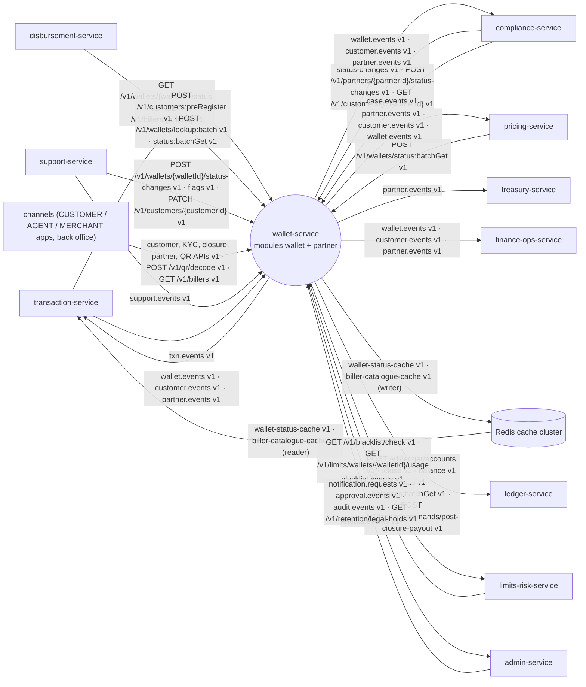

Other services also read `wallet.events`, `customer.events` and `partner.events` and call `GET /v1/wallets/{walletId}` / `GET /v1/partners/{partnerId}`; the producer side does not depend on who they are.

### 3.2 Component diagram

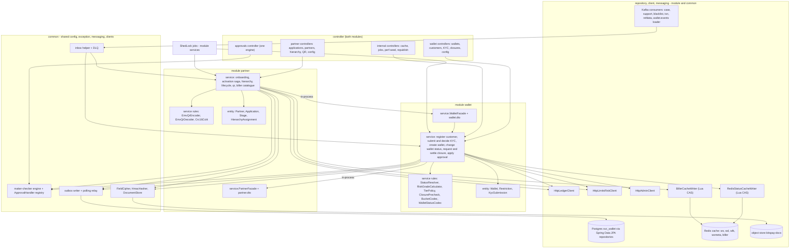

### 3.3 Runtime and deployment (Compose)

| Item | Value |
|---|---|
| Compose service | `wallet-service`, ports 8103 / 9103, `mem_limit` 448 MB, profiles `dev,api,cache-loader` (all roles in one container locally); `depends_on`: postgres, kafka-init, redis-cache, object-store |
| Roles | `api`: REST of both modules, Kafka consumers of both modules, scheduled jobs (ShedLock leader, `bitspay.jobs.enabled=true`). `cache-loader`: `wallet.events` loader + sampler + `biller-cache-refresh` (CR-WALLET-1). Production may split jobs into their own deployment (`api` pods with `bitspay.jobs.enabled=false`, a `jobs` deployment with `true`) so a 50,000-descendant republish never competes with hot reads |
| Replicas (prod guidance) | api ≥ 3 · jobs 2 (one active per job via ShedLock) · cache-loader 2 (one active per partition via the consumer group) |
| Schema / role | `svc_wallet` (login role `svc_wallet`); `spring.flyway.schemas=svc_wallet`, two Flyway configurations (wallet then partner); `create-schemas=false` in the stack, `true` in Testcontainers |
| Redis | cache cluster only (`BITSPAY_REDIS_CACHE_URL`); keys §4.2. The critical cluster is not used |
| Object store | S3-compatible bucket `bitspay-docs` (KYC and partner documents); `local` profile may use the filesystem `DocumentStore` implementation |
| Readiness | own Postgres, Kafka, Redis cache and object store only; never waits for another service |

Environment beyond kernel K8.3:

| Env var | Property | Meaning |
|---|---|---|
| `BITSPAY_S3_ENDPOINT`, `BITSPAY_S3_ACCESSKEY`, `BITSPAY_S3_SECRETKEY`, `BITSPAY_S3_REGION` | `bitspay.s3.*` | object store |
| `BITSPAY_DOCUMENTS_STORE` | `bitspay.documents.store` | `s3` \| `filesystem` |
| `BITSPAY_DOC_MASTER_KEY` | `bitspay.crypto.doc-master-key` | AES key wrapping per-document DEKs (AES-KW) |
| `BITSPAY_FIELD_CIPHER_KEY` | `bitspay.crypto.field-cipher-key` | AES-GCM key for NID / account numbers (kernel K8.3) |
| `BITSPAY_PLATFORM_HMAC_KEY` | `bitspay.crypto.platform-hmac-key` | kernel K2 |
| `BITSPAY_CLIENTS_LEDGER_BASEURL`, `BITSPAY_CLIENTS_LIMITSRISK_BASEURL`, `BITSPAY_CLIENTS_ADMIN_BASEURL` | `bitspay.clients.<svc>.base-url` | outbound HTTP |
| `BITSPAY_CACHELOADER_BULK_DATASOURCE_URL` | `bitspay.cache-loader.bulk-datasource.url` | read replica for the bulk rebuild (defaults to the primary locally) |

Consumer groups (all `^wallet-service(\.[a-z0-9-]+)?$`, OPEN D-30):

| Group | Module | Topics |
|---|---|---|
| `wallet-service` | wallet | `case.events`, `support.events`, `blacklist.events`, `txn.events`, `refdata.events` |
| `wallet-service.status-cache-loader` | wallet (cache-loader role) | `wallet.events` |
| `wallet-service.partner-case-events` | partner | `case.events` |
| `wallet-service.partner-blacklist-events` | partner | `blacklist.events` |
| `wallet-service.partner-refdata-events` | partner | `refdata.events` |

Scheduled jobs (ShedLock, one instance each; cron in Asia/Dhaka where a time is given; `job_run` key per run):

| Job | Module | Schedule | Purpose |
|---|---|---|---|
| `provisioning-retry` | wallet | every 10 s | ledger account for `LEDGER_PENDING` wallets (backoff 10 s → 10 min, max 50) |
| `blacklist-recheck` | wallet | every 5 min | submissions with `blacklistCheck = PENDING` |
| `screening-overdue` | wallet | hourly | `SCREENING_OVERDUE` exception after 24 h |
| `draft-expiry` | wallet | daily 02:00 | DRAFT submissions past `resume_expires_at`; purge never-submitted documents after 30 d |
| `approval-expiry` | common | every 15 min | expire PENDING approvals (`APPROVAL_EXPIRED`); partner stages re-issued |
| `closure-settle` | wallet | every minute | SETTLING → payout → CLOSING → CLOSED or revert; CLOSING retries; `CLOSURE_STUCK` after 24 h |
| `closure-expiry` | wallet | daily 03:00 | PRECHECK_FAILED / AWAITING_ZERO_BALANCE older than 30 d → EXPIRED |
| `dormancy` (R2) | wallet | daily 02:15 | warnings + dormancy (BR-W-34) |
| `kyc-review` (R2) | wallet | daily 02:30 | DUE / OVERDUE / KYC_EXPIRED restriction (BR-W-35) |
| `kyc-anonymisation` (R2, off) | wallet | daily 04:00 | retention end action (BR-W-46) |
| `activity-flush` | wallet | every 1 s | batch upsert of `wallet_activity` |
| `cache-sampler` | wallet (cache-loader) | every 60 s | consistency sampler (BR-W-55) |
| `biller-cache-refresh` (MVP) | partner (cache-loader) | at start-up, then every 60 s | full rewrite of `biller:*` from the database with the CAS (BR-PAR-88) |
| `ActivationRetryJob` | partner | every 30 s | activation saga steps |
| `HierarchyApplyJob` | partner | every 60 s | SCHEDULED assignments due |
| `SlaMonitorJob` | partner | every 5 min | stage SLA breach (notify once) |
| `ScreeningTimeoutJob` | partner | hourly | screening older than 24 h → SLA notification |
| `SuspensionExpiryJob` | partner | every 5 min | distributor suspensions past `until` |
| `DynamicQrExpiryJob` | partner | every 5 min | ACTIVE dynamic QR past `expires_at` → EXPIRED; purge after 90 d |
| `DraftExpiryJob` | partner | daily 02:00 | DRAFT / RETURNED applications past 30 d → EXPIRED |
| `ExpiryAlertJob` (R2) | partner | daily 09:00 | agreement / trade-licence expiry alerts |
| `outbox-cleanup`, `inbox-cleanup`, `idempotency-cleanup` | common | daily | 3 d / 14 d / 7 d retention |

### 3.4 Key flows

**F1 — Customer onboarding (Rahim, assisted by agent Salma).**

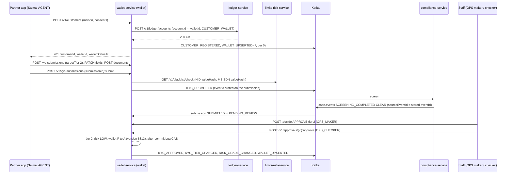

**F2 — Immediate fraud / AML freeze with write-through.**

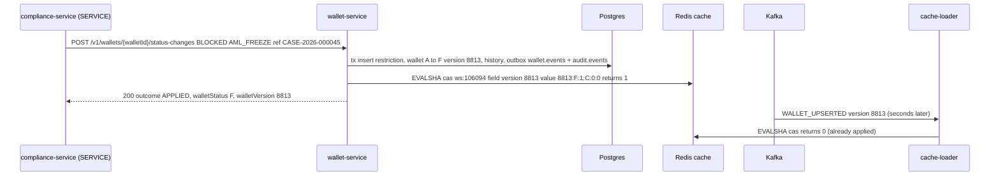

**F3 — Closure with same-person payout and the failure path.**

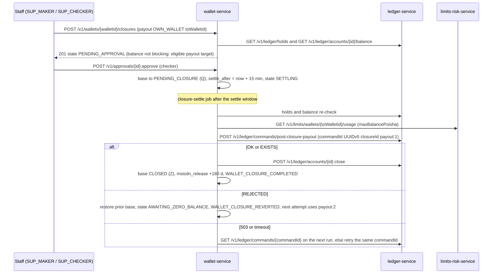

**F4 — Cache rebuild (DB_THEN_KAFKA).**

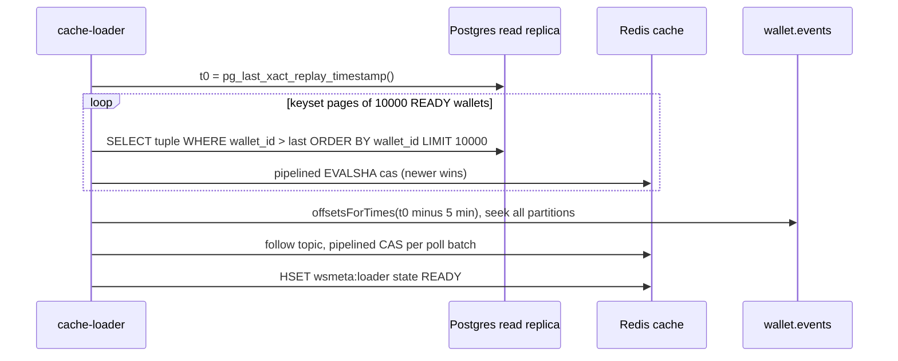

**F5 — Partner submission, screening and approval chain.**

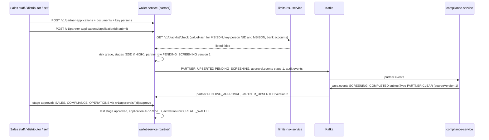

**F6 — Activation saga (Nirob Store).**

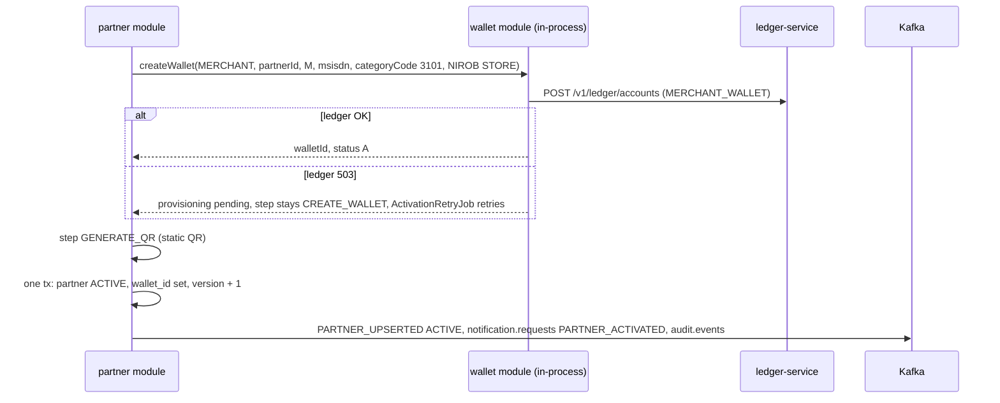

**F7 — Future-dated hierarchy change (Salma moves to a new sub-distributor).**

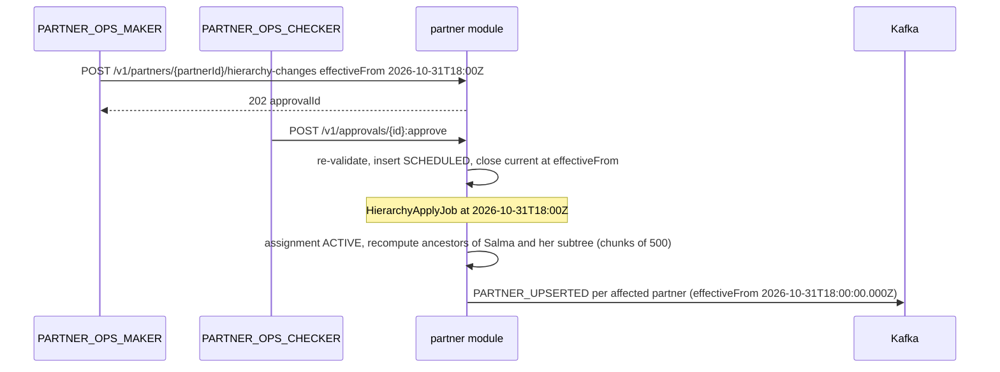

**F8 — QR decode during a merchant payment.**

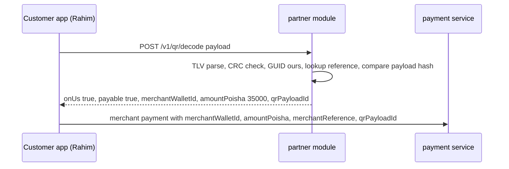

**F9 — Partner suspension by compliance (atomic wallet restriction).**

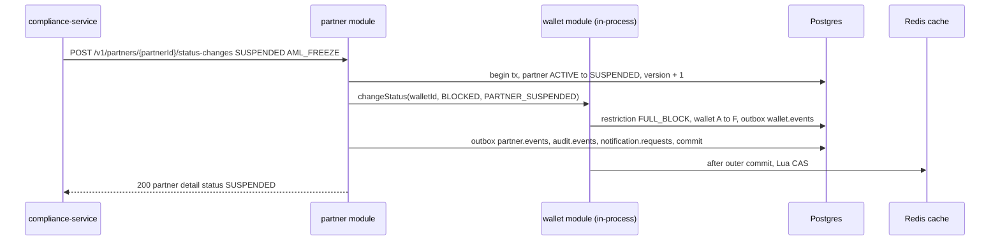

**F10 — Biller onboarding and catalogue cache (DESCO, MVP, CR-WALLET-1).**

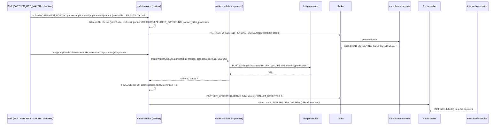

### 3.5 State machines

**Wallet base status** (effective code from BR-W-02):

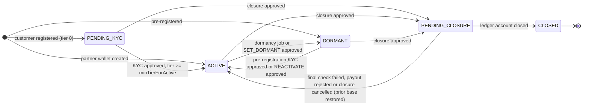

Restrictions overlay any base: `DEBIT_BLOCK` → `X`, `CREDIT_BLOCK` → `C`, `FULL_BLOCK` (or both) → `F` (table BR-W-02). "Prior base restored" means the stored `prior_base_status` (PENDING_KYC, ACTIVE or DORMANT).

**KYC submission:**

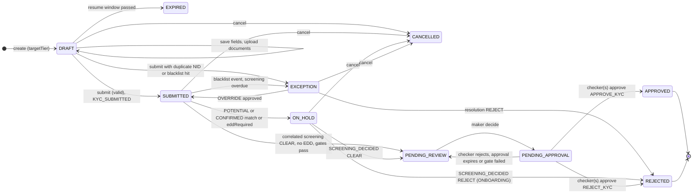

**Closure request:**

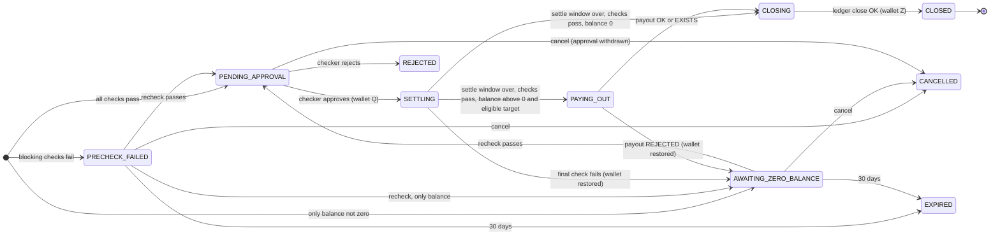

**Partner application:**

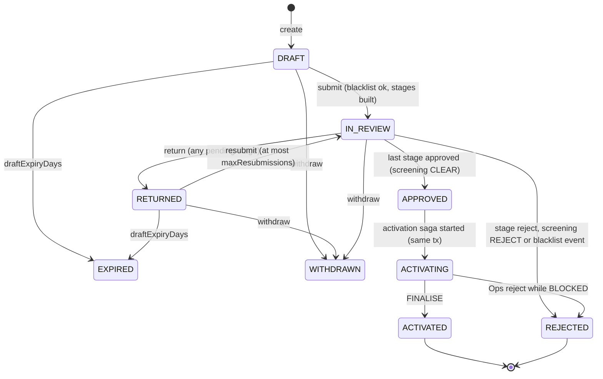

`SUBMITTED` is a transient value used only inside the submit transaction. Application stage per round: `WAITING → PENDING → APPROVED | AUTO_APPROVED | RETURNED | REJECTED`; `WAITING → SKIPPED` (condition false).

**Partner:**

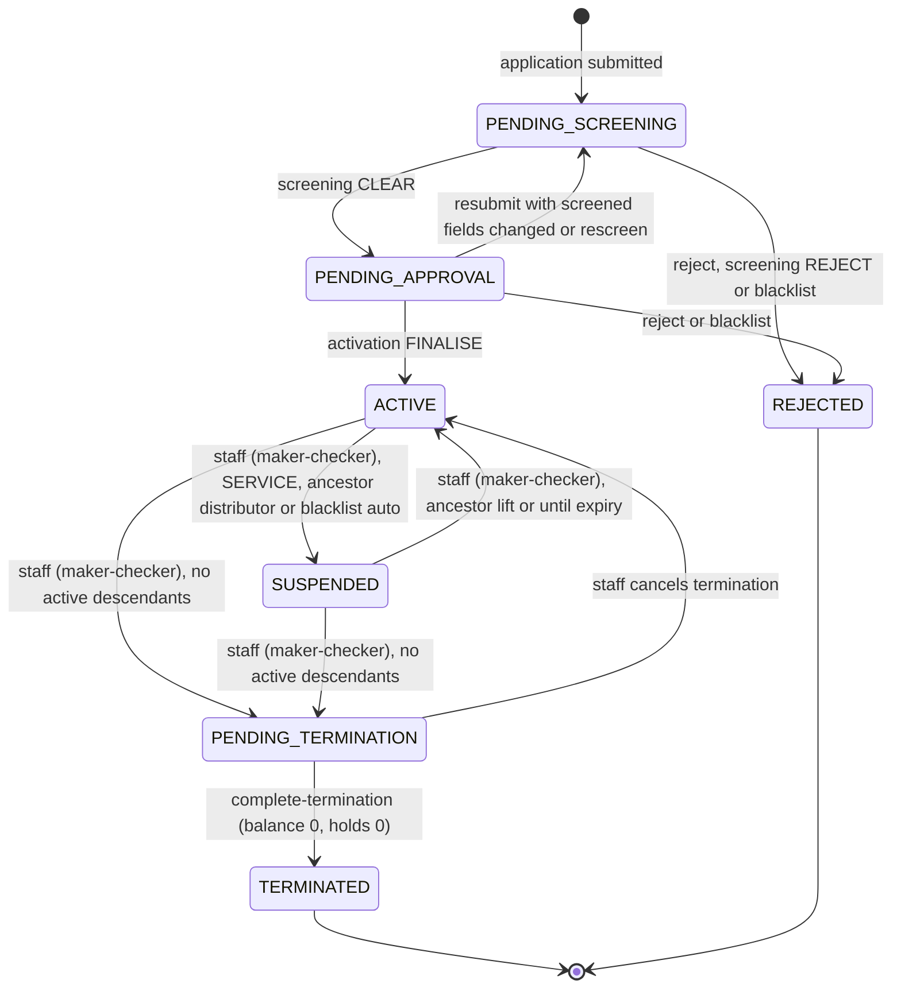

**Hierarchy assignment:**

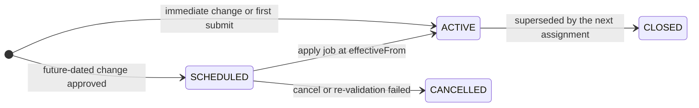

**QR code:**

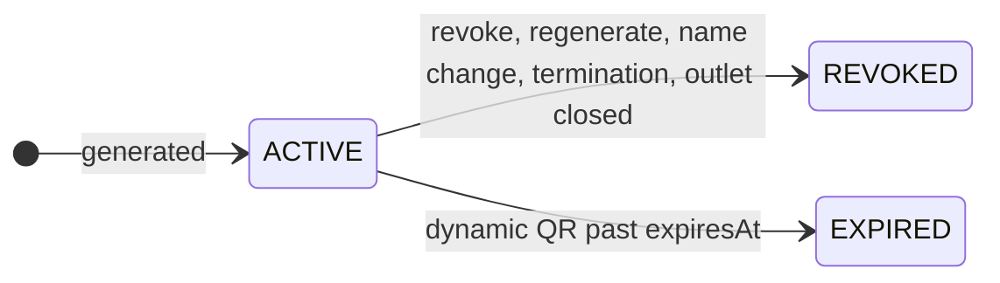

**Approval request (shared engine):**

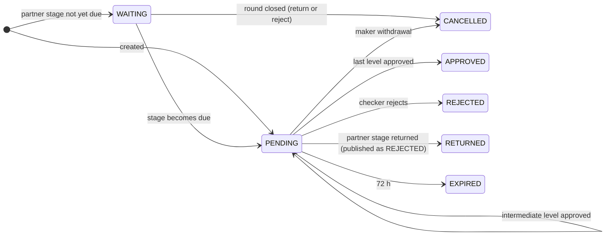

### 3.6 Architecture decisions

| ADR | Decision | Why | Consequence |
|---|---|---|---|
| ADR-01 | Wallet and partner are two modules of one service; partner ↔ wallet calls are in-process through the `<module>.service.<Module>Facade` interfaces | Every partner is a wallet holder; five former REST calls and a retry table disappear; partner/wallet status changes commit atomically | Activation stays a saga (ledger is remote); module boundaries are enforced by `ArchitectureTest` |
| ADR-02 | Status = base lifecycle state + set of restrictions; effective code derived by `StatusResolver` | Overlapping causes (AML freeze, KYC expiry, customer request) are lifted independently | Contract still sees one status code per wallet |
| ADR-03 | `wallet.version` is the optimistic-lock column **and** the cache version; every UPDATE of a wallet row increments it by exactly 1 | CAS needs a monotonic version | Every emitted `WALLET_UPSERTED` has `version = previous + 1` |
| ADR-04 | Redis write-through after commit (`TransactionSynchronization.afterCommit`), 3 attempts (0/20/50 ms); failure → metric + log; the loader converges | Redis must never show a rolled-back state | For immediate freezes the API answers after the write-through attempt |
| ADR-05 | Wallet creation is ledger-first: row `LEDGER_PENDING`, ledger called synchronously, retry job; `WALLET_UPSERTED` only when `READY`; repeat create returns the same `walletId` | Account must exist before a wallet is visible | `notFound` / 404 until READY |
| ADR-06 | Cache loader = same jar, profile `cache-loader`; rebuild = replica snapshot, then Kafka from `offsetsForTimes(t0 − 5 min)` | No gap; CAS makes overlap harmless | Rebuild of 80 M wallets ≤ 30 min |
| ADR-07 | "No pending transactions" at closure is enforced by entering `PENDING_CLOSURE` (blocks new debits / credits) and waiting `closureSettleMinutes` before the final checks | No dependency on the payment service; in-flight payments resolve within minutes | Closure takes ≥ 15 min after approval |
| ADR-08 | Flags are reference-counted by holder (`wallet_flag_holder`) | Two services may set `HAS_OPEN_LIEN`; one must not clear the other's | `clear` removes only the caller's holder row |
| ADR-09 | Wallet config (tiers, risk matrix, params, masking, reason authority) = versioned JSON documents validated by JSON Schema, activated by maker-checker, cached in Caffeine | No redeploy for business config | Partner config uses typed tables with the same maker-checker |
| ADR-10 | Dormancy activity = `txn.events TRANSACTION_COMPLETED` where the wallet is `from` (and `to` if configured), REVERSAL rows excluded, ≤ 1 DB write per wallet per day | Volume control at 5k TPS; regulatory meaning of customer activity | Postings outside the payment service do not count |
| ADR-11 | UUIDv7 via `com.github.f4b6a3:uuid-creator`; murmur3 via commons-codec `MurmurHash3.hash32x86(bytes, 0, 16, 0)` | Deterministic, library-backed | Test vectors in §7.6 |
| ADR-12 | Each partner application stage is an `approval_request` row (`level = stageNo`, `required_levels = stageCount`) | One engine; governance sees stages | WAITING rows are not published; RETURNED is published as REJECTED |
| ADR-13 | The `partner` row is created at first submission (`PENDING_SCREENING`) | Stable partnerId for screening, documents and audit | Rejected applications leave a REJECTED partner row |
| ADR-14 | Hierarchy = effective-dated assignments with a GiST exclusion constraint, future changes applied by a job, no backdating; ancestor ids materialised on the partner row and recomputed for the whole subtree on a move | History for commission; O(1) event building and scope checks | Moves republish the subtree in chunks |
| ADR-15 | EMVCo MPM payloads with a Bits Pay template in tag 26 (GUID `BD.COM.BITSPAY`); scheme values in config, marked provisional | Bangla QR scheme spec not yet available | Swapping tag / GUID = config + regenerate |
| ADR-16 | QR decode trusts only the database (reference + full payload hash for dynamic, account code + hash for static) | Prevents tampered amounts with recomputed CRC | Every decode does a hash compare |
| ADR-17 | Documents through `common.client.DocumentStore` (S3 / filesystem implementations) with envelope encryption; SHA-256 recorded | No plaintext at rest | Download endpoints are audited |
| ADR-18 | Job leadership with ShedLock (`shedlock` table) for both modules | One mechanism | Jobs run in any `api` pod with `bitspay.jobs.enabled=true` |
| ADR-19 | One idempotency store (7-day retention) for both modules | Kernel K3.3 | Cleanup daily |
| ADR-20 | Billers (MVP, CR-WALLET-1) are partners of type `BILLER` with a 1:1 `partner_biller_profile`, onboarded through the existing application / screening / approval-chain path, each with one `B` wallet; the payable catalogue is published as a Redis data contract (`biller-catalogue-cache`) written by the partner module (write-through + DB refresh), not via a consumed topic | Reuses screening, maker-checker, activation saga and the ledger-first wallet path; transaction-service validates in one Redis round trip without calling this service | `PARTNER_UPSERTED` gains an optional `biller` object; the catalogue is rebuildable from the database at any time |

### 3.7 Latency and throughput budget

| Path | Target |
|---|---|
| `GET /v1/wallets/{walletId}/status` (cache-miss fallback) | p99 ≤ 20 ms at the service (PK lookup on the primary; read-repair async) |
| `POST /v1/wallets/status:batchGet` (1,000 ids) | p99 ≤ 150 ms |
| `GET /v1/wallets/lookup`, `GET /v1/wallets/{walletId}`, `GET /v1/customers/{customerId}` | p95 ≤ 50 ms |
| Write-through CAS after commit | p99 ≤ 5 ms |
| Immediate freeze end-to-end incl. Redis | p99 ≤ 100 ms |
| `POST /v1/wallets` incl. ledger account | p95 ≤ 300 ms |
| `POST /v1/qr/decode` | p99 ≤ 30 ms (Caffeine for account code → partner summary and static QR hash; DB fallback) |
| Other partner reads / writes | p99 ≤ 100 ms / ≤ 300 ms (submit with blacklist calls p99 ≤ 1.5 s) |

## 4. Data model

One schema `svc_wallet` (login role `svc_wallet`); no cross-schema access. Two Flyway configurations run in order: **wallet** (`db/migration/wallet`, history table `flyway_history_wallet`) then **partner** (`db/migration/partner`, history table `flyway_history_partner`). The wallet location also holds the shared-kernel tables. No foreign key crosses the two modules (the partner `wallet_id` column is a plain uuid). Mutable rows have `created_at`, `updated_at`, `version`. Unqualified DDL lands in `svc_wallet` via `search_path`.

### 4.1 Tables

**Main entities (wallet module):**

```mermaid
erDiagram
  CUSTOMER ||--o{ WALLET : "owns (CUSTOMER wallets)"
  CUSTOMER ||--o{ KYC_SUBMISSION : submits
  KYC_SUBMISSION ||--o{ KYC_DOCUMENT : has
  KYC_SUBMISSION ||--o{ KYC_SUBMISSION_EVENT : trail
  CUSTOMER ||--o{ NOMINEE : names
  CUSTOMER ||--o{ CONSENT_RECORD : grants
  CUSTOMER ||--o{ EXCEPTION_ITEM : raises
  WALLET ||--o{ WALLET_RESTRICTION : restricted_by
  WALLET ||--o{ WALLET_FLAG_HOLDER : flags
  WALLET ||--o{ STATUS_CHANGE_REQUEST : requests
  WALLET ||--o{ WALLET_STATUS_HISTORY : history
  WALLET ||--o{ CLOSURE_REQUEST : closes
  WALLET ||--o| WALLET_ACTIVITY : activity
  WALLET ||--o{ OPEN_DISPUTE : blocks_closure
  APPROVAL_REQUEST ||--o| STATUS_CHANGE_REQUEST : approves
```

**Main entities (partner module):**

```mermaid
erDiagram
  PARTNER ||--o| PARTNER_APPLICATION : "created by"
  PARTNER_APPLICATION ||--o{ PARTNER_APPLICATION_STAGE : stages
  PARTNER_APPLICATION ||--o{ PARTNER_KEY_PERSON : key_persons
  PARTNER_APPLICATION ||--o{ PARTNER_DOCUMENT : documents
  PARTNER_APPLICATION ||--o{ PARTNER_BANK_ACCOUNT : bank_accounts
  PARTNER_APPLICATION ||--o{ PARTNER_SITE_VISIT : site_visits
  PARTNER_APPLICATION ||--o| PARTNER_ACTIVATION : activation
  PARTNER ||--o{ PARTNER_HIERARCHY_ASSIGNMENT : assignments
  PARTNER ||--o{ PARTNER_STATUS_HISTORY : history
  PARTNER ||--o{ PARTNER_RISK_FLAG : flags
  PARTNER ||--o{ PARTNER_QR_CODE : qr_codes
  PARTNER ||--o{ PARTNER_MERCHANT_OUTLET : outlets
  PARTNER ||--o{ PARTNER_USER : users
  PARTNER ||--o{ PARTNER_AGREEMENT : agreements
  PARTNER ||--o{ PARTNER_BLACKLIST_MATCH : matches
  PARTNER ||--o| PARTNER_BILLER_PROFILE : "biller profile (BILLER only)"
  PARTNER_BILLER_PROFILE ||--o{ PARTNER_BILLER_MSISDN_PREFIX : "MNO prefixes"
  PARTNER }o--o| PARTNER : parent
```

#### 4.1.1 `db/migration/wallet/V1__init.sql`

```sql
-- ===================== shared kernel (kernel K8.2 outbox / inbox, K5 maker-checker, K3.3 idempotency) =====================
CREATE TABLE IF NOT EXISTS outbox (
  id             uuid PRIMARY KEY,                    -- = envelope eventId
  aggregate_type text        NOT NULL,                -- = Kafka topic
  aggregate_id   text        NOT NULL,                -- = Kafka key = envelope aggregateId
  event_type     text        NOT NULL,
  payload        jsonb       NULL,                    -- full envelope; never NULL for this service (no tombstones)
  created_at     timestamptz NOT NULL DEFAULT now(),
  published_at   timestamptz                          -- polling relay only
);
CREATE INDEX IF NOT EXISTS outbox_unpublished ON outbox (created_at) WHERE published_at IS NULL;

CREATE TABLE IF NOT EXISTS processed_event (           -- inbox of the wallet module
  event_id     uuid PRIMARY KEY,
  topic        text NOT NULL,
  processed_at timestamptz NOT NULL DEFAULT now()
);

CREATE TABLE approval_request (                        -- one engine for both modules
  id               uuid PRIMARY KEY,
  module           text NOT NULL CHECK (module IN ('wallet','partner')),
  entity_type      text NOT NULL,                      -- codes.yaml entityTypes of the module
  entity_id        text NOT NULL,
  action           text NOT NULL,                      -- §7.14 action list
  payload          jsonb NOT NULL,
  maker_id         text NOT NULL,                      -- staff uuid / forwarded X-Actor-User-Id / service name / partner X-Actor-Id
  maker_type       text NOT NULL,
  maker_user_id    text,                               -- X-Actor-User-Id when present
  maker_roles      text[] NOT NULL DEFAULT '{}',
  status           text NOT NULL CHECK (status IN ('WAITING','PENDING','APPROVED','REJECTED','RETURNED','EXPIRED','CANCELLED')),
  level            int  NOT NULL DEFAULT 1,            -- 1-based level awaiting decision (partner stages: stageNo)
  required_levels  int  NOT NULL DEFAULT 1,
  checker_roles    jsonb NOT NULL,                     -- {"1":["OPS_CHECKER"],"2":["COMPLIANCE_OFFICER","CAMLCO"]}
  amount_poisha    bigint,
  summary          text NOT NULL CHECK (length(summary) <= 200),   -- no PII
  created_at       timestamptz NOT NULL DEFAULT now(),
  expires_at       timestamptz NOT NULL,
  decided_by       text[] NOT NULL DEFAULT '{}',
  decided_at       timestamptz,
  comments         jsonb NOT NULL DEFAULT '[]'::jsonb, -- [{level, actorId, decision, comment (≤140 in audit), reasonCode, at}]
  updated_at       timestamptz NOT NULL DEFAULT now(),
  version          bigint NOT NULL DEFAULT 1
);
CREATE INDEX ix_approval_pending ON approval_request (status, created_at) WHERE status = 'PENDING';
CREATE INDEX ix_approval_entity  ON approval_request (entity_type, entity_id);

CREATE TABLE idempotency_record (                      -- kernel K3.3, retention 7 days
  actor_id        text NOT NULL,
  idem_key        text NOT NULL,
  request_hash    char(64) NOT NULL,
  response_status int NOT NULL,
  response_body   jsonb NOT NULL,
  created_at      timestamptz NOT NULL DEFAULT now(),
  PRIMARY KEY (actor_id, idem_key)
);

CREATE TABLE shedlock (
  name varchar(64) PRIMARY KEY, lock_until timestamptz NOT NULL, locked_at timestamptz NOT NULL, locked_by varchar(255) NOT NULL
);

CREATE TABLE job_run (
  job_name    text NOT NULL,
  run_key     text NOT NULL,                           -- e.g. business date '2026-10-09'
  status      text NOT NULL CHECK (status IN ('RUNNING','DONE','FAILED')),
  stats       jsonb NOT NULL DEFAULT '{}'::jsonb,
  started_at  timestamptz NOT NULL DEFAULT now(),
  finished_at timestamptz,
  PRIMARY KEY (job_name, run_key)
);

-- ===================== customers =====================
CREATE TABLE customer (
  customer_id            uuid PRIMARY KEY,
  status                 text        NOT NULL CHECK (status IN ('PRE_REGISTERED','REGISTERED','ACTIVE','CLOSED')),
  msisdn                 varchar(13) NOT NULL CHECK (msisdn ~ '^8801[3-9][0-9]{8}$'),
  msisdn_hash            bytea       NOT NULL,          -- HMAC-SHA256 (kernel K2, MSISDN)
  email                  varchar(254),
  name_en                text,
  name_bn                text,
  nid_enc                bytea,                         -- FieldCipher AES-GCM (iv||ct||tag); set on first KYC approval
  nid_hash               bytea,                         -- HMAC-SHA256 (kernel K2, NID); emitted as 64-hex
  nid_last4              char(4),
  dob                    date,
  gender                 text CHECK (gender IN ('MALE','FEMALE','THIRD_GENDER')),
  father_name            text,
  mother_name            text,
  spouse_name            text,
  occupation             text,
  source_of_funds        text,
  income_band            text,
  purpose_of_account     text,
  present_address        jsonb,                         -- {line1,line2,division,district,upazila,union,postCode} GEO codes
  permanent_address      jsonb,
  division               text,                          -- GEO codes of the present address (denormalised for events)
  district               text,
  upazila                text,
  union_code             text,
  language               text        NOT NULL DEFAULT 'bn' CHECK (language IN ('bn','en')),
  kyc_tier               smallint    NOT NULL DEFAULT 0 CHECK (kyc_tier BETWEEN 0 AND 2),
  risk_grade             text CHECK (risk_grade IN ('LOW','MEDIUM','HIGH')),
  risk_score             int,
  edd_required           boolean     NOT NULL DEFAULT false,
  pep_flag               boolean     NOT NULL DEFAULT false,
  screening_status       text        NOT NULL DEFAULT 'NOT_SCREENED'
                         CHECK (screening_status IN ('NOT_SCREENED','PENDING','CLEAR','POTENTIAL_MATCH','CONFIRMED_MATCH','REJECTED')),
  last_screening_id      uuid,
  blacklist_hit          boolean     NOT NULL DEFAULT false, -- MSISDN listed at registration (BR-W-21)
  kyc_approved_at        timestamptz,
  kyc_review_due_at      timestamptz,
  kyc_review_status      text        NOT NULL DEFAULT 'NONE' CHECK (kyc_review_status IN ('NONE','DUE','OVERDUE')),
  registration_channel   text        NOT NULL,
  referral_code          varchar(16),
  assisted_by_type       text,
  assisted_by_id         text,
  institution_id         uuid,                          -- pre-registration source (ONB-020)
  anonymised_at          timestamptz,                   -- R2 retention end action
  created_at             timestamptz NOT NULL DEFAULT now(),
  updated_at             timestamptz NOT NULL DEFAULT now(),
  version                bigint      NOT NULL DEFAULT 1
);
CREATE UNIQUE INDEX ux_customer_msisdn_live ON customer (msisdn) WHERE status <> 'CLOSED';
CREATE UNIQUE INDEX ux_customer_nid_live    ON customer (nid_hash) WHERE nid_hash IS NOT NULL AND status <> 'CLOSED';
CREATE INDEX ix_customer_review_due ON customer (kyc_review_due_at) WHERE status = 'ACTIVE';
CREATE INDEX ix_customer_msisdn_hash ON customer (msisdn_hash);

CREATE TABLE nominee (
  nominee_id      uuid PRIMARY KEY,
  customer_id     uuid NOT NULL REFERENCES customer,
  name            text NOT NULL,
  relationship    text NOT NULL,
  id_type         text NOT NULL CHECK (id_type IN ('NID','BIRTH_REG','PASSPORT')),
  id_enc          bytea NOT NULL,
  id_last4        char(4) NOT NULL,
  share_bps       int  NOT NULL CHECK (share_bps BETWEEN 1 AND 10000),
  dob             date,
  created_at      timestamptz NOT NULL DEFAULT now(),
  updated_at      timestamptz NOT NULL DEFAULT now(),
  version         bigint NOT NULL DEFAULT 1
);
CREATE INDEX ix_nominee_customer ON nominee (customer_id);

CREATE TABLE consent_record (
  consent_id       uuid PRIMARY KEY,
  customer_id      uuid NOT NULL REFERENCES customer,
  consent_type     text NOT NULL CHECK (consent_type IN ('TERMS','PRIVACY','DATA_SHARING','MARKETING','LOCATION')),
  counterparty     text,
  document_version text NOT NULL,                       -- e.g. 'TNC-2026.10-bn'
  language         text NOT NULL,
  granted_at       timestamptz NOT NULL,
  withdrawn_at     timestamptz,
  channel          text NOT NULL,
  device_id        text,
  actor_type       text NOT NULL,
  actor_id         text NOT NULL,
  created_at       timestamptz NOT NULL DEFAULT now()
);
CREATE INDEX ix_consent_customer ON consent_record (customer_id, consent_type);

-- ===================== KYC =====================
CREATE TABLE kyc_submission (
  submission_id        uuid PRIMARY KEY,
  customer_id          uuid NOT NULL REFERENCES customer,
  target_tier          smallint NOT NULL CHECK (target_tier IN (1,2)),
  state                text NOT NULL CHECK (state IN ('DRAFT','SUBMITTED','ON_HOLD','EXCEPTION','PENDING_REVIEW',
                                                      'PENDING_APPROVAL','APPROVED','REJECTED','EXPIRED','CANCELLED')),
  data                 jsonb NOT NULL DEFAULT '{}'::jsonb,   -- captured fields (no clear NID)
  nid_enc              bytea,
  nid_hash             bytea,
  nid_last4            char(4),
  verification_provider text NOT NULL DEFAULT 'manual',
  verification_result  jsonb,                                -- reviewer checklist
  blacklist_check      text NOT NULL DEFAULT 'NOT_RUN' CHECK (blacklist_check IN ('NOT_RUN','PENDING','CLEAR','LISTED','OVERRIDDEN')),
  screening_status     text NOT NULL DEFAULT 'NOT_REQUESTED'
                       CHECK (screening_status IN ('NOT_REQUESTED','PENDING','CLEAR','POTENTIAL_MATCH','CONFIRMED_MATCH','REJECTED')),
  kyc_submitted_event_id uuid,                               -- eventId of the latest KYC_SUBMITTED (screening correlation)
  screening_id         uuid,
  edd_required         boolean NOT NULL DEFAULT false,
  risk_score           int,
  risk_grade           text,
  risk_breakdown       jsonb,
  attempt_no           int NOT NULL DEFAULT 1,
  channel              text NOT NULL,
  device_id            text,
  geo                  jsonb,                                -- {lat,lng,accuracyM} only with LOCATION consent
  assisted_by_type     text,
  assisted_by_id       text,
  recommended_decision text CHECK (recommended_decision IN ('APPROVE','REJECT')),
  recommended_tier     smallint,
  decision_reason_code text,
  reviewer_id          text,
  approval_id          uuid,
  submitted_at         timestamptz,
  decided_at           timestamptz,
  resume_expires_at    timestamptz NOT NULL,
  created_at           timestamptz NOT NULL DEFAULT now(),
  updated_at           timestamptz NOT NULL DEFAULT now(),
  version              bigint NOT NULL DEFAULT 1
);
CREATE UNIQUE INDEX ux_kyc_one_open ON kyc_submission (customer_id)
  WHERE state NOT IN ('APPROVED','REJECTED','EXPIRED','CANCELLED');
CREATE INDEX ix_kyc_queue  ON kyc_submission (state, submitted_at)
  WHERE state IN ('SUBMITTED','ON_HOLD','EXCEPTION','PENDING_REVIEW','PENDING_APPROVAL');
CREATE INDEX ix_kyc_draft_expiry ON kyc_submission (resume_expires_at) WHERE state = 'DRAFT';
CREATE INDEX ix_kyc_event ON kyc_submission (kyc_submitted_event_id);

CREATE TABLE kyc_document (
  document_id     uuid PRIMARY KEY,
  submission_id   uuid NOT NULL REFERENCES kyc_submission,
  customer_id     uuid NOT NULL REFERENCES customer,
  doc_type        text NOT NULL CHECK (doc_type IN ('NID_FRONT','NID_BACK','SELFIE','NOMINEE_ID','ADDRESS_PROOF',
                                                    'SIGNATURE','SOURCE_OF_FUNDS','OTHER')),
  content_type    text NOT NULL CHECK (content_type IN ('image/jpeg','image/png','application/pdf')),
  size_bytes      int  NOT NULL CHECK (size_bytes BETWEEN 1 AND 5242880),
  sha256_hex      char(64) NOT NULL,
  storage_key     text NOT NULL,                       -- kyc/{customerId}/{documentId}
  dek_wrapped     bytea NOT NULL,                      -- AES-256 DEK wrapped with BITSPAY_DOC_MASTER_KEY (AES-KW)
  iv              bytea NOT NULL,
  uploaded_by_type text NOT NULL,
  uploaded_by_id   text NOT NULL,
  purged_at       timestamptz,
  created_at      timestamptz NOT NULL DEFAULT now()
);
CREATE INDEX ix_kycdoc_submission ON kyc_document (submission_id);

CREATE TABLE kyc_submission_event (                   -- ONB-025 onboarding trail
  id             bigserial PRIMARY KEY,
  submission_id  uuid NOT NULL,
  step           text NOT NULL,                       -- CREATED, FIELDS_SAVED, DOC_UPLOADED, SUBMITTED, SCREENING_RESULT, DECIDED, ...
  from_state     text,
  to_state       text,
  actor_type     text NOT NULL,
  actor_id       text NOT NULL,
  channel        text,
  device_id      text,
  geo            jsonb,
  details        jsonb,
  occurred_at    timestamptz NOT NULL DEFAULT now()
);
CREATE INDEX ix_kycevt_submission ON kyc_submission_event (submission_id, occurred_at);

CREATE TABLE screening_result (                       -- from case.events (CUSTOMER)
  screening_id    uuid PRIMARY KEY,
  customer_id     uuid NOT NULL,
  submission_id   uuid,                                -- set only when correlated (sourceEventId matched)
  trigger         text NOT NULL,
  source_event_id uuid,
  result          text NOT NULL CHECK (result IN ('CLEAR','POTENTIAL_MATCH','CONFIRMED_MATCH')),
  edd_required    boolean NOT NULL DEFAULT false,
  decision        text CHECK (decision IN ('CLEAR','REJECT')),
  matches         jsonb NOT NULL DEFAULT '[]'::jsonb,
  applied         boolean NOT NULL DEFAULT false,      -- false = recorded only (uncorrelated / non-onboarding)
  received_at     timestamptz NOT NULL DEFAULT now(),
  decided_at      timestamptz
);
CREATE INDEX ix_screening_customer ON screening_result (customer_id, received_at DESC);

CREATE TABLE exception_item (
  item_id        uuid PRIMARY KEY,
  item_type      text NOT NULL CHECK (item_type IN ('DUPLICATE_NID','DUPLICATE_MSISDN','MSISDN_COOLING','BLACKLIST_HIT',
                                                    'BLACKLIST_EXISTING_CUSTOMER','SCREENING_OVERDUE','LEDGER_PROVISIONING_FAILED',
                                                    'CLOSURE_STUCK','PAYOUT_FAILED')),
  customer_id    uuid,
  submission_id  uuid,
  wallet_id      uuid,
  source_ref     text,                                -- e.g. blacklist entryId (uniqueness per source)
  details        jsonb NOT NULL,
  state          text NOT NULL DEFAULT 'OPEN' CHECK (state IN ('OPEN','RESOLVED_OVERRIDE','RESOLVED_REJECT','AUTO_CLOSED')),
  assigned_to    text,
  resolution_note text,
  resolved_by    text,
  resolved_at    timestamptz,
  approval_id    uuid,
  created_at     timestamptz NOT NULL DEFAULT now(),
  updated_at     timestamptz NOT NULL DEFAULT now(),
  version        bigint NOT NULL DEFAULT 1
);
CREATE INDEX ix_exception_open ON exception_item (item_type, created_at) WHERE state = 'OPEN';
CREATE UNIQUE INDEX ux_exception_source ON exception_item (item_type, source_ref, customer_id) WHERE source_ref IS NOT NULL;

-- ===================== wallets =====================
CREATE TABLE wallet (
  wallet_id             uuid PRIMARY KEY,                    -- = ledger account id (UUIDv7)
  owner_type            text NOT NULL CHECK (owner_type IN ('CUSTOMER','AGENT','MERCHANT','DISTRIBUTOR','INSTITUTION','BILLER')),   -- BILLER: CR-WALLET-1
  owner_id              uuid NOT NULL,
  wallet_type           char(1) NOT NULL CHECK (wallet_type IN ('C','A','D','M','I','B')),        -- B = BILLER (ledger 150)
  msisdn                varchar(13) NOT NULL,
  msisdn_hash           bytea NOT NULL,
  msisdn_scope          char(1) NOT NULL,                    -- 'G' (global) or wallet_type, from config at insert; always 'B' for B wallets (BR-PAR-86)
  display_name          text NOT NULL CHECK (length(display_name) BETWEEN 1 AND 100),
  language              text NOT NULL DEFAULT 'bn',
  base_status           text NOT NULL CHECK (base_status IN ('PENDING_KYC','ACTIVE','DORMANT','PENDING_CLOSURE','CLOSED')),
  status_code           char(1) NOT NULL CHECK (status_code IN ('P','A','D','X','C','F','Q','Z')),  -- effective (StatusResolver)
  previous_status_code  char(1),
  status_reason_code    text NOT NULL,
  kyc_tier              smallint NOT NULL CHECK (kyc_tier BETWEEN 0 AND 2),
  category_code         int NOT NULL DEFAULT 0 CHECK (category_code BETWEEN 0 AND 99999),
  flags                 int NOT NULL DEFAULT 0 CHECK (flags >= 0 AND flags < 32),
  provisioning_state    text NOT NULL CHECK (provisioning_state IN ('LEDGER_PENDING','READY','LEDGER_FAILED')),
  provisioning_attempts int NOT NULL DEFAULT 0,
  next_provisioning_at  timestamptz,
  closed_at             timestamptz,
  created_at            timestamptz NOT NULL DEFAULT now(),
  updated_at            timestamptz NOT NULL DEFAULT now(),
  version               bigint NOT NULL DEFAULT 1 CHECK (version < 9007199254740992)   -- ADR-03: cache version (< 2^53)
);
CREATE UNIQUE INDEX ux_wallet_owner        ON wallet (owner_type, owner_id, wallet_type);
CREATE UNIQUE INDEX ux_wallet_msisdn_live  ON wallet (msisdn, msisdn_scope) WHERE base_status <> 'CLOSED';
CREATE INDEX ix_wallet_lookup              ON wallet (msisdn, wallet_type);
CREATE INDEX ix_wallet_provisioning        ON wallet (next_provisioning_at) WHERE provisioning_state <> 'READY';
CREATE INDEX ix_wallet_recent              ON wallet (updated_at);

CREATE TABLE wallet_restriction (
  restriction_id         uuid PRIMARY KEY,
  wallet_id              uuid NOT NULL REFERENCES wallet,
  kind                   text NOT NULL CHECK (kind IN ('DEBIT_BLOCK','CREDIT_BLOCK','FULL_BLOCK')),
  reason_code            text NOT NULL,
  reference              text NOT NULL DEFAULT '',
  source_actor_type      text NOT NULL,
  source_actor_id        text NOT NULL,
  change_request_id      uuid,
  active                 boolean NOT NULL DEFAULT true,
  placed_at              timestamptz NOT NULL DEFAULT now(),
  lifted_at              timestamptz,
  lifted_by              text,
  lift_change_request_id uuid,
  updated_at             timestamptz NOT NULL DEFAULT now(),
  version                bigint NOT NULL DEFAULT 1
);
CREATE UNIQUE INDEX ux_restriction_active ON wallet_restriction (wallet_id, kind, reason_code, reference) WHERE active;
CREATE INDEX ix_restriction_wallet ON wallet_restriction (wallet_id) WHERE active;

CREATE TABLE wallet_flag_holder (
  wallet_id    uuid NOT NULL REFERENCES wallet,
  flag_bit     int  NOT NULL CHECK (flag_bit IN (1,2,4,8,16)),
  holder       text NOT NULL,                    -- SERVICE X-Actor-Id, 'backoffice' or 'wallet-service'
  reason_code  text NOT NULL,
  set_at       timestamptz NOT NULL DEFAULT now(),
  PRIMARY KEY (wallet_id, flag_bit, holder)
);

CREATE TABLE status_change_request (
  change_request_id uuid PRIMARY KEY,
  wallet_id         uuid NOT NULL REFERENCES wallet,
  operation         text NOT NULL CHECK (operation IN ('ADD_RESTRICTION','LIFT_RESTRICTION','SET_DORMANT','REACTIVATE')),
  target_status     text NOT NULL,              -- as requested (name)
  restriction_kind  text,
  reason_code       text NOT NULL,
  reference         text NOT NULL DEFAULT '',
  comment           text,
  requested_by_type text NOT NULL,
  requested_by_id   text NOT NULL,
  requested_by_user text,
  requested_roles   text[] NOT NULL DEFAULT '{}',
  channel           text NOT NULL,
  idempotency_key   text,
  state             text NOT NULL CHECK (state IN ('PENDING_APPROVAL','APPLIED','NOOP','REJECTED','EXPIRED','FAILED')),
  approval_id       uuid,
  applied_version   bigint,
  failure_detail    text,
  created_at        timestamptz NOT NULL DEFAULT now(),
  updated_at        timestamptz NOT NULL DEFAULT now(),
  version           bigint NOT NULL DEFAULT 1
);
CREATE UNIQUE INDEX ux_scr_pending ON status_change_request (wallet_id, operation, reason_code, reference) WHERE state = 'PENDING_APPROVAL';

CREATE TABLE wallet_status_history (              -- ACL-010
  id                bigserial PRIMARY KEY,
  wallet_id         uuid NOT NULL,
  wallet_version    bigint NOT NULL,
  from_status       char(1),
  to_status         char(1) NOT NULL,
  base_status       text NOT NULL,
  reason_code       text NOT NULL,
  reference         text,
  change_request_id uuid,
  actor_type        text NOT NULL,
  actor_id          text NOT NULL,
  approver_ids      text[] NOT NULL DEFAULT '{}',
  occurred_at       timestamptz NOT NULL DEFAULT now()
);
CREATE INDEX ix_wsh_wallet ON wallet_status_history (wallet_id, occurred_at DESC);

CREATE TABLE msisdn_release (                     -- ACL-009 cooling
  msisdn             varchar(13) NOT NULL,
  previous_wallet_id uuid NOT NULL,
  previous_nid_hash  bytea,
  closed_at          timestamptz NOT NULL,
  reusable_after     timestamptz NOT NULL,
  PRIMARY KEY (msisdn, previous_wallet_id)
);
CREATE INDEX ix_msisdn_release_active ON msisdn_release (msisdn, reusable_after);

CREATE TABLE closure_request (
  closure_id          uuid PRIMARY KEY,
  wallet_id           uuid NOT NULL REFERENCES wallet,
  state               text NOT NULL CHECK (state IN ('PRECHECK_FAILED','AWAITING_ZERO_BALANCE','PENDING_APPROVAL','SETTLING',
                                                     'PAYING_OUT','CLOSING','CLOSED','REJECTED','CANCELLED','EXPIRED')),
  requested_via       text NOT NULL CHECK (requested_via IN ('APP','CALL_CENTRE','SERVICE_POINT','BACKOFFICE')),
  identity_verification jsonb NOT NULL,           -- {method, reference, verifiedBy}
  payout_preference   jsonb NOT NULL,             -- {method: CASH_OUT|OWN_WALLET, toWalletId}
  precheck_result     jsonb,
  prior_base_status   text,
  approval_id         uuid,
  settle_after        timestamptz,
  payout_attempt      int NOT NULL DEFAULT 0,     -- current attempt (commandId = UUIDv5(closureId, 'payout:' || attempt))
  payout_command_id   uuid,                       -- persisted BEFORE the ledger call
  payout_txn_ref      varchar(32),                -- WC{yyMMdd}00{8 Crockford}
  payout_amount_poisha bigint,
  payout_result       text CHECK (payout_result IN ('PENDING','OK','EXISTS','REJECTED','UNKNOWN')),
  payout_rejection_code text,
  ledger_close_result jsonb,
  requested_by_type   text NOT NULL,
  requested_by_id     text NOT NULL,
  reason_note         text,
  closed_at           timestamptz,
  created_at          timestamptz NOT NULL DEFAULT now(),
  updated_at          timestamptz NOT NULL DEFAULT now(),
  version             bigint NOT NULL DEFAULT 1
);
CREATE UNIQUE INDEX ux_closure_open ON closure_request (wallet_id)
  WHERE state NOT IN ('CLOSED','REJECTED','CANCELLED','EXPIRED');
CREATE INDEX ix_closure_settle ON closure_request (settle_after) WHERE state IN ('SETTLING','PAYING_OUT','CLOSING');

CREATE TABLE open_dispute (                       -- projection of support.events (closure pre-check)
  item_id      uuid NOT NULL,                     -- disputeId or reversalRequestId
  wallet_id    uuid NOT NULL,
  item_kind    text NOT NULL CHECK (item_kind IN ('DISPUTE','REVERSAL_REQUEST')),
  ticket_id    uuid,
  opened_at    timestamptz NOT NULL,
  PRIMARY KEY (item_id, wallet_id)
);
CREATE INDEX ix_open_dispute_wallet ON open_dispute (wallet_id);

CREATE TABLE wallet_activity (                    -- projection of txn.events (dormancy)
  wallet_id        uuid PRIMARY KEY,
  last_activity_at timestamptz NOT NULL,
  last_txn_ref     varchar(32),                   -- opaque reference, ≥ 32 chars
  updated_at       timestamptz NOT NULL DEFAULT now()
);
CREATE INDEX ix_activity_last ON wallet_activity (last_activity_at);

CREATE TABLE refdata_item (                       -- projection of refdata.events: GEO, REASON_CODE, SYSTEM_PARAM RETENTION.CUSTOMER_KYC
  ref_type     text NOT NULL,
  code         text NOT NULL,
  parent_code  text,
  name_en      text,
  name_bn      text,
  attributes   jsonb NOT NULL DEFAULT '{}'::jsonb,
  active       boolean NOT NULL,
  ref_version  bigint NOT NULL,
  updated_at   timestamptz NOT NULL DEFAULT now(),
  PRIMARY KEY (ref_type, code)
);

CREATE TABLE prereg_batch (                       -- R2
  batch_id        uuid PRIMARY KEY,
  institution_id  uuid NOT NULL,
  actor_id        text NOT NULL,
  idempotency_key text NOT NULL,
  request_hash    char(64) NOT NULL,
  row_count       int NOT NULL,
  response        jsonb NOT NULL,
  created_at      timestamptz NOT NULL DEFAULT now(),
  UNIQUE (actor_id, idempotency_key)
);

CREATE TABLE config_document (                    -- ADR-09
  config_key     text NOT NULL CHECK (config_key IN ('KYC_TIERS','RISK_MATRIX','WALLET_PARAMS','MASKING_POLICY','REASON_AUTHORITY')),
  config_version int  NOT NULL,
  status         text NOT NULL CHECK (status IN ('DRAFT','PENDING_APPROVAL','ACTIVE','RETIRED','REJECTED')),
  payload        jsonb NOT NULL,
  effective_from timestamptz,
  maker_id       text NOT NULL,
  approval_id    uuid,
  created_at     timestamptz NOT NULL DEFAULT now(),
  updated_at     timestamptz NOT NULL DEFAULT now(),
  version        bigint NOT NULL DEFAULT 1,
  PRIMARY KEY (config_key, config_version)
);
CREATE UNIQUE INDEX ux_config_active ON config_document (config_key) WHERE status = 'ACTIVE';
```

`db/migration/wallet/V2__seed_config.sql` inserts the provisional ACTIVE `config_document` rows of §8.2 (maker `system-seed`, version 1).

#### 4.1.2 `db/migration/partner/V1__init.sql`

`btree_gist` must exist in database `bitspay` (created by the stack's database init script; the role `svc_wallet` cannot create extensions). V1 fails with a clear error if it is missing.

```sql
-- ---------- reference data projection (from refdata.events: GEO, MCC, REASON_CODE, BANK) ----------
CREATE TABLE partner_refdata (
  type         text        NOT NULL,
  code         text        NOT NULL,
  parent_code  text,
  name_en      text        NOT NULL,
  name_bn      text,
  attributes   jsonb       NOT NULL DEFAULT '{}'::jsonb,  -- GEO {level, bbsCode, riskFlag, qrCity}; MCC {group "01".."07"|"99", riskLevel}
  version      bigint      NOT NULL,
  active       boolean     NOT NULL,
  updated_at   timestamptz NOT NULL DEFAULT now(),
  PRIMARY KEY (type, code)
);

CREATE TABLE partner_processed_event (           -- inbox of the partner module
  event_id     uuid PRIMARY KEY,
  topic        text NOT NULL,
  processed_at timestamptz NOT NULL DEFAULT now()
);

-- ---------- configuration (maker-checker via approval_request) ----------
CREATE TABLE partner_config_param (
  key text PRIMARY KEY, value jsonb NOT NULL, description text,
  created_at timestamptz NOT NULL DEFAULT now(), updated_at timestamptz NOT NULL DEFAULT now(), updated_by text,
  version bigint NOT NULL DEFAULT 0
);

CREATE TABLE partner_category_code_map (
  partner_type  text NOT NULL, sub_type text NOT NULL,
  mcc_group     text NOT NULL DEFAULT '*',   -- '*' for non-merchants; '01'..'07','99' for merchants
  category_code int  NOT NULL, description text,
  PRIMARY KEY (partner_type, sub_type, mcc_group)
);
CREATE UNIQUE INDEX partner_category_code_map_code ON partner_category_code_map (category_code);

CREATE TABLE partner_hierarchy_level_def (
  level_no smallint PRIMARY KEY CHECK (level_no BETWEEN 0 AND 4),
  code text NOT NULL UNIQUE,                -- OPERATOR, MASTER_DISTRIBUTOR, DISTRIBUTOR, SUB_DISTRIBUTOR, OUTLET
  name_en text NOT NULL, name_bn text, role_description text NOT NULL
);

CREATE TABLE partner_hierarchy_rule (       -- allowed (child -> parent) pairs; parent_type 'OPERATOR' = no parent
  child_type text NOT NULL, child_sub_type text NOT NULL,   -- '*' = any
  parent_type text NOT NULL, parent_sub_type text NOT NULL, -- '*' = any
  PRIMARY KEY (child_type, child_sub_type, parent_type, parent_sub_type)
);

CREATE TABLE partner_approval_chain_def (
  chain_code text PRIMARY KEY, partner_type text NOT NULL, sub_type text NOT NULL DEFAULT '*',
  channel_kind text NOT NULL DEFAULT '*' CHECK (channel_kind IN ('*','SELF','ASSISTED')),
  active boolean NOT NULL DEFAULT true,
  created_at timestamptz NOT NULL DEFAULT now(), updated_at timestamptz NOT NULL DEFAULT now(), version bigint NOT NULL DEFAULT 0
);
CREATE UNIQUE INDEX partner_approval_chain_def_match ON partner_approval_chain_def (partner_type, sub_type, channel_kind) WHERE active;

CREATE TABLE partner_approval_chain_stage (
  chain_code text NOT NULL REFERENCES partner_approval_chain_def(chain_code),
  stage_no smallint NOT NULL CHECK (stage_no >= 1),
  stage_code text NOT NULL CHECK (stage_code IN ('SALES','COMPLIANCE','EDD','FINANCE','OPERATIONS')),
  required_roles text[] NOT NULL, sla_hours int NOT NULL CHECK (sla_hours > 0),
  auto_rule text CHECK (auto_rule IN ('LOW_RISK_SCREEN_CLEAR')),
  condition text NOT NULL DEFAULT 'ALWAYS' CHECK (condition IN ('ALWAYS','HIGH_RISK_ONLY')),
  requires_screening_clear boolean NOT NULL DEFAULT false,
  PRIMARY KEY (chain_code, stage_no)
);

CREATE TABLE partner_document_checklist (
  partner_type text NOT NULL, sub_type text NOT NULL DEFAULT '*',
  doc_type text NOT NULL, mandatory boolean NOT NULL,
  PRIMARY KEY (partner_type, sub_type, doc_type)
);

CREATE TABLE partner_risk_score_rule (
  rule_code text PRIMARY KEY,
  factor text NOT NULL CHECK (factor IN ('TYPE','SUB_TYPE','MCC_RISK','PEP_DECLARED','SCREENING_HIT_CLEARED','TERRITORY_FLAG','TURNOVER_BAND')),
  match_value text NOT NULL, points int NOT NULL, active boolean NOT NULL DEFAULT true
);

-- ---------- core entities ----------
CREATE SEQUENCE partner_code_seq START 1;

CREATE TABLE partner (
  id                       uuid PRIMARY KEY,                    -- UUIDv7 = partnerId
  partner_code             text NOT NULL UNIQUE CHECK (partner_code ~ '^[AMDIB][0-9]{9}$'),
  partner_type             text NOT NULL CHECK (partner_type IN ('AGENT','MERCHANT','DISTRIBUTOR','INSTITUTION','BILLER')),
  sub_type                 text NOT NULL,
  legal_name               text NOT NULL,
  display_name             text NOT NULL CHECK (display_name ~ '^[A-Z0-9 .&''-]{1,25}$'),   -- QR tag 59
  display_name_bn          text,
  msisdn                   varchar(13) NOT NULL,
  msisdn_hash              bytea NOT NULL,
  email                    text,
  mcc                      char(4),                             -- merchants only
  category_code            int NOT NULL,
  wallet_id                uuid UNIQUE,                         -- null until activated (no FK: other module)
  parent_partner_id        uuid REFERENCES partner(id),
  ancestor_ids             uuid[] NOT NULL DEFAULT '{}',        -- nearest first
  ancestor_wallet_ids      uuid[] NOT NULL DEFAULT '{}',        -- aligned with ancestor_ids
  depth                    smallint NOT NULL DEFAULT 1,         -- 1 = directly under the Operator
  hierarchy_effective_from timestamptz NOT NULL,
  division_code text NOT NULL, district_code text NOT NULL, upazila_code text, union_code text,
  address_line text, geo_lat numeric(9,6), geo_lon numeric(9,6),
  status                   text NOT NULL CHECK (status IN ('PENDING_SCREENING','PENDING_APPROVAL','ACTIVE','SUSPENDED','PENDING_TERMINATION','TERMINATED','REJECTED')),
  status_reason_code       text,
  suspended_by_type        text,                                -- STAFF | SERVICE | DISTRIBUTOR | SYSTEM
  suspended_by_id          text,
  suspended_until          timestamptz,                         -- DST-008
  risk_grade               text CHECK (risk_grade IN ('LOW','MEDIUM','HIGH')), risk_score int,
  settlement_mode          text NOT NULL DEFAULT 'WALLET' CHECK (settlement_mode IN ('WALLET')),
  trade_licence_no text, trade_licence_expiry date, tin text, bin text, expected_monthly_turnover_band text,
  linked_partner_id        uuid REFERENCES partner(id),         -- e.g. MERCHANT_AGENT's merchant record
  self_registered          boolean NOT NULL DEFAULT false,
  onboarded_by_type text NOT NULL, onboarded_by_id text NOT NULL,
  last_screening_emission_event_id uuid,                        -- eventId of the latest PENDING_SCREENING PARTNER_UPSERTED
  last_screening_version   bigint,                              -- its version (screening correlation)
  activated_at timestamptz, terminated_at timestamptz,
  created_at timestamptz NOT NULL DEFAULT now(), updated_at timestamptz NOT NULL DEFAULT now(),
  version bigint NOT NULL DEFAULT 0                             -- = PARTNER_UPSERTED.version
);
CREATE INDEX partner_parent      ON partner (parent_partner_id);
CREATE INDEX partner_ancestors   ON partner USING gin (ancestor_ids);
CREATE INDEX partner_type_status ON partner (partner_type, status);
CREATE INDEX partner_district    ON partner (district_code);
CREATE INDEX partner_msisdn_hash ON partner (msisdn_hash);
CREATE UNIQUE INDEX partner_msisdn_type_live ON partner (msisdn_hash, partner_type) WHERE status NOT IN ('TERMINATED','REJECTED');

CREATE TABLE partner_application (
  id uuid PRIMARY KEY,
  partner_id uuid UNIQUE REFERENCES partner(id),               -- set at first submission
  partner_type text NOT NULL, sub_type text NOT NULL,
  status text NOT NULL CHECK (status IN ('DRAFT','SUBMITTED','IN_REVIEW','RETURNED','APPROVED','ACTIVATING','ACTIVATED','REJECTED','WITHDRAWN','EXPIRED')),
  form_data jsonb NOT NULL,                                     -- PartnerForm
  proposed_parent_id uuid REFERENCES partner(id), chain_code text REFERENCES partner_approval_chain_def(chain_code),
  current_stage_no smallint, channel_kind text NOT NULL CHECK (channel_kind IN ('SELF','ASSISTED')),
  initiated_by_type text NOT NULL, initiated_by_id text NOT NULL, submitted_at timestamptz,
  submission_count int NOT NULL DEFAULT 0,
  screening_status text NOT NULL DEFAULT 'NOT_STARTED' CHECK (screening_status IN ('NOT_STARTED','PENDING','POTENTIAL_MATCH','CLEAR','REJECTED')),
  screening_id uuid, screening_requested_at timestamptz, blacklist_checked_at timestamptz,
  risk_grade text, risk_score int, edd_required boolean NOT NULL DEFAULT false,
  rejection_reason_code text, rejection_comment text, last_return_comment text,
  credentials_issued boolean NOT NULL DEFAULT false,
  expires_at timestamptz,                                       -- draft expiry
  created_at timestamptz NOT NULL DEFAULT now(), updated_at timestamptz NOT NULL DEFAULT now(), version bigint NOT NULL DEFAULT 0
);
CREATE INDEX partner_application_status ON partner_application (status, partner_type);
CREATE INDEX partner_application_initiator ON partner_application (initiated_by_type, initiated_by_id);

CREATE TABLE partner_application_stage (
  application_id uuid NOT NULL REFERENCES partner_application(id),
  round_no int NOT NULL,                                        -- = submission_count
  stage_no smallint NOT NULL, stage_code text NOT NULL, required_roles text[] NOT NULL,
  approval_id uuid,                                             -- approval_request.id (null while WAITING)
  status text NOT NULL CHECK (status IN ('WAITING','PENDING','APPROVED','RETURNED','REJECTED','SKIPPED','AUTO_APPROVED','CANCELLED')),
  sla_due_at timestamptz, sla_breached boolean NOT NULL DEFAULT false, decided_by text, decided_at timestamptz,
  reason_code text, comment text,
  PRIMARY KEY (application_id, round_no, stage_no)
);
CREATE INDEX partner_application_stage_pending ON partner_application_stage (status, sla_due_at) WHERE status = 'PENDING';

CREATE TABLE partner_key_person (
  id uuid PRIMARY KEY,                                          -- = keyPersons[].personId on partner.events
  partner_id uuid REFERENCES partner(id),
  application_id uuid NOT NULL REFERENCES partner_application(id),
  role text NOT NULL CHECK (role IN ('PROPRIETOR','DIRECTOR','PARTNER','AUTHORISED_SIGNATORY','BENEFICIAL_OWNER')),
  name_en text NOT NULL, name_bn text,
  nid_enc bytea NOT NULL, nid_hash bytea NOT NULL, nid_last4 char(4) NOT NULL,
  dob date NOT NULL, msisdn varchar(13), msisdn_hash bytea,
  ownership_bps int CHECK (ownership_bps BETWEEN 0 AND 10000),
  pep_declared boolean NOT NULL DEFAULT false,
  verification_status text NOT NULL DEFAULT 'UNVERIFIED' CHECK (verification_status IN ('UNVERIFIED','VERIFIED_MANUAL','FAILED')),
  screening_note text,                                          -- latest rolled-up screening match shown per person
  created_at timestamptz NOT NULL DEFAULT now(), updated_at timestamptz NOT NULL DEFAULT now(), version bigint NOT NULL DEFAULT 0
);
CREATE INDEX partner_key_person_nid_hash ON partner_key_person (nid_hash);
CREATE INDEX partner_key_person_msisdn_hash ON partner_key_person (msisdn_hash);

CREATE TABLE partner_document (
  id uuid PRIMARY KEY, partner_id uuid REFERENCES partner(id), application_id uuid REFERENCES partner_application(id),
  key_person_id uuid REFERENCES partner_key_person(id), doc_type text NOT NULL, storage_key text NOT NULL,
  sha256 char(64) NOT NULL,
  content_type text NOT NULL CHECK (content_type IN ('application/pdf','image/jpeg','image/png')),
  size_bytes int NOT NULL CHECK (size_bytes <= 10485760), document_no text, expiry_date date,
  dek_wrapped bytea NOT NULL, iv bytea NOT NULL,
  verified_status text NOT NULL DEFAULT 'PENDING' CHECK (verified_status IN ('PENDING','VERIFIED','REJECTED')),
  verified_by text, uploaded_by text NOT NULL,
  created_at timestamptz NOT NULL DEFAULT now(), updated_at timestamptz NOT NULL DEFAULT now(), version bigint NOT NULL DEFAULT 0
);

CREATE TABLE partner_bank_account (
  id uuid PRIMARY KEY, partner_id uuid REFERENCES partner(id), application_id uuid REFERENCES partner_application(id),
  bank_code text NOT NULL,                                      -- refdata BANK
  branch_code text, account_name text NOT NULL,
  account_no_enc bytea NOT NULL, account_no_hash bytea NOT NULL, -- HMAC over bankCode:digits (kernel K2)
  account_no_masked text NOT NULL,                              -- ****5678
  proof_document_id uuid REFERENCES partner_document(id), is_primary boolean NOT NULL DEFAULT false,
  status text NOT NULL CHECK (status IN ('PENDING_APPROVAL','ACTIVE','REMOVED')),
  created_at timestamptz NOT NULL DEFAULT now(), updated_at timestamptz NOT NULL DEFAULT now(), version bigint NOT NULL DEFAULT 0
);
CREATE INDEX partner_bank_account_hash ON partner_bank_account (account_no_hash);

CREATE TABLE partner_site_visit (
  id uuid PRIMARY KEY, application_id uuid REFERENCES partner_application(id), partner_id uuid REFERENCES partner(id),
  visited_by text NOT NULL, visited_at timestamptz NOT NULL,
  geo_lat numeric(9,6) NOT NULL, geo_lon numeric(9,6) NOT NULL,
  checklist jsonb NOT NULL,                                     -- [{"item":"SIGNBOARD","ok":true}, ...]
  photo_document_ids uuid[] NOT NULL DEFAULT '{}',
  outcome text NOT NULL CHECK (outcome IN ('SATISFACTORY','UNSATISFACTORY')),
  created_at timestamptz NOT NULL DEFAULT now()
);

-- ---------- hierarchy (effective-dated) ----------
CREATE TABLE partner_hierarchy_assignment (
  id uuid PRIMARY KEY, partner_id uuid NOT NULL REFERENCES partner(id),
  parent_partner_id uuid REFERENCES partner(id),                -- null = directly under the Operator
  effective_from timestamptz NOT NULL, effective_to timestamptz, -- null = open
  status text NOT NULL CHECK (status IN ('SCHEDULED','ACTIVE','CLOSED','CANCELLED')), approval_id uuid,
  reason_code text, created_by text NOT NULL, applied_at timestamptz,
  created_at timestamptz NOT NULL DEFAULT now(), updated_at timestamptz NOT NULL DEFAULT now(), version bigint NOT NULL DEFAULT 0,
  CONSTRAINT pha_no_overlap EXCLUDE USING gist (
    partner_id WITH =, tstzrange(effective_from, effective_to, '[)') WITH &&) WHERE (status <> 'CANCELLED'),
  CHECK (effective_to IS NULL OR effective_to > effective_from)
);
CREATE INDEX pha_due ON partner_hierarchy_assignment (effective_from) WHERE status = 'SCHEDULED';
CREATE UNIQUE INDEX pha_one_scheduled ON partner_hierarchy_assignment (partner_id) WHERE status = 'SCHEDULED';

CREATE TABLE partner_status_history (
  id uuid PRIMARY KEY, partner_id uuid NOT NULL REFERENCES partner(id), from_status text, to_status text NOT NULL,
  reason_code text NOT NULL, actor_type text NOT NULL, actor_id text NOT NULL, approval_id uuid, comment text,
  occurred_at timestamptz NOT NULL DEFAULT now()
);
CREATE INDEX psh_partner ON partner_status_history (partner_id, occurred_at);

CREATE TABLE partner_risk_flag (
  partner_id uuid NOT NULL REFERENCES partner(id),
  flag text NOT NULL CHECK (flag IN ('PERFORMANCE_WATCH','COMPLAINT_WATCH','FRAUD_WATCH','AML_WATCH','BLACKLIST_MATCH','INACTIVE')),
  set_by text NOT NULL, set_by_type text NOT NULL, reason_code text NOT NULL, comment text,
  set_at timestamptz NOT NULL DEFAULT now(),
  PRIMARY KEY (partner_id, flag)
);

-- ---------- activation saga ----------
CREATE TABLE partner_activation (
  application_id uuid PRIMARY KEY REFERENCES partner_application(id),
  partner_id uuid NOT NULL REFERENCES partner(id),
  step text NOT NULL CHECK (step IN ('CREATE_WALLET','GENERATE_QR','FINALISE','DONE','BLOCKED')), wallet_id uuid,
  blocked_reason text,                                          -- WALLET_MSISDN_TAKEN, PARENT_TERMINATED, WALLET_REJECTED
  attempts int NOT NULL DEFAULT 0, next_attempt_at timestamptz NOT NULL DEFAULT now(), last_error text,
  created_at timestamptz NOT NULL DEFAULT now(), updated_at timestamptz NOT NULL DEFAULT now(), version bigint NOT NULL DEFAULT 0
);
CREATE INDEX partner_activation_due ON partner_activation (next_attempt_at) WHERE step NOT IN ('DONE','BLOCKED');

-- ---------- merchants: outlets & partner users (records only, R2) ----------
CREATE TABLE partner_merchant_outlet (
  id uuid PRIMARY KEY, merchant_partner_id uuid NOT NULL REFERENCES partner(id),
  outlet_code text NOT NULL CHECK (outlet_code ~ '^OUT[0-9]{4}$'),   -- QR tag 62.07
  name text NOT NULL, address_line text, district_code text, geo_lat numeric(9,6), geo_lon numeric(9,6),
  status text NOT NULL CHECK (status IN ('ACTIVE','CLOSED')),
  created_at timestamptz NOT NULL DEFAULT now(), updated_at timestamptz NOT NULL DEFAULT now(), version bigint NOT NULL DEFAULT 0,
  UNIQUE (merchant_partner_id, outlet_code)
);

CREATE TABLE partner_user (
  id uuid PRIMARY KEY, partner_id uuid NOT NULL REFERENCES partner(id),
  outlet_id uuid REFERENCES partner_merchant_outlet(id), name text NOT NULL, msisdn varchar(13) NOT NULL,
  msisdn_hash bytea NOT NULL, role text NOT NULL CHECK (role IN ('ADMIN','CASHIER','ACCOUNTANT','VIEWER')),
  status text NOT NULL CHECK (status IN ('ACTIVE','DISABLED')), created_by text NOT NULL,
  created_at timestamptz NOT NULL DEFAULT now(), updated_at timestamptz NOT NULL DEFAULT now(), version bigint NOT NULL DEFAULT 0,
  UNIQUE (partner_id, msisdn_hash)
);

-- ---------- Bangla QR ----------
CREATE TABLE partner_qr_code (
  id uuid PRIMARY KEY,                                          -- = qrPayloadId (UUIDv7)
  partner_id uuid NOT NULL REFERENCES partner(id), outlet_id uuid REFERENCES partner_merchant_outlet(id),
  qr_type text NOT NULL CHECK (qr_type IN ('STATIC','DYNAMIC')),
  account_code text NOT NULL,                                   -- tag 26.01 = partner_code
  reference text,                                               -- tag 62.05 (dynamic only), unique
  bill_number text,                                             -- tag 62.01 (merchantReference)
  amount_poisha bigint CHECK (amount_poisha IS NULL OR (amount_poisha > 0 AND amount_poisha <= 10000000000000)),
  payload text NOT NULL, payload_sha256 char(64) NOT NULL,
  status text NOT NULL CHECK (status IN ('ACTIVE','REVOKED','EXPIRED')), expires_at timestamptz,
  revoke_reason text, reprint_count int NOT NULL DEFAULT 0, created_by text NOT NULL,
  created_at timestamptz NOT NULL DEFAULT now(), updated_at timestamptz NOT NULL DEFAULT now(), version bigint NOT NULL DEFAULT 0,
  CHECK ((qr_type = 'DYNAMIC') = (amount_poisha IS NOT NULL AND reference IS NOT NULL))
);
CREATE UNIQUE INDEX partner_qr_reference ON partner_qr_code (reference) WHERE reference IS NOT NULL;
CREATE UNIQUE INDEX partner_qr_static_active ON partner_qr_code (partner_id, coalesce(outlet_id, '00000000-0000-0000-0000-000000000000'::uuid))
  WHERE qr_type = 'STATIC' AND status = 'ACTIVE';
CREATE INDEX partner_qr_partner ON partner_qr_code (partner_id, created_at DESC);
CREATE INDEX partner_qr_static_lookup ON partner_qr_code (account_code) WHERE qr_type = 'STATIC';
CREATE INDEX partner_qr_dynamic_expiry ON partner_qr_code (expires_at) WHERE qr_type = 'DYNAMIC' AND status = 'ACTIVE';

-- ---------- agreements & expiry alerts (R2) ----------
CREATE TABLE partner_agreement (
  id uuid PRIMARY KEY, partner_id uuid NOT NULL REFERENCES partner(id), agreement_version int NOT NULL,
  document_id uuid NOT NULL REFERENCES partner_document(id), signed_at date NOT NULL, valid_from date NOT NULL,
  valid_to date NOT NULL, status text NOT NULL CHECK (status IN ('ACTIVE','SUPERSEDED','EXPIRED')),
  created_at timestamptz NOT NULL DEFAULT now(), updated_at timestamptz NOT NULL DEFAULT now(), version bigint NOT NULL DEFAULT 0,
  UNIQUE (partner_id, agreement_version),
  CHECK (valid_to > valid_from)
);
CREATE TABLE partner_expiry_alert_log (
  subject_type text NOT NULL CHECK (subject_type IN ('AGREEMENT','TRADE_LICENCE')), subject_id uuid NOT NULL,
  alert_code text NOT NULL,                                     -- D30, D7, D1, EXPIRED
  sent_at timestamptz NOT NULL DEFAULT now(),
  PRIMARY KEY (subject_type, subject_id, alert_code)
);

-- ---------- blacklist projection (from blacklist.events) ----------
CREATE TABLE partner_blacklist_projection (
  entry_id uuid PRIMARY KEY,
  type text NOT NULL,                                           -- NID | MSISDN | BANK_ACCOUNT | WALLET | PARTNER (others ignored)
  value_hash char(64) NOT NULL, active boolean NOT NULL, expires_at timestamptz, reason_code text,
  updated_at timestamptz NOT NULL DEFAULT now()
);
CREATE INDEX partner_blacklist_projection_hash ON partner_blacklist_projection (type, value_hash) WHERE active;

CREATE TABLE partner_blacklist_match (
  id uuid PRIMARY KEY, partner_id uuid NOT NULL REFERENCES partner(id), entry_id uuid NOT NULL,
  matched_on text NOT NULL CHECK (matched_on IN ('PARTNER_MSISDN','KEY_PERSON_NID','KEY_PERSON_MSISDN','BANK_ACCOUNT','WALLET','PARTNER')),
  detected_at timestamptz NOT NULL DEFAULT now(),
  resolution text CHECK (resolution IN ('SUSPENDED','FALSE_POSITIVE','TERMINATED')), resolved_by text, resolved_at timestamptz,
  UNIQUE (partner_id, entry_id, matched_on)
);
```

`db/migration/partner/V2__seed_config.sql` inserts the seeds of §8.3 (config params, category map, levels, rules, chains, checklists, risk rules). `V3__seed_refdata_dev.sql` (location added only in `local` / `dev` profiles) inserts a small GEO / MCC / BANK set (Dhaka division `30`, district `3026`, upazila `302648`; MCC 5411, 5812, 6011; bank `DBBL`) so the module works before `refdata.events` arrives.

#### 4.1.3 `db/migration/partner/V4__biller_catalogue.sql` (CR-WALLET-1, MVP)

Biller profile tables, biller configuration seeds and the MVP seed catalogue. Runs after V2 (V3 exists only in `local` / `dev`; Flyway accepts the gap). The `partner_type` / `partner_code` CHECKs of V1 and the `wallet` CHECKs of wallet V1 already include `BILLER` / `B` (nothing has been migrated yet, so V1 is edited in place).

```sql
-- ---------- biller profile (1:1 with a BILLER partner; created at first submit, BR-PAR-81) ----------
CREATE TABLE partner_biller_profile (
  partner_id            uuid PRIMARY KEY REFERENCES partner(id),     -- = billerId
  biller_code           text NOT NULL CHECK (biller_code ~ '^[A-Z0-9-]{2,16}$'),
  name_en               text NOT NULL CHECK (length(name_en) BETWEEN 1 AND 100),
  name_bn               text NOT NULL CHECK (length(name_bn) BETWEEN 1 AND 100),
  category              text NOT NULL CHECK (category IN ('UTILITY_ELECTRICITY','UTILITY_GAS','UTILITY_WATER','INTERNET','TV','EDUCATION','GOVT_FEE','MOBILE_PREPAID','MOBILE_POSTPAID')),
  logo_key              text CHECK (logo_key IS NULL OR length(logo_key) <= 200),
  reference_label_en    text NOT NULL CHECK (length(reference_label_en) BETWEEN 1 AND 60),
  reference_label_bn    text NOT NULL CHECK (length(reference_label_bn) BETWEEN 1 AND 60),
  reference_pattern     text NOT NULL CHECK (length(reference_pattern) BETWEEN 1 AND 200),   -- compiled and checked by BR-PAR-80
  amount_mode           text NOT NULL CHECK (amount_mode IN ('ENQUIRY','FIXED','OPEN')),
  fixed_amount_poisha   bigint,
  min_amount_poisha     bigint NOT NULL CHECK (min_amount_poisha >= 1),
  max_amount_poisha     bigint NOT NULL,
  fee_bearer            text NOT NULL CHECK (fee_bearer IN ('PAYER','BILLER')),
  recharge_types        text[] NOT NULL DEFAULT '{}',                -- MNO only: subset of {PREPAID,POSTPAID}
  denominations_poisha  bigint[] NOT NULL DEFAULT '{}',              -- MNO only, ascending
  live                  boolean NOT NULL DEFAULT true,               -- false once the partner is REJECTED or TERMINATED (releases the code)
  created_at timestamptz NOT NULL DEFAULT now(), updated_at timestamptz NOT NULL DEFAULT now(), version bigint NOT NULL DEFAULT 0,
  CHECK (max_amount_poisha >= min_amount_poisha),
  CHECK ((amount_mode = 'FIXED') = (fixed_amount_poisha IS NOT NULL)),
  CHECK (fixed_amount_poisha IS NULL OR fixed_amount_poisha BETWEEN min_amount_poisha AND max_amount_poisha),
  CHECK (recharge_types <@ ARRAY['PREPAID','POSTPAID']::text[])
);
CREATE UNIQUE INDEX partner_biller_code_live ON partner_biller_profile (biller_code) WHERE live;
CREATE INDEX partner_biller_category ON partner_biller_profile (category);

CREATE TABLE partner_biller_msisdn_prefix (            -- MNO prefix index (BR-PAR-83); a row exists only while the biller is live
  prefix      char(3) PRIMARY KEY CHECK (prefix ~ '^01[3-9]$'),
  partner_id  uuid NOT NULL REFERENCES partner_biller_profile(partner_id),
  created_at  timestamptz NOT NULL DEFAULT now()
);
CREATE INDEX partner_biller_msisdn_prefix_partner ON partner_biller_msisdn_prefix (partner_id);

-- ---------- biller configuration seeds (mirrored in §8.3) ----------
INSERT INTO partner_category_code_map (partner_type, sub_type, mcc_group, category_code, description) VALUES
  ('BILLER','UTILITY','*',501,'BILLER_UTILITY'), ('BILLER','EDUCATION','*',502,'BILLER_EDUCATION'),
  ('BILLER','GOVT_FEE','*',503,'BILLER_GOVT_FEE'), ('BILLER','INTERNET_TV','*',504,'BILLER_INTERNET_TV'),
  ('BILLER','MNO','*',505,'BILLER_MNO');
INSERT INTO partner_hierarchy_rule VALUES ('BILLER','*','OPERATOR','*');
INSERT INTO partner_approval_chain_def (chain_code, partner_type, sub_type, channel_kind) VALUES ('BILLER_STD','BILLER','*','ASSISTED');
INSERT INTO partner_approval_chain_stage VALUES
  ('BILLER_STD',1,'SALES','{PARTNER_OPS_MAKER}',24,NULL,'ALWAYS',false),
  ('BILLER_STD',2,'COMPLIANCE','{COMPLIANCE_OFFICER}',48,NULL,'ALWAYS',true),
  ('BILLER_STD',3,'EDD','{CAMLCO}',72,NULL,'HIGH_RISK_ONLY',true),
  ('BILLER_STD',4,'OPERATIONS','{PARTNER_OPS_CHECKER}',24,NULL,'ALWAYS',true);
INSERT INTO partner_document_checklist VALUES
  ('BILLER','*','AGREEMENT',true), ('BILLER','*','TRADE_LICENCE',false),
  ('BILLER','*','INCORPORATION_CERT',false), ('BILLER','*','BANK_PROOF',false);
```

**Seed catalogue (MVP, provisional until OPEN B-25).** The same migration inserts one `DRAFT` `partner_application` per biller below (`channel_kind = 'ASSISTED'`, `initiated_by_type = 'SYSTEM'`, `initiated_by_id = 'system-seed'`, `proposed_parent_id = NULL`, `expires_at = NULL` — seed drafts never expire, `form_data` = PartnerForm with the `biller` object). Seeds are **not** active billers: billers go through compliance screening like every partner, so staff upload the agreement and submit each draft; the normal path (BR-PAR-03..18, chain `BILLER_STD`) and the activation saga (BR-PAR-85) create the partner, its `partner_biller_profile`, its `B` wallet and its cache entry. Seed application ids are fixed: `0192f500-b000-7000-8000-0000000000NN` (NN = row number 01..11). Common form values: territory Dhaka (`30` / `3026`), `addressLine` "Head office, Dhaka", `settlementMode WALLET`, `feeBearer PAYER`, `logoKey` `billers/<code lower-case>.png`, contact MSISDN placeholder `88013000000NN` (B wallets use their own MSISDN scope, BR-PAR-86).

| NN | billerCode | subType | category | amountMode | nameEn / displayName | nameBn | Reference label (en / bn) | referencePattern | min..max poisha | MNO prefixes · recharge types · denominations |
|---|---|---|---|---|---|---|---|---|---|---|
| 01 | `DESCO` | UTILITY | UTILITY_ELECTRICITY | ENQUIRY | Dhaka Electric Supply Company (DESCO) / `DESCO` | ঢাকা ইলেকট্রিক সাপ্লাই কোম্পানি (ডেসকো) | Account number / হিসাব নম্বর | `^[0-9]{8,12}$` | 1,000..5,000,000 | — |
| 02 | `DPDC` | UTILITY | UTILITY_ELECTRICITY | ENQUIRY | Dhaka Power Distribution Company (DPDC) / `DPDC` | ঢাকা পাওয়ার ডিস্ট্রিবিউশন কোম্পানি (ডিপিডিসি) | Customer number / গ্রাহক নম্বর | `^[0-9]{8,12}$` | 1,000..5,000,000 | — |
| 03 | `TITAS` | UTILITY | UTILITY_GAS | ENQUIRY | Titas Gas Transmission and Distribution / `TITAS GAS` | তিতাস গ্যাস | Customer code / গ্রাহক কোড | `^[0-9]{6,12}$` | 1,000..5,000,000 | — |
| 04 | `WASA` | UTILITY | UTILITY_WATER | ENQUIRY | Dhaka WASA / `DHAKA WASA` | ঢাকা ওয়াসা | Account number / হিসাব নম্বর | `^[0-9]{6,12}$` | 1,000..5,000,000 | — |
| 05 | `BTCL-INT` | INTERNET_TV | INTERNET | OPEN | BTCL Internet / `BTCL INTERNET` | বিটিসিএল ইন্টারনেট | Customer ID / গ্রাহক আইডি | `^[A-Z0-9]{6,15}$` | 1,000..5,000,000 | — |
| 06 | `SCHOOL-DEMO` | EDUCATION | EDUCATION | OPEN | Demo School (pilot) / `DEMO SCHOOL` | ডেমো স্কুল (পাইলট) | Student ID / শিক্ষার্থী আইডি | `^[A-Z0-9-]{4,20}$` | 1,000..5,000,000 | — |
| 07 | `GP` | MNO | MOBILE_PREPAID | OPEN | Grameenphone / `GRAMEENPHONE` | গ্রামীণফোন | Mobile number / মোবাইল নম্বর | `^01[3-9][0-9]{8}$` | 1,000..100,000 | `017`, `013` · PREPAID, POSTPAID · 2,000 / 5,000 / 10,000 / 20,000 / 50,000 |
| 08 | `ROBI` | MNO | MOBILE_PREPAID | OPEN | Robi / `ROBI` | রবি | Mobile number / মোবাইল নম্বর | `^01[3-9][0-9]{8}$` | 1,000..100,000 | `018` · PREPAID, POSTPAID · same |
| 09 | `AIRTEL` | MNO | MOBILE_PREPAID | OPEN | Airtel / `AIRTEL` | এয়ারটেল | Mobile number / মোবাইল নম্বর | `^01[3-9][0-9]{8}$` | 1,000..100,000 | `016` · PREPAID, POSTPAID · same |
| 10 | `BANGLALINK` | MNO | MOBILE_PREPAID | OPEN | Banglalink / `BANGLALINK` | বাংলালিংক | Mobile number / মোবাইল নম্বর | `^01[3-9][0-9]{8}$` | 1,000..100,000 | `019`, `014` · PREPAID, POSTPAID · same |
| 11 | `TELETALK` | MNO | MOBILE_PREPAID | OPEN | Teletalk / `TELETALK` | টেলিটক | Mobile number / মোবাইল নম্বর | `^01[3-9][0-9]{8}$` | 1,000..100,000 | `015` · PREPAID, POSTPAID · same |

Bill references ending in `0000` are reserved by transaction-service's simulated provider as rejection test references; they are valid against the patterns above on purpose.

### 4.2 Redis keys (cache cluster)

The format of `ws:*` and `wsn:*` is a provided data contract: `contracts/provided/data/wallet-status-cache.v1.md` (§5.4); the format of `biller:*` is the data contract `contracts/provided/data/biller-catalogue-cache.v1.md` (CR-WALLET-1). Readers depend on them.

| Key | Type | TTL | Writer | Content |
|---|---|---|---|---|
| `ws:{bucket}` | hash | none | api (write-through, read-repair), cache-loader | field = base64url(uuid bytes), value = `{version}:{status}:{tier}:{type}:{category}:{flags}` (§7.5) |
| `wsn:{walletId}` | string `1` | 60 s | **readers** only | negative cache after a 404; this service only `DEL`s it when a wallet becomes READY |
| `wd:{walletId}` | string (JSON) | 6 h | api (cache-aside) | `{"displayName","displayNameMasked","walletType","status","msisdn"}`; `DEL` on every wallet change |
| `wlk:{walletTypeCode}:{msisdnHashHex16}` | string | 6 h | api | walletId for lookup; key uses the first 16 hex chars of `msisdn_hash` (no clear MSISDN in keys); `DEL` on create / close / contact change |
| `wsmeta:loader` | hash | none | cache-loader (+ api for `requested`) | `state` (EMPTY / LOADING / READY), `mode`, `loadedAt`, `schema=1`, `walletCount`, `requested` |
| `biller:{billerId}` | string (JSON) | none | api (partner write-through), cache-loader (`biller-cache-refresh`) | biller catalogue entry (data contract `biller-catalogue-cache` v1 §3), Lua CAS by partner version; never deleted |
| `biller:mno-prefix:{prefix}` | string | none | api, cache-loader | billerId of the live MNO holding the prefix (`017` …); compare-and-delete when released |
| `biller:meta` | hash | none | cache-loader | `state`, `loadedAt`, `schema=1`, `count` |

Redis server settings (documented for the stack): `hash-max-listpack-entries 1024`, `hash-max-listpack-value 64` (80 M wallets / 131,072 buckets ≈ 610 fields per bucket). The partner module uses Caffeine for its own reads (QR account-code → partner summary TTL 30 s, refdata, config, biller list 30 s) and writes only the `biller:*` keys to Redis.

### 4.3 Retention and archival

| Data | Retention | Mechanism |
|---|---|---|
| Customer, KYC submissions, documents, consents, nominees, `kyc_submission_event`, `wallet_status_history` | relationship + 5 years after closure (`RETENTION.CUSTOMER_KYC`: `totalYears 5`, `basis RELATIONSHIP_END`, `endAction ANONYMISE`) | R2 anonymisation job (BR-W-46), legal holds checked first |
| Partners, applications, partner documents, history | never deleted by this service in R1 (`RETENTION.PARTNER` 5 y after relationship end, handled by the platform archiver later) | — |
| Dynamic QR rows | EXPIRED by job; purged 90 days after expiry if not referenced | `DynamicQrExpiryJob` |
| Draft KYC documents never submitted | purged after `draftDocumentPurgeDays` (30) | `draft-expiry` |
| `outbox` 3 d · `processed_event` / `partner_processed_event` 14 d · `idempotency_record` 7 d · `job_run` 400 d | kernel K8.2 / K3.3 | cleanup jobs |

## 5. Provided contracts

### 5.1 REST operations

Contract file: `contracts/provided/openapi.yaml` (OpenAPI 3.1; wins on conflict). Every operation takes the kernel K3.1 headers; `400 VALIDATION_FAILED` (bad header/parameter/body) and `403 ACTOR_NOT_ALLOWED` apply to every operation, `404 NOT_FOUND` to every operation with a path entity, and `409 IDEMPOTENCY_CONFLICT` to every operation that honours `Idempotency-Key`. Wallet `status` and `walletType` in every response are the single-letter codes; requests accept the code or the name. Machine sub-reasons are in `reason`; extra data in named extension members (codes.yaml `problemExtensions`).

Summary (104 operations; 103–104 added by CR-WALLET-1, MVP):

| # | Operation | Module | Audience | Actors | Idempotency | Purpose |
|---|---|---|---|---|---|---|
| 1 | `GET /v1/wallets/{walletId}` | wallet | service | CUSTOMER (own wallet); AGENT (own wallet); MERCHANT (own wallet); DISTRIBUTOR (own wallet); INSTITUTION (own wallet); STAFF (any role); SERVICE (`treasury-service`, `support-service`, `compliance-service`, `finance-ops-service`, `admin-service`, `disbursement-service`); SYSTEM | — | Wallet detail. |
| 2 | `GET /v1/wallets/{walletId}/status` | wallet | service | SERVICE (`transaction-service`, `disbursement-service`, `pricing-service`); SYSTEM; STAFF (any role) | — | Status object — the status-cache miss fallback. |
| 3 | `POST /v1/wallets/status:batchGet` | wallet | service | SERVICE (`disbursement-service`, `pricing-service`, `transaction-service`); SYSTEM; STAFF (any role) | — | Status objects for up to 1,000 wallets. |
| 4 | `GET /v1/wallets/lookup` | wallet | service | CUSTOMER (own wallet); AGENT (own wallet); MERCHANT (own wallet); DISTRIBUTOR (own wallet); INSTITUTION (own wallet); SERVICE (`disbursement-service`, `treasury-service`, `support-service`); STAFF (any role) | — | Find the READY, non-CLOSED wallet of an MSISDN (confirmation screen). |
| 5 | `POST /v1/wallets/lookup:batch` | wallet | service | SERVICE (`disbursement-service`); STAFF (any role) | — | Batch MSISDN lookup (one item per MSISDN, same order). |
| 6 | `POST /v1/wallets/{walletId}/status-changes` | wallet | service | STAFF (`SUP_AGENT`, `SUP_MAKER`, `OPS_MAKER`, `RISK_ANALYST`, `COMPLIANCE_OFFICER`); SERVICE (`support-service`, `compliance-service`, `limits-risk-service`, `admin-service`); SYSTEM (`wallet-service`) | key optional | Add / lift a restriction, set dormancy or reactivate (BR-W-10..16). |
| 7 | `POST /v1/wallets/{walletId}/flags` | wallet | service | SERVICE (`compliance-service`, `support-service`); SYSTEM; STAFF (`RISK_ANALYST`, `COMPLIANCE_OFFICER`, `SUP_MAKER`) | — | Set / clear flag bits (per-holder model, BR-W-17). |
| 8 | `GET /v1/customers/{customerId}` | wallet | service | CUSTOMER (own); STAFF (any role); SERVICE (`support-service`, `compliance-service`) | — | Customer profile (masked by caller, §7.7). |
| 9 | `PATCH /v1/customers/{customerId}` | wallet | service | STAFF (`OPS_MAKER`, `SUP_MAKER`); SERVICE (`support-service`) | key optional | Maker-checker profile / contact update (ONB-023, SUP-008). |
| 10 | `POST /v1/customers:preRegister` | wallet | service | SERVICE (`disbursement-service`) | key required | Bulk pre-registration of salary / G2P recipients (ONB-020). |
| 11 | `POST /v1/partners/{partnerId}/status-changes` | partner | service | SERVICE (`compliance-service`); STAFF (`PARTNER_OPS_MAKER`); DISTRIBUTOR (ancestor of {partnerId}) | key optional | Suspend / reactivate / request termination of a partner. |
| 12 | `GET /v1/partners/{partnerId}` | partner | service | STAFF (any role); SERVICE (any service); AGENT (self or ancestor); MERCHANT (self); DISTRIBUTOR (self or ancestor); INSTITUTION (self) | — | Partner detail. |
| 13 | `GET /v1/partners/by-wallet/{walletId}` | partner | service | STAFF (any role); SERVICE (any service); CUSTOMER (summary only); AGENT (summary only); MERCHANT (summary only) | — | Partner of a wallet (STAFF/SERVICE: detail; holders: summary). |
| 14 | `GET /v1/partners/by-code/{partnerCode}` | partner | service | STAFF (any role); SERVICE (any service); CUSTOMER (summary only); AGENT (summary only); MERCHANT (summary only) | — | Partner summary by code (BR-PAR-61). |
| 15 | `POST /v1/partners/{partnerId}/risk-flags` | partner | service | STAFF (`COMPLIANCE_OFFICER`, `RISK_ANALYST`); SERVICE (`compliance-service`) | — | Set / clear an informational risk flag (AGT-008). |
| 16 | `GET /v1/approvals` | approvals | staff | STAFF (any role) | — | List approvals of both modules (kernel K5). |
| 17 | `POST /v1/approvals/{id}:approve` | approvals | staff | STAFF (`role in the current level's checkerRoles`) | — | Approve the current level. |
| 18 | `POST /v1/approvals/{id}:reject` | approvals | staff | STAFF (`role in the current level's checkerRoles`) | — | Reject the current level. |
| 19 | `POST /v1/wallets` | wallet | staff | STAFF (`ADMIN`); SYSTEM (`wallet-service`) | natural on (ownerType, ownerId, walletType); `Idempotency-Key` optional | Create a wallet (ledger account first). |
| 20 | `PATCH /v1/wallets/{walletId}/category` | wallet | staff | STAFF (`PARTNER_OPS_MAKER`) | — | Repair a partner wallet's categoryCode (applied immediately). |
| 21 | `POST /v1/customers` | wallet | customer | CUSTOMER (self (X-Channel APP/USSD)); AGENT (assisting); STAFF (`OPS_MAKER`); SYSTEM | key required | Register a customer and create the CUSTOMER wallet (P, tier 0). |
| 22 | `GET /v1/customers` | wallet | staff | STAFF (any role) | — | Search customers by exact MSISDN (nidLast4 narrows). |
| 23 | `PATCH /v1/customers/{customerId}/preferences` | wallet | customer | CUSTOMER (own); STAFF (`OPS_MAKER`, `SUP_MAKER`, `SUP_AGENT`) | — | Change language (immediate). |
| 24 | `GET /v1/customers/{customerId}/wallets` | wallet | customer | CUSTOMER (own); STAFF (any role); SERVICE (`support-service`, `compliance-service`) | — | Wallets of a customer (READY only). |
| 25 | `PUT /v1/customers/{customerId}/nominees` | wallet | customer | CUSTOMER (own (before first approval)); AGENT (assisting); STAFF (`OPS_MAKER`, `SUP_MAKER`) | — | Replace the nominee list (Σ shareBps = 10000). |
| 26 | `POST /v1/customers/{customerId}/consents` | wallet | customer | CUSTOMER (own); AGENT (assisting); STAFF (`OPS_MAKER`, `SUP_MAKER`, `SUP_AGENT`) | — | Record a consent (versioned document). |
| 27 | `GET /v1/customers/{customerId}/consents` | wallet | customer | CUSTOMER (own); AGENT (assisting); STAFF (any role) | — | List consents (current and withdrawn). |
| 28 | `POST /v1/customers/{customerId}/consents/{consentId}:withdraw` | wallet | customer | CUSTOMER (own); STAFF (`OPS_MAKER`, `SUP_MAKER`, `SUP_AGENT`) | — | Withdraw a consent. |
| 29 | `POST /v1/customers/{customerId}/kyc-submissions` | wallet | customer | CUSTOMER (own); AGENT (assisting); STAFF (`OPS_MAKER`) | — | Create a DRAFT KYC submission for a target tier. |
| 30 | `PATCH /v1/kyc-submissions/{submissionId}` | wallet | customer | CUSTOMER (own); AGENT (assisting); STAFF (`OPS_MAKER`) | — | Save progress (partial fields) on a DRAFT submission. |
| 31 | `POST /v1/kyc-submissions/{submissionId}/documents` | wallet | customer | CUSTOMER (own); AGENT (assisting); STAFF (`OPS_MAKER`) | — | Upload a KYC document (multipart). |
| 32 | `GET /v1/kyc-submissions/{submissionId}/documents/{documentId}` | wallet | staff | STAFF (`OPS_MAKER`, `OPS_CHECKER`, `COMPLIANCE_OFFICER`, `AUDITOR`) | — | Stream the decrypted document bytes (audited KYC_DOCUMENT_VIEWED). |
| 33 | `POST /v1/kyc-submissions/{submissionId}:submit` | wallet | customer | CUSTOMER (own); AGENT (assisting); STAFF (`OPS_MAKER`) | — | Submit: tier validation, de-dup, blacklist, risk score → SUBMITTED or EXCEPTION; emits KYC_SUBMITTED. |
| 34 | `GET /v1/kyc-submissions/{submissionId}` | wallet | customer | CUSTOMER (own); AGENT (assisting); STAFF (any role) | — | Submission detail (state, screening, risk breakdown, document list). |
| 35 | `POST /v1/kyc-submissions/{submissionId}:cancel` | wallet | customer | CUSTOMER (own); AGENT (assisting); STAFF (`OPS_MAKER`) | — | Cancel (DRAFT, SUBMITTED, ON_HOLD, EXCEPTION → CANCELLED). |
| 36 | `GET /v1/kyc/review-queue` | wallet | staff | STAFF (`OPS_MAKER`, `OPS_CHECKER`, `COMPLIANCE_OFFICER`) | — | Review queue, oldest first. |
| 37 | `POST /v1/kyc-submissions/{submissionId}:decide` | wallet | staff | STAFF (`OPS_MAKER`) | — | Decide APPROVE / REJECT — single step in the MVP, maker-checker in R1 (BR-W-25). |
| 38 | `GET /v1/kyc/exceptions` | wallet | staff | STAFF (`OPS_MAKER`, `OPS_CHECKER`, `COMPLIANCE_OFFICER`) | — | Exception queue. |
| 39 | `POST /v1/kyc/exceptions/{itemId}:resolve` | wallet | staff | STAFF (`OPS_MAKER`) | — | Resolve an exception (OVERRIDE needs approval; REJECT applies immediately). |
| 40 | `GET /v1/wallets/{walletId}/status-history` | wallet | staff | STAFF (any role); SERVICE (`support-service`, `compliance-service`) | — | Status history (ACL-010), newest first. |
| 41 | `GET /v1/wallets/{walletId}/restrictions` | wallet | staff | STAFF (any role); SERVICE (`support-service`, `compliance-service`) | — | Active and lifted restrictions. |
| 42 | `POST /v1/wallets/{walletId}/closures` | wallet | customer | CUSTOMER (own (X-Channel APP)); STAFF (`SUP_MAKER`, `OPS_MAKER`) | key optional | Start a closure; runs the pre-checks (BR-W-40). |
| 43 | `GET /v1/closures/{closureId}` | wallet | customer | CUSTOMER (own); STAFF (any role) | — | Closure detail. |
| 44 | `POST /v1/closures/{closureId}:recheck` | wallet | customer | CUSTOMER (own); STAFF (`SUP_MAKER`, `OPS_MAKER`) | — | Re-run the pre-checks; when all pass, creates the approval (maker = caller). |
| 45 | `POST /v1/closures/{closureId}:cancel` | wallet | customer | CUSTOMER (own); STAFF (`SUP_MAKER`, `OPS_MAKER`) | — | Cancel a closure (PRECHECK_FAILED, AWAITING_ZERO_BALANCE, PENDING_APPROVAL). |
| 46 | `GET /v1/wallets/reports/unclaimed` | wallet | staff | STAFF (`FIN_MAKER`, `COMPLIANCE_OFFICER`, `AUDITOR`) | — | Unclaimed-balance dataset (LED-017): wallets dormant ≥ dormantDays with their ledger balance. |
| 47 | `GET /v1/wallet-config/{key}` | wallet | staff | STAFF (any role) | — | Active configuration document. |
| 48 | `GET /v1/wallet-config/{key}/versions` | wallet | staff | STAFF (any role) | — | All versions of a configuration document. |
| 49 | `POST /v1/wallet-config/{key}/versions` | wallet | staff | STAFF (`ADMIN`, `COMPLIANCE_OFFICER`, `OPS_MAKER`) | — | Propose a new version (→ `ConfigDocument / ACTIVATE` approval). |
| 50 | `POST /v1/qr/decode` | partner | customer | CUSTOMER; AGENT; MERCHANT; STAFF (any role); SERVICE (any service) | — | Decode an on-us Bangla QR (EMVCo MPM). |
| 51 | `POST /v1/partner-applications` | partner | staff | STAFF (`PARTNER_OPS_MAKER`); DISTRIBUTOR (for AGENT/MERCHANT in own subtree); CUSTOMER (MERCHANT/MICRO self-registration (flag)) | key optional | Create a DRAFT application (BR-PAR-01). |
| 52 | `GET /v1/partner-applications/{applicationId}` | partner | staff | STAFF (any role); DISTRIBUTOR (initiator); CUSTOMER (initiator (self-registration)) | — | Application detail (stages, document metadata, screening). |
| 53 | `PATCH /v1/partner-applications/{applicationId}` | partner | staff | STAFF (`PARTNER_OPS_MAKER`); DISTRIBUTOR (initiator); CUSTOMER (initiator (self-registration)) | — | Update form data (DRAFT or RETURNED). |
| 54 | `GET /v1/partner-applications` | partner | staff | STAFF (any role); DISTRIBUTOR (own applications) | — | Application work queue. |
| 55 | `POST /v1/partner-applications/{applicationId}/key-persons` | partner | staff | STAFF (`PARTNER_OPS_MAKER`); DISTRIBUTOR (initiator); CUSTOMER (initiator (self-registration)) | — | Add a key person (blacklist checked now and again at submit). |
| 56 | `PUT /v1/partner-applications/{applicationId}/key-persons/{keyPersonId}` | partner | staff | STAFF (`PARTNER_OPS_MAKER`); DISTRIBUTOR (initiator); CUSTOMER (initiator (self-registration)) | — | Replace a key person. |
| 57 | `DELETE /v1/partner-applications/{applicationId}/key-persons/{keyPersonId}` | partner | staff | STAFF (`PARTNER_OPS_MAKER`); DISTRIBUTOR (initiator); CUSTOMER (initiator (self-registration)) | — | Remove a key person. |
| 58 | `POST /v1/partner-applications/{applicationId}/documents` | partner | staff | STAFF (`PARTNER_OPS_MAKER`); DISTRIBUTOR (initiator); CUSTOMER (initiator (self-registration)); STAFF (`COMPLIANCE_OFFICER`) | — | Upload a document (multipart; ≤ 10 MB; pdf/jpeg/png; AES-GCM at rest). |
| 59 | `GET /v1/partner-documents/{documentId}/content` | partner | staff | STAFF (`COMPLIANCE_OFFICER`, `CAMLCO`, `PARTNER_OPS_MAKER`, `PARTNER_OPS_CHECKER`, `AUDITOR`) | — | Download a decrypted partner document (audited DOCUMENT_DOWNLOADED). |
| 60 | `POST /v1/partner-documents/{documentId}:verify` | partner | staff | STAFF (`COMPLIANCE_OFFICER`, `PARTNER_OPS_CHECKER`) | — | Record the manual verification of a document. |
| 61 | `POST /v1/partner-applications/{applicationId}/bank-accounts` | partner | staff | STAFF (`PARTNER_OPS_MAKER`); DISTRIBUTOR (initiator) | — | Link a bank account to the application (record; blacklist checked). |
| 62 | `POST /v1/partner-applications/{applicationId}/site-visits` | partner | staff | STAFF (`PARTNER_OPS_MAKER`); DISTRIBUTOR (initiator) | — | Capture a site visit (photos, GPS, checklist). |
| 63 | `POST /v1/partner-applications/{applicationId}:submit` | partner | staff | STAFF (`PARTNER_OPS_MAKER`); DISTRIBUTOR (initiator); CUSTOMER (initiator (self-registration)) | key optional | Submit / resubmit: checklist, duplicates, blacklist, partner code + row, risk, stages, screening (BR-PAR-03..09). |
| 64 | `POST /v1/partner-applications/{applicationId}:return` | partner | staff | STAFF (`role of the current PENDING stage`) | — | Return the application for resubmission (BR-PAR-13). |
| 65 | `POST /v1/partner-applications/{applicationId}:withdraw` | partner | staff | STAFF (`PARTNER_OPS_MAKER`); DISTRIBUTOR (initiator); CUSTOMER (initiator (self-registration)) | — | Withdraw the application. |
| 66 | `POST /v1/partner-applications/{applicationId}:rescreen` | partner | staff | STAFF (`COMPLIANCE_OFFICER`, `PARTNER_OPS_MAKER`) | — | Re-publish PENDING_SCREENING (version + 1) after a screening timeout. |
| 67 | `GET /v1/partners/{partnerId}/key-persons` | partner | staff | STAFF (`COMPLIANCE_OFFICER`, `CAMLCO`, `PARTNER_OPS_MAKER`, `PARTNER_OPS_CHECKER`, `AUDITOR`) | — | Key persons of a partner (masked NID). |
| 68 | `GET /v1/partners` | partner | staff | STAFF (any role); SERVICE (any service) | — | Search partners. |
| 69 | `GET /v1/partners/{partnerId}/ancestors` | partner | staff | STAFF (any role); SERVICE (any service); AGENT (self); MERCHANT (self); DISTRIBUTOR (self); INSTITUTION (self) | — | Ancestor chain as of `at` (BR-PAR-37). |
| 70 | `GET /v1/partners/{partnerId}/descendants` | partner | staff | STAFF (any role); DISTRIBUTOR (self or ancestor) | — | Downstream partners (DST-005). |
| 71 | `GET /v1/partners/{partnerId}/hierarchy-history` | partner | staff | STAFF (any role); AGENT (self); MERCHANT (self); DISTRIBUTOR (self) | — | Hierarchy assignment history. |
| 72 | `POST /v1/partners/{partnerId}:complete-termination` | partner | staff | STAFF (`PARTNER_OPS_CHECKER`) | — | Zero-balance check → TERMINATED (BR-PAR-46). |
| 73 | `POST /v1/partners/{partnerId}/hierarchy-changes` | partner | staff | STAFF (`PARTNER_OPS_MAKER`) | key optional | Move a partner under a new parent (maker-checker, effective-dated). |
| 74 | `POST /v1/partners/{partnerId}/hierarchy-changes/{assignmentId}:cancel` | partner | staff | STAFF (`PARTNER_OPS_MAKER`) | — | Cancel a SCHEDULED hierarchy change before it is due. |
| 75 | `POST /v1/partners/{partnerId}/category-changes` | partner | staff | STAFF (`PARTNER_OPS_MAKER`) | key optional | Change subType / MCC (maker-checker; recomputes categoryCode). |
| 76 | `POST /v1/partners/{partnerId}/territory-changes` | partner | staff | STAFF (`PARTNER_OPS_MAKER`) | key optional | Change territory / address (maker-checker). |
| 77 | `POST /v1/partners/{partnerId}/profile-changes` | partner | staff | AGENT (self); MERCHANT (self); DISTRIBUTOR (self); INSTITUTION (self); STAFF (`PARTNER_OPS_MAKER`) | key optional | Profile changes with per-field policy (PRT-009). |
| 78 | `POST /v1/partners/{partnerId}/bank-accounts` | partner | staff | AGENT (self); MERCHANT (self); DISTRIBUTOR (self); INSTITUTION (self); STAFF (`PARTNER_OPS_MAKER`) | key optional | Add a bank account (maker-checker, checker FIN_CHECKER). |
| 79 | `POST /v1/partners/{partnerId}/bank-accounts/{bankAccountId}:remove` | partner | staff | AGENT (self); MERCHANT (self); DISTRIBUTOR (self); INSTITUTION (self); STAFF (`PARTNER_OPS_MAKER`) | — | Remove a bank account (maker-checker, checker FIN_CHECKER). |
| 80 | `GET /v1/partners/{partnerId}/agreements` | partner | staff | STAFF (any role); AGENT (self); MERCHANT (self); DISTRIBUTOR (self); INSTITUTION (self) | — | Agreements of a partner. |
| 81 | `POST /v1/partners/{partnerId}/agreements` | partner | staff | STAFF (`PARTNER_OPS_MAKER`) | — | Register a new agreement version (supersedes the ACTIVE one). |
| 82 | `GET /v1/merchants/{partnerId}/outlets` | partner | staff | MERCHANT (self); STAFF (any role) | — | Outlets of a merchant. |
| 83 | `POST /v1/merchants/{partnerId}/outlets` | partner | staff | MERCHANT (self); STAFF (`PARTNER_OPS_MAKER`) | — | Create an outlet (code OUTnnnn allocated). |
| 84 | `PATCH /v1/merchants/{partnerId}/outlets/{outletId}` | partner | staff | MERCHANT (self); STAFF (`PARTNER_OPS_MAKER`) | — | Update or close an outlet. |
| 85 | `GET /v1/partners/{partnerId}/users` | partner | staff | MERCHANT (self (ENTERPRISE)); DISTRIBUTOR (self); INSTITUTION (self); STAFF (any role) | — | Partner users (records). |
| 86 | `POST /v1/partners/{partnerId}/users` | partner | staff | MERCHANT (self (ENTERPRISE)); DISTRIBUTOR (self); INSTITUTION (self); STAFF (`PARTNER_OPS_MAKER`) | — | Create a partner user record. |
| 87 | `PATCH /v1/partners/{partnerId}/users/{userId}` | partner | staff | MERCHANT (self (ENTERPRISE)); DISTRIBUTOR (self); INSTITUTION (self); STAFF (`PARTNER_OPS_MAKER`) | — | Update / disable a partner user. |
| 88 | `GET /v1/partners/{partnerId}/qr-codes` | partner | staff | MERCHANT (self); AGENT (self); STAFF (any role) | — | QR codes of a partner. |
| 89 | `POST /v1/qr/static` | partner | staff | MERCHANT (self); AGENT (self); STAFF (`PARTNER_OPS_MAKER`) | key optional | (Re)generate the static QR of a partner / outlet (revokes the previous one). |
| 90 | `POST /v1/qr/dynamic` | partner | partner | MERCHANT (self) | key optional | Generate a dynamic QR (amount + reference). |
| 91 | `GET /v1/qr/{qrPayloadId}` | partner | staff | MERCHANT (self); AGENT (self); STAFF (any role) | — | QR payload and metadata. |
| 92 | `GET /v1/qr/{qrPayloadId}/image` | partner | staff | MERCHANT (self); AGENT (self); STAFF (any role) | — | Printable QR image (PNG or SVG; error correction M; quiet zone 4). |
| 93 | `POST /v1/qr/{qrPayloadId}:revoke` | partner | staff | MERCHANT (self); AGENT (self); STAFF (`PARTNER_OPS_MAKER`) | — | Revoke a QR code. |
| 94 | `POST /v1/qr/{qrPayloadId}:reprint` | partner | staff | MERCHANT (self); AGENT (self); STAFF (`PARTNER_OPS_MAKER`) | — | Record a reprint request (counter + audit; physical print out of scope). |
| 95 | `GET /v1/partner-config/{section}` | partner | staff | STAFF (any role) | — | Read a configuration section. |
| 96 | `PUT /v1/partner-config/{section}` | partner | staff | STAFF (`PARTNER_OPS_MAKER`) | — | Propose a configuration change (→ `Config / CONFIG_<SECTION>` approval). |
| 97 | `POST /v1/internal/cache:rebuild` | internal | internal | STAFF (`ADMIN`); SYSTEM | — | Ask the cache loader to rebuild the status cache. |
| 98 | `GET /v1/internal/cache/check` | internal | internal | STAFF (`ADMIN`); SYSTEM | — | Compare the DB tuple and the Redis value for one wallet. |
| 99 | `POST /v1/internal/wallet-jobs/{jobName}:run` | internal | internal | STAFF (`ADMIN`); SYSTEM | — | Run a scheduled job now (local and dev profiles only; bean absent otherwise). |
| 100 | `POST /v1/internal/perf/wallets:seed` | internal | internal | STAFF (`ADMIN`); SYSTEM | — | Create customers + ACTIVE CUSTOMER wallets with ledger accounts (perf profile only). |
| 101 | `POST /v1/internal/jobs/dormancy:run` | internal | internal | STAFF (`ADMIN`); SYSTEM | — | Run the dormancy job as if now = asOf (local and shared dev profiles only). |
| 102 | `POST /v1/internal/partners:republish` | internal | internal | STAFF (`ADMIN`); SYSTEM | — | Re-emit PARTNER_UPSERTED without a version bump (empty list = all). |
| 103 | `GET /v1/billers` | partner | service | CUSTOMER, AGENT, MERCHANT, DISTRIBUTOR, INSTITUTION (ACTIVE billers only); STAFF (any role); SERVICE (any service); SYSTEM | — | Biller catalogue (filters category, subType, status, msisdnPrefix, q) (BR-PAR-89). |
| 104 | `GET /v1/billers/{billerId}` | partner | service | CUSTOMER, AGENT, MERCHANT, DISTRIBUTOR, INSTITUTION (ACTIVE billers only); STAFF (any role); SERVICE (any service); SYSTEM | — | One biller (cache-miss fallback of `biller-catalogue-cache`) (BR-PAR-89). |

#### 5.1.0 Shared schemas

**`WalletStatus`** — Status object; also the item of status:batchGet and the source of the status-cache tuple.

| Field | Type | Req | Null | Constraints / enum | Notes |
|---|---|---|---|---|---|
| `walletId` | uuid | Y | N |  |  |
| `version` | int64 | Y | N | 1..9007199254740991; ≥ 1, < 2^53 |  |
| `status` | enum{P,A,D,X,C,F,Q,Z} | Y | N |  | effective status code (codes.yaml walletStatus) |
| `kycTier` | int32 | Y | N | 0..2 |  |
| `walletType` | enum{C,A,D,M,I,B} | Y | N |  |  |
| `categoryCode` | int32 | Y | N | 0..99999; codes.yaml categoryCode |  |
| `flags` | int32 | Y | N | 0..31; bitmask (codes.yaml walletFlag) |  |

**`WalletDetail`** — Wallet detail (GET /v1/wallets/{walletId}).

| Field | Type | Req | Null | Constraints / enum | Notes |
|---|---|---|---|---|---|
| `walletId` | uuid | Y | N |  |  |
| `ownerType` | enum{CUSTOMER,AGENT,MERCHANT,DISTRIBUTOR,INSTITUTION,BILLER} | Y | N |  |  |
| `ownerId` | uuid | Y | N |  | customerId or partnerId |
| `msisdn` | string | Y | N | clear `8801711000000` or masked `8801711****00` | masking §7.7 BR-W-68 |
| `displayName` | string | Y | N | 1..100 chars |  |
| `language` | enum{bn,en} | Y | N |  |  |
| `status` | enum{P,A,D,X,C,F,Q,Z} | Y | N |  |  |
| `statusName` | enum{PENDING_KYC,ACTIVE,DORMANT,DEBIT_BLOCKED,CREDIT_BLOCKED,BLOCKED,PENDING_CLOSURE,CLOSED} | Y | N |  |  |
| `statusReasonCode` | string | Y | N | codes.yaml reasonCodes 'Wallet status' | holder actors get `RESTRICTED` instead of AML_FREEZE / REGULATORY_INSTRUCTION / COURT_ORDER |
| `kycTier` | int32 | Y | N | 0..2 |  |
| `walletType` | enum{C,A,D,M,I,B} | Y | N |  |  |
| `walletTypeName` | enum{CUSTOMER,AGENT,DISTRIBUTOR,MERCHANT,INSTITUTION,BILLER} | Y | N |  |  |
| `categoryCode` | int32 | Y | N | 0..99999 |  |
| `flags` | int32 | Y | N | 0..31 |  |
| `version` | int64 | Y | N | 1.. | = wallet.events version |
| `createdAt` | timestamp | Y | N |  |  |
| `updatedAt` | timestamp | Y | N |  |  |

**`Address`** — Address; geography = refdata GEO codes, validated as a parent chain.

| Field | Type | Req | Null | Constraints / enum | Notes |
|---|---|---|---|---|---|
| `line1` | string | Y | Y |  | `***` for AUDITOR / READ_ONLY |
| `line2` | string | Y | Y |  |  |
| `division` | string | Y | N | `^[0-9]{2}$`; GEO code, 2 digits |  |
| `district` | string | Y | N | `^[0-9]{4}$`; GEO code, 4 digits |  |
| `upazila` | string | Y | Y | `^[0-9]{6}$`; GEO code, 6 digits |  |
| `union` | string | Y | Y | `^[0-9]{8}$`; GEO code, 8 digits |  |
| `postCode` | string | Y | Y |  |  |

**`CustomerProfile`** — Customer profile (GET /v1/customers/{customerId}).

| Field | Type | Req | Null | Constraints / enum | Notes |
|---|---|---|---|---|---|
| `customerId` | uuid | Y | N |  |  |
| `status` | enum{PRE_REGISTERED,REGISTERED,ACTIVE,CLOSED} | Y | N |  |  |
| `msisdn` | string | Y | N | clear or masked per §7.7 |  |
| `email` | string | Y | Y | 0..254 chars; ≤ 254; masked = first char + `***@` + domain |  |
| `nameEn` | string | Y | Y |  |  |
| `nameBn` | string | Y | Y |  |  |
| `nidMasked` | string | Y | Y | `******` + last 4; clear NID never returned |  |
| `dob` | date | Y | Y |  |  |
| `gender` | enum{MALE,FEMALE,THIRD_GENDER} | Y | Y |  |  |
| `occupation` | string | Y | Y |  |  |
| `incomeBand` | string | Y | Y |  |  |
| `sourceOfFunds` | string | Y | Y |  |  |
| `purposeOfAccount` | string | Y | Y |  |  |
| `presentAddress` | object (`Address`) | Y | Y |  |  |
| `language` | enum{bn,en} | Y | N |  |  |
| `kycTier` | int32 | Y | N | 0..2 |  |
| `kycStatus` | enum{NOT_STARTED,IN_PROGRESS,PENDING_REVIEW,APPROVED,REJECTED} | Y | N |  | derived, BR-W-37 |
| `kycReviewDueAt` | timestamp | Y | Y |  |  |
| `kycReviewStatus` | enum{NONE,DUE,OVERDUE} | Y | N |  |  |
| `riskGrade` | enum{LOW,MEDIUM,HIGH} | Y | Y |  | null for CUSTOMER (own) callers (tipping-off) |
| `eddRequired` | bool | Y | Y |  | null for CUSTOMER (own) callers |
| `screeningStatus` | enum{NOT_SCREENED,PENDING,CLEAR,POTENTIAL_MATCH,CONFIRMED_MATCH,REJECTED} | Y | Y |  | null for CUSTOMER (own) callers |
| `wallets` | array<object> | Y | N |  |  |
| `wallets[].walletId` | uuid | Y | N |  |  |
| `wallets[].walletType` | enum{C,A,D,M,I,B} | Y | N |  |  |
| `wallets[].status` | enum{P,A,D,X,C,F,Q,Z} | Y | N |  |  |
| `nominees` | array<object> | Y | N |  |  |
| `nominees[].name` | string | Y | N |  |  |
| `nominees[].relationship` | string | Y | N |  |  |
| `nominees[].shareBps` | int32 | Y | N | 0..10000 |  |
| `registrationChannel` | enum{APP,USSD,PARTNER_APP,PORTAL,BACKOFFICE,API,SYSTEM} | Y | N |  |  |
| `assistedBy` | object | Y | Y |  |  |
| `assistedBy.actorType` | string | Y | N |  |  |
| `assistedBy.actorId` | string | Y | N |  |  |
| `createdAt` | timestamp | Y | N |  |  |
| `updatedAt` | timestamp | Y | N |  |  |

**`StatusChangeResult`** — Result of POST /v1/wallets/{walletId}/status-changes.

| Field | Type | Req | Null | Constraints / enum | Notes |
|---|---|---|---|---|---|
| `changeRequestId` | uuid | Y | N |  | = approval entityId when pending |
| `walletId` | uuid | Y | N |  |  |
| `outcome` | enum{APPLIED,PENDING_APPROVAL,NOOP} | Y | N | 200 ⇒ APPLIED\|NOOP; 202 ⇒ PENDING_APPROVAL |  |
| `approvalId` | uuid | Y | Y | non-null iff PENDING_APPROVAL |  |
| `walletStatus` | enum{P,A,D,X,C,F,Q,Z} | Y | N |  | effective code after the call |
| `walletVersion` | int64 | Y | N | 1.. | unchanged on NOOP / 202 |

**`ApprovalItem`** — Maker-checker request (kernel K5).

| Field | Type | Req | Null | Constraints / enum | Notes |
|---|---|---|---|---|---|
| `approvalId` | uuid | Y | N |  |  |
| `module` | enum{wallet,partner} | Y | N |  |  |
| `entityType` | string | Y | N | codes.yaml entityTypes |  |
| `entityId` | string | Y | N | 0..128 chars |  |
| `action` | string | Y | N | `^[A-Z][A-Z_]{1,39}$` |  |
| `makerId` | string | Y | N |  | STAFF uuid; SERVICE name; partner actor X-Actor-Id |
| `status` | enum{PENDING,APPROVED,REJECTED,EXPIRED,CANCELLED} | Y | N |  |  |
| `level` | int32 | Y | N | 1.. | 1-based level awaiting / just decided |
| `requiredLevels` | int32 | Y | N | 1.. |  |
| `checkerRoles` | array<string> | Y | N | 1.. items | kernel K7 roles allowed for the current level |
| `amountPoisha` | int64 (poisha) | Y | Y | 0.. |  |
| `summary` | string | Y | N | 0..200 chars | no PII |
| `payload` | object | Y | N |  |  |
| `decidedBy` | array<string> | Y | N |  | checkers so far |
| `decidedAt` | timestamp | Y | Y |  |  |
| `createdAt` | timestamp | Y | N |  |  |
| `expiresAt` | timestamp | Y | N |  |  |

**`ApprovalDecision`** — Approval after a decision (+ next stage for partner applications).

| Field | Type | Req | Null | Constraints / enum | Notes |
|---|---|---|---|---|---|
| `approvalId` | uuid | Y | N |  |  |
| `module` | enum{wallet,partner} | Y | N |  |  |
| `entityType` | string | Y | N | codes.yaml entityTypes |  |
| `entityId` | string | Y | N | 0..128 chars |  |
| `action` | string | Y | N | `^[A-Z][A-Z_]{1,39}$` |  |
| `makerId` | string | Y | N |  | STAFF uuid; SERVICE name; partner actor X-Actor-Id |
| `status` | enum{PENDING,APPROVED,REJECTED,EXPIRED,CANCELLED} | Y | N |  |  |
| `level` | int32 | Y | N | 1.. | 1-based level awaiting / just decided |
| `requiredLevels` | int32 | Y | N | 1.. |  |
| `checkerRoles` | array<string> | Y | N | 1.. items | kernel K7 roles allowed for the current level |
| `amountPoisha` | int64 (poisha) | Y | Y | 0.. |  |
| `summary` | string | Y | N | 0..200 chars | no PII |
| `payload` | object | Y | N |  |  |
| `decidedBy` | array<string> | Y | N |  | checkers so far |
| `decidedAt` | timestamp | Y | Y |  |  |
| `createdAt` | timestamp | Y | N |  |  |
| `expiresAt` | timestamp | Y | N |  |  |
| `next` | object | Y | Y |  | partner application stages only: the next PENDING stage |
| `next.stageNo` | int32 | Y | N |  |  |
| `next.stageCode` | string | Y | N |  |  |
| `next.approvalId` | uuid | Y | N |  |  |

**`Restriction`** — Wallet restriction (status overlay).

| Field | Type | Req | Null | Constraints / enum | Notes |
|---|---|---|---|---|---|
| `restrictionId` | uuid | Y | N |  |  |
| `kind` | enum{DEBIT_BLOCK,CREDIT_BLOCK,FULL_BLOCK} | Y | N |  |  |
| `reasonCode` | string | Y | N | `^[A-Z_]{3,40}$` |  |
| `reference` | string | Y | N | 0..64 chars |  |
| `sourceActorType` | string | Y | N |  |  |
| `sourceActorId` | string | Y | N |  |  |
| `active` | bool | Y | N |  |  |
| `placedAt` | timestamp | Y | N |  |  |
| `liftedAt` | timestamp | Y | Y |  |  |
| `liftedBy` | string | Y | Y |  |  |

**`StatusHistoryItem`** — Row of wallet_status_history.

| Field | Type | Req | Null | Constraints / enum | Notes |
|---|---|---|---|---|---|
| `walletVersion` | int64 | Y | N | 1.. |  |
| `fromStatus` | enum{P,A,D,X,C,F,Q,Z} | Y | Y |  |  |
| `toStatus` | enum{P,A,D,X,C,F,Q,Z} | Y | N |  |  |
| `baseStatus` | enum{PENDING_KYC,ACTIVE,DORMANT,PENDING_CLOSURE,CLOSED} | Y | N |  |  |
| `reasonCode` | string | Y | N |  |  |
| `reference` | string | Y | Y |  |  |
| `changeRequestId` | uuid | Y | Y |  |  |
| `actorType` | string | Y | N |  |  |
| `actorId` | string | Y | N |  |  |
| `approverIds` | array<string> | Y | N |  |  |
| `occurredAt` | timestamp | Y | N |  |  |

**`Precheck`** — Closure pre-check result (BR-W-40).

| Field | Type | Req | Null | Constraints / enum | Notes |
|---|---|---|---|---|---|
| `openDisputes` | int32 | Y | N | 0.. |  |
| `openHolds` | int32 | Y | N | 0.. |  |
| `regulatoryFreeze` | bool | Y | N |  |  |
| `pendingApprovals` | int32 | Y | N | 0.. |  |
| `ledgerBalancePoisha` | int64 (poisha) | Y | Y |  | null when ledger unreachable |
| `availableBalancePoisha` | int64 (poisha) | Y | Y |  |  |
| `heldPoisha` | int64 (poisha) | Y | Y |  |  |
| `payoutTargetEligible` | bool | Y | Y |  | OWN_WALLET target passes the same-person rule; null when no OWN_WALLET preference |
| `passed` | bool | Y | N |  |  |
| `blocking` | array<enum{OPEN_DISPUTE,OPEN_HOLD,REGULATORY_FREEZE,PENDING_APPROVAL,BALANCE_NOT_ZERO,UNKNOWN}> | Y | N |  |  |
| `checkedAt` | timestamp | Y | N |  |  |

**`Closure`** — Closure request (BR-W-40..44).

| Field | Type | Req | Null | Constraints / enum | Notes |
|---|---|---|---|---|---|
| `closureId` | uuid | Y | N |  |  |
| `walletId` | uuid | Y | N |  |  |
| `state` | enum{PRECHECK_FAILED,AWAITING_ZERO_BALANCE,PENDING_APPROVAL,SETTLING,PAYING_OUT,CLOSING,CLOSED,REJECTED,CANCELLED,EXPIRED} | Y | N |  |  |
| `requestedVia` | enum{APP,CALL_CENTRE,SERVICE_POINT,BACKOFFICE} | Y | N |  |  |
| `identityVerification` | object | Y | N |  |  |
| `identityVerification.method` | enum{NID_PHYSICAL_CHECK,CALL_VERIFICATION,APP_SESSION} | Y | N |  |  |
| `identityVerification.reference` | string | Y | N | 0..64 chars |  |
| `identityVerification.verifiedBy` | string | Y | Y |  |  |
| `payoutPreference` | object | Y | N |  |  |
| `payoutPreference.method` | enum{CASH_OUT,OWN_WALLET} | Y | N |  |  |
| `payoutPreference.toWalletId` | uuid | Y | Y | required iff OWN_WALLET |  |
| `precheck` | object (`Precheck`) | Y | N |  |  |
| `approvalId` | uuid | Y | Y |  |  |
| `settleAfter` | timestamp | Y | Y |  |  |
| `payout` | object | Y | Y |  | closure payout (ledger command 17) state |
| `payout.attempt` | int32 | Y | N | 1.. |  |
| `payout.commandId` | uuid | Y | N |  |  |
| `payout.txnRef` | string | Y | N | 0..32 chars |  |
| `payout.amountPoisha` | int64 (poisha) | Y | N |  |  |
| `payout.result` | enum{PENDING,OK,EXISTS,REJECTED,UNKNOWN} | Y | N |  |  |
| `payout.rejectionCode` | string | Y | Y |  |  |
| `closedAt` | timestamp | Y | Y |  |  |
| `reasonNote` | string | Y | Y | 0..500 chars |  |
| `createdAt` | timestamp | Y | N |  |  |
| `updatedAt` | timestamp | Y | N |  |  |

**`KycDocumentMeta`** — KYC document metadata (bytes are never returned here).

| Field | Type | Req | Null | Constraints / enum | Notes |
|---|---|---|---|---|---|
| `documentId` | uuid | Y | N |  |  |
| `docType` | enum{NID_FRONT,NID_BACK,SELFIE,NOMINEE_ID,ADDRESS_PROOF,SIGNATURE,SOURCE_OF_FUNDS,OTHER} | Y | N |  |  |
| `contentType` | enum{image/jpeg,image/png,application/pdf} | Y | N |  |  |
| `sizeBytes` | int32 | Y | N | 1..5242880 |  |
| `sha256Hex` | string | Y | N | 64 lower-case hex (kernel K2) |  |
| `createdAt` | timestamp | Y | N |  |  |

**`KycSubmission`** — KYC submission detail.

| Field | Type | Req | Null | Constraints / enum | Notes |
|---|---|---|---|---|---|
| `submissionId` | uuid | Y | N |  |  |
| `customerId` | uuid | Y | N |  |  |
| `targetTier` | int32 | Y | N | 1..2 |  |
| `state` | enum{DRAFT,SUBMITTED,ON_HOLD,EXCEPTION,PENDING_REVIEW,PENDING_APPROVAL,APPROVED,REJECTED,EXPIRED,CANCELLED} | Y | N |  |  |
| `attemptNo` | int32 | Y | N | 1.. |  |
| `data` | object | Y | N |  | captured fields (no clear NID); `nidMasked` instead of `nid` |
| `screeningStatus` | enum{NOT_REQUESTED,PENDING,CLEAR,POTENTIAL_MATCH,CONFIRMED_MATCH,REJECTED} | Y | N |  |  |
| `blacklistCheck` | enum{NOT_RUN,PENDING,CLEAR,LISTED,OVERRIDDEN} | Y | N |  |  |
| `riskScore` | int32 | Y | Y |  |  |
| `riskGrade` | enum{LOW,MEDIUM,HIGH} | Y | Y |  |  |
| `riskBreakdown` | object | Y | Y |  | factor → points |
| `eddRequired` | bool | Y | N |  |  |
| `openExceptions` | array<uuid> | Y | N |  | OPEN exception item ids |
| `documents` | array<`KycDocumentMeta`> | Y | N |  |  |
| `channel` | enum{APP,USSD,PARTNER_APP,PORTAL,BACKOFFICE,API,SYSTEM} | Y | N |  |  |
| `assistedBy` | object | Y | Y |  |  |
| `assistedBy.actorType` | string | Y | N |  |  |
| `assistedBy.actorId` | string | Y | N |  |  |
| `recommendedDecision` | enum{APPROVE,REJECT} | Y | Y |  |  |
| `recommendedTier` | int32 | Y | Y |  |  |
| `decisionReasonCode` | string | Y | Y |  |  |
| `approvalId` | uuid | Y | Y |  |  |
| `submittedAt` | timestamp | Y | Y |  |  |
| `decidedAt` | timestamp | Y | Y |  |  |
| `resumeExpiresAt` | timestamp | Y | N |  |  |
| `createdAt` | timestamp | Y | N |  |  |
| `updatedAt` | timestamp | Y | N |  |  |
| `version` | int64 | Y | N | 1.. |  |

**`ExceptionItem`** — Onboarding / lifecycle exception queue item.

| Field | Type | Req | Null | Constraints / enum | Notes |
|---|---|---|---|---|---|
| `itemId` | uuid | Y | N |  |  |
| `itemType` | enum{DUPLICATE_NID,DUPLICATE_MSISDN,MSISDN_COOLING,BLACKLIST_HIT,BLACKLIST_EXISTING_CUSTOMER,SCREENING_OVERDUE,LEDGER_PROVISIONING_FAILED,CLOSURE_STUCK,PAYOUT_FAILED} | Y | N |  |  |
| `customerId` | uuid | Y | Y |  |  |
| `submissionId` | uuid | Y | Y |  |  |
| `walletId` | uuid | Y | Y |  |  |
| `details` | object | Y | N |  | no clear PII (masked MSISDN, other customerId) |
| `state` | enum{OPEN,RESOLVED_OVERRIDE,RESOLVED_REJECT,AUTO_CLOSED} | Y | N |  |  |
| `assignedTo` | string | Y | Y |  |  |
| `resolutionNote` | string | Y | Y |  |  |
| `resolvedBy` | string | Y | Y |  |  |
| `resolvedAt` | timestamp | Y | Y |  |  |
| `approvalId` | uuid | Y | Y |  |  |
| `createdAt` | timestamp | Y | N |  |  |

**`Consent`** — Consent record (ONB-015, PRV-002).

| Field | Type | Req | Null | Constraints / enum | Notes |
|---|---|---|---|---|---|
| `consentId` | uuid | Y | N |  |  |
| `consentType` | enum{TERMS,PRIVACY,DATA_SHARING,MARKETING,LOCATION} | Y | N |  |  |
| `counterparty` | string | Y | Y |  | named partner for DATA_SHARING |
| `documentVersion` | string | Y | N | 0..64 chars |  |
| `language` | enum{bn,en} | Y | N |  |  |
| `grantedAt` | timestamp | Y | N |  |  |
| `withdrawnAt` | timestamp | Y | Y |  |  |
| `channel` | enum{APP,USSD,PARTNER_APP,PORTAL,BACKOFFICE,API,SYSTEM} | Y | N |  |  |

**`Nominee`** — Nominee (ONB-009).

| Field | Type | Req | Null | Constraints / enum | Notes |
|---|---|---|---|---|---|
| `nomineeId` | uuid | Y | N |  |  |
| `name` | string | Y | N | 1..100 chars |  |
| `relationship` | string | Y | N | 0..40 chars |  |
| `idType` | enum{NID,BIRTH_REG,PASSPORT} | Y | N |  |  |
| `idMasked` | string | Y | N |  | last 4 visible |
| `shareBps` | int32 | Y | N | 1..10000 |  |
| `dob` | date | Y | Y |  |  |

**`ConfigDocument`** — Versioned business configuration document (ADR-08).

| Field | Type | Req | Null | Constraints / enum | Notes |
|---|---|---|---|---|---|
| `configKey` | enum{KYC_TIERS,RISK_MATRIX,WALLET_PARAMS,MASKING_POLICY,REASON_AUTHORITY} | Y | N |  |  |
| `configVersion` | int32 | Y | N | 1.. |  |
| `status` | enum{DRAFT,PENDING_APPROVAL,ACTIVE,RETIRED,REJECTED} | Y | N |  |  |
| `payload` | object | Y | N |  | validated by the key's JSON Schema |
| `effectiveFrom` | timestamp | Y | Y |  |  |
| `makerId` | string | Y | N |  |  |
| `approvalId` | uuid | Y | Y |  |  |
| `createdAt` | timestamp | Y | N |  |  |

**`Territory`** — Partner territory; refdata GEO codes forming a parent chain.

| Field | Type | Req | Null | Constraints / enum | Notes |
|---|---|---|---|---|---|
| `division` | string | Y | N | `^[0-9]{2}$`; GEO code |  |
| `district` | string | Y | N | `^[0-9]{4}$`; GEO code |  |
| `upazila` | string | Y | Y | `^[0-9]{6}$` |  |
| `union` | string | Y | Y | `^[0-9]{8}$` |  |

**`PartnerDetail`** — Partner detail (GET /v1/partners/{partnerId}; also the 200 body of status-changes).

| Field | Type | Req | Null | Constraints / enum | Notes |
|---|---|---|---|---|---|
| `partnerId` | uuid | Y | N |  |  |
| `partnerCode` | string | Y | N | `^[AMDIB][0-9]{9}$` | 8-digit sequence + Luhn digit |
| `partnerType` | enum{AGENT,MERCHANT,DISTRIBUTOR,INSTITUTION,BILLER} | Y | N |  |  |
| `subType` | enum{RETAIL,SUPER_AGENT,MERCHANT_AGENT,BANK_AGENT,MICRO,SMALL,ENTERPRISE,ONLINE,MASTER,DISTRIBUTOR,SUB,EMPLOYER,GOVERNMENT,NGO,OTHER,UTILITY,EDUCATION,GOVT_FEE,INTERNET_TV,MNO} | Y | N | AGENT: RETAIL\|SUPER_AGENT\|MERCHANT_AGENT\|BANK_AGENT; MERCHANT: MICRO\|SMALL\|ENTERPRISE\|ONLINE; DISTRIBUTOR: MASTER\|DISTRIBUTOR\|SUB; INSTITUTION: EMPLOYER\|GOVERNMENT\|NGO\|OTHER; BILLER: UTILITY\|EDUCATION\|GOVT_FEE\|INTERNET_TV\|MNO |  |
| `mcc` | string | Y | Y | `^[0-9]{4}$` | merchants only |
| `categoryCode` | int32 | Y | N | 0..99999; codes.yaml categoryCode |  |
| `legalName` | string | Y | N |  |  |
| `displayName` | string | Y | N | `^[A-Z0-9 .&'-]{1,25}$` | QR tag 59 |
| `displayNameBn` | string | Y | Y |  |  |
| `msisdn` | string | Y | N | canonical; masked for partner actors (except self) and read-only roles |  |
| `walletId` | uuid | Y | Y |  | null until ACTIVE |
| `status` | enum{PENDING_SCREENING,PENDING_APPROVAL,ACTIVE,SUSPENDED,PENDING_TERMINATION,TERMINATED,REJECTED} | Y | N |  |  |
| `statusReasonCode` | string | Y | Y | codes.yaml reasonCodes 'Partner status' |  |
| `riskGrade` | enum{LOW,MEDIUM,HIGH} | Y | Y |  |  |
| `parentPartnerId` | uuid | Y | Y |  | null = directly under the Operator |
| `ancestorPartnerIds` | array<uuid> | Y | N | 0..3 items | nearest first |
| `depth` | int32 | Y | N | 1..4 |  |
| `hierarchyEffectiveFrom` | timestamp | Y | N |  |  |
| `territory` | object (`Territory`) | Y | N |  |  |
| `settlementMode` | enum{WALLET,BANK} | Y | N |  | only WALLET produced in R1 (OPEN D-42) |
| `flags` | array<enum{PERFORMANCE_WATCH,COMPLAINT_WATCH,FRAUD_WATCH,AML_WATCH,BLACKLIST_MATCH,INACTIVE}> | Y | N |  |  |
| `suspendedUntil` | timestamp | Y | Y |  |  |
| `activatedAt` | timestamp | Y | Y |  |  |
| `version` | int64 | Y | N | 1.. | = PARTNER_UPSERTED.version |
| `biller` | object (`BillerProfileInput`) | N | Y |  | additive (CR-WALLET-1); BILLER partners only |

**`BillerProfileInput`** — Biller profile (CR-WALLET-1, BIL-008); part of the BILLER partner model (PartnerForm.biller, PartnerDetail.biller, profile-changes `changes.biller`, `PARTNER_UPSERTED.biller`).

| Field | Type | Req | Null | Constraints / enum | Notes |
|---|---|---|---|---|---|
| `billerCode` | string | Y | N | `^[A-Z0-9-]{2,16}$` | unique among live billers; immutable after activation |
| `nameEn` | string | Y | N | 1..100 chars |  |
| `nameBn` | string | Y | N | 1..100 chars |  |
| `category` | enum{UTILITY_ELECTRICITY,UTILITY_GAS,UTILITY_WATER,INTERNET,TV,EDUCATION,GOVT_FEE,MOBILE_PREPAID,MOBILE_POSTPAID} | Y | N | allowed per subType (codes.yaml `billerCategory`) |  |
| `logoKey` | string | Y | Y | ≤ 200 chars | object-store key |
| `referenceLabelEn` | string | Y | N | 1..60 chars |  |
| `referenceLabelBn` | string | Y | N | 1..60 chars |  |
| `referencePattern` | string | Y | N | 1..200 chars; compiles as a Java regex | whole-reference match; MNO `^01[3-9][0-9]{8}$` |
| `amountMode` | enum{ENQUIRY,FIXED,OPEN} | Y | N |  |  |
| `fixedAmountPoisha` | int64 (poisha) | Y | Y | ≥ 1; set iff FIXED; within min..max |  |
| `minAmountPoisha` | int64 (poisha) | Y | N | ≥ 1 |  |
| `maxAmountPoisha` | int64 (poisha) | Y | N | ≥ minAmountPoisha |  |
| `feeBearer` | enum{PAYER,BILLER} | Y | N | codes.yaml `billerFeeBearer` |  |
| `msisdnPrefixes` | array<string> | Y | N | `^01[3-9]$`, ≤ 10; MNO ≥ 1, else [] | unique across live MNOs |
| `rechargeTypes` | array<enum{PREPAID,POSTPAID}> | Y | N | MNO ≥ 1, else [] |  |
| `denominationsPoisha` | array<int64> | Y | N | ≤ 20, ascending, within min..max; MNO only | quick picks; may be [] |

**`Biller`** — Catalogue view of an activated biller (`GET /v1/billers…`); same fields as data contract `biller-catalogue-cache` v1 §3 without `schema`.

| Field | Type | Req | Null | Constraints / enum | Notes |
|---|---|---|---|---|---|
| `billerId` | uuid | Y | N |  | = partnerId |
| `version` | int64 | Y | N | 1.. | = PARTNER_UPSERTED.version |
| `partnerCode` | string | Y | N | `^B[0-9]{9}$` |  |
| `subType` | enum{UTILITY,EDUCATION,GOVT_FEE,INTERNET_TV,MNO} | Y | N |  |  |
| `categoryCode` | int32 | Y | N | 501..505 |  |
| `status` | enum{PENDING_SCREENING,PENDING_APPROVAL,ACTIVE,SUSPENDED,PENDING_TERMINATION,TERMINATED,REJECTED} | Y | N |  | only ACTIVE is payable |
| `walletId` | uuid | Y | N |  | settlement wallet (type `B`, ledger 150) |
| `billerCode` | string | Y | N | `^[A-Z0-9-]{2,16}$` | unique among live billers; immutable after activation |
| `nameEn` | string | Y | N | 1..100 chars |  |
| `nameBn` | string | Y | N | 1..100 chars |  |
| `category` | enum{UTILITY_ELECTRICITY,UTILITY_GAS,UTILITY_WATER,INTERNET,TV,EDUCATION,GOVT_FEE,MOBILE_PREPAID,MOBILE_POSTPAID} | Y | N | allowed per subType (codes.yaml `billerCategory`) |  |
| `logoKey` | string | Y | Y | ≤ 200 chars | object-store key |
| `referenceLabelEn` | string | Y | N | 1..60 chars |  |
| `referenceLabelBn` | string | Y | N | 1..60 chars |  |
| `referencePattern` | string | Y | N | 1..200 chars; compiles as a Java regex | whole-reference match; MNO `^01[3-9][0-9]{8}$` |
| `amountMode` | enum{ENQUIRY,FIXED,OPEN} | Y | N |  |  |
| `fixedAmountPoisha` | int64 (poisha) | Y | Y | ≥ 1; set iff FIXED; within min..max |  |
| `minAmountPoisha` | int64 (poisha) | Y | N | ≥ 1 |  |
| `maxAmountPoisha` | int64 (poisha) | Y | N | ≥ minAmountPoisha |  |
| `feeBearer` | enum{PAYER,BILLER} | Y | N | codes.yaml `billerFeeBearer` |  |
| `msisdnPrefixes` | array<string> | Y | N | `^01[3-9]$`, ≤ 10; MNO ≥ 1, else [] | unique across live MNOs |
| `rechargeTypes` | array<enum{PREPAID,POSTPAID}> | Y | N | MNO ≥ 1, else [] |  |
| `denominationsPoisha` | array<int64> | Y | N | ≤ 20, ascending, within min..max; MNO only | quick picks; may be [] |
| `updatedAt` | timestamp | Y | N |  |  |

**`Stage`** — Approval-chain stage of an application round.

| Field | Type | Req | Null | Constraints / enum | Notes |
|---|---|---|---|---|---|
| `stageNo` | int32 | Y | N | 1.. |  |
| `stageCode` | enum{SALES,COMPLIANCE,EDD,FINANCE,OPERATIONS} | Y | N |  |  |
| `status` | enum{WAITING,PENDING,APPROVED,RETURNED,REJECTED,SKIPPED,AUTO_APPROVED} | Y | N |  |  |
| `approvalId` | uuid | Y | Y |  |  |
| `requiredRoles` | array<string> | Y | N |  |  |
| `slaDueAt` | timestamp | Y | Y |  |  |
| `slaBreached` | bool | Y | N |  |  |
| `decidedBy` | string | Y | Y |  |  |
| `decidedAt` | timestamp | Y | Y |  |  |
| `reasonCode` | string | Y | Y |  |  |

**`PartnerForm`** — Per-type onboarding form data (validated at save and at submit).

| Field | Type | Req | Null | Constraints / enum | Notes |
|---|---|---|---|---|---|
| `legalName` | string | Y | N | 1..200 chars |  |
| `displayName` | string | Y | N | 1..25 `[A-Z0-9 .&'-]` (upper-cased) |  |
| `displayNameBn` | string | N | Y |  |  |
| `msisdn` | string | Y | N | `^8801[3-9][0-9]{8}$` after normalisation |  |
| `email` | string | N | Y | 0..254 chars |  |
| `mcc` | string | cond | Y | `^[0-9]{4}$` | required for MERCHANT; refdata MCC |
| `territory` | object (`Territory`) | Y | N |  |  |
| `addressLine` | string | Y | N | 0..200 chars |  |
| `geo` | object | N | Y |  |  |
| `geo.lat` | number | Y | N |  |  |
| `geo.lon` | number | Y | N |  |  |
| `tradeLicenceNo` | string | cond | Y |  | mandatory except INSTITUTION/GOVERNMENT, MERCHANT/MICRO and BILLER |
| `tradeLicenceExpiry` | date | N | Y |  |  |
| `tin` | string | N | Y |  |  |
| `bin` | string | N | Y |  |  |
| `expectedMonthlyTurnoverBand` | enum{TK_UPTO_10L,TK_10L_50L,TK_50L_1CR,TK_1CR_PLUS} | N | Y |  |  |
| `settlementMode` | enum{WALLET,BANK} | Y | N |  | BANK → 422 SERVICE_DISABLED |
| `biller` | object (`BillerProfileInput`) | N | Y |  | additive (CR-WALLET-1); required when partnerType = BILLER, absent / null otherwise (BR-PAR-80) |

**`PartnerApplication`** — Partner onboarding application.

| Field | Type | Req | Null | Constraints / enum | Notes |
|---|---|---|---|---|---|
| `applicationId` | uuid | Y | N |  |  |
| `partnerId` | uuid | Y | Y |  | set at first submit |
| `partnerCode` | string | Y | Y | `^[AMDIB][0-9]{9}$` |  |
| `partnerType` | enum{AGENT,MERCHANT,DISTRIBUTOR,INSTITUTION,BILLER} | Y | N |  |  |
| `subType` | enum{RETAIL,SUPER_AGENT,MERCHANT_AGENT,BANK_AGENT,MICRO,SMALL,ENTERPRISE,ONLINE,MASTER,DISTRIBUTOR,SUB,EMPLOYER,GOVERNMENT,NGO,OTHER,UTILITY,EDUCATION,GOVT_FEE,INTERNET_TV,MNO} | Y | N |  |  |
| `status` | enum{DRAFT,SUBMITTED,IN_REVIEW,RETURNED,APPROVED,ACTIVATING,ACTIVATED,REJECTED,WITHDRAWN,EXPIRED} | Y | N |  |  |
| `channelKind` | enum{SELF,ASSISTED} | Y | N |  |  |
| `chainCode` | string | Y | Y |  |  |
| `proposedParentPartnerId` | uuid | Y | Y |  |  |
| `formData` | object (`PartnerForm`) | Y | N |  |  |
| `screeningStatus` | enum{NOT_STARTED,PENDING,POTENTIAL_MATCH,CLEAR,REJECTED} | Y | N |  |  |
| `riskGrade` | enum{LOW,MEDIUM,HIGH} | Y | Y |  |  |
| `riskScore` | int32 | Y | Y |  |  |
| `eddRequired` | bool | Y | N |  |  |
| `currentStageNo` | int32 | Y | Y |  |  |
| `submissionCount` | int32 | Y | N | 0.. |  |
| `missingDocuments` | array<string> | Y | N |  |  |
| `stages` | array<`Stage`> | Y | N |  |  |
| `rejectionReasonCode` | string | Y | Y |  |  |
| `lastReturnComment` | string | Y | Y |  |  |
| `expiresAt` | timestamp | Y | Y |  |  |
| `createdAt` | timestamp | Y | N |  |  |
| `updatedAt` | timestamp | Y | N |  |  |
| `version` | int64 | Y | N | 0.. |  |

**`KeyPerson`** — Key person (NID never in clear).

| Field | Type | Req | Null | Constraints / enum | Notes |
|---|---|---|---|---|---|
| `keyPersonId` | uuid | Y | N |  |  |
| `role` | enum{PROPRIETOR,DIRECTOR,PARTNER,AUTHORISED_SIGNATORY,BENEFICIAL_OWNER} | Y | N |  |  |
| `nameEn` | string | Y | N |  |  |
| `nameBn` | string | Y | Y |  |  |
| `nidMasked` | string | Y | N |  |  |
| `dob` | date | Y | N |  |  |
| `msisdnMasked` | string | Y | Y |  |  |
| `ownershipBps` | int32 | Y | Y | 0..10000 |  |
| `pepDeclared` | bool | Y | N |  |  |
| `verificationStatus` | enum{UNVERIFIED,VERIFIED_MANUAL,FAILED} | Y | N |  |  |

**`PartnerDocument`** — Partner document metadata.

| Field | Type | Req | Null | Constraints / enum | Notes |
|---|---|---|---|---|---|
| `documentId` | uuid | Y | N |  |  |
| `docType` | enum{TRADE_LICENCE,TIN_CERT,BIN_CERT,BANK_PROOF,NID_FRONT,NID_BACK,PHOTO,SHOP_PHOTO,INCORPORATION_CERT,MOA,BOARD_RESOLUTION,AGREEMENT,SITE_PHOTO,OTHER} | Y | N |  |  |
| `contentType` | enum{application/pdf,image/jpeg,image/png} | Y | N |  |  |
| `sizeBytes` | int32 | Y | N | 1..10485760 |  |
| `sha256Hex` | string | Y | N | 64 lower-case hex (kernel K2) |  |
| `documentNo` | string | Y | Y |  |  |
| `expiryDate` | date | Y | Y |  |  |
| `keyPersonId` | uuid | Y | Y |  |  |
| `verifiedStatus` | enum{PENDING,VERIFIED,REJECTED} | Y | N |  |  |
| `createdAt` | timestamp | Y | N |  |  |

**`BankAccount`** — Linked bank account (record only; number encrypted + HMAC).

| Field | Type | Req | Null | Constraints / enum | Notes |
|---|---|---|---|---|---|
| `bankAccountId` | uuid | Y | N |  |  |
| `bankCode` | string | Y | N | `^[A-Z0-9-]{3,12}$`; refdata BANK |  |
| `branchCode` | string | Y | Y |  |  |
| `accountName` | string | Y | N |  |  |
| `accountNoMasked` | string | Y | N |  |  |
| `proofDocumentId` | uuid | Y | Y |  |  |
| `isPrimary` | bool | Y | N |  |  |
| `status` | enum{PENDING_APPROVAL,ACTIVE,REMOVED} | Y | N |  |  |

**`HierarchyAssignment`** — Effective-dated hierarchy assignment.

| Field | Type | Req | Null | Constraints / enum | Notes |
|---|---|---|---|---|---|
| `assignmentId` | uuid | Y | N |  |  |
| `parentPartnerId` | uuid | Y | Y |  |  |
| `effectiveFrom` | timestamp | Y | N |  |  |
| `effectiveTo` | timestamp | Y | Y |  |  |
| `status` | enum{SCHEDULED,ACTIVE,CLOSED,CANCELLED} | Y | N |  |  |
| `approvalId` | uuid | Y | Y |  |  |
| `reasonCode` | string | Y | Y |  |  |
| `appliedAt` | timestamp | Y | Y |  |  |

**`QrCode`** — Bangla QR code.

| Field | Type | Req | Null | Constraints / enum | Notes |
|---|---|---|---|---|---|
| `qrPayloadId` | uuid | Y | N |  |  |
| `partnerId` | uuid | Y | N |  |  |
| `outletId` | uuid | Y | Y |  |  |
| `qrType` | enum{STATIC,DYNAMIC} | Y | N |  |  |
| `payload` | string | Y | N | 0..512 chars | EMVCo MPM string |
| `reference` | string | Y | Y | `^Q[0-9A-HJKMNP-TV-Z]{9}$` | dynamic only (tag 62.05) |
| `billNumber` | string | Y | Y | 0..25 chars |  |
| `amountPoisha` | int64 (poisha) | Y | Y |  | dynamic only |
| `status` | enum{ACTIVE,REVOKED,EXPIRED} | Y | N |  |  |
| `expiresAt` | timestamp | Y | Y |  |  |
| `reprintCount` | int32 | Y | N | 0.. |  |
| `imageUrl` | string | Y | N |  |  |
| `createdAt` | timestamp | Y | N |  |  |

**`Outlet`** — Merchant outlet (record, MER-007).

| Field | Type | Req | Null | Constraints / enum | Notes |
|---|---|---|---|---|---|
| `outletId` | uuid | Y | N |  |  |
| `merchantPartnerId` | uuid | Y | N |  |  |
| `outletCode` | string | Y | N | `^OUT[0-9]{4}$` |  |
| `name` | string | Y | N | 0..100 chars |  |
| `addressLine` | string | Y | Y |  |  |
| `districtCode` | string | Y | Y | `^[0-9]{4}$` |  |
| `geo` | object | Y | Y |  |  |
| `geo.lat` | number | Y | N |  |  |
| `geo.lon` | number | Y | N |  |  |
| `status` | enum{ACTIVE,CLOSED} | Y | N |  |  |

**`PartnerUser`** — Partner-side user record (PRT-010; not an actor in this phase).

| Field | Type | Req | Null | Constraints / enum | Notes |
|---|---|---|---|---|---|
| `userId` | uuid | Y | N |  |  |
| `partnerId` | uuid | Y | N |  |  |
| `outletId` | uuid | Y | Y |  |  |
| `name` | string | Y | N | 0..100 chars |  |
| `msisdnMasked` | string | Y | N |  |  |
| `role` | enum{ADMIN,CASHIER,ACCOUNTANT,VIEWER} | Y | N |  |  |
| `status` | enum{ACTIVE,DISABLED} | Y | N |  |  |

**`Agreement`** — Partner agreement (PON-010).

| Field | Type | Req | Null | Constraints / enum | Notes |
|---|---|---|---|---|---|
| `agreementId` | uuid | Y | N |  |  |
| `partnerId` | uuid | Y | N |  |  |
| `agreementVersion` | int32 | Y | N | 1.. |  |
| `documentId` | uuid | Y | N |  |  |
| `signedAt` | date | Y | N |  |  |
| `validFrom` | date | Y | N |  |  |
| `validTo` | date | Y | N |  |  |
| `status` | enum{ACTIVE,SUPERSEDED,EXPIRED} | Y | N |  |  |

**`QrDecodeResult`** — Result of POST /v1/qr/decode.

| Field | Type | Req | Null | Constraints / enum | Notes |
|---|---|---|---|---|---|
| `valid` | bool | Y | N |  |  |
| `onUs` | bool | Y | N |  |  |
| `payable` | bool | Y | N |  |  |
| `notPayableReason` | enum{EXPIRED,REVOKED,PARTNER_NOT_ACTIVE,UNKNOWN_ACCOUNT,TAMPERED,OFF_US_NOT_SUPPORTED,CURRENCY_NOT_SUPPORTED} | Y | Y | null iff payable |  |
| `pointOfInitiation` | enum{STATIC,DYNAMIC} | Y | N |  |  |
| `qrPayloadId` | uuid | Y | Y |  | passed by channels to POST /v1/payments/merchant |
| `partnerType` | enum{MERCHANT,AGENT} | Y | Y |  |  |
| `partnerId` | uuid | Y | Y |  |  |
| `partnerCode` | string | Y | Y | `^[AMDIB][0-9]{9}$` |  |
| `merchantWalletId` | uuid | Y | Y |  |  |
| `agentWalletId` | uuid | Y | Y |  |  |
| `displayName` | string | Y | N |  |  |
| `displayNameBn` | string | Y | Y |  |  |
| `mcc` | string | Y | N | `^[0-9]{4}$` |  |
| `city` | string | Y | N |  |  |
| `amountPoisha` | int64 (poisha) | Y | Y |  | dynamic QR only |
| `reference` | string | Y | Y |  |  |
| `billNumber` | string | Y | Y |  |  |
| `outletCode` | string | Y | Y |  |  |
| `currency` | enum{BDT} | Y | N |  |  |
| `expiresAt` | timestamp | Y | Y |  |  |
| `unknownTags` | object | Y | N |  | tag → string; may be {} |

#### 5.1.1 Service-to-service contract operations

##### 5.1.1.1 `GET /v1/wallets/{walletId}`

Wallet detail. Holder actors read only their own wallet (X-Actor-Wallet-Id = walletId or own ownerId); an INSTITUTION actor must own an `I` wallet. MSISDN masking per BR-W-68; tipping-off: holder actors receive `statusReasonCode = RESTRICTED` for AML_FREEZE / REGULATORY_INSTRUCTION / COURT_ORDER. A caller that keeps a contact copy overwrites it only when `version` is newer.

- Module `wallet` · audience `service` · release R1 · operationId `getWallet`
- Actors: CUSTOMER (own wallet); AGENT (own wallet); MERCHANT (own wallet); DISTRIBUTOR (own wallet); INSTITUTION (own wallet); STAFF (any role); SERVICE (`treasury-service`, `support-service`, `compliance-service`, `finance-ops-service`, `admin-service`, `disbursement-service`); SYSTEM
- Forwarded actor context: `support-service` (and `compliance-service` on reads) may forward the staff context: `X-Actor-Type: SERVICE`, `X-Actor-Id: <service>`, `X-Actor-Roles: <staff roles>`, `X-Actor-User-Id: <staff uuid>`. Authority and masking are evaluated on the forwarded roles; the maker is the forwarded user id.
- Idempotency: read-only / no key
- Latency: p95 ≤ 50 ms (cache-aside `wd:`)

| Param | In | Type | Req | Constraints / notes |
|---|---|---|---|---|
| `walletId` | path | uuid | Y |  |

Response `200`:

Schema `WalletDetail` (§5.1.0).

```json
{
  "walletId": "0192f2bb-4d5f-7c62-9b3e-6f1a4dac8b12",
  "ownerType": "CUSTOMER",
  "ownerId": "0192f2a0-5b1c-7d10-8e11-0a1b2c3d4e02",
  "msisdn": "8801711000000",
  "displayName": "Karim Ahmed",
  "language": "bn",
  "status": "A",
  "statusName": "ACTIVE",
  "statusReasonCode": "KYC_APPROVED",
  "kycTier": 1,
  "walletType": "C",
  "walletTypeName": "CUSTOMER",
  "categoryCode": 0,
  "flags": 0,
  "version": 8812,
  "createdAt": "2026-10-09T05:10:00.000Z",
  "updatedAt": "2026-10-09T06:00:00.000Z"
}
```

Errors:

| HTTP | code | reason | extensions | when |
|---|---|---|---|---|
| 400 | `VALIDATION_FAILED` | — | — | malformed header, parameter or body |
| 403 | `ACTOR_NOT_ALLOWED` | — | — | actor type, role or caller not permitted |
| 404 | `NOT_FOUND` | — | — | unknown or not READY |

##### 5.1.1.2 `GET /v1/wallets/{walletId}/status`

Status object — the status-cache miss fallback. Served from the primary (never a replica), one PK lookup, no outbound call; after responding a read-repair CAS of the same tuple is queued (BR-W-53).

- Module `wallet` · audience `service` · release R1 · operationId `getWalletStatus`
- Actors: SERVICE (`transaction-service`, `disbursement-service`, `pricing-service`); SYSTEM; STAFF (any role)
- Idempotency: read-only / no key
- Latency: p99 ≤ 20 ms

| Param | In | Type | Req | Constraints / notes |
|---|---|---|---|---|
| `walletId` | path | uuid | Y |  |

Response `200`:

Schema `WalletStatus` (§5.1.0).

```json
{
  "walletId": "0192f2aa-1c3e-7b51-8a2d-5e0f3c9b7a01",
  "version": 8813,
  "status": "A",
  "kycTier": 2,
  "walletType": "C",
  "categoryCode": 0,
  "flags": 0
}
```

Errors:

| HTTP | code | reason | extensions | when |
|---|---|---|---|---|
| 400 | `VALIDATION_FAILED` | — | — | malformed header, parameter or body |
| 403 | `ACTOR_NOT_ALLOWED` | — | — | actor type, role or caller not permitted |
| 404 | `NOT_FOUND` | — | — | unknown or not READY (the reader may write `wsn:`) |
| 503 | `DEPENDENCY_UNAVAILABLE` | — | — | database unavailable |

##### 5.1.1.3 `POST /v1/wallets/status:batchGet`

Status objects for up to 1,000 wallets. One `WHERE wallet_id = ANY(?)` query on the primary. Duplicates ignored. `notFound` includes not-yet-READY wallets; callers treat them as not eligible and do not retry within the same call.

- Module `wallet` · audience `service` · release R1 · operationId `batchGetWalletStatus`
- Actors: SERVICE (`disbursement-service`, `pricing-service`, `transaction-service`); SYSTEM; STAFF (any role)
- Idempotency: read-only / no key
- Latency: p99 ≤ 150 ms for 1,000 ids

Request (`application/json`):

| Field | Type | Req | Null | Constraints / enum | Notes |
|---|---|---|---|---|---|
| `walletIds` | array<uuid> | Y | N | 1..1000 items |  |

```json
{"walletIds": ["0192f2aa-1c3e-7b51-8a2d-5e0f3c9b7a01", "0192f2bb-4d5f-7c62-9b3e-6f1a4dac8b12", "0192f2ff-0000-7000-8000-000000000999"]}
```

Response `200`:

| Field | Type | Req | Null | Constraints / enum | Notes |
|---|---|---|---|---|---|
| `items` | array<`WalletStatus`> | Y | N |  |  |
| `notFound` | array<uuid> | Y | N |  |  |

```json
{
  "items": [{"walletId": "0192f2aa-1c3e-7b51-8a2d-5e0f3c9b7a01", "version": 8813, "status": "A", "kycTier": 2, "walletType": "C", "categoryCode": 0, "flags": 0}, {"walletId": "0192f2bb-4d5f-7c62-9b3e-6f1a4dac8b12", "version": 8812, "status": "A", "kycTier": 1, "walletType": "C", "categoryCode": 0, "flags": 0}],
  "notFound": ["0192f2ff-0000-7000-8000-000000000999"]
}
```

Errors:

| HTTP | code | reason | extensions | when |
|---|---|---|---|---|
| 400 | `VALIDATION_FAILED` | — | — | 0 or > 1000 ids, malformed uuid |
| 403 | `ACTOR_NOT_ALLOWED` | — | — | actor type, role or caller not permitted |

##### 5.1.1.4 `GET /v1/wallets/lookup`

Find the READY, non-CLOSED wallet of an MSISDN (confirmation screen). Cache-aside `wlk:` → `wd:` (BR-W-56). Name matching is not supported.

- Module `wallet` · audience `service` · release R1 · operationId `lookupWallet`
- Actors: CUSTOMER (own wallet); AGENT (own wallet); MERCHANT (own wallet); DISTRIBUTOR (own wallet); INSTITUTION (own wallet); SERVICE (`disbursement-service`, `treasury-service`, `support-service`); STAFF (any role)
- Idempotency: read-only / no key
- Latency: p95 ≤ 50 ms

| Param | In | Type | Req | Constraints / notes |
|---|---|---|---|---|
| `msisdn` | query | string | Y | accepts `01…`, `880…`, `+880…`; normalised |
| `walletType` | query | string | N | code `C\|A\|D\|M\|I\|B` or name; default `C` |

Response `200`:

| Field | Type | Req | Null | Constraints / enum | Notes |
|---|---|---|---|---|---|
| `walletId` | uuid | Y | N |  |  |
| `displayNameMasked` | string | Y | N | C: first name + initial + `***`; A/M/D/I/B: full display name |  |
| `walletType` | enum{C,A,D,M,I,B} | Y | N |  |  |
| `status` | enum{P,A,D,X,C,F,Q} | Y | N |  | never Z |

```json
{"walletId": "0192f2bb-4d5f-7c62-9b3e-6f1a4dac8b12", "displayNameMasked": "Karim A***", "walletType": "C", "status": "A"}
```

Errors:

| HTTP | code | reason | extensions | when |
|---|---|---|---|---|
| 400 | `VALIDATION_FAILED` | — | — | malformed MSISDN or walletType |
| 403 | `ACTOR_NOT_ALLOWED` | — | — | actor type, role or caller not permitted |
| 404 | `NOT_FOUND` | — | — | no READY non-CLOSED wallet |

##### 5.1.1.5 `POST /v1/wallets/lookup:batch`

Batch MSISDN lookup (one item per MSISDN, same order). Read-only. A malformed MSISDN gives a null item, never a 400. Not READY or CLOSED → `walletId: null`.

- Module `wallet` · audience `service` · release R1 · operationId `batchLookupWallets`
- Actors: SERVICE (`disbursement-service`); STAFF (any role)
- Idempotency: read-only / no key

Request (`application/json`):

| Field | Type | Req | Null | Constraints / enum | Notes |
|---|---|---|---|---|---|
| `walletType` | string | Y | N | code `C\|A\|D\|M\|I\|B` or name |  |
| `msisdns` | array<string> | Y | N | 1..1000 items | each accepts `01…`, `880…`, `+880…` |

```json
{"walletType": "C", "msisdns": ["8801711000000", "01755000017"]}
```

Response `200`:

| Field | Type | Req | Null | Constraints / enum | Notes |
|---|---|---|---|---|---|
| `items` | array<object> | Y | N |  |  |
| `items[].msisdn` | string | Y | N |  | echoed exactly as sent |
| `items[].walletId` | uuid | Y | Y |  | null = not found or malformed entry |
| `items[].walletType` | enum{C,A,D,M,I,B} | Y | N |  |  |
| `items[].status` | enum{P,A,D,X,C,F,Q} | Y | Y | null iff walletId null |  |
| `items[].displayNameMasked` | string | Y | Y | null iff walletId null |  |

```json
{
  "items": [{"msisdn": "8801711000000", "walletId": "0192f2bb-4d5f-7c62-9b3e-6f1a4dac8b12", "walletType": "C", "status": "A", "displayNameMasked": "Karim A***"}, {"msisdn": "01755000017", "walletId": null, "walletType": "C", "status": null, "displayNameMasked": null}]
}
```

Errors:

| HTTP | code | reason | extensions | when |
|---|---|---|---|---|
| 400 | `VALIDATION_FAILED` | — | — | 0 or > 1000 msisdns, invalid walletType |
| 403 | `ACTOR_NOT_ALLOWED` | — | — | actor type, role or caller not permitted |

##### 5.1.1.6 `POST /v1/wallets/{walletId}/status-changes`

Add / lift a restriction, set dormancy or reactivate (BR-W-10..16). Applied immediately only for SERVICE/SYSTEM callers in the immediate-apply table (§7.2 BR-W-11): compliance-service AML_FREEZE / FRAUD_FREEZE (BLOCKED, DEBIT_BLOCKED, ACTIVE = lift that freeze); limits-risk-service FRAUD_FREEZE (reserved, not called in R1). Everything else creates a `WalletStatusChange / APPLY` approval and returns 202. admin-service is reserved (not called in R1). SERVICE compliance-service sends only `FREEZE <reference>` / `LIFT <reference>` as comment (no narrative).

- Module `wallet` · audience `service` · release R1 · operationId `changeWalletStatus`
- Actors: STAFF (`SUP_AGENT`, `SUP_MAKER`, `OPS_MAKER`, `RISK_ANALYST`, `COMPLIANCE_OFFICER`); SERVICE (`support-service`, `compliance-service`, `limits-risk-service`, `admin-service`); SYSTEM (`wallet-service`)
- Forwarded actor context: `support-service` (and `compliance-service` on reads) may forward the staff context: `X-Actor-Type: SERVICE`, `X-Actor-Id: <service>`, `X-Actor-Roles: <staff roles>`, `X-Actor-User-Id: <staff uuid>`. Authority and masking are evaluated on the forwarded roles; the maker is the forwarded user id.
- Idempotency: `Idempotency-Key` optional (honoured, kernel K3.3)
- Latency: immediate freeze incl. Redis write-through p99 ≤ 100 ms

| Param | In | Type | Req | Constraints / notes |
|---|---|---|---|---|
| `walletId` | path | uuid | Y |  |

Request (`application/json`):

| Field | Type | Req | Null | Constraints / enum | Notes |
|---|---|---|---|---|---|
| `targetStatus` | string | Y | N | `BLOCKED\|DEBIT_BLOCKED\|CREDIT_BLOCKED\|ACTIVE\|DORMANT` or code `F\|X\|C\|A\|D` | `PENDING_KYC`/`PENDING_CLOSURE`/`CLOSED` → 409 TARGET_NOT_ALLOWED |
| `reasonCode` | string | Y | N | `^[A-Z_]{3,40}$` | a wallet status reason the actor has authority for |
| `reference` | string | cond | Y | 0..64 chars | mandatory for COURT_ORDER, REGULATORY_INSTRUCTION, AML_FREEZE, FRAUD_FREEZE on add and on lift |
| `comment` | string | Y | N | 1..500 chars |  |

```json
{"targetStatus": "BLOCKED", "reasonCode": "AML_FREEZE", "reference": "CASE-2026-000045", "comment": "FREEZE CASE-2026-000045"}
```

Response `200` — APPLIED or NOOP:

Schema `StatusChangeResult` (§5.1.0).

```json
{
  "changeRequestId": "0192f400-2222-7000-8000-00000000a002",
  "walletId": "0192f2bb-4d5f-7c62-9b3e-6f1a4dac8b12",
  "outcome": "APPLIED",
  "approvalId": null,
  "walletStatus": "F",
  "walletVersion": 8813
}
```

Response `202` — PENDING_APPROVAL:

Schema `StatusChangeResult` (§5.1.0).

```json
{
  "changeRequestId": "0192f400-1111-7000-8000-00000000a001",
  "walletId": "0192f2aa-1c3e-7b51-8a2d-5e0f3c9b7a01",
  "outcome": "PENDING_APPROVAL",
  "approvalId": "0192f400-1111-7000-8000-00000000b001",
  "walletStatus": "A",
  "walletVersion": 8813
}
```

Errors:

| HTTP | code | reason | extensions | when |
|---|---|---|---|---|
| 400 | `VALIDATION_FAILED` | — | — | unknown reason, missing reference on add or lift |
| 403 | `ACTOR_NOT_ALLOWED` | — | — | no authority for the reason (REASON_AUTHORITY) |
| 404 | `NOT_FOUND` | — | — | path entity missing (or not visible to the actor) |
| 409 | `STATE_CONFLICT` | `WALLET_CLOSED`, `TARGET_NOT_ALLOWED`, `ALREADY_PENDING`, `REKYC_REQUIRED`, `OPEN_REGULATORY_FREEZE` | `changeRequestId` | `changeRequestId` carries the pending request when reason = ALREADY_PENDING |
| 409 | `IDEMPOTENCY_CONFLICT` | — | — | same key, different body |

##### 5.1.1.7 `POST /v1/wallets/{walletId}/flags`

Set / clear flag bits (per-holder model, BR-W-17). Holder = SERVICE `X-Actor-Id`, otherwise `backoffice`. A bit stays set while any holder holds it. Immediate and audited.

- Module `wallet` · audience `service` · release R1 · operationId `changeWalletFlags`
- Actors: SERVICE (`compliance-service`, `support-service`); SYSTEM; STAFF (`RISK_ANALYST`, `COMPLIANCE_OFFICER`, `SUP_MAKER`)
- Idempotency: read-only / no key

| Param | In | Type | Req | Constraints / notes |
|---|---|---|---|---|
| `walletId` | path | uuid | Y |  |

Request (`application/json`):

| Field | Type | Req | Null | Constraints / enum | Notes |
|---|---|---|---|---|---|
| `set` | int32 | Y | N | 0..31; bits 4 and 16 → 403 |  |
| `clear` | int32 | Y | N | 0..31; overlap with set → 400; clears only this holder's bits |  |
| `reasonCode` | string | Y | N | `^[A-Z_]{3,40}$`; codes.yaml reasonCodes 'Wallet flag' + ledger Hold codes |  |

```json
{"set": 8, "clear": 0, "reasonCode": "WRONG_TRANSFER_HOLD"}
```

Response `200`:

| Field | Type | Req | Null | Constraints / enum | Notes |
|---|---|---|---|---|---|
| `walletId` | uuid | Y | N |  |  |
| `flags` | int32 | Y | N | 0..31 | effective OR of held bits |
| `walletVersion` | int64 | Y | N |  | bumped only when effective flags changed |
| `holders` | array<object> | Y | N |  |  |
| `holders[].flag` | int32 | Y | N |  |  |
| `holders[].holder` | string | Y | N |  |  |
| `holders[].reasonCode` | string | Y | N |  |  |

```json
{
  "walletId": "0192f2bb-4d5f-7c62-9b3e-6f1a4dac8b12",
  "flags": 8,
  "walletVersion": 8814,
  "holders": [{"flag": 8, "holder": "support-service", "reasonCode": "WRONG_TRANSFER_HOLD"}]
}
```

Errors:

| HTTP | code | reason | extensions | when |
|---|---|---|---|---|
| 400 | `VALIDATION_FAILED` | — | — | malformed header, parameter or body |
| 403 | `ACTOR_NOT_ALLOWED` | — | — | bits 4 / 16, or role not allowed |
| 404 | `NOT_FOUND` | — | — | path entity missing (or not visible to the actor) |
| 409 | `STATE_CONFLICT` | `WALLET_CLOSED` | — | closed wallet |

##### 5.1.1.8 `GET /v1/customers/{customerId}`

Customer profile (masked by caller, §7.7). CUSTOMER (own): riskGrade, eddRequired and screeningStatus are null (tipping-off). Clear NID is never returned; NID reveal is not part of this contract (OPEN D-20).

- Module `wallet` · audience `service` · release R1 · operationId `getCustomer`
- Actors: CUSTOMER (own); STAFF (any role); SERVICE (`support-service`, `compliance-service`)
- Forwarded actor context: `support-service` (and `compliance-service` on reads) may forward the staff context: `X-Actor-Type: SERVICE`, `X-Actor-Id: <service>`, `X-Actor-Roles: <staff roles>`, `X-Actor-User-Id: <staff uuid>`. Authority and masking are evaluated on the forwarded roles; the maker is the forwarded user id.
- Idempotency: read-only / no key
- Latency: p95 ≤ 50 ms

| Param | In | Type | Req | Constraints / notes |
|---|---|---|---|---|
| `customerId` | path | uuid | Y |  |

Response `200`:

Schema `CustomerProfile` (§5.1.0).

```json
{
  "customerId": "0192f2a0-5b1c-7d10-8e11-0a1b2c3d4e01",
  "status": "ACTIVE",
  "msisdn": "8801812000001",
  "email": null,
  "nameEn": "Rahim Uddin",
  "nameBn": "রহিম উদ্দিন",
  "nidMasked": "******6789",
  "dob": "1990-04-12",
  "gender": "MALE",
  "occupation": "SALARIED",
  "incomeBand": "BDT_25K_50K",
  "sourceOfFunds": "SALARY",
  "purposeOfAccount": "PERSONAL",
  "presentAddress": {"line1": "House 12, Road 3", "line2": null, "division": "30", "district": "3026", "upazila": "302648", "union": null, "postCode": "1216"},
  "language": "bn",
  "kycTier": 2,
  "kycStatus": "APPROVED",
  "kycReviewDueAt": "2031-10-08T18:00:00.000Z",
  "kycReviewStatus": "NONE",
  "riskGrade": "LOW",
  "eddRequired": false,
  "screeningStatus": "CLEAR",
  "wallets": [{"walletId": "0192f2aa-1c3e-7b51-8a2d-5e0f3c9b7a01", "walletType": "C", "status": "A"}],
  "nominees": [{"name": "Ayesha Begum", "relationship": "SPOUSE", "shareBps": 10000}],
  "registrationChannel": "PARTNER_APP",
  "assistedBy": {"actorType": "AGENT", "actorId": "0192f4a0-0a01-7c00-8a00-00000000a001"},
  "createdAt": "2026-10-09T05:00:00.000Z",
  "updatedAt": "2026-10-09T06:05:00.000Z"
}
```

Errors:

| HTTP | code | reason | extensions | when |
|---|---|---|---|---|
| 400 | `VALIDATION_FAILED` | — | — | malformed header, parameter or body |
| 403 | `ACTOR_NOT_ALLOWED` | — | — | actor type, role or caller not permitted |
| 404 | `NOT_FOUND` | — | — | path entity missing (or not visible to the actor) |

##### 5.1.1.9 `PATCH /v1/customers/{customerId}`

Maker-checker profile / contact update (ONB-023, SUP-008). Body = any non-empty subset of the profile fields plus `reason`. Creates `CustomerProfile / UPDATE` (checker OPS_CHECKER or SUP_CHECKER). NID-derived fields are locked. MSISDN uniqueness and cooling are checked at request and at approval. support-service sends `Idempotency-Key: sa-{actionId}`.

- Module `wallet` · audience `service` · release R1 · operationId `updateCustomerProfile`
- Actors: STAFF (`OPS_MAKER`, `SUP_MAKER`); SERVICE (`support-service`)
- Forwarded actor context: `support-service` (and `compliance-service` on reads) may forward the staff context: `X-Actor-Type: SERVICE`, `X-Actor-Id: <service>`, `X-Actor-Roles: <staff roles>`, `X-Actor-User-Id: <staff uuid>`. Authority and masking are evaluated on the forwarded roles; the maker is the forwarded user id.
- Idempotency: `Idempotency-Key` optional (honoured, kernel K3.3)

| Param | In | Type | Req | Constraints / notes |
|---|---|---|---|---|
| `customerId` | path | uuid | Y |  |

Request (`application/json`):

| Field | Type | Req | Null | Constraints / enum | Notes |
|---|---|---|---|---|---|
| `msisdn` | string | N | N | normalised `^8801[3-9][0-9]{8}$` |  |
| `email` | string | N | Y | 0..254 chars |  |
| `presentAddress` | object (`Address`) | N | N |  |  |
| `occupation` | string | N | N |  |  |
| `incomeBand` | string | N | N |  |  |
| `sourceOfFunds` | string | N | N |  |  |
| `purposeOfAccount` | string | N | N |  |  |
| `reason` | string | Y | N | 1..140 chars |  |
| `reference` | string | N | Y | 0..64 chars |  |

```json
{"msisdn": "8801812000009", "reason": "Customer changed SIM", "reference": "T261009000123"}
```

Response `202`:

| Field | Type | Req | Null | Constraints / enum | Notes |
|---|---|---|---|---|---|
| `changeRequestId` | uuid | Y | N |  | = approval entity id |
| `customerId` | uuid | Y | N |  |  |
| `outcome` | enum{PENDING_APPROVAL} | Y | N |  |  |
| `approvalId` | uuid | Y | N |  |  |

```json
{
  "changeRequestId": "0192f450-0000-7000-8000-000000000001",
  "customerId": "0192f2a0-5b1c-7d10-8e11-0a1b2c3d4e01",
  "outcome": "PENDING_APPROVAL",
  "approvalId": "0192f451-0000-7000-8000-000000000001"
}
```

Errors:

| HTTP | code | reason | extensions | when |
|---|---|---|---|---|
| 400 | `VALIDATION_FAILED` | — | — | malformed header, parameter or body |
| 403 | `ACTOR_NOT_ALLOWED` | — | — | actor type, role or caller not permitted |
| 404 | `NOT_FOUND` | — | — | path entity missing (or not visible to the actor) |
| 409 | `STATE_CONFLICT` | `FIELD_LOCKED`, `DUPLICATE_MSISDN`, `MSISDN_COOLING`, `ALREADY_PENDING` | `changeRequestId` |  |
| 409 | `IDEMPOTENCY_CONFLICT` | — | — | same `Idempotency-Key`, different body |

##### 5.1.1.10 `POST /v1/customers:preRegister`

Bulk pre-registration of salary / G2P recipients (ONB-020). ≤ 1,000 rows; rows processed in chunks of 200 per transaction; created wallets are `D` with flag 4. A returned walletId is usable only once GET …/status or status:batchGet returns it. Callers use `Idempotency-Key: prereg-{batchId}-{groupNo}`. Unknown fields are ignored. A 503 fails the whole request and creates nothing.

- Module `wallet` · audience `service` · release R2 · operationId `preRegisterCustomers`
- Actors: SERVICE (`disbursement-service`)
- Idempotency: `Idempotency-Key` **required** (kernel K3.3)

Request (`application/json`):

| Field | Type | Req | Null | Constraints / enum | Notes |
|---|---|---|---|---|---|
| `institutionId` | uuid | Y | N |  | INSTITUTION partnerId |
| `rows` | array<object> | Y | N | 1..1000 items |  |
| `rows[].rowRef` | string | Y | N | 0..32 chars; unique within the request; JSON string |  |
| `rows[].msisdn` | string | Y | N | accepts `01…`, `880…`, `+880…` |  |
| `rows[].nameEn` | string | N | Y | 1..100 chars |  |
| `rows[].nidLast4` | string | N | Y | `^[0-9]{4}$` |  |

```json
{
  "institutionId": "0192f2e0-0000-7000-8000-00000000e100",
  "rows": [{"rowRef": "17", "msisdn": "8801755000017", "nameEn": "Shila Akter", "nidLast4": "4421"}, {"rowRef": "18", "msisdn": "8801711000000", "nameEn": "Karim Ahmed"}]
}
```

Response `200`:

| Field | Type | Req | Null | Constraints / enum | Notes |
|---|---|---|---|---|---|
| `results` | array<object> | Y | N |  |  |
| `results[].rowRef` | string | Y | N |  |  |
| `results[].result` | enum{CREATED,EXISTS,REJECTED} | Y | N |  |  |
| `results[].reason` | enum{INVALID_MSISDN,MSISDN_COOLING,CLOSED_WALLET} | Y | Y | non-null iff REJECTED |  |
| `results[].customerId` | uuid | Y | Y |  |  |
| `results[].walletId` | uuid | Y | Y |  |  |
| `results[].status` | enum{D,P,A,X,C,F} | Y | Y |  |  |
| `created` | int32 | Y | N | 0.. |  |
| `existing` | int32 | Y | N | 0.. |  |
| `rejected` | int32 | Y | N | 0.. |  |

```json
{
  "results": [{"rowRef": "17", "result": "CREATED", "reason": null, "customerId": "0192f500-0000-7000-8000-000000000017", "walletId": "0192f501-0000-7000-8000-000000000017", "status": "D"}, {"rowRef": "18", "result": "EXISTS", "reason": null, "customerId": "0192f2a0-5b1c-7d10-8e11-0a1b2c3d4e02", "walletId": "0192f2bb-4d5f-7c62-9b3e-6f1a4dac8b12", "status": "A"}],
  "created": 1,
  "existing": 1,
  "rejected": 0
}
```

Errors:

| HTTP | code | reason | extensions | when |
|---|---|---|---|---|
| 400 | `VALIDATION_FAILED` | — | — | malformed header, parameter or body |
| 403 | `ACTOR_NOT_ALLOWED` | — | — | actor type, role or caller not permitted |
| 409 | `IDEMPOTENCY_CONFLICT` | — | — | same `Idempotency-Key`, different body |
| 503 | `DEPENDENCY_UNAVAILABLE` | — | — | whole request fails, nothing created |

##### 5.1.1.11 `POST /v1/partners/{partnerId}/status-changes`

Suspend / reactivate / request termination of a partner. SERVICE compliance-service with AML_FREEZE / FRAUD_FREEZE / RISK_PERFORMANCE and targetStatus SUSPENDED → applied immediately (200 + partner detail; compliance relies only on partnerId, status, version); other SERVICE requests → 403; reactivation stays with STAFF maker-checker. STAFF PARTNER_OPS_MAKER → 202 (checker PARTNER_OPS_CHECKER; COMPLIANCE_OFFICER to reactivate a compliance suspension). DISTRIBUTOR ancestor (X-Actor-Id ∈ ancestorPartnerIds): SUSPENDED with DISTRIBUTOR_SUSPENSION and `until` → immediate 200; it may lift only its own suspension. Effects: PARTNER_UPSERTED and wallet synchronisation in the same transaction (BR-PAR-47).

- Module `partner` · audience `service` · release R1 · operationId `changePartnerStatus`
- Actors: SERVICE (`compliance-service`); STAFF (`PARTNER_OPS_MAKER`); DISTRIBUTOR (ancestor of {partnerId})
- Idempotency: `Idempotency-Key` optional (honoured, kernel K3.3)

| Param | In | Type | Req | Constraints / notes |
|---|---|---|---|---|
| `partnerId` | path | uuid | Y |  |

Request (`application/json`):

| Field | Type | Req | Null | Constraints / enum | Notes |
|---|---|---|---|---|---|
| `targetStatus` | enum{SUSPENDED,ACTIVE,PENDING_TERMINATION} | Y | N |  | ACTIVE = reactivate |
| `reasonCode` | string | Y | N | `^[A-Z_]{3,40}$`; SERVICE: AML_FREEZE, FRAUD_FREEZE, SCREENING_REJECTED, RISK_PERFORMANCE; DISTRIBUTOR: DISTRIBUTOR_SUSPENSION |  |
| `until` | timestamp | cond | Y | required for DISTRIBUTOR; ≤ now + 7 d |  |
| `comment` | string | Y | N | 1..500 chars |  |

```json
{
  "targetStatus": "SUSPENDED",
  "reasonCode": "DISTRIBUTOR_SUSPENSION",
  "until": "2026-10-12T18:00:00.000Z",
  "comment": "Cash shortage complaints"
}
```

Response `200` — applied:

Schema `PartnerDetail` (§5.1.0).

```json
{
  "partnerId": "0192f4a0-0e01-7c00-8a00-00000000e001",
  "partnerCode": "M000123455",
  "partnerType": "MERCHANT",
  "subType": "MICRO",
  "mcc": "5411",
  "categoryCode": 3101,
  "legalName": "Nirob Store",
  "displayName": "NIROB STORE",
  "displayNameBn": "নীরব স্টোর",
  "msisdn": "8801812000111",
  "walletId": "0192f4a1-0e01-7c00-8a00-00000000e001",
  "status": "SUSPENDED",
  "statusReasonCode": "DISTRIBUTOR_SUSPENSION",
  "riskGrade": "LOW",
  "parentPartnerId": "0192f4a0-0d03-7c00-8a00-00000000d003",
  "ancestorPartnerIds": ["0192f4a0-0d03-7c00-8a00-00000000d003", "0192f4a0-0d02-7c00-8a00-00000000d002", "0192f4a0-0d01-7c00-8a00-00000000d001"],
  "depth": 4,
  "hierarchyEffectiveFrom": "2026-10-09T10:00:00.000Z",
  "territory": {"division": "30", "district": "3026", "upazila": "302648", "union": null},
  "settlementMode": "WALLET",
  "flags": [],
  "suspendedUntil": "2026-10-12T18:00:00.000Z",
  "activatedAt": "2026-10-09T10:00:00.000Z",
  "version": 5
}
```

Response `202` — maker-checker pending:

| Field | Type | Req | Null | Constraints / enum | Notes |
|---|---|---|---|---|---|
| `approvalId` | uuid | Y | N |  |  |
| `status` | enum{PENDING} | Y | N |  |  |

```json
{"approvalId": "0192f400-1111-7000-8000-00000000b001", "status": "PENDING"}
```

Errors:

| HTTP | code | reason | extensions | when |
|---|---|---|---|---|
| 400 | `VALIDATION_FAILED` | — | — | malformed header, parameter or body |
| 403 | `ACTOR_NOT_ALLOWED` | — | — | actor type, role or caller not permitted |
| 404 | `NOT_FOUND` | — | — | path entity missing (or not visible to the actor) |
| 409 | `STATE_CONFLICT` | `INVALID_TRANSITION`, `HAS_ACTIVE_DESCENDANTS`, `ALREADY_PENDING` | `activeDescendants`, `changeRequestId` | `activeDescendants` with HAS_ACTIVE_DESCENDANTS |
| 409 | `IDEMPOTENCY_CONFLICT` | — | — | same `Idempotency-Key`, different body |

##### 5.1.1.12 `GET /v1/partners/{partnerId}`

Partner detail. Partner actors may read themselves and their descendants (BR-PAR-60). Key persons are never returned here.

- Module `partner` · audience `service` · release R1 · operationId `getPartner`
- Actors: STAFF (any role); SERVICE (any service); AGENT (self or ancestor); MERCHANT (self); DISTRIBUTOR (self or ancestor); INSTITUTION (self)
- Idempotency: read-only / no key
- Latency: reads p99 ≤ 100 ms

| Param | In | Type | Req | Constraints / notes |
|---|---|---|---|---|
| `partnerId` | path | uuid | Y |  |

Response `200`:

Schema `PartnerDetail` (§5.1.0).

```json
{
  "partnerId": "0192f4a0-0e01-7c00-8a00-00000000e001",
  "partnerCode": "M000123455",
  "partnerType": "MERCHANT",
  "subType": "MICRO",
  "mcc": "5411",
  "categoryCode": 3101,
  "legalName": "Nirob Store",
  "displayName": "NIROB STORE",
  "displayNameBn": "নীরব স্টোর",
  "msisdn": "8801812000111",
  "walletId": "0192f4a1-0e01-7c00-8a00-00000000e001",
  "status": "ACTIVE",
  "statusReasonCode": "ONBOARDING_APPROVED",
  "riskGrade": "LOW",
  "parentPartnerId": "0192f4a0-0d03-7c00-8a00-00000000d003",
  "ancestorPartnerIds": ["0192f4a0-0d03-7c00-8a00-00000000d003", "0192f4a0-0d02-7c00-8a00-00000000d002", "0192f4a0-0d01-7c00-8a00-00000000d001"],
  "depth": 4,
  "hierarchyEffectiveFrom": "2026-10-09T10:00:00.000Z",
  "territory": {"division": "30", "district": "3026", "upazila": "302648", "union": null},
  "settlementMode": "WALLET",
  "flags": [],
  "suspendedUntil": null,
  "activatedAt": "2026-10-09T10:00:00.000Z",
  "version": 4
}
```

Errors:

| HTTP | code | reason | extensions | when |
|---|---|---|---|---|
| 400 | `VALIDATION_FAILED` | — | — | malformed header, parameter or body |
| 403 | `ACTOR_NOT_ALLOWED` | — | — | actor type, role or caller not permitted |
| 404 | `NOT_FOUND` | — | — | path entity missing (or not visible to the actor) |

##### 5.1.1.13 `GET /v1/partners/by-wallet/{walletId}`

Partner of a wallet (STAFF/SERVICE: detail; holders: summary).

- Module `partner` · audience `service` · release R1 · operationId `getPartnerByWallet`
- Actors: STAFF (any role); SERVICE (any service); CUSTOMER (summary only); AGENT (summary only); MERCHANT (summary only)
- Idempotency: read-only / no key

| Param | In | Type | Req | Constraints / notes |
|---|---|---|---|---|
| `walletId` | path | uuid | Y |  |

Response `200`:

Schema `PartnerDetail` (§5.1.0).

```json
{
  "partnerId": "0192f4a0-0e01-7c00-8a00-00000000e001",
  "partnerCode": "M000123455",
  "partnerType": "MERCHANT",
  "subType": "MICRO",
  "mcc": "5411",
  "categoryCode": 3101,
  "legalName": "Nirob Store",
  "displayName": "NIROB STORE",
  "displayNameBn": "নীরব স্টোর",
  "msisdn": "8801812000111",
  "walletId": "0192f4a1-0e01-7c00-8a00-00000000e001",
  "status": "ACTIVE",
  "statusReasonCode": "ONBOARDING_APPROVED",
  "riskGrade": "LOW",
  "parentPartnerId": "0192f4a0-0d03-7c00-8a00-00000000d003",
  "ancestorPartnerIds": ["0192f4a0-0d03-7c00-8a00-00000000d003", "0192f4a0-0d02-7c00-8a00-00000000d002", "0192f4a0-0d01-7c00-8a00-00000000d001"],
  "depth": 4,
  "hierarchyEffectiveFrom": "2026-10-09T10:00:00.000Z",
  "territory": {"division": "30", "district": "3026", "upazila": "302648", "union": null},
  "settlementMode": "WALLET",
  "flags": [],
  "suspendedUntil": null,
  "activatedAt": "2026-10-09T10:00:00.000Z",
  "version": 4
}
```

Errors:

| HTTP | code | reason | extensions | when |
|---|---|---|---|---|
| 400 | `VALIDATION_FAILED` | — | — | malformed header, parameter or body |
| 403 | `ACTOR_NOT_ALLOWED` | — | — | actor type, role or caller not permitted |
| 404 | `NOT_FOUND` | — | — | path entity missing (or not visible to the actor) |

##### 5.1.1.14 `GET /v1/partners/by-code/{partnerCode}`

Partner summary by code (BR-PAR-61).

- Module `partner` · audience `service` · release R1 · operationId `getPartnerByCode`
- Actors: STAFF (any role); SERVICE (any service); CUSTOMER (summary only); AGENT (summary only); MERCHANT (summary only)
- Idempotency: read-only / no key

| Param | In | Type | Req | Constraints / notes |
|---|---|---|---|---|
| `partnerCode` | path | string | Y |  |

Response `200`:

| Field | Type | Req | Null | Constraints / enum | Notes |
|---|---|---|---|---|---|
| `partnerId` | uuid | Y | N |  |  |
| `partnerCode` | string | Y | N | `^[AMDIB][0-9]{9}$` |  |
| `partnerType` | enum{AGENT,MERCHANT,DISTRIBUTOR,INSTITUTION,BILLER} | Y | N |  |  |
| `displayName` | string | Y | N |  |  |
| `status` | enum{PENDING_SCREENING,PENDING_APPROVAL,ACTIVE,SUSPENDED,PENDING_TERMINATION,TERMINATED,REJECTED} | Y | N |  |  |
| `walletId` | uuid | Y | Y |  |  |

```json
{
  "partnerId": "0192f4a0-0e01-7c00-8a00-00000000e001",
  "partnerCode": "M000123455",
  "partnerType": "MERCHANT",
  "displayName": "NIROB STORE",
  "status": "ACTIVE",
  "walletId": "0192f2bb-4d5f-7c62-9b3e-6f1a4dac8b12"
}
```

Errors:

| HTTP | code | reason | extensions | when |
|---|---|---|---|---|
| 400 | `VALIDATION_FAILED` | — | — | malformed header, parameter or body |
| 403 | `ACTOR_NOT_ALLOWED` | — | — | actor type, role or caller not permitted |
| 404 | `NOT_FOUND` | — | — | path entity missing (or not visible to the actor) |

##### 5.1.1.15 `POST /v1/partners/{partnerId}/risk-flags`

Set / clear an informational risk flag (AGT-008). FRAUD_WATCH / AML_WATCH set by SERVICE are not clearable by partner actors.

- Module `partner` · audience `service` · release R1 · operationId `changePartnerRiskFlag`
- Actors: STAFF (`COMPLIANCE_OFFICER`, `RISK_ANALYST`); SERVICE (`compliance-service`)
- Idempotency: read-only / no key

| Param | In | Type | Req | Constraints / notes |
|---|---|---|---|---|
| `partnerId` | path | uuid | Y |  |

Request (`application/json`):

| Field | Type | Req | Null | Constraints / enum | Notes |
|---|---|---|---|---|---|
| `flag` | enum{PERFORMANCE_WATCH,COMPLAINT_WATCH,FRAUD_WATCH,AML_WATCH,BLACKLIST_MATCH,INACTIVE} | Y | N |  |  |
| `action` | enum{SET,CLEAR} | Y | N |  |  |
| `reasonCode` | string | Y | N | `^[A-Z_]{3,40}$` |  |
| `comment` | string | N | Y | 0..500 chars |  |

```json
{"flag": "AML_WATCH", "action": "SET", "reasonCode": "AML_WATCH", "comment": "Verified by phone"}
```

Response `200`:

| Field | Type | Req | Null | Constraints / enum | Notes |
|---|---|---|---|---|---|
| `partnerId` | uuid | Y | N |  |  |
| `flags` | array<enum{PERFORMANCE_WATCH,COMPLAINT_WATCH,FRAUD_WATCH,AML_WATCH,BLACKLIST_MATCH,INACTIVE}> | Y | N |  |  |

```json
{"partnerId": "0192f4a0-0e01-7c00-8a00-00000000e001", "flags": ["AML_WATCH"]}
```

Errors:

| HTTP | code | reason | extensions | when |
|---|---|---|---|---|
| 400 | `VALIDATION_FAILED` | — | — | malformed header, parameter or body |
| 403 | `ACTOR_NOT_ALLOWED` | — | — | actor type, role or caller not permitted |
| 404 | `NOT_FOUND` | — | — | path entity missing (or not visible to the actor) |

#### 5.1.2 Maker-checker operations (both modules)

##### 5.1.2.1 `GET /v1/approvals`

List approvals of both modules (kernel K5).

- Module `approvals` · audience `staff` · release R1 · operationId `listApprovals`
- Actors: STAFF (any role)
- Idempotency: read-only / no key
- Pagination: kernel K3.4 (`limit` 1..200, default 50; `cursor`) → `{items, nextCursor}`

| Param | In | Type | Req | Constraints / notes |
|---|---|---|---|---|
| `status` | query | enum{PENDING,APPROVED,REJECTED,EXPIRED,CANCELLED} | N | default PENDING |
| `entityType` | query | string | N | codes.yaml entityTypes |
| `module` | query | enum{wallet,partner} | N |  |

Response `200`:

| Field | Type | Req | Null | Constraints / enum | Notes |
|---|---|---|---|---|---|
| `items` | array<`ApprovalItem`> | Y | N |  |  |
| `nextCursor` | string | Y | Y |  |  |

```json
{
  "items": [{"approvalId": "0192f400-1111-7000-8000-00000000b001", "module": "wallet", "entityType": "WalletStatusChange", "entityId": "0192f400-1111-7000-8000-00000000a001", "action": "APPLY", "makerId": "0192f1aa-0000-7000-8000-0000000000a1", "status": "PENDING", "level": 1, "requiredLevels": 1, "checkerRoles": ["SUP_CHECKER", "OPS_CHECKER"], "amountPoisha": null, "summary": "Block wallet 8801812****01 (CUSTOMER_REQUEST)", "payload": {"targetStatus": "BLOCKED", "reasonCode": "CUSTOMER_REQUEST"}, "decidedBy": [], "decidedAt": null, "createdAt": "2026-10-09T08:00:00.000Z", "expiresAt": "2026-10-12T08:00:00.000Z"}],
  "nextCursor": null
}
```

Errors:

| HTTP | code | reason | extensions | when |
|---|---|---|---|---|
| 400 | `VALIDATION_FAILED` | `INVALID_CURSOR` | — | malformed header, parameter or body |
| 403 | `ACTOR_NOT_ALLOWED` | — | — | actor type, role or caller not permitted |

##### 5.1.2.2 `POST /v1/approvals/{id}:approve`

Approve the current level. Checker ≠ maker (also on X-Actor-User-Id); a level-2+ checker ≠ every earlier checker; ADMIN is never a checker. The final level runs the module's ApprovalHandler (re-validation) in the same transaction; for partner application stages the response carries `next`.

- Module `approvals` · audience `staff` · release R1 · operationId `approveApproval`
- Actors: STAFF (`role in the current level's checkerRoles`)
- Idempotency: read-only / no key

| Param | In | Type | Req | Constraints / notes |
|---|---|---|---|---|
| `id` | path | uuid | Y | approvalId |

Request (`application/json`):

| Field | Type | Req | Null | Constraints / enum | Notes |
|---|---|---|---|---|---|
| `comment` | string | N | N | 1..500 chars |  |

```json
{"comment": "Verified"}
```

Response `200`:

Schema `ApprovalDecision` (§5.1.0).

```json
{
  "approvalId": "0192f400-1111-7000-8000-00000000b001",
  "module": "wallet",
  "entityType": "WalletStatusChange",
  "entityId": "0192f400-1111-7000-8000-00000000a001",
  "action": "APPLY",
  "makerId": "0192f1aa-0000-7000-8000-0000000000a1",
  "status": "APPROVED",
  "level": 1,
  "requiredLevels": 1,
  "checkerRoles": ["SUP_CHECKER", "OPS_CHECKER"],
  "amountPoisha": null,
  "summary": "Block wallet 8801812****01 (CUSTOMER_REQUEST)",
  "payload": {"targetStatus": "BLOCKED", "reasonCode": "CUSTOMER_REQUEST"},
  "decidedBy": ["0192f1aa-0000-7000-8000-0000000000a2"],
  "decidedAt": "2026-10-09T09:00:00.000Z",
  "createdAt": "2026-10-09T08:00:00.000Z",
  "expiresAt": "2026-10-12T08:00:00.000Z",
  "next": null
}
```

Errors:

| HTTP | code | reason | extensions | when |
|---|---|---|---|---|
| 400 | `VALIDATION_FAILED` | — | — | malformed header, parameter or body |
| 403 | `ACTOR_NOT_ALLOWED` | — | — | role not in the current level's checkerRoles |
| 404 | `NOT_FOUND` | — | — | path entity missing (or not visible to the actor) |
| 409 | `STATE_CONFLICT` | `NOT_PENDING`, `EXPIRED`, `REVALIDATION_FAILED`, `SCREENING_NOT_CLEAR`, `GATE_NOT_SATISFIED` | — | not PENDING / expired / handler re-validation failed |
| 422 | `MAKER_CHECKER_VIOLATION` | — | — | checker = maker, or decided an earlier level / stage |

##### 5.1.2.3 `POST /v1/approvals/{id}:reject`

Reject the current level. `reasonCode` is required for partner application stages.

- Module `approvals` · audience `staff` · release R1 · operationId `rejectApproval`
- Actors: STAFF (`role in the current level's checkerRoles`)
- Idempotency: read-only / no key

| Param | In | Type | Req | Constraints / notes |
|---|---|---|---|---|
| `id` | path | uuid | Y | approvalId |

Request (`application/json`):

| Field | Type | Req | Null | Constraints / enum | Notes |
|---|---|---|---|---|---|
| `comment` | string | Y | N | 1..500 chars |  |
| `reasonCode` | string | N | Y | `^[A-Z_]{3,40}$` | required for PartnerApplication stages |

```json
{"comment": "Documents unreadable", "reasonCode": null}
```

Response `200`:

Schema `ApprovalDecision` (§5.1.0).

```json
{
  "approvalId": "0192f400-1111-7000-8000-00000000b001",
  "module": "wallet",
  "entityType": "WalletStatusChange",
  "entityId": "0192f400-1111-7000-8000-00000000a001",
  "action": "APPLY",
  "makerId": "0192f1aa-0000-7000-8000-0000000000a1",
  "status": "REJECTED",
  "level": 1,
  "requiredLevels": 1,
  "checkerRoles": ["SUP_CHECKER", "OPS_CHECKER"],
  "amountPoisha": null,
  "summary": "Block wallet 8801812****01 (CUSTOMER_REQUEST)",
  "payload": {"targetStatus": "BLOCKED", "reasonCode": "CUSTOMER_REQUEST"},
  "decidedBy": ["0192f1aa-0000-7000-8000-0000000000a2"],
  "decidedAt": "2026-10-09T09:00:00.000Z",
  "createdAt": "2026-10-09T08:00:00.000Z",
  "expiresAt": "2026-10-12T08:00:00.000Z",
  "next": null
}
```

Errors:

| HTTP | code | reason | extensions | when |
|---|---|---|---|---|
| 400 | `VALIDATION_FAILED` | — | — | malformed header, parameter or body |
| 403 | `ACTOR_NOT_ALLOWED` | — | — | role not in the current level's checkerRoles |
| 404 | `NOT_FOUND` | — | — | path entity missing (or not visible to the actor) |
| 409 | `STATE_CONFLICT` | `NOT_PENDING`, `EXPIRED` | — |  |
| 422 | `MAKER_CHECKER_VIOLATION` | — | — | checker = maker |

#### 5.1.3 Wallet module — channel and back-office operations

##### 5.1.3.1 `POST /v1/wallets`

Create a wallet (ledger account first). Natural idempotency on (ownerType, ownerId, walletType): a repeat returns the same wallet (200). Customer wallets are created only by registration / pre-registration; `ownerType=CUSTOMER` from outside → 403. Partner wallets are created in-process by the partner module through the same service logic (`WalletFacade.createWallet`).

- Module `wallet` · audience `staff` · release R1 · operationId `createWallet`
- Actors: STAFF (`ADMIN`); SYSTEM (`wallet-service`)
- Idempotency: natural on (ownerType, ownerId, walletType); `Idempotency-Key` optional
- Latency: p95 ≤ 300 ms (incl. ledger call)

Request (`application/json`):

| Field | Type | Req | Null | Constraints / enum | Notes |
|---|---|---|---|---|---|
| `ownerType` | enum{CUSTOMER,AGENT,MERCHANT,DISTRIBUTOR,INSTITUTION,BILLER} | Y | N | must match walletType | `CUSTOMER` from outside → 403 |
| `ownerId` | uuid | Y | N |  | customerId / partnerId |
| `walletType` | string | Y | N | code `C\|A\|D\|M\|I\|B` or name | CUSTOMER↔C AGENT↔A MERCHANT↔M DISTRIBUTOR↔D INSTITUTION↔I BILLER↔B |
| `msisdn` | string | Y | N | accepts `01…`, `880…`, `+880…`; normalised | unique among non-CLOSED wallets |
| `categoryCode` | int32 | N | Y | 0..99999; codes.yaml categoryCode; 0/absent for C |  |
| `displayName` | string | Y | N | 1..100 chars |  |

```json
{
  "ownerType": "MERCHANT",
  "ownerId": "0192f4a0-0e01-7c00-8a00-00000000e001",
  "walletType": "M",
  "msisdn": "8801812000111",
  "categoryCode": 3101,
  "displayName": "Nirob Store"
}
```

Response `201` — created:

| Field | Type | Req | Null | Constraints / enum | Notes |
|---|---|---|---|---|---|
| `walletId` | uuid | Y | N |  | UUIDv7 = ledger account id |
| `status` | enum{P,A,D} | Y | N |  | partner → A, customer → P, pre-registered → D |

```json
{"walletId": "0192f2dd-3a4b-7c5d-8e6f-708192a3b4c5", "status": "A"}
```

Response `200` — already existed (same walletId):

| Field | Type | Req | Null | Constraints / enum | Notes |
|---|---|---|---|---|---|
| `walletId` | uuid | Y | N |  |  |
| `status` | enum{P,A,D} | Y | N |  |  |

```json
{"walletId": "0192f2dd-3a4b-7c5d-8e6f-708192a3b4c5", "status": "A"}
```

Errors:

| HTTP | code | reason | extensions | when |
|---|---|---|---|---|
| 400 | `VALIDATION_FAILED` | — | — | malformed header, parameter or body |
| 403 | `ACTOR_NOT_ALLOWED` | — | — | actor type, role or caller not permitted |
| 409 | `STATE_CONFLICT` | `DUPLICATE_MSISDN`, `MSISDN_COOLING`, `OWNER_HAS_DIFFERENT_MSISDN` | — | MSISDN uniqueness / cooling / owner already has another MSISDN |
| 503 | `DEPENDENCY_UNAVAILABLE` | — | — | ledger down: row kept LEDGER_PENDING, retry returns the same walletId |

##### 5.1.3.2 `PATCH /v1/wallets/{walletId}/category`

Repair a partner wallet's categoryCode (applied immediately). The partner module applies category changes in-process inside its approval transaction; this endpoint is the staff repair path. Bumps `version`, emits WALLET_UPSERTED, keeps statusReasonCode.

- Module `wallet` · audience `staff` · release R1 · operationId `setWalletCategory`
- Actors: STAFF (`PARTNER_OPS_MAKER`)
- Idempotency: read-only / no key

| Param | In | Type | Req | Constraints / notes |
|---|---|---|---|---|
| `walletId` | path | uuid | Y |  |

Request (`application/json`):

| Field | Type | Req | Null | Constraints / enum | Notes |
|---|---|---|---|---|---|
| `categoryCode` | int32 | Y | N | 0..99999; codes.yaml categoryCode |  |

```json
{"categoryCode": 3102}
```

Response `200`:

| Field | Type | Req | Null | Constraints / enum | Notes |
|---|---|---|---|---|---|
| `walletId` | uuid | Y | N |  |  |
| `categoryCode` | int32 | Y | N |  |  |
| `walletVersion` | int64 | Y | N |  |  |

```json
{"walletId": "0192f4a1-0e01-7c00-8a00-00000000e001", "categoryCode": 3102, "walletVersion": 9002}
```

Errors:

| HTTP | code | reason | extensions | when |
|---|---|---|---|---|
| 400 | `VALIDATION_FAILED` | — | — | malformed header, parameter or body |
| 403 | `ACTOR_NOT_ALLOWED` | — | — | actor type, role or caller not permitted |
| 404 | `NOT_FOUND` | — | — | path entity missing (or not visible to the actor) |
| 409 | `STATE_CONFLICT` | `CUSTOMER_WALLET`, `WALLET_CLOSED` | — | C wallets keep 0; closed wallet |

##### 5.1.3.3 `POST /v1/customers`

Register a customer and create the CUSTOMER wallet (P, tier 0). Re-POST with the same MSISDN while REGISTERED returns the existing customer (200, resume). A PRE_REGISTERED customer with that MSISDN is linked (200, result LINKED_PRE_REGISTRATION). TERMS and PRIVACY consents are mandatory. The MSISDN is assumed verified upstream (OTP deferred).

- Module `wallet` · audience `customer` · release R1 · operationId `registerCustomer`
- Actors: CUSTOMER (self (X-Channel APP/USSD)); AGENT (assisting); STAFF (`OPS_MAKER`); SYSTEM
- Idempotency: `Idempotency-Key` **required** (kernel K3.3)

Request (`application/json`):

| Field | Type | Req | Null | Constraints / enum | Notes |
|---|---|---|---|---|---|
| `msisdn` | string | Y | N | accepts `01…`, `880…`, `+880…` |  |
| `language` | enum{bn,en} | Y | N |  |  |
| `nameEn` | string | N | Y | `^[A-Za-z][A-Za-z .'-]{1,99}$` |  |
| `referralCode` | string | N | Y | 0..16 chars | opaque; stored and emitted only on CUSTOMER_REGISTERED |
| `consents` | array<object> | Y | N | 2.. items |  |
| `consents[].consentType` | enum{TERMS,PRIVACY,DATA_SHARING,MARKETING,LOCATION} | Y | N |  |  |
| `consents[].documentVersion` | string | Y | N | 0..64 chars |  |
| `consents[].language` | enum{bn,en} | Y | N |  |  |
| `consents[].counterparty` | string | N | Y |  |  |

```json
{
  "msisdn": "8801812000001",
  "language": "bn",
  "nameEn": "Rahim Uddin",
  "referralCode": null,
  "consents": [{"consentType": "TERMS", "documentVersion": "TNC-2026.10-bn", "language": "bn"}, {"consentType": "PRIVACY", "documentVersion": "PRV-2026.10-bn", "language": "bn"}]
}
```

Response `201`:

| Field | Type | Req | Null | Constraints / enum | Notes |
|---|---|---|---|---|---|
| `customerId` | uuid | Y | N |  |  |
| `walletId` | uuid | Y | Y |  | null while the ledger account is provisioning |
| `status` | enum{REGISTERED,PRE_REGISTERED,ACTIVE} | Y | N |  |  |
| `walletStatus` | enum{P,A,D} | Y | Y |  |  |
| `kycTier` | int32 | Y | N | 0..2 |  |
| `result` | enum{CREATED,RESUMED,LINKED_PRE_REGISTRATION} | Y | N |  |  |

```json
{
  "customerId": "0192f2a0-5b1c-7d10-8e11-0a1b2c3d4e01",
  "walletId": "0192f2aa-1c3e-7b51-8a2d-5e0f3c9b7a01",
  "status": "REGISTERED",
  "walletStatus": "P",
  "kycTier": 0,
  "result": "CREATED"
}
```

Response `200` — resumed or linked:

| Field | Type | Req | Null | Constraints / enum | Notes |
|---|---|---|---|---|---|
| `customerId` | uuid | Y | N |  |  |
| `walletId` | uuid | Y | Y |  |  |
| `status` | enum{REGISTERED,PRE_REGISTERED,ACTIVE} | Y | N |  |  |
| `walletStatus` | enum{P,A,D} | Y | Y |  |  |
| `kycTier` | int32 | Y | N | 0..2 |  |
| `result` | enum{CREATED,RESUMED,LINKED_PRE_REGISTRATION} | Y | N |  |  |

```json
{
  "customerId": "0192f2a0-5b1c-7d10-8e11-0a1b2c3d4e01",
  "walletId": "0192f2aa-1c3e-7b51-8a2d-5e0f3c9b7a01",
  "status": "REGISTERED",
  "walletStatus": "P",
  "kycTier": 0,
  "result": "RESUMED"
}
```

Errors:

| HTTP | code | reason | extensions | when |
|---|---|---|---|---|
| 400 | `VALIDATION_FAILED` | — | — | MSISDN format, missing TERMS/PRIVACY consent |
| 403 | `ACTOR_NOT_ALLOWED` | — | — | actor type, role or caller not permitted |
| 409 | `STATE_CONFLICT` | `DUPLICATE_MSISDN`, `MSISDN_COOLING` | — | MSISDN used by another live customer / in cooling |
| 409 | `IDEMPOTENCY_CONFLICT` | — | — | same `Idempotency-Key`, different body |
| 503 | `DEPENDENCY_UNAVAILABLE` | — | — | ledger down: customer and wallet kept, wallet provisioned by the retry job (walletId returned on resume) |

##### 5.1.3.4 `GET /v1/customers`

Search customers by exact MSISDN (nidLast4 narrows).

- Module `wallet` · audience `staff` · release R1 · operationId `searchCustomers`
- Actors: STAFF (any role)
- Idempotency: read-only / no key
- Pagination: kernel K3.4 (`limit` 1..200, default 50; `cursor`) → `{items, nextCursor}`

| Param | In | Type | Req | Constraints / notes |
|---|---|---|---|---|
| `msisdn` | query | string | Y | normalised; exact match |
| `nidLast4` | query | string | N | `^[0-9]{4}$` |

Response `200`:

| Field | Type | Req | Null | Constraints / enum | Notes |
|---|---|---|---|---|---|
| `items` | array<object> | Y | N |  |  |
| `items[].customerId` | uuid | Y | N |  |  |
| `items[].status` | enum{PRE_REGISTERED,REGISTERED,ACTIVE,CLOSED} | Y | N |  |  |
| `items[].msisdn` | string | Y | N |  | masked per role |
| `items[].nameEn` | string | Y | Y |  |  |
| `items[].kycTier` | int32 | Y | N |  |  |
| `items[].kycStatus` | enum{NOT_STARTED,IN_PROGRESS,PENDING_REVIEW,APPROVED,REJECTED} | Y | N |  |  |
| `items[].createdAt` | timestamp | Y | N |  |  |
| `nextCursor` | string | Y | Y |  |  |

```json
{
  "items": [{"customerId": "0192f2a0-5b1c-7d10-8e11-0a1b2c3d4e01", "status": "PRE_REGISTERED", "msisdn": "8801711000000", "nameEn": "Rahim Uddin", "kycTier": 1, "kycStatus": "NOT_STARTED", "createdAt": "2026-10-09T05:10:00.000Z"}],
  "nextCursor": null
}
```

Errors:

| HTTP | code | reason | extensions | when |
|---|---|---|---|---|
| 400 | `VALIDATION_FAILED` | `INVALID_CURSOR` | — | malformed header, parameter or body |
| 403 | `ACTOR_NOT_ALLOWED` | — | — | actor type, role or caller not permitted |

##### 5.1.3.5 `PATCH /v1/customers/{customerId}/preferences`

Change language (immediate). Emits CUSTOMER_PROFILE_UPDATED (PREFERENCES_UPDATED) and WALLET_UPSERTED (language).

- Module `wallet` · audience `customer` · release R1 · operationId `updateCustomerPreferences`
- Actors: CUSTOMER (own); STAFF (`OPS_MAKER`, `SUP_MAKER`, `SUP_AGENT`)
- Idempotency: read-only / no key

| Param | In | Type | Req | Constraints / notes |
|---|---|---|---|---|
| `customerId` | path | uuid | Y |  |

Request (`application/json`):

| Field | Type | Req | Null | Constraints / enum | Notes |
|---|---|---|---|---|---|
| `language` | enum{bn,en} | Y | N |  |  |

```json
{"language": "en"}
```

Response `200`:

| Field | Type | Req | Null | Constraints / enum | Notes |
|---|---|---|---|---|---|
| `customerId` | uuid | Y | N |  |  |
| `language` | enum{bn,en} | Y | N |  |  |

```json
{"customerId": "0192f2a0-5b1c-7d10-8e11-0a1b2c3d4e01", "language": "en"}
```

Errors:

| HTTP | code | reason | extensions | when |
|---|---|---|---|---|
| 400 | `VALIDATION_FAILED` | — | — | malformed header, parameter or body |
| 403 | `ACTOR_NOT_ALLOWED` | — | — | actor type, role or caller not permitted |
| 404 | `NOT_FOUND` | — | — | path entity missing (or not visible to the actor) |

##### 5.1.3.6 `GET /v1/customers/{customerId}/wallets`

Wallets of a customer (READY only). Not paged: bounded by the wallets of one customer (one CUSTOMER wallet in R1).

- Module `wallet` · audience `customer` · release R1 · operationId `listCustomerWallets`
- Actors: CUSTOMER (own); STAFF (any role); SERVICE (`support-service`, `compliance-service`)
- Idempotency: read-only / no key

| Param | In | Type | Req | Constraints / notes |
|---|---|---|---|---|
| `customerId` | path | uuid | Y |  |

Response `200`:

| Field | Type | Req | Null | Constraints / enum | Notes |
|---|---|---|---|---|---|
| `items` | array<`WalletStatus`> | Y | N |  |  |

```json
{
  "items": [{"walletId": "0192f2bb-4d5f-7c62-9b3e-6f1a4dac8b12", "version": 8813, "status": "A", "kycTier": 2, "walletType": "C", "categoryCode": 0, "flags": 0}]
}
```

Errors:

| HTTP | code | reason | extensions | when |
|---|---|---|---|---|
| 400 | `VALIDATION_FAILED` | — | — | malformed header, parameter or body |
| 403 | `ACTOR_NOT_ALLOWED` | — | — | actor type, role or caller not permitted |
| 404 | `NOT_FOUND` | — | — | path entity missing (or not visible to the actor) |

##### 5.1.3.7 `PUT /v1/customers/{customerId}/nominees`

Replace the nominee list (Σ shareBps = 10000). Before the first KYC approval: immediate. After approval: maker-checker as a profile update (`CustomerProfile / UPDATE`, 202).

- Module `wallet` · audience `customer` · release R1 · operationId `replaceNominees`
- Actors: CUSTOMER (own (before first approval)); AGENT (assisting); STAFF (`OPS_MAKER`, `SUP_MAKER`)
- Idempotency: read-only / no key

| Param | In | Type | Req | Constraints / notes |
|---|---|---|---|---|
| `customerId` | path | uuid | Y |  |

Request (`application/json`):

| Field | Type | Req | Null | Constraints / enum | Notes |
|---|---|---|---|---|---|
| `nominees` | array<object> | Y | N | 1..5 items |  |
| `nominees[].name` | string | Y | N | 1..100 chars |  |
| `nominees[].relationship` | string | Y | N | 0..40 chars |  |
| `nominees[].idType` | enum{NID,BIRTH_REG,PASSPORT} | Y | N |  |  |
| `nominees[].idNumber` | string | Y | N | 0..32 chars | stored encrypted; only last 4 kept in clear |
| `nominees[].shareBps` | int32 | Y | N | 1..10000 |  |
| `nominees[].dob` | date | N | Y |  |  |

```json
{
  "nominees": [{"name": "Ayesha Begum", "relationship": "SPOUSE", "idType": "NID", "idNumber": "1990123451234", "shareBps": 10000, "dob": "1990-04-12"}]
}
```

Response `200` — applied:

| Field | Type | Req | Null | Constraints / enum | Notes |
|---|---|---|---|---|---|
| `items` | array<`Nominee`> | Y | N |  |  |

```json
{
  "items": [{"nomineeId": "0192f2d6-0000-7000-8000-0000000000a6", "name": "Ayesha Begum", "relationship": "SPOUSE", "idType": "NID", "idMasked": "******1234", "shareBps": 10000, "dob": "1990-04-12"}]
}
```

Response `202` — pending approval:

| Field | Type | Req | Null | Constraints / enum | Notes |
|---|---|---|---|---|---|
| `changeRequestId` | uuid | Y | N |  |  |
| `approvalId` | uuid | Y | N |  |  |
| `outcome` | enum{PENDING_APPROVAL} | Y | N |  |  |

```json
{
  "changeRequestId": "0192f400-1111-7000-8000-00000000a001",
  "approvalId": "0192f400-1111-7000-8000-00000000b001",
  "outcome": "PENDING_APPROVAL"
}
```

Errors:

| HTTP | code | reason | extensions | when |
|---|---|---|---|---|
| 400 | `VALIDATION_FAILED` | — | — | shares do not sum to 10000 |
| 403 | `ACTOR_NOT_ALLOWED` | — | — | actor type, role or caller not permitted |
| 404 | `NOT_FOUND` | — | — | path entity missing (or not visible to the actor) |

##### 5.1.3.8 `POST /v1/customers/{customerId}/consents`

Record a consent (versioned document).

- Module `wallet` · audience `customer` · release R1 · operationId `grantConsent`
- Actors: CUSTOMER (own); AGENT (assisting); STAFF (`OPS_MAKER`, `SUP_MAKER`, `SUP_AGENT`)
- Idempotency: read-only / no key

| Param | In | Type | Req | Constraints / notes |
|---|---|---|---|---|
| `customerId` | path | uuid | Y |  |

Request (`application/json`):

| Field | Type | Req | Null | Constraints / enum | Notes |
|---|---|---|---|---|---|
| `consentType` | enum{TERMS,PRIVACY,DATA_SHARING,MARKETING,LOCATION} | Y | N |  |  |
| `documentVersion` | string | Y | N | 0..64 chars |  |
| `language` | enum{bn,en} | Y | N |  |  |
| `counterparty` | string | N | Y |  | required for DATA_SHARING |

```json
{"consentType": "TERMS", "documentVersion": "TNC-2026.10-bn", "language": "bn", "counterparty": "text"}
```

Response `201`:

Schema `Consent` (§5.1.0).

```json
{
  "consentId": "0192f2d5-0000-7000-8000-0000000000c5",
  "consentType": "TERMS",
  "counterparty": "text",
  "documentVersion": "TNC-2026.10-bn",
  "language": "bn",
  "grantedAt": "2026-10-09T08:00:00.000Z",
  "withdrawnAt": "2026-10-09T08:00:00.000Z",
  "channel": "APP"
}
```

Errors:

| HTTP | code | reason | extensions | when |
|---|---|---|---|---|
| 400 | `VALIDATION_FAILED` | — | — | malformed header, parameter or body |
| 403 | `ACTOR_NOT_ALLOWED` | — | — | actor type, role or caller not permitted |
| 404 | `NOT_FOUND` | — | — | path entity missing (or not visible to the actor) |

##### 5.1.3.9 `GET /v1/customers/{customerId}/consents`

List consents (current and withdrawn). Not paged (bounded per customer).

- Module `wallet` · audience `customer` · release R1 · operationId `listConsents`
- Actors: CUSTOMER (own); AGENT (assisting); STAFF (any role)
- Idempotency: read-only / no key

| Param | In | Type | Req | Constraints / notes |
|---|---|---|---|---|
| `customerId` | path | uuid | Y |  |

Response `200`:

| Field | Type | Req | Null | Constraints / enum | Notes |
|---|---|---|---|---|---|
| `items` | array<`Consent`> | Y | N |  |  |

```json
{
  "items": [{"consentId": "0192f2d5-0000-7000-8000-0000000000c5", "consentType": "TERMS", "counterparty": "text", "documentVersion": "TNC-2026.10-bn", "language": "bn", "grantedAt": "2026-10-09T08:00:00.000Z", "withdrawnAt": "2026-10-09T08:00:00.000Z", "channel": "APP"}]
}
```

Errors:

| HTTP | code | reason | extensions | when |
|---|---|---|---|---|
| 400 | `VALIDATION_FAILED` | — | — | malformed header, parameter or body |
| 403 | `ACTOR_NOT_ALLOWED` | — | — | actor type, role or caller not permitted |
| 404 | `NOT_FOUND` | — | — | path entity missing (or not visible to the actor) |

##### 5.1.3.10 `POST /v1/customers/{customerId}/consents/{consentId}:withdraw`

Withdraw a consent. TERMS / PRIVACY cannot be withdrawn (use closure).

- Module `wallet` · audience `customer` · release R1 · operationId `withdrawConsent`
- Actors: CUSTOMER (own); STAFF (`OPS_MAKER`, `SUP_MAKER`, `SUP_AGENT`)
- Idempotency: read-only / no key

| Param | In | Type | Req | Constraints / notes |
|---|---|---|---|---|
| `customerId` | path | uuid | Y |  |
| `consentId` | path | uuid | Y |  |

Response `200`:

Schema `Consent` (§5.1.0).

```json
{
  "consentId": "0192f2d5-0000-7000-8000-0000000000c5",
  "consentType": "TERMS",
  "counterparty": "text",
  "documentVersion": "TNC-2026.10-bn",
  "language": "bn",
  "grantedAt": "2026-10-09T08:00:00.000Z",
  "withdrawnAt": "2026-10-09T08:00:00.000Z",
  "channel": "APP"
}
```

Errors:

| HTTP | code | reason | extensions | when |
|---|---|---|---|---|
| 400 | `VALIDATION_FAILED` | — | — | malformed header, parameter or body |
| 403 | `ACTOR_NOT_ALLOWED` | — | — | actor type, role or caller not permitted |
| 404 | `NOT_FOUND` | — | — | path entity missing (or not visible to the actor) |
| 409 | `STATE_CONFLICT` | `CONSENT_REQUIRED`, `ALREADY_WITHDRAWN` | — | TERMS/PRIVACY or already withdrawn |

##### 5.1.3.11 `POST /v1/customers/{customerId}/kyc-submissions`

Create a DRAFT KYC submission for a target tier. One open submission per customer. After `maxKycAttempts` rejected attempts only STAFF may create (MAX_ATTEMPTS).

- Module `wallet` · audience `customer` · release R1 · operationId `createKycSubmission`
- Actors: CUSTOMER (own); AGENT (assisting); STAFF (`OPS_MAKER`)
- Idempotency: read-only / no key

| Param | In | Type | Req | Constraints / notes |
|---|---|---|---|---|
| `customerId` | path | uuid | Y |  |

Request (`application/json`):

| Field | Type | Req | Null | Constraints / enum | Notes |
|---|---|---|---|---|---|
| `targetTier` | int32 | Y | N | 1..2 |  |

```json
{"targetTier": 2}
```

Response `201`:

Schema `KycSubmission` (§5.1.0).

```json
{
  "submissionId": "0192f2c0-7a00-7000-8000-0000000000b1",
  "customerId": "0192f2a0-5b1c-7d10-8e11-0a1b2c3d4e01",
  "targetTier": 2,
  "state": "PENDING_REVIEW",
  "attemptNo": 1,
  "data": {},
  "screeningStatus": "CLEAR",
  "blacklistCheck": "CLEAR",
  "riskScore": 5,
  "riskGrade": "LOW",
  "riskBreakdown": {},
  "eddRequired": false,
  "openExceptions": ["0192f96a-e323-7f89-834f-47f2997d31a9"],
  "documents": [{"documentId": "0192f2d0-0000-7000-8000-0000000000d1", "docType": "NID_FRONT", "contentType": "image/jpeg", "sizeBytes": 245000, "sha256Hex": "3f79bb7b435b05321651daefd374cdc681dc06faa65e374e38337b88ca046dea", "createdAt": "2026-10-09T05:10:00.000Z"}],
  "channel": "PARTNER_APP",
  "assistedBy": {"actorType": "AGENT", "actorId": "0192f4a0-0a01-7c00-8a00-00000000a001"},
  "recommendedDecision": null,
  "recommendedTier": null,
  "decisionReasonCode": null,
  "approvalId": null,
  "submittedAt": "2026-10-09T08:00:00.000Z",
  "decidedAt": null,
  "resumeExpiresAt": "2026-10-09T08:00:00.000Z",
  "createdAt": "2026-10-09T05:10:00.000Z",
  "updatedAt": "2026-10-09T06:00:00.000Z",
  "version": 4
}
```

Errors:

| HTTP | code | reason | extensions | when |
|---|---|---|---|---|
| 400 | `VALIDATION_FAILED` | — | — | malformed header, parameter or body |
| 403 | `ACTOR_NOT_ALLOWED` | — | — | actor type, role or caller not permitted |
| 404 | `NOT_FOUND` | — | — | path entity missing (or not visible to the actor) |
| 409 | `STATE_CONFLICT` | `OPEN_SUBMISSION_EXISTS`, `MAX_ATTEMPTS`, `TIER_NOT_HIGHER` | `existingId` | `existingId` = the open submission |

##### 5.1.3.12 `PATCH /v1/kyc-submissions/{submissionId}`

Save progress (partial fields) on a DRAFT submission. Extends `resumeExpiresAt` by `draftResumeDays` (BR-W-30).

- Module `wallet` · audience `customer` · release R1 · operationId `saveKycFields`
- Actors: CUSTOMER (own); AGENT (assisting); STAFF (`OPS_MAKER`)
- Idempotency: read-only / no key

| Param | In | Type | Req | Constraints / notes |
|---|---|---|---|---|
| `submissionId` | path | uuid | Y |  |

Request (`application/json`):

| Field | Type | Req | Null | Constraints / enum | Notes |
|---|---|---|---|---|---|
| `nameEn` | string | N | N | `^[A-Za-z][A-Za-z .'-]{1,99}$` |  |
| `nameBn` | string | N | N | Bengali block U+0980–U+09FF, space, `.`, `-` |  |
| `nid` | string | N | N | digits; 10, 13 or 17 after stripping spaces/dashes | never echoed; stored encrypted + HMAC |
| `dob` | date | N | N |  |  |
| `gender` | enum{MALE,FEMALE,THIRD_GENDER} | N | N |  |  |
| `fatherName` | string | N | N | 0..100 chars |  |
| `motherName` | string | N | N | 0..100 chars |  |
| `spouseName` | string | N | Y | 0..100 chars |  |
| `presentAddress` | object (`Address`) | N | N |  |  |
| `permanentAddress` | object (`Address`) | N | N |  |  |
| `occupation` | string | N | N | WALLET_PARAMS.occupations |  |
| `sourceOfFunds` | string | N | N |  |  |
| `incomeBand` | string | N | N |  |  |
| `purposeOfAccount` | string | N | N |  |  |
| `sourceOfWealth` | string | N | Y |  | EDD (HIGH / PEP) |
| `eddNote` | string | N | Y | 0..500 chars |  |
| `geo` | object | N | Y |  | only with LOCATION consent |
| `geo.lat` | number | Y | N |  |  |
| `geo.lng` | number | Y | N |  |  |
| `geo.accuracyM` | int32 | Y | N |  |  |

```json
{
  "nameEn": "Rahim Uddin",
  "nameBn": "রহিম উদ্দিন",
  "nid": "1990123456789",
  "dob": "1990-04-12",
  "gender": "MALE",
  "fatherName": "Karim Uddin",
  "motherName": "Rokeya Begum",
  "presentAddress": {"line1": "House 12, Road 3", "line2": null, "division": "30", "district": "3026", "upazila": "302648", "union": null, "postCode": "1216"},
  "permanentAddress": {"line1": "Vill. Charpara", "line2": null, "division": "45", "district": "4561", "upazila": "456194", "union": "45619411", "postCode": "2220"},
  "occupation": "SALARIED",
  "sourceOfFunds": "SALARY",
  "incomeBand": "BDT_25K_50K",
  "purposeOfAccount": "PERSONAL",
  "geo": {"lat": 23.8069, "lng": 90.3687, "accuracyM": 25}
}
```

Response `200`:

Schema `KycSubmission` (§5.1.0).

```json
{
  "submissionId": "0192f2c0-7a00-7000-8000-0000000000b1",
  "customerId": "0192f2a0-5b1c-7d10-8e11-0a1b2c3d4e01",
  "targetTier": 2,
  "state": "PENDING_REVIEW",
  "attemptNo": 1,
  "data": {},
  "screeningStatus": "CLEAR",
  "blacklistCheck": "CLEAR",
  "riskScore": 5,
  "riskGrade": "LOW",
  "riskBreakdown": {},
  "eddRequired": false,
  "openExceptions": ["0192f96a-e323-7f89-834f-47f2997d31a9"],
  "documents": [{"documentId": "0192f2d0-0000-7000-8000-0000000000d1", "docType": "NID_FRONT", "contentType": "image/jpeg", "sizeBytes": 245000, "sha256Hex": "3f79bb7b435b05321651daefd374cdc681dc06faa65e374e38337b88ca046dea", "createdAt": "2026-10-09T05:10:00.000Z"}],
  "channel": "PARTNER_APP",
  "assistedBy": {"actorType": "AGENT", "actorId": "0192f4a0-0a01-7c00-8a00-00000000a001"},
  "recommendedDecision": null,
  "recommendedTier": null,
  "decisionReasonCode": null,
  "approvalId": null,
  "submittedAt": "2026-10-09T08:00:00.000Z",
  "decidedAt": null,
  "resumeExpiresAt": "2026-10-09T08:00:00.000Z",
  "createdAt": "2026-10-09T05:10:00.000Z",
  "updatedAt": "2026-10-09T06:00:00.000Z",
  "version": 4
}
```

Errors:

| HTTP | code | reason | extensions | when |
|---|---|---|---|---|
| 400 | `VALIDATION_FAILED` | — | — | malformed header, parameter or body |
| 403 | `ACTOR_NOT_ALLOWED` | — | — | actor type, role or caller not permitted |
| 404 | `NOT_FOUND` | — | — | path entity missing (or not visible to the actor) |
| 409 | `STATE_CONFLICT` | `NOT_DRAFT` | — | submission not DRAFT |

##### 5.1.3.13 `POST /v1/kyc-submissions/{submissionId}/documents`

Upload a KYC document (multipart). ≤ 5 MB; jpeg/png/pdf; magic bytes must match; ≤ 12 per submission; SHA-256 recorded; envelope encryption (BR-W-67).

- Module `wallet` · audience `customer` · release R1 · operationId `uploadKycDocument`
- Actors: CUSTOMER (own); AGENT (assisting); STAFF (`OPS_MAKER`)
- Idempotency: read-only / no key

| Param | In | Type | Req | Constraints / notes |
|---|---|---|---|---|
| `submissionId` | path | uuid | Y |  |

Request (`multipart/form-data`):

| Field | Type | Req | Null | Constraints / enum | Notes |
|---|---|---|---|---|---|
| `docType` | enum{NID_FRONT,NID_BACK,SELFIE,NOMINEE_ID,ADDRESS_PROOF,SIGNATURE,SOURCE_OF_FUNDS,OTHER} | Y | N |  |  |
| `file` | binary | Y | N |  | image/jpeg, image/png or application/pdf |

Response `201`:

Schema `KycDocumentMeta` (§5.1.0).

```json
{
  "documentId": "0192f2d0-0000-7000-8000-0000000000d1",
  "docType": "NID_FRONT",
  "contentType": "image/jpeg",
  "sizeBytes": 245000,
  "sha256Hex": "3f79bb7b435b05321651daefd374cdc681dc06faa65e374e38337b88ca046dea",
  "createdAt": "2026-10-09T05:10:00.000Z"
}
```

Errors:

| HTTP | code | reason | extensions | when |
|---|---|---|---|---|
| 400 | `VALIDATION_FAILED` | — | — | size, type, magic bytes, > 12 documents |
| 403 | `ACTOR_NOT_ALLOWED` | — | — | actor type, role or caller not permitted |
| 404 | `NOT_FOUND` | — | — | path entity missing (or not visible to the actor) |
| 409 | `STATE_CONFLICT` | `NOT_DRAFT` | — | submission not DRAFT |

##### 5.1.3.14 `GET /v1/kyc-submissions/{submissionId}/documents/{documentId}`

Stream the decrypted document bytes (audited KYC_DOCUMENT_VIEWED).

- Module `wallet` · audience `staff` · release R1 · operationId `viewKycDocument`
- Actors: STAFF (`OPS_MAKER`, `OPS_CHECKER`, `COMPLIANCE_OFFICER`, `AUDITOR`)
- Idempotency: read-only / no key

| Param | In | Type | Req | Constraints / notes |
|---|---|---|---|---|
| `submissionId` | path | uuid | Y |  |
| `documentId` | path | uuid | Y |  |

Response `200`:

Binary body (`application/octet-stream`).

Errors:

| HTTP | code | reason | extensions | when |
|---|---|---|---|---|
| 400 | `VALIDATION_FAILED` | — | — | malformed header, parameter or body |
| 403 | `ACTOR_NOT_ALLOWED` | — | — | actor type, role or caller not permitted |
| 404 | `NOT_FOUND` | — | — | path entity missing (or not visible to the actor) |

##### 5.1.3.15 `POST /v1/kyc-submissions/{submissionId}:submit`

Submit: tier validation, de-dup, blacklist, risk score → SUBMITTED or EXCEPTION; emits KYC_SUBMITTED. Missing tier items → 400 with one `errors[]` entry per item. Blacklist unreachable → submission proceeds with blacklistCheck PENDING (re-checked every 5 min; review gate blocks).

- Module `wallet` · audience `customer` · release R1 · operationId `submitKyc`
- Actors: CUSTOMER (own); AGENT (assisting); STAFF (`OPS_MAKER`)
- Idempotency: read-only / no key

| Param | In | Type | Req | Constraints / notes |
|---|---|---|---|---|
| `submissionId` | path | uuid | Y |  |

Response `200`:

Schema `KycSubmission` (§5.1.0).

```json
{
  "submissionId": "0192f2c0-7a00-7000-8000-0000000000b1",
  "customerId": "0192f2a0-5b1c-7d10-8e11-0a1b2c3d4e01",
  "targetTier": 2,
  "state": "PENDING_REVIEW",
  "attemptNo": 1,
  "data": {},
  "screeningStatus": "CLEAR",
  "blacklistCheck": "CLEAR",
  "riskScore": 5,
  "riskGrade": "LOW",
  "riskBreakdown": {},
  "eddRequired": false,
  "openExceptions": ["0192f96a-e323-7f89-834f-47f2997d31a9"],
  "documents": [{"documentId": "0192f2d0-0000-7000-8000-0000000000d1", "docType": "NID_FRONT", "contentType": "image/jpeg", "sizeBytes": 245000, "sha256Hex": "3f79bb7b435b05321651daefd374cdc681dc06faa65e374e38337b88ca046dea", "createdAt": "2026-10-09T05:10:00.000Z"}],
  "channel": "PARTNER_APP",
  "assistedBy": {"actorType": "AGENT", "actorId": "0192f4a0-0a01-7c00-8a00-00000000a001"},
  "recommendedDecision": null,
  "recommendedTier": null,
  "decisionReasonCode": null,
  "approvalId": null,
  "submittedAt": "2026-10-09T08:00:00.000Z",
  "decidedAt": null,
  "resumeExpiresAt": "2026-10-09T08:00:00.000Z",
  "createdAt": "2026-10-09T05:10:00.000Z",
  "updatedAt": "2026-10-09T06:00:00.000Z",
  "version": 4
}
```

Errors:

| HTTP | code | reason | extensions | when |
|---|---|---|---|---|
| 400 | `VALIDATION_FAILED` | — | — | tier requirements (fields, documents, consents), DOB age, NID/DOB cross-check |
| 403 | `ACTOR_NOT_ALLOWED` | — | — | actor type, role or caller not permitted |
| 404 | `NOT_FOUND` | — | — | path entity missing (or not visible to the actor) |
| 409 | `STATE_CONFLICT` | `NOT_DRAFT` | — |  |

##### 5.1.3.16 `GET /v1/kyc-submissions/{submissionId}`

Submission detail (state, screening, risk breakdown, document list). CUSTOMER / AGENT callers do not see screeningStatus, riskGrade, riskBreakdown or eddRequired detail beyond `state` (tipping-off): those fields are null / masked to defaults.

- Module `wallet` · audience `customer` · release R1 · operationId `getKycSubmission`
- Actors: CUSTOMER (own); AGENT (assisting); STAFF (any role)
- Idempotency: read-only / no key

| Param | In | Type | Req | Constraints / notes |
|---|---|---|---|---|
| `submissionId` | path | uuid | Y |  |

Response `200`:

Schema `KycSubmission` (§5.1.0).

```json
{
  "submissionId": "0192f2c0-7a00-7000-8000-0000000000b1",
  "customerId": "0192f2a0-5b1c-7d10-8e11-0a1b2c3d4e01",
  "targetTier": 2,
  "state": "PENDING_REVIEW",
  "attemptNo": 1,
  "data": {},
  "screeningStatus": "CLEAR",
  "blacklistCheck": "CLEAR",
  "riskScore": 5,
  "riskGrade": "LOW",
  "riskBreakdown": {},
  "eddRequired": false,
  "openExceptions": ["0192f96a-e323-7f89-834f-47f2997d31a9"],
  "documents": [{"documentId": "0192f2d0-0000-7000-8000-0000000000d1", "docType": "NID_FRONT", "contentType": "image/jpeg", "sizeBytes": 245000, "sha256Hex": "3f79bb7b435b05321651daefd374cdc681dc06faa65e374e38337b88ca046dea", "createdAt": "2026-10-09T05:10:00.000Z"}],
  "channel": "PARTNER_APP",
  "assistedBy": {"actorType": "AGENT", "actorId": "0192f4a0-0a01-7c00-8a00-00000000a001"},
  "recommendedDecision": null,
  "recommendedTier": null,
  "decisionReasonCode": null,
  "approvalId": null,
  "submittedAt": "2026-10-09T08:00:00.000Z",
  "decidedAt": null,
  "resumeExpiresAt": "2026-10-09T08:00:00.000Z",
  "createdAt": "2026-10-09T05:10:00.000Z",
  "updatedAt": "2026-10-09T06:00:00.000Z",
  "version": 4
}
```

Errors:

| HTTP | code | reason | extensions | when |
|---|---|---|---|---|
| 400 | `VALIDATION_FAILED` | — | — | malformed header, parameter or body |
| 403 | `ACTOR_NOT_ALLOWED` | — | — | actor type, role or caller not permitted |
| 404 | `NOT_FOUND` | — | — | path entity missing (or not visible to the actor) |

##### 5.1.3.17 `POST /v1/kyc-submissions/{submissionId}:cancel`

Cancel (DRAFT, SUBMITTED, ON_HOLD, EXCEPTION → CANCELLED).

- Module `wallet` · audience `customer` · release R1 · operationId `cancelKycSubmission`
- Actors: CUSTOMER (own); AGENT (assisting); STAFF (`OPS_MAKER`)
- Idempotency: read-only / no key

| Param | In | Type | Req | Constraints / notes |
|---|---|---|---|---|
| `submissionId` | path | uuid | Y |  |

Response `200`:

Schema `KycSubmission` (§5.1.0).

```json
{
  "submissionId": "0192f2c0-7a00-7000-8000-0000000000b1",
  "customerId": "0192f2a0-5b1c-7d10-8e11-0a1b2c3d4e01",
  "targetTier": 2,
  "state": "PENDING_REVIEW",
  "attemptNo": 1,
  "data": {},
  "screeningStatus": "CLEAR",
  "blacklistCheck": "CLEAR",
  "riskScore": 5,
  "riskGrade": "LOW",
  "riskBreakdown": {},
  "eddRequired": false,
  "openExceptions": ["0192f96a-e323-7f89-834f-47f2997d31a9"],
  "documents": [{"documentId": "0192f2d0-0000-7000-8000-0000000000d1", "docType": "NID_FRONT", "contentType": "image/jpeg", "sizeBytes": 245000, "sha256Hex": "3f79bb7b435b05321651daefd374cdc681dc06faa65e374e38337b88ca046dea", "createdAt": "2026-10-09T05:10:00.000Z"}],
  "channel": "PARTNER_APP",
  "assistedBy": {"actorType": "AGENT", "actorId": "0192f4a0-0a01-7c00-8a00-00000000a001"},
  "recommendedDecision": null,
  "recommendedTier": null,
  "decisionReasonCode": null,
  "approvalId": null,
  "submittedAt": "2026-10-09T08:00:00.000Z",
  "decidedAt": null,
  "resumeExpiresAt": "2026-10-09T08:00:00.000Z",
  "createdAt": "2026-10-09T05:10:00.000Z",
  "updatedAt": "2026-10-09T06:00:00.000Z",
  "version": 4
}
```

Errors:

| HTTP | code | reason | extensions | when |
|---|---|---|---|---|
| 400 | `VALIDATION_FAILED` | — | — | malformed header, parameter or body |
| 403 | `ACTOR_NOT_ALLOWED` | — | — | actor type, role or caller not permitted |
| 404 | `NOT_FOUND` | — | — | path entity missing (or not visible to the actor) |
| 409 | `STATE_CONFLICT` | `INVALID_TRANSITION` | — |  |

##### 5.1.3.18 `GET /v1/kyc/review-queue`

Review queue, oldest first. ON_HOLD / EXCEPTION visible with the state filter.

- Module `wallet` · audience `staff` · release R1 · operationId `kycReviewQueue`
- Actors: STAFF (`OPS_MAKER`, `OPS_CHECKER`, `COMPLIANCE_OFFICER`)
- Idempotency: read-only / no key
- Pagination: kernel K3.4 (`limit` 1..200, default 50; `cursor`) → `{items, nextCursor}`

| Param | In | Type | Req | Constraints / notes |
|---|---|---|---|---|
| `state` | query | enum{SUBMITTED,ON_HOLD,EXCEPTION,PENDING_REVIEW,PENDING_APPROVAL} | N | default PENDING_REVIEW |
| `channel` | query | enum{APP,USSD,PARTNER_APP,PORTAL,BACKOFFICE,API,SYSTEM} | N |  |
| `riskGrade` | query | enum{LOW,MEDIUM,HIGH} | N |  |

Response `200`:

| Field | Type | Req | Null | Constraints / enum | Notes |
|---|---|---|---|---|---|
| `items` | array<`KycSubmission`> | Y | N |  |  |
| `nextCursor` | string | Y | Y |  |  |

```json
{
  "items": [{"submissionId": "0192f2c0-7a00-7000-8000-0000000000b1", "customerId": "0192f2a0-5b1c-7d10-8e11-0a1b2c3d4e01", "targetTier": 2, "state": "PENDING_REVIEW", "attemptNo": 1, "data": {}, "screeningStatus": "CLEAR", "blacklistCheck": "CLEAR", "riskScore": 5, "riskGrade": "LOW", "riskBreakdown": {}, "eddRequired": false, "openExceptions": ["0192f644-53c4-7d95-8cc6-09294d07369f"], "documents": [{"documentId": "0192f2d0-0000-7000-8000-0000000000d1", "docType": "NID_FRONT", "contentType": "image/jpeg", "sizeBytes": 245000, "sha256Hex": "3f79bb7b435b05321651daefd374cdc681dc06faa65e374e38337b88ca046dea", "createdAt": "2026-10-09T05:10:00.000Z"}], "channel": "PARTNER_APP", "assistedBy": {"actorType": "AGENT", "actorId": "0192f4a0-0a01-7c00-8a00-00000000a001"}, "recommendedDecision": null, "recommendedTier": null, "decisionReasonCode": null, "approvalId": null, "submittedAt": "2026-10-09T08:00:00.000Z", "decidedAt": null, "resumeExpiresAt": "2026-10-09T08:00:00.000Z", "createdAt": "2026-10-09T05:10:00.000Z", "updatedAt": "2026-10-09T06:00:00.000Z", "version": 4}],
  "nextCursor": null
}
```

Errors:

| HTTP | code | reason | extensions | when |
|---|---|---|---|---|
| 400 | `VALIDATION_FAILED` | `INVALID_CURSOR` | — | malformed header, parameter or body |
| 403 | `ACTOR_NOT_ALLOWED` | — | — | actor type, role or caller not permitted |

##### 5.1.3.19 `POST /v1/kyc-submissions/{submissionId}:decide`

Decide APPROVE / REJECT (BR-W-25, CR-WALLET-2). `bitspay.wallet.kyc.decision-mode = SINGLE_STEP` (MVP): the OPS_MAKER decision is applied at once (tier, risk grade, wallet `P → A`, `KYC_APPROVED` / `KYC_REJECTED`) and answered `200`; HIGH grade or PEP still needs the EDD fields. `MAKER_CHECKER` (R1): maker proposal → PENDING_APPROVAL + approval request, answered `202`; HIGH grade or PEP → 2 levels (level 2 COMPLIANCE_OFFICER / CAMLCO); NID correction on upgrade → 2 levels.

- Module `wallet` · audience `staff` · release MVP · operationId `decideKyc`
- Actors: STAFF (`OPS_MAKER`)
- Idempotency: read-only / no key

| Param | In | Type | Req | Constraints / notes |
|---|---|---|---|---|
| `submissionId` | path | uuid | Y |  |

Request (`application/json`):

| Field | Type | Req | Null | Constraints / enum | Notes |
|---|---|---|---|---|---|
| `decision` | enum{APPROVE,REJECT} | Y | N |  |  |
| `tier` | int32 | cond | Y | 1..2 | required for APPROVE |
| `reasonCode` | string | Y | N | `^[A-Z_]{3,40}$`; KYC_APPROVED or a KYC rejection code |  |
| `checklist` | object | Y | N |  | reviewer checklist (manual verification result) |
| `comment` | string | N | Y | 0..500 chars |  |

```json
{
  "decision": "APPROVE",
  "tier": 2,
  "reasonCode": "KYC_APPROVED",
  "checklist": {"nidImageLegible": true, "nidDataMatchesForm": true, "selfieMatchesNidPhoto": true, "ageOver18": true, "addressComplete": true},
  "comment": "Documents verified manually"
}
```

Response `200` (SINGLE_STEP, MVP):

| Field | Type | Req | Null | Constraints / enum | Notes |
|---|---|---|---|---|---|
| `submissionId` | uuid | Y | N |  |  |
| `state` | enum{APPROVED,REJECTED} | Y | N |  |  |
| `approvalId` | null | N | Y |  | always null |
| `requiredLevels` | int32 | N | N | 0 |  |

```json
{
  "submissionId": "0192f2c0-7a00-7000-8000-0000000000b1",
  "state": "APPROVED",
  "approvalId": null,
  "requiredLevels": 0
}
```

Response `202` (MAKER_CHECKER, R1):

| Field | Type | Req | Null | Constraints / enum | Notes |
|---|---|---|---|---|---|
| `submissionId` | uuid | Y | N |  |  |
| `state` | enum{PENDING_APPROVAL} | Y | N |  |  |
| `approvalId` | uuid | Y | N |  |  |
| `requiredLevels` | int32 | Y | N | 1..2 |  |

```json
{
  "submissionId": "0192f2c0-7a00-7000-8000-0000000000b1",
  "state": "PENDING_APPROVAL",
  "approvalId": "0192f400-1111-7000-8000-00000000b001",
  "requiredLevels": 1
}
```

Errors:

| HTTP | code | reason | extensions | when |
|---|---|---|---|---|
| 400 | `VALIDATION_FAILED` | — | — | EDD fields missing for HIGH / PEP, tier missing |
| 403 | `ACTOR_NOT_ALLOWED` | — | — | actor type, role or caller not permitted |
| 404 | `NOT_FOUND` | — | — | path entity missing (or not visible to the actor) |
| 409 | `STATE_CONFLICT` | `NOT_PENDING_REVIEW`, `GATE_NOT_SATISFIED` | — | not in PENDING_REVIEW / gate no longer satisfied |

##### 5.1.3.20 `GET /v1/kyc/exceptions`

Exception queue.

- Module `wallet` · audience `staff` · release R1 · operationId `listKycExceptions`
- Actors: STAFF (`OPS_MAKER`, `OPS_CHECKER`, `COMPLIANCE_OFFICER`)
- Idempotency: read-only / no key
- Pagination: kernel K3.4 (`limit` 1..200, default 50; `cursor`) → `{items, nextCursor}`

| Param | In | Type | Req | Constraints / notes |
|---|---|---|---|---|
| `type` | query | string | N | ExceptionItem.itemType |
| `state` | query | enum{OPEN,RESOLVED_OVERRIDE,RESOLVED_REJECT,AUTO_CLOSED} | N | default OPEN |

Response `200`:

| Field | Type | Req | Null | Constraints / enum | Notes |
|---|---|---|---|---|---|
| `items` | array<`ExceptionItem`> | Y | N |  |  |
| `nextCursor` | string | Y | Y |  |  |

```json
{
  "items": [{"itemId": "0192f2e1-0000-7000-8000-0000000000e1", "itemType": "DUPLICATE_NID", "customerId": "0192f2a0-5b1c-7d10-8e11-0a1b2c3d4e01", "submissionId": "0192f2c0-7a00-7000-8000-0000000000b1", "walletId": "0192f2bb-4d5f-7c62-9b3e-6f1a4dac8b12", "details": {}, "state": "OPEN", "assignedTo": "text", "resolutionNote": "text", "resolvedBy": "text", "resolvedAt": "2026-10-09T08:00:00.000Z", "approvalId": "0192f400-1111-7000-8000-00000000b001", "createdAt": "2026-10-09T05:10:00.000Z"}],
  "nextCursor": null
}
```

Errors:

| HTTP | code | reason | extensions | when |
|---|---|---|---|---|
| 400 | `VALIDATION_FAILED` | `INVALID_CURSOR` | — | malformed header, parameter or body |
| 403 | `ACTOR_NOT_ALLOWED` | — | — | actor type, role or caller not permitted |

##### 5.1.3.21 `POST /v1/kyc/exceptions/{itemId}:resolve`

Resolve an exception (OVERRIDE needs approval; REJECT applies immediately). OVERRIDE of DUPLICATE_NID: 2 levels OPS_CHECKER + COMPLIANCE_OFFICER; BLACKLIST_HIT: checker COMPLIANCE_OFFICER (`ExceptionItem / OVERRIDE`).

- Module `wallet` · audience `staff` · release R1 · operationId `resolveKycException`
- Actors: STAFF (`OPS_MAKER`)
- Idempotency: read-only / no key

| Param | In | Type | Req | Constraints / notes |
|---|---|---|---|---|
| `itemId` | path | uuid | Y |  |

Request (`application/json`):

| Field | Type | Req | Null | Constraints / enum | Notes |
|---|---|---|---|---|---|
| `resolution` | enum{OVERRIDE,REJECT} | Y | N |  |  |
| `note` | string | Y | N | 1..500 chars |  |

```json
{"resolution": "OVERRIDE", "note": "Other customer is being closed"}
```

Response `200` — REJECT applied:

Schema `ExceptionItem` (§5.1.0).

```json
{
  "itemId": "0192f2e1-0000-7000-8000-0000000000e1",
  "itemType": "DUPLICATE_NID",
  "customerId": "0192f2a0-5b1c-7d10-8e11-0a1b2c3d4e01",
  "submissionId": "0192f2c0-7a00-7000-8000-0000000000b1",
  "walletId": "0192f2bb-4d5f-7c62-9b3e-6f1a4dac8b12",
  "details": {},
  "state": "OPEN",
  "assignedTo": "text",
  "resolutionNote": "text",
  "resolvedBy": "text",
  "resolvedAt": "2026-10-09T08:00:00.000Z",
  "approvalId": "0192f400-1111-7000-8000-00000000b001",
  "createdAt": "2026-10-09T05:10:00.000Z"
}
```

Response `202` — OVERRIDE pending approval:

| Field | Type | Req | Null | Constraints / enum | Notes |
|---|---|---|---|---|---|
| `itemId` | uuid | Y | N |  |  |
| `approvalId` | uuid | Y | N |  |  |
| `outcome` | enum{PENDING_APPROVAL} | Y | N |  |  |

```json
{"itemId": "0192f2e1-0000-7000-8000-0000000000e1", "approvalId": "0192f400-1111-7000-8000-00000000b001", "outcome": "PENDING_APPROVAL"}
```

Errors:

| HTTP | code | reason | extensions | when |
|---|---|---|---|---|
| 400 | `VALIDATION_FAILED` | — | — | malformed header, parameter or body |
| 403 | `ACTOR_NOT_ALLOWED` | — | — | actor type, role or caller not permitted |
| 404 | `NOT_FOUND` | — | — | path entity missing (or not visible to the actor) |
| 409 | `STATE_CONFLICT` | `NOT_OPEN`, `ALREADY_PENDING` | — |  |

##### 5.1.3.22 `GET /v1/wallets/{walletId}/status-history`

Status history (ACL-010), newest first.

- Module `wallet` · audience `staff` · release R1 · operationId `walletStatusHistory`
- Actors: STAFF (any role); SERVICE (`support-service`, `compliance-service`)
- Idempotency: read-only / no key
- Pagination: kernel K3.4 (`limit` 1..200, default 50; `cursor`) → `{items, nextCursor}`

| Param | In | Type | Req | Constraints / notes |
|---|---|---|---|---|
| `walletId` | path | uuid | Y |  |

Response `200`:

| Field | Type | Req | Null | Constraints / enum | Notes |
|---|---|---|---|---|---|
| `items` | array<`StatusHistoryItem`> | Y | N |  |  |
| `nextCursor` | string | Y | Y |  |  |

```json
{
  "items": [{"walletVersion": 8813, "fromStatus": "A", "toStatus": "F", "baseStatus": "ACTIVE", "reasonCode": "AML_FREEZE", "reference": "T261009000123", "changeRequestId": "0192f400-1111-7000-8000-00000000a001", "actorType": "SERVICE", "actorId": "compliance-service", "approverIds": ["text"], "occurredAt": "2026-10-09T06:00:00.000Z"}],
  "nextCursor": null
}
```

Errors:

| HTTP | code | reason | extensions | when |
|---|---|---|---|---|
| 400 | `VALIDATION_FAILED` | `INVALID_CURSOR` | — | malformed header, parameter or body |
| 403 | `ACTOR_NOT_ALLOWED` | — | — | actor type, role or caller not permitted |
| 404 | `NOT_FOUND` | — | — | path entity missing (or not visible to the actor) |

##### 5.1.3.23 `GET /v1/wallets/{walletId}/restrictions`

Active and lifted restrictions. Not paged (bounded per wallet; lifted rows of the last 400 days).

- Module `wallet` · audience `staff` · release R1 · operationId `walletRestrictions`
- Actors: STAFF (any role); SERVICE (`support-service`, `compliance-service`)
- Idempotency: read-only / no key

| Param | In | Type | Req | Constraints / notes |
|---|---|---|---|---|
| `walletId` | path | uuid | Y |  |

Response `200`:

| Field | Type | Req | Null | Constraints / enum | Notes |
|---|---|---|---|---|---|
| `items` | array<`Restriction`> | Y | N |  |  |

```json
{
  "items": [{"restrictionId": "0192f401-0000-7000-8000-0000000000f1", "kind": "DEBIT_BLOCK", "reasonCode": "AML_FREEZE", "reference": "CASE-2026-000045", "sourceActorType": "SERVICE", "sourceActorId": "compliance-service", "active": true, "placedAt": "2026-10-09T08:00:00.000Z", "liftedAt": "2026-10-09T08:00:00.000Z", "liftedBy": "text"}]
}
```

Errors:

| HTTP | code | reason | extensions | when |
|---|---|---|---|---|
| 400 | `VALIDATION_FAILED` | — | — | malformed header, parameter or body |
| 403 | `ACTOR_NOT_ALLOWED` | — | — | actor type, role or caller not permitted |
| 404 | `NOT_FOUND` | — | — | path entity missing (or not visible to the actor) |

##### 5.1.3.24 `POST /v1/wallets/{walletId}/closures`

Start a closure; runs the pre-checks (BR-W-40). All pass → PENDING_APPROVAL (`WalletClosure / CLOSE`); only BALANCE_NOT_ZERO failing → AWAITING_ZERO_BALANCE; any other failing → PRECHECK_FAILED. BALANCE_NOT_ZERO does not block when payoutPreference = OWN_WALLET names a same-person wallet. Sends WALLET_CLOSURE_REQUESTED.

- Module `wallet` · audience `customer` · release R1 · operationId `requestClosure`
- Actors: CUSTOMER (own (X-Channel APP)); STAFF (`SUP_MAKER`, `OPS_MAKER`)
- Idempotency: `Idempotency-Key` optional (honoured, kernel K3.3)

| Param | In | Type | Req | Constraints / notes |
|---|---|---|---|---|
| `walletId` | path | uuid | Y |  |

Request (`application/json`):

| Field | Type | Req | Null | Constraints / enum | Notes |
|---|---|---|---|---|---|
| `requestedVia` | enum{APP,CALL_CENTRE,SERVICE_POINT,BACKOFFICE} | Y | N |  |  |
| `identityVerification` | object | Y | N |  |  |
| `identityVerification.method` | enum{NID_PHYSICAL_CHECK,CALL_VERIFICATION,APP_SESSION} | Y | N |  |  |
| `identityVerification.reference` | string | Y | N | 0..64 chars |  |
| `payoutPreference` | object | Y | N |  |  |
| `payoutPreference.method` | enum{CASH_OUT,OWN_WALLET} | Y | N |  |  |
| `payoutPreference.toWalletId` | uuid | cond | Y |  | required for OWN_WALLET |
| `reasonNote` | string | N | Y | 0..500 chars |  |

```json
{
  "requestedVia": "SERVICE_POINT",
  "identityVerification": {"method": "NID_PHYSICAL_CHECK", "reference": "SP-DHK-01/2210"},
  "payoutPreference": {"method": "CASH_OUT", "toWalletId": null},
  "reasonNote": "Moving abroad"
}
```

Response `201`:

Schema `Closure` (§5.1.0).

```json
{
  "closureId": "0192fb5f-0000-7000-8000-00000000c105",
  "walletId": "0192f2bb-4d5f-7c62-9b3e-6f1a4dac8b12",
  "state": "AWAITING_ZERO_BALANCE",
  "requestedVia": "SERVICE_POINT",
  "identityVerification": {"method": "NID_PHYSICAL_CHECK", "reference": "SP-DHK-01/2210", "verifiedBy": "0192f1aa-0000-7000-8000-0000000000a1"},
  "payoutPreference": {"method": "CASH_OUT", "toWalletId": null},
  "precheck": {"openDisputes": 0, "openHolds": 0, "regulatoryFreeze": false, "pendingApprovals": 0, "ledgerBalancePoisha": 42575, "availableBalancePoisha": 42575, "heldPoisha": 0, "payoutTargetEligible": null, "passed": false, "blocking": ["BALANCE_NOT_ZERO"], "checkedAt": "2026-10-13T04:00:00.000Z"},
  "approvalId": null,
  "settleAfter": null,
  "payout": null,
  "closedAt": null,
  "reasonNote": "Moving abroad",
  "createdAt": "2026-10-13T04:00:00.000Z",
  "updatedAt": "2026-10-13T04:00:00.000Z"
}
```

Errors:

| HTTP | code | reason | extensions | when |
|---|---|---|---|---|
| 400 | `VALIDATION_FAILED` | — | — | OWN_WALLET without toWalletId; BANK payout not available |
| 403 | `ACTOR_NOT_ALLOWED` | — | — | actor type, role or caller not permitted |
| 404 | `NOT_FOUND` | — | — | path entity missing (or not visible to the actor) |
| 409 | `STATE_CONFLICT` | `WALLET_CLOSED`, `CLOSURE_OPEN`, `PAYOUT_TARGET_NOT_ELIGIBLE` | `existingId` |  |
| 409 | `IDEMPOTENCY_CONFLICT` | — | — | same `Idempotency-Key`, different body |

##### 5.1.3.25 `GET /v1/closures/{closureId}`

Closure detail.

- Module `wallet` · audience `customer` · release R1 · operationId `getClosure`
- Actors: CUSTOMER (own); STAFF (any role)
- Idempotency: read-only / no key

| Param | In | Type | Req | Constraints / notes |
|---|---|---|---|---|
| `closureId` | path | uuid | Y |  |

Response `200`:

Schema `Closure` (§5.1.0).

```json
{
  "closureId": "0192fb5f-0000-7000-8000-00000000c105",
  "walletId": "0192f2bb-4d5f-7c62-9b3e-6f1a4dac8b12",
  "state": "AWAITING_ZERO_BALANCE",
  "requestedVia": "SERVICE_POINT",
  "identityVerification": {"method": "NID_PHYSICAL_CHECK", "reference": "SP-DHK-01/2210", "verifiedBy": "0192f1aa-0000-7000-8000-0000000000a1"},
  "payoutPreference": {"method": "CASH_OUT", "toWalletId": null},
  "precheck": {"openDisputes": 0, "openHolds": 0, "regulatoryFreeze": false, "pendingApprovals": 0, "ledgerBalancePoisha": 42575, "availableBalancePoisha": 42575, "heldPoisha": 0, "payoutTargetEligible": null, "passed": false, "blocking": ["BALANCE_NOT_ZERO"], "checkedAt": "2026-10-09T08:00:00.000Z"},
  "approvalId": null,
  "settleAfter": null,
  "payout": null,
  "closedAt": null,
  "reasonNote": "Moving abroad",
  "createdAt": "2026-10-09T05:10:00.000Z",
  "updatedAt": "2026-10-09T06:00:00.000Z"
}
```

Errors:

| HTTP | code | reason | extensions | when |
|---|---|---|---|---|
| 400 | `VALIDATION_FAILED` | — | — | malformed header, parameter or body |
| 403 | `ACTOR_NOT_ALLOWED` | — | — | actor type, role or caller not permitted |
| 404 | `NOT_FOUND` | — | — | path entity missing (or not visible to the actor) |

##### 5.1.3.26 `POST /v1/closures/{closureId}:recheck`

Re-run the pre-checks; when all pass, creates the approval (maker = caller). Only from PRECHECK_FAILED / AWAITING_ZERO_BALANCE; the call may contact ledger.

- Module `wallet` · audience `customer` · release R1 · operationId `recheckClosure`
- Actors: CUSTOMER (own); STAFF (`SUP_MAKER`, `OPS_MAKER`)
- Idempotency: read-only / no key

| Param | In | Type | Req | Constraints / notes |
|---|---|---|---|---|
| `closureId` | path | uuid | Y |  |

Response `200`:

Schema `Closure` (§5.1.0).

```json
{
  "closureId": "0192fb5f-0000-7000-8000-00000000c105",
  "walletId": "0192f2bb-4d5f-7c62-9b3e-6f1a4dac8b12",
  "state": "AWAITING_ZERO_BALANCE",
  "requestedVia": "SERVICE_POINT",
  "identityVerification": {"method": "NID_PHYSICAL_CHECK", "reference": "SP-DHK-01/2210", "verifiedBy": "0192f1aa-0000-7000-8000-0000000000a1"},
  "payoutPreference": {"method": "CASH_OUT", "toWalletId": null},
  "precheck": {"openDisputes": 0, "openHolds": 0, "regulatoryFreeze": false, "pendingApprovals": 0, "ledgerBalancePoisha": 42575, "availableBalancePoisha": 42575, "heldPoisha": 0, "payoutTargetEligible": null, "passed": false, "blocking": ["BALANCE_NOT_ZERO"], "checkedAt": "2026-10-09T08:00:00.000Z"},
  "approvalId": null,
  "settleAfter": null,
  "payout": null,
  "closedAt": null,
  "reasonNote": "Moving abroad",
  "createdAt": "2026-10-09T05:10:00.000Z",
  "updatedAt": "2026-10-09T06:00:00.000Z"
}
```

Errors:

| HTTP | code | reason | extensions | when |
|---|---|---|---|---|
| 400 | `VALIDATION_FAILED` | — | — | malformed header, parameter or body |
| 403 | `ACTOR_NOT_ALLOWED` | — | — | actor type, role or caller not permitted |
| 404 | `NOT_FOUND` | — | — | path entity missing (or not visible to the actor) |
| 409 | `STATE_CONFLICT` | `INVALID_TRANSITION` | — |  |
| 503 | `DEPENDENCY_UNAVAILABLE` | — | — | ledger unreachable (pre-check UNKNOWN is also returned as PRECHECK_FAILED) |

##### 5.1.3.27 `POST /v1/closures/{closureId}:cancel`

Cancel a closure (PRECHECK_FAILED, AWAITING_ZERO_BALANCE, PENDING_APPROVAL). A pending approval is withdrawn (CANCELLED).

- Module `wallet` · audience `customer` · release R1 · operationId `cancelClosure`
- Actors: CUSTOMER (own); STAFF (`SUP_MAKER`, `OPS_MAKER`)
- Idempotency: read-only / no key

| Param | In | Type | Req | Constraints / notes |
|---|---|---|---|---|
| `closureId` | path | uuid | Y |  |

Response `200`:

Schema `Closure` (§5.1.0).

```json
{
  "closureId": "0192fb5f-0000-7000-8000-00000000c105",
  "walletId": "0192f2bb-4d5f-7c62-9b3e-6f1a4dac8b12",
  "state": "AWAITING_ZERO_BALANCE",
  "requestedVia": "SERVICE_POINT",
  "identityVerification": {"method": "NID_PHYSICAL_CHECK", "reference": "SP-DHK-01/2210", "verifiedBy": "0192f1aa-0000-7000-8000-0000000000a1"},
  "payoutPreference": {"method": "CASH_OUT", "toWalletId": null},
  "precheck": {"openDisputes": 0, "openHolds": 0, "regulatoryFreeze": false, "pendingApprovals": 0, "ledgerBalancePoisha": 42575, "availableBalancePoisha": 42575, "heldPoisha": 0, "payoutTargetEligible": null, "passed": false, "blocking": ["BALANCE_NOT_ZERO"], "checkedAt": "2026-10-09T08:00:00.000Z"},
  "approvalId": null,
  "settleAfter": null,
  "payout": null,
  "closedAt": null,
  "reasonNote": "Moving abroad",
  "createdAt": "2026-10-09T05:10:00.000Z",
  "updatedAt": "2026-10-09T06:00:00.000Z"
}
```

Errors:

| HTTP | code | reason | extensions | when |
|---|---|---|---|---|
| 400 | `VALIDATION_FAILED` | — | — | malformed header, parameter or body |
| 403 | `ACTOR_NOT_ALLOWED` | — | — | actor type, role or caller not permitted |
| 404 | `NOT_FOUND` | — | — | path entity missing (or not visible to the actor) |
| 409 | `STATE_CONFLICT` | `INVALID_TRANSITION` | — |  |

##### 5.1.3.28 `GET /v1/wallets/reports/unclaimed`

Unclaimed-balance dataset (LED-017): wallets dormant ≥ dormantDays with their ledger balance. Balances read with ledger balances:batchGet (≤ 500 per call). No payout account exists yet (OPEN D-35).

- Module `wallet` · audience `staff` · release R2 · operationId `unclaimedWalletsReport`
- Actors: STAFF (`FIN_MAKER`, `COMPLIANCE_OFFICER`, `AUDITOR`)
- Idempotency: read-only / no key
- Pagination: kernel K3.4 (`limit` 1..200, default 50; `cursor`) → `{items, nextCursor}`

| Param | In | Type | Req | Constraints / notes |
|---|---|---|---|---|
| `dormantDays` | query | int32 | N | default 1825 |

Response `200`:

| Field | Type | Req | Null | Constraints / enum | Notes |
|---|---|---|---|---|---|
| `items` | array<object> | Y | N |  |  |
| `items[].walletId` | uuid | Y | N |  |  |
| `items[].msisdnMasked` | string | Y | N |  |  |
| `items[].walletType` | enum{C,A,D,M,I,B} | Y | N |  |  |
| `items[].dormantSince` | timestamp | Y | N |  |  |
| `items[].ledgerBalancePoisha` | int64 (poisha) | Y | N |  |  |
| `nextCursor` | string | Y | Y |  |  |

```json
{
  "items": [{"walletId": "0192f2bb-4d5f-7c62-9b3e-6f1a4dac8b12", "msisdnMasked": "8801711****00", "walletType": "C", "dormantSince": "2026-10-09T08:00:00.000Z", "ledgerBalancePoisha": 12000}],
  "nextCursor": null
}
```

Errors:

| HTTP | code | reason | extensions | when |
|---|---|---|---|---|
| 400 | `VALIDATION_FAILED` | `INVALID_CURSOR` | — | malformed header, parameter or body |
| 403 | `ACTOR_NOT_ALLOWED` | — | — | actor type, role or caller not permitted |
| 503 | `DEPENDENCY_UNAVAILABLE` | — | — | ledger unreachable |

##### 5.1.3.29 `GET /v1/wallet-config/{key}`

Active configuration document.

- Module `wallet` · audience `staff` · release R1 · operationId `getWalletConfig`
- Actors: STAFF (any role)
- Idempotency: read-only / no key

| Param | In | Type | Req | Constraints / notes |
|---|---|---|---|---|
| `key` | path | enum{KYC_TIERS,RISK_MATRIX,WALLET_PARAMS,MASKING_POLICY,REASON_AUTHORITY} | Y |  |

Response `200`:

Schema `ConfigDocument` (§5.1.0).

```json
{
  "configKey": "KYC_TIERS",
  "configVersion": 3,
  "status": "ACTIVE",
  "payload": {},
  "effectiveFrom": "2026-10-09T08:00:00.000Z",
  "makerId": "0192f1aa-0000-7000-8000-0000000000a1",
  "approvalId": "0192f400-1111-7000-8000-00000000b001",
  "createdAt": "2026-10-09T05:10:00.000Z"
}
```

Errors:

| HTTP | code | reason | extensions | when |
|---|---|---|---|---|
| 400 | `VALIDATION_FAILED` | — | — | malformed header, parameter or body |
| 403 | `ACTOR_NOT_ALLOWED` | — | — | actor type, role or caller not permitted |
| 404 | `NOT_FOUND` | — | — | path entity missing (or not visible to the actor) |

##### 5.1.3.30 `GET /v1/wallet-config/{key}/versions`

All versions of a configuration document.

- Module `wallet` · audience `staff` · release R1 · operationId `listWalletConfigVersions`
- Actors: STAFF (any role)
- Idempotency: read-only / no key
- Pagination: kernel K3.4 (`limit` 1..200, default 50; `cursor`) → `{items, nextCursor}`

| Param | In | Type | Req | Constraints / notes |
|---|---|---|---|---|
| `key` | path | enum{KYC_TIERS,RISK_MATRIX,WALLET_PARAMS,MASKING_POLICY,REASON_AUTHORITY} | Y |  |

Response `200`:

| Field | Type | Req | Null | Constraints / enum | Notes |
|---|---|---|---|---|---|
| `items` | array<`ConfigDocument`> | Y | N |  |  |
| `nextCursor` | string | Y | Y |  |  |

```json
{
  "items": [{"configKey": "KYC_TIERS", "configVersion": 3, "status": "ACTIVE", "payload": {}, "effectiveFrom": "2026-10-09T08:00:00.000Z", "makerId": "0192f1aa-0000-7000-8000-0000000000a1", "approvalId": "0192f400-1111-7000-8000-00000000b001", "createdAt": "2026-10-09T05:10:00.000Z"}],
  "nextCursor": null
}
```

Errors:

| HTTP | code | reason | extensions | when |
|---|---|---|---|---|
| 400 | `VALIDATION_FAILED` | `INVALID_CURSOR` | — | malformed header, parameter or body |
| 403 | `ACTOR_NOT_ALLOWED` | — | — | actor type, role or caller not permitted |
| 404 | `NOT_FOUND` | — | — | path entity missing (or not visible to the actor) |

##### 5.1.3.31 `POST /v1/wallet-config/{key}/versions`

Propose a new version (→ `ConfigDocument / ACTIVATE` approval). Writers: ADMIN, COMPLIANCE_OFFICER (RISK_MATRIX, KYC_TIERS, REASON_AUTHORITY, MASKING_POLICY), OPS_MAKER (WALLET_PARAMS). Checker: COMPLIANCE_OFFICER for RISK_MATRIX/KYC_TIERS, OPS_CHECKER otherwise. Activation reloads caches without restart.

- Module `wallet` · audience `staff` · release R1 · operationId `proposeWalletConfig`
- Actors: STAFF (`ADMIN`, `COMPLIANCE_OFFICER`, `OPS_MAKER`)
- Idempotency: read-only / no key

| Param | In | Type | Req | Constraints / notes |
|---|---|---|---|---|
| `key` | path | enum{KYC_TIERS,RISK_MATRIX,WALLET_PARAMS,MASKING_POLICY,REASON_AUTHORITY} | Y |  |

Request (`application/json`):

| Field | Type | Req | Null | Constraints / enum | Notes |
|---|---|---|---|---|---|
| `payload` | object | Y | N |  | validated by the key's JSON Schema |
| `effectiveFrom` | timestamp | N | Y |  |  |

```json
{"payload": {}, "effectiveFrom": "2026-10-09T08:00:00.000Z"}
```

Response `202`:

| Field | Type | Req | Null | Constraints / enum | Notes |
|---|---|---|---|---|---|
| `configKey` | string | Y | N |  |  |
| `configVersion` | int32 | Y | N |  |  |
| `approvalId` | uuid | Y | N |  |  |
| `status` | enum{PENDING_APPROVAL} | Y | N |  |  |

```json
{"configKey": "WALLET_PARAMS", "configVersion": 4, "approvalId": "0192f400-1111-7000-8000-00000000b001", "status": "PENDING_APPROVAL"}
```

Errors:

| HTTP | code | reason | extensions | when |
|---|---|---|---|---|
| 400 | `VALIDATION_FAILED` | — | — | payload fails the key's JSON Schema |
| 403 | `ACTOR_NOT_ALLOWED` | — | — | actor type, role or caller not permitted |
| 404 | `NOT_FOUND` | — | — | path entity missing (or not visible to the actor) |
| 409 | `STATE_CONFLICT` | `ALREADY_PENDING` | — |  |

#### 5.1.4 Partner module — channel and back-office operations

##### 5.1.4.1 `POST /v1/qr/decode`

Decode an on-us Bangla QR (EMVCo MPM). Trusts the database, not the QR text (BR-PAR-75/76): static by account code + stored payload hash, dynamic by reference + payload hash. Off-us payloads parse but are not payable.

- Module `partner` · audience `customer` · release R1 · operationId `decodeQr`
- Actors: CUSTOMER; AGENT; MERCHANT; STAFF (any role); SERVICE (any service)
- Idempotency: read-only / no key
- Latency: p99 ≤ 30 ms

Request (`application/json`):

| Field | Type | Req | Null | Constraints / enum | Notes |
|---|---|---|---|---|---|
| `payload` | string | Y | N | 0..512 chars |  |

```json
{"payload": "00020101021126370014BD.COM.BITSPAY0110M0001234550201M5204541153030505802BD5911NIROB STORE6005DHAKA62110707OUT000163045989"}
```

Response `200`:

Schema `QrDecodeResult` (§5.1.0).

```json
{
  "valid": true,
  "onUs": true,
  "payable": true,
  "notPayableReason": null,
  "pointOfInitiation": "STATIC",
  "qrPayloadId": "0192f4c0-0000-7000-8000-000000000001",
  "partnerType": "MERCHANT",
  "partnerId": "0192f4a0-0e01-7c00-8a00-00000000e001",
  "partnerCode": "M000123455",
  "merchantWalletId": "0192f4a1-0e01-7c00-8a00-00000000e001",
  "agentWalletId": null,
  "displayName": "NIROB STORE",
  "displayNameBn": "নীরব স্টোর",
  "mcc": "5411",
  "city": "DHAKA",
  "amountPoisha": null,
  "reference": null,
  "billNumber": null,
  "outletCode": "OUT0001",
  "currency": "BDT",
  "expiresAt": null,
  "unknownTags": {}
}
```

Errors:

| HTTP | code | reason | extensions | when |
|---|---|---|---|---|
| 400 | `VALIDATION_FAILED` | — | — | `errors[{field: payload, message ∈ CRC_MISMATCH\|BAD_TLV\|MISSING_TAG\|BAD_FORMAT}]` |
| 403 | `ACTOR_NOT_ALLOWED` | — | — | actor type, role or caller not permitted |

##### 5.1.4.2 `POST /v1/partner-applications`

Create a DRAFT application (BR-PAR-01). Response lists the missing mandatory documents of the type's checklist.

- Module `partner` · audience `staff` · release R1 · operationId `createPartnerApplication`
- Actors: STAFF (`PARTNER_OPS_MAKER`); DISTRIBUTOR (for AGENT/MERCHANT in own subtree); CUSTOMER (MERCHANT/MICRO self-registration (flag))
- Idempotency: `Idempotency-Key` optional (honoured, kernel K3.3)

Request (`application/json`):

| Field | Type | Req | Null | Constraints / enum | Notes |
|---|---|---|---|---|---|
| `partnerType` | enum{AGENT,MERCHANT,DISTRIBUTOR,INSTITUTION,BILLER} | Y | N |  |  |
| `subType` | enum{RETAIL,SUPER_AGENT,MERCHANT_AGENT,BANK_AGENT,MICRO,SMALL,ENTERPRISE,ONLINE,MASTER,DISTRIBUTOR,SUB,EMPLOYER,GOVERNMENT,NGO,OTHER,UTILITY,EDUCATION,GOVT_FEE,INTERNET_TV,MNO} | Y | N | AGENT: RETAIL\|SUPER_AGENT\|MERCHANT_AGENT\|BANK_AGENT; MERCHANT: MICRO\|SMALL\|ENTERPRISE\|ONLINE; DISTRIBUTOR: MASTER\|DISTRIBUTOR\|SUB; INSTITUTION: EMPLOYER\|GOVERNMENT\|NGO\|OTHER; BILLER: UTILITY\|EDUCATION\|GOVT_FEE\|INTERNET_TV\|MNO |  |
| `proposedParentPartnerId` | uuid | N | Y |  |  |
| `formData` | object (`PartnerForm`) | Y | N |  |  |

```json
{
  "partnerType": "AGENT",
  "subType": "RETAIL",
  "proposedParentPartnerId": "0192f4a0-0d03-7c00-8a00-00000000d003",
  "formData": {"legalName": "Salma Telecom", "displayName": "SALMA TELECOM", "displayNameBn": "সালমা টেলিকম", "msisdn": "8801712345678", "email": null, "mcc": null, "territory": {"division": "30", "district": "3026", "upazila": "302648", "union": null}, "addressLine": "House 12, Road 3, Section 10, Mirpur, Dhaka", "geo": {"lat": 23.8069, "lon": 90.3687}, "tradeLicenceNo": "DNCC-0451277", "tradeLicenceExpiry": "2027-06-30", "tin": "123456789012", "bin": null, "expectedMonthlyTurnoverBand": "TK_10L_50L", "settlementMode": "WALLET"}
}
```

Response `201`:

Schema `PartnerApplication` (§5.1.0).

```json
{
  "applicationId": "0192f4b0-5a01-7c00-8a00-0000000a0001",
  "partnerId": "0192f4a0-0e01-7c00-8a00-00000000e001",
  "partnerCode": "A000045674",
  "partnerType": "AGENT",
  "subType": "RETAIL",
  "status": "IN_REVIEW",
  "channelKind": "ASSISTED",
  "chainCode": "AGENT_STD",
  "proposedParentPartnerId": "0192f4a0-0d03-7c00-8a00-00000000d003",
  "formData": {"legalName": "Salma Telecom", "displayName": "SALMA TELECOM", "displayNameBn": "সালমা টেলিকম", "msisdn": "8801712345678", "email": null, "mcc": null, "territory": {"division": "30", "district": "3026", "upazila": "302648", "union": null}, "addressLine": "House 12, Road 3, Section 10, Mirpur, Dhaka", "geo": {"lat": 23.8069, "lon": 90.3687}, "tradeLicenceNo": "DNCC-0451277", "tradeLicenceExpiry": "2027-06-30", "tin": "123456789012", "bin": null, "expectedMonthlyTurnoverBand": "TK_10L_50L", "settlementMode": "WALLET"},
  "screeningStatus": "PENDING",
  "riskGrade": "LOW",
  "riskScore": 10,
  "eddRequired": false,
  "currentStageNo": 1,
  "submissionCount": 1,
  "missingDocuments": [],
  "stages": [{"stageNo": 1, "stageCode": "SALES", "status": "PENDING", "approvalId": "0192f400-1111-7000-8000-00000000b001", "requiredRoles": ["PARTNER_OPS_MAKER"], "slaDueAt": "2026-10-09T08:00:00.000Z", "slaBreached": false, "decidedBy": null, "decidedAt": null, "reasonCode": null}],
  "rejectionReasonCode": null,
  "lastReturnComment": null,
  "expiresAt": "2026-10-12T08:00:00.000Z",
  "createdAt": "2026-10-09T05:10:00.000Z",
  "updatedAt": "2026-10-09T06:00:00.000Z",
  "version": 3
}
```

Errors:

| HTTP | code | reason | extensions | when |
|---|---|---|---|---|
| 400 | `VALIDATION_FAILED` | — | — | malformed header, parameter or body |
| 403 | `ACTOR_NOT_ALLOWED` | — | — | CUSTOMER for non-MICRO; DISTRIBUTOR proposing a parent outside its subtree |
| 409 | `IDEMPOTENCY_CONFLICT` | — | — | same `Idempotency-Key`, different body |
| 422 | `SERVICE_DISABLED` | `SELF_REGISTRATION_DISABLED`, `BANK_SETTLEMENT_DISABLED` | — | self-registration off; settlementMode BANK |

##### 5.1.4.3 `GET /v1/partner-applications/{applicationId}`

Application detail (stages, document metadata, screening).

- Module `partner` · audience `staff` · release R1 · operationId `getPartnerApplication`
- Actors: STAFF (any role); DISTRIBUTOR (initiator); CUSTOMER (initiator (self-registration))
- Idempotency: read-only / no key

| Param | In | Type | Req | Constraints / notes |
|---|---|---|---|---|
| `applicationId` | path | uuid | Y |  |

Response `200`:

Schema `PartnerApplication` (§5.1.0).

```json
{
  "applicationId": "0192f4b0-5a01-7c00-8a00-0000000a0001",
  "partnerId": "0192f4a0-0e01-7c00-8a00-00000000e001",
  "partnerCode": "A000045674",
  "partnerType": "AGENT",
  "subType": "RETAIL",
  "status": "IN_REVIEW",
  "channelKind": "ASSISTED",
  "chainCode": "AGENT_STD",
  "proposedParentPartnerId": "0192f4a0-0d03-7c00-8a00-00000000d003",
  "formData": {"legalName": "Salma Telecom", "displayName": "SALMA TELECOM", "displayNameBn": "সালমা টেলিকম", "msisdn": "8801712345678", "email": null, "mcc": null, "territory": {"division": "30", "district": "3026", "upazila": "302648", "union": null}, "addressLine": "House 12, Road 3, Section 10, Mirpur, Dhaka", "geo": {"lat": 23.8069, "lon": 90.3687}, "tradeLicenceNo": "DNCC-0451277", "tradeLicenceExpiry": "2027-06-30", "tin": "123456789012", "bin": null, "expectedMonthlyTurnoverBand": "TK_10L_50L", "settlementMode": "WALLET"},
  "screeningStatus": "PENDING",
  "riskGrade": "LOW",
  "riskScore": 10,
  "eddRequired": false,
  "currentStageNo": 1,
  "submissionCount": 1,
  "missingDocuments": [],
  "stages": [{"stageNo": 1, "stageCode": "SALES", "status": "PENDING", "approvalId": "0192f400-1111-7000-8000-00000000b001", "requiredRoles": ["PARTNER_OPS_MAKER"], "slaDueAt": "2026-10-09T08:00:00.000Z", "slaBreached": false, "decidedBy": null, "decidedAt": null, "reasonCode": null}],
  "rejectionReasonCode": null,
  "lastReturnComment": null,
  "expiresAt": "2026-10-12T08:00:00.000Z",
  "createdAt": "2026-10-09T05:10:00.000Z",
  "updatedAt": "2026-10-09T06:00:00.000Z",
  "version": 3
}
```

Errors:

| HTTP | code | reason | extensions | when |
|---|---|---|---|---|
| 400 | `VALIDATION_FAILED` | — | — | malformed header, parameter or body |
| 403 | `ACTOR_NOT_ALLOWED` | — | — | actor type, role or caller not permitted |
| 404 | `NOT_FOUND` | — | — | path entity missing (or not visible to the actor) |

##### 5.1.4.4 `PATCH /v1/partner-applications/{applicationId}`

Update form data (DRAFT or RETURNED). Partial `formData` merge.

- Module `partner` · audience `staff` · release R1 · operationId `updatePartnerApplication`
- Actors: STAFF (`PARTNER_OPS_MAKER`); DISTRIBUTOR (initiator); CUSTOMER (initiator (self-registration))
- Idempotency: read-only / no key

| Param | In | Type | Req | Constraints / notes |
|---|---|---|---|---|
| `applicationId` | path | uuid | Y |  |

Request (`application/json`):

| Field | Type | Req | Null | Constraints / enum | Notes |
|---|---|---|---|---|---|
| `formData` | object | Y | N |  | partial PartnerForm |
| `proposedParentPartnerId` | uuid | N | Y |  |  |

```json
{"formData": {"addressLine": "Shop 4, Mirpur 10"}}
```

Response `200`:

Schema `PartnerApplication` (§5.1.0).

```json
{
  "applicationId": "0192f4b0-5a01-7c00-8a00-0000000a0001",
  "partnerId": "0192f4a0-0e01-7c00-8a00-00000000e001",
  "partnerCode": "A000045674",
  "partnerType": "AGENT",
  "subType": "RETAIL",
  "status": "IN_REVIEW",
  "channelKind": "ASSISTED",
  "chainCode": "AGENT_STD",
  "proposedParentPartnerId": "0192f4a0-0d03-7c00-8a00-00000000d003",
  "formData": {"legalName": "Salma Telecom", "displayName": "SALMA TELECOM", "displayNameBn": "সালমা টেলিকম", "msisdn": "8801712345678", "email": null, "mcc": null, "territory": {"division": "30", "district": "3026", "upazila": "302648", "union": null}, "addressLine": "House 12, Road 3, Section 10, Mirpur, Dhaka", "geo": {"lat": 23.8069, "lon": 90.3687}, "tradeLicenceNo": "DNCC-0451277", "tradeLicenceExpiry": "2027-06-30", "tin": "123456789012", "bin": null, "expectedMonthlyTurnoverBand": "TK_10L_50L", "settlementMode": "WALLET"},
  "screeningStatus": "PENDING",
  "riskGrade": "LOW",
  "riskScore": 10,
  "eddRequired": false,
  "currentStageNo": 1,
  "submissionCount": 1,
  "missingDocuments": [],
  "stages": [{"stageNo": 1, "stageCode": "SALES", "status": "PENDING", "approvalId": "0192f400-1111-7000-8000-00000000b001", "requiredRoles": ["PARTNER_OPS_MAKER"], "slaDueAt": "2026-10-09T08:00:00.000Z", "slaBreached": false, "decidedBy": null, "decidedAt": null, "reasonCode": null}],
  "rejectionReasonCode": null,
  "lastReturnComment": null,
  "expiresAt": "2026-10-12T08:00:00.000Z",
  "createdAt": "2026-10-09T05:10:00.000Z",
  "updatedAt": "2026-10-09T06:00:00.000Z",
  "version": 3
}
```

Errors:

| HTTP | code | reason | extensions | when |
|---|---|---|---|---|
| 400 | `VALIDATION_FAILED` | — | — | malformed header, parameter or body |
| 403 | `ACTOR_NOT_ALLOWED` | — | — | actor type, role or caller not permitted |
| 404 | `NOT_FOUND` | — | — | path entity missing (or not visible to the actor) |
| 409 | `STATE_CONFLICT` | `INVALID_TRANSITION` | — | not DRAFT / RETURNED |

##### 5.1.4.5 `GET /v1/partner-applications`

Application work queue.

- Module `partner` · audience `staff` · release R1 · operationId `listPartnerApplications`
- Actors: STAFF (any role); DISTRIBUTOR (own applications)
- Idempotency: read-only / no key
- Pagination: kernel K3.4 (`limit` 1..200, default 50; `cursor`) → `{items, nextCursor}`

| Param | In | Type | Req | Constraints / notes |
|---|---|---|---|---|
| `status` | query | string | N | application status |
| `partnerType` | query | enum{AGENT,MERCHANT,DISTRIBUTOR,INSTITUTION,BILLER} | N |  |
| `stageCode` | query | enum{SALES,COMPLIANCE,EDD,FINANCE,OPERATIONS} | N |  |
| `slaBreached` | query | bool | N |  |
| `initiatedById` | query | string | N |  |

Response `200`:

| Field | Type | Req | Null | Constraints / enum | Notes |
|---|---|---|---|---|---|
| `items` | array<`PartnerApplication`> | Y | N |  |  |
| `nextCursor` | string | Y | Y |  |  |

```json
{
  "items": [{"applicationId": "0192f4b0-5a01-7c00-8a00-0000000a0001", "partnerId": "0192f4a0-0e01-7c00-8a00-00000000e001", "partnerCode": "A000045674", "partnerType": "AGENT", "subType": "RETAIL", "status": "IN_REVIEW", "channelKind": "ASSISTED", "chainCode": "AGENT_STD", "proposedParentPartnerId": "0192f4a0-0d03-7c00-8a00-00000000d003", "formData": {"legalName": "Salma Telecom", "displayName": "SALMA TELECOM", "displayNameBn": "সালমা টেলিকম", "msisdn": "8801712345678", "email": null, "mcc": null, "territory": {"division": "30", "district": "3026", "upazila": "302648", "union": null}, "addressLine": "House 12, Road 3, Section 10, Mirpur, Dhaka", "geo": {"lat": 23.8069, "lon": 90.3687}, "tradeLicenceNo": "DNCC-0451277", "tradeLicenceExpiry": "2027-06-30", "tin": "123456789012", "bin": null, "expectedMonthlyTurnoverBand": "TK_10L_50L", "settlementMode": "WALLET"}, "screeningStatus": "PENDING", "riskGrade": "LOW", "riskScore": 10, "eddRequired": false, "currentStageNo": 1, "submissionCount": 1, "missingDocuments": [], "stages": [{"stageNo": 1, "stageCode": "SALES", "status": "PENDING", "approvalId": "0192f400-1111-7000-8000-00000000b001", "requiredRoles": ["PARTNER_OPS_MAKER"], "slaDueAt": "2026-10-09T08:00:00.000Z", "slaBreached": false, "decidedBy": null, "decidedAt": null, "reasonCode": null}], "rejectionReasonCode": null, "lastReturnComment": null, "expiresAt": "2026-10-12T08:00:00.000Z", "createdAt": "2026-10-09T05:10:00.000Z", "updatedAt": "2026-10-09T06:00:00.000Z", "version": 3}],
  "nextCursor": null
}
```

Errors:

| HTTP | code | reason | extensions | when |
|---|---|---|---|---|
| 400 | `VALIDATION_FAILED` | `INVALID_CURSOR` | — | malformed header, parameter or body |
| 403 | `ACTOR_NOT_ALLOWED` | — | — | actor type, role or caller not permitted |

##### 5.1.4.6 `POST /v1/partner-applications/{applicationId}/key-persons`

Add a key person (blacklist checked now and again at submit).

- Module `partner` · audience `staff` · release R1 · operationId `addKeyPerson`
- Actors: STAFF (`PARTNER_OPS_MAKER`); DISTRIBUTOR (initiator); CUSTOMER (initiator (self-registration))
- Idempotency: read-only / no key

| Param | In | Type | Req | Constraints / notes |
|---|---|---|---|---|
| `applicationId` | path | uuid | Y |  |

Request (`application/json`):

| Field | Type | Req | Null | Constraints / enum | Notes |
|---|---|---|---|---|---|
| `role` | enum{PROPRIETOR,DIRECTOR,PARTNER,AUTHORISED_SIGNATORY,BENEFICIAL_OWNER} | Y | N |  |  |
| `nameEn` | string | Y | N | 0..100 chars |  |
| `nameBn` | string | N | Y |  |  |
| `nid` | string | Y | N | `^[0-9]{10}$\|^[0-9]{13}$\|^[0-9]{17}$` | encrypted + HMAC; never echoed |
| `dob` | date | Y | N |  |  |
| `msisdn` | string | N | Y |  |  |
| `ownershipBps` | int32 | N | Y | 0..10000 |  |
| `pepDeclared` | bool | Y | N |  |  |

```json
{
  "role": "PROPRIETOR",
  "nameEn": "Salma Begum",
  "nameBn": "সালমা বেগম",
  "nid": "1990123456789",
  "dob": "1990-02-14",
  "msisdn": "8801712345678",
  "ownershipBps": 10000,
  "pepDeclared": false
}
```

Response `201`:

Schema `KeyPerson` (§5.1.0).

```json
{
  "keyPersonId": "0192f4b2-0001-7c00-8a00-0000000000c1",
  "role": "PROPRIETOR",
  "nameEn": "Salma Begum",
  "nameBn": "সালমা বেগম",
  "nidMasked": "*********6789",
  "dob": "1990-02-14",
  "msisdnMasked": "8801712****78",
  "ownershipBps": 10000,
  "pepDeclared": false,
  "verificationStatus": "UNVERIFIED"
}
```

Errors:

| HTTP | code | reason | extensions | when |
|---|---|---|---|---|
| 400 | `VALIDATION_FAILED` | — | — | malformed header, parameter or body |
| 403 | `ACTOR_NOT_ALLOWED` | — | — | actor type, role or caller not permitted |
| 404 | `NOT_FOUND` | — | — | path entity missing (or not visible to the actor) |
| 409 | `STATE_CONFLICT` | `INVALID_TRANSITION` | — | application not DRAFT / RETURNED |
| 422 | `RISK_BLOCKED` | `BLACKLISTED` | — | NID or MSISDN blacklisted (no list details returned) |
| 503 | `DEPENDENCY_UNAVAILABLE` | — | — | blacklist check unreachable; nothing changed |

##### 5.1.4.7 `PUT /v1/partner-applications/{applicationId}/key-persons/{keyPersonId}`

Replace a key person.

- Module `partner` · audience `staff` · release R1 · operationId `replaceKeyPerson`
- Actors: STAFF (`PARTNER_OPS_MAKER`); DISTRIBUTOR (initiator); CUSTOMER (initiator (self-registration))
- Idempotency: read-only / no key

| Param | In | Type | Req | Constraints / notes |
|---|---|---|---|---|
| `applicationId` | path | uuid | Y |  |
| `keyPersonId` | path | uuid | Y |  |

Request (`application/json`):

| Field | Type | Req | Null | Constraints / enum | Notes |
|---|---|---|---|---|---|
| `role` | enum{PROPRIETOR,DIRECTOR,PARTNER,AUTHORISED_SIGNATORY,BENEFICIAL_OWNER} | Y | N |  |  |
| `nameEn` | string | Y | N | 0..100 chars |  |
| `nameBn` | string | N | Y |  |  |
| `nid` | string | Y | N | `^[0-9]{10}$\|^[0-9]{13}$\|^[0-9]{17}$` | encrypted + HMAC; never echoed |
| `dob` | date | Y | N |  |  |
| `msisdn` | string | N | Y |  |  |
| `ownershipBps` | int32 | N | Y | 0..10000 |  |
| `pepDeclared` | bool | Y | N |  |  |

```json
{
  "role": "PROPRIETOR",
  "nameEn": "Salma Begum",
  "nameBn": "সালমা বেগম",
  "nid": "1990123456789",
  "dob": "1990-02-14",
  "msisdn": "8801712345678",
  "ownershipBps": 10000,
  "pepDeclared": false
}
```

Response `200`:

Schema `KeyPerson` (§5.1.0).

```json
{
  "keyPersonId": "0192f4b2-0001-7c00-8a00-0000000000c1",
  "role": "PROPRIETOR",
  "nameEn": "Salma Begum",
  "nameBn": "সালমা বেগম",
  "nidMasked": "*********6789",
  "dob": "1990-02-14",
  "msisdnMasked": "8801712****78",
  "ownershipBps": 10000,
  "pepDeclared": false,
  "verificationStatus": "UNVERIFIED"
}
```

Errors:

| HTTP | code | reason | extensions | when |
|---|---|---|---|---|
| 400 | `VALIDATION_FAILED` | — | — | malformed header, parameter or body |
| 403 | `ACTOR_NOT_ALLOWED` | — | — | actor type, role or caller not permitted |
| 404 | `NOT_FOUND` | — | — | path entity missing (or not visible to the actor) |
| 409 | `STATE_CONFLICT` | `INVALID_TRANSITION` | — |  |
| 422 | `RISK_BLOCKED` | `BLACKLISTED` | — |  |
| 503 | `DEPENDENCY_UNAVAILABLE` | — | — |  |

##### 5.1.4.8 `DELETE /v1/partner-applications/{applicationId}/key-persons/{keyPersonId}`

Remove a key person.

- Module `partner` · audience `staff` · release R1 · operationId `removeKeyPerson`
- Actors: STAFF (`PARTNER_OPS_MAKER`); DISTRIBUTOR (initiator); CUSTOMER (initiator (self-registration))
- Idempotency: read-only / no key

| Param | In | Type | Req | Constraints / notes |
|---|---|---|---|---|
| `applicationId` | path | uuid | Y |  |
| `keyPersonId` | path | uuid | Y |  |

Response `204` — removed:

No body.

Errors:

| HTTP | code | reason | extensions | when |
|---|---|---|---|---|
| 400 | `VALIDATION_FAILED` | — | — | malformed header, parameter or body |
| 403 | `ACTOR_NOT_ALLOWED` | — | — | actor type, role or caller not permitted |
| 404 | `NOT_FOUND` | — | — | path entity missing (or not visible to the actor) |
| 409 | `STATE_CONFLICT` | `INVALID_TRANSITION` | — |  |

##### 5.1.4.9 `POST /v1/partner-applications/{applicationId}/documents`

Upload a document (multipart; ≤ 10 MB; pdf/jpeg/png; AES-GCM at rest).

- Module `partner` · audience `staff` · release R1 · operationId `uploadPartnerDocument`
- Actors: STAFF (`PARTNER_OPS_MAKER`); DISTRIBUTOR (initiator); CUSTOMER (initiator (self-registration)); STAFF (`COMPLIANCE_OFFICER`)
- Idempotency: read-only / no key

| Param | In | Type | Req | Constraints / notes |
|---|---|---|---|---|
| `applicationId` | path | uuid | Y |  |

Request (`multipart/form-data`):

| Field | Type | Req | Null | Constraints / enum | Notes |
|---|---|---|---|---|---|
| `file` | binary | Y | N |  |  |
| `docType` | string | Y | N | PartnerDocument.docType |  |
| `documentNo` | string | N | N |  |  |
| `expiryDate` | date | N | N |  |  |
| `keyPersonId` | uuid | N | N |  |  |

Response `201`:

Schema `PartnerDocument` (§5.1.0).

```json
{
  "documentId": "0192f2d0-0000-7000-8000-0000000000d1",
  "docType": "TRADE_LICENCE",
  "contentType": "application/pdf",
  "sizeBytes": 245000,
  "sha256Hex": "3f79bb7b435b05321651daefd374cdc681dc06faa65e374e38337b88ca046dea",
  "documentNo": "DNCC-0451277",
  "expiryDate": "2027-06-30",
  "keyPersonId": null,
  "verifiedStatus": "PENDING",
  "createdAt": "2026-10-09T05:10:00.000Z"
}
```

Errors:

| HTTP | code | reason | extensions | when |
|---|---|---|---|---|
| 400 | `VALIDATION_FAILED` | — | — | size, type, magic bytes |
| 403 | `ACTOR_NOT_ALLOWED` | — | — | actor type, role or caller not permitted |
| 404 | `NOT_FOUND` | — | — | path entity missing (or not visible to the actor) |

##### 5.1.4.10 `GET /v1/partner-documents/{documentId}/content`

Download a decrypted partner document (audited DOCUMENT_DOWNLOADED).

- Module `partner` · audience `staff` · release R1 · operationId `downloadPartnerDocument`
- Actors: STAFF (`COMPLIANCE_OFFICER`, `CAMLCO`, `PARTNER_OPS_MAKER`, `PARTNER_OPS_CHECKER`, `AUDITOR`)
- Idempotency: read-only / no key

| Param | In | Type | Req | Constraints / notes |
|---|---|---|---|---|
| `documentId` | path | uuid | Y |  |

Response `200`:

Binary body (`application/octet-stream`).

Errors:

| HTTP | code | reason | extensions | when |
|---|---|---|---|---|
| 400 | `VALIDATION_FAILED` | — | — | malformed header, parameter or body |
| 403 | `ACTOR_NOT_ALLOWED` | — | — | actor type, role or caller not permitted |
| 404 | `NOT_FOUND` | — | — | path entity missing (or not visible to the actor) |

##### 5.1.4.11 `POST /v1/partner-documents/{documentId}:verify`

Record the manual verification of a document.

- Module `partner` · audience `staff` · release R1 · operationId `verifyPartnerDocument`
- Actors: STAFF (`COMPLIANCE_OFFICER`, `PARTNER_OPS_CHECKER`)
- Idempotency: read-only / no key

| Param | In | Type | Req | Constraints / notes |
|---|---|---|---|---|
| `documentId` | path | uuid | Y |  |

Request (`application/json`):

| Field | Type | Req | Null | Constraints / enum | Notes |
|---|---|---|---|---|---|
| `result` | enum{VERIFIED,REJECTED} | Y | N |  |  |
| `comment` | string | Y | N | 1..500 chars |  |

```json
{"result": "VERIFIED", "comment": "Licence valid"}
```

Response `200`:

Schema `PartnerDocument` (§5.1.0).

```json
{
  "documentId": "0192f2d0-0000-7000-8000-0000000000d1",
  "docType": "TRADE_LICENCE",
  "contentType": "application/pdf",
  "sizeBytes": 245000,
  "sha256Hex": "3f79bb7b435b05321651daefd374cdc681dc06faa65e374e38337b88ca046dea",
  "documentNo": "DNCC-0451277",
  "expiryDate": "2027-06-30",
  "keyPersonId": null,
  "verifiedStatus": "PENDING",
  "createdAt": "2026-10-09T05:10:00.000Z"
}
```

Errors:

| HTTP | code | reason | extensions | when |
|---|---|---|---|---|
| 400 | `VALIDATION_FAILED` | — | — | malformed header, parameter or body |
| 403 | `ACTOR_NOT_ALLOWED` | — | — | actor type, role or caller not permitted |
| 404 | `NOT_FOUND` | — | — | path entity missing (or not visible to the actor) |

##### 5.1.4.12 `POST /v1/partner-applications/{applicationId}/bank-accounts`

Link a bank account to the application (record; blacklist checked).

- Module `partner` · audience `staff` · release R1 · operationId `addApplicationBankAccount`
- Actors: STAFF (`PARTNER_OPS_MAKER`); DISTRIBUTOR (initiator)
- Idempotency: read-only / no key

| Param | In | Type | Req | Constraints / notes |
|---|---|---|---|---|
| `applicationId` | path | uuid | Y |  |

Request (`application/json`):

| Field | Type | Req | Null | Constraints / enum | Notes |
|---|---|---|---|---|---|
| `bankCode` | string | Y | N | `^[A-Z0-9-]{3,12}$`; refdata BANK |  |
| `branchCode` | string | N | Y |  |  |
| `accountName` | string | Y | N | 0..100 chars |  |
| `accountNo` | string | Y | N | `^[0-9]{6,20}$` | encrypted + HMAC (bankCode:digits); never echoed |
| `proofDocumentId` | uuid | N | Y |  |  |
| `isPrimary` | bool | Y | N |  |  |

```json
{
  "bankCode": "DBBL",
  "branchCode": "105",
  "accountName": "Salma Telecom",
  "accountNo": "1051010012345678",
  "proofDocumentId": null,
  "isPrimary": true
}
```

Response `201`:

Schema `BankAccount` (§5.1.0).

```json
{
  "bankAccountId": "0192f4b5-0000-7c00-8a00-0000000000b5",
  "bankCode": "DBBL",
  "branchCode": "105",
  "accountName": "Salma Telecom",
  "accountNoMasked": "****5678",
  "proofDocumentId": null,
  "isPrimary": true,
  "status": "PENDING_APPROVAL"
}
```

Errors:

| HTTP | code | reason | extensions | when |
|---|---|---|---|---|
| 400 | `VALIDATION_FAILED` | — | — | malformed header, parameter or body |
| 403 | `ACTOR_NOT_ALLOWED` | — | — | actor type, role or caller not permitted |
| 404 | `NOT_FOUND` | — | — | path entity missing (or not visible to the actor) |
| 422 | `RISK_BLOCKED` | `BLACKLISTED` | — |  |
| 503 | `DEPENDENCY_UNAVAILABLE` | — | — |  |

##### 5.1.4.13 `POST /v1/partner-applications/{applicationId}/site-visits`

Capture a site visit (photos, GPS, checklist).

- Module `partner` · audience `staff` · release R1 · operationId `addSiteVisit`
- Actors: STAFF (`PARTNER_OPS_MAKER`); DISTRIBUTOR (initiator)
- Idempotency: read-only / no key

| Param | In | Type | Req | Constraints / notes |
|---|---|---|---|---|
| `applicationId` | path | uuid | Y |  |

Request (`application/json`):

| Field | Type | Req | Null | Constraints / enum | Notes |
|---|---|---|---|---|---|
| `visitedAt` | timestamp | Y | N |  |  |
| `geo` | object | Y | N |  |  |
| `geo.lat` | number | Y | N |  |  |
| `geo.lon` | number | Y | N |  |  |
| `checklist` | array<object> | Y | N | 1.. items |  |
| `checklist[].item` | string | Y | N |  |  |
| `checklist[].ok` | bool | Y | N |  |  |
| `photoDocumentIds` | array<uuid> | Y | N |  |  |
| `outcome` | enum{SATISFACTORY,UNSATISFACTORY} | Y | N |  |  |

```json
{
  "visitedAt": "2026-10-09T08:00:00.000Z",
  "geo": {"lat": 23.8069, "lon": 90.3687},
  "checklist": [{"item": "SIGNBOARD", "ok": true}],
  "photoDocumentIds": ["0192f421-5711-794e-8dd2-3ca558079f57"],
  "outcome": "SATISFACTORY"
}
```

Response `201`:

| Field | Type | Req | Null | Constraints / enum | Notes |
|---|---|---|---|---|---|
| `siteVisitId` | uuid | Y | N |  |  |
| `outcome` | enum{SATISFACTORY,UNSATISFACTORY} | Y | N |  |  |
| `visitedAt` | timestamp | Y | N |  |  |

```json
{"siteVisitId": "0192f4b6-0000-7c00-8a00-0000000000b6", "outcome": "SATISFACTORY", "visitedAt": "2026-10-09T08:00:00.000Z"}
```

Errors:

| HTTP | code | reason | extensions | when |
|---|---|---|---|---|
| 400 | `VALIDATION_FAILED` | — | — | malformed header, parameter or body |
| 403 | `ACTOR_NOT_ALLOWED` | — | — | actor type, role or caller not permitted |
| 404 | `NOT_FOUND` | — | — | path entity missing (or not visible to the actor) |

##### 5.1.4.14 `POST /v1/partner-applications/{applicationId}:submit`

Submit / resubmit: checklist, duplicates, blacklist, partner code + row, risk, stages, screening (BR-PAR-03..09). First submit creates the partner (PENDING_SCREENING) and emits PARTNER_UPSERTED.

- Module `partner` · audience `staff` · release R1 · operationId `submitPartnerApplication`
- Actors: STAFF (`PARTNER_OPS_MAKER`); DISTRIBUTOR (initiator); CUSTOMER (initiator (self-registration))
- Idempotency: `Idempotency-Key` optional (honoured, kernel K3.3)

| Param | In | Type | Req | Constraints / notes |
|---|---|---|---|---|
| `applicationId` | path | uuid | Y |  |

Response `200`:

Schema `PartnerApplication` (§5.1.0).

```json
{
  "applicationId": "0192f4b0-5a01-7c00-8a00-0000000a0001",
  "partnerId": "0192f4a0-0a01-7c00-8a00-00000000a001",
  "partnerCode": "A000045674",
  "partnerType": "AGENT",
  "subType": "RETAIL",
  "status": "IN_REVIEW",
  "channelKind": "ASSISTED",
  "chainCode": "AGENT_STD",
  "proposedParentPartnerId": "0192f4a0-0d03-7c00-8a00-00000000d003",
  "formData": {"legalName": "Salma Telecom", "displayName": "SALMA TELECOM", "displayNameBn": "সালমা টেলিকম", "msisdn": "8801712345678", "email": null, "mcc": null, "territory": {"division": "30", "district": "3026", "upazila": "302648", "union": null}, "addressLine": "House 12, Road 3, Section 10, Mirpur, Dhaka", "geo": {"lat": 23.8069, "lon": 90.3687}, "tradeLicenceNo": "DNCC-0451277", "tradeLicenceExpiry": "2027-06-30", "tin": "123456789012", "bin": null, "expectedMonthlyTurnoverBand": "TK_10L_50L", "settlementMode": "WALLET"},
  "screeningStatus": "PENDING",
  "riskGrade": "LOW",
  "riskScore": 10,
  "eddRequired": false,
  "currentStageNo": 1,
  "submissionCount": 1,
  "missingDocuments": [],
  "stages": [{"stageNo": 1, "stageCode": "SALES", "status": "PENDING", "approvalId": "0192f4b1-0001-7c00-8a00-000000000001", "requiredRoles": ["PARTNER_OPS_MAKER"], "slaDueAt": "2026-10-10T08:01:00.000Z", "slaBreached": false, "decidedBy": null, "decidedAt": null, "reasonCode": null}, {"stageNo": 2, "stageCode": "COMPLIANCE", "status": "WAITING", "approvalId": null, "requiredRoles": ["COMPLIANCE_OFFICER"], "slaDueAt": null, "slaBreached": false, "decidedBy": null, "decidedAt": null, "reasonCode": null}, {"stageNo": 3, "stageCode": "EDD", "status": "SKIPPED", "approvalId": null, "requiredRoles": ["CAMLCO"], "slaDueAt": null, "slaBreached": false, "decidedBy": null, "decidedAt": null, "reasonCode": null}, {"stageNo": 4, "stageCode": "OPERATIONS", "status": "WAITING", "approvalId": null, "requiredRoles": ["PARTNER_OPS_CHECKER"], "slaDueAt": null, "slaBreached": false, "decidedBy": null, "decidedAt": null, "reasonCode": null}],
  "rejectionReasonCode": null,
  "lastReturnComment": null,
  "expiresAt": null,
  "createdAt": "2026-10-09T08:00:00.000Z",
  "updatedAt": "2026-10-09T08:01:00.000Z",
  "version": 3
}
```

Errors:

| HTTP | code | reason | extensions | when |
|---|---|---|---|---|
| 400 | `VALIDATION_FAILED` | — | `missingItems` | missing mandatory documents / key persons / bank account / site visit; `errors[]` lists them |
| 403 | `ACTOR_NOT_ALLOWED` | — | — | actor type, role or caller not permitted |
| 404 | `NOT_FOUND` | — | — | path entity missing (or not visible to the actor) |
| 409 | `STATE_CONFLICT` | `INVALID_TRANSITION`, `DUPLICATE_PARTNER`, `NO_APPROVAL_CHAIN`, `MAX_RESUBMISSIONS`, `DUPLICATE_BILLER_CODE`, `MSISDN_PREFIX_TAKEN` | — | the last two: BILLER only (BR-PAR-81, BR-PAR-83) |
| 409 | `IDEMPOTENCY_CONFLICT` | — | — | same `Idempotency-Key`, different body |
| 422 | `RISK_BLOCKED` | `BLACKLISTED` | — | an identifier is blacklisted |
| 503 | `DEPENDENCY_UNAVAILABLE` | — | — | limits-risk unreachable; nothing changed |

##### 5.1.4.15 `POST /v1/partner-applications/{applicationId}:return`

Return the application for resubmission (BR-PAR-13).

- Module `partner` · audience `staff` · release R1 · operationId `returnPartnerApplication`
- Actors: STAFF (`role of the current PENDING stage`)
- Idempotency: read-only / no key

| Param | In | Type | Req | Constraints / notes |
|---|---|---|---|---|
| `applicationId` | path | uuid | Y |  |

Request (`application/json`):

| Field | Type | Req | Null | Constraints / enum | Notes |
|---|---|---|---|---|---|
| `stageNo` | int32 | Y | N | 1.. |  |
| `reasonCode` | string | Y | N | `^[A-Z_]{3,40}$` |  |
| `comment` | string | Y | N | 1..500 chars |  |

```json
{"stageNo": 2, "reasonCode": "DOCUMENT_UNREADABLE", "comment": "Re-upload NID back"}
```

Response `200`:

Schema `PartnerApplication` (§5.1.0).

```json
{
  "applicationId": "0192f4b0-5a01-7c00-8a00-0000000a0001",
  "partnerId": "0192f4a0-0e01-7c00-8a00-00000000e001",
  "partnerCode": "A000045674",
  "partnerType": "AGENT",
  "subType": "RETAIL",
  "status": "IN_REVIEW",
  "channelKind": "ASSISTED",
  "chainCode": "AGENT_STD",
  "proposedParentPartnerId": "0192f4a0-0d03-7c00-8a00-00000000d003",
  "formData": {"legalName": "Salma Telecom", "displayName": "SALMA TELECOM", "displayNameBn": "সালমা টেলিকম", "msisdn": "8801712345678", "email": null, "mcc": null, "territory": {"division": "30", "district": "3026", "upazila": "302648", "union": null}, "addressLine": "House 12, Road 3, Section 10, Mirpur, Dhaka", "geo": {"lat": 23.8069, "lon": 90.3687}, "tradeLicenceNo": "DNCC-0451277", "tradeLicenceExpiry": "2027-06-30", "tin": "123456789012", "bin": null, "expectedMonthlyTurnoverBand": "TK_10L_50L", "settlementMode": "WALLET"},
  "screeningStatus": "PENDING",
  "riskGrade": "LOW",
  "riskScore": 10,
  "eddRequired": false,
  "currentStageNo": 1,
  "submissionCount": 1,
  "missingDocuments": [],
  "stages": [{"stageNo": 1, "stageCode": "SALES", "status": "PENDING", "approvalId": "0192f400-1111-7000-8000-00000000b001", "requiredRoles": ["PARTNER_OPS_MAKER"], "slaDueAt": "2026-10-09T08:00:00.000Z", "slaBreached": false, "decidedBy": null, "decidedAt": null, "reasonCode": null}],
  "rejectionReasonCode": null,
  "lastReturnComment": null,
  "expiresAt": "2026-10-12T08:00:00.000Z",
  "createdAt": "2026-10-09T05:10:00.000Z",
  "updatedAt": "2026-10-09T06:00:00.000Z",
  "version": 3
}
```

Errors:

| HTTP | code | reason | extensions | when |
|---|---|---|---|---|
| 400 | `VALIDATION_FAILED` | — | — | malformed header, parameter or body |
| 403 | `ACTOR_NOT_ALLOWED` | — | — | actor type, role or caller not permitted |
| 404 | `NOT_FOUND` | — | — | path entity missing (or not visible to the actor) |
| 409 | `STATE_CONFLICT` | `INVALID_TRANSITION` | — | stage not PENDING |
| 422 | `MAKER_CHECKER_VIOLATION` | — | — | decider = initiator |

##### 5.1.4.16 `POST /v1/partner-applications/{applicationId}:withdraw`

Withdraw the application.

- Module `partner` · audience `staff` · release R1 · operationId `withdrawPartnerApplication`
- Actors: STAFF (`PARTNER_OPS_MAKER`); DISTRIBUTOR (initiator); CUSTOMER (initiator (self-registration))
- Idempotency: read-only / no key

| Param | In | Type | Req | Constraints / notes |
|---|---|---|---|---|
| `applicationId` | path | uuid | Y |  |

Request (`application/json`):

| Field | Type | Req | Null | Constraints / enum | Notes |
|---|---|---|---|---|---|
| `comment` | string | Y | N | 1..500 chars |  |

```json
{"comment": "Applicant withdrew"}
```

Response `200`:

Schema `PartnerApplication` (§5.1.0).

```json
{
  "applicationId": "0192f4b0-5a01-7c00-8a00-0000000a0001",
  "partnerId": "0192f4a0-0e01-7c00-8a00-00000000e001",
  "partnerCode": "A000045674",
  "partnerType": "AGENT",
  "subType": "RETAIL",
  "status": "IN_REVIEW",
  "channelKind": "ASSISTED",
  "chainCode": "AGENT_STD",
  "proposedParentPartnerId": "0192f4a0-0d03-7c00-8a00-00000000d003",
  "formData": {"legalName": "Salma Telecom", "displayName": "SALMA TELECOM", "displayNameBn": "সালমা টেলিকম", "msisdn": "8801712345678", "email": null, "mcc": null, "territory": {"division": "30", "district": "3026", "upazila": "302648", "union": null}, "addressLine": "House 12, Road 3, Section 10, Mirpur, Dhaka", "geo": {"lat": 23.8069, "lon": 90.3687}, "tradeLicenceNo": "DNCC-0451277", "tradeLicenceExpiry": "2027-06-30", "tin": "123456789012", "bin": null, "expectedMonthlyTurnoverBand": "TK_10L_50L", "settlementMode": "WALLET"},
  "screeningStatus": "PENDING",
  "riskGrade": "LOW",
  "riskScore": 10,
  "eddRequired": false,
  "currentStageNo": 1,
  "submissionCount": 1,
  "missingDocuments": [],
  "stages": [{"stageNo": 1, "stageCode": "SALES", "status": "PENDING", "approvalId": "0192f400-1111-7000-8000-00000000b001", "requiredRoles": ["PARTNER_OPS_MAKER"], "slaDueAt": "2026-10-09T08:00:00.000Z", "slaBreached": false, "decidedBy": null, "decidedAt": null, "reasonCode": null}],
  "rejectionReasonCode": null,
  "lastReturnComment": null,
  "expiresAt": "2026-10-12T08:00:00.000Z",
  "createdAt": "2026-10-09T05:10:00.000Z",
  "updatedAt": "2026-10-09T06:00:00.000Z",
  "version": 3
}
```

Errors:

| HTTP | code | reason | extensions | when |
|---|---|---|---|---|
| 400 | `VALIDATION_FAILED` | — | — | malformed header, parameter or body |
| 403 | `ACTOR_NOT_ALLOWED` | — | — | actor type, role or caller not permitted |
| 404 | `NOT_FOUND` | — | — | path entity missing (or not visible to the actor) |
| 409 | `STATE_CONFLICT` | `INVALID_TRANSITION` | — |  |

##### 5.1.4.17 `POST /v1/partner-applications/{applicationId}:rescreen`

Re-publish PENDING_SCREENING (version + 1) after a screening timeout.

- Module `partner` · audience `staff` · release R1 · operationId `rescreenPartnerApplication`
- Actors: STAFF (`COMPLIANCE_OFFICER`, `PARTNER_OPS_MAKER`)
- Idempotency: read-only / no key

| Param | In | Type | Req | Constraints / notes |
|---|---|---|---|---|
| `applicationId` | path | uuid | Y |  |

Response `200`:

Schema `PartnerApplication` (§5.1.0).

```json
{
  "applicationId": "0192f4b0-5a01-7c00-8a00-0000000a0001",
  "partnerId": "0192f4a0-0e01-7c00-8a00-00000000e001",
  "partnerCode": "A000045674",
  "partnerType": "AGENT",
  "subType": "RETAIL",
  "status": "IN_REVIEW",
  "channelKind": "ASSISTED",
  "chainCode": "AGENT_STD",
  "proposedParentPartnerId": "0192f4a0-0d03-7c00-8a00-00000000d003",
  "formData": {"legalName": "Salma Telecom", "displayName": "SALMA TELECOM", "displayNameBn": "সালমা টেলিকম", "msisdn": "8801712345678", "email": null, "mcc": null, "territory": {"division": "30", "district": "3026", "upazila": "302648", "union": null}, "addressLine": "House 12, Road 3, Section 10, Mirpur, Dhaka", "geo": {"lat": 23.8069, "lon": 90.3687}, "tradeLicenceNo": "DNCC-0451277", "tradeLicenceExpiry": "2027-06-30", "tin": "123456789012", "bin": null, "expectedMonthlyTurnoverBand": "TK_10L_50L", "settlementMode": "WALLET"},
  "screeningStatus": "PENDING",
  "riskGrade": "LOW",
  "riskScore": 10,
  "eddRequired": false,
  "currentStageNo": 1,
  "submissionCount": 1,
  "missingDocuments": [],
  "stages": [{"stageNo": 1, "stageCode": "SALES", "status": "PENDING", "approvalId": "0192f400-1111-7000-8000-00000000b001", "requiredRoles": ["PARTNER_OPS_MAKER"], "slaDueAt": "2026-10-09T08:00:00.000Z", "slaBreached": false, "decidedBy": null, "decidedAt": null, "reasonCode": null}],
  "rejectionReasonCode": null,
  "lastReturnComment": null,
  "expiresAt": "2026-10-12T08:00:00.000Z",
  "createdAt": "2026-10-09T05:10:00.000Z",
  "updatedAt": "2026-10-09T06:00:00.000Z",
  "version": 3
}
```

Errors:

| HTTP | code | reason | extensions | when |
|---|---|---|---|---|
| 400 | `VALIDATION_FAILED` | — | — | malformed header, parameter or body |
| 403 | `ACTOR_NOT_ALLOWED` | — | — | actor type, role or caller not permitted |
| 404 | `NOT_FOUND` | — | — | path entity missing (or not visible to the actor) |
| 409 | `STATE_CONFLICT` | `INVALID_TRANSITION` | — |  |

##### 5.1.4.18 `GET /v1/partners/{partnerId}/key-persons`

Key persons of a partner (masked NID). Not paged (bounded per partner).

- Module `partner` · audience `staff` · release R1 · operationId `listPartnerKeyPersons`
- Actors: STAFF (`COMPLIANCE_OFFICER`, `CAMLCO`, `PARTNER_OPS_MAKER`, `PARTNER_OPS_CHECKER`, `AUDITOR`)
- Idempotency: read-only / no key

| Param | In | Type | Req | Constraints / notes |
|---|---|---|---|---|
| `partnerId` | path | uuid | Y |  |

Response `200`:

| Field | Type | Req | Null | Constraints / enum | Notes |
|---|---|---|---|---|---|
| `items` | array<`KeyPerson`> | Y | N |  |  |

```json
{
  "items": [{"keyPersonId": "0192f4b2-0001-7c00-8a00-0000000000c1", "role": "PROPRIETOR", "nameEn": "Salma Begum", "nameBn": "সালমা বেগম", "nidMasked": "*********6789", "dob": "1990-02-14", "msisdnMasked": "8801712****78", "ownershipBps": 10000, "pepDeclared": false, "verificationStatus": "UNVERIFIED"}]
}
```

Errors:

| HTTP | code | reason | extensions | when |
|---|---|---|---|---|
| 400 | `VALIDATION_FAILED` | — | — | malformed header, parameter or body |
| 403 | `ACTOR_NOT_ALLOWED` | — | — | actor type, role or caller not permitted |
| 404 | `NOT_FOUND` | — | — | path entity missing (or not visible to the actor) |

##### 5.1.4.19 `GET /v1/partners`

Search partners.

- Module `partner` · audience `staff` · release R1 · operationId `searchPartners`
- Actors: STAFF (any role); SERVICE (any service)
- Idempotency: read-only / no key
- Pagination: kernel K3.4 (`limit` 1..200, default 50; `cursor`) → `{items, nextCursor}`

| Param | In | Type | Req | Constraints / notes |
|---|---|---|---|---|
| `type` | query | enum{AGENT,MERCHANT,DISTRIBUTOR,INSTITUTION,BILLER} | N |  |
| `subType` | query | string | N |  |
| `status` | query | enum{PENDING_SCREENING,PENDING_APPROVAL,ACTIVE,SUSPENDED,PENDING_TERMINATION,TERMINATED,REJECTED} | N |  |
| `parentPartnerId` | query | uuid | N |  |
| `districtCode` | query | string | N |  |
| `q` | query | string | N | code or name prefix |

Response `200`:

| Field | Type | Req | Null | Constraints / enum | Notes |
|---|---|---|---|---|---|
| `items` | array<`PartnerDetail`> | Y | N |  |  |
| `nextCursor` | string | Y | Y |  |  |

```json
{
  "items": [{"partnerId": "0192f4a0-0e01-7c00-8a00-00000000e001", "partnerCode": "M000123455", "partnerType": "MERCHANT", "subType": "MICRO", "mcc": "5411", "categoryCode": 3101, "legalName": "Nirob Store", "displayName": "NIROB STORE", "displayNameBn": "নীরব স্টোর", "msisdn": "8801812000111", "walletId": "0192f4a1-0e01-7c00-8a00-00000000e001", "status": "ACTIVE", "statusReasonCode": "ONBOARDING_APPROVED", "riskGrade": "LOW", "parentPartnerId": "0192f4a0-0d03-7c00-8a00-00000000d003", "ancestorPartnerIds": ["0192f4a0-0d03-7c00-8a00-00000000d003", "0192f4a0-0d02-7c00-8a00-00000000d002", "0192f4a0-0d01-7c00-8a00-00000000d001"], "depth": 4, "hierarchyEffectiveFrom": "2026-10-09T08:00:00.000Z", "territory": {"division": "30", "district": "3026", "upazila": "302648", "union": null}, "settlementMode": "WALLET", "flags": [], "suspendedUntil": null, "activatedAt": "2026-10-09T08:00:00.000Z", "version": 4}],
  "nextCursor": null
}
```

Errors:

| HTTP | code | reason | extensions | when |
|---|---|---|---|---|
| 400 | `VALIDATION_FAILED` | `INVALID_CURSOR` | — | malformed header, parameter or body |
| 403 | `ACTOR_NOT_ALLOWED` | — | — | actor type, role or caller not permitted |

##### 5.1.4.20 `GET /v1/partners/{partnerId}/ancestors`

Ancestor chain as of `at` (BR-PAR-37).

- Module `partner` · audience `staff` · release R1 · operationId `getPartnerAncestors`
- Actors: STAFF (any role); SERVICE (any service); AGENT (self); MERCHANT (self); DISTRIBUTOR (self); INSTITUTION (self)
- Idempotency: read-only / no key

| Param | In | Type | Req | Constraints / notes |
|---|---|---|---|---|
| `partnerId` | path | uuid | Y |  |
| `at` | query | timestamp | N | default now |

Response `200`:

| Field | Type | Req | Null | Constraints / enum | Notes |
|---|---|---|---|---|---|
| `partnerId` | uuid | Y | N |  |  |
| `at` | timestamp | Y | N |  |  |
| `ancestors` | array<object> | Y | N |  |  |
| `ancestors[].partnerId` | uuid | Y | N |  |  |
| `ancestors[].walletId` | uuid | Y | Y |  |  |
| `ancestors[].partnerType` | enum{AGENT,MERCHANT,DISTRIBUTOR,INSTITUTION,BILLER} | Y | N |  |  |
| `ancestors[].subType` | enum{RETAIL,SUPER_AGENT,MERCHANT_AGENT,BANK_AGENT,MICRO,SMALL,ENTERPRISE,ONLINE,MASTER,DISTRIBUTOR,SUB,EMPLOYER,GOVERNMENT,NGO,OTHER,UTILITY,EDUCATION,GOVT_FEE,INTERNET_TV,MNO} | Y | N |  |  |
| `ancestors[].effectiveFrom` | timestamp | Y | N |  |  |

```json
{
  "partnerId": "0192f4a0-0e01-7c00-8a00-00000000e001",
  "at": "2026-10-09T08:00:00.000Z",
  "ancestors": [{"partnerId": "0192f4a0-0d03-7c00-8a00-00000000d003", "walletId": "0192f4a1-0d03-7c00-8a00-00000000d003", "partnerType": "DISTRIBUTOR", "subType": "SUB", "effectiveFrom": "2026-10-09T08:00:00.000Z"}]
}
```

Errors:

| HTTP | code | reason | extensions | when |
|---|---|---|---|---|
| 400 | `VALIDATION_FAILED` | — | — | malformed header, parameter or body |
| 403 | `ACTOR_NOT_ALLOWED` | — | — | actor type, role or caller not permitted |
| 404 | `NOT_FOUND` | — | — | path entity missing (or not visible to the actor) |

##### 5.1.4.21 `GET /v1/partners/{partnerId}/descendants`

Downstream partners (DST-005).

- Module `partner` · audience `staff` · release R1 · operationId `getPartnerDescendants`
- Actors: STAFF (any role); DISTRIBUTOR (self or ancestor)
- Idempotency: read-only / no key
- Pagination: kernel K3.4 (`limit` 1..200, default 50; `cursor`) → `{items, nextCursor}`

| Param | In | Type | Req | Constraints / notes |
|---|---|---|---|---|
| `partnerId` | path | uuid | Y |  |
| `maxDepth` | query | int32 | N | 1..4 |
| `status` | query | enum{PENDING_SCREENING,PENDING_APPROVAL,ACTIVE,SUSPENDED,PENDING_TERMINATION,TERMINATED,REJECTED} | N |  |
| `type` | query | enum{AGENT,MERCHANT,DISTRIBUTOR,INSTITUTION,BILLER} | N |  |

Response `200`:

| Field | Type | Req | Null | Constraints / enum | Notes |
|---|---|---|---|---|---|
| `items` | array<object> | Y | N |  |  |
| `items[].partnerId` | uuid | Y | N |  |  |
| `items[].partnerCode` | string | Y | N | `^[AMDIB][0-9]{9}$` |  |
| `items[].partnerType` | enum{AGENT,MERCHANT,DISTRIBUTOR,INSTITUTION,BILLER} | Y | N |  |  |
| `items[].displayName` | string | Y | N |  |  |
| `items[].status` | enum{PENDING_SCREENING,PENDING_APPROVAL,ACTIVE,SUSPENDED,PENDING_TERMINATION,TERMINATED,REJECTED} | Y | N |  |  |
| `items[].walletId` | uuid | Y | Y |  |  |
| `items[].depth` | int32 | Y | N | 1..4 |  |
| `nextCursor` | string | Y | Y |  |  |

```json
{
  "items": [{"partnerId": "0192f4a0-0e01-7c00-8a00-00000000e001", "partnerCode": "M000123455", "partnerType": "MERCHANT", "displayName": "NIROB STORE", "status": "ACTIVE", "walletId": "0192f2bb-4d5f-7c62-9b3e-6f1a4dac8b12", "depth": 4}],
  "nextCursor": null
}
```

Errors:

| HTTP | code | reason | extensions | when |
|---|---|---|---|---|
| 400 | `VALIDATION_FAILED` | `INVALID_CURSOR` | — | malformed header, parameter or body |
| 403 | `ACTOR_NOT_ALLOWED` | — | — | actor type, role or caller not permitted |
| 404 | `NOT_FOUND` | — | — | path entity missing (or not visible to the actor) |

##### 5.1.4.22 `GET /v1/partners/{partnerId}/hierarchy-history`

Hierarchy assignment history. Not paged (bounded per partner).

- Module `partner` · audience `staff` · release R1 · operationId `getHierarchyHistory`
- Actors: STAFF (any role); AGENT (self); MERCHANT (self); DISTRIBUTOR (self)
- Idempotency: read-only / no key

| Param | In | Type | Req | Constraints / notes |
|---|---|---|---|---|
| `partnerId` | path | uuid | Y |  |

Response `200`:

| Field | Type | Req | Null | Constraints / enum | Notes |
|---|---|---|---|---|---|
| `items` | array<`HierarchyAssignment`> | Y | N |  |  |

```json
{
  "items": [{"assignmentId": "0192f4e0-0000-7c00-8a00-000000000e01", "parentPartnerId": "0192f4a0-0d03-7c00-8a00-00000000d003", "effectiveFrom": "2026-10-09T08:00:00.000Z", "effectiveTo": null, "status": "ACTIVE", "approvalId": null, "reasonCode": "TERRITORY_REALIGNMENT", "appliedAt": "2026-10-09T08:00:00.000Z"}]
}
```

Errors:

| HTTP | code | reason | extensions | when |
|---|---|---|---|---|
| 400 | `VALIDATION_FAILED` | — | — | malformed header, parameter or body |
| 403 | `ACTOR_NOT_ALLOWED` | — | — | actor type, role or caller not permitted |
| 404 | `NOT_FOUND` | — | — | path entity missing (or not visible to the actor) |

##### 5.1.4.23 `POST /v1/partners/{partnerId}:complete-termination`

Zero-balance check → TERMINATED (BR-PAR-46). Reads the ledger balance of the partner wallet; requires ledgerBalancePoisha = 0 and heldPoisha = 0. Wallet → BLOCKED (PARTNER_TERMINATED) in the same transaction.

- Module `partner` · audience `staff` · release R1 · operationId `completePartnerTermination`
- Actors: STAFF (`PARTNER_OPS_CHECKER`)
- Idempotency: read-only / no key

| Param | In | Type | Req | Constraints / notes |
|---|---|---|---|---|
| `partnerId` | path | uuid | Y |  |

Response `200`:

Schema `PartnerDetail` (§5.1.0).

```json
{
  "partnerId": "0192f4a0-0e01-7c00-8a00-00000000e001",
  "partnerCode": "M000123455",
  "partnerType": "MERCHANT",
  "subType": "MICRO",
  "mcc": "5411",
  "categoryCode": 3101,
  "legalName": "Nirob Store",
  "displayName": "NIROB STORE",
  "displayNameBn": "নীরব স্টোর",
  "msisdn": "8801812000111",
  "walletId": "0192f4a1-0e01-7c00-8a00-00000000e001",
  "status": "TERMINATED",
  "statusReasonCode": "BLACKLISTED",
  "riskGrade": "LOW",
  "parentPartnerId": "0192f4a0-0d03-7c00-8a00-00000000d003",
  "ancestorPartnerIds": ["0192f4a0-0d03-7c00-8a00-00000000d003", "0192f4a0-0d02-7c00-8a00-00000000d002", "0192f4a0-0d01-7c00-8a00-00000000d001"],
  "depth": 4,
  "hierarchyEffectiveFrom": "2026-10-09T10:00:00.000Z",
  "territory": {"division": "30", "district": "3026", "upazila": "302648", "union": null},
  "settlementMode": "WALLET",
  "flags": [],
  "suspendedUntil": null,
  "activatedAt": "2026-10-09T10:00:00.000Z",
  "version": 7
}
```

Errors:

| HTTP | code | reason | extensions | when |
|---|---|---|---|---|
| 400 | `VALIDATION_FAILED` | — | — | malformed header, parameter or body |
| 403 | `ACTOR_NOT_ALLOWED` | — | — | actor type, role or caller not permitted |
| 404 | `NOT_FOUND` | — | — | path entity missing (or not visible to the actor) |
| 409 | `STATE_CONFLICT` | `INVALID_TRANSITION`, `BALANCE_NOT_ZERO` | `ledgerBalancePoisha`, `heldPoisha` | float not settled |
| 503 | `DEPENDENCY_UNAVAILABLE` | — | — | ledger unreachable |

##### 5.1.4.24 `POST /v1/partners/{partnerId}/hierarchy-changes`

Move a partner under a new parent (maker-checker, effective-dated). Validation at request and at approval (BR-PAR-30..36).

- Module `partner` · audience `staff` · release R1 · operationId `requestHierarchyChange`
- Actors: STAFF (`PARTNER_OPS_MAKER`)
- Idempotency: `Idempotency-Key` optional (honoured, kernel K3.3)

| Param | In | Type | Req | Constraints / notes |
|---|---|---|---|---|
| `partnerId` | path | uuid | Y |  |

Request (`application/json`):

| Field | Type | Req | Null | Constraints / enum | Notes |
|---|---|---|---|---|---|
| `newParentPartnerId` | uuid | Y | Y |  | null = directly under the Operator |
| `effectiveFrom` | timestamp | N | Y | ≥ now − 60 s, ≤ now + 180 d; absent = on approval |  |
| `reasonCode` | string | Y | N | `^[A-Z_]{3,40}$` |  |
| `comment` | string | Y | N | 1..500 chars |  |

```json
{
  "newParentPartnerId": "0192f4a0-0d04-7c00-8a00-00000000d004",
  "effectiveFrom": "2026-10-31T18:00:00.000Z",
  "reasonCode": "TERRITORY_REALIGNMENT",
  "comment": "Mirpur split"
}
```

Response `202`:

| Field | Type | Req | Null | Constraints / enum | Notes |
|---|---|---|---|---|---|
| `approvalId` | uuid | Y | N |  |  |
| `assignmentPreview` | object | Y | N |  |  |
| `assignmentPreview.newDepth` | int32 | Y | N | 1..4 |  |
| `assignmentPreview.subtreeSize` | int32 | Y | N | 0.. |  |

```json
{"approvalId": "0192f400-1111-7000-8000-00000000b001", "assignmentPreview": {"newDepth": 4, "subtreeSize": 0}}
```

Errors:

| HTTP | code | reason | extensions | when |
|---|---|---|---|---|
| 400 | `VALIDATION_FAILED` | — | — | malformed header, parameter or body |
| 403 | `ACTOR_NOT_ALLOWED` | — | — | actor type, role or caller not permitted |
| 404 | `NOT_FOUND` | — | — | path entity missing (or not visible to the actor) |
| 409 | `STATE_CONFLICT` | `CYCLE`, `DEPTH_EXCEEDED`, `PARENT_NOT_ACTIVE`, `RULE_NOT_ALLOWED`, `BACKDATED`, `ALREADY_SCHEDULED` | — |  |
| 409 | `IDEMPOTENCY_CONFLICT` | — | — | same `Idempotency-Key`, different body |

##### 5.1.4.25 `POST /v1/partners/{partnerId}/hierarchy-changes/{assignmentId}:cancel`

Cancel a SCHEDULED hierarchy change before it is due.

- Module `partner` · audience `staff` · release R1 · operationId `cancelHierarchyChange`
- Actors: STAFF (`PARTNER_OPS_MAKER`)
- Idempotency: read-only / no key

| Param | In | Type | Req | Constraints / notes |
|---|---|---|---|---|
| `partnerId` | path | uuid | Y |  |
| `assignmentId` | path | uuid | Y |  |

Response `200`:

Schema `HierarchyAssignment` (§5.1.0).

```json
{
  "assignmentId": "0192f4e0-0000-7c00-8a00-000000000e01",
  "parentPartnerId": "0192f4a0-0d03-7c00-8a00-00000000d003",
  "effectiveFrom": "2026-10-09T08:00:00.000Z",
  "effectiveTo": null,
  "status": "ACTIVE",
  "approvalId": null,
  "reasonCode": "TERRITORY_REALIGNMENT",
  "appliedAt": "2026-10-09T08:00:00.000Z"
}
```

Errors:

| HTTP | code | reason | extensions | when |
|---|---|---|---|---|
| 400 | `VALIDATION_FAILED` | — | — | malformed header, parameter or body |
| 403 | `ACTOR_NOT_ALLOWED` | — | — | actor type, role or caller not permitted |
| 404 | `NOT_FOUND` | — | — | path entity missing (or not visible to the actor) |
| 409 | `STATE_CONFLICT` | `INVALID_TRANSITION` | — | not SCHEDULED |

##### 5.1.4.26 `POST /v1/partners/{partnerId}/category-changes`

Change subType / MCC (maker-checker; recomputes categoryCode). Changing partnerType is not allowed (terminate + re-onboard).

- Module `partner` · audience `staff` · release R1 · operationId `requestCategoryChange`
- Actors: STAFF (`PARTNER_OPS_MAKER`)
- Idempotency: `Idempotency-Key` optional (honoured, kernel K3.3)

| Param | In | Type | Req | Constraints / notes |
|---|---|---|---|---|
| `partnerId` | path | uuid | Y |  |

Request (`application/json`):

| Field | Type | Req | Null | Constraints / enum | Notes |
|---|---|---|---|---|---|
| `subType` | enum{RETAIL,SUPER_AGENT,MERCHANT_AGENT,BANK_AGENT,MICRO,SMALL,ENTERPRISE,ONLINE,MASTER,DISTRIBUTOR,SUB,EMPLOYER,GOVERNMENT,NGO,OTHER,UTILITY,EDUCATION,GOVT_FEE,INTERNET_TV,MNO} | N | N |  |  |
| `mcc` | string | N | Y | `^[0-9]{4}$` |  |
| `reasonCode` | string | Y | N | `^[A-Z_]{3,40}$` |  |
| `comment` | string | Y | N | 1..500 chars |  |

```json
{"subType": "SMALL", "mcc": "5411", "reasonCode": "BUSINESS_GROWTH", "comment": "Second shop opened"}
```

Response `202`:

| Field | Type | Req | Null | Constraints / enum | Notes |
|---|---|---|---|---|---|
| `approvalId` | uuid | Y | N |  |  |
| `proposedCategoryCode` | int32 | Y | N |  |  |

```json
{"approvalId": "0192f400-1111-7000-8000-00000000b001", "proposedCategoryCode": 3201}
```

Errors:

| HTTP | code | reason | extensions | when |
|---|---|---|---|---|
| 400 | `VALIDATION_FAILED` | — | — | malformed header, parameter or body |
| 403 | `ACTOR_NOT_ALLOWED` | — | — | actor type, role or caller not permitted |
| 404 | `NOT_FOUND` | — | — | path entity missing (or not visible to the actor) |
| 409 | `STATE_CONFLICT` | `INVALID_TRANSITION`, `ALREADY_PENDING` | — |  |
| 409 | `IDEMPOTENCY_CONFLICT` | — | — | same `Idempotency-Key`, different body |

##### 5.1.4.27 `POST /v1/partners/{partnerId}/territory-changes`

Change territory / address (maker-checker).

- Module `partner` · audience `staff` · release R1 · operationId `requestTerritoryChange`
- Actors: STAFF (`PARTNER_OPS_MAKER`)
- Idempotency: `Idempotency-Key` optional (honoured, kernel K3.3)

| Param | In | Type | Req | Constraints / notes |
|---|---|---|---|---|
| `partnerId` | path | uuid | Y |  |

Request (`application/json`):

| Field | Type | Req | Null | Constraints / enum | Notes |
|---|---|---|---|---|---|
| `territory` | object (`Territory`) | Y | N |  |  |
| `addressLine` | string | N | N | 0..200 chars |  |
| `geo` | object | N | Y |  |  |
| `geo.lat` | number | Y | N |  |  |
| `geo.lon` | number | Y | N |  |  |
| `reasonCode` | string | Y | N | `^[A-Z_]{3,40}$` |  |
| `comment` | string | N | Y | 0..500 chars |  |

```json
{
  "territory": {"division": "30", "district": "3026", "upazila": "302648", "union": null},
  "addressLine": "text",
  "geo": {"lat": 23.8069, "lon": 90.3687},
  "reasonCode": "SHOP_MOVED",
  "comment": "Verified by phone"
}
```

Response `202`:

| Field | Type | Req | Null | Constraints / enum | Notes |
|---|---|---|---|---|---|
| `approvalId` | uuid | Y | N |  |  |

```json
{"approvalId": "0192f400-1111-7000-8000-00000000b001"}
```

Errors:

| HTTP | code | reason | extensions | when |
|---|---|---|---|---|
| 400 | `VALIDATION_FAILED` | — | — | malformed header, parameter or body |
| 403 | `ACTOR_NOT_ALLOWED` | — | — | actor type, role or caller not permitted |
| 404 | `NOT_FOUND` | — | — | path entity missing (or not visible to the actor) |
| 409 | `IDEMPOTENCY_CONFLICT` | — | — | same `Idempotency-Key`, different body |

##### 5.1.4.28 `POST /v1/partners/{partnerId}/profile-changes`

Profile changes with per-field policy (PRT-009). DIRECT fields applied now, APPROVAL fields in one approval (PARTNER_OPS_CHECKER). An approved msisdn / displayName change updates the partner wallet contact in the same transaction (BR-PAR-53).

- Module `partner` · audience `staff` · release R1 · operationId `requestProfileChange`
- Actors: AGENT (self); MERCHANT (self); DISTRIBUTOR (self); INSTITUTION (self); STAFF (`PARTNER_OPS_MAKER`)
- Idempotency: `Idempotency-Key` optional (honoured, kernel K3.3)

| Param | In | Type | Req | Constraints / notes |
|---|---|---|---|---|
| `partnerId` | path | uuid | Y |  |

Request (`application/json`):

| Field | Type | Req | Null | Constraints / enum | Notes |
|---|---|---|---|---|---|
| `changes` | object | Y | N |  | subset of email, displayNameBn (DIRECT); addressLine, geo, displayName, msisdn, legalName, tradeLicenceNo, tradeLicenceExpiry, tin, bin, biller (APPROVAL; `biller` = a full `BillerProfileInput`, BILLER partners only, `billerCode` immutable — CR-WALLET-1) |
| `comment` | string | N | Y | 0..500 chars |  |

```json
{
  "changes": {"email": "salma.telecom@example.com", "addressLine": "Shop 4, Mirpur 10", "displayNameBn": "সালমা টেলিকম"},
  "comment": "Moved shop"
}
```

Response `200`:

| Field | Type | Req | Null | Constraints / enum | Notes |
|---|---|---|---|---|---|
| `applied` | array<string> | Y | N |  |  |
| `approvalId` | uuid | Y | Y |  |  |

```json
{"applied": ["email", "displayNameBn"], "approvalId": "0192f400-1111-7000-8000-00000000b001"}
```

Errors:

| HTTP | code | reason | extensions | when |
|---|---|---|---|---|
| 400 | `VALIDATION_FAILED` | — | — | malformed header, parameter or body |
| 403 | `ACTOR_NOT_ALLOWED` | — | — | actor type, role or caller not permitted |
| 404 | `NOT_FOUND` | — | — | path entity missing (or not visible to the actor) |
| 409 | `STATE_CONFLICT` | `DUPLICATE_MSISDN`, `MSISDN_COOLING`, `ALREADY_PENDING`, `DUPLICATE_BILLER_CODE`, `MSISDN_PREFIX_TAKEN` | — | the last two: `changes.biller` (BR-PAR-84) |
| 409 | `IDEMPOTENCY_CONFLICT` | — | — | same `Idempotency-Key`, different body |
| 422 | `RISK_BLOCKED` | `BLACKLISTED` | — | new MSISDN blacklisted |
| 503 | `DEPENDENCY_UNAVAILABLE` | — | — | blacklist unreachable |

##### 5.1.4.29 `POST /v1/partners/{partnerId}/bank-accounts`

Add a bank account (maker-checker, checker FIN_CHECKER).

- Module `partner` · audience `staff` · release R1 · operationId `addPartnerBankAccount`
- Actors: AGENT (self); MERCHANT (self); DISTRIBUTOR (self); INSTITUTION (self); STAFF (`PARTNER_OPS_MAKER`)
- Idempotency: `Idempotency-Key` optional (honoured, kernel K3.3)

| Param | In | Type | Req | Constraints / notes |
|---|---|---|---|---|
| `partnerId` | path | uuid | Y |  |

Request (`application/json`):

| Field | Type | Req | Null | Constraints / enum | Notes |
|---|---|---|---|---|---|
| `bankCode` | string | Y | N | `^[A-Z0-9-]{3,12}$`; refdata BANK |  |
| `branchCode` | string | N | Y |  |  |
| `accountName` | string | Y | N | 0..100 chars |  |
| `accountNo` | string | Y | N | `^[0-9]{6,20}$` | encrypted + HMAC (bankCode:digits); never echoed |
| `proofDocumentId` | uuid | N | Y |  |  |
| `isPrimary` | bool | Y | N |  |  |

```json
{
  "bankCode": "DBBL",
  "branchCode": "105",
  "accountName": "Salma Telecom",
  "accountNo": "1051010012345678",
  "proofDocumentId": null,
  "isPrimary": true
}
```

Response `202`:

| Field | Type | Req | Null | Constraints / enum | Notes |
|---|---|---|---|---|---|
| `bankAccountId` | uuid | Y | N |  |  |
| `approvalId` | uuid | Y | N |  |  |
| `status` | enum{PENDING_APPROVAL} | Y | N |  |  |

```json
{
  "bankAccountId": "0192f4b5-0000-7c00-8a00-0000000000b5",
  "approvalId": "0192f400-1111-7000-8000-00000000b001",
  "status": "PENDING_APPROVAL"
}
```

Errors:

| HTTP | code | reason | extensions | when |
|---|---|---|---|---|
| 400 | `VALIDATION_FAILED` | — | — | malformed header, parameter or body |
| 403 | `ACTOR_NOT_ALLOWED` | — | — | actor type, role or caller not permitted |
| 404 | `NOT_FOUND` | — | — | path entity missing (or not visible to the actor) |
| 409 | `IDEMPOTENCY_CONFLICT` | — | — | same `Idempotency-Key`, different body |
| 422 | `RISK_BLOCKED` | `BLACKLISTED` | — |  |
| 503 | `DEPENDENCY_UNAVAILABLE` | — | — |  |

##### 5.1.4.30 `POST /v1/partners/{partnerId}/bank-accounts/{bankAccountId}:remove`

Remove a bank account (maker-checker, checker FIN_CHECKER).

- Module `partner` · audience `staff` · release R1 · operationId `removePartnerBankAccount`
- Actors: AGENT (self); MERCHANT (self); DISTRIBUTOR (self); INSTITUTION (self); STAFF (`PARTNER_OPS_MAKER`)
- Idempotency: read-only / no key

| Param | In | Type | Req | Constraints / notes |
|---|---|---|---|---|
| `partnerId` | path | uuid | Y |  |
| `bankAccountId` | path | uuid | Y |  |

Response `202`:

| Field | Type | Req | Null | Constraints / enum | Notes |
|---|---|---|---|---|---|
| `bankAccountId` | uuid | Y | N |  |  |
| `approvalId` | uuid | Y | N |  |  |
| `status` | enum{PENDING_APPROVAL} | Y | N |  |  |

```json
{
  "bankAccountId": "0192f4b5-0000-7c00-8a00-0000000000b5",
  "approvalId": "0192f400-1111-7000-8000-00000000b001",
  "status": "PENDING_APPROVAL"
}
```

Errors:

| HTTP | code | reason | extensions | when |
|---|---|---|---|---|
| 400 | `VALIDATION_FAILED` | — | — | malformed header, parameter or body |
| 403 | `ACTOR_NOT_ALLOWED` | — | — | actor type, role or caller not permitted |
| 404 | `NOT_FOUND` | — | — | path entity missing (or not visible to the actor) |

##### 5.1.4.31 `GET /v1/partners/{partnerId}/agreements`

Agreements of a partner. Not paged (bounded).

- Module `partner` · audience `staff` · release R2 · operationId `listAgreements`
- Actors: STAFF (any role); AGENT (self); MERCHANT (self); DISTRIBUTOR (self); INSTITUTION (self)
- Idempotency: read-only / no key

| Param | In | Type | Req | Constraints / notes |
|---|---|---|---|---|
| `partnerId` | path | uuid | Y |  |

Response `200`:

| Field | Type | Req | Null | Constraints / enum | Notes |
|---|---|---|---|---|---|
| `items` | array<`Agreement`> | Y | N |  |  |

```json
{
  "items": [{"agreementId": "0192f4c6-0000-7c00-8a00-0000000000c6", "partnerId": "0192f4a0-0e01-7c00-8a00-00000000e001", "agreementVersion": 1, "documentId": "0192f2d0-0000-7000-8000-0000000000d1", "signedAt": "2026-10-09", "validFrom": "2026-10-09", "validTo": "2027-10-08", "status": "ACTIVE"}]
}
```

Errors:

| HTTP | code | reason | extensions | when |
|---|---|---|---|---|
| 400 | `VALIDATION_FAILED` | — | — | malformed header, parameter or body |
| 403 | `ACTOR_NOT_ALLOWED` | — | — | actor type, role or caller not permitted |
| 404 | `NOT_FOUND` | — | — | path entity missing (or not visible to the actor) |

##### 5.1.4.32 `POST /v1/partners/{partnerId}/agreements`

Register a new agreement version (supersedes the ACTIVE one).

- Module `partner` · audience `staff` · release R2 · operationId `addAgreement`
- Actors: STAFF (`PARTNER_OPS_MAKER`)
- Idempotency: read-only / no key

| Param | In | Type | Req | Constraints / notes |
|---|---|---|---|---|
| `partnerId` | path | uuid | Y |  |

Request (`application/json`):

| Field | Type | Req | Null | Constraints / enum | Notes |
|---|---|---|---|---|---|
| `documentId` | uuid | Y | N |  |  |
| `signedAt` | date | Y | N |  |  |
| `validFrom` | date | Y | N |  |  |
| `validTo` | date | Y | N |  |  |

```json
{"documentId": "0192f2d0-0000-7000-8000-0000000000d1", "signedAt": "2026-10-09", "validFrom": "2026-10-09", "validTo": "2027-10-08"}
```

Response `201`:

Schema `Agreement` (§5.1.0).

```json
{
  "agreementId": "0192f4c6-0000-7c00-8a00-0000000000c6",
  "partnerId": "0192f4a0-0e01-7c00-8a00-00000000e001",
  "agreementVersion": 1,
  "documentId": "0192f2d0-0000-7000-8000-0000000000d1",
  "signedAt": "2026-10-09",
  "validFrom": "2026-10-09",
  "validTo": "2027-10-08",
  "status": "ACTIVE"
}
```

Errors:

| HTTP | code | reason | extensions | when |
|---|---|---|---|---|
| 400 | `VALIDATION_FAILED` | — | — | validTo ≤ validFrom |
| 403 | `ACTOR_NOT_ALLOWED` | — | — | actor type, role or caller not permitted |
| 404 | `NOT_FOUND` | — | — | path entity missing (or not visible to the actor) |

##### 5.1.4.33 `GET /v1/merchants/{partnerId}/outlets`

Outlets of a merchant.

- Module `partner` · audience `staff` · release R2 · operationId `listOutlets`
- Actors: MERCHANT (self); STAFF (any role)
- Idempotency: read-only / no key
- Pagination: kernel K3.4 (`limit` 1..200, default 50; `cursor`) → `{items, nextCursor}`

| Param | In | Type | Req | Constraints / notes |
|---|---|---|---|---|
| `partnerId` | path | uuid | Y | merchant partnerId |

Response `200`:

| Field | Type | Req | Null | Constraints / enum | Notes |
|---|---|---|---|---|---|
| `items` | array<`Outlet`> | Y | N |  |  |
| `nextCursor` | string | Y | Y |  |  |

```json
{
  "items": [{"outletId": "0192f4c0-0e01-7c00-8a00-0000000e0001", "merchantPartnerId": "0192fec1-df42-76c8-86b6-c335c9a358ca", "outletCode": "OUT0001", "name": "Nirob Store Mirpur 10", "addressLine": "text", "districtCode": "3026", "geo": {"lat": 23.8069, "lon": 90.3687}, "status": "ACTIVE"}],
  "nextCursor": null
}
```

Errors:

| HTTP | code | reason | extensions | when |
|---|---|---|---|---|
| 400 | `VALIDATION_FAILED` | `INVALID_CURSOR` | — | malformed header, parameter or body |
| 403 | `ACTOR_NOT_ALLOWED` | — | — | actor type, role or caller not permitted |
| 404 | `NOT_FOUND` | — | — | path entity missing (or not visible to the actor) |

##### 5.1.4.34 `POST /v1/merchants/{partnerId}/outlets`

Create an outlet (code OUTnnnn allocated).

- Module `partner` · audience `staff` · release R2 · operationId `createOutlet`
- Actors: MERCHANT (self); STAFF (`PARTNER_OPS_MAKER`)
- Idempotency: read-only / no key

| Param | In | Type | Req | Constraints / notes |
|---|---|---|---|---|
| `partnerId` | path | uuid | Y | merchant partnerId |

Request (`application/json`):

| Field | Type | Req | Null | Constraints / enum | Notes |
|---|---|---|---|---|---|
| `name` | string | Y | N | 0..100 chars |  |
| `addressLine` | string | N | Y |  |  |
| `districtCode` | string | N | Y | `^[0-9]{4}$` |  |
| `geo` | object | N | Y |  |  |
| `geo.lat` | number | Y | N |  |  |
| `geo.lon` | number | Y | N |  |  |

```json
{"name": "Nirob Store Mirpur 10", "addressLine": "text", "districtCode": "3026", "geo": {"lat": 23.8069, "lon": 90.3687}}
```

Response `201`:

Schema `Outlet` (§5.1.0).

```json
{
  "outletId": "0192f4c0-0e01-7c00-8a00-0000000e0001",
  "merchantPartnerId": "0192fef8-e679-7e22-8bd7-19eebbd06a5f",
  "outletCode": "OUT0001",
  "name": "Nirob Store Mirpur 10",
  "addressLine": "text",
  "districtCode": "3026",
  "geo": {"lat": 23.8069, "lon": 90.3687},
  "status": "ACTIVE"
}
```

Errors:

| HTTP | code | reason | extensions | when |
|---|---|---|---|---|
| 400 | `VALIDATION_FAILED` | — | — | malformed header, parameter or body |
| 403 | `ACTOR_NOT_ALLOWED` | — | — | actor type, role or caller not permitted |
| 404 | `NOT_FOUND` | — | — | path entity missing (or not visible to the actor) |

##### 5.1.4.35 `PATCH /v1/merchants/{partnerId}/outlets/{outletId}`

Update or close an outlet. Closing revokes the outlet's static QR.

- Module `partner` · audience `staff` · release R2 · operationId `updateOutlet`
- Actors: MERCHANT (self); STAFF (`PARTNER_OPS_MAKER`)
- Idempotency: read-only / no key

| Param | In | Type | Req | Constraints / notes |
|---|---|---|---|---|
| `partnerId` | path | uuid | Y | merchant partnerId |
| `outletId` | path | uuid | Y |  |

Request (`application/json`):

| Field | Type | Req | Null | Constraints / enum | Notes |
|---|---|---|---|---|---|
| `addressLine` | string | N | Y |  |  |
| `districtCode` | string | N | Y | `^[0-9]{4}$` |  |
| `geo` | object | N | Y |  |  |
| `geo.lat` | number | Y | N |  |  |
| `geo.lon` | number | Y | N |  |  |
| `name` | string | N | N | 0..100 chars |  |
| `status` | enum{ACTIVE,CLOSED} | N | N |  |  |

```json
{"status": "CLOSED"}
```

Response `200`:

Schema `Outlet` (§5.1.0).

```json
{
  "outletId": "0192f4c0-0e01-7c00-8a00-0000000e0001",
  "merchantPartnerId": "0192fef8-e679-7e22-8bd7-19eebbd06a5f",
  "outletCode": "OUT0001",
  "name": "Nirob Store Mirpur 10",
  "addressLine": "text",
  "districtCode": "3026",
  "geo": {"lat": 23.8069, "lon": 90.3687},
  "status": "ACTIVE"
}
```

Errors:

| HTTP | code | reason | extensions | when |
|---|---|---|---|---|
| 400 | `VALIDATION_FAILED` | — | — | malformed header, parameter or body |
| 403 | `ACTOR_NOT_ALLOWED` | — | — | actor type, role or caller not permitted |
| 404 | `NOT_FOUND` | — | — | path entity missing (or not visible to the actor) |

##### 5.1.4.36 `GET /v1/partners/{partnerId}/users`

Partner users (records).

- Module `partner` · audience `staff` · release R2 · operationId `listPartnerUsers`
- Actors: MERCHANT (self (ENTERPRISE)); DISTRIBUTOR (self); INSTITUTION (self); STAFF (any role)
- Idempotency: read-only / no key
- Pagination: kernel K3.4 (`limit` 1..200, default 50; `cursor`) → `{items, nextCursor}`

| Param | In | Type | Req | Constraints / notes |
|---|---|---|---|---|
| `partnerId` | path | uuid | Y |  |

Response `200`:

| Field | Type | Req | Null | Constraints / enum | Notes |
|---|---|---|---|---|---|
| `items` | array<`PartnerUser`> | Y | N |  |  |
| `nextCursor` | string | Y | Y |  |  |

```json
{
  "items": [{"userId": "0192f4c5-0000-7c00-8a00-0000000000c5", "partnerId": "0192f4a0-0e01-7c00-8a00-00000000e001", "outletId": "0192f4c0-0e01-7c00-8a00-0000000e0001", "name": "Rana", "msisdnMasked": "8801911****22", "role": "CASHIER", "status": "ACTIVE"}],
  "nextCursor": null
}
```

Errors:

| HTTP | code | reason | extensions | when |
|---|---|---|---|---|
| 400 | `VALIDATION_FAILED` | `INVALID_CURSOR` | — | malformed header, parameter or body |
| 403 | `ACTOR_NOT_ALLOWED` | — | — | actor type, role or caller not permitted |
| 404 | `NOT_FOUND` | — | — | path entity missing (or not visible to the actor) |

##### 5.1.4.37 `POST /v1/partners/{partnerId}/users`

Create a partner user record.

- Module `partner` · audience `staff` · release R2 · operationId `createPartnerUser`
- Actors: MERCHANT (self (ENTERPRISE)); DISTRIBUTOR (self); INSTITUTION (self); STAFF (`PARTNER_OPS_MAKER`)
- Idempotency: read-only / no key

| Param | In | Type | Req | Constraints / notes |
|---|---|---|---|---|
| `partnerId` | path | uuid | Y |  |

Request (`application/json`):

| Field | Type | Req | Null | Constraints / enum | Notes |
|---|---|---|---|---|---|
| `name` | string | Y | N | 0..100 chars |  |
| `msisdn` | string | Y | N |  |  |
| `role` | enum{ADMIN,CASHIER,ACCOUNTANT,VIEWER} | Y | N |  |  |
| `outletId` | uuid | N | Y |  |  |

```json
{"name": "Rana", "msisdn": "8801911000022", "role": "CASHIER", "outletId": "0192f4c0-0e01-7c00-8a00-0000000e0001"}
```

Response `201`:

Schema `PartnerUser` (§5.1.0).

```json
{
  "userId": "0192f4c5-0000-7c00-8a00-0000000000c5",
  "partnerId": "0192f4a0-0e01-7c00-8a00-00000000e001",
  "outletId": "0192f4c0-0e01-7c00-8a00-0000000e0001",
  "name": "Rana",
  "msisdnMasked": "8801911****22",
  "role": "CASHIER",
  "status": "ACTIVE"
}
```

Errors:

| HTTP | code | reason | extensions | when |
|---|---|---|---|---|
| 400 | `VALIDATION_FAILED` | — | — | malformed header, parameter or body |
| 403 | `ACTOR_NOT_ALLOWED` | — | — | actor type, role or caller not permitted |
| 404 | `NOT_FOUND` | — | — | path entity missing (or not visible to the actor) |
| 409 | `STATE_CONFLICT` | `DUPLICATE_MSISDN` | — | same MSISDN already a user of this partner |

##### 5.1.4.38 `PATCH /v1/partners/{partnerId}/users/{userId}`

Update / disable a partner user.

- Module `partner` · audience `staff` · release R2 · operationId `updatePartnerUser`
- Actors: MERCHANT (self (ENTERPRISE)); DISTRIBUTOR (self); INSTITUTION (self); STAFF (`PARTNER_OPS_MAKER`)
- Idempotency: read-only / no key

| Param | In | Type | Req | Constraints / notes |
|---|---|---|---|---|
| `partnerId` | path | uuid | Y |  |
| `userId` | path | uuid | Y |  |

Request (`application/json`):

| Field | Type | Req | Null | Constraints / enum | Notes |
|---|---|---|---|---|---|
| `role` | enum{ADMIN,CASHIER,ACCOUNTANT,VIEWER} | N | N |  |  |
| `status` | enum{ACTIVE,DISABLED} | N | N |  |  |
| `outletId` | uuid | N | Y |  |  |

```json
{"status": "DISABLED"}
```

Response `200`:

Schema `PartnerUser` (§5.1.0).

```json
{
  "userId": "0192f4c5-0000-7c00-8a00-0000000000c5",
  "partnerId": "0192f4a0-0e01-7c00-8a00-00000000e001",
  "outletId": "0192f4c0-0e01-7c00-8a00-0000000e0001",
  "name": "Rana",
  "msisdnMasked": "8801911****22",
  "role": "CASHIER",
  "status": "ACTIVE"
}
```

Errors:

| HTTP | code | reason | extensions | when |
|---|---|---|---|---|
| 400 | `VALIDATION_FAILED` | — | — | malformed header, parameter or body |
| 403 | `ACTOR_NOT_ALLOWED` | — | — | actor type, role or caller not permitted |
| 404 | `NOT_FOUND` | — | — | path entity missing (or not visible to the actor) |

##### 5.1.4.39 `GET /v1/partners/{partnerId}/qr-codes`

QR codes of a partner.

- Module `partner` · audience `staff` · release R1 · operationId `listQrCodes`
- Actors: MERCHANT (self); AGENT (self); STAFF (any role)
- Idempotency: read-only / no key
- Pagination: kernel K3.4 (`limit` 1..200, default 50; `cursor`) → `{items, nextCursor}`

| Param | In | Type | Req | Constraints / notes |
|---|---|---|---|---|
| `partnerId` | path | uuid | Y |  |
| `type` | query | enum{STATIC,DYNAMIC} | N |  |
| `status` | query | enum{ACTIVE,REVOKED,EXPIRED} | N |  |

Response `200`:

| Field | Type | Req | Null | Constraints / enum | Notes |
|---|---|---|---|---|---|
| `items` | array<`QrCode`> | Y | N |  |  |
| `nextCursor` | string | Y | Y |  |  |

```json
{
  "items": [{"qrPayloadId": "0192f4c2-0e01-7c00-8a00-0000000e0101", "partnerId": "0192f4a0-0e01-7c00-8a00-00000000e001", "outletId": "0192f4c0-0e01-7c00-8a00-0000000e0001", "qrType": "DYNAMIC", "payload": "00020101021226370014BD.COM.BITSPAY0110M0001234550201M5204541153030505406350.005802BD5911NIROB STORE6005DHAKA62370108INV-10010510Q7K3M9QX2A0707OUT00016304A6A5", "reference": "Q7K3M9QX2A", "billNumber": "INV-1001", "amountPoisha": 35000, "status": "ACTIVE", "expiresAt": "2026-10-09T10:15:00.000Z", "reprintCount": 0, "imageUrl": "/v1/qr/0192f4c2-0e01-7c00-8a00-0000000e0101/image?format=png", "createdAt": "2026-10-09T05:10:00.000Z"}],
  "nextCursor": null
}
```

Errors:

| HTTP | code | reason | extensions | when |
|---|---|---|---|---|
| 400 | `VALIDATION_FAILED` | `INVALID_CURSOR` | — | malformed header, parameter or body |
| 403 | `ACTOR_NOT_ALLOWED` | — | — | actor type, role or caller not permitted |
| 404 | `NOT_FOUND` | — | — | path entity missing (or not visible to the actor) |

##### 5.1.4.40 `POST /v1/qr/static`

(Re)generate the static QR of a partner / outlet (revokes the previous one).

- Module `partner` · audience `staff` · release R1 · operationId `generateStaticQr`
- Actors: MERCHANT (self); AGENT (self); STAFF (`PARTNER_OPS_MAKER`)
- Idempotency: `Idempotency-Key` optional (honoured, kernel K3.3)

Request (`application/json`):

| Field | Type | Req | Null | Constraints / enum | Notes |
|---|---|---|---|---|---|
| `partnerId` | uuid | Y | N |  |  |
| `outletId` | uuid | N | Y |  |  |

```json
{"partnerId": "0192f4a0-0e01-7c00-8a00-00000000e001", "outletId": "0192f4c0-0e01-7c00-8a00-0000000e0001"}
```

Response `201`:

Schema `QrCode` (§5.1.0).

```json
{
  "qrPayloadId": "0192f4c2-0e01-7c00-8a00-0000000e0101",
  "partnerId": "0192f4a0-0e01-7c00-8a00-00000000e001",
  "outletId": "0192f4c0-0e01-7c00-8a00-0000000e0001",
  "qrType": "DYNAMIC",
  "payload": "00020101021226370014BD.COM.BITSPAY0110M0001234550201M5204541153030505406350.005802BD5911NIROB STORE6005DHAKA62370108INV-10010510Q7K3M9QX2A0707OUT00016304A6A5",
  "reference": "Q7K3M9QX2A",
  "billNumber": "INV-1001",
  "amountPoisha": 35000,
  "status": "ACTIVE",
  "expiresAt": "2026-10-09T10:15:00.000Z",
  "reprintCount": 0,
  "imageUrl": "/v1/qr/0192f4c2-0e01-7c00-8a00-0000000e0101/image?format=png",
  "createdAt": "2026-10-09T05:10:00.000Z"
}
```

Errors:

| HTTP | code | reason | extensions | when |
|---|---|---|---|---|
| 400 | `VALIDATION_FAILED` | — | — | malformed header, parameter or body |
| 403 | `ACTOR_NOT_ALLOWED` | — | — | actor type, role or caller not permitted |
| 409 | `STATE_CONFLICT` | `PARTNER_NOT_ACTIVE`, `OUTLET_CLOSED` | — |  |
| 409 | `IDEMPOTENCY_CONFLICT` | — | — | same `Idempotency-Key`, different body |

##### 5.1.4.41 `POST /v1/qr/dynamic`

Generate a dynamic QR (amount + reference). Reusable until expiry (single use not enforced).

- Module `partner` · audience `partner` · release R1 · operationId `generateDynamicQr`
- Actors: MERCHANT (self)
- Idempotency: `Idempotency-Key` optional (honoured, kernel K3.3)

Request (`application/json`):

| Field | Type | Req | Null | Constraints / enum | Notes |
|---|---|---|---|---|---|
| `partnerId` | uuid | Y | N |  |  |
| `outletId` | uuid | N | Y |  |  |
| `amountPoisha` | int64 (poisha) | Y | N | 1..10000000000000 |  |
| `billNumber` | string | N | Y | 0..25 chars; `^[ -~]{1,25}$` |  |
| `expiresInSeconds` | int32 | N | N | 60..86400 | default 900 |

```json
{
  "partnerId": "0192f4a0-0e01-7c00-8a00-00000000e001",
  "outletId": "0192f4c0-0e01-7c00-8a00-0000000e0001",
  "amountPoisha": 35000,
  "billNumber": "INV-1001",
  "expiresInSeconds": 900
}
```

Response `201`:

Schema `QrCode` (§5.1.0).

```json
{
  "qrPayloadId": "0192f4c2-0e01-7c00-8a00-0000000e0101",
  "partnerId": "0192f4a0-0e01-7c00-8a00-00000000e001",
  "outletId": "0192f4c0-0e01-7c00-8a00-0000000e0001",
  "qrType": "DYNAMIC",
  "payload": "00020101021226370014BD.COM.BITSPAY0110M0001234550201M5204541153030505406350.005802BD5911NIROB STORE6005DHAKA62370108INV-10010510Q7K3M9QX2A0707OUT00016304A6A5",
  "reference": "Q7K3M9QX2A",
  "billNumber": "INV-1001",
  "amountPoisha": 35000,
  "status": "ACTIVE",
  "expiresAt": "2026-10-09T10:15:00.000Z",
  "reprintCount": 0,
  "imageUrl": "/v1/qr/0192f4c2-0e01-7c00-8a00-0000000e0101/image?format=png",
  "createdAt": "2026-10-09T05:10:00.000Z"
}
```

Errors:

| HTTP | code | reason | extensions | when |
|---|---|---|---|---|
| 400 | `VALIDATION_FAILED` | — | — | amount ≤ 0 or > max, bill number, expiry outside [60, max] |
| 403 | `ACTOR_NOT_ALLOWED` | — | — | actor type, role or caller not permitted |
| 409 | `STATE_CONFLICT` | `PARTNER_NOT_ACTIVE`, `OUTLET_CLOSED` | — |  |
| 409 | `IDEMPOTENCY_CONFLICT` | — | — | same `Idempotency-Key`, different body |

##### 5.1.4.42 `GET /v1/qr/{qrPayloadId}`

QR payload and metadata.

- Module `partner` · audience `staff` · release R1 · operationId `getQrCode`
- Actors: MERCHANT (self); AGENT (self); STAFF (any role)
- Idempotency: read-only / no key

| Param | In | Type | Req | Constraints / notes |
|---|---|---|---|---|
| `qrPayloadId` | path | uuid | Y |  |

Response `200`:

Schema `QrCode` (§5.1.0).

```json
{
  "qrPayloadId": "0192f4c2-0e01-7c00-8a00-0000000e0101",
  "partnerId": "0192f4a0-0e01-7c00-8a00-00000000e001",
  "outletId": "0192f4c0-0e01-7c00-8a00-0000000e0001",
  "qrType": "DYNAMIC",
  "payload": "00020101021226370014BD.COM.BITSPAY0110M0001234550201M5204541153030505406350.005802BD5911NIROB STORE6005DHAKA62370108INV-10010510Q7K3M9QX2A0707OUT00016304A6A5",
  "reference": "Q7K3M9QX2A",
  "billNumber": "INV-1001",
  "amountPoisha": 35000,
  "status": "ACTIVE",
  "expiresAt": "2026-10-09T10:15:00.000Z",
  "reprintCount": 0,
  "imageUrl": "/v1/qr/0192f4c2-0e01-7c00-8a00-0000000e0101/image?format=png",
  "createdAt": "2026-10-09T05:10:00.000Z"
}
```

Errors:

| HTTP | code | reason | extensions | when |
|---|---|---|---|---|
| 400 | `VALIDATION_FAILED` | — | — | malformed header, parameter or body |
| 403 | `ACTOR_NOT_ALLOWED` | — | — | actor type, role or caller not permitted |
| 404 | `NOT_FOUND` | — | — | path entity missing (or not visible to the actor) |

##### 5.1.4.43 `GET /v1/qr/{qrPayloadId}/image`

Printable QR image (PNG or SVG; error correction M; quiet zone 4).

- Module `partner` · audience `staff` · release R1 · operationId `getQrImage`
- Actors: MERCHANT (self); AGENT (self); STAFF (any role)
- Idempotency: read-only / no key

| Param | In | Type | Req | Constraints / notes |
|---|---|---|---|---|
| `qrPayloadId` | path | uuid | Y |  |
| `format` | query | enum{png,svg} | N | default png |
| `size` | query | int32 | N | 64..2048, default 512 |

Response `200`:

Binary body (`application/octet-stream`).

Errors:

| HTTP | code | reason | extensions | when |
|---|---|---|---|---|
| 400 | `VALIDATION_FAILED` | — | — | malformed header, parameter or body |
| 403 | `ACTOR_NOT_ALLOWED` | — | — | actor type, role or caller not permitted |
| 404 | `NOT_FOUND` | — | — | path entity missing (or not visible to the actor) |

##### 5.1.4.44 `POST /v1/qr/{qrPayloadId}:revoke`

Revoke a QR code.

- Module `partner` · audience `staff` · release R1 · operationId `revokeQrCode`
- Actors: MERCHANT (self); AGENT (self); STAFF (`PARTNER_OPS_MAKER`)
- Idempotency: read-only / no key

| Param | In | Type | Req | Constraints / notes |
|---|---|---|---|---|
| `qrPayloadId` | path | uuid | Y |  |

Request (`application/json`):

| Field | Type | Req | Null | Constraints / enum | Notes |
|---|---|---|---|---|---|
| `reasonCode` | string | Y | N | `^[A-Z_]{3,40}$` |  |

```json
{"reasonCode": "LOST_STICKER"}
```

Response `200`:

Schema `QrCode` (§5.1.0).

```json
{
  "qrPayloadId": "0192f4c2-0e01-7c00-8a00-0000000e0101",
  "partnerId": "0192f4a0-0e01-7c00-8a00-00000000e001",
  "outletId": "0192f4c0-0e01-7c00-8a00-0000000e0001",
  "qrType": "DYNAMIC",
  "payload": "00020101021226370014BD.COM.BITSPAY0110M0001234550201M5204541153030505406350.005802BD5911NIROB STORE6005DHAKA62370108INV-10010510Q7K3M9QX2A0707OUT00016304A6A5",
  "reference": "Q7K3M9QX2A",
  "billNumber": "INV-1001",
  "amountPoisha": 35000,
  "status": "ACTIVE",
  "expiresAt": "2026-10-09T10:15:00.000Z",
  "reprintCount": 0,
  "imageUrl": "/v1/qr/0192f4c2-0e01-7c00-8a00-0000000e0101/image?format=png",
  "createdAt": "2026-10-09T05:10:00.000Z"
}
```

Errors:

| HTTP | code | reason | extensions | when |
|---|---|---|---|---|
| 400 | `VALIDATION_FAILED` | — | — | malformed header, parameter or body |
| 403 | `ACTOR_NOT_ALLOWED` | — | — | actor type, role or caller not permitted |
| 404 | `NOT_FOUND` | — | — | path entity missing (or not visible to the actor) |
| 409 | `STATE_CONFLICT` | `INVALID_TRANSITION` | — |  |

##### 5.1.4.45 `POST /v1/qr/{qrPayloadId}:reprint`

Record a reprint request (counter + audit; physical print out of scope).

- Module `partner` · audience `staff` · release R1 · operationId `reprintQrCode`
- Actors: MERCHANT (self); AGENT (self); STAFF (`PARTNER_OPS_MAKER`)
- Idempotency: read-only / no key

| Param | In | Type | Req | Constraints / notes |
|---|---|---|---|---|
| `qrPayloadId` | path | uuid | Y |  |

Response `200`:

Schema `QrCode` (§5.1.0).

```json
{
  "qrPayloadId": "0192f4c2-0e01-7c00-8a00-0000000e0101",
  "partnerId": "0192f4a0-0e01-7c00-8a00-00000000e001",
  "outletId": "0192f4c0-0e01-7c00-8a00-0000000e0001",
  "qrType": "DYNAMIC",
  "payload": "00020101021226370014BD.COM.BITSPAY0110M0001234550201M5204541153030505406350.005802BD5911NIROB STORE6005DHAKA62370108INV-10010510Q7K3M9QX2A0707OUT00016304A6A5",
  "reference": "Q7K3M9QX2A",
  "billNumber": "INV-1001",
  "amountPoisha": 35000,
  "status": "ACTIVE",
  "expiresAt": "2026-10-09T10:15:00.000Z",
  "reprintCount": 0,
  "imageUrl": "/v1/qr/0192f4c2-0e01-7c00-8a00-0000000e0101/image?format=png",
  "createdAt": "2026-10-09T05:10:00.000Z"
}
```

Errors:

| HTTP | code | reason | extensions | when |
|---|---|---|---|---|
| 400 | `VALIDATION_FAILED` | — | — | malformed header, parameter or body |
| 403 | `ACTOR_NOT_ALLOWED` | — | — | actor type, role or caller not permitted |
| 404 | `NOT_FOUND` | — | — | path entity missing (or not visible to the actor) |

##### 5.1.4.46 `GET /v1/partner-config/{section}`

Read a configuration section.

- Module `partner` · audience `staff` · release R1 · operationId `getPartnerConfig`
- Actors: STAFF (any role)
- Idempotency: read-only / no key

| Param | In | Type | Req | Constraints / notes |
|---|---|---|---|---|
| `section` | path | enum{approval-chains,hierarchy-rules,hierarchy-levels,category-codes,document-checklists,risk-score-rules,params} | Y |  |

Response `200`:

| Field | Type | Req | Null | Constraints / enum | Notes |
|---|---|---|---|---|---|
| `section` | string | Y | N |  |  |
| `version` | int64 | Y | N |  |  |
| `items` | array<object> | Y | N |  | section rows |

```json
{"section": "params", "version": 3, "items": [{"key": "approval.expiryHours", "value": 72}]}
```

Errors:

| HTTP | code | reason | extensions | when |
|---|---|---|---|---|
| 400 | `VALIDATION_FAILED` | — | — | malformed header, parameter or body |
| 403 | `ACTOR_NOT_ALLOWED` | — | — | actor type, role or caller not permitted |
| 404 | `NOT_FOUND` | — | — | path entity missing (or not visible to the actor) |

##### 5.1.4.47 `PUT /v1/partner-config/{section}`

Propose a configuration change (→ `Config / CONFIG_<SECTION>` approval). Checker PARTNER_OPS_CHECKER (COMPLIANCE_OFFICER for risk-score-rules). Applies to applications submitted afterwards.

- Module `partner` · audience `staff` · release R1 · operationId `proposePartnerConfig`
- Actors: STAFF (`PARTNER_OPS_MAKER`)
- Idempotency: read-only / no key

| Param | In | Type | Req | Constraints / notes |
|---|---|---|---|---|
| `section` | path | enum{approval-chains,hierarchy-rules,hierarchy-levels,category-codes,document-checklists,risk-score-rules,params} | Y |  |

Request (`application/json`):

| Field | Type | Req | Null | Constraints / enum | Notes |
|---|---|---|---|---|---|
| `items` | array<object> | Y | N |  | section rows (§8.8 shapes) |

```json
{
  "items": [{"chainCode": "MERCHANT_MICRO_SELF", "partnerType": "MERCHANT", "subType": "MICRO", "channelKind": "SELF", "stages": [{"stageNo": 1, "stageCode": "COMPLIANCE", "requiredRoles": ["COMPLIANCE_OFFICER"], "slaHours": 24, "autoRule": "LOW_RISK_SCREEN_CLEAR", "condition": "ALWAYS", "requiresScreeningClear": true}, {"stageNo": 2, "stageCode": "OPERATIONS", "requiredRoles": ["PARTNER_OPS_CHECKER"], "slaHours": 24, "autoRule": null, "condition": "ALWAYS", "requiresScreeningClear": true}]}]
}
```

Response `202`:

| Field | Type | Req | Null | Constraints / enum | Notes |
|---|---|---|---|---|---|
| `approvalId` | uuid | Y | N |  |  |
| `status` | enum{PENDING} | Y | N |  |  |

```json
{"approvalId": "0192f400-1111-7000-8000-00000000b001", "status": "PENDING"}
```

Errors:

| HTTP | code | reason | extensions | when |
|---|---|---|---|---|
| 400 | `VALIDATION_FAILED` | — | — | malformed header, parameter or body |
| 403 | `ACTOR_NOT_ALLOWED` | — | — | actor type, role or caller not permitted |
| 404 | `NOT_FOUND` | — | — | path entity missing (or not visible to the actor) |
| 409 | `STATE_CONFLICT` | `ALREADY_PENDING` | — |  |

##### 5.1.4.48 `GET /v1/billers`

Biller catalogue (CR-WALLET-1; BIL-008, BIL-011, BIL-012). Activated BILLER partners with their profile, ordered by `billerCode` (BR-PAR-89). Holder actors see only ACTIVE billers; STAFF / SERVICE may filter by status. Same data as the Redis data contract `biller-catalogue-cache` v1 (the payment service's hot-path source); this operation is its cache-miss fallback and the channel catalogue read.

- Module `partner` · audience `service` · release MVP · operationId `listBillers`
- Actors: CUSTOMER, AGENT, MERCHANT, DISTRIBUTOR, INSTITUTION (ACTIVE billers only); STAFF (any role); SERVICE (any service); SYSTEM
- Idempotency: read-only / no key
- Pagination: kernel K3.4 (`limit` 1..200, default 50; `cursor`) → `{items, nextCursor}`

| Param | In | Type | Req | Constraints / notes |
|---|---|---|---|---|
| `category` | query | enum{UTILITY_ELECTRICITY,UTILITY_GAS,UTILITY_WATER,INTERNET,TV,EDUCATION,GOVT_FEE,MOBILE_PREPAID,MOBILE_POSTPAID} | N |  |
| `subType` | query | enum{UTILITY,EDUCATION,GOVT_FEE,INTERNET_TV,MNO} | N |  |
| `status` | query | enum{ACTIVE,SUSPENDED,PENDING_TERMINATION,TERMINATED} | N | default ACTIVE; other values STAFF / SERVICE only (holder actors → 403) |
| `msisdnPrefix` | query | string | N | `^01[3-9]$`; the MNO holding the prefix (recharge operator resolution) |
| `q` | query | string | N | ≤ 50 chars; billerCode or nameEn prefix (case-insensitive) |

Response `200`:

| Field | Type | Req | Null | Constraints / enum | Notes |
|---|---|---|---|---|---|
| `items` | array<`Biller`> | Y | N |  |  |
| `nextCursor` | string | Y | Y |  |  |

```json
{
  "items": [{"billerId": "0192f4a0-0b01-7c00-8a00-00000000b001", "version": 3, "partnerCode": "B000000018", "subType": "UTILITY", "categoryCode": 501, "status": "ACTIVE", "walletId": "0192f4a1-0b01-7c00-8a00-00000000b001", "billerCode": "DESCO", "nameEn": "Dhaka Electric Supply Company (DESCO)", "nameBn": "ঢাকা ইলেকট্রিক সাপ্লাই কোম্পানি (ডেসকো)", "category": "UTILITY_ELECTRICITY", "logoKey": "billers/desco.png", "referenceLabelEn": "Account number", "referenceLabelBn": "হিসাব নম্বর", "referencePattern": "^[0-9]{8,12}$", "amountMode": "ENQUIRY", "fixedAmountPoisha": null, "minAmountPoisha": 1000, "maxAmountPoisha": 5000000, "feeBearer": "PAYER", "msisdnPrefixes": [], "rechargeTypes": [], "denominationsPoisha": [], "updatedAt": "2026-10-14T06:00:00.000Z"}],
  "nextCursor": null
}
```

Errors:

| HTTP | code | reason | extensions | when |
|---|---|---|---|---|
| 400 | `VALIDATION_FAILED` | `INVALID_CURSOR` | — | malformed header, parameter or body |
| 403 | `ACTOR_NOT_ALLOWED` | — | — | actor type, role or caller not permitted (incl. a holder actor asking for a non-ACTIVE status) |

##### 5.1.4.49 `GET /v1/billers/{billerId}`

One biller of the catalogue (CR-WALLET-1). 404 when the id is not an activated BILLER partner, or (holder actors) the biller is not ACTIVE.

- Module `partner` · audience `service` · release MVP · operationId `getBiller`
- Actors: CUSTOMER, AGENT, MERCHANT, DISTRIBUTOR, INSTITUTION (ACTIVE billers only); STAFF (any role); SERVICE (any service); SYSTEM
- Idempotency: read-only / no key

| Param | In | Type | Req | Constraints / notes |
|---|---|---|---|---|
| `billerId` | path | uuid | Y |  |

Response `200`: `Biller` (§5.1.0).

```json
{"billerId": "0192f4a0-0b01-7c00-8a00-00000000b001", "version": 3, "partnerCode": "B000000018", "subType": "UTILITY", "categoryCode": 501, "status": "ACTIVE", "walletId": "0192f4a1-0b01-7c00-8a00-00000000b001", "billerCode": "DESCO", "nameEn": "Dhaka Electric Supply Company (DESCO)", "nameBn": "ঢাকা ইলেকট্রিক সাপ্লাই কোম্পানি (ডেসকো)", "category": "UTILITY_ELECTRICITY", "logoKey": "billers/desco.png", "referenceLabelEn": "Account number", "referenceLabelBn": "হিসাব নম্বর", "referencePattern": "^[0-9]{8,12}$", "amountMode": "ENQUIRY", "fixedAmountPoisha": null, "minAmountPoisha": 1000, "maxAmountPoisha": 5000000, "feeBearer": "PAYER", "msisdnPrefixes": [], "rechargeTypes": [], "denominationsPoisha": [], "updatedAt": "2026-10-14T06:00:00.000Z"}
```

Errors:

| HTTP | code | reason | extensions | when |
|---|---|---|---|---|
| 400 | `VALIDATION_FAILED` | — | — | malformed header, parameter or body |
| 403 | `ACTOR_NOT_ALLOWED` | — | — | actor type, role or caller not permitted |
| 404 | `NOT_FOUND` | — | — | not an activated biller (or not visible to the actor) |

#### 5.1.5 Internal and test-support operations (`x-audience: internal`)

##### 5.1.5.1 `POST /v1/internal/cache:rebuild`

Ask the cache loader to rebuild the status cache. Sets `wsmeta:loader requested=<mode>`; the loader picks it up.

- Module `internal` · audience `internal` · release R1 · operationId `requestCacheRebuild`
- Actors: STAFF (`ADMIN`); SYSTEM
- Idempotency: read-only / no key

Request (`application/json`):

| Field | Type | Req | Null | Constraints / enum | Notes |
|---|---|---|---|---|---|
| `mode` | enum{DB_THEN_KAFKA,KAFKA_ONLY} | Y | N |  |  |

```json
{"mode": "DB_THEN_KAFKA"}
```

Response `202`:

| Field | Type | Req | Null | Constraints / enum | Notes |
|---|---|---|---|---|---|
| `mode` | enum{DB_THEN_KAFKA,KAFKA_ONLY} | Y | N |  |  |
| `requestedAt` | timestamp | Y | N |  |  |

```json
{"mode": "DB_THEN_KAFKA", "requestedAt": "2026-10-09T08:00:00.000Z"}
```

Errors:

| HTTP | code | reason | extensions | when |
|---|---|---|---|---|
| 400 | `VALIDATION_FAILED` | — | — | malformed header, parameter or body |
| 403 | `ACTOR_NOT_ALLOWED` | — | — | actor type, role or caller not permitted |

##### 5.1.5.2 `GET /v1/internal/cache/check`

Compare the DB tuple and the Redis value for one wallet.

- Module `internal` · audience `internal` · release R1 · operationId `checkCacheEntry`
- Actors: STAFF (`ADMIN`); SYSTEM
- Idempotency: read-only / no key

| Param | In | Type | Req | Constraints / notes |
|---|---|---|---|---|
| `walletId` | query | uuid | Y |  |

Response `200`:

| Field | Type | Req | Null | Constraints / enum | Notes |
|---|---|---|---|---|---|
| `walletId` | uuid | Y | N |  |  |
| `key` | string | Y | N |  |  |
| `field` | string | Y | N |  |  |
| `dbValue` | string | Y | Y |  |  |
| `redisValue` | string | Y | Y |  |  |
| `verdict` | enum{MATCH,MISSING,STALE,DIVERGENT,AHEAD,NOT_READY} | Y | N |  |  |

```json
{
  "walletId": "0192f2bb-4d5f-7c62-9b3e-6f1a4dac8b12",
  "key": "ws:106094",
  "field": "AZLyu01ffGKbPm8aTayLEg",
  "dbValue": "8813:F:1:C:0:0",
  "redisValue": "8813:F:1:C:0:0",
  "verdict": "MATCH"
}
```

Errors:

| HTTP | code | reason | extensions | when |
|---|---|---|---|---|
| 400 | `VALIDATION_FAILED` | — | — | malformed header, parameter or body |
| 403 | `ACTOR_NOT_ALLOWED` | — | — | actor type, role or caller not permitted |

##### 5.1.5.3 `POST /v1/internal/wallet-jobs/{jobName}:run`

Run a scheduled job now (local and dev profiles only; bean absent otherwise). The dormancy job has its own typed operation.

- Module `internal` · audience `internal` · release R1 · operationId `runWalletJob`
- Actors: STAFF (`ADMIN`); SYSTEM
- Idempotency: read-only / no key

| Param | In | Type | Req | Constraints / notes |
|---|---|---|---|---|
| `jobName` | path | enum{kyc-review,provisioning-retry,draft-expiry,closure-settle,sampler,blacklist-recheck,approval-expiry,screening-overdue,activation-retry,hierarchy-apply,sla-monitor,suspension-expiry,dynamic-qr-expiry,expiry-alerts} | Y |  |

Response `200`:

| Field | Type | Req | Null | Constraints / enum | Notes |
|---|---|---|---|---|---|
| `jobName` | string | Y | N |  |  |
| `jobRunKey` | string | Y | N |  |  |
| `stats` | object | Y | N |  |  |

```json
{"jobName": "kyc-review", "jobRunKey": "kyc-review-2026-10-09", "stats": {}}
```

Errors:

| HTTP | code | reason | extensions | when |
|---|---|---|---|---|
| 400 | `VALIDATION_FAILED` | — | — | malformed header, parameter or body |
| 403 | `ACTOR_NOT_ALLOWED` | — | — | actor type, role or caller not permitted |
| 404 | `NOT_FOUND` | — | — | path entity missing (or not visible to the actor) |

##### 5.1.5.4 `POST /v1/internal/perf/wallets:seed`

Create customers + ACTIVE CUSTOMER wallets with ledger accounts (perf profile only). Enabled only when `bitspay.perf-seed.enabled=true` (bean absent otherwise, never in prod). Idempotent per MSISDN; emits CUSTOMER_REGISTERED, KYC_APPROVED and WALLET_UPSERTED as the normal path.

- Module `internal` · audience `internal` · release R1 · operationId `seedPerfWallets`
- Actors: STAFF (`ADMIN`); SYSTEM
- Idempotency: read-only / no key

Request (`application/json`):

| Field | Type | Req | Null | Constraints / enum | Notes |
|---|---|---|---|---|---|
| `rows` | array<object> | Y | N | 1..1000 items |  |
| `rows[].msisdn` | string | Y | N |  | normalised; idempotency key of the row |
| `rows[].nameEn` | string | Y | N |  |  |
| `rows[].kycTier` | int32 | Y | N | 0..2 |  |
| `rows[].language` | enum{bn,en} | N | Y |  |  |

```json
{"rows": [{"msisdn": "8801711000001", "nameEn": "Perf User 1", "kycTier": 1, "language": "bn"}]}
```

Response `200`:

| Field | Type | Req | Null | Constraints / enum | Notes |
|---|---|---|---|---|---|
| `results` | array<object> | Y | N |  |  |
| `results[].msisdn` | string | Y | N |  |  |
| `results[].result` | enum{CREATED,EXISTS,REJECTED} | Y | N |  |  |
| `results[].customerId` | uuid | Y | Y |  |  |
| `results[].walletId` | uuid | Y | Y |  |  |
| `results[].status` | enum{P,A,D,X,C,F,Q,Z} | Y | Y |  |  |
| `results[].kycTier` | int32 | Y | Y | 0..2 |  |

```json
{
  "results": [{"msisdn": "8801711000001", "result": "CREATED", "customerId": "0192f2aa-0001-7000-8000-00000000a101", "walletId": "0192f2bb-0002-7000-8000-00000000b101", "status": "A", "kycTier": 1}]
}
```

Errors:

| HTTP | code | reason | extensions | when |
|---|---|---|---|---|
| 400 | `VALIDATION_FAILED` | — | — | malformed header, parameter or body |
| 403 | `ACTOR_NOT_ALLOWED` | — | — | actor type, role or caller not permitted |

##### 5.1.5.5 `POST /v1/internal/jobs/dormancy:run`

Run the dormancy job as if now = asOf (local and shared dev profiles only).

- Module `internal` · audience `internal` · release R1 · operationId `runDormancyJob`
- Actors: STAFF (`ADMIN`); SYSTEM
- Idempotency: read-only / no key

Request (`application/json`):

| Field | Type | Req | Null | Constraints / enum | Notes |
|---|---|---|---|---|---|
| `asOf` | timestamp | N | Y |  | default now |

```json
{"asOf": "2027-10-10T00:00:00.000Z"}
```

Response `200`:

| Field | Type | Req | Null | Constraints / enum | Notes |
|---|---|---|---|---|---|
| `jobRunKey` | string | Y | N |  |  |
| `candidates` | int32 | Y | N | 0.. |  |
| `warned` | int32 | Y | N | 0.. |  |
| `markedDormant` | int32 | Y | N | 0.. |  |

```json
{"jobRunKey": "dormancy-2026-10-09", "candidates": 12, "warned": 3, "markedDormant": 2}
```

Errors:

| HTTP | code | reason | extensions | when |
|---|---|---|---|---|
| 400 | `VALIDATION_FAILED` | — | — | malformed header, parameter or body |
| 403 | `ACTOR_NOT_ALLOWED` | — | — | actor type, role or caller not permitted |

##### 5.1.5.6 `POST /v1/internal/partners:republish`

Re-emit PARTNER_UPSERTED without a version bump (empty list = all).

- Module `internal` · audience `internal` · release R1 · operationId `republishPartners`
- Actors: STAFF (`ADMIN`); SYSTEM
- Idempotency: read-only / no key

Request (`application/json`):

| Field | Type | Req | Null | Constraints / enum | Notes |
|---|---|---|---|---|---|
| `partnerIds` | array<uuid> | N | N | 0..10000 items |  |

```json
{"partnerIds": ["0192f4a0-0a01-7c00-8a00-00000000a001"]}
```

Response `202`:

| Field | Type | Req | Null | Constraints / enum | Notes |
|---|---|---|---|---|---|
| `count` | int32 | Y | N | 0.. |  |

```json
{"count": 1}
```

Errors:

| HTTP | code | reason | extensions | when |
|---|---|---|---|---|
| 400 | `VALIDATION_FAILED` | — | — | malformed header, parameter or body |
| 403 | `ACTOR_NOT_ALLOWED` | — | — | actor type, role or caller not permitted |

### 5.2 Events produced

Schemas: `contracts/provided/events/<topic>/<EVENT_TYPE>.v1.schema.json` (wins on conflict); one full envelope example per type next to it. Envelope per kernel K4.1, `producer = "wallet-service"` for both modules; outbox transport (kernel K4.2); tolerant readers.

| Topic | Key (= aggregateId) | aggregateType | Compacted / tombstones | Partitions dev/prod | Retention (Compose) | eventTypes |
|---|---|---|---|---|---|---|
| `wallet.events` | walletId | `Wallet` | yes / no | 3 / 48 | compacted | `WALLET_UPSERTED` |
| `customer.events` | customerId | `Customer` | no / no | 3 / 24 | 7 d | `CUSTOMER_REGISTERED`, `KYC_SUBMITTED`, `KYC_APPROVED`, `KYC_REJECTED`, `KYC_TIER_CHANGED`, `RISK_GRADE_CHANGED`, `CUSTOMER_PROFILE_UPDATED` |
| `partner.events` | partnerId | `Partner` | yes / no | 3 / 12 | compacted | `PARTNER_UPSERTED` (only type) |


#### 5.2.1 `wallet.events` · `WALLET_UPSERTED`

aggregateType `Wallet`, key = walletId, compacted (latest state per wallet, no tombstones). Emitted once when the wallet becomes READY, then on every committed change of any field below; never for a non-READY wallet. Consumers apply only if `version` > stored. Written in the same transaction as the wallet change (BR-W-04).

| Field | Type | Req | Null | Constraints / enum | Notes |
|---|---|---|---|---|---|
| `walletId` | uuid | Y | N |  | = key |
| `version` | int64 | Y | N | 1..9007199254740991; strictly +1 per emitted change | = status-cache version |
| `ownerType` | enum{CUSTOMER,AGENT,MERCHANT,DISTRIBUTOR,INSTITUTION,BILLER} | Y | N |  |  |
| `ownerId` | uuid | Y | N |  | customerId or partnerId |
| `walletType` | enum{C,A,D,M,I,B} | Y | N |  |  |
| `msisdn` | string | Y | N | `^8801[3-9][0-9]{8}$` | canonical; contact source of truth for wallets |
| `status` | enum{P,A,D,X,C,F,Q,Z} | Y | N |  | effective status |
| `kycTier` | int32 | Y | N | 0..2 | partner wallets 2 |
| `categoryCode` | int32 | Y | N | 0..99999; codes.yaml categoryCode; 0 for C |  |
| `flags` | int32 | Y | N | 0..31; bitmask codes.yaml walletFlag |  |
| `previousStatus` | enum{P,A,D,X,C,F,Q,Z} | Y | Y |  | effective status of the previous version; null only on the first (READY) event |
| `statusReasonCode` | string | Y | N | `^[A-Z_]{3,40}$`; one of WALLET_CREATED, PRE_REGISTRATION, KYC_APPROVED, KYC_UPGRADE, KYC_EXPIRED, DORMANCY, REACTIVATION, CUSTOMER_REQUEST, FRAUD_FREEZE, AML_FREEZE, COURT_ORDER, REGULATORY_INSTRUCTION, CLOSURE, RISK_REGRADE, SCREENING_REJECT, PARTNER_SUSPENDED, PARTNER_REACTIVATED, PARTNER_TERMINATED | reason of the last status/restriction change; kept on flag/category/tier/contact/language changes |
| `displayName` | string | Y | N | 1..100 chars |  |
| `language` | enum{bn,en} | Y | N |  |  |
| `createdAt` | timestamp | Y | N |  |  |
| `updatedAt` | timestamp | Y | N |  |  |

Field semantics:
- (a) Every applied restriction ADD or LIFT and every base-status change bumps `version` and emits `WALLET_UPSERTED` with `statusReasonCode` = that change's reason, **even when the effective `status` is unchanged** (e.g. `AML_FREEZE` on a wallet already `F` for `CUSTOMER_REQUEST` gives `previousStatus: "F"`, `status: "F"`, `statusReasonCode: "AML_FREEZE"`).
- (b) Flag, category, tier, msisdn, displayName and language changes bump `version` and **keep** the previous `statusReasonCode`.
- (c) `previousStatus` = effective status of the preceding version (null only on the first event).
- (d) A status-change request answered `NOOP` emits nothing.
- (e) On a lift, `statusReasonCode` = the lift request's `reasonCode` (the reason of the restriction lifted, or `PARTNER_REACTIVATED`).
- Reactivation ⇔ `previousStatus = D` ∧ `status = A` ∧ `statusReasonCode ∈ {REACTIVATION, CUSTOMER_REQUEST, DORMANCY}`; `D → A` with `KYC_APPROVED` is a first activation.
- Tipping-off (OPEN D-06): changes whose `statusReasonCode ∈ {AML_FREEZE, REGULATORY_INSTRUCTION, COURT_ORDER}` (and their lifts) must not produce customer communication; `FRAUD_FREEZE` changes may. This service sends no customer message for them.
- A caller confirms its own freeze / lift from the HTTP outcome of status-changes (`APPLIED` | `NOOP`), not from this topic.
- `msisdn` / `displayName` here are the wallet contact of record (also for partner wallets: the partner module keeps them in step in-process, BR-PAR-53).

```json
{
  "eventId": "0192f3d0-0000-7000-8000-0000000000e1",
  "eventType": "WALLET_UPSERTED",
  "eventVersion": 1,
  "occurredAt": "2026-10-09T06:00:00.123Z",
  "producer": "wallet-service",
  "aggregateType": "Wallet",
  "aggregateId": "0192f2bb-4d5f-7c62-9b3e-6f1a4dac8b12",
  "correlationId": "c-0f3e7a",
  "data": {"walletId": "0192f2bb-4d5f-7c62-9b3e-6f1a4dac8b12", "version": 8813, "ownerType": "CUSTOMER", "ownerId": "0192f2a0-5b1c-7d10-8e11-0a1b2c3d4e02", "walletType": "C", "msisdn": "8801711000000", "status": "A", "kycTier": 2, "categoryCode": 0, "flags": 0, "previousStatus": "P", "statusReasonCode": "KYC_APPROVED", "displayName": "Karim Ahmed", "language": "bn", "createdAt": "2026-10-09T05:10:00.000Z", "updatedAt": "2026-10-09T06:00:00.120Z"}
}
```

#### 5.2.2 `customer.events` (7 types, one `data` shape)

aggregateType `Customer`, key = customerId, not compacted, no `version` field (consumers order per customer by offset / `occurredAt`). Full current values on every type except `KYC_SUBMITTED`.

| eventType | Trigger | `reasonCode` (OPEN D-32 for new seeds) | `submissionId` / `targetTier` |
|---|---|---|---|
| `CUSTOMER_REGISTERED` | registration, pre-registration, perf seed | `REGISTERED` | `PRE_REGISTRATION` | null / null |
| `KYC_SUBMITTED` | `:submit` (incl. resubmission, override → SUBMITTED) | `KYC_SUBMITTED` | set / set |
| `KYC_APPROVED` | final approval | `KYC_APPROVED` | `KYC_UPGRADE` | set / set |
| `KYC_REJECTED` | final rejection (incl. screening REJECT, exception REJECT) | `NID_MISMATCH`, `IMAGE_UNCLEAR`, `SELFIE_MISMATCH`, `INCOMPLETE`, `DUPLICATE`, `SCREENING_REJECT`, `BLACKLISTED`, `FRAUD_SUSPECTED`, `UNDERAGE`, `OTHER` | set / set |
| `KYC_TIER_CHANGED` | approved tier changes | `KYC_APPROVED` | `KYC_UPGRADE` | set / null |
| `RISK_GRADE_CHANGED` | first grade, every regrade | `KYC_APPROVED` (first) | `RISK_REGRADE` | null / null |
| `CUSTOMER_PROFILE_UPDATED` | approved profile update, preferences, nominees, KYC review status change | `PROFILE_UPDATED` | `PREFERENCES_UPDATED` | `NOMINEES_UPDATED` | `KYC_REVIEW_DUE` | `KYC_REVIEW_OVERDUE` | null / null |

| Field | Type | Req | Null | Constraints / enum | Notes |
|---|---|---|---|---|---|
| `customerId` | uuid | Y | N |  | = key |
| `walletIds` | array<uuid> | Y | N |  | READY wallets of the customer (may be []) |
| `msisdn` | string | Y | N | `^8801[3-9][0-9]{8}$` |  |
| `nameEn` | string | Y | Y |  | KYC_SUBMITTED: submitted value |
| `nameBn` | string | Y | Y |  | KYC_SUBMITTED: submitted value |
| `nidHash` | string | Y | Y | 64 lower-case hex (kernel K2) | null before NID capture; NID never in clear |
| `dob` | date | Y | Y |  | KYC_SUBMITTED: submitted value |
| `kycTier` | int32 | Y | N | 0..2 | current approved tier (also on KYC_SUBMITTED) |
| `riskGrade` | enum{LOW,MEDIUM,HIGH} | Y | Y |  | KYC_SUBMITTED: grade computed for the submission, never null |
| `occupation` | string | Y | Y | WALLET_PARAMS occupation code |  |
| `incomeBand` | enum{UP_TO_BDT_10K,BDT_10K_25K,BDT_25K_50K,BDT_50K_100K,ABOVE_BDT_100K} | Y | Y |  |  |
| `division` | string | Y | Y | `^[0-9]{2}$`; GEO code (present address) |  |
| `district` | string | Y | Y | `^[0-9]{4}$`; GEO code |  |
| `upazila` | string | Y | Y | `^[0-9]{6}$`; GEO code |  |
| `union` | string | Y | Y | `^[0-9]{8}$`; GEO code |  |
| `gender` | enum{MALE,FEMALE,THIRD_GENDER} | Y | Y |  |  |
| `language` | enum{bn,en} | Y | N |  |  |
| `registeredAt` | timestamp | Y | N |  |  |
| `registrationChannel` | enum{APP,USSD,PARTNER_APP,PORTAL,BACKOFFICE,API,SYSTEM} | Y | N |  | X-Channel of registration |
| `kycExpiryDate` | date | Y | Y |  | Asia/Dhaka date of the current KYC review due date |
| `referralCode` | string | Y | Y | 0..16 chars | only on CUSTOMER_REGISTERED, else null |
| `reasonCode` | string | Y | Y | `^[A-Z_]{3,40}$`; per eventType (§5.2 table) |  |
| `submissionId` | uuid | N | Y |  | additive; set on KYC_* events, else null |
| `targetTier` | int32 | N | Y | 1..2 | additive; KYC_SUBMITTED/APPROVED/REJECTED |

Semantics:
- `KYC_SUBMITTED`: identity / profile fields (`nameEn`, `nameBn`, `nidHash`, `dob`, `occupation`, `incomeBand`, geography, `gender`) are the **submitted** values (so compliance can screen before approval); `riskGrade` = the grade computed for this submission (never null); `kycTier` = the current approved tier; `targetTier` = the tier applied for. The envelope `eventId` is stored on the submission (`kyc_submitted_event_id`) for screening correlation (§6.4).
- Geography values are refdata GEO codes, never names (OPEN D-21).
- `nidHash` per kernel K2 (null before NID capture); NID never in clear.
- `referralCode` only on `CUSTOMER_REGISTERED` (opaque, ≤ 16, not validated).
- `kycExpiryDate` = Asia/Dhaka date of `kyc_review_due_at`.

Examples (full envelopes in `contracts/provided/events/customer.events/`):

`KYC_SUBMITTED`:

```json
{
  "eventId": "0192f3d2-1111-7000-8000-0000000000c2",
  "eventType": "KYC_SUBMITTED",
  "eventVersion": 1,
  "occurredAt": "2026-10-09T05:30:00.250Z",
  "producer": "wallet-service",
  "aggregateType": "Customer",
  "aggregateId": "0192f2a0-5b1c-7d10-8e11-0a1b2c3d4e01",
  "correlationId": "c-0f3e71",
  "data": {"customerId": "0192f2a0-5b1c-7d10-8e11-0a1b2c3d4e01", "walletIds": ["0192f2aa-1c3e-7b51-8a2d-5e0f3c9b7a01"], "msisdn": "8801812000001", "nameEn": "Rahim Uddin", "nameBn": "রহিম উদ্দিন", "nidHash": "9f2c0e7a1b3d5f7091a2b3c4d5e6f708192a3b4c5d6e7f8091a2b3c4d5e6f708", "dob": "1990-04-12", "kycTier": 1, "riskGrade": "LOW", "occupation": "SALARIED", "incomeBand": "BDT_25K_50K", "division": "30", "district": "3026", "upazila": "302648", "union": null, "gender": "MALE", "language": "bn", "registeredAt": "2026-10-09T05:00:00.000Z", "registrationChannel": "PARTNER_APP", "kycExpiryDate": null, "referralCode": null, "reasonCode": "KYC_SUBMITTED", "submissionId": "0192f2c0-7a00-7000-8000-0000000000b1", "targetTier": 2}
}
```

`CUSTOMER_REGISTERED` (`data` only):

```json
{"customerId": "0192f2a0-5b1c-7d10-8e11-0a1b2c3d4e01", "walletIds": ["0192f2aa-1c3e-7b51-8a2d-5e0f3c9b7a01"], "msisdn": "8801812000001", "nameEn": "Rahim Uddin", "nameBn": null, "nidHash": null, "dob": null, "kycTier": 0, "riskGrade": null, "occupation": null, "incomeBand": null, "division": null, "district": null, "upazila": null, "union": null, "gender": null, "language": "bn", "registeredAt": "2026-10-09T05:00:00.000Z", "registrationChannel": "PARTNER_APP", "kycExpiryDate": null, "referralCode": "RAHIM16", "reasonCode": "REGISTERED", "submissionId": null, "targetTier": null}
```

`KYC_APPROVED` differs from `KYC_SUBMITTED` in `kycTier: 2`, `kycExpiryDate: "2031-10-09"`, `reasonCode: "KYC_APPROVED"`. `KYC_REJECTED` carries the rejection code (example `IMAGE_UNCLEAR`). `KYC_TIER_CHANGED` carries `targetTier: null`; `RISK_GRADE_CHANGED` and `CUSTOMER_PROFILE_UPDATED` carry `submissionId: null, targetTier: null`.

#### 5.2.3 `partner.events` · `PARTNER_UPSERTED` (only type)

aggregateType `Partner`, key = partnerId, compacted (no tombstones). Trigger: any change of any field below — submit (`PENDING_SCREENING`), screening CLEAR (`PENDING_APPROVAL`), activation, reject, suspend / reactivate / terminate, category, territory, profile (displayName, msisdn, legalName), **any key-person change**, risk grade, hierarchy change (the partner and every descendant), rescreen (`version + 1`). `:republish` re-emits without a version bump. Consumers apply only if `version` > stored (or = stored for an initial load). All 20 fields are mandatory in every emission (contract-tested); `tinPresent` and `biller` (CR-WALLET-1, BILLER partners only) are additive.

| Field | Type | Req | Null | Constraints / enum | Notes |
|---|---|---|---|---|---|
| `partnerId` | uuid | Y | N |  | = key |
| `partnerCode` | string | Y | N | `^[AMDIB][0-9]{9}$` | type prefix + 8-digit sequence + Luhn digit |
| `partnerType` | enum{AGENT,MERCHANT,DISTRIBUTOR,INSTITUTION,BILLER} | Y | N |  |  |
| `subType` | enum{RETAIL,SUPER_AGENT,MERCHANT_AGENT,BANK_AGENT,MICRO,SMALL,ENTERPRISE,ONLINE,MASTER,DISTRIBUTOR,SUB,EMPLOYER,GOVERNMENT,NGO,OTHER,UTILITY,EDUCATION,GOVT_FEE,INTERNET_TV,MNO} | Y | N | AGENT RETAIL\|SUPER_AGENT\|MERCHANT_AGENT\|BANK_AGENT; MERCHANT MICRO\|SMALL\|ENTERPRISE\|ONLINE; DISTRIBUTOR MASTER\|DISTRIBUTOR\|SUB; INSTITUTION EMPLOYER\|GOVERNMENT\|NGO\|OTHER; BILLER UTILITY\|EDUCATION\|GOVT_FEE\|INTERNET_TV\|MNO |  |
| `categoryCode` | int32 | Y | N | 0..99999; codes.yaml categoryCode | same as the partner wallet's |
| `mcc` | string | Y | Y | `^[0-9]{4}$` | null for non-merchants |
| `walletId` | uuid | Y | Y |  | null until ACTIVE |
| `parentPartnerId` | uuid | Y | Y | = ancestorPartnerIds[0] | null directly under the Operator |
| `ancestorPartnerIds` | array<uuid> | Y | N | 0..3 items; nearest first; excludes the Operator and the partner itself |  |
| `ancestorWalletIds` | array<uuid> | Y | N | 0..3 items; same length; [i] = wallet of ancestorPartnerIds[i]; no null items |  |
| `territory` | object | Y | N |  |  |
| `territory.division` | string | Y | N | `^[0-9]{2}$`; GEO code |  |
| `territory.district` | string | Y | N | `^[0-9]{4}$`; GEO code |  |
| `territory.upazila` | string | Y | Y | `^[0-9]{6}$`; GEO code |  |
| `territory.union` | string | Y | Y | `^[0-9]{8}$`; GEO code |  |
| `status` | enum{PENDING_SCREENING,PENDING_APPROVAL,ACTIVE,SUSPENDED,PENDING_TERMINATION,TERMINATED,REJECTED} | Y | N |  |  |
| `displayName` | string | Y | N | `^[A-Z0-9 .&'-]{1,25}$` | QR tag 59 |
| `msisdn` | string | Y | N | `^8801[3-9][0-9]{8}$` |  |
| `settlementMode` | enum{WALLET,BANK} | Y | N |  | only WALLET produced in R1; BANK reserved (OPEN D-42) |
| `version` | int64 | Y | N | 1..; strictly increasing per partner | descendants bump when an ancestor changes |
| `effectiveFrom` | timestamp | Y | N | max(effective_from of own ACTIVE assignment and each ancestor's) | unchanged by non-hierarchy changes |
| `legalName` | string | Y | N |  |  |
| `riskGrade` | enum{LOW,MEDIUM,HIGH} | Y | N |  | set at submission |
| `keyPersons` | array<object> | Y | N |  | may be [] (e.g. INSTITUTION/GOVERNMENT, BILLER) |
| `keyPersons[].personId` | uuid | Y | N |  | screening subject id of the person |
| `keyPersons[].role` | enum{PROPRIETOR,DIRECTOR,PARTNER,AUTHORISED_SIGNATORY,BENEFICIAL_OWNER} | Y | N |  |  |
| `keyPersons[].nameEn` | string | Y | N |  |  |
| `keyPersons[].nameBn` | string | Y | Y |  |  |
| `keyPersons[].nidHash` | string | Y | Y | 64 lower-case hex (kernel K2) |  |
| `keyPersons[].dob` | date | Y | Y |  |  |
| `tinPresent` | bool | N | N |  | additive; partner has a TIN on file |
| `biller` | object | N | Y |  | additive (CR-WALLET-1); present only when `partnerType = BILLER`; the `BillerProfileInput` fields (§5.1.0) |
| `biller.billerCode` | string | Y | N | `^[A-Z0-9-]{2,16}$` |  |
| `biller.nameEn` / `biller.nameBn` | string | Y | N | 1..100 chars |  |
| `biller.category` | enum{UTILITY_ELECTRICITY,UTILITY_GAS,UTILITY_WATER,INTERNET,TV,EDUCATION,GOVT_FEE,MOBILE_PREPAID,MOBILE_POSTPAID} | Y | N |  |  |
| `biller.logoKey` | string | Y | Y |  |  |
| `biller.referenceLabelEn` / `biller.referenceLabelBn` | string | Y | N | 1..60 chars |  |
| `biller.referencePattern` | string | Y | N | 1..200 chars |  |
| `biller.amountMode` | enum{ENQUIRY,FIXED,OPEN} | Y | N |  |  |
| `biller.fixedAmountPoisha` | int64 | Y | Y | set iff FIXED |  |
| `biller.minAmountPoisha` / `biller.maxAmountPoisha` | int64 | Y | N | ≥ 1; max ≥ min |  |
| `biller.feeBearer` | enum{PAYER,BILLER} | Y | N |  |  |
| `biller.msisdnPrefixes` | array<string> | Y | N | `^01[3-9]$`; MNO only, else [] |  |
| `biller.rechargeTypes` | array<enum{PREPAID,POSTPAID}> | Y | N | MNO only, else [] |  |
| `biller.denominationsPoisha` | array<int64> | Y | N | MNO only, may be [] |  |

Semantics:
- Compliance screens every new version with `status = PENDING_SCREENING` whose `version` > the last version it screened; key persons and both `legalName` and `displayName` are screened inside the partner-level result.
- Money-path consumers treat only `ACTIVE` as active, except a float return (child → parent), which is allowed when the child is `ACTIVE` or `PENDING_TERMINATION` and the parent is `ACTIVE`.
- `walletId` is null until ACTIVE; consumers keyed by wallet skip the wallet-keyed effect of such an event but may record the version.
- `ancestorPartnerIds` excludes the Operator and the partner itself; `[]` directly under the Operator; `ancestorWalletIds[i]` is the wallet of `ancestorPartnerIds[i]` (ancestors are always activated, so never null).
- `effectiveFrom` = max(`effective_from` of the partner's ACTIVE assignment and of each ancestor's); unchanged by non-hierarchy changes.
- `territory.*` are GEO codes; `mcc` null for non-merchants; `settlementMode` always `WALLET` in R1.
- `keyPersons[]` = the key persons of the latest application round; `personId` = `partner_key_person.id`.
- `msisdn` / `displayName` describe the partner; the partner wallet's contact is published on `wallet.events`.
- `biller` (CR-WALLET-1) is the biller profile of a BILLER partner from its first submission on (also while PENDING_SCREENING, so screening sees it); billerId = `partnerId`, and `status`, `walletId`, `subType`, `categoryCode` stay top-level. A profile change bumps `version` like any partner change. Consumers that only need the payable catalogue should read the data contract `biller-catalogue-cache` instead.

```json
{
  "eventId": "0192f4d0-1111-7c00-8a00-000000000001",
  "eventType": "PARTNER_UPSERTED",
  "eventVersion": 1,
  "occurredAt": "2026-10-09T10:00:00.412Z",
  "producer": "wallet-service",
  "aggregateType": "Partner",
  "aggregateId": "0192f4a0-0a01-7c00-8a00-00000000a001",
  "correlationId": "c-7d1e0a",
  "data": {"partnerId": "0192f4a0-0a01-7c00-8a00-00000000a001", "partnerCode": "A000045674", "partnerType": "AGENT", "subType": "RETAIL", "categoryCode": 101, "mcc": null, "walletId": "0192f4a1-0a01-7c00-8a00-00000000a001", "parentPartnerId": "0192f4a0-0d03-7c00-8a00-00000000d003", "ancestorPartnerIds": ["0192f4a0-0d03-7c00-8a00-00000000d003", "0192f4a0-0d02-7c00-8a00-00000000d002", "0192f4a0-0d01-7c00-8a00-00000000d001"], "ancestorWalletIds": ["0192f4a1-0d03-7c00-8a00-00000000d003", "0192f4a1-0d02-7c00-8a00-00000000d002", "0192f4a1-0d01-7c00-8a00-00000000d001"], "territory": {"division": "30", "district": "3026", "upazila": "302648", "union": null}, "status": "ACTIVE", "displayName": "SALMA TELECOM", "msisdn": "8801712345678", "settlementMode": "WALLET", "version": 5, "effectiveFrom": "2026-10-09T10:00:00.000Z", "legalName": "Salma Telecom", "riskGrade": "LOW", "keyPersons": [{"personId": "0192f4b2-0001-7c00-8a00-0000000000c1", "role": "PROPRIETOR", "nameEn": "Salma Begum", "nameBn": "সালমা বেগম", "nidHash": "4be1a0c3d5e7f9012b3c4d5e6f708192a3b4c5d6e7f8091a2b3c4d5e6f708192", "dob": "1990-02-14"}], "tinPresent": true}
}
```

Pending-screening example (`data` only, Nirob Store at submission):

```json
{"partnerId": "0192f4a0-0e01-7c00-8a00-00000000e001", "partnerCode": "M000123455", "partnerType": "MERCHANT", "subType": "MICRO", "categoryCode": 3101, "mcc": "5411", "walletId": null, "parentPartnerId": "0192f4a0-0d03-7c00-8a00-00000000d003", "ancestorPartnerIds": ["0192f4a0-0d03-7c00-8a00-00000000d003", "0192f4a0-0d02-7c00-8a00-00000000d002", "0192f4a0-0d01-7c00-8a00-00000000d001"], "ancestorWalletIds": ["0192f4a1-0d03-7c00-8a00-00000000d003", "0192f4a1-0d02-7c00-8a00-00000000d002", "0192f4a1-0d01-7c00-8a00-00000000d001"], "territory": {"division": "30", "district": "3026", "upazila": "302648", "union": null}, "status": "PENDING_SCREENING", "displayName": "NIROB STORE", "msisdn": "8801812000111", "settlementMode": "WALLET", "version": 1, "effectiveFrom": "2026-10-09T09:30:00.000Z", "legalName": "Nirob Store", "riskGrade": "LOW", "keyPersons": [{"personId": "0192f4b2-0002-7c00-8a00-0000000000c2", "role": "PROPRIETOR", "nameEn": "Nirob Hossain", "nameBn": null, "nidHash": "4be1a0c3d5e7f9012b3c4d5e6f708192a3b4c5d6e7f8091a2b3c4d5e6f70819a", "dob": "1988-07-01"}], "tinPresent": false}
```

Biller example (`data` only, Grameenphone after activation, CR-WALLET-1):

```json
{"partnerId": "0192f4a0-0b07-7c00-8a00-00000000b007", "partnerCode": "B000000075", "partnerType": "BILLER", "subType": "MNO", "categoryCode": 505, "mcc": null, "walletId": "0192f4a1-0b07-7c00-8a00-00000000b007", "parentPartnerId": null, "ancestorPartnerIds": [], "ancestorWalletIds": [], "territory": {"division": "30", "district": "3026", "upazila": null, "union": null}, "status": "ACTIVE", "displayName": "GRAMEENPHONE", "msisdn": "8801300000007", "settlementMode": "WALLET", "version": 3, "effectiveFrom": "2026-10-14T05:00:00.000Z", "legalName": "Grameenphone Ltd.", "riskGrade": "LOW", "keyPersons": [], "tinPresent": true, "biller": {"billerCode": "GP", "nameEn": "Grameenphone", "nameBn": "গ্রামীণফোন", "category": "MOBILE_PREPAID", "logoKey": "billers/gp.png", "referenceLabelEn": "Mobile number", "referenceLabelBn": "মোবাইল নম্বর", "referencePattern": "^01[3-9][0-9]{8}$", "amountMode": "OPEN", "fixedAmountPoisha": null, "minAmountPoisha": 1000, "maxAmountPoisha": 100000, "feeBearer": "PAYER", "msisdnPrefixes": ["017", "013"], "rechargeTypes": ["PREPAID", "POSTPAID"], "denominationsPoisha": [2000, 5000, 10000, 20000, 50000]}}
```

The `biller` object example is also carried in the schema (`properties.biller.examples`); the envelope example file stays the agent example above.

#### 5.2.4 Inbound topics written (owned by admin-service)

This service also writes `notification.requests`, `approval.events` and `audit.events`; their schemas belong to admin-service (kernel K4.4) and are pinned in §6.10. Templates sent: §5.3.5; entity types: §5.3.4.

### 5.3 Owned codes (mirror of `contracts/provided/codes.yaml`, which wins)

#### 5.3.1 Code sets

| Set | Values | Notes |
|---|---|---|
| `walletStatus` | `P` PENDING_KYC, `A` ACTIVE, `D` DORMANT, `X` DEBIT_BLOCKED, `C` CREDIT_BLOCKED, `F` BLOCKED, `Q` PENDING_CLOSURE, `Z` CLOSED | Effective wallet status. Single-letter code on the wire and in the status cache; requests accept the code or the name. Directions per code below. |
| `walletType` | `C` CUSTOMER, `A` AGENT, `D` DISTRIBUTOR, `M` MERCHANT, `I` INSTITUTION, `B` BILLER | Wallet type code (status cache, events, responses) and the matching ledger account type (`B` → `BILLER_WALLET` 150, owner type `BILLER`; CR-WALLET-1). |
| `walletStatusReason` | `KYC_APPROVED`, `KYC_EXPIRED`, `DORMANCY`, `CUSTOMER_REQUEST`, `FRAUD_FREEZE`, `AML_FREEZE`, `COURT_ORDER`, `REGULATORY_INSTRUCTION`, `CLOSURE`, `WALLET_CREATED`, `PRE_REGISTRATION`, `REACTIVATION`, `KYC_UPGRADE`, `RISK_REGRADE`, `SCREENING_REJECT`, `PARTNER_SUSPENDED`, `PARTNER_REACTIVATED`, `PARTNER_TERMINATED`, `RESTRICTED` | Wallet statusReasonCode / status-changes reasonCode values (reasonCodes group 'Wallet status'); RESTRICTED is display-only. |
| `ownerType` | `CUSTOMER`, `AGENT`, `MERCHANT`, `DISTRIBUTOR`, `INSTITUTION`, `BILLER` | Wallet owner type. |
| `categoryCode` | 0, 101–104, 201–203, 3101–3107, 3199, 3201–3207, 3299, 3301–3307, 3399, 3401–3407, 3499, 401–404, 501–505 (49 values) | Partner category (int32, 0..99999), derived only by the partner module; never an MCC. CUSTOMER = 0; AGENT 101..104; DISTRIBUTOR 201..203; INSTITUTION 401..404; BILLER 501 UTILITY, 502 EDUCATION, 503 GOVT_FEE, 504 INTERNET_TV, 505 MNO; MERCHANT = 3000 + d*100 + g with d = MICRO 1, SMALL 2, ENTERPRISE 3, ONLINE 4 and g = refdata MCC attributes.group (01 GROCERY_RETAIL, 02 FOOD, 03 UTILITY_TELCO, 04 TRANSPORT, 05 HEALTH, 06 EDUCATION, 07 DIGITAL, 99 OTHER). Consumers may match a merchant size class by its hundred group (3100, 3200, 3300, 3400). Pending architect sign-off (OPEN D-21). |
| `kycTier` | `0` MOBILE_VERIFIED, `1` SIMPLIFIED, `2` FULL | KYC tier (definitions configurable in KYC_TIERS). |
| `riskGrade` | `LOW`, `MEDIUM`, `HIGH` | Customer / partner risk grade. |
| `walletFlag` | `1` AML_WATCH, `2` PIN_RESET_COOLING, `4` PRE_REGISTERED, `8` HAS_OPEN_LIEN, `16` NEW_DEVICE_COOLING | flags bitmask. Bits 4 and 16 are not externally settable. |
| `statusChangeTarget` | `BLOCKED`, `DEBIT_BLOCKED`, `CREDIT_BLOCKED`, `ACTIVE`, `DORMANT` | targetStatus of POST /v1/wallets/{walletId}/status-changes (name or code). |
| `statusChangeOutcome` | `APPLIED`, `PENDING_APPROVAL`, `NOOP` | Outcome of a wallet status change. |
| `customerStatus` | `PRE_REGISTERED`, `REGISTERED`, `ACTIVE`, `CLOSED` |  |
| `kycStatus` | `NOT_STARTED`, `IN_PROGRESS`, `PENDING_REVIEW`, `APPROVED`, `REJECTED` | Derived from the latest submission (BR-W-37). |
| `kycReviewStatus` | `NONE`, `DUE`, `OVERDUE` |  |
| `customerScreeningStatus` | `NOT_SCREENED`, `PENDING`, `CLEAR`, `POTENTIAL_MATCH`, `CONFIRMED_MATCH`, `REJECTED` |  |
| `gender` | `MALE`, `FEMALE`, `THIRD_GENDER` |  |
| `incomeBand` | `UP_TO_BDT_10K`, `BDT_10K_25K`, `BDT_25K_50K`, `BDT_50K_100K`, `ABOVE_BDT_100K` |  |
| `preRegisterResult` | `CREATED`, `EXISTS`, `REJECTED` |  |
| `preRegisterRejectReason` | `INVALID_MSISDN`, `MSISDN_COOLING`, `CLOSED_WALLET` |  |
| `partnerType` | `AGENT`, `MERCHANT`, `DISTRIBUTOR`, `INSTITUTION`, `BILLER` |  |
| `partnerSubType` | `RETAIL`, `SUPER_AGENT`, `MERCHANT_AGENT`, `BANK_AGENT`, `MICRO`, `SMALL`, `ENTERPRISE`, `ONLINE`, `MASTER`, `DISTRIBUTOR`, `SUB`, `EMPLOYER`, `GOVERNMENT`, `NGO`, `OTHER`, `UTILITY`, `EDUCATION`, `GOVT_FEE`, `INTERNET_TV`, `MNO` | Partner sub-type per partner type (BILLER: UTILITY, EDUCATION, GOVT_FEE, INTERNET_TV, MNO). |
| `partnerStatus` | `PENDING_SCREENING`, `PENDING_APPROVAL`, `ACTIVE`, `SUSPENDED`, `PENDING_TERMINATION`, `TERMINATED`, `REJECTED` | Compliance screens on PENDING_SCREENING; money paths treat only ACTIVE as active (float return also from PENDING_TERMINATION). |
| `partnerStatusTarget` | `SUSPENDED`, `ACTIVE`, `PENDING_TERMINATION` |  |
| `partnerFlag` | `PERFORMANCE_WATCH`, `COMPLAINT_WATCH`, `FRAUD_WATCH`, `AML_WATCH`, `BLACKLIST_MATCH`, `INACTIVE` |  |
| `keyPersonRole` | `PROPRIETOR`, `DIRECTOR`, `PARTNER`, `AUTHORISED_SIGNATORY`, `BENEFICIAL_OWNER` |  |
| `settlementMode` | `WALLET`, `BANK` | Only WALLET produced in R1; BANK reserved (OPEN D-42). |
| `hierarchyLevel` | `0` OPERATOR, `1` MASTER_DISTRIBUTOR, `2` DISTRIBUTOR, `3` SUB_DISTRIBUTOR, `4` OUTLET |  |
| `qrPointOfInitiation` | `STATIC`, `DYNAMIC` |  |
| `qrNotPayableReason` | `EXPIRED`, `REVOKED`, `PARTNER_NOT_ACTIVE`, `UNKNOWN_ACCOUNT`, `TAMPERED`, `OFF_US_NOT_SUPPORTED`, `CURRENCY_NOT_SUPPORTED` |  |
| `qrDecodeError` | `CRC_MISMATCH`, `BAD_TLV`, `MISSING_TAG`, `BAD_FORMAT` | errors[].message of 400 on POST /v1/qr/decode. |
| `billerCategory` | `UTILITY_ELECTRICITY`, `UTILITY_GAS`, `UTILITY_WATER` (UTILITY); `INTERNET`, `TV` (INTERNET_TV); `EDUCATION`; `GOVT_FEE`; `MOBILE_PREPAID`, `MOBILE_POSTPAID` (MNO) | Biller profile category, allowed per subType (CR-WALLET-1). |
| `billerAmountMode` | `ENQUIRY`, `FIXED`, `OPEN` | How a bill amount is determined. |
| `billerFeeBearer` | `PAYER`, `BILLER` | Who bears the bill-payment fee of the biller (not the kernel feeBearer). |
| `rechargeType` | `PREPAID`, `POSTPAID` | Recharge types an MNO biller accepts. |

Wallet status permissions:

| Code | Name | Debit | Credit |
|---|---|---|---|
| `P` | `PENDING_KYC` | False | policy |
| `A` | `ACTIVE` | True | True |
| `D` | `DORMANT` | False | True |
| `X` | `DEBIT_BLOCKED` | False | True |
| `C` | `CREDIT_BLOCKED` | True | False |
| `F` | `BLOCKED` | False | False |
| `Q` | `PENDING_CLOSURE` | closure-only | False |
| `Z` | `CLOSED` | False | False |

#### 5.3.2 Problem reasons

| code | reason | operations | extensions |
|---|---|---|---|
| `STATE_CONFLICT` | `DUPLICATE_MSISDN` | `POST /v1/wallets`; `POST /v1/customers`; `PATCH /v1/customers/{customerId}`; `POST /v1/partners/{partnerId}/profile-changes`; `POST /v1/partners/{partnerId}/users` | — |
| `STATE_CONFLICT` | `MSISDN_COOLING` | `POST /v1/wallets`; `POST /v1/customers`; `PATCH /v1/customers/{customerId}`; `POST /v1/partners/{partnerId}/profile-changes` | — |
| `STATE_CONFLICT` | `OWNER_HAS_DIFFERENT_MSISDN` | `POST /v1/wallets` | — |
| `STATE_CONFLICT` | `WALLET_CLOSED` | `POST /v1/wallets/{walletId}/status-changes`; `PATCH /v1/wallets/{walletId}/category`; `POST /v1/wallets/{walletId}/flags`; `POST /v1/wallets/{walletId}/closures` | — |
| `STATE_CONFLICT` | `TARGET_NOT_ALLOWED` | `POST /v1/wallets/{walletId}/status-changes` | — |
| `STATE_CONFLICT` | `ALREADY_PENDING` | `POST /v1/wallets/{walletId}/status-changes`; `PATCH /v1/customers/{customerId}`; `POST /v1/kyc/exceptions/{itemId}:resolve`; `POST /v1/wallet-config/{key}/versions`; `POST /v1/partners/{partnerId}/status-changes`; `POST /v1/partners/{partnerId}/category-changes`; `POST /v1/partners/{partnerId}/profile-changes`; `PUT /v1/partner-config/{section}` | `changeRequestId` |
| `STATE_CONFLICT` | `REKYC_REQUIRED` | `POST /v1/wallets/{walletId}/status-changes` | — |
| `STATE_CONFLICT` | `OPEN_REGULATORY_FREEZE` | `POST /v1/wallets/{walletId}/status-changes` | — |
| `STATE_CONFLICT` | `CUSTOMER_WALLET` | `PATCH /v1/wallets/{walletId}/category` | — |
| `STATE_CONFLICT` | `FIELD_LOCKED` | `PATCH /v1/customers/{customerId}` | — |
| `STATE_CONFLICT` | `INVALID_TRANSITION` | `POST /v1/partners/{partnerId}/status-changes`; `POST /v1/partners/{partnerId}:complete-termination`; partner application, QR, closure and KYC state transitions | — |
| `STATE_CONFLICT` | `HAS_ACTIVE_DESCENDANTS` | `POST /v1/partners/{partnerId}/status-changes` | `activeDescendants` |
| `STATE_CONFLICT` | `BALANCE_NOT_ZERO` | `POST /v1/partners/{partnerId}:complete-termination` | `ledgerBalancePoisha`, `heldPoisha` |
| `STATE_CONFLICT` | `CONSENT_REQUIRED` | `POST /v1/customers/{customerId}/consents/{consentId}:withdraw` | — |
| `STATE_CONFLICT` | `ALREADY_WITHDRAWN` | `POST /v1/customers/{customerId}/consents/{consentId}:withdraw` | — |
| `STATE_CONFLICT` | `OPEN_SUBMISSION_EXISTS` | `POST /v1/customers/{customerId}/kyc-submissions` | `existingId` |
| `STATE_CONFLICT` | `MAX_ATTEMPTS` | `POST /v1/customers/{customerId}/kyc-submissions` | — |
| `STATE_CONFLICT` | `TIER_NOT_HIGHER` | `POST /v1/customers/{customerId}/kyc-submissions` | — |
| `STATE_CONFLICT` | `NOT_DRAFT` | `PATCH /v1/kyc-submissions/{submissionId}`; `POST /v1/kyc-submissions/{submissionId}/documents`; `POST /v1/kyc-submissions/{submissionId}:submit` | — |
| `STATE_CONFLICT` | `NOT_PENDING_REVIEW` | `POST /v1/kyc-submissions/{submissionId}:decide` | — |
| `STATE_CONFLICT` | `GATE_NOT_SATISFIED` | `POST /v1/kyc-submissions/{submissionId}:decide`; `POST /v1/approvals/{id}:approve` | — |
| `STATE_CONFLICT` | `NOT_OPEN` | `POST /v1/kyc/exceptions/{itemId}:resolve` | — |
| `STATE_CONFLICT` | `CLOSURE_OPEN` | `POST /v1/wallets/{walletId}/closures` | `existingId` |
| `STATE_CONFLICT` | `PAYOUT_TARGET_NOT_ELIGIBLE` | `POST /v1/wallets/{walletId}/closures` | — |
| `STATE_CONFLICT` | `NOT_PENDING` | `POST /v1/approvals/{id}:approve`; `POST /v1/approvals/{id}:reject` | — |
| `STATE_CONFLICT` | `EXPIRED` | `POST /v1/approvals/{id}:approve`; `POST /v1/approvals/{id}:reject` | — |
| `STATE_CONFLICT` | `REVALIDATION_FAILED` | `POST /v1/approvals/{id}:approve` | — |
| `STATE_CONFLICT` | `SCREENING_NOT_CLEAR` | `POST /v1/approvals/{id}:approve` | — |
| `STATE_CONFLICT` | `DUPLICATE_PARTNER` | `POST /v1/partner-applications/{applicationId}:submit` | — |
| `STATE_CONFLICT` | `NO_APPROVAL_CHAIN` | `POST /v1/partner-applications/{applicationId}:submit` | — |
| `STATE_CONFLICT` | `MAX_RESUBMISSIONS` | `POST /v1/partner-applications/{applicationId}:submit` | — |
| `STATE_CONFLICT` | `CYCLE` | `POST /v1/partners/{partnerId}/hierarchy-changes` | — |
| `STATE_CONFLICT` | `DEPTH_EXCEEDED` | `POST /v1/partners/{partnerId}/hierarchy-changes` | — |
| `STATE_CONFLICT` | `PARENT_NOT_ACTIVE` | `POST /v1/partners/{partnerId}/hierarchy-changes` | — |
| `STATE_CONFLICT` | `RULE_NOT_ALLOWED` | `POST /v1/partners/{partnerId}/hierarchy-changes` | — |
| `STATE_CONFLICT` | `BACKDATED` | `POST /v1/partners/{partnerId}/hierarchy-changes` | — |
| `STATE_CONFLICT` | `ALREADY_SCHEDULED` | `POST /v1/partners/{partnerId}/hierarchy-changes` | — |
| `STATE_CONFLICT` | `PARTNER_NOT_ACTIVE` | `POST /v1/qr/static`; `POST /v1/qr/dynamic` | — |
| `STATE_CONFLICT` | `OUTLET_CLOSED` | `POST /v1/qr/static`; `POST /v1/qr/dynamic` | — |
| `STATE_CONFLICT` | `DUPLICATE_BILLER_CODE` | `POST /v1/partner-applications/{applicationId}:submit`; `POST /v1/partners/{partnerId}/profile-changes` | — |
| `STATE_CONFLICT` | `MSISDN_PREFIX_TAKEN` | `POST /v1/partner-applications/{applicationId}:submit`; `POST /v1/partners/{partnerId}/profile-changes` | — |
| `RISK_BLOCKED` | `BLACKLISTED` | `POST /v1/partner-applications/{applicationId}/key-persons`; `PUT /v1/partner-applications/{applicationId}/key-persons/{keyPersonId}`; `POST /v1/partner-applications/{applicationId}/bank-accounts`; `POST /v1/partner-applications/{applicationId}:submit`; `POST /v1/partners/{partnerId}/profile-changes`; `POST /v1/partners/{partnerId}/bank-accounts` | — |
| `SERVICE_DISABLED` | `SELF_REGISTRATION_DISABLED` | `POST /v1/partner-applications` | — |
| `SERVICE_DISABLED` | `BANK_SETTLEMENT_DISABLED` | `POST /v1/partner-applications` | — |
| `VALIDATION_FAILED` | `INVALID_CURSOR` | every paged operation (kernel-reserved) | — |

#### 5.3.3 Problem extensions

| name | type | when |
|---|---|---|
| `changeRequestId` | uuid | reason = ALREADY_PENDING (the existing pending request) |
| `activeDescendants` | int32 | reason = HAS_ACTIVE_DESCENDANTS |
| `ledgerBalancePoisha` | int64 (poisha) | reason = BALANCE_NOT_ZERO |
| `heldPoisha` | int64 (poisha) | reason = BALANCE_NOT_ZERO |
| `existingId` | uuid | reason = OPEN_SUBMISSION_EXISTS \| CLOSURE_OPEN (the existing open entity) |
| `missingItems` | array<string> | 400 on partner application submit (missing documents / key persons / bank account / site visit); errors[] lists the same |

#### 5.3.4 Maker-checker entity types

| module | entityType | actions |
|---|---|---|
| `wallet` | `WalletStatusChange` | `APPLY` |
| `wallet` | `KycSubmission` | `APPROVE_KYC`, `REJECT_KYC` |
| `wallet` | `CustomerProfile` | `UPDATE` |
| `wallet` | `CustomerRiskGrade` | `CHANGE_GRADE` |
| `wallet` | `WalletClosure` | `CLOSE` |
| `wallet` | `ConfigDocument` | `ACTIVATE` |
| `wallet` | `ExceptionItem` | `OVERRIDE` |
| `partner` | `Partner` | `SUSPEND`, `REACTIVATE`, `TERMINATE`, `CANCEL_TERMINATION`, `CHANGE_CATEGORY`, `CHANGE_TERRITORY`, `UPDATE_PROFILE` |
| `partner` | `PartnerApplication` | `APPROVE_STAGE_SALES`, `APPROVE_STAGE_COMPLIANCE`, `APPROVE_STAGE_EDD`, `APPROVE_STAGE_FINANCE`, `APPROVE_STAGE_OPERATIONS` |
| `partner` | `HierarchyAssignment` | `CHANGE_HIERARCHY` |
| `partner` | `Config` | `CONFIG_APPROVAL_CHAINS`, `CONFIG_HIERARCHY_RULES`, `CONFIG_HIERARCHY_LEVELS`, `CONFIG_CATEGORY_CODES`, `CONFIG_DOCUMENT_CHECKLISTS`, `CONFIG_RISK_SCORE_RULES`, `CONFIG_PARAMS` |
| `partner` | `BankAccount` | `ADD_BANK_ACCOUNT`, `REMOVE_BANK_ACCOUNT` |

#### 5.3.5 Notification templates sent (`notification.requests`)

Variables exactly as declared (types: TEXT, DATE, DATETIME, INT, MONEY, MSISDN); `priority` always null; dates are Asia/Dhaka `DATE`.

| Template [category] | Module | Trigger | Recipient / channels | Variable | Type | Req | Notes |
|---|---|---|---|---|---|---|---|
| `WALLET_CLOSURE_REQUESTED` [SERVICE] | wallet | closure request accepted | wallet holder (walletId) · IN_APP, SMS | `closureId` | TEXT | Y | uuid text |
| 〃 | | | | `requestedAt` | DATETIME | Y |  |
| 〃 | | | | `awaitingZeroBalance` | TEXT | Y | enum{true,false} |
| `WALLET_CLOSURE_APPROVED` [SERVICE] | wallet | closure approved | wallet holder (walletId) · IN_APP, SMS | `closureId` | TEXT | Y |  |
| 〃 | | | | `settleAfter` | DATETIME | Y | required |
| `WALLET_CLOSURE_COMPLETED` [SERVICE] | wallet | wallet closed (Z, reason CLOSURE) | msisdn only (closed wallet) · SMS | `closureId` | TEXT | Y |  |
| 〃 | | | | `closedAt` | DATETIME | Y |  |
| `WALLET_CLOSURE_REVERTED` [SERVICE] | wallet | closure reverted (blocking final check or payout rejected) | wallet holder (walletId) · IN_APP, SMS | `closureId` | TEXT | Y |  |
| 〃 | | | | `reason` | TEXT | Y | blocking check code, e.g. BALANCE_NOT_ZERO, AWAITING_ZERO_BALANCE |
| `WALLET_DORMANCY_WARNING` [SERVICE] | wallet | dormancy warning job | wallet holder (walletId) · SMS, IN_APP | `dormantFrom` | DATE | Y |  |
| 〃 | | | | `inactiveDays` | INT | Y |  |
| `KYC_REVIEW_DUE` [SERVICE] | wallet | re-KYC due job (single sender of re-KYC reminders, OPEN D-11) | wallet holder (walletId) · SMS, IN_APP | `dueDate` | DATE | Y |  |
| `KYC_REVIEW_OVERDUE` [SERVICE] | wallet | re-KYC overdue job | wallet holder (walletId) · SMS, IN_APP | `dueDate` | DATE | Y |  |
| 〃 | | | | `restrictFrom` | DATE | Y |  |
| `PARTNER_APPLICATION_RECEIVED` [SERVICE] | partner | application submitted | applicant msisdn · SMS | `applicationId` | TEXT | Y |  |
| 〃 | | | | `partnerType` | TEXT | Y | partner type |
| `PARTNER_APPLICATION_RETURNED` [SERVICE] | partner | application returned for correction | applicant msisdn + initiator staffUserId (one request each) · template default | `reason` | TEXT | Y | REASON_CODE code |
| `PARTNER_APPLICATION_REJECTED` [SERVICE] | partner | application rejected | applicant msisdn · SMS | `reason` | TEXT | Y | REASON_CODE code |
| `PARTNER_ACTIVATED` [SERVICE] | partner | partner activated | partner wallet (walletId) · IN_APP, SMS | `partnerCode` | TEXT | Y |  |
| 〃 | | | | `displayName` | TEXT | Y |  |
| `PARTNER_SUSPENDED` [SERVICE] | partner | partner suspended | partner wallet (walletId); + parent wallet for DST-008 · template default | `reason` | TEXT | Y | partner status reason code |
| 〃 | | | | `until` | DATE | N |  |
| `PARTNER_REACTIVATED` [SERVICE] | partner | partner reactivated | partner wallet (walletId); + parent wallet for DST-008 · template default | `reason` | TEXT | Y |  |
| 〃 | | | | `until` | DATE | N |  |
| `PARTNER_TERMINATED` [SERVICE] | partner | partner terminated | partner wallet (walletId) · template default | `reason` | TEXT | Y |  |
| 〃 | | | | `until` | DATE | N |  |
| `AGREEMENT_EXPIRING` [SERVICE] | partner | agreement expiry job | partner wallet (walletId); second request recipient.role = PARTNER_OPS_MAKER (IN_APP) · IN_APP | `expiryDate` | DATE | Y |  |
| 〃 | | | | `daysLeft` | INT | Y |  |
| `TRADE_LICENCE_EXPIRING` [SERVICE] | partner | trade-licence expiry job | partner wallet (walletId); second request recipient.role = PARTNER_OPS_MAKER (IN_APP) · IN_APP | `expiryDate` | DATE | Y |  |
| 〃 | | | | `daysLeft` | INT | Y |  |
| `PARTNER_APPLICATION_SLA_BREACHED` [INTERNAL] | partner | application stage SLA breached / screening timeout | recipient.role = the stage's role (one request per role) · IN_APP | `applicationId` | TEXT | Y |  |
| 〃 | | | | `stageCode` | TEXT | Y |  |

#### 5.3.6 Reason codes introduced / used (seeded by admin-service from this file)

| Group | Field | Codes | Notes |
|---|---|---|---|
| Wallet status | wallet statusReasonCode / status-changes reasonCode | `KYC_APPROVED`, `KYC_EXPIRED`, `DORMANCY`, `CUSTOMER_REQUEST`, `FRAUD_FREEZE`, `AML_FREEZE`, `COURT_ORDER`, `REGULATORY_INSTRUCTION`, `CLOSURE`, `WALLET_CREATED`, `PRE_REGISTRATION`, `REACTIVATION`, `KYC_UPGRADE`, `RISK_REGRADE`, `SCREENING_REJECT`, `PARTNER_SUSPENDED`, `PARTNER_REACTIVATED`, `PARTNER_TERMINATED` | Customer notification of AML_FREEZE, REGULATORY_INSTRUCTION, COURT_ORDER (and lifts) is suppressed; FRAUD_FREEZE is notified (OPEN D-06). RESTRICTED is returned to holder actors by GET /v1/wallets/{walletId} instead of those three; never stored or emitted. |
| Partner status | partner statusReasonCode / partner status-changes reasonCode | `AML_FREEZE`, `FRAUD_FREEZE`, `SCREENING_REJECTED`, `RISK_PERFORMANCE`, `DISTRIBUTOR_SUSPENSION`, `BLACKLIST_MATCH`, `ONBOARDING_APPROVED`, `SUSPENSION_EXPIRED`, `NAME_CHANGED`, `PARTNER_REJECTED`, `BLACKLISTED` | ONBOARDING_APPROVED .. BLACKLISTED pending governance sign-off (OPEN D-32). |
| KYC | customer.events reasonCode (KYC_* types); KYC decision reasonCode | `KYC_SUBMITTED`, `KYC_APPROVED`, `KYC_UPGRADE`, `RISK_REGRADE`, `NID_MISMATCH`, `IMAGE_UNCLEAR`, `SELFIE_MISMATCH`, `INCOMPLETE`, `DUPLICATE`, `SCREENING_REJECT`, `BLACKLISTED`, `FRAUD_SUSPECTED`, `UNDERAGE`, `OTHER` | OPEN D-32 |
| Customer profile | customer.events reasonCode (CUSTOMER_REGISTERED, CUSTOMER_PROFILE_UPDATED) | `REGISTERED`, `PROFILE_UPDATED`, `PREFERENCES_UPDATED`, `NOMINEES_UPDATED`, `KYC_REVIEW_DUE`, `KYC_REVIEW_OVERDUE` | CUSTOMER_REGISTERED also uses PRE_REGISTRATION (Wallet status group). OPEN D-32 |
| Wallet flag | POST /v1/wallets/{walletId}/flags reasonCode | `AML_WATCH`, `AML_LIEN`, `PIN_RESET`, `NEW_DEVICE` | Also accepts the Hold group codes owned by ledger-service (DISPUTE_HOLD, AML_LIEN, WRONG_TRANSFER_HOLD). OPEN D-32 |
| Partner application | stage return / reject reasonCode; PARTNER_APPLICATION_RETURNED / _REJECTED variable reason | `INCOMPLETE_KYB`, `DOCUMENT_UNREADABLE`, `DOCUMENT_EXPIRED`, `SITE_VISIT_FAILED`, `DUPLICATE_PARTNER`, `SCREENING_REJECTED`, `BLACKLISTED`, `OTHER` | new seed introduced by this pack (OPEN D-32) |
| Partner change | hierarchy / category / territory change reasonCode | `TERRITORY_REALIGNMENT`, `BUSINESS_GROWTH`, `SHOP_MOVED`, `CORRECTION`, `OTHER` | new seed (OPEN D-32) |
| QR revoke | POST /v1/qr/{qrPayloadId}:revoke reasonCode | `LOST_STICKER`, `DAMAGED`, `NAME_CHANGED`, `REGENERATED`, `OUTLET_CLOSED`, `PARTNER_TERMINATED`, `OTHER` | new seed (OPEN D-32) |

#### 5.3.7 Reference prefixes minted

| Prefix | Kind | Meaning | Format | Length |
|---|---|---|---|---|
| `WC` | ledger | closure payout (ledger command 17, post-closure-payout) | `WC{yyMMdd}00{8 Crockford base32}` | 18 |
| `A` | business | partnerCode of an AGENT (not a txnRef) | `A{8-digit sequence}{Luhn digit}` | 10 |
| `M` | business | partnerCode of a MERCHANT (not a txnRef) | `M{8-digit sequence}{Luhn digit}` | 10 |
| `D` | business | partnerCode of a DISTRIBUTOR (not a txnRef) | `D{8-digit sequence}{Luhn digit}` | 10 |
| `I` | business | partnerCode of an INSTITUTION (not a txnRef) | `I{8-digit sequence}{Luhn digit}` | 10 |
| `B` | business | partnerCode of a BILLER (not a txnRef; the short `billerCode`, e.g. `DESCO`, is separate) | `B{8-digit sequence}{Luhn digit}` | 10 |
| `Q` | business | dynamic Bangla QR reference (tag 62.05; not a txnRef) | `Q{9 Crockford base32}` | 10 |

`WC` is the only ledger `txnRef` prefix; partner codes and QR references are business references, never sent to the ledger. Consumers treat every reference as opaque (kernel K1).

#### 5.3.8 Product codes and metrics

Product codes: none (this service owns no product switch; `BILL_PAY` / `RECHARGE` belong to transaction-service). Service metrics: §9 (codes.yaml `metrics`, incl. `bitspay_partner_biller_cache_writes_total{source,result}`).

### 5.4 Data contracts

| id | Version | File | Kind | Summary |
|---|---|---|---|---|
| `wallet-status-cache` | 1 | `contracts/provided/data/wallet-status-cache.v1.md` | redis-format | Key / field / value format of `ws:{bucket}`, the Lua CAS, the negative-cache key `wsn:{walletId}`, readiness rules and test vectors. Readers depend on it; any change is versioned. `walletTypeCode` `B` added additively (contract 1.1.0). |
| `biller-catalogue-cache` | 1 | `contracts/provided/data/biller-catalogue-cache.v1.md` | redis-format | MVP, CR-WALLET-1. Keys `biller:{billerId}` (JSON, Lua CAS by partner version) and `biller:mno-prefix:{prefix}` → billerId, plus `biller:meta`; write rules, reader rules (fallback `GET /v1/billers…`), test vectors. |

Summary (the file is authoritative):

```
bucket  = murmur3_x86_32(uuidBytes(walletId), seed 0) as unsigned 32-bit, mod 131072
key     = "ws:" + bucket                                  e.g. ws:86318
field   = base64url without padding of the 16 uuid bytes  (22 chars)
value   = "{version}:{statusCode}:{kycTier}:{walletTypeCode}:{categoryCode}:{flags}"   e.g. "8813:A:2:C:0:0"
```

- `version` = wallet row version (monotonic, < 2^53); writers apply only a newer version (Lua CAS); the field is never deleted (closed = `Z`); no TTL; rebuildable from compacted `wallet.events`.
- Readers fetch sender and receiver in one round trip (pipelined `HGET`); on a miss they call `GET /v1/wallets/{walletId}/status` (single-flight + circuit breaker), on a 404 they may write `wsn:{walletId}` = `1` with TTL 60 s; this service `DEL`s that key when the wallet becomes READY. Both unavailable → the reader refuses with 503.
- Test vectors §7.6.

`biller-catalogue-cache` summary (the file is authoritative):

```
key    = "biller:" + billerId                    JSON {schema:1, billerId, version, billerCode, partnerCode, subType, category, categoryCode,
                                                       nameEn, nameBn, logoKey, status, walletId, referenceLabelEn, referenceLabelBn,
                                                       referencePattern, amountMode, fixedAmountPoisha, minAmountPoisha, maxAmountPoisha,
                                                       feeBearer, msisdnPrefixes, rechargeTypes, denominationsPoisha, updatedAt}
key    = "biller:mno-prefix:" + prefix          value = billerId   (prefix = "01X", e.g. 017)
key    = "biller:meta"                          hash state / loadedAt / schema / count
```

- Written only for activated billers (with a `walletId`); never deleted; the CAS applies only a newer partner `version`; prefix keys are set after an applied CAS and released by compare-and-delete.
- Readers: payable only when `status = ACTIVE`; verify `prefix ∈ msisdnPrefixes` after a prefix lookup; on a miss call `GET /v1/billers/{billerId}` (or `?msisdnPrefix=`); both unavailable → 503, never guess.

## 6. Consumed contracts

Mirror of `contracts/contract.yaml → consumes`. All pins: `pinnedContractVersion 1.0.0`, major 1. Outbound headers (kernel K3.2): `X-Actor-Type: SERVICE` (ledger commands always SERVICE; job-driven reads SYSTEM), `X-Actor-Id: wallet-service` (both modules), `X-Channel` = the inbound request's channel or `SYSTEM` (jobs, consumers), `X-Correlation-Id` propagated (or the envelope `correlationId`). Clients live in `common` and are shared by both modules; one Resilience4j circuit breaker per dependency (50 % failures over 20 calls → open 10 s). Base URLs `bitspay.clients.<svc>.base-url`; profile `local` → WireMock on 8099 using `stubs/<producer>/`; tests use the same WireMock stubs (no in-memory fake clients).

| Producer | Artefact | Pinned | Fields used (summary) | Why |
|---|---|---|---|---|
| ledger-service | `POST /v1/ledger/accounts` | v1 / 1.1.0 | req accountId, accountType, ownerType; res accountId, result | create the wallet's ledger account (ADR-05); `BILLER_WALLET` / `BILLER` needs ledger contract ≥ 1.1.0 (CR-WALLET-1; pin raised by the orchestrator) |
| ledger-service | `POST /v1/ledger/accounts/{id}:close` | v1 / 1.1.0 | path id; res result, closedAt; problem reason | final closure step |
| ledger-service | `GET /v1/ledger/accounts/{id}/balance` | v1 / 1.1.0 | ledger/available/held balance, closed | closure pre-check, partner termination |
| ledger-service | `GET /v1/ledger/holds` | v1 / 1.1.0 | items[].holdCommandId, amountPoisha, reasonCode, totalHeldPoisha | closure pre-check |
| ledger-service | `POST /v1/ledger/accounts/balances:batchGet` | v1 / 1.1.0 | items balances, notFound | unclaimed report (R2) |
| ledger-service | `POST /v1/ledger/commands/post-closure-payout` | v1 / 1.1.0 | command 17 body, response result / rejectionCode | closure payout |
| ledger-service | `GET /v1/ledger/commands/{commandId}` | v1 / 1.1.0 | found, result, rejectionCode | resolve an unknown payout outcome |
| limits-risk-service | `GET /v1/blacklist/check` | v1 / 1.1.0 | query type, valueHash; res listed, entries | onboarding blacklist checks |
| limits-risk-service | `GET /v1/limits/wallets/{walletId}/usage` | v1 / 1.1.0 | res maxBalancePoisha | payout destination max balance |
| admin-service | `GET /v1/retention/legal-holds` (R2) | v1 / 1.1.0 | query subjectType, subjectId, category; res items | skip anonymisation under hold |
| admin-service | `GET /v1/refdata/{type}` | v1 / 1.1.0 | items type, code, parentCode, names, attributes, version, active | bootstrap projections |
| compliance-service | `case.events` SCREENING_COMPLETED / SCREENING_DECIDED (both modules), RISK_REGRADE_RECOMMENDED | v1 / 1.0.0 | §6.4 | KYC / partner screening, regrade |
| support-service | `support.events` DISPUTE_OPENED, DISPUTE_RESOLVED, REVERSAL_REQUESTED, REVERSAL_COMPLETED | v1 / 1.0.0 | ids, walletIds | closure pre-check projection |
| limits-risk-service | `blacklist.events` BLACKLIST_ENTRY_UPSERTED (both modules) | v1 / 1.1.0 | entryId, type, valueHash, active, expiresAt, reasonCode | re-check on list changes |
| transaction-service | `txn.events` TRANSACTION_COMPLETED | v1 / 1.1.0 | txnRef, txnType, from/to wallet, completedAt | dormancy activity |
| admin-service | `refdata.events` REFDATA_UPSERTED (both modules) | v1 / 1.1.0 | all item fields | validation, QR city, category formula, retention |
| wallet-service (self) | `wallet.events` WALLET_UPSERTED | v1 / 1.1.0 | walletId, version, status, kycTier, walletType, categoryCode, flags | cache loader |
| admin-service | inbound `notification.requests`, `approval.events`, `audit.events` | v1 / 1.1.0 | whole schema (writer) | §6.10 |

### 6.1 ledger-service — account and balance operations

**`POST /v1/ledger/accounts`** — called synchronously by `CreateWallet` (registration, pre-registration, partner activation, staff repair) and by the `provisioning-retry` job.

| Field used | Type | Notes |
|---|---|---|
| `req.accountId` | uuid | = walletId (UUIDv7) |
| `req.accountType` | enum{CUSTOMER_WALLET, AGENT_WALLET, DISTRIBUTOR_WALLET, MERCHANT_WALLET, INSTITUTION_WALLET, BILLER_WALLET} | from codes.yaml `walletType.ledgerAccountType` (C→CUSTOMER_WALLET, A→AGENT_WALLET, D→DISTRIBUTOR_WALLET, M→MERCHANT_WALLET, I→INSTITUTION_WALLET, B→BILLER_WALLET (account type 150, owner type 6; ledger contract ≥ 1.1.0, CR-WALLET-1)) |
| `req.ownerType` | enum{CUSTOMER, AGENT, DISTRIBUTOR, MERCHANT, INSTITUTION, BILLER} | the wallet's owner type |
| `res.accountId` | uuid | echo |
| `res.result` | enum{OK, EXISTS} | both = success (200; 201 not used) |

Resilience: 300 ms connect / 1 s read. 503 / 5xx / timeout → row stays `LEDGER_PENDING`, caller gets `503 DEPENDENCY_UNAVAILABLE`, retry job (backoff 10 s → 10 min, max 50 attempts, then `LEDGER_FAILED` + exception `LEDGER_PROVISIONING_FAILED`). 400 / 403 / `409 IDEMPOTENCY_CONFLICT` → definitive: `LEDGER_FAILED` + exception item, alert. Stubs `stubs/ledger-service/post-v1-ledger-accounts-*.json`.

**`POST /v1/ledger/accounts/{id}:close`** — closure step CLOSING (job `closure-settle`).

| Field used | Type | Notes |
|---|---|---|
| `path.id` | uuid | walletId |
| `res.result` | enum{OK, EXISTS} | EXISTS = already closed (success) |
| `res.closedAt` | timestamp | stored in `ledger_close_result` |
| `problem.reason` | string | `BALANCE_NOT_ZERO`, `OPEN_HOLDS` on `409 STATE_CONFLICT` → closure reverted |

Resilience: 300 ms / 2 s; 503 / timeout → stay CLOSING, retried each job run; > 24 h → exception `CLOSURE_STUCK`. 404 / 403 → exception item, no state change.

**`GET /v1/ledger/accounts/{id}/balance`** — closure pre-check (request, `:recheck`, final check) and partner `:complete-termination`.

| Field used | Type | Notes |
|---|---|---|
| `path.id` | uuid | walletId |
| `res.ledgerBalancePoisha` | int64 (poisha) | must be 0 to close without payout |
| `res.availableBalancePoisha` | int64 (poisha) | payout amount |
| `res.heldPoisha` | int64 (poisha) | must be 0 |
| `res.closed` | bool | already closed → treated as CLOSING success |

Resilience: 300 ms / 1 s; unreachable → pre-check item `UNKNOWN` (blocking, never close on unknown); partner termination → `503` to the caller.

**`GET /v1/ledger/holds?accountId=`** — closure pre-check and final check (not paged).

| Field used | Type | Notes |
|---|---|---|
| `query.accountId` | uuid | walletId |
| `res.items[].holdCommandId` | uuid | shown in precheck details |
| `res.items[].amountPoisha` | int64 (poisha) | |
| `res.items[].reasonCode` | string | |
| `res.totalHeldPoisha` | int64 (poisha) | > 0 → `OPEN_HOLD` |

Resilience: 300 ms / 1 s; unreachable → `UNKNOWN` (blocking).

**`POST /v1/ledger/accounts/balances:batchGet`** — unclaimed report (R2), ≤ 500 ids per call.

| Field used | Type | Notes |
|---|---|---|
| `req.accountIds` | array<uuid> | 1..500 |
| `res.items[].accountId` | uuid | |
| `res.items[].ledgerBalancePoisha` | int64 (poisha) | |
| `res.notFound` | array<uuid> | reported as balance unknown |

Resilience: 300 ms / 3 s; failure → `503` to the report caller.

### 6.2 ledger-service — closure payout command (17) and outcome lookup

**`POST /v1/ledger/commands/post-closure-payout`** — job `closure-settle`, state PAYING_OUT, only from the wallet module (caller `X-Actor-Id: wallet-service`, `X-Actor-Type: SERVICE`). `Idempotency-Key` = `commandId` (logged only by the ledger).

| Field used | Type | Notes |
|---|---|---|
| `req.commandId` | uuid | `UUIDv5(namespace = closureId, name = "payout:" + attempt)`; attempt starts at 1 and increments **only** after a definitive `REJECTED`; persisted on the closure before the call |
| `req.txnRef` | string | `WC{yyMMdd}00{8 Crockford base32}` (18 chars; yyMMdd = Asia/Dhaka date of the attempt); persisted with the commandId |
| `req.fromAccountId` | uuid | the closing wallet (base `PENDING_CLOSURE`, checked by this service) |
| `req.toAccountId` | uuid | the same-person target wallet (BR-W-44) |
| `req.amountPoisha` | int64 (poisha) | `availableBalancePoisha` read in the same job run |
| `req.constraints.destinationMaxBalancePoisha` | int64 (poisha) \| null | from limits-risk usage (§6.3); omitted when null |
| `res.commandId` | uuid | echo |
| `res.result` | enum{OK, EXISTS, REJECTED} | OK / EXISTS → `:close` next |
| `res.rejectionCode` | enum | `INSUFFICIENT_FUNDS`, `MAX_BALANCE_EXCEEDED`, `ACCOUNT_NOT_FOUND`, `ACCOUNT_CLOSED`, `INVALID_AMOUNT`, `OTHER` → closure reverted, `WALLET_CLOSURE_REVERTED` (reason `PAYOUT_REJECTED`), next approval uses attempt + 1 |
| `res.detail` | string \| null | stored; branch only on `ACCOUNT_TYPE_MISMATCH` |
| `res.transferIds` | array<uuid> | stored on the closure |

Resilience: 300 ms / 2 s; `503` / timeout / 5xx → outcome unknown: payout_result `UNKNOWN`, next job run first calls the lookup below, else retries the **same** commandId and body. 400 / 403 / `409 IDEMPOTENCY_CONFLICT` → definitive caller bug: exception `PAYOUT_FAILED`, closure stays PAYING_OUT for Ops, never retried unchanged.

**`GET /v1/ledger/commands/{commandId}`** — resolve an `UNKNOWN` payout (also when the first try is older than 24 h, kernel K3.3 rule 4).

| Field used | Type | Notes |
|---|---|---|
| `path.commandId` | uuid | the persisted payout commandId |
| `res.found` | bool | true with result OK / EXISTS → posted |
| `res.result` | enum{OK, REJECTED} \| null | REJECTED → rejected (whatever `found` says) |
| `res.rejectionCode` | enum \| null | as for a 200 REJECTED |

Otherwise not posted → re-post the same commandId and body.

### 6.3 limits-risk-service — blacklist check and usage

**`GET /v1/blacklist/check?type=&valueHash=`** — wallet: MSISDN at registration; NID + MSISDN at KYC submit and by `blacklist-recheck`. Partner: partner MSISDN, key-person NID / MSISDN, bank accounts (key-person add, bank account add, submit, MSISDN change). **Always `valueHash`** (kernel K2) for every type; never `value`. The query string is excluded from access logs.

| Field used | Type | Notes |
|---|---|---|
| `query.type` | enum{NID, MSISDN, BANK_ACCOUNT} | |
| `query.valueHash` | string (64 hex) | HMAC per kernel K2 (`BANK_ACCOUNT` over `bankCode:digits`) |
| `res.listed` | bool | |
| `res.entries[].entryId` | uuid | stored on the exception / match |
| `res.entries[].type` | enum | |
| `res.entries[].reasonCode` | enum | |
| `res.entries[].expiresAt` | timestamp \| null | |

Resilience: wallet 300 ms / 500 ms — failure → submission proceeds with `blacklistCheck = PENDING`, re-checked every 5 min, the review gate blocks (BR-W-21). Partner 300 ms / 1 s — failure → `503` to the caller, nothing changed (BR-PAR-05).

**`GET /v1/limits/wallets/{walletId}/usage`** — closure payout destination limit (job `closure-settle`).

| Field used | Type | Notes |
|---|---|---|
| `path.walletId` | uuid | the payout target wallet |
| `res.maxBalancePoisha` | int64 (poisha) \| null | → `constraints.destinationMaxBalancePoisha`; null = no max |

Resilience: 300 ms / 1 s; unreachable / 404 / 503 → no payout this job run (retried next run).

### 6.4 compliance-service — `case.events`

Consumer groups: wallet module `wallet-service`; partner module `wallet-service.partner-case-events`. Inbox per module (`processed_event` / `partner_processed_event` + effect in one transaction). Other types (`CASE_OPENED`, `CASE_CLOSED`, `FREEZE_APPLIED`, `FREEZE_LIFTED`, `REVERSAL_RECOMMENDED`) are ignored and counted (`FILTERED`). Fixtures `fixtures/events/case.events.*.jsonl`.

**`SCREENING_COMPLETED` / `SCREENING_DECIDED`** — fields used:

| Field | Type | Req | Null | Used by |
|---|---|---|---|---|
| `screeningId` | uuid | Y | N | both (PK of `screening_result`) |
| `subjectType` | enum{CUSTOMER, PARTNER} | Y | N | wallet acts on CUSTOMER, partner on PARTNER, the other ignored |
| `subjectId` | uuid | Y | N | customerId / partnerId |
| `trigger` | enum{ONBOARDING, RESCREEN, MANUAL, PROFILE_CHANGE, PERIODIC} | Y | N | REJECT acts only for ONBOARDING |
| `result` | enum{CLEAR, POTENTIAL_MATCH, CONFIRMED_MATCH} | Y | N | |
| `eddRequired` | bool | Y | N | treated as POTENTIAL_MATCH (hold) |
| `sourceEventId` | uuid | Y | Y | wallet correlation (= stored KYC_SUBMITTED eventId); partner alternative |
| `sourceVersion` | int64 | Y | Y | partner correlation (= latest PENDING_SCREENING version) |
| `matches[].listKind` | enum{SANCTIONS, PEP, INTERNAL, BLACKLIST} | Y | N | PEP rule |
| `matches[].matchedSubjectType` | enum{PARTNER, PERSON} | N | Y | partner: per key-person display |
| `matches[].matchedSubjectId` | uuid | N | Y | partner: key person `personId` |
| `decision` | enum{CLEAR, REJECT} | DECIDED only | N | |
| `decidedAt` | timestamp | DECIDED only | N | stored |

Wallet module rules (BR-W-24): a result is **applied** only if `sourceEventId` equals the open submission's stored `kyc_submitted_event_id`; otherwise it is recorded only. Applied CLEAR ∧ ¬eddRequired → PENDING_REVIEW (if gates pass); POTENTIAL / CONFIRMED match or `eddRequired` → ON_HOLD until `SCREENING_DECIDED`; DECIDED CLEAR → PENDING_REVIEW; DECIDED REJECT (trigger ONBOARDING) → REJECTED (`SCREENING_REJECT`) + `KYC_REJECTED` without maker-checker (compliance decided with four eyes). `pep_flag` is set only on DECIDED with `decision = CLEAR` ∧ `eddRequired` ∧ some `matches[].listKind = PEP`. Results for ACTIVE customers (non-onboarding) update `screening_status` only; compliance acts through the freeze API.

Partner module rules (BR-PAR-15/52): applied only if `sourceVersion` (or `sourceEventId`) equals the latest PENDING_SCREENING emission; CLEAR → application screening CLEAR, partner PENDING_APPROVAL + `PARTNER_UPSERTED`; match or `eddRequired` → `POTENTIAL_MATCH` (COMPLIANCE stage blocked until decided); DECIDED REJECT (ONBOARDING) → application and partner REJECTED (`SCREENING_REJECTED`); for an ACTIVE partner a non-onboarding match sets flag `AML_WATCH` and a DECIDED REJECT suspends immediately (`SCREENING_REJECTED`, wallet synced in the same transaction).

**`RISK_REGRADE_RECOMMENDED`** (R2, wallet module):

| Field | Type | Req | Null | Notes |
|---|---|---|---|---|
| `subjectType` | enum{CUSTOMER} | Y | N | |
| `subjectId` | uuid | Y | N | customerId (unknown → ignore + count) |
| `currentGrade` | enum{LOW, MEDIUM, HIGH} | Y | Y | |
| `recommendedGrade` | enum{LOW, MEDIUM, HIGH} | Y | N | |
| `caseId` | uuid | Y | N | stored in the approval payload |
| `reasonCode` | enum{AML_CASE_SUSPICIOUS, FRAUD_CONFIRMED, PERIODIC_REVIEW} | Y | N | |

Effect BR-W-32 (approval `CustomerRiskGrade / CHANGE_GRADE`, one PENDING per customer; a newer recommendation supersedes).

### 6.5 support-service — `support.events`

Group `wallet-service`; inbox; `TICKET_CREATED`, `TICKET_STATUS_CHANGED` ignored (`FILTERED`).

| eventType | Fields used (Type, Req, Null) | Effect |
|---|---|---|
| `DISPUTE_OPENED` | `disputeId` uuid Y N; `ticketId` uuid Y N; `walletIds` array<uuid> Y N (≥ 1); `openedAt` timestamp Y N | upsert `open_dispute (disputeId, walletId)` per entry, kind DISPUTE |
| `REVERSAL_REQUESTED` | `reversalRequestId` uuid Y N; `ticketId` uuid Y N; `walletIds` array<uuid> Y N; `requestedAt` timestamp Y N | upsert per entry, kind REVERSAL_REQUEST |
| `DISPUTE_RESOLVED` | `disputeId` uuid Y N | delete rows of the dispute |
| `REVERSAL_COMPLETED` | `reversalRequestId` uuid Y N | delete rows of the request (all terminal outcomes) |

### 6.6 limits-risk-service — `blacklist.events`

Groups: `wallet-service` (wallet) and `wallet-service.partner-blacklist-events` (partner). Inbox per module; compacted topic, replay-safe.

| Field | Type | Req | Null | Notes |
|---|---|---|---|---|
| `entryId` | uuid | Y | N | uniqueness of exception / match rows |
| `type` | enum{NID, MSISDN, DEVICE, WALLET, BANK_ACCOUNT, IP, PARTNER} | Y | N | wallet acts on NID, MSISDN, WALLET; partner on MSISDN, NID, BANK_ACCOUNT, WALLET, PARTNER; others ignored |
| `valueHash` | string (64 hex) | Y | N | compared with stored hashes; WALLET / PARTNER = HMAC(lower-case uuid) |
| `active` | bool | Y | N | false → projection updated, no new match |
| `expiresAt` | timestamp | Y | Y | stored |
| `reasonCode` | enum | Y | N | stored |

Effects: wallet module — match `nid_hash` / `msisdn_hash` / HMAC(walletId) of open submissions → submission `EXCEPTION BLACKLIST_HIT`; of live customers → exception `BLACKLIST_EXISTING_CUSTOMER` (no automatic status change). Partner module — §7.11 BR-PAR-52a.

### 6.7 transaction-service — `txn.events`

Group `wallet-service`; only `TRANSACTION_COMPLETED`; other types ignored (`FILTERED`); rows with `txnType = REVERSAL` ignored.

| Field | Type | Req | Null | Notes |
|---|---|---|---|---|
| `txnRef` | string | Y | N | opaque (1..32), stored in `wallet_activity.last_txn_ref` |
| `txnType` | enum | Y | N | REVERSAL excluded |
| `fromWalletId` | uuid | Y | N | activity |
| `toWalletId` | uuid | Y | N | activity when `dormancyCountInboundAsActivity` |
| `completedAt` | timestamp | Y | N | `last_activity_at` |

Idempotency: no inbox row; the effect is idempotent (`GREATEST`), batched every 1 s with an in-memory day-set (≤ 1 DB write per wallet per day): `INSERT … ON CONFLICT (wallet_id) DO UPDATE SET last_activity_at = GREATEST(…) WHERE wallet_activity.last_activity_at < EXCLUDED.last_activity_at - interval '1 hour'`; offsets are committed after the flush.

### 6.8 admin-service — `refdata.events` and refdata read API

Groups: `wallet-service` (wallet: `GEO`, `REASON_CODE`, `SYSTEM_PARAM` code `RETENTION.CUSTOMER_KYC`) and `wallet-service.partner-refdata-events` (partner: `GEO`, `MCC`, `REASON_CODE`, `BANK`). Other types / codes ignored (`FILTERED`). Apply only a higher `version` (dedupe `(type, code, version)`).

| Field | Type | Req | Null | Notes |
|---|---|---|---|---|
| `type` | enum | Y | N | |
| `code` | string | Y | N | GEO BBS code; MCC 4 digits; … |
| `parentCode` | string | Y | Y | GEO parent chain validation |
| `nameEn` | string | Y | N | QR city fallback (upper-cased) |
| `nameBn` | string | Y | N | |
| `attributes` | object | Y | N | GEO `level`, `riskFlag`, `qrCity`; MCC `group` (string `^[0-9]{2}$`), `riskLevel`; RETENTION `totalYears`, `basis`, `endAction`, `legalHold` |
| `version` | int64 | Y | N | |
| `active` | bool | Y | N | |

Bootstrap: when a projection is empty at start-up the module calls `GET /v1/refdata/{type}` (fields `items[].type, code, parentCode, nameEn, nameBn, attributes, version, active`; `nextCursor`); if that fails too, validation against the projection is skipped with a WARN (local) and the local defaults of §8 apply (RETENTION.CUSTOMER_KYC: 5 years, RELATIONSHIP_END, ANONYMISE).

**`GET /v1/retention/legal-holds`** (R2, before each anonymisation): query `subjectType` (`CUSTOMER` / `WALLET`), `subjectId`, `category = CUSTOMER_KYC`; uses `items[]` (non-empty, incl. a category-level hold, → skip the entity). Unreachable → skip the entity this run (never anonymise on unknown). 300 ms / 1 s.

### 6.9 wallet-service — own `wallet.events` (cache loader)

Group `wallet-service.status-cache-loader` (cache-loader role). Fields used: `walletId`, `version`, `status`, `kycTier`, `walletType`, `categoryCode`, `flags`. Effect: Lua CAS into `ws:{bucket}` (BR-W-54); no inbox table (CAS by version is the idempotent effect); `max.poll.records=2000`, offsets committed after all replies of a poll.

### 6.10 Inbound topics written (owned by admin-service)

| Topic / eventType | Writer use | Key (= aggregateId) |
|---|---|---|
| `notification.requests` / `NOTIFICATION_REQUESTED` | templates of §5.3.5 only; `priority: null`; variables exactly as declared; never `reminder`, never `variables.role`; `requestId` = UUIDv5 of the business event; `dedupeKey` `{templateCode}:{subjectId}[:{date}]` | first non-null of `recipient.walletId`, `recipient.staffUserId`, `recipient.msisdn`, `recipient.role` (never a partnerId) |
| `approval.events` / `APPROVAL_REQUESTED`, `APPROVAL_DECIDED`, `APPROVAL_EXPIRED` | every `approval_request` transition; `service = "wallet-service"`, `module` = `wallet` \| `partner`; `checkerRoles[]` always set (staff roles); `status` ∈ PENDING, APPROVED, REJECTED, EXPIRED, CANCELLED (partner RETURNED → REJECTED; WAITING not published); `level` 1-based; `deepLink /v1/approvals/{approvalId}`; `summary` ≤ 200 without PII | approvalId |
| `audit.events` / `AUDIT_RECORDED` | every state-changing API and job, document views / downloads; `service = "wallet-service"`, `module` set; `before` / `after` follow kernel K6 (no NID, account numbers, document bytes; masked MSISDN / e-mail; free text ≤ 140) | entityId |

Audit actions — wallet module: `CUSTOMER_REGISTERED`, `KYC_FIELDS_SAVED`, `KYC_DOCUMENT_UPLOADED`, `KYC_DOCUMENT_VIEWED`, `KYC_SUBMITTED`, `KYC_DECISION_PROPOSED`, `KYC_APPROVED`, `KYC_REJECTED`, `KYC_EXCEPTION_RESOLVED`, `WALLET_CREATED`, `WALLET_STATUS_CHANGE_REQUESTED`, `WALLET_STATUS_CHANGED`, `WALLET_FLAGS_CHANGED`, `WALLET_CATEGORY_CHANGED`, `WALLET_CONTACT_CHANGED`, `CUSTOMER_PROFILE_UPDATE_REQUESTED`, `CUSTOMER_PROFILE_UPDATED`, `CUSTOMER_PREFERENCES_UPDATED`, `NOMINEES_UPDATED`, `RISK_GRADE_CHANGED`, `CLOSURE_REQUESTED`, `CLOSURE_APPROVED`, `CLOSURE_PAYOUT_POSTED`, `CLOSURE_REVERTED`, `WALLET_CLOSED`, `CONSENT_GRANTED`, `CONSENT_WITHDRAWN`, `CONFIG_ACTIVATED`, `APPROVAL_DECIDED`, `CUSTOMER_ANONYMISED` (R2). Partner module: `PARTNER_APPLICATION_CREATED|UPDATED|SUBMITTED|RETURNED|REJECTED|WITHDRAWN|APPROVED`, `PARTNER_ACTIVATED`, `PARTNER_STATUS_CHANGE_REQUESTED|APPLIED`, `PARTNER_CATEGORY_CHANGED`, `PARTNER_TERRITORY_CHANGED`, `PARTNER_PROFILE_CHANGED`, `PARTNER_HIERARCHY_CHANGE_REQUESTED|SCHEDULED|APPLIED|CANCELLED`, `PARTNER_TERMINATED`, `DOCUMENT_UPLOADED|DOWNLOADED|VERIFIED`, `KEY_PERSON_ADDED|UPDATED|REMOVED`, `BANK_ACCOUNT_ADDED|REMOVED`, `QR_GENERATED|REVOKED|REPRINT_REQUESTED`, `PARTNER_FLAG_SET|CLEARED`, `PARTNER_USER_CREATED|UPDATED`, `OUTLET_CREATED|UPDATED`, `AGREEMENT_ADDED`, `CONFIG_CHANGE_REQUESTED|APPLIED`, `BLACKLIST_MATCH_DETECTED`.

Example `approval.events` data (wallet status change):

```json
{"approvalId": "0192f400-1111-7000-8000-00000000b001", "service": "wallet-service", "module": "wallet", "entityType": "WalletStatusChange", "entityId": "0192f400-1111-7000-8000-00000000a001", "action": "APPLY", "makerId": "0192f1aa-0000-7000-8000-0000000000a1", "checkerId": null, "level": 1, "requiredLevels": 1, "checkerRoles": ["SUP_CHECKER", "OPS_CHECKER"], "amountPoisha": null, "status": "PENDING", "summary": "Block wallet 8801812****01 (CUSTOMER_REQUEST)", "deepLink": "/v1/approvals/0192f400-1111-7000-8000-00000000b001", "requestedAt": "2026-10-09T08:00:00.000Z", "decidedAt": null, "expiresAt": "2026-10-12T08:00:00.000Z"}
```

Example `notification.requests` data (closure approved):

```json
{"requestId": "0192fb60-0000-7000-8000-000000000060", "templateCode": "WALLET_CLOSURE_APPROVED", "recipient": {"walletId": "0192f2bb-4d5f-7c62-9b3e-6f1a4dac8b12", "msisdn": null, "staffUserId": null, "email": null, "role": null}, "channels": ["IN_APP", "SMS"], "priority": null, "language": null, "variables": {"closureId": "0192fb5f-0000-7000-8000-00000000c105", "settleAfter": "2026-10-16T04:00:00.000Z"}, "dedupeKey": "WALLET_CLOSURE_APPROVED:0192fb5f-0000-7000-8000-00000000c105", "reminder": null}
```

Closed wallets are addressed by `recipient.msisdn` only (WALLET_CLOSURE_COMPLETED). Partner requests without a wallet are addressed by `msisdn`; role-inbox requests use `recipient.role` (one request per role).

### 6.11 Reference data read

| Type / code | Module | Use | Fallback until received |
|---|---|---|---|
| `GEO` | wallet, partner | address / territory chain validation (BR-W-64, partner form), QR tag 60 (`qrCity` or upper-cased `nameEn`), risk `TERRITORY_FLAG` (`riskFlag`), wallet `RISK_MATRIX.highRiskDistricts` (codes) | validation skipped with WARN (local); V3 dev seed |
| `MCC` | partner | MCC existence, `attributes.group` → categoryCode, `riskLevel` → MCC_RISK points | dev seed |
| `REASON_CODE` | wallet, partner | validation of incoming reason codes against this pack's groups | own codes.yaml lists |
| `BANK` | partner | bank code validation | dev seed |
| `SYSTEM_PARAM RETENTION.CUSTOMER_KYC` | wallet | anonymisation schedule (R2) | 5 years, RELATIONSHIP_END, ANONYMISE |

Not read: `WALLET.ALLOW_INBOUND_BEFORE_KYC` (readers of the status apply it; this service always publishes `P`), `FEATURE.*` (this service owns no product switch), `CUTOFF.EOD` (no `businessDate` emitted).

## 7. Business rules and calculations

Rule ids: `BR-W-nn` wallet module, `BR-PAR-nn` partner module, `BR-MC-nn` shared maker-checker engine.

### 7.1 Status model (ACL-001)

- **BR-W-01** Initial base status: customer wallet → `PENDING_KYC` (reason `WALLET_CREATED`); partner wallet → `ACTIVE` (`WALLET_CREATED`), `kycTier = partnerWalletKycTier` (2); pre-registered → `DORMANT` (`PRE_REGISTRATION`) + flag `PRE_REGISTERED (4)` held by `wallet-service`.
- **BR-W-02** `StatusResolver(base, activeRestrictions)` → effective code:

| base \ restrictions | none | DEBIT_BLOCK | CREDIT_BLOCK | DEBIT+CREDIT or FULL_BLOCK |
|---|---|---|---|---|
| PENDING_KYC | `P` | `P` | `F` | `F` |
| ACTIVE | `A` | `X` | `C` | `F` |
| DORMANT | `D` | `D` | `F` | `F` |
| PENDING_CLOSURE | `Q` | `Q` | `Q` | `Q` |
| CLOSED | `Z` | `Z` | `Z` | `Z` |

- **BR-W-03** `previousStatus` on the event = effective code of the preceding version (null only on the first READY event). `statusReasonCode` = reason of the last restriction add / lift or base-status change; flag, category, tier, msisdn, displayName and language changes keep it (§5.2.1).
- **BR-W-04** Any change of a field of the cache tuple or of the `WALLET_UPSERTED` payload: `UPDATE … SET …, version = version + 1 WHERE wallet_id = ? AND version = ?` + `wallet_status_history` (when status, base or a restriction changed) + outbox `wallet.events` + `audit.events` in **one** transaction; after commit → write-through (BR-W-52) and `DEL wd:{walletId}` (and `wlk:` on contact change). Every applied restriction add / lift bumps the version even if the effective status is unchanged; a NOOP bumps nothing.

### 7.2 Status changes, restrictions, flags, category (ACL-002/003/008/010)

- **BR-W-10** `targetStatus` → operation: `BLOCKED` → ADD `FULL_BLOCK`; `DEBIT_BLOCKED` → ADD `DEBIT_BLOCK`; `CREDIT_BLOCKED` → ADD `CREDIT_BLOCK` — each restriction carries `(reasonCode, reference)`. `ACTIVE` → LIFT: for `AML_FREEZE`, `FRAUD_FREEZE`, `COURT_ORDER`, `REGULATORY_INSTRUCTION` only the restrictions with exactly the same `(reasonCode, reference)` (a lift without `reference` → 400); for other reasons the active restrictions with that `reasonCode` (and `reference` if given). If nothing matches and base is `DORMANT` → REACTIVATE; otherwise `NOOP`. A lift never restores a remembered status: the effective status is recomputed from the remaining restrictions. `DORMANT` → SET_DORMANT (base must be ACTIVE). `PENDING_KYC`, `PENDING_CLOSURE`, `CLOSED` → `409 STATE_CONFLICT TARGET_NOT_ALLOWED`. Any operation on base `CLOSED` → `409 WALLET_CLOSED`.
- **BR-W-11** Applied immediately (no approval) only when `X-Actor-Type ∈ {SERVICE, SYSTEM}` and the (caller, reason, target) is in this table; everything else creates `WalletStatusChange / APPLY` (maker = `X-Actor-User-Id` when forwarded, else `X-Actor-Id`) and returns 202:

| Caller (`X-Actor-Id`) | `reasonCode` | Allowed `targetStatus` |
|---|---|---|
| `compliance-service` | `AML_FREEZE`, `FRAUD_FREEZE` | `BLOCKED`, `DEBIT_BLOCKED`; `ACTIVE` = lift that freeze |
| `limits-risk-service` | `FRAUD_FREEZE` | as above — reserved, not called in R1 |
| partner module (in-process, `module == partner`) | `PARTNER_SUSPENDED` / `PARTNER_REACTIVATED` / `PARTNER_TERMINATED` | `BLOCKED` / `ACTIVE` (lifts only `PARTNER_SUSPENDED`) / `BLOCKED` |
| `wallet-service` jobs (SYSTEM) | `DORMANCY`, `KYC_EXPIRED`, `KYC_APPROVED` (lift of `KYC_EXPIRED`) | per job |

  A `202` for compliance-service with AML_FREEZE / FRAUD_FREEZE never happens (that combination is always immediate).
- **BR-W-12** Authority (`REASON_AUTHORITY` seed; maker roles may request, checker roles may approve; SERVICE = service callers allowed):

| reasonCode | maker roles (STAFF / forwarded) | checker roles | SERVICE callers | lift |
|---|---|---|---|---|
| `CUSTOMER_REQUEST` | SUP_AGENT, SUP_MAKER, OPS_MAKER | SUP_CHECKER, OPS_CHECKER | support-service (forwarding staff) | same roles |
| `FRAUD_FREEZE` | RISK_ANALYST | RISK_CHECKER | compliance-service (immediate); limits-risk-service (reserved) | same; exact (reasonCode, reference) |
| `AML_FREEZE` | COMPLIANCE_OFFICER | CAMLCO | compliance-service (immediate) | same; exact (reasonCode, reference) |
| `COURT_ORDER`, `REGULATORY_INSTRUCTION` | COMPLIANCE_OFFICER | CAMLCO | compliance-service (maker-checker) | same; `reference` mandatory on add and lift |
| `KYC_EXPIRED` | — (system only) | — | — | system on re-KYC approval |
| `DORMANCY` (SET_DORMANT) | OPS_MAKER | OPS_CHECKER | — | via REACTIVATE |
| `REACTIVATION` / `CUSTOMER_REQUEST` (REACTIVATE) | SUP_MAKER, OPS_MAKER | SUP_CHECKER, OPS_CHECKER | support-service (forwarding staff) | — |
| `PARTNER_SUSPENDED`, `PARTNER_REACTIVATED`, `PARTNER_TERMINATED` | — | — | partner module only (in-process) | partner module |

  `ADMIN` never appears as a checker. Missing authority → `403 ACTOR_NOT_ALLOWED`. admin-service (governance) is a reserved caller with no reasons in R1.
- **BR-W-13** Idempotency: an active restriction with the same (wallet, kind, reason, reference) → `NOOP` (200). The same request already pending → `409 STATE_CONFLICT ALREADY_PENDING` with extension `changeRequestId`. `Idempotency-Key` + same body → stored response; different body → `409 IDEMPOTENCY_CONFLICT`.
- **BR-W-14** On approval re-validate against the current wallet: CLOSED → request `FAILED` (approval answered `409 REVALIDATION_FAILED`); already in effect → `NOOP`; otherwise apply. Approver ids go to `wallet_status_history.approver_ids`.
- **BR-W-15** Pending wallet approvals expire after `approvalExpiryHours` (72) → request `EXPIRED`, `APPROVAL_EXPIRED`.
- **BR-W-16** `reference` (≤ 64) mandatory for `COURT_ORDER`, `REGULATORY_INSTRUCTION`, `AML_FREEZE`, `FRAUD_FREEZE` on add and on lift (400 otherwise). `comment` 1..500.
- **BR-W-17** Flags (ADR-08): `set` / `clear` bitmasks; for each bit in `set` insert a holder row (`holder` = SERVICE `X-Actor-Id`, else `backoffice`); for each bit in `clear` delete the caller's holder row; effective `flags` = OR of bits with ≥ 1 holder; if the effective value changed → BR-W-04 (statusReasonCode kept). A bit in both `set` and `clear` → 400. Bits 4 and 16 from outside → 403. `reasonCode` ∈ codes.yaml group "Wallet flag" or the ledger Hold codes.
- **BR-W-18** Category only for wallet types A, M, D, I; value must be in codes.yaml `categoryCode`; `C` wallets keep 0 (`409 CUSTOMER_WALLET`).
- **BR-W-19** Create wallet: `ownerType ↔ walletType` must match; MSISDN unique among non-CLOSED wallets within `msisdnUniqueScope` (`GLOBAL` → scope `G`, `PER_WALLET_TYPE` → scope = type) → else `DUPLICATE_MSISDN`; MSISDN in cooling (BR-W-43) → `MSISDN_COOLING`; the owner already has a wallet of that type with another MSISDN → `OWNER_HAS_DIFFERENT_MSISDN`; `displayName` 1..100; partner wallets `kycTier = 2`. Contact change (`changeContact`, `PATCH /v1/customers` msisdn) re-applies the uniqueness and cooling rules.

### 7.3 Onboarding and KYC (ONB)

- **BR-W-20** De-dup (ONB-007). Registration: MSISDN of a non-CLOSED customer → if that customer is `PRE_REGISTERED`, link it and return 200 `LINKED_PRE_REGISTRATION`; if it is the same REGISTERED customer, return it (200 `RESUMED`); else `409 DUPLICATE_MSISDN`. Submit: `nid_hash` equal to another live customer's or another customer's open submission → state `EXCEPTION`, item `DUPLICATE_NID` (details: other customerId, masked MSISDN). Resolution `REJECT` → submission `REJECTED (DUPLICATE)`; `OVERRIDE` needs approval by `OPS_CHECKER` then `COMPLIANCE_OFFICER` (2 levels).
- **BR-W-21** Blacklist (PON-008): MSISDN at registration (listed → registration still allowed, `blacklist_hit = true`, the first submission goes to EXCEPTION); NID + MSISDN at submit. Listed → `EXCEPTION BLACKLIST_HIT`; override only with checker `COMPLIANCE_OFFICER`. Dependency down → `blacklistCheck = PENDING`, re-checked every 5 min; the review gate blocks until done.
- **BR-W-22** Tier requirements (`KYC_TIERS`, §8.2): submit validates required fields / documents / consents for `targetTier`; missing → 400 `VALIDATION_FAILED` with one `errors[]` entry per item.
- **BR-W-23** Review gate (ONB-008): a submission enters `PENDING_REVIEW` only when the correlated screening is CLEAR without EDD (or decided CLEAR), the blacklist check is done and not listed (or overridden) and no OPEN exception exists. The checker's approval re-evaluates the gate; if it no longer holds → `409 GATE_NOT_SATISFIED` and the submission returns to the matching state.
- **BR-W-24** Screening (consumer rules §6.4): only correlated results (`sourceEventId` = stored `kyc_submitted_event_id`) change state; CLEAR ∧ ¬eddRequired ⇒ gate pass; POTENTIAL / CONFIRMED match or `eddRequired` ⇒ `ON_HOLD`; `SCREENING_DECIDED` CLEAR ⇒ gate pass; REJECT (ONBOARDING) ⇒ `REJECTED` (`SCREENING_REJECT`). No correlated result after `screeningOverdueHours` (24) ⇒ exception `SCREENING_OVERDUE` (never auto-approve). A resubmission emits a new `KYC_SUBMITTED` and stores its new eventId, so a late result for an older attempt is recorded only.
- **BR-W-25** Decision (ONB-018), mode `bitspay.wallet.kyc.decision-mode` (CR-WALLET-2). **`SINGLE_STEP` (MVP default):** `:decide` by `OPS_MAKER` re-checks the gate (BR-W-23: correlated CLEAR screening, blacklist done, no open exception) and the EDD fields for HIGH / PEP, then applies the decision in one transaction exactly as an approved `APPROVE_KYC` / `REJECT_KYC` would (tier, risk grade, wallet `P → A`, `customer.events`, `wallet.events`, `audit.events` `KYC_DECIDED` with the deciding user and `decisionMode`); no approval request; answer `200`. **`MAKER_CHECKER` (R1):** `:decide` by `OPS_MAKER` creates `KycSubmission / APPROVE_KYC` or `REJECT_KYC`; level 1 checker `OPS_CHECKER`; computed risk grade HIGH or `pep_flag` → `required_levels = 2`, level 2 checker `COMPLIANCE_OFFICER` / `CAMLCO`, EDD fields `sourceOfWealth` and `eddNote` mandatory (ONB-011). Owner of customer EDD (compliance case vs this level-2 approval) is OPEN D-19; the level-2 approval stays until decided.
- **BR-W-26** Approval effects (one transaction): copy submission fields to the customer (NID enc / hash / last 4, names, DOB, addresses + denormalised GEO codes, profile); `kyc_tier` = approved tier; risk grade / score; `kyc_approved_at = now`; `kyc_review_due_at` per BR-W-35; customer `ACTIVE`; wallet base `PENDING_KYC | DORMANT → ACTIVE` when tier ≥ `minTierForActive` (1); clear the flag-4 holder; lift `KYC_EXPIRED` restrictions; events `KYC_APPROVED`, `KYC_TIER_CHANGED` (if changed), `RISK_GRADE_CHANGED` (if changed; reason `KYC_APPROVED` on the first grade), `WALLET_UPSERTED`.
- **BR-W-27** Rejection codes: `NID_MISMATCH`, `IMAGE_UNCLEAR`, `SELFIE_MISMATCH`, `INCOMPLETE`, `DUPLICATE`, `SCREENING_REJECT`, `BLACKLISTED`, `FRAUD_SUSPECTED`, `UNDERAGE`, `OTHER`. `attempt_no` increments per new submission; after `maxKycAttempts` (3) rejected attempts new submissions need a STAFF actor (customer → `409 MAX_ATTEMPTS`).
- **BR-W-28** A checker rejecting the maker's proposal → submission back to `PENDING_REVIEW` with the checker comment (not a KYC rejection).
- **BR-W-29** Upgrade (ONB-013): `targetTier > customer.kyc_tier` (else `409 TIER_NOT_HIGHER`); NID-derived fields (`nid`, `nameEn`, `nameBn`, `dob`, `fatherName`, `motherName`) must equal stored values after normalisation (trim, collapse spaces, case-fold EN); otherwise `data.nidCorrection = true` → `required_levels = 2` (level 2 `COMPLIANCE_OFFICER`). Same wallet; `KYC_TIER_CHANGED` / `KYC_APPROVED` with reason `KYC_UPGRADE`.
- **BR-W-30** Save & resume (ONB-017): `resume_expires_at = created_at + draftResumeDays (7)`, extended on every save; expiry job → `EXPIRED`; documents of never-submitted drafts purged after `draftDocumentPurgeDays` (30).
- **BR-W-31** Risk grade (ONB-011): `score = Σ points(factor value)` over `RISK_MATRIX` factors; grade by bands; overrides after scoring in order: `pep_flag → HIGH`, present-address district ∈ `highRiskDistricts` (GEO codes) → max(grade, `highRiskDistrictMinGrade`), occupation ∈ `highRiskOccupations` → HIGH. Unknown factor value → `defaultPoints`. Tier-1 submissions use the available factors only. Result + breakdown stored on the submission. Worked example: Rahim SALARIED 1 + BDT_25K_50K 2 + SALARY 1 + PARTNER_APP 1 = 5 → LOW (band LOW ≤ 5).
- **BR-W-32** Risk regrade (R2): on a correlated-or-not `RISK_REGRADE_RECOMMENDED` for an existing customer: same grade → audit only; else `CustomerRiskGrade / CHANGE_GRADE` (maker `compliance-service`, checker `CAMLCO` or `COMPLIANCE_OFFICER`, payload `{currentGrade, recommendedGrade, caseId, reasonCode}`); one PENDING per customer (a newer recommendation expires the older). Approval → grade updated, `edd_required = (grade = HIGH)`, `kyc_review_due_at = min(current, approvedAt + reviewMonths[newGrade])`, `RISK_GRADE_CHANGED` reason `RISK_REGRADE`. Reject → audit only. Unknown customer → ignore + count.
- **BR-W-33** Reactivation (ACL-008): REACTIVATE allowed only if `kyc_review_status ≠ OVERDUE` (else `409 REKYC_REQUIRED`), latest screening ≠ `CONFIRMED_MATCH` and no active `AML_FREEZE` / `COURT_ORDER` / `REGULATORY_INSTRUCTION` (else `409 OPEN_REGULATORY_FREEZE`). Maker-checker per BR-W-12. Resets `wallet_activity.last_activity_at = now`.
- **BR-W-34** Dormancy (LED-016, R2): daily 02:15 Asia/Dhaka (`job_run` key = date; the internal run operation may pass `asOf`). Candidates: CUSTOMER wallets, base `ACTIVE`, `coalesce(last_activity_at, kyc_approved_at, created_at) < asOf − dormancyDays (365)`. Pre-warning at `dormancyDays − dormancyWarningDays (30)` → `WALLET_DORMANCY_WARNING` (`dormantFrom` = Asia/Dhaka date when dormancy will apply, `inactiveDays`), once per wallet per cycle (dedupeKey). Apply base `DORMANT`, reason `DORMANCY`, in batches of 1000 (each wallet its own transaction + event). Partner wallets excluded unless `dormancyIncludePartners`. Result counts `{candidates, warned, markedDormant}`.
- **BR-W-35** KYC review (ONB-021, R2): `kyc_review_due_at = kyc_approved_at + reviewMonths[grade]` (LOW 60, MEDIUM 36, HIGH 12) or the document expiry date if earlier. Daily job: due within `reKycNoticeDays` (30) → `kyc_review_status = DUE` + `KYC_REVIEW_DUE` (`dueDate`) + `CUSTOMER_PROFILE_UPDATED (KYC_REVIEW_DUE)`; due date passed → `OVERDUE` + `KYC_REVIEW_OVERDUE` (`dueDate`, `restrictFrom = dueDate + reKycGraceDays`) + `CUSTOMER_PROFILE_UPDATED (KYC_REVIEW_OVERDUE)`; due + `reKycGraceDays` (30) passed → ADD `DEBIT_BLOCK` reason `KYC_EXPIRED` (system, immediate). A new approved submission (tier ≥ current) resets status and lifts the restriction. This service is the single sender of re-KYC reminders (OPEN D-11).
- **BR-W-36** Pre-registration (ONB-020, R2): per row — invalid MSISDN → `REJECTED INVALID_MSISDN`; MSISDN of a live customer → `EXISTS` (its wallet); in cooling → `REJECTED MSISDN_COOLING`; MSISDN only on a CLOSED wallet still being closed → `REJECTED CLOSED_WALLET`; else customer `PRE_REGISTERED` (`institution_id`, optional `nameEn`) + wallet base `DORMANT` + flag 4 → `CREATED`, `CUSTOMER_REGISTERED (PRE_REGISTRATION)`. Whole request idempotent on (`X-Actor-Id`, `Idempotency-Key`) via `prereg_batch`; rows in chunks of 200 per transaction; ledger accounts via the same provisioning path (a row whose ledger call failed returns `CREATED` with the wallet still provisioning; it appears in `wallet.events` when READY). A database failure (503) rolls back every chunk of the request (one outer transaction per request when ≤ 1000 rows).
- **BR-W-37** `kycStatus` derivation from the latest submission: none → `NOT_STARTED`; `DRAFT` → `IN_PROGRESS`; `SUBMITTED`, `ON_HOLD`, `EXCEPTION`, `PENDING_REVIEW`, `PENDING_APPROVAL` → `PENDING_REVIEW`; `APPROVED` → `APPROVED`; `REJECTED`, `EXPIRED`, `CANCELLED` → `REJECTED` if no tier was ever approved, otherwise `APPROVED`.
- **BR-W-38** Profile update (`PATCH /v1/customers`): NID-derived fields → `409 FIELD_LOCKED`; MSISDN checks at request and at approval; one pending per customer (`ALREADY_PENDING`); approval → fields applied, `CUSTOMER_PROFILE_UPDATED (PROFILE_UPDATED)`, and when the MSISDN changed the wallet contact changes too (`WALLET_UPSERTED`, `wlk:` / `wd:` evicted). Nominees after the first approval follow the same path (`NOMINEES_UPDATED`). Preferences (language) are immediate (`PREFERENCES_UPDATED` + `WALLET_UPSERTED`).

### 7.4 Closure (ACL-004..009)

- **BR-W-40** Pre-checks (each recorded in `precheck_result`): (1) `OPEN_DISPUTE` — no `open_dispute` rows for the wallet; (2) `OPEN_HOLD` — ledger holds empty **and** flag 8 not set; (3) `REGULATORY_FREEZE` — no active restriction with `AML_FREEZE`, `FRAUD_FREEZE`, `COURT_ORDER`, `REGULATORY_INSTRUCTION`; (4) `PENDING_APPROVAL` — no PENDING status-change / profile approvals for the wallet / customer; (5) `BALANCE_NOT_ZERO` — `ledgerBalancePoisha = 0` and `heldPoisha = 0`, **except** that it does not block when `payoutPreference.method = OWN_WALLET` and the target passes BR-W-44 (`payoutTargetEligible = true`); (6) `UNKNOWN` — a dependency unreachable (blocks). Any of (1)–(4),(6) failing → `PRECHECK_FAILED`; only (5) failing → `AWAITING_ZERO_BALANCE`; all pass → `PENDING_APPROVAL` (`WalletClosure / CLOSE`, maker = requester or the staff member who ran `:recheck`; a CUSTOMER-initiated closure gets maker = the customer id and checker roles SUP_CHECKER / OPS_CHECKER). `WALLET_CLOSURE_REQUESTED` (`awaitingZeroBalance` = `true` iff AWAITING_ZERO_BALANCE).
- **BR-W-41** Approval (checker `SUP_CHECKER` or `OPS_CHECKER`): store `prior_base_status`, base → `PENDING_CLOSURE` (reason `CLOSURE`), `settle_after = now + closureSettleMinutes (15)`, state `SETTLING`, `WALLET_CLOSURE_APPROVED` (`settleAfter`). The settle job (every minute) after `settle_after`: re-run (2), (3) and read the balance; if (2)/(3) fail → revert. Balance = 0 → `CLOSING`. Balance > 0 with an eligible OWN_WALLET target and `closure.ledgerPayout.enabled` → `PAYING_OUT` (BR-W-44). Balance > 0 otherwise → revert. Revert = base restored to `prior_base_status` (reason `CLOSURE`), state `AWAITING_ZERO_BALANCE` or `PRECHECK_FAILED`, `WALLET_CLOSURE_REVERTED` (`reason` = the blocking check code or `PAYOUT_REJECTED`). `CLOSING` → ledger `:close` → base `CLOSED` (reason `CLOSURE`), `closed_at`, `msisdn_release`, customer `CLOSED` if it has no other non-CLOSED wallet, state `CLOSED`, `WALLET_CLOSURE_COMPLETED` (to the MSISDN).
- **BR-W-42** Notifications at request, approval, completion, reversion (§5.3.5). `PRECHECK_FAILED` / `AWAITING_ZERO_BALANCE` requests expire after `closureRequestExpiryDays` (30); `:cancel` from those states or `PENDING_APPROVAL` (approval CANCELLED).
- **BR-W-43** MSISDN cooling (ACL-009): on CLOSED insert `msisdn_release (reusable_after = closed_at + msisdnCoolingDays (180))`. Registration / wallet creation / contact change with that MSISDN before `reusable_after` → `409 MSISDN_COOLING`. After cooling the new applicant undergoes full KYC; the submission gets `data.msisdnRecycled = true`.
- **BR-W-44** Payout (ACL-006, ledger command 17). Same-person target = a non-CLOSED, credit-allowed (status ∉ {C, F, Q, Z}; `P` not allowed) wallet with the **same `ownerId`**, or whose owner (customer, or partner key person via `PartnerFacade`) has the **same `nidHash`** as the closing wallet's owner. Steps in `PAYING_OUT`: (a) limits-risk usage of the target → `maxBalancePoisha`; (b) attempt = `payout_attempt` (start 1), `commandId = UUIDv5(closureId, "payout:" + attempt)`, `txnRef = WC{yyMMdd}00{8 Crockford}` persisted before the call; (c) `post-closure-payout {commandId, txnRef, fromAccountId = walletId, toAccountId, amountPoisha = availableBalancePoisha, constraints.destinationMaxBalancePoisha}`; (d) OK / EXISTS → `CLOSING`; REJECTED → revert (BR-W-41), `payout_attempt + 1` for the next approved run; unknown → §6.2. Bank / MFS payout is not available; with no eligible target the customer drains the balance (cash-out / P2P) and the closure waits in `AWAITING_ZERO_BALANCE`. Partner wallets may alternatively be emptied by a treasury closure redemption (outside this service). `WC` references are not carried on any event yet (OPEN D-51).
- **BR-W-45** Same-person check is re-run at approval and at the payout step; a target that stopped qualifying → revert with reason `PAYOUT_TARGET_NOT_ELIGIBLE`.
- **BR-W-46** KYC retention (R2, switched off until R2): for customers `CLOSED` longer than `RETENTION.CUSTOMER_KYC.totalYears` (default 5): call legal holds (§6.8) — any hold or unreachable → skip; else anonymise (names, DOB, addresses, father / mother / spouse names, e-mail → null; NID enc → null, keep `nid_hash` only if needed for cooling; delete KYC documents from the object store; customer `anonymised_at`), audit `CUSTOMER_ANONYMISED`. Status history and audit rows are kept.

### 7.5 Wallet status cache — writer side

- **BR-W-50** Codec exactly as `contracts/provided/data/wallet-status-cache.v1.md` §2 (walletTypeCode `C A D M I B`; uuid bytes big-endian; `MurmurHash3.hash32x86(bytes, 0, 16, 0)`; `bucket = Integer.toUnsignedLong(h) % 131072`; base64url without padding; value `version:status:tier:type:category:flags`). Assert `version < 2^53`.
- **BR-W-51** Every write is the Lua CAS of the data contract (`EVALSHA`, fallback `EVAL` on `NOSCRIPT`); never plain `HSET`, never `HDEL`.
- **BR-W-52** Write-through (ADR-04): after the commit of BR-W-04 run the CAS with the committed tuple; 3 attempts (0 / 20 / 50 ms); then `bitspay_wallet_cache_writethrough_failures_total` + WARN log (walletId only). For `AML_FREEZE` / `FRAUD_FREEZE` (and partner suspensions) the API response is sent after the write-through attempt.
- **BR-W-53** Read-repair: `GET …/status` and `status:batchGet` enqueue CAS writes of the values read from the primary (async, bounded queue 10,000, drop on overflow + `bitspay_wallet_readrepair_dropped_total`).
- **BR-W-54** Loader (`cache-loader` profile): consumer of `wallet.events` (`max.poll.records=2000`): decode → pipelined `EVALSHA` per record → commit offsets after all replies. Start-up: read `wsmeta:loader.state`; missing / `EMPTY` or `requested` set → `DB_THEN_KAFKA` (default) or `KAFKA_ONLY` (seek to beginning). `DB_THEN_KAFKA`: `t0 = pg_last_xact_replay_timestamp()` on the bulk datasource, keyset scan `SELECT wallet_id, version, status_code, kyc_tier, wallet_type, category_code, flags FROM wallet WHERE provisioning_state = 'READY' AND wallet_id > ? ORDER BY wallet_id LIMIT 10000`, 4 parallel range workers over the UUID space, pipelined CAS; then `offsetsForTimes(t0 − 5 min)` and follow; mark `wsmeta:loader state = READY`. Target ≥ 50,000 CAS/s per loader pod.
- **BR-W-55** Sampler (ShedLock `cache-sampler`, every 60 s): set A = `SELECT … FROM wallet TABLESAMPLE SYSTEM (0.01) LIMIT 1000` (READY only); set B = wallets with `updated_at BETWEEN now() − 5 min AND now() − 30 s`. Compare with Redis: `MISSING`, `STALE` (redis version < db), `DIVERGENT` (same version, different value), `AHEAD` (redis version > db: replica lag, ignored after 2 runs). Metrics `bitspay_wallet_cache_sample_total`, `bitspay_wallet_cache_mismatch_total{type}`; `cache.sampler.repair = true` re-applies the DB value via CAS (MISSING / STALE only; DIVERGENT → ERROR log + alert, never overwritten at equal version).
- **BR-W-56** Display cache: `wd:{walletId}` filled on `GET /v1/wallets/{walletId}` and lookup; `wlk:` filled on lookup; both deleted after any wallet change / close / contact change. Balances are never cached.
- **BR-W-57** On transition to READY: `DEL wsn:{walletId}`, then CAS, then the first `WALLET_UPSERTED` (the outbox row is written in the READY transaction).

### 7.6 Cache codec test vectors

The four vectors of the data contract §5 (Rahim `ws:86318` / `AZLyqhw-e1GKLV4PPJt6AQ`; Karim `ws:106094` / `AZLyu01ffGKbPm8aTayLEg` — negative signed hash; `01929a3c-…0001` → `ws:50999`; `…0200` → `ws:53902`) go into `BucketCodecTest`. Example values: Rahim after approval `8813:A:2:C:0:0`; Karim frozen `8813:F:1:C:0:0`; Nirob Store `9002:A:2:M:3101:0`; DESCO biller wallet `3:A:2:B:501:0` (CR-WALLET-1).

### 7.7 Validation (DAT-002) and masking

- **BR-W-60** MSISDN canonical form `8801[3-9]XXXXXXXX` (13 digits); inputs `01XXXXXXXXX`, `+8801…`, `8801…` are normalised before validation, storage and hashing.
- **BR-W-61** NID: digits only after stripping spaces / dashes; length 10, 13 or 17; a 17-digit NID's first 4 digits = DOB year (400 otherwise).
- **BR-W-62** `nameEn` `^[A-Za-z][A-Za-z .'-]{1,99}$`; `nameBn` only U+0980–U+09FF, space, `.`, `-`; both required from tier 1.
- **BR-W-63** DOB: age 18..120 at submission (`UNDERAGE` → 400).
- **BR-W-64** Geography (`division / district / upazila / union`) are GEO codes validated as a parent chain against the `refdata_item` projection; occupation, income band, source of funds, purpose from `WALLET_PARAMS` lists. Empty projection (local) → validation skipped with WARN.
- **BR-W-65** `displayNameMasked`: customer wallets → first token in full + each further token's first letter + `***` (`Karim Ahmed` → `Karim A***`; single token `Karim` → `Ka***`); partner wallets (A/M/D/I/B) → full display name.
- **BR-W-66** Hashes per kernel K2 (`BITSPAY_PLATFORM_HMAC_KEY`): `nid_hash` over the digits-only NID, `msisdn_hash` over the canonical MSISDN; emitted as 64 lower-case hex.
- **BR-W-67** Documents: magic bytes must match `content_type`; ≤ 5 MB; ≤ 12 per submission; SHA-256 recorded; envelope encryption (random 256-bit DEK, AES-GCM 96-bit IV, DEK wrapped with `BITSPAY_DOC_MASTER_KEY` via AES-KW); object key `kyc/{customerId}/{documentId}`; plaintext never written to disk; every view audited (`KYC_DOCUMENT_VIEWED`).
- **BR-W-68** `MASKING_POLICY` (caller → visible fields), for `GET /v1/wallets/{walletId}` and `GET /v1/customers/{customerId}`:

| Caller | `msisdn` | NID | `presentAddress.line1/line2` | `email` |
|---|---|---|---|---|
| SERVICE without `X-Actor-Roles` (contact fallback, treasury, reporting) | clear | `nidMasked` only | clear | clear |
| SERVICE with forwarded `X-Actor-Roles` (support, compliance) | per those roles (as STAFF) | `nidMasked` only | per those roles | per those roles |
| STAFF `SUP_AGENT`, `SUP_MAKER`, `SUP_CHECKER`, `OPS_*`, `COMPLIANCE_OFFICER`, `CAMLCO` | clear | `nidMasked` only | clear | clear |
| STAFF `AUDITOR`, `READ_ONLY`, other roles | masked `8801711****00` | `nidMasked` only | `***` (AUDITOR / READ_ONLY) | masked (first char + `***@` + domain) |
| CUSTOMER (own) | clear | `nidMasked` | clear | clear; `riskGrade`, `eddRequired`, `screeningStatus` null (tipping-off) |
| holder actors on `GET /v1/wallets/{walletId}` | clear (own) | — | — | `statusReasonCode` `RESTRICTED` for AML_FREEZE / REGULATORY_INSTRUCTION / COURT_ORDER |

  A clear NID is never returned to anyone; NID reveal is not available (OPEN D-20).

### 7.8 Partner onboarding (BR-PAR-01 … 19)

- **BR-PAR-01** Draft creation: STAFF `PARTNER_OPS_MAKER` (any type); DISTRIBUTOR actor for AGENT / MERCHANT only, with `proposedParentPartnerId` = itself or a descendant; CUSTOMER actor only for MERCHANT / MICRO when `onboarding.selfRegistration.microMerchant = true` (`channel_kind = SELF`, parent null unless sales sets one later); `settlementMode = BANK` → `422 SERVICE_DISABLED BANK_SETTLEMENT_DISABLED`. Form validation: `displayName` 1–25 `[A-Z0-9 .&'-]` (upper-cased); MSISDN canonical; `mcc` required for MERCHANT and must exist in refdata MCC; territory codes exist in GEO with the correct parent chain, district mandatory; `tradeLicenceNo` mandatory except INSTITUTION/GOVERNMENT, MERCHANT/MICRO and BILLER. BILLER drafts: STAFF only (DISTRIBUTOR / CUSTOMER actors → 403), `proposedParentPartnerId` must be null, `formData.biller` per BR-PAR-80.
- **BR-PAR-02** A draft expires after `application.draftExpiryDays` (30) without submit → `EXPIRED`.
- **BR-PAR-03** Submission requires: all mandatory documents of the checklist for (type, subType) present and not REJECTED; ≥ 1 key person (except INSTITUTION/GOVERNMENT and BILLER); for MERCHANT ENTERPRISE / ONLINE and all DISTRIBUTOR: ≥ 1 bank account (BILLER: none required in the MVP); Σ `ownershipBps` of PROPRIETOR / PARTNER / BENEFICIAL_OWNER ≤ 10000; for DISTRIBUTOR and SUPER_AGENT a SATISFACTORY site visit. Missing → 400 with `errors[]` and `missingItems`.
- **BR-PAR-04** Duplicate rule: no other partner with the same `msisdn_hash` and `partner_type` in a non-terminal state (`409 DUPLICATE_PARTNER`); the same key-person NID across several partners is allowed but flagged in the COMPLIANCE stage view.
- **BR-PAR-05** Blacklist: partner MSISDN, every key-person NID and MSISDN, every bank account → `GET /v1/blacklist/check` with `valueHash`; any `listed` → `422 RISK_BLOCKED BLACKLISTED`, application stays DRAFT / RETURNED, audit `BLACKLIST_MATCH_DETECTED`. Any check failing → 503, nothing changed.
- **BR-PAR-06** First successful submit: allocate `partnerCode` (prefix `A`/`M`/`D`/`I`/`B` + 8-digit `partner_code_seq` + Luhn digit over the 8 digits); create the `partner` row (`PENDING_SCREENING`, `category_code` from the map, hierarchy assignment ACTIVE with `effective_from = now`, `version = 1`); emit `PARTNER_UPSERTED` and store its eventId / version as the screening correlation; `PARTNER_APPLICATION_RECEIVED` to the applicant MSISDN.
- **BR-PAR-07** Risk score = Σ points of matching active `partner_risk_score_rule` rows; grade LOW < `riskGrade.mediumFrom` (30) ≤ MEDIUM < `riskGrade.highFrom` (60) ≤ HIGH. HIGH → `edd_required` → stages with `condition = HIGH_RISK_ONLY` (EDD, CAMLCO) included, else SKIPPED. Salma: RETAIL 10 → LOW.
- **BR-PAR-08** Chain selection: the active chain matching (partnerType, subType, channelKind) with the most specific match (exact `subType` beats `*`, exact `channel_kind` beats `*`); none → `409 NO_APPROVAL_CHAIN`.
- **BR-PAR-09** Stages are sequential: stage n becomes PENDING (approval created, `APPROVAL_REQUESTED`, `sla_due_at = now + sla_hours`) only when stage n−1 is APPROVED / AUTO_APPROVED / SKIPPED.
- **BR-PAR-10** A stage with `requiresScreeningClear` cannot be approved while screening ≠ CLEAR (`409 SCREENING_NOT_CLEAR`). COMPLIANCE and the final stage always require it.
- **BR-PAR-11** `autoRule = LOW_RISK_SCREEN_CLEAR`: the stage is AUTO_APPROVED by SYSTEM when it becomes PENDING (or when screening turns CLEAR while it is PENDING) iff risk LOW ∧ screening CLEAR ∧ no blacklist match ∧ no PEP declared.
- **BR-PAR-12** Deciders: role ∈ stage `required_roles`; decider ≠ initiator (`422 MAKER_CHECKER_VIOLATION`); with `approval.distinctDecidersPerApplication = true` a staff id decides at most one stage per round. A reject requires `reasonCode` (codes.yaml "Partner application").
- **BR-PAR-13** Return: the role of a PENDING stage may return → application RETURNED, the round's stages closed (RETURNED; WAITING → CANCELLED), partner keeps PENDING_SCREENING / PENDING_APPROVAL; `PARTNER_APPLICATION_RETURNED` to the applicant MSISDN and to the initiator staff user. Resubmit → `submission_count + 1`, new round from stage 1; screening re-requested (partner `PENDING_SCREENING` + `PARTNER_UPSERTED`) only if screened fields (displayName, legalName, key persons) changed; blacklist re-checked always. More than `application.maxResubmissions` (3) → `409 MAX_RESUBMISSIONS` (only reject remains).
- **BR-PAR-14** Reject (any stage, screening REJECT, blacklist event): application REJECTED, partner REJECTED (`PARTNER_REJECTED` or the screening / blacklist reason, `PARTNER_UPSERTED`), `PARTNER_APPLICATION_REJECTED`. Terminal.
- **BR-PAR-15** Screening timeout: no correlated result within `screening.timeoutHours` (24) → `PARTNER_APPLICATION_SLA_BREACHED` to role `COMPLIANCE_OFFICER`; `:rescreen` re-emits `PARTNER_UPSERTED` with `version + 1` and a new correlation.
- **BR-PAR-16** SLA: `SlaMonitorJob` marks `sla_breached` and notifies once per stage (`PARTNER_APPLICATION_SLA_BREACHED`, one request per stage role); SLA in wall-clock hours.
- **BR-PAR-17** Approvals expire after `approval.expiryHours` (72) → `APPROVAL_EXPIRED`; an expired **stage** request is re-issued automatically (new approvalId, same stage); other actions just expire.
- **BR-PAR-18** Last stage APPROVED → application APPROVED → `partner_activation` row (`CREATE_WALLET`) in the same transaction.
- **BR-PAR-19** Local profile only: `screening.mode = BYPASS_DEV` marks screening CLEAR immediately (refused at start-up unless profile `local`).

### 7.9 Activation (BR-PAR-20 … 25)

- **BR-PAR-20** CREATE_WALLET: `WalletFacade.createWallet(ownerType = partnerType, ownerId = partnerId, walletType A/M/D/I/B, msisdn, categoryCode, displayName)`; success → store `walletId`. Provisioning pending (ledger down) → step stays, retried.
- **BR-PAR-21** `DUPLICATE_MSISDN` / `OWNER_HAS_DIFFERENT_MSISDN` → lookup by MSISDN + type → accept only if `ownerId = partnerId`; otherwise `BLOCKED (WALLET_MSISDN_TAKEN)`, Ops notified (role inbox `PARTNER_OPS_MAKER`), application stays ACTIVATING (Ops may reject).
- **BR-PAR-22** GENERATE_QR: MERCHANT and AGENT get one static QR (no outlet); DISTRIBUTOR / INSTITUTION / BILLER skip.
- **BR-PAR-23** FINALISE (one transaction): `partner.wallet_id`, `status = ACTIVE`, `activated_at`, reason `ONBOARDING_APPROVED`, `version + 1`, `PARTNER_UPSERTED`, `PARTNER_ACTIVATED`, audit, application ACTIVATED.
- **BR-PAR-24** Retries: `ActivationRetryJob` backoff 30 s × 2^attempts capped at 15 min; after `activation.maxAttempts` (20) still failing → alert `PartnerActivationStuck` (keeps retrying hourly).
- **BR-PAR-25** The parent must not be TERMINATED at FINALISE (`BLOCKED PARENT_TERMINATED`); a suspended parent does not block (suspension does not cascade).

### 7.10 Hierarchy (BR-PAR-30 … 37)

- **BR-PAR-30** Levels: 0 OPERATOR (implicit, never a partner), 1 MASTER_DISTRIBUTOR, 2 DISTRIBUTOR, 3 SUB_DISTRIBUTOR, 4 OUTLET (agents, merchants). `hierarchy.maxDepth` = 5 incl. the Operator ⇒ partner `depth` ≤ 4 (depth = 1 + number of ancestors).
- **BR-PAR-31** Allowed (child → parent) pairs only from `partner_hierarchy_rule` (seed §8.3). INSTITUTION and BILLER always under the Operator (a BILLER has no hierarchy changes).
- **BR-PAR-32** The new parent must be ACTIVE (`PARENT_NOT_ACTIVE`), must not be the partner itself or a descendant (`CYCLE`, checked on `ancestor_ids`), and `newDepth + subtreeHeight ≤ maxDepth − 1` (`DEPTH_EXCEEDED`); pair allowed (`RULE_NOT_ALLOWED`).
- **BR-PAR-33** `effectiveFrom` ≥ now − 60 s (no backdating, `BACKDATED`) and ≤ now + 180 days; at most one SCHEDULED change per partner (`ALREADY_SCHEDULED`).
- **BR-PAR-34** On approval: future-dated → insert SCHEDULED and set the current ACTIVE row's `effective_to = effectiveFrom`; immediate → apply now. Cancel before due → row CANCELLED, current `effective_to = null`.
- **BR-PAR-35** Apply (job or immediate), one transaction per chunk of `hierarchy.republishChunkSize` (500): current row CLOSED, new row ACTIVE (`applied_at`), recompute `parent_partner_id`, `ancestor_ids`, `ancestor_wallet_ids`, `depth`, `hierarchy_effective_from` for the partner and its whole subtree (BFS by depth), `version + 1` each, one `PARTNER_UPSERTED` per partner. Re-running is idempotent (deterministic recompute; unchanged rows skipped).
- **BR-PAR-36** Re-validation at apply time: parent no longer ACTIVE or depth rule broken → assignment CANCELLED, current re-opened, Ops notified.
- **BR-PAR-37** `GET …/ancestors?at=T` walks assignments with `effective_from ≤ T < coalesce(effective_to, ∞)` (status ACTIVE / CLOSED / SCHEDULED) for the partner and each parent.

### 7.11 Partner lifecycle (BR-PAR-40 … 53)

- **BR-PAR-40** Transitions only per the partner state machine (§3.5); anything else → `409 INVALID_TRANSITION`.
- **BR-PAR-41** STAFF-initiated SUSPEND, REACTIVATE, PENDING_TERMINATION, CANCEL_TERMINATION, CHANGE_CATEGORY, CHANGE_TERRITORY, CHANGE_HIERARCHY, UPDATE_PROFILE (approval fields), ADD / REMOVE_BANK_ACCOUNT are maker-checker: maker `PARTNER_OPS_MAKER`, checker `PARTNER_OPS_CHECKER` (bank accounts `FIN_CHECKER`); checker ≠ maker.
- **BR-PAR-42** SERVICE compliance-service suspensions are immediate (reasons `AML_FREEZE`, `FRAUD_FREEZE`, `RISK_PERFORMANCE`; `SCREENING_REJECTED` is applied by this module from `case.events`); other SERVICE requests → 403; reactivation of such a suspension needs STAFF maker-checker with checker `COMPLIANCE_OFFICER`.
- **BR-PAR-43** DST-008: a DISTRIBUTOR actor in `ancestor_ids` of an ACTIVE AGENT / MERCHANT may suspend it immediately with `until ≤ now + distributorSuspension.maxDays (7)`, `suspended_by_type = DISTRIBUTOR`; that distributor (or any ancestor) may lift it; STAFF may override (maker-checker). `SuspensionExpiryJob` reactivates at `until` (reason `SUSPENSION_EXPIRED`) only distributor-set suspensions. Notifications go to the partner wallet and the parent's wallet.
- **BR-PAR-44** Suspension does not cascade to descendants.
- **BR-PAR-45** PENDING_TERMINATION requires zero non-terminated descendants (else `409 HAS_ACTIVE_DESCENDANTS` + `activeDescendants`); on entering it all ACTIVE QR codes are REVOKED (`PARTNER_TERMINATED`) and dynamic QR generation is refused.
- **BR-PAR-46** TERMINATED requires ledger `ledgerBalancePoisha = 0` and `heldPoisha = 0` for the partner wallet (`termination.requireZeroBalance`); else `409 BALANCE_NOT_ZERO` with both amounts; ledger down → 503. Float is moved out beforehand (float return, treasury redemption).
- **BR-PAR-47** Wallet synchronisation, in the same transaction (in-process): SUSPENDED → `BLOCKED (PARTNER_SUSPENDED)`; back to ACTIVE from SUSPENDED → `ACTIVE (PARTNER_REACTIVATED)` (lifts only that restriction); PENDING_TERMINATION → no wallet change; TERMINATED → `BLOCKED (PARTNER_TERMINATED)` (wallet closure then follows §7.4). If the wallet module rejects, the whole partner change rolls back.
- **BR-PAR-48** Category change recomputes `category_code` from the map; on approval: partner update + `PARTNER_UPSERTED` + `WalletFacade.setCategory` in the same transaction. Changing `partnerType` is not allowed.
- **BR-PAR-49** Territory change validates the GEO chain; applied on approval; event emitted.
- **BR-PAR-50** A `displayName` change regenerates the static QR(s) (old REVOKED, reason `NAME_CHANGED`) because tag 59 changes.
- **BR-PAR-51** Risk flags (AGT-008) are informational and listed in partner detail `flags`; FRAUD_WATCH / AML_WATCH set by SERVICE are not clearable by partner actors.
- **BR-PAR-52** Blacklist match on an ACTIVE partner never deletes data; resolution recorded in `partner_blacklist_match` (FALSE_POSITIVE by `COMPLIANCE_OFFICER`).
- **BR-PAR-52a** `blacklist.events` (active entry) matching a live partner's `msisdn_hash`, a key person's `nid_hash` / `msisdn_hash`, a bank `account_no_hash`, HMAC(partner walletId) (`WALLET`) or HMAC(partnerId) (`PARTNER`) → match row, flag `BLACKLIST_MATCH`, audit, Ops notification; `blacklist.autoSuspend = true` → immediate SUSPENDED (`BLACKLIST_MATCH`), else a `Partner / SUSPEND` approval for Ops. Pending applications → REJECTED (`BLACKLISTED`).
- **BR-PAR-53** Profile changes (PRT-009): DIRECT fields (`email`, `displayNameBn`) applied at once; APPROVAL fields (`addressLine`, `geo`, `displayName`, `msisdn`, `legalName`, `tradeLicenceNo`, `tradeLicenceExpiry`, `tin`, `bin`) in one approval (`PARTNER_OPS_CHECKER`). An MSISDN change needs a new blacklist check. On approval of `msisdn` / `displayName` the partner module calls `WalletFacade.changeContact` in the same transaction (uniqueness / cooling apply; a conflict fails the approval with `409`), so `wallet.events` and `partner.events` carry the same contact.

### 7.12 Data scope (BR-PAR-60 … 62)

- **BR-PAR-60** Partner actors (AGENT / MERCHANT / DISTRIBUTOR / INSTITUTION) read only `partnerId = X-Actor-Id` or partners where `X-Actor-Id = ANY(ancestor_ids)`; they write only self-service endpoints for themselves (and DST-008 suspension of descendants). BILLER is a partner type, not an actor type: billers have no login in the MVP and are maintained by STAFF only.
- **BR-PAR-61** CUSTOMER actors: only `POST /v1/qr/decode`, partner summary by code / wallet, and their own self-registration application.
- **BR-PAR-62** Partner document download: STAFF `COMPLIANCE_OFFICER`, `CAMLCO`, `PARTNER_OPS_MAKER`, `PARTNER_OPS_CHECKER`, `AUDITOR`; every download audited.

### 7.13 Bangla QR (EMVCo MPM) — BR-PAR-70 … 79

Payload = concatenation of TLV objects `ID (2 digits) + LEN (2 digits, number of characters of the value) + VALUE`, ascending tag order, ending with tag 63. All values ASCII except optional tag 64 (UTF-8, disabled by default).

| Tag | Name | Static | Dynamic | Value / rule | Status |
|---|---|---|---|---|---|
| 00 | Payload Format Indicator | M | M | `01` | EMVCo |
| 01 | Point of Initiation Method | M | M | `11` static, `12` dynamic | EMVCo |
| 26 | Merchant Account Information (Bits Pay template) | M | M | sub-tags below | provisional (scheme assigns template / IDs) |
| 26.00 | Globally Unique Identifier | M | M | `BD.COM.BITSPAY` (config `qr.guid`) | provisional |
| 26.01 | Merchant / agent account code | M | M | `partnerCode`, e.g. `M000123455` | provisional |
| 26.02 | Partner role | M | M | `M` merchant, `A` agent | provisional (Bits Pay private) |
| 52 | Merchant Category Code | M | M | merchant `mcc`; agent `6011` (config `qr.agentMcc`) | EMVCo |
| 53 | Transaction Currency | M | M | `050` (BDT) | EMVCo |
| 54 | Transaction Amount | — | M | Taka with exactly 2 decimals, no separator, ≤ 13 chars: `350.00` | EMVCo |
| 58 | Country Code | M | M | `BD` | EMVCo |
| 59 | Merchant Name | M | M | `displayName`, 1–25 chars, upper-case ASCII | EMVCo |
| 60 | Merchant City | M | M | GEO district `attributes.qrCity` or upper-cased `nameEn`, ≤ 15 chars | EMVCo |
| 61 | Postal Code | O | O | omitted by default | EMVCo |
| 62 | Additional Data Field Template | O | M | sub-tags below | EMVCo |
| 62.01 | Bill Number | — | O | `billNumber` (≤ 25, ASCII) = merchantReference | EMVCo |
| 62.05 | Reference Label | — | M | `Q` + 9 Crockford base32 (unique) | EMVCo tag, value format provisional |
| 62.07 | Terminal Label | O | O | `outletCode` | EMVCo |
| 64 | Language Template | O | O | 00 = `BN`, 01 = `displayNameBn` — only if `qr.includeAltLanguage` | provisional |
| 63 | CRC | M | M | 4 upper-case hex | EMVCo |

- **BR-PAR-70** CRC-16/CCITT-FALSE: polynomial `0x1021`, init `0xFFFF`, no reflection, xorout `0x0000`, over the UTF-8 bytes of the whole payload **including** the literal `6304` and excluding the CRC value. Check value `CRC("123456789") = 29B1`.

```java
static String crc16(String s) {               // partner.service.Crc16Ccitt
  int crc = 0xFFFF;
  for (byte b : s.getBytes(StandardCharsets.UTF_8)) {
    crc ^= (b & 0xFF) << 8;
    for (int i = 0; i < 8; i++) crc = (crc & 0x8000) != 0 ? ((crc << 1) ^ 0x1021) & 0xFFFF : (crc << 1) & 0xFFFF;
  }
  return String.format("%04X", crc);
}
```

Golden vectors (`src/test/resources/qr/golden-qr.json`, byte-exact):
- Nirob Store static (outlet OUT0001): `00020101021126370014BD.COM.BITSPAY0110M0001234550201M5204541153030505802BD5911NIROB STORE6005DHAKA62110707OUT000163045989`
- Nirob Store dynamic 350 Tk, bill `INV-1001`, reference `Q7K3M9QX2A`: `00020101021226370014BD.COM.BITSPAY0110M0001234550201M5204541153030505406350.005802BD5911NIROB STORE6005DHAKA62370108INV-10010510Q7K3M9QX2A0707OUT00016304A6A5`
- Salma agent static: `00020101021126370014BD.COM.BITSPAY0110A0000456740201A5204601153030505802BD5913SALMA TELECOM6005DHAKA63047425`

Breakdown of the dynamic example: `00 02 01` · `01 02 12` · `26 37 [00 14 BD.COM.BITSPAY][01 10 M000123455][02 01 M]` · `52 04 5411` · `53 03 050` · `54 06 350.00` · `58 02 BD` · `59 11 NIROB STORE` · `60 05 DHAKA` · `62 37 [01 08 INV-1001][05 10 Q7K3M9QX2A][07 07 OUT0001]` · `63 04 A6A5`.

- **BR-PAR-71** Amount ↔ poisha: encode `amountPoisha / 100` + `.` + two digits; decode with `BigDecimal` (scale ≤ 2, else invalid) × 100 → `long`. Never floating point.
- **BR-PAR-72** Generation refuses values that exceed a field length or contain non-ASCII (400).
- **BR-PAR-73** Decoder: strict TLV (2-digit numeric id, 2-digit numeric length within the remaining input); duplicate top-level tags invalid; mandatory tags 00, 01, 52, 53, 58, 59, 60, 63 and ≥ 1 of 26–51; tag 63 last with length 4; CRC verified (case-insensitive hex). Failures → 400 with `errors[{field: "payload", message ∈ CRC_MISMATCH | BAD_TLV | MISSING_TAG | BAD_FORMAT}]`. Unknown tags returned in `unknownTags`.
- **BR-PAR-74** On-us iff a template in 26–51 has sub-tag 00 equal (case-insensitive) to `qr.guid`; otherwise `onUs = false`, `payable = false`, `OFF_US_NOT_SUPPORTED` (parsed fields returned, no ids).
- **BR-PAR-75** Static on-us: partner by 26.01 must exist (`UNKNOWN_ACCOUNT`), be ACTIVE (`PARTNER_NOT_ACTIVE`) and have an ACTIVE static QR whose `payload_sha256` = SHA-256 of the input (else `REVOKED` if a revoked row matches, otherwise `TAMPERED`). Names and wallet come from the database. Agent QR → `agentWalletId`, `merchantWalletId` null.
- **BR-PAR-76** Dynamic on-us: by 62.05 reference → same account code, `payload_sha256` equal (`TAMPERED`), status ACTIVE and `expires_at > now` (`EXPIRED`), partner ACTIVE.
- **BR-PAR-77** Currency 53 ≠ `050` → `CURRENCY_NOT_SUPPORTED`.
- **BR-PAR-78** A dynamic QR is reusable until expiry (single use is not enforced); default expiry 900 s, max 86,400 s; reference uniqueness by index (retry generation on collision).
- **BR-PAR-79** Static QR regeneration revokes the previous ACTIVE static QR of the same (partner, outlet) in the same transaction; reprint only increments `reprint_count` (+ audit).

### 7.14 Maker-checker engine (shared, kernel K5)

- **BR-MC-01** One `approval_request` table and one `/v1/approvals` controller for both modules; modules register an `ApprovalHandler` per `entityType` (codes.yaml `entityTypes`, with the action list there). The handler re-validates and applies the change in the decision transaction.
- **BR-MC-02** Checker ≠ maker (compared on `maker_id` and, when both are present, `X-Actor-User-Id`); a level-2+ checker ≠ every earlier checker; ADMIN is never a checker; the checker's role must be in `checker_roles[level]` (403 otherwise).
- **BR-MC-03** Levels: wallet KYC (1 or 2), exception override (1 or 2), others 1; partner application stage rows use `level = stageNo`, `required_levels = stageCount`.
- **BR-MC-04** Every transition writes `approval.events` (§6.10 mapping) and `audit.events` in the same transaction; `WAITING` rows are not published; `RETURNED` is published as `REJECTED`.
- **BR-MC-05** Expiry after 72 h by default (`approvalExpiryHours`, `approval.expiryHours`); partner stage requests are re-issued (BR-PAR-17).
- **BR-MC-06** Maker withdrawal (closure cancel, application withdraw / return) → `CANCELLED`.
- **BR-MC-07** `summary` ≤ 200 chars without PII (masked MSISDN allowed); `amountPoisha` null for all approvals of this service.

### 7.15 Event consumption (both modules)

- **BR-EV-01** Inbox per module: insert `processed_event` / `partner_processed_event` (event_id = envelope eventId) and apply the effect in one transaction; conflict → skip. Exceptions: `txn.events` (idempotent GREATEST upsert) and the cache loader (CAS by version).
- **BR-EV-02** Retryable failures: 5 attempts with exponential backoff, then `<topic>.dlq`; non-retryable (deserialisation, malformed JSON, envelope violation) → DLQ immediately with the kernel K4.3 headers.
- **BR-EV-03** Unknown or filtered eventTypes and null values → ignore + `bitspay_consumer_events_ignored_total{topic,group,event_type,reason}`; unknown enum values handled safely (record, no state change).

### 7.16 Biller catalogue (BR-PAR-80 … 89, CR-WALLET-1, MVP)

- **BR-PAR-80** Biller profile validation. `formData.biller` is required for `partnerType = BILLER` and must be absent / null for every other type (400). Shape at save, full rules at submit, at a profile-change request and again at its approval: `billerCode` `^[A-Z0-9-]{2,16}$`; `category` allowed for the subType (UTILITY → UTILITY_ELECTRICITY / UTILITY_GAS / UTILITY_WATER; INTERNET_TV → INTERNET / TV; EDUCATION → EDUCATION; GOVT_FEE → GOVT_FEE; MNO → MOBILE_PREPAID / MOBILE_POSTPAID); `referencePattern` ≤ 200 chars and compiles with `java.util.regex.Pattern` (matched against the whole reference); `minAmountPoisha ≥ 1`, `maxAmountPoisha ≥ minAmountPoisha`; `fixedAmountPoisha` present iff `amountMode = FIXED` and within min..max. MNO: `referencePattern = ^01[3-9][0-9]{8}$`, ≥ 1 `msisdnPrefixes` (`^01[3-9]$`, no duplicates), ≥ 1 `rechargeTypes`, `denominationsPoisha` ascending, unique, within min..max, and `biller.mno.minAmountPoisha` (1,000) ≤ min ≤ max ≤ `biller.mno.maxAmountPoisha` (100,000). Non-MNO: `msisdnPrefixes`, `rechargeTypes`, `denominationsPoisha` = `[]`. Violations → `400 VALIDATION_FAILED`, one `errors[]` entry per field.
- **BR-PAR-81** Submission of a BILLER (BR-PAR-03..09 otherwise unchanged): `billerCode` not used by another live biller (case-sensitive, codes are upper-case) → else `409 DUPLICATE_BILLER_CODE`; MNO prefixes per BR-PAR-83. The first successful submit inserts `partner_biller_profile` (`live = true`) in the same transaction as the `partner` row (BR-PAR-06); a resubmission overwrites it from the form. Checklist `BILLER/*` (§8.3: AGREEMENT mandatory); key persons optional; no bank account and no site visit required; chain `BILLER_STD`; risk score from the existing rules (no BILLER-specific rule; normally LOW).
- **BR-PAR-82** Screening and approval exactly as for every partner: `PARTNER_UPSERTED PENDING_SCREENING` (with `biller`) → compliance screens the partner-level names and any key persons → correlated CLEAR → stages of `BILLER_STD` (maker-checker per stage, BR-PAR-09..17). Billers do **not** need KYC tiers: there is no KYC submission, tier assignment, upgrade or re-KYC for a biller; its wallet carries the technical tier of every partner wallet (`partnerWalletKycTier`, 2).
- **BR-PAR-83** MNO prefixes: `partner_biller_msisdn_prefix` (PK = prefix) holds each prefix of a live MNO biller once; a prefix held by another live biller → `409 MSISDN_PREFIX_TAKEN`. Rows are inserted with the profile, replaced in the approval transaction of a profile change, and deleted when the partner becomes REJECTED or TERMINATED (which also sets `live = false`, releasing the `billerCode`).
- **BR-PAR-84** Profile changes after submission: `POST /v1/partners/{partnerId}/profile-changes` with `changes.biller` (a full `BillerProfileInput`) is an APPROVAL field (`Partner / UPDATE_PROFILE`, maker `PARTNER_OPS_MAKER`, checker `PARTNER_OPS_CHECKER`, checker ≠ maker). `billerCode` is immutable once the biller is ACTIVE (400). On approval: profile and prefix rows updated, partner `version + 1`, `PARTNER_UPSERTED` (new `biller` object) and audit in the same transaction, cache write-through after commit (BR-PAR-87). Biller names are not screened fields (no rescreen).
- **BR-PAR-85** Activation of a BILLER (BR-PAR-20..25): CREATE_WALLET with `ownerType BILLER`, `walletType B`, `categoryCode` 501..505 → the wallet module creates the ledger account `BILLER_WALLET` (150) with owner type `BILLER` (6) first, the same way a merchant's `MERCHANT_WALLET` (130) is created (ADR-05, provisioning retry); GENERATE_QR skipped; FINALISE unchanged (partner ACTIVE, `PARTNER_UPSERTED`, `PARTNER_ACTIVATED`); the biller cache write is an after-commit hook of FINALISE.
- **BR-PAR-86** `B` wallets (wallet module): created only in-process by the partner module (`POST /v1/wallets` with `ownerType BILLER` from outside → 403); `msisdn_scope = 'B'` always, so a biller's contact number never blocks a customer, agent or merchant wallet with the same MSISDN; base ACTIVE at creation; excluded from dormancy (partner wallets); restrictions, freezes, `WALLET_UPSERTED` and the status cache (`walletTypeCode B`) as for every wallet; partner suspension / reactivation / termination synchronise the wallet per BR-PAR-47. A `B` wallet is closed only after partner termination with a zero balance (no closure payout: ledger command 17 does not accept 150 in the MVP; biller settlement is R1+).
- **BR-PAR-87** Biller cache writer: after the commit of every change of an activated biller (activation, approved profile change, status change, category change, termination) the partner module runs the Lua CAS of data contract `biller-catalogue-cache` §4 with the committed value (`version` = partner version), then maintains the prefix keys (SET for current prefixes; compare-and-delete for released ones; none when TERMINATED). 3 attempts (0 / 20 / 50 ms), then `bitspay_partner_biller_cache_writes_total{source=writethrough,result=error}` + WARN (billerId only); the refresh job converges. Billers without a wallet are never written.
- **BR-PAR-88** `biller-cache-refresh` (ShedLock, cache-loader role, at start-up and every `bitspay.billers.cache.refresh-interval` (60 s)): reads every BILLER partner with a `walletId` (+ profile, prefixes) from the database, applies the CAS for each (newer wins), re-sets prefix keys, compare-and-deletes prefix keys that point to a biller which no longer holds them, then `HSET biller:meta state READY, loadedAt, schema 1, count`. The cache is fully rebuildable from the database.
- **BR-PAR-89** Read APIs `GET /v1/billers` and `GET /v1/billers/{billerId}`: only activated BILLER partners; holder actors (CUSTOMER, AGENT, MERCHANT, DISTRIBUTOR, INSTITUTION) see only ACTIVE billers (other status filter → 403, other biller → 404); STAFF / SERVICE / SYSTEM see every status; ordered by `billerCode`, keyset cursor; `msisdnPrefix` resolves through `partner_biller_msisdn_prefix`; Caffeine 30 s; the response carries the cache JSON fields (§5.1.0 `Biller`).

## 8. Configuration

All business values below are provisional seeds (SRS Appendix B-05 / B-06 / B-09 / B-10 pending Operator, Compliance and Operations confirmation); they are configuration, not code.

### 8.1 Application properties

| Property | Default | Meaning | Provisional / OPEN |
|---|---|---|---|
| `bitspay.wallet.kyc.decision-mode` | `SINGLE_STEP` | BR-W-25: `SINGLE_STEP` (MVP, one OPS_MAKER decides) or `MAKER_CHECKER` (R1, ONB-018 maker-checker, 2 levels for HIGH / PEP) | W-MVP-ONB |
| `bitspay.wallet.seed.customers.enabled` | `false` | Demo / test customers seeded at start-up; allowed only in profiles `local`, `dev`, `qa`, `demo` — start-up fails if `true` under `prod` | W-MVP-ONB |
| `bitspay.cache.buckets` | 131072 | fixed by the data contract — not changeable at runtime | contract |
| `bitspay.cache.writethrough.attempts` | 3 | write-through attempts (0 / 20 / 50 ms) | |
| `bitspay.cache.readrepair.queue` | 10000 | bounded read-repair queue | |
| `bitspay.cache.sampler.repair` | true | sampler repairs MISSING / STALE | |
| `bitspay.cache-loader.max-poll-records` | 2000 | loader poll size | |
| `bitspay.cache-loader.rebuild-mode` | `DB_THEN_KAFKA` | default rebuild | |
| `bitspay.jobs.enabled` | true | run ShedLock jobs in this pod | |
| `bitspay.jobs.<job>.cron` | §3.3 | job schedules (Asia/Dhaka) | |
| `bitspay.documents.store` | `s3` (`filesystem` in `local`) | document store implementation | |
| `bitspay.kyc.verification-provider` | `manual` | KYC SPI | |
| `bitspay.kyc.face-match-provider` | `none` | | |
| `bitspay.features.preregistration.enabled` | true | R2 pre-registration endpoint | |
| `bitspay.features.dormancy.enabled` | true | R2 dormancy job | |
| `bitspay.features.kyc-review.enabled` | true | R2 re-KYC job | |
| `bitspay.features.kyc-anonymisation.enabled` | false | R2 anonymisation job (switch on in R2) | |
| `closure.ledgerPayout.enabled` | true | closure payout via ledger command 17 | decided |
| `bitspay.perf-seed.enabled` | false | perf seed operation (perf profile only; bean absent otherwise) | |
| `bitspay.clients.<svc>.base-url` | env `BITSPAY_CLIENTS_*_BASEURL` (`http://localhost:8099` WireMock in `local`) | one concrete `Http<Svc>Client` per downstream (kernel K9) | |
| `bitspay.clients.ledger.timeouts` | connect 300 ms, read 1 s (close / payout 2 s, batch 3 s) | §6.1 | |
| `bitspay.clients.limits-risk.timeouts` | connect 300 ms, read 500 ms (wallet) / 1 s (partner, usage) | §6.3 | |
| `bitspay.partner.documents.max-bytes` | 10485760 | partner document size limit | |
| `bitspay.billers.cache.refresh-interval` | 60 s | `biller-cache-refresh` period (BR-PAR-88) | CR-WALLET-1 |
| `bitspay.billers.cache.writethrough.attempts` | 3 | biller cache write-through attempts (0 / 20 / 50 ms) | CR-WALLET-1 |
| `bitspay.outbox.relay` | `debezium` | kernel K8.3 | |

### 8.2 Wallet configuration documents (`config_document`, V2 seed)

`WALLET_PARAMS`:

```json
{ "minTierForActive": 1, "partnerWalletKycTier": 2, "msisdnUniqueScope": "GLOBAL", "msisdnCoolingDays": 180,
  "draftResumeDays": 7, "draftDocumentPurgeDays": 30, "maxKycAttempts": 3, "screeningOverdueHours": 24,
  "approvalExpiryHours": 72, "dormancyDays": 365, "dormancyWarningDays": 30, "dormancyCountInboundAsActivity": true,
  "dormancyIncludePartners": false, "reviewMonths": { "LOW": 60, "MEDIUM": 36, "HIGH": 12 },
  "reKycNoticeDays": 30, "reKycGraceDays": 30, "closureSettleMinutes": 15, "closureRequestExpiryDays": 30,
  "unclaimedDormantDays": 1825, "maxDocumentBytes": 5242880, "maxDocumentsPerSubmission": 12,
  "occupations": ["SALARIED","BUSINESS","SELF_EMPLOYED","FARMER","STUDENT","HOMEMAKER","DAY_LABOURER","RETIRED","UNEMPLOYED","CASH_INTENSIVE_BUSINESS","OTHER"],
  "incomeBands": ["UP_TO_BDT_10K","BDT_10K_25K","BDT_25K_50K","BDT_50K_100K","ABOVE_BDT_100K"],
  "sourcesOfFunds": ["SALARY","BUSINESS","AGRICULTURE","REMITTANCE","PENSION","FAMILY_SUPPORT","OTHER"],
  "purposes": ["PERSONAL","BUSINESS","SALARY_RECEIPT","REMITTANCE_RECEIPT","OTHER"] }
```

`KYC_TIERS` (limits per tier live in limits-risk-service):

```json
{ "tiers": [
  { "tier": 0, "name": "Basic", "requiredFields": ["msisdn"], "requiredDocuments": [], "requiredConsents": ["TERMS","PRIVACY"], "walletBaseStatus": "PENDING_KYC" },
  { "tier": 1, "name": "Simplified", "requiredFields": ["nameEn","nameBn","nid","dob","gender","fatherName","motherName","presentAddress"],
    "requiredDocuments": ["NID_FRONT","NID_BACK","SELFIE"], "requiredConsents": ["TERMS","PRIVACY"], "walletBaseStatus": "ACTIVE" },
  { "tier": 2, "name": "Full", "requiredFields": ["nameEn","nameBn","nid","dob","gender","fatherName","motherName","presentAddress",
      "permanentAddress","occupation","sourceOfFunds","incomeBand","purposeOfAccount","nominees"],
    "requiredDocuments": ["NID_FRONT","NID_BACK","SELFIE"], "conditionalDocuments": { "riskGrade=HIGH": ["SOURCE_OF_FUNDS"] },
    "requiredConsents": ["TERMS","PRIVACY"], "walletBaseStatus": "ACTIVE" } ] }
```

`RISK_MATRIX` (district values are GEO codes; the four codes below are the BBS codes of Satkhira, Jashore, Chapai Nawabganj and Kurigram — illustrative until the GEO master is loaded):

```json
{ "factors": {
    "occupation": { "SALARIED": 1, "STUDENT": 1, "HOMEMAKER": 1, "FARMER": 1, "RETIRED": 1, "DAY_LABOURER": 1, "BUSINESS": 2,
                    "SELF_EMPLOYED": 2, "UNEMPLOYED": 2, "CASH_INTENSIVE_BUSINESS": 4, "OTHER": 2 },
    "incomeBand": { "UP_TO_BDT_10K": 1, "BDT_10K_25K": 1, "BDT_25K_50K": 2, "BDT_50K_100K": 3, "ABOVE_BDT_100K": 4 },
    "sourceOfFunds": { "SALARY": 1, "AGRICULTURE": 1, "PENSION": 1, "FAMILY_SUPPORT": 1, "BUSINESS": 2, "REMITTANCE": 2, "OTHER": 3 },
    "registrationChannel": { "PARTNER_APP": 1, "BACKOFFICE": 1, "APP": 2, "USSD": 2 } },
  "defaultPoints": 2,
  "bands": [ { "grade": "LOW", "maxScore": 5 }, { "grade": "MEDIUM", "maxScore": 9 }, { "grade": "HIGH", "maxScore": 999 } ],
  "overrides": { "pep": "HIGH", "highRiskOccupations": ["CASH_INTENSIVE_BUSINESS"],
                 "highRiskDistricts": ["4087", "4041", "5070", "5549"], "highRiskDistrictMinGrade": "MEDIUM" } }
```

`REASON_AUTHORITY` = the table of BR-W-12 as JSON (`{reasonCode: {makerRoles[], checkerRoles[], serviceCallers[], immediateFor[], referenceRequired, liftRule}}`). `MASKING_POLICY` = the table of BR-W-68 as JSON. JSON Schemas of the five documents: `src/main/resources/config-schemas/*.json`.

### 8.3 Partner configuration (`partner_config_param` and seed tables, V2)

| Key | Seed | Notes |
|---|---|---|
| `application.draftExpiryDays` | 30 | |
| `application.maxResubmissions` | 3 | |
| `approval.expiryHours` | 72 | |
| `approval.distinctDecidersPerApplication` | true | |
| `screening.timeoutHours` | 24 | |
| `screening.mode` | `EVENT` | `BYPASS_DEV` only in `local` |
| `riskGrade.mediumFrom` / `riskGrade.highFrom` | 30 / 60 | |
| `onboarding.selfRegistration.microMerchant` | true | PON-003 |
| `hierarchy.maxDepth` | 5 | incl. the Operator |
| `hierarchy.allowBackdating` | false | |
| `hierarchy.maxFutureDays` | 180 | |
| `hierarchy.republishChunkSize` | 500 | |
| `distributorSuspension.maxDays` | 7 | DST-008 |
| `termination.requireZeroBalance` | true | |
| `blacklist.autoSuspend` | false | Ops approval instead |
| `activation.maxAttempts` | 20 | then alert, hourly retries |
| `qr.guid` | `BD.COM.BITSPAY` | provisional |
| `qr.agentMcc` | `6011` | provisional |
| `qr.dynamic.defaultExpirySeconds` / `maxExpirySeconds` | 900 / 86400 | |
| `qr.includeAltLanguage` | false | tag 64 |
| `expiryAlerts.agreementDays` | [30, 7, 1] | PON-010 |
| `expiryAlerts.tradeLicenceDays` | [30, 7] | |
| `profileChange.fieldPolicy` | DIRECT: `email`, `displayNameBn`; APPROVAL: `addressLine`, `geo`, `displayName`, `msisdn`, `legalName`, `tradeLicenceNo`, `tradeLicenceExpiry`, `tin`, `bin`, `biller` | BR-PAR-53, BR-PAR-84 |
| `biller.mno.minAmountPoisha` / `biller.mno.maxAmountPoisha` | 1000 / 100000 | MNO profile amount bounds (BR-PAR-80); provisional (OPEN B-26) |

`partner_category_code_map` seed = codes.yaml `categoryCode` (AGENT RETAIL 101, SUPER_AGENT 102, MERCHANT_AGENT 103, BANK_AGENT 104; DISTRIBUTOR MASTER 201, DISTRIBUTOR 202, SUB 203; INSTITUTION EMPLOYER 401, GOVERNMENT 402, NGO 403, OTHER 404; BILLER UTILITY 501, EDUCATION 502, GOVT_FEE 503, INTERNET_TV 504, MNO 505 (seeded by partner V4, §4.1.3); MERCHANT `3000 + d×100 + g`). Worked examples: Nirob Store MICRO grocery (MCC 5411, group `01`) = **3101**; an ENTERPRISE restaurant (MCC 5812, group `02`) = **3302**. MCC groups come from refdata MCC `attributes.group` (`01` GROCERY_RETAIL 5411/5499/5311, `02` FOOD 5812/5814, `03` UTILITY_TELCO 4814/4900, `04` TRANSPORT 4111/4121, `05` HEALTH 5912/8062, `06` EDUCATION 8211/8220, `07` DIGITAL 5815–5818, `99` OTHER).

`partner_hierarchy_level_def` seed: 0 OPERATOR "Bits Pay operator — issues e-money, owns all partners"; 1 MASTER_DISTRIBUTOR "Holds bulk float, appoints distributors"; 2 DISTRIBUTOR "Supplies float to sub-distributors / agents in a territory"; 3 SUB_DISTRIBUTOR "Supplies float to agents in an upazila"; 4 OUTLET "Agent or merchant serving customers".

`partner_hierarchy_rule` seed (child → parent): DISTRIBUTOR/MASTER → OPERATOR; DISTRIBUTOR/DISTRIBUTOR → OPERATOR | DISTRIBUTOR/MASTER; DISTRIBUTOR/SUB → DISTRIBUTOR/DISTRIBUTOR; AGENT/* → OPERATOR | DISTRIBUTOR/*; AGENT/RETAIL → AGENT/SUPER_AGENT; MERCHANT/* → OPERATOR | DISTRIBUTOR/*; INSTITUTION/* → OPERATOR; BILLER/* → OPERATOR (V4).

`partner_approval_chain_def` seed (stage: code / roles / SLA hours):

| Chain | Match | Stages |
|---|---|---|
| `AGENT_STD` | AGENT/* | 1 SALES `PARTNER_OPS_MAKER` 24 · 2 COMPLIANCE `COMPLIANCE_OFFICER` 48 (screening) · 3 EDD `CAMLCO` 72 (HIGH only) · 4 OPERATIONS `PARTNER_OPS_CHECKER` 24 |
| `MERCHANT_MICRO_SELF` | MERCHANT/MICRO/SELF | 1 COMPLIANCE `COMPLIANCE_OFFICER` 24 (auto LOW_RISK_SCREEN_CLEAR) · 2 OPERATIONS `PARTNER_OPS_CHECKER` 24 |
| `MERCHANT_MICRO` | MERCHANT/MICRO/ASSISTED | 1 SALES 24 · 2 COMPLIANCE 24 (auto LOW_RISK_SCREEN_CLEAR) · 3 OPERATIONS 24 |
| `MERCHANT_STD` | MERCHANT/* | 1 SALES 24 · 2 COMPLIANCE 48 · 3 EDD 72 (HIGH only) · 4 OPERATIONS 24 |
| `DISTRIBUTOR_STD` | DISTRIBUTOR/* | 1 SALES 48 · 2 COMPLIANCE 72 · 3 EDD 72 (HIGH only) · 4 FINANCE `FIN_CHECKER` 48 · 5 OPERATIONS 24 |
| `INSTITUTION_STD` | INSTITUTION/* | 1 SALES 48 · 2 COMPLIANCE 72 · 3 EDD 72 (HIGH only) · 4 OPERATIONS 24 |
| `BILLER_STD` (V4, MVP) | BILLER/*/ASSISTED | 1 SALES `PARTNER_OPS_MAKER` 24 · 2 COMPLIANCE `COMPLIANCE_OFFICER` 48 (screening) · 3 EDD `CAMLCO` 72 (HIGH only) · 4 OPERATIONS `PARTNER_OPS_CHECKER` 24 |

`partner_document_checklist` seed (M mandatory, O optional): AGENT: TRADE_LICENCE M, NID_FRONT M, NID_BACK M, PHOTO M, SHOP_PHOTO M, TIN_CERT O; MERCHANT/MICRO: NID_FRONT M, NID_BACK M, SHOP_PHOTO M, TRADE_LICENCE O; MERCHANT/SMALL: + TRADE_LICENCE M; MERCHANT/ENTERPRISE and ONLINE: TRADE_LICENCE M, TIN_CERT M, BIN_CERT M, BANK_PROOF M, INCORPORATION_CERT M, BOARD_RESOLUTION M; DISTRIBUTOR: TRADE_LICENCE M, TIN_CERT M, BIN_CERT M, BANK_PROOF M, INCORPORATION_CERT M, AGREEMENT M; INSTITUTION: INCORPORATION_CERT M (GOVERNMENT O), BANK_PROOF M, BOARD_RESOLUTION M; BILLER (V4): AGREEMENT M, TRADE_LICENCE O, INCORPORATION_CERT O, BANK_PROOF O.

`partner_risk_score_rule` seed: TYPE DISTRIBUTOR +15, INSTITUTION +10 (no BILLER rule); SUB_TYPE SUPER_AGENT +20, RETAIL +10, ONLINE +20, ENTERPRISE +10, MICRO +5; MCC_RISK HIGH +30, MEDIUM +10; PEP_DECLARED true +40; SCREENING_HIT_CLEARED true +20; TERRITORY_FLAG true (GEO `riskFlag`) +10; TURNOVER_BAND TK_1CR_PLUS +15, TK_50L_1CR +10.

## 9. Non-functional requirements

| Area | Target / behaviour |
|---|---|
| Throughput | System design target 5,000 TPS sustained (10,000 burst for 10 min). This service is off the payment hot path except the cache-miss fallback and QR decode. Status fallback sized for the Redis-down scenario: ≈ 1,000 req/s across 3 pods (HikariCP 40 / pod, PK lookups). Registrations ≤ 50/s peak; status changes ≤ 25/s; QR decode 500 req/s per pod. Never measured on a laptop. |
| Scale | 80 M wallets (~2 GB Redis for `ws:*`); biller catalogue ≤ 1,000 billers (`biller:*` < 2 MB); 1 M partners and 10 M QR rows without schema change; 50,000-partner subtree republished ≤ 5 min |
| Latency | §3.7 |
| Loader | rebuild 80 M wallets ≤ 30 min (≥ 50k CAS/s per pod); follow lag p99 ≤ 2 s |
| Availability | stateless API ≥ 3 replicas; loader 2 replicas (one active per partition); a wallet-service outage never blocks payments while Redis is up |
| Resilience | ledger down → wallet creation 503 + retry job, closures wait, termination 503; limits-risk down → wallet blacklist deferred (gate), partner submit 503; Redis down → write-through fails (metric), loader retries, readers use the status fallback; Kafka down → outbox accumulates; compliance silent → submissions wait (`SCREENING_OVERDUE`), never auto-approve |
| Memory | `mem_limit` 448 MB in Compose (`-XX:MaxRAMPercentage`, kernel K8.3); Caffeine bounded |
| Security / PII | NID and bank account numbers AES-GCM + HMAC; documents envelope-encrypted; no PII in logs (MSISDN masked `8801711****00`, no NID, no account numbers, no dynamic QR payload at INFO — payload hash only); blacklist query strings excluded from access logs; Redis keys contain no MSISDN; log-scan test |
| Logging | JSON logs `ts, level, service, module, correlationId, traceId, actorId, msg` (kernel K9) |

Metrics: kernel K8.4 generic metrics (HTTP with tags `service`, `module`; outbox; consumers) plus the service metrics of codes.yaml `metrics`: `bitspay_wallet_registrations_total{channel}`, `bitspay_wallet_kyc_submissions_total{state}`, `bitspay_wallet_kyc_queue_size{state}`, `bitspay_wallet_kyc_queue_oldest_seconds`, `bitspay_wallet_status_changes_total{reason,outcome}`, `bitspay_wallet_cache_writethrough_total{result}`, `bitspay_wallet_cache_writethrough_failures_total`, `bitspay_wallet_cache_loader_lag_seconds`, `bitspay_wallet_cache_sample_total`, `bitspay_wallet_cache_mismatch_total{type}`, `bitspay_wallet_provisioning_pending`, `bitspay_wallet_closures_total{state}`, `bitspay_wallet_closure_payouts_total{result}`, `bitspay_wallet_dormancy_marked_total`, `bitspay_wallet_readrepair_dropped_total`, `bitspay_partner_applications_total{type,outcome}`, `bitspay_partner_application_stage_sla_breached_total{stage}`, `bitspay_partner_activation_pending`, `bitspay_partner_activation_attempts_total{result}`, `bitspay_partner_status_changes_total{to,actorType}`, `bitspay_partner_hierarchy_republished_total`, `bitspay_partner_qr_generated_total{type}`, `bitspay_partner_qr_decode_total{onUs,payable,reason}`, `bitspay_partner_qr_decode_seconds`, `bitspay_partner_blacklist_matches_total`, `bitspay_partner_biller_cache_writes_total{source,result}` (CR-WALLET-1).

Alert conditions (rules are built later; metrics exposed now): cache mismatch > 0 for 3 sampler runs; loader lag > 5 s for 2 min; write-through failures > 0 for 5 min; provisioning pending older than 10 min; KYC queue oldest > 24 h; screening overdue items > 0; activation pending > 30 min; partner screening overdue > 24 h; QR decode p99 > 30 ms for 5 min; QR TAMPERED > 10/min; outbox backlog > 1,000 for 5 min; any DLQ record.

## 10. Work packages (build order for Claude Code)

Every WP ends with `./gradlew check` green, the OpenAPI drift check green against `contracts/provided/openapi.yaml`, `docs/PROGRESS.md` updated (one section per module) and `make verify` green. No WP needs another service running (WireMock stubs from `stubs/`, fixtures from `fixtures/events/`). Owners: W-WPs Dev-3, P-WPs Dev-4, shared WPs Dev-3 with Dev-4 reviewing.

Scope tags: `[MVP]` = needed by the MVP release (SRS v1.2); `[R1+]` = no MVP need (R1 / R2 features: R2 lifecycle jobs and pre-registration, effective-dated hierarchy changes, outlets / partner users / agreements). Inside an `[MVP]` WP, items marked R2 (e.g. W-WP-7 risk regrade) may be built later without blocking the MVP. WP-CR-1 is applied after P-WP-7 (and W-WP-3 for the cache writer pattern) and before X-WP-1.

### WP-1 [MVP] Skeleton, shared kernel and contracts (Dev-3)
- Goal: a running service with both module skeletons and every provided operation answering from its contract.
- Scope: standalone Gradle project (kernel K9 build template), packages `wallet`, `partner`, `common`; `docs/MODULES.md`; `ArchitectureTest` module rule green. `common`: ActorContext filter, `@RequiresActor`, problem+json mapper (kernel codes + this pack's reasons / extensions), correlation id, JSON logging with PII masking, outbox writer + polling relay, inbox helper + DLQ, idempotency store, maker-checker engine skeleton, ShedLock, `FieldCipher`, `HmacHasher` (kernel K2 vectors), `DocumentStore` (S3 + filesystem). Flyway wallet V1 (§4.1.1) + V2 seed and partner V1 (§4.1.2) + V2 seed + V3 dev refdata. Controllers for all 104 operations returning the OpenAPI examples (501 for not-yet-built logic is allowed only before the owning WP). WireMock wiring for ledger, limits-risk and admin stubs; event fixtures loaded.
- Acceptance: app starts on an empty `svc_wallet` in Compose (`dev,api,cache-loader`); `/actuator/health/readiness` UP; generated OpenAPI matches the contract; provider contract tests validate every example; `ArchitectureTest` (ArchUnit: layering, module facade rule, no float/double in money code) green; a test proves `svc_wallet` cannot read another schema; Flyway re-run is a no-op.
- Depends on: —.

### W-WP-2 [MVP] Wallet core and ledger provisioning
- Scope: `Wallet`, `StatusResolver` (BR-W-02), version semantics (ADR-03); `POST /v1/wallets` ledger-first + `provisioning-retry` + exception; GET detail / status / batchGet / lookup / lookup:batch; category; flags holder model; `WALLET_UPSERTED` + `audit.events` (BR-W-04); `WalletFacade.createWallet / lookup / get / setCategory / changeContact`.
- Acceptance: `createWallet_ledgerDown_returns503_thenJobProvisions_andPublishesOnce`; `createWallet_sameOwnerTwice_returnsSameWalletId`; `flags_twoHolders_clearByOne_keepsBit`; `statusResolver_allCombinations` (25 cases); `lookupBatch_malformedMsisdn_nullItem_not400`; `getWallet_holderAmlFreeze_seesRESTRICTED`.
- Depends on: WP-1.

### W-WP-3 [MVP] Status cache writer, loader, sampler
- Scope: `BucketCodec` (§7.6 vectors), Lua CAS, write-through after commit, read-repair queue, `wd:` / `wlk:` cache-aside, `DEL wsn:`; `cache-loader` profile (DB_THEN_KAFKA / KAFKA_ONLY, `wsmeta:loader`, rebuild and check operations); sampler with metrics and repair.
- Acceptance: `cas_olderVersion_isIgnored`; `writeThrough_freeze_visibleInRedisBeforeResponse`; `loader_rebuildFromDbThenKafka_noGap` (10k wallets, concurrent updates, final Redis == DB); `sampler_detectsStaleAndRepairs`; `ready_deletesNegativeCacheKey`.
- Depends on: W-WP-2.

### W-WP-4 [MVP] Maker-checker engine and wallet status changes
- Scope: full engine (levels, checker roles, expiry job, `approval.events` mapping, partner-ready handler registry); `/v1/approvals`; status changes BR-W-10..16 incl. forwarded staff context, restrictions, history, REASON_AUTHORITY; `WalletFacade.changeStatus`.
- Acceptance: `statusChange_serviceAmlFreeze_appliedImmediately`; `statusChange_staffCustomerRequest_requiresApproval`; `liftFreeze_withoutReference_400`; `liftAmlFreeze_otherReference_untouched`; `approve_byMaker_returns422MakerChecker`; `liftAmlFreeze_leavesKycExpiredDebitBlock_statusX`; `secondFreeze_onFrozenWallet_bumpsVersion_reasonUpdated`; `approval_expires_after72h`; `approvalEvents_moduleAndCheckerRolesSet`.
- Depends on: W-WP-2.

### W-WP-5 [MVP] Customers, profile, nominees, consents
- Scope: `POST /v1/customers` (+ wallet P, referralCode), search, GET with masking (BR-W-68) and tipping-off, preferences, nominees, consents, profile update via approval (BR-W-38), validators BR-W-60..64, `refdata.events` projection (`refdata_item`) with bootstrap.
- Acceptance: `register_duplicateMsisdn_409`; `register_preRegisteredMsisdn_links`; `getCustomer_auditorRole_masksMsisdnAndAddress`; `getCustomer_ownCustomer_nullsRiskFields`; `getCustomer_serviceWithoutRoles_clearMsisdn`; `profileUpdate_nidField_409FieldLocked`; `profileUpdate_msisdnApproved_emitsWalletUpserted`; `nominees_sharesNot100_400`; `logs_containNoFullMsisdnOrNid`.
- Depends on: W-WP-4.

### W-WP-6 [MVP] KYC submissions and review
- Scope: submission state machine, documents (envelope encryption), tier validation, de-dup, blacklist client (`valueHash`) + recheck job, risk calculator, SPIs; `KYC_SUBMITTED` with stored eventId; `case.events` consumer (correlation, eddRequired, PEP rule); review queue; `:decide` → approval; approval effects (BR-W-26); exceptions + resolve; draft expiry; screening-overdue job.
- Acceptance: `kyc_rahimTier2_happyPath_walletBecomesActive_eventsInOrder`; `kyc_potentialMatch_onHold_thenDecidedClear_toReview`; `kyc_clearWithEdd_onHold`; `kyc_lateResultForOldAttempt_recordedOnly`; `kyc_pepOnlyOnDecidedClearWithEdd`; `kyc_duplicateNid_routedToException`; `kyc_highRisk_requiresTwoLevels`; `kyc_checkerApprovesWhileScreeningNotClear_409`; `document_storedEncrypted_plaintextNeverOnDisk`; `blacklistCall_usesValueHashOnly`.
- Depends on: W-WP-5.

### W-WP-7 [MVP] Risk regrade, blacklist events, config documents
- Scope: `RISK_REGRADE_RECOMMENDED` → `CHANGE_GRADE` approval (BR-W-32); `blacklist.events` consumer (NID, MSISDN, WALLET hash); config documents CRUD + activation approval + hot reload.
- Acceptance: `riskRegrade_toHigh_afterApproval_setsEddAndShortensReview`; `riskRegrade_deliveredTwice_oneApproval`; `blacklistEvent_openSubmission_movesToException`; `blacklistEvent_walletHashMatch`; `configActivation_tierChange_takesEffectWithoutRestart`.
- Depends on: W-WP-6.

### W-WP-8 [MVP] Closure, payout and MSISDN cooling
- Scope: `support.events` projection; closure API + pre-checks (ledger balance / holds), same-person target check (via `PartnerFacade` when needed), approval, settle job (payout via command 17 with attempt-derived commandId, usage max balance, unknown-outcome lookup), ledger close, revert path, notifications, `msisdn_release`.
- Acceptance: `closure_openDispute_precheckFailed`; `closure_balanceNonZero_awaitingZeroBalance`; `closure_ownWalletTarget_balanceNotBlocking`; `closure_payoutOk_thenClose_walletZ_msisdnCooling180d`; `closure_payoutRejected_reverts_nextAttemptUsesPayout2`; `closure_payoutTimeout_resolvedByLookup_sameCommandId`; `closure_finalCheckFindsHold_reverts`; `closure_ledgerUnknown_neverCloses`.
- Depends on: W-WP-4, W-WP-5.

### W-WP-9 [R1+] R2 lifecycle jobs and pre-registration
- Scope: `txn.events` activity consumer (ADR-10), dormancy job + warning + `dormancy:run`, KYC review job + `KYC_EXPIRED`, reactivation (BR-W-33), unclaimed report, `POST /v1/customers:preRegister`, perf seed operation, anonymisation job (off) with legal-hold check.
- Acceptance: `dormancy_365daysInactive_marksD_creditStillAllowed`; `dormancyRun_asOf_countsMatch`; `kycReview_graceElapsed_addsDebitBlock_statusX`; `reactivate_overdueKyc_409RekycRequired`; `preRegister_1000rows_idempotentReplay`; `activityConsumer_reversalIgnored`; `activityConsumer_burst_atMostOneWritePerWalletPerDay`; `anonymisation_legalHold_skips`.
- Depends on: W-WP-8.

### P-WP-2 [MVP] Partner config, reference data, approval handlers
- Scope: handlers registered in the shared engine (stage, partner, hierarchy, config, bank account); `refdata.events` partner consumer (GEO, MCC, REASON_CODE, BANK) + GEO chain validator; config endpoints with maker-checker; category resolver; hierarchy rule evaluator; chain selector.
- Acceptance: `refdata_olderVersion_ignored`; `categoryCode_microGrocery_is3101`; `categoryCode_enterpriseRestaurant_is3302`; chain selection specificity tests; `partnerConfig_requiresChecker`.
- Depends on: WP-1, W-WP-4 (engine).

### P-WP-3 [MVP] Applications: drafts, key persons, documents, bank accounts, site visits
- Scope: applications create / read / update / list, key persons, documents (encrypted), bank accounts, site visits; blacklist client (`valueHash`); draft expiry; actor rules BR-PAR-01.
- Acceptance: NID / account number never stored or logged in clear; `selfRegistration_nonMicro_returns403`; `distributorDraft_parentOutsideSubtree_returns403`; `document_download_isAudited`; `keyPerson_blacklisted_returns422RiskBlocked`.
- Depends on: P-WP-2.

### P-WP-4 [MVP] Submission, risk grading, screening
- Scope: submit (BR-PAR-03..09), partner code + row, risk score, stages, `PARTNER_UPSERTED` builder (20 fields + tinPresent, ancestor arrays, key persons), `case.events` partner consumer with `sourceVersion` correlation, screening timeout, `:rescreen`.
- Acceptance: `partnerUpserted_dataKeysExactlyContract`; `submit_limitsRiskDown_returns503_noPartnerCreated`; `screeningClear_movesPartnerToPendingApproval`; `screeningRejected_rejectsApplication`; `staleScreeningVersion_recordedOnly`; `keyPersonChange_bumpsVersion`; `caseEvent_deliveredTwice_appliedOnce`; Luhn partner code tests.
- Depends on: P-WP-3.

### P-WP-5 [MVP] Approval chain workflow
- Scope: stage progression BR-PAR-09..17 (auto stage, EDD skip / include, return / resubmit rounds, reject with reasonCode, distinct deciders, SLA monitor + notifications), return / withdraw / rescreen operations, application queue.
- Acceptance: `chain_agentStd_stagesApproveInOrder`; `complianceStage_screeningPending_returns409`; `microSelf_lowRiskClear_autoApproved`; `highRisk_includesEddStage`; `sameStaffTwoStages_returns422`; `return_thenResubmit_newRoundFromStage1`; `returned_publishedAsRejected_waitingNotPublished`; `slaBreach_notifiesStageRoleOnce`.
- Depends on: P-WP-4.

### P-WP-6 [MVP] Bangla QR engine
- Scope: `Tlv`, `EmvQrEncoder`, `EmvQrDecoder`, `Crc16Ccitt` (`partner.service`), golden vectors, amount conversion; QR operations, PNG / SVG rendering (ZXing, EC level M, quiet zone 4), dynamic reference generator, expiry job, Caffeine cache for decode.
- Acceptance: `crc_checkValue_123456789_is29B1`; three golden payloads byte-exact; `decode_tamperedAmountWithValidCrc_payableFalseTampered`; `decode_expiredDynamic_payableFalse`; `decode_offUsGuid_onUsFalse`; `decode_badCrc_returns400`; jqwik `encodeThenDecode_roundTrips`.
- Depends on: P-WP-2.

### P-WP-7 [MVP] Activation saga
- Scope: activation steps BR-PAR-20..25 through `WalletFacade` (in-process), static QR, FINALISE transaction, retry job, BLOCKED handling, notifications.
- Acceptance: `activation_walletCreated_partnerActive_eventPublishedOnce`; `activation_ledgerDown_retriesUntilWalletReady`; `activation_msisdnTakenByOtherOwner_blocked`; `activation_crashBetweenSteps_resumes`; `activation_parentTerminated_blocked`.
- Depends on: P-WP-5, P-WP-6, W-WP-2 (until merged: `WalletFacade` mocked with Mockito, tests only).

### P-WP-8 [R1+] Hierarchy (effective-dated, R2)
- Scope: hierarchy changes + approval handler, validations BR-PAR-30..36, scheduling, cancel, apply job, subtree recompute + chunked republish, ancestors / descendants / history queries, data scope BR-PAR-60.
- Acceptance: `hierarchy_cycle_rejected`; `hierarchy_depthExceeded_rejected`; `hierarchy_backdated_rejected`; `hierarchy_futureChange_appliedByJobAtEffectiveFrom`; `hierarchy_moveSubDistributor_republishesAllDescendants`; `ancestorsAt_returnsHistoricalChain`; exclusion-constraint overlap test; 100-thread concurrent change → exactly one SCHEDULED; `partnerActor_readsNonDescendant_403`.
- Depends on: P-WP-7.

### P-WP-9 [MVP] Partner lifecycle and controls
- Scope: partner status changes (staff maker-checker, SERVICE immediate, DST-008 + expiry job), complete termination with ledger balance, category / territory / profile changes, bank accounts, risk flags, `blacklist.events` partner consumer (BR-PAR-52a), QR side effects; atomic wallet sync via `WalletFacade.changeStatus / setCategory / changeContact`.
- Acceptance: `suspend_byStaff_requiresChecker`; `suspend_bySERVICE_amlFreeze_immediate`; `suspend_partnerAndWalletRestrictionCommitTogether`; `suspend_walletModuleRejects_rollsBackPartnerChange`; `suspend_redisWriteThroughOnlyAfterOuterCommit`; `distributorSuspendsDescendant_untilExpiry_autoReactivates`; `terminate_withActiveDescendants_409WithCount`; `completeTermination_nonZeroBalance_409BalanceNotZero`; `completeTermination_ledgerDown_503`; `categoryChange_walletCategoryCommittedAtomically`; `msisdnChange_walletContactCommittedAtomically`; `blacklistEvent_partnerHash_flagsPartner`.
- Depends on: P-WP-7, W-WP-4.

### P-WP-10 [R1+] Outlets, partner users, agreements, expiry alerts (R2)
- Scope: outlets (QR tag 62.07), partner users, agreements, expiry alert job with dedupe log, bank accounts with FIN_CHECKER.
- Acceptance: `outletQr_containsTerminalLabel`; `partnerUser_duplicateMsisdn_409`; `agreementExpiry_D30_alertSentOnceToWalletAndRole`; `tradeLicenceExpiry_D7_alert`.
- Depends on: P-WP-9.

### WP-CR-1 [MVP] Billers: partner type, `B` wallet and biller catalogue (CR-WALLET-1, Dev-4 with Dev-3 for the wallet module)
- Goal: billers onboarded through the normal partner path with a `B` settlement wallet, and a payable catalogue published for transaction-service (BILL_PAY / RECHARGE).
- Scope: `BILLER` partner type and sub-types, category codes 501..505, partner code prefix `B`; `partner_biller_profile` + `partner_biller_msisdn_prefix` and seeds (partner V4, §4.1.3); `PartnerForm.biller` validation (BR-PAR-80), submit rules (BR-PAR-81, BR-PAR-83), `BILLER_STD` chain, screening with the `biller` object on `PARTNER_UPSERTED` (BR-PAR-82); profile changes with `changes.biller` (BR-PAR-84); activation with `walletType B` / ledger `BILLER_WALLET` 150 owner `BILLER`, no QR (BR-PAR-85); wallet module support for `B` (CHECKs, `msisdn_scope 'B'`, status cache type `B`, BR-PAR-86); `BillerCacheWriter` (Lua CAS, prefix keys) + `biller-cache-refresh` job (BR-PAR-87, BR-PAR-88); `GET /v1/billers`, `GET /v1/billers/{billerId}` (BR-PAR-89); metric `bitspay_partner_biller_cache_writes_total`; WireMock ledger stub for `BILLER_WALLET`.
- Acceptance: `billerProfile_mnoWithoutPrefixes_400`; `billerProfile_categoryNotAllowedForSubType_400`; `billerProfile_fixedModeWithoutAmount_400`; `billerSubmit_duplicateBillerCode_409`; `billerSubmit_prefixHeldByOtherMno_409MsisdnPrefixTaken`; `billerSubmit_noKeyPersons_ok`; `billerUpserted_pendingScreening_carriesBillerObject`; `billerActivation_createsBWalletWithLedger150Owner6_noQr`; `billerWallet_msisdnScopeB_doesNotBlockCustomerRegistration`; `billerActivation_writesBillerCacheAfterCommit_andPrefixKeys`; `billerCache_olderVersion_ignored`; `billerProfileChange_requiresChecker_bumpsVersion_rewritesCache`; `billerProfileChange_prefixMoved_oldPrefixKeyDeleted`; `billerTerminated_prefixReleased_codeReusable`; `billerCacheRefresh_flushAll_rebuildsCatalogue`; `listBillers_customer_onlyActive`; `listBillers_msisdnPrefix017_returnsGp`; `getBiller_notActivated_404`; `statusCache_billerWallet_typeB_vector` (`3:A:2:B:501:0`); `seedCatalogue_11Drafts_present_submitAndApprove_activates`.
- Depends on: P-WP-7, P-WP-9 (profile changes), W-WP-3.

### WP-CR-2 [MVP] Single-step KYC decision and non-prod customer seeds (CR-WALLET-2, Dev-3)
- Goal: MVP customers are onboarded by one back-office staff member, with no maker-checker on the KYC decision; seeded customers never reach production.
- Scope: `bitspay.wallet.kyc.decision-mode` (`SINGLE_STEP` default, `MAKER_CHECKER` keeps W-WP-6 behaviour) in `KycDecisionService`; `200` response of `decideKyc`; `KYC_DECIDED` audit with `decisionMode`; `bitspay.wallet.seed.customers.enabled` with a `prod` start-up guard.
- Acceptance: `kyc_decide_singleStep_approvesAndActivates`; `kyc_decide_singleStep_reject_emitsKycRejected`; `kyc_decide_singleStep_highRisk_requiresEddFields`; `kyc_decide_singleStep_screeningNotClear_409GateNotSatisfied`; `kyc_decide_singleStep_noApprovalRequestCreated`; `kyc_decide_makerChecker_unchanged_202`; `seed_customers_prodProfile_startupFails`.
- Depends on: W-WP-6.

### X-WP-1 [MVP] Integration on the Compose stack (both owners)
- Scope: switch to real ledger, limits-risk, admin and Kafka topics; walk by hand: Salma / Nirob Store onboarding (wallets + QR + screening round trip), Rahim tier 2 / Karim tier 1, a blocked wallet refused by the payment service via the cache, a compliance freeze and lift, closure with payout + dormancy (`dormancy:run asOf`), partner suspension with wallet restriction; a seeded biller (DESCO) and an MNO (GP) activated and visible in `biller:*` (CR-WALLET-1).
- Acceptance: scenarios pass on the stack; cache mismatch metric = 0 during the walk; no DLQ records produced by this service's consumers; OpenAPI drift clean.
- Depends on: all W-WPs and P-WPs.

### X-WP-2 [MVP] Hardening
- Scope: Redis flush drill (rebuild while serving), kill-pod drill during a subtree republish, concurrency suites, PII log scan, `docs/TRACEABILITY.md`, `docs/MODULES.md` final.
- Acceptance: after `FLUSHALL` the cache is READY again and mismatches return to 0 with no payment allowed on a blocked wallet during the rebuild; republish resumes with correct ancestors and monotonic versions; traceability covers every SRS id of §2.
- Depends on: X-WP-1.

## 11. Test plan

| Layer | Must-have tests |
|---|---|
| Provider contract | every operation of `contracts/provided/openapi.yaml` (request / response examples and schemas, problem reasons); every event example validates against its schema; `partnerUpserted_dataKeysExactlyContract`; `customerEvents_dataFieldsExactlyContract`; `walletUpserted_envelopeAndKey`; data contract vectors (§7.6); `partnerUpserted_billerObject_matchesSchema`; `billerCatalogueCache_vectors` (prefix derivation, CAS cases of data contract §6); `listBillers_examplesValidate` |
| Consumer contract | stubs and snapshots of ledger (accounts, close, balance, holds, batch, command 17, command lookup), limits-risk (blacklist check with `valueHash`, usage), admin (legal holds, refdata), fixtures of case / support / blacklist / txn / refdata events |
| Service unit (rules) | `statusResolver_allCombinations`, `bucketCodec_vectorsMatchSpec`, `bucketCodec_negativeHash_usesUnsignedMod`, `cacheValue_format`, `riskGrade_rahim_isLow`, `riskGrade_pepOverride_isHigh`, `riskGrade_highRiskDistrict_atLeastMedium`, `msisdn_normalisation_variants`, `nid17_yearMismatch_rejected`, `nameBn_latinChars_rejected`, `displayNameMasked_rules`, `kycStateMachine_illegalTransitions_throw`, `closureStateMachine_illegalTransitions_throw`, `payoutCommandId_isUuidV5OfClosureAndAttempt`, `crc_checkValue_123456789_is29B1`, `tlv_parse_rejectsLengthBeyondInput`, `tlv_parse_rejectsDuplicateTopLevelTag`, `amount_encode_35000_is350_00`, `amount_decode_threeDecimals_invalid`, `partnerCode_luhnValid`, `riskScore_salmaRetail_isLow`, `riskScore_pepDeclared_isHigh`, `partnerStateMachine_terminatedToActive_rejected`, `hierarchy_depthRule`, `effectiveFrom_isMaxOfChain` |
| Property (jqwik) | `bucket_inRange_forAnyUuid`, `cas_isMonotonic_forAnyEventOrder`, `statusResolver_debitCreditSemantics_matchCodes`, `encodeThenDecode_roundTrips`, `crc_detectsSingleCharMutation`, `subtreeRecompute_ancestorsConsistentWithParents` |
| Service unit (Mockito / WireMock) | `decideKyc_makerCannotApproveOwn`, `approvalEffects_tierAndStatusAndEvents_atomic`, `statusChange_liftOnlyMatchingReasonAndReference`, `flagsHolder_setClearSemantics`, `preRegister_rowResults`, `submit_missingMandatoryDoc_returns400WithList`, `submit_duplicateMsisdnSameType_409`, `resubmit_screenedFieldsUnchanged_noRescreen`, `approvalStageExpired_reissued` |
| Integration (Testcontainers Postgres / Redis / Kafka + WireMock) | `createWallet_ledgerDown_returns503_thenJobProvisions_andPublishesOnce`, `writeThrough_freeze_visibleInRedisBeforeResponse`, `loader_rebuildFromDbThenKafka_noGap`, `sampler_detectsStaleAndRepairs`, `document_storedEncrypted_plaintextNeverOnDisk`, `closure_payoutOk_thenClose_walletZ_msisdnCooling180d`, `closure_ledgerUnknown_neverCloses`, `blacklistDown_submissionProceeds_gateBlocksReview`, `endToEnd_salmaOnboarding_activeWithWalletAndQr`, `endToEnd_nirobMicroSelf_autoComplianceStage`, `outboxRow_and_stateChange_sameTransaction` |
| Event (consume twice) | `screeningCompleted_deliveredTwice_appliedOnce`, `riskRegrade_deliveredTwice_oneApproval`, `supportDisputeOpened_deliveredTwice_oneRowPerWallet`, `blacklistEntry_deliveredTwice_oneException`, `refdata_deliveredTwice_noop`, `partnerCaseEvent_deliveredTwice_appliedOnce`, `unknownEventType_ignoredWithMetric`, `poisonEvent_goesToDlqAfter5Retries`, `malformedJson_toDlqImmediately` |
| KYC decision mode (CR-WALLET-2, MVP) | the WP-CR-2 acceptance tests; `decideKyc_makerCannotApproveOwn` applies to `MAKER_CHECKER` only |
| Biller catalogue (CR-WALLET-1, MVP) | the WP-CR-1 acceptance tests; `billerCache_writeThroughVsRefresh_race_finalValueIsNewest`; `billerSubmit_twoMnosSamePrefix_concurrent_oneWins`; `redisKeys_billerKeysContainNoMsisdn` |
| Concurrency (≥ 100 threads) | `concurrentStatusChanges_versionsMonotonic_noLostRestriction`, `concurrentRegistrations_sameMsisdn_oneWins`, `writeThroughVsLoader_race_finalValueIsNewest`, `parallelStageApprovals_onlyOneSucceeds`, `parallelHierarchyChanges_oneScheduled`, `parallelStaticQrRegenerate_oneActive`, `activationJob_twoInstances_singleWalletCreate`, `closureSettle_twoInstances_singlePayout` |
| Security / PII | `logs_containNoNidOrFullMsisdn`, `documentDownload_unauthorisedRole_403`, `schemaTest_noClearNidOrAccountColumns`, `redisKeys_containNoMsisdn` |
| Manual Compose scenarios | X-WP-1 list |

## 12. Definition of done (additions to kernel K10)

- [ ] §7.6 / data-contract vectors pass in `BucketCodecTest`; Redis flush drill passed (no payment allowed on a blocked wallet during the rebuild).
- [ ] Every wallet status change visible in `wallet_status_history`, `audit.events` and `wallet.events` with identical version.
- [ ] No KYC submission reaches `APPROVED` without a correlated CLEAR screening and a checker ≠ maker (property + integration tests).
- [ ] `PARTNER_UPSERTED` is the only eventType ever written with `aggregate_type = 'partner.events'` (test guard); its data keys equal the contract.
- [ ] QR golden vectors byte-exact; decode p99 target met in a smoke run.
- [ ] Partner ↔ wallet atomicity tests (suspend, category, contact) green; `ArchitectureTest` green; `docs/MODULES.md` current (per module: owner, facade methods, tables, topics, consumer groups).
- [ ] Hierarchy subtree republish proven idempotent and crash-safe.
- [ ] No clear NID / account number outside `*_enc` columns (schema test); log-scan test green.
- [ ] Closure payout never posts twice for one attempt and never closes on an unknown balance (tests).
- [ ] Biller catalogue (CR-WALLET-1): every activated biller has a `B` wallet (ledger 150 / owner 6) and a `biller:{billerId}` entry equal to the database after a refresh; no live prefix is held by two MNOs.

## 13. Open decisions, deferred items, assumptions

| Tag | Topic | Provisional value used | Where used |
|---|---|---|---|
| OPEN D-06 | Customer notification of freezes (tipping-off) | No customer message for AML_FREEZE / REGULATORY_INSTRUCTION / COURT_ORDER and their lifts; FRAUD_FREEZE notifiable; holders see `RESTRICTED` | §5.2.1, §7.7 BR-W-68, codes.yaml reasonCodes |
| W-MVP-ONB (decided, MVP decisions 2026-10-14) | Customer onboarding in the MVP (no self-onboarding: OTP, PIN, e-KYC provider are R1) | Assisted onboarding by one back-office staff member (ONB-002 `assistedBy`), basic KYC decided in a single step with no maker-checker (CR-WALLET-2, applied: BR-W-25 `SINGLE_STEP`). Seeded customers only in `local` / `dev` / `qa` / `demo` profiles, never `prod` | §2 ONB-002, ONB-018; BR-W-25 |
| W-MVP-PAYOUT (decided, MVP decisions 2026-10-14) | Biller payouts in the MVP | None: biller `B` wallets accumulate (billers are simulated; nothing is owed outside the system). Biller bank settlement / payout R1+ | §1.3 |
| OPEN D-11 | Owner of re-KYC reminders | This service is the single sender (`KYC_REVIEW_DUE` / `_OVERDUE`) | BR-W-35, codes.yaml templates |
| OPEN D-16 | Ledger REJECTED-is-final, 400 vs REJECTED, lookup interpretation | Applied as consumer rules for command 17 | §6.2, BR-W-44 |
| OPEN D-19 | Owner of customer EDD (compliance case vs wallet level-2) | Wallet level-2 approval kept; `eddRequired` holds the submission | BR-W-25 |
| OPEN D-20 | PII for SERVICE callers; NID reveal | SERVICE without roles: clear MSISDN / address, `nidMasked` only; no reveal | BR-W-68, `GET /v1/customers/{customerId}` |
| OPEN D-21 | Geography and category-code vocabularies | GEO codes everywhere; categoryCode table of codes.yaml | §5.2, §8.3, codes.yaml categoryCode |
| OPEN D-29 | limits-risk reading `partner.events` (riskGrade, PARTNER hash) | All 20 fields always emitted | §5.2.3 |
| OPEN D-30 | Consumer group ids | `wallet-service`, `wallet-service.status-cache-loader`, `wallet-service.partner-*` | §3.3, contract.yaml |
| OPEN D-32 | New reason-code seeds (KYC, Customer profile, Wallet flag, Partner status additions, Partner application, Partner change, QR revoke) | as codes.yaml `reasonCodes` | §5.2.2, §7, codes.yaml |
| OPEN D-35 | Unclaimed-balance account | none; unclaimed report is a dataset only; no payout to such an account | BR-W-44, unclaimed report |
| OPEN D-42 | Merchant bank settlement | `settlementMode` WALLET only; BANK → 422 | §1.3, partner form |
| OPEN D-51 | Event carrying the `WC` closure-payout reference | none; `payout_txn_ref` kept on the closure (visible in the closure API) | BR-W-44, codes.yaml txnRefPrefixes |
| OPEN B-25 | MVP seed biller and MNO catalogue sign-off (SRS v1.2) | 11 seed DRAFT applications (§4.1.3): codes, names, reference patterns, amount bounds, prefixes, placeholder contact MSISDNs `88013000000NN`, logo keys | §4.1.3, BR-PAR-80 |
| OPEN B-26 | MVP fee and limit values (SRS v1.2) | biller min / max as in §4.1.3; MNO bounds 1,000..100,000 poisha (`biller.mno.*`); fees live in pricing-service | §8.3, BR-PAR-80 |

**Deferred items (interim behaviour):** OTP / PIN / device binding (edge layer later; headers trusted); e-KYC, OCR, liveness (manual review SPIs); minors (rejected); multiple customer wallets (one); bank / MFS closure payout (same-person wallet or cash-out drain); off-us QR (decoded, not payable); merchant bank settlement (WALLET only); MVP biller deferrals (CR-WALLET-1) — biller bank settlement / payout of `B` wallet balances (R1+; balances accumulate in the `B` wallet), biller logins and biller-side APIs (R1+), ekPay / aggregator and biller adapters (BIL-001 / BIL-002, R1+), agent-assisted bill pay and recharge (R1+), logo upload (staff sets `logoKey`), holds and closure payout on `B` wallets (not in the ledger MVP guards); geo-fencing (data only); partner portal credentials (`credentialsIssued=false`); KYC anonymisation job (built, off until R2); single-use dynamic QR (reusable until expiry).

**Assumptions:**
1. All seeds of §8 (tiers, risk matrix, dormancy 365 d, cooling 180 d, review periods 60 / 36 / 12 months, grace 30 d, settle 15 min, chains, SLAs, risk points, checklists, expiry days) are provisional configuration.
2. MSISDN verification and closure identity verification happen upstream / by staff and are recorded, not verified.
3. `WALLET.ALLOW_INBOUND_BEFORE_KYC` is applied by status readers; this service always publishes `P`; pre-registered recipients use `D` (credit allowed).
4. The Hold reason codes accepted as flag reasons (`DISPUTE_HOLD`, `AML_LIEN`, `WRONG_TRANSFER_HOLD`) are owned by ledger-service; they are validated against the REASON_CODE projection, not pinned as a code set.
5. Bangla QR scheme values (tag 26 template, GUID, 26.02 role, agent MCC 6011, reference format, tag 64) are provisional until the scheme specification exists; changing them is configuration + regeneration.
6. GEO codes in examples (`30`, `3026`, `302648`, `4561…`) and the four high-risk district codes are illustrative BBS codes until the GEO master is loaded.
7. `btree_gist` is installed in database `bitspay` by the stack's database init script.
8. A partner's key persons published on `partner.events` are those of the latest application round.
9. Staff and channel operations not used by other services (KYC, closures, partner applications, config, internal) were renamed only where their old paths would collide with other services' paths: wallet configuration moved from `/v1/config/{key}` to `/v1/wallet-config/{key}`, partner documents from `/v1/documents/{documentId}…` to `/v1/partner-documents/{documentId}…`, generic job runs from `/v1/internal/jobs/{jobName}:run` to `/v1/internal/wallet-jobs/{jobName}:run`.
10. Jobs run in the `api` role by default (Compose profiles `dev,api,cache-loader`); a separate jobs deployment is a production option.
11. A-41 (SRS v1.2): no external biller or telco call in the MVP; bill enquiry, payment confirmation and recharge fulfilment are simulated by transaction-service from the catalogue this service publishes.
12. A-43 (SRS v1.2): no OTP / step-up in the MVP; `X-Actor-*` headers are trusted.

**Provenance (consolidated sources, one line each):**
- Old spec: `Dev Plan v5.0/services/SVC-03-wallet-service.md` v1.2 consolidated (Part 0 merged-service chapter, Part A wallet module, Part B partner module), with its v5.0 overlay rules applied (Gradle, schema `svc_wallet`, 5k TPS, Compose only, no Spring Modulith).
- Contract Catalogue v1.4: §1.4 / §1.4.1 (reasons, extensions), §2.3–§2.7 (ledger calls, command 17), §3.1 (`WC` prefix), §4.1–§4.4 (wallet and partner contract), §5.2 (blacklist check, usage), §7.2 / §7.3 (topics; wallet, customer, partner, case, support, blacklist, txn, refdata, notification, approval, audit events), §8.1 entity types, §8.4 groups Wallet status / Partner status / KYC / Customer profile / Wallet flag, §8.5, §8.6 + §8.6.1 C1 / C2, §11.4 (refdata read, legal holds), §12.1 group ids, §12.3.1–§12.3.2, §13.3–§13.6.
- Contract audit §4.3 edits applied: C-001, C-003, C-005, C-007, C-008, C-012, C-014, C-015, C-017, C-021, C-022, C-024, C-025, C-028, C-029, C-033, C-039, C-045, C-058, C-059, C-060, C-062, C-063, C-065, C-067, C-079, C-091, C-092, C-124, C-149 (plus CI-1 action `CHANGE_GRADE`, CI-2 reject `reasonCode`, V-001 tipping-off, V-003 payout max balance, V-019 payout attempts).
- Decisions: D-08 (closure payout destination, decided) applied; open decisions tagged above.
- CCR-GL ids: none apply to this service.
- Correction: the catalogue's `nidHash` example had 65 hex characters; this pack uses a 64-character value.

## 14. Changelog

| contractVersion | Date | CR | Change |
|---|---|---|---|
| 1.0.0 | 2026-10-13 | — | v6 baseline consolidated from SVC-03 v1.2 (wallet + partner) + v5.0 overlay + catalogue v1.4 + contract audit §4.3 + D-08 |
| 1.1.0 | 2026-10-14 | CR-WALLET-1 | MVP (SRS v1.2) biller catalogue, kind B: wallet type `B` BILLER (ledger 150 / owner 6), partner type `BILLER` (UTILITY, EDUCATION, GOVT_FEE, INTERNET_TV, MNO), category codes 501..505, partner code prefix `B`, `partner_biller_profile` + MNO prefix index + V4 seeds (11 billers as DRAFT applications), `GET /v1/billers`, `GET /v1/billers/{billerId}`, optional `PARTNER_UPSERTED.biller`, `PartnerForm.biller` / `PartnerDetail.biller`, reasons `DUPLICATE_BILLER_CODE` / `MSISDN_PREFIX_TAKEN`, data contract `biller-catalogue-cache` v1, `wallet-status-cache` type `B`; BR-PAR-80..89, WP-CR-1; §2 baseline SRS v1.2 with MVP markers; §10 scope tags |
| 1.1.0 | 2026-10-14 | — | Kind A (documentation only, MVP decisions 2026-10-14): W-MVP-ONB and W-MVP-PAYOUT recorded; CR-WALLET-2 (single-step KYC decision, kind C) proposed |
| 1.2.0 | 2026-10-14 | [CR-WALLET-2](changes/CR-WALLET-2.md) | Kind B (reclassified from C: zero impacted consumers; `202` kept, `200` added): `decideKyc` single step in the MVP (`bitspay.wallet.kyc.decision-mode = SINGLE_STEP`, response `200` APPROVED / REJECTED), maker-checker kept for R1 (`MAKER_CHECKER`, `202`); `x-release MVP`; BR-W-25, ONB-011, ONB-018; config incl. non-prod customer seeds; WP-CR-2; §11 tests |
